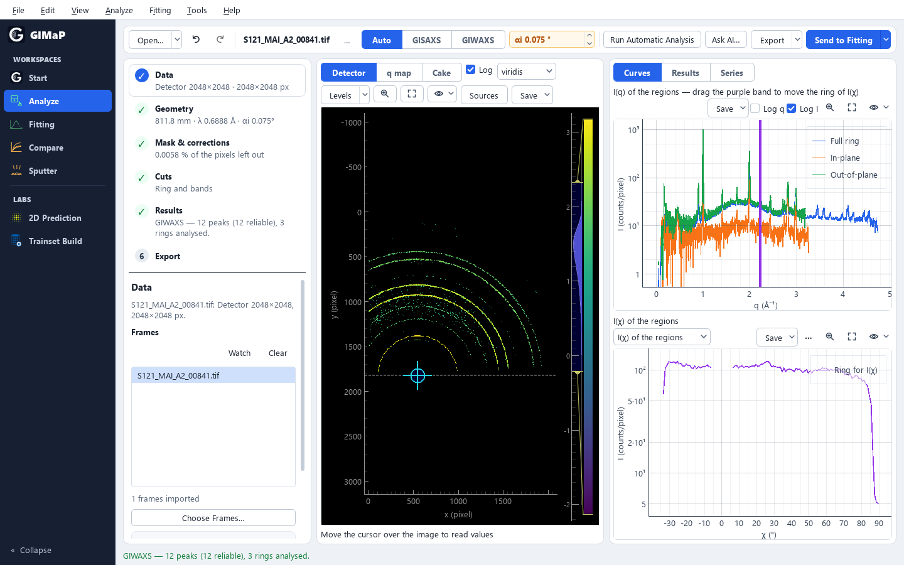

# GIMaP — Grazing-Incidence Mapping Package

GIMaP is a desktop program for grazing-incidence small- and wide-angle X-ray scattering (GISAXS and
GIWAXS). It turns detector frames into curves at the exact scattering vector, analyses them without AI
(peaks, orientation and crystallite size for GIWAXS; the Yoneda cut, the length scale 2π/q\* and particle
models for GISAXS), fits 1D curves and whole in-situ series, and compares runs and samples. Every curve
it exports carries a record of the frames, geometry and settings it came from. GIMaP is written for
scientists who measure GISAXS or GIWAXS at a beamline or with a laboratory source and need numbers they
can trace. It is written in Python with PyQt5, has an English and a Chinese interface, and runs on
Windows without installing Python.

The current version is 0.2.0, a pre-release: see [CHANGELOG.md](CHANGELOG.md) for what changed in each
version and for the known limitations. Treat it as beta scientific software and check the results that
matter to you.



*Analyze: the steps on the left, the detector frame in the middle, the curves of the cut regions on the
right.*

## What GIMaP does

- **Analyze** (GISAXS and GIWAXS): CBF, TIFF, EDF and NeXus/HDF5 frames, one by one or as a series, to
  curves at the exact q (Å⁻¹): GISAXS cuts, I(q), sectors, q boxes and I(χ). Geometry from a calibrant or a
  `.poni` file, kept as the instrument profile of the detector; masks, hot and dead pixels left out per
  frame, background subtraction and optional GIWAXS intensity corrections with propagated errors.
- **Run Automatic Analysis** (no AI): for GIWAXS a peak table with fitted positions, widths and
  uncertainties, ring orientation (Hermans f) and Scherrer sizes (lower bounds); for GISAXS the Yoneda cut,
  the length scale 2π/q\* (not necessarily the particle spacing) and screening fits of sphere and cylinder models. A value it cannot know, such as the
  incidence angle, becomes a question in the Results step.
- **Series and Batch Export**: heat maps and peak tables of in-situ series at the true q; Batch Export
  takes a folder of raw frames to curves, fit input, q maps, images or converted frames, several frames at
  once in low-priority processes, with Pause and Stop.
- **Fitting and In-situ series**: sphere, random-cylinder and vertical-cylinder models with size spread and
  distance, fitted to one curve or to every curve of a folder; every value with ± 1σ and warnings.
- **Compare and stages** (no AI): where an in-situ series changes course (stages), which frames do not
  belong (odd frames), and several series or samples side by side.
- **Sputter**: an in-situ sputter deposition of Ag or Au on a polymer (PILATUS CBF frames; Cu with the Ag
  model, for reference only), read as particle size, spacing, island height, growth stage and metal
  thickness for every time window, each with how far it can be trusted.
- **Tools**: Geometry Calibration (beam centre and distance from AgBh, LaB₆, CeO₂ …), Format Converter,
  XRR Series Extractor, SEM Particle Analysis (particle sizes from SEM images, with a scale you give) and 1D
  Predict for many curves.
- **AI assistant** (optional): **Tools ▸ Process with AI…** lets an AI (Claude, DeepSeek, Qwen, OpenAI or a
  local model) run the Analyze tools on the frame shown while you watch; each change comes back as a card
  you can preview, apply or undo. Nothing else in GIMaP needs AI or an account.
- **Command line and MCP**: `tools/gimap_agent.py` runs the automatic analysis without the window and
  serves the analysis tools to agents over MCP (see [Command Line and MCP](#command-line-and-mcp)).
- **Labs** (experimental): 2D Prediction runs trained TensorFlow modules on GISAXS frames (no trained model
  comes with GIMaP); Trainset Build simulates GISAXS training sets with BornAgain.
- **Records**: every curve shows its sources on the plot. Curve exports write `<stem>_analysis.json`
  (source frames, geometry, corrections, settings) beside them, and the CSV and `_fit_input.dat` files
  name their sources in `#` header lines.

What GIMaP does not model: q is the kinematic (vacuum) value, without refraction or the DWBA; the detector
is taken as flat and perpendicular to the beam (the tilt of a `.poni` file is folded into the beam centre
and distance); intensities are counts per pixel, not absolute. The
[Physics and Methods reference](docs/Physics_Manual.md) states every formula GIMaP uses and lists all of
these limits in its last chapter.

## Install

### Windows: the portable version

No Python is needed; the package brings its own.

1. Open https://github.com/zyffcc/gisaxs_gui/releases and choose the latest release.
2. The release offers the package in one of two forms: one file, `GIMaP-<version>-windows-x64-portable.zip`,
   or, when that would be larger than GitHub allows (1900 MiB), its parts `….zip.part01`, `.part02` … with
   the installer `00_Download_and_Install_GIMaP-<version>.bat`. Choose a folder with a short path that you
   may write to and that uses English letters only (for example `C:\GIMaP`).
3. - **One ZIP:** download it, extract the whole ZIP into that folder, and double-click `Start_GIMaP.bat` in
     `GIMaP-<version>-windows-x64-portable`.
   - **Parts:** download only `00_Download_and_Install_GIMaP-<version>.bat` into that folder (an empty one)
     and double-click it. It downloads the parts, verifies each one (SHA-256), joins and extracts them into
     the folder `GIMaP-<version>-windows-x64-portable` beside the installer, and starts GIMaP once.

Later, start GIMaP with `Start_GIMaP.bat` in that folder; the first start prepares the bundled Python
environment, which takes a few minutes. The launcher (and the installer, when there is one) are unsigned
batch files: Windows may ask before it runs them. Take them only from the GitHub Releases page of GIMaP.

To update, install the new version in the same way (its ZIP or its installer) into a new folder. Settings,
instrument profiles, recent files and the fitting model are kept in `%APPDATA%\GIMaP`, outside the program
folder, so an update keeps them. (Version 0.0.2 kept its settings in its own program folder: they are not
carried over.)

### Windows: a source folder with one double-click

For a clone of the repository (`git clone https://github.com/zyffcc/gisaxs_gui.git`) or a ZIP of it
(**Code ▸ Download ZIP**, extracted to a short path that you may write to): double-click
`Start_GIMaP.bat` in the folder. The first start sets up a private environment in `.gimap\` inside the
folder: it downloads uv (a small Python installer, pinned version, checked against its SHA-256),
Python 3.10, the packages of `requirements.txt` (about 2 GB) and PyTorch for the Sputter workspace
(`requirements-sputter.txt`, about 1.2 GB more) — 3-20 minutes depending on the connection. Then GIMaP
opens; later starts are immediate. Nothing outside the folder is changed; delete `.gimap\` to remove the
environment.
To update a clone, double-click `Update_GIMaP.bat` (see
[Updating a source checkout](#updating-a-source-checkout)).

### From source with pip

Python 3.10 or 3.11:

```powershell
cd gisaxs_gui

python -m venv .venv
.\.venv\Scripts\Activate.ps1

python -m pip install --upgrade pip
python -m pip install -r requirements.txt

python main.py
```

If PowerShell blocks activation in the current terminal session:

```powershell
Set-ExecutionPolicy -Scope Process -ExecutionPolicy Bypass
.\.venv\Scripts\Activate.ps1
```

Conda can also be used:

```powershell
conda create -n GUI python=3.11 -y
conda activate GUI
python -m pip install -r requirements.txt
python main.py
```

The Sputter workspace's model is part of the repository (`utils/sputter_toolkit`) and runs on PyTorch
(CPU), which its first **Predict** installs into the Python GIMaP runs in (about 1.2 GB; by hand:
`python -m pip install -r requirements-sputter.txt`).

**macOS and BornAgain.** BornAgain 24.1 has no macOS wheel on PyPI, so `requirements.txt` leaves it out on
macOS: install it from the Homebrew formula `mlz/homebrew/bornagain@24.1` as a wheel built for the same
Python version as GIMaP's environment, then install the rest with pip. The
[development guide](docs/development.md) gives the commands and how to check the wheel.

## Quick start

1. Start GIMaP: `Start_GIMaP.bat`, or `python main.py` from source. The **Start** page opens.
2. **Help ▸ Example Data ▸ GIWAXS — MAPbI₃ Film (DESY P08)…** copies a public GIWAXS frame and its
   calibration (`.poni`) to a folder you choose and opens it in **Analyze**. Your own frames: drop them or
   their folder on the window, or use **File ▸ Open Data…** (`Ctrl+O`).
3. Give the frame a geometry: **Find Calibration Automatically** in the banner finds the `.poni` beside the
   frame. For your own detector, calibrate from an image of a standard (**Tools ▸ Geometry Calibration…**,
   `Ctrl+Shift+G`) or enter the geometry; it is kept as the instrument profile of that detector.
4. Press **Run Automatic Analysis**. When it asks for a value it cannot know, such as the incidence angle
   (0.075° for this example), type it in the Results step and press **Run Again with These Answers**.
5. Read the peak table and the ring orientation in **Results**. Then **Send to Fitting**, **Export**, or
   **Batch Export…** for a whole folder; **File ▸ Save Project** (`Ctrl+S`) keeps the sample as you left it.

Chapter 1 of the [User Manual](docs/User_Manual.md) walks through this example and a GISAXS one (silver
nanoparticles, GALAXI), about ten minutes each.

## Documentation

- [User Manual](docs/User_Manual.md), in Chinese [User_Manual_zh.md](docs/User_Manual_zh.md): how to use
  GIMaP, from installation to every output file. **Help ▸ User Manual** (`F1`) opens the
  manual in your browser, in the interface language.
- [Physics and Methods](docs/Physics_Manual.md), in Chinese [Physics_Manual_zh.md](docs/Physics_Manual_zh.md):
  what GIMaP computes — geometry, q, calibration, corrections, cuts, uncertainties, models — with the
  assumptions, the limits and the references (**Help ▸ Physics and Methods**).
- [CHANGELOG.md](CHANGELOG.md): what changed in each version, and the known limitations.
- [GIWAXS playbook](docs/agents/giwaxs-playbook.md) and [GISAXS playbook](docs/agents/gisaxs-playbook.md)
  (in Chinese): the default decisions of the command line, for scripts and agents.
- [docs/development.md](docs/development.md), [docs/architecture/](docs/architecture/) and
  [docs/ui/workspaces/](docs/ui/workspaces/): for developers; [docs/releasing.md](docs/releasing.md): how a
  release is made.
- [THIRD_PARTY_NOTICES.md](THIRD_PARTY_NOTICES.md): what is not GIMaP's own work, and its licences
  (**Help ▸ Third-party Notices**). The sources of the example data are in
  [tests/data/external/README.md](tests/data/external/README.md).

## Analyze → Fitting Workflow

1. In **Analyze**, **Send to Fitting** opens the horizontal cut (GISAXS) or I(q) (GIWAXS) in **Fitting**;
   its menu chooses the halves of a cut (both on |qy|, their mean, or one side). **Send Series to
   Fitting…** exports every frame into a folder `<name>_fitting/` and opens **Fitting ▸ In-situ series**,
   which fits every frame on the mean of both halves or on one half (**Halves of the cut**).
2. Fitting has four steps: **Curve → Model → Fit → Results**. In **Fit**, choose a method — **Find the
   particle shape (no AI)** (sphere, random and vertical cylinder from several starts), **Refine the values
   in Model**, **Search the ranges, then refine** or **AI proposal (1D Predict)** — and press **Fit**
   (`Ctrl+Return`); **Stop** keeps the best values so far of *Refine* and *Search* (a stopped shape search,
   AI proposal or Predict gives no new result). **Predict parameters (fit1d)** needs the optional
   fit1d kit, which is not part of this repository (manual, section 2.3).
3. **Results** gives χ²ᵣ, every value ± 1σ and warnings (a value at a bound, strongly correlated values).
   The **Fitting** menu saves the data and fit (CSV with a JSON record), the plot and the model.

Fitting shows q in nm⁻¹ (Analyze uses Å⁻¹; the Curve step shows both). Fitting opens `.dat` and `.txt`
curves; the `.csv` curves that Analyze exports are not read by Fitting — use **Send to Fitting**, or the
`<name>_fit_input.dat` file written next to them.

## 1D Predict (experimental neural fitting)

1D Predict proposes particle models for a 1D GISAXS curve with the bundled Workflow V5 networks
(`modules/Fitting_1D_Model/Workflow_v5`) and corrects each proposal numerically against the measured
points. It is experimental and was validated on simulated curves only: take its solutions as starts to
refine and check in Fitting. The trained weights of 1D Predict are in the Git repository (about 56 MB) and
in the portable version, so a checkout runs it.

- **One curve**: Fitting ▸ Fit ▸ **AI proposal (1D Predict)**, then **Fit**; **Use This Solution** puts one
  of the listed solutions into Model.
- **Many curves**: **Tools ▸ 1D Predict — Fit Many Curves…** (also in the **Fitting** menu): **Add
  curves…** or **Use current cut**, choose the method in **Parameters…** — *General V5 (experimental)*,
  *Single RC specialist (experimental)* or *Physical fit (numerical)*, which uses no network — then **Fit
  curve**.
- **Output**: every run writes a new folder `AI_Fitting_Output/v5_<date>_<time>_<µs>/` in the folder GIMaP was
  started from (for the portable version: the program folder): `request.json`, `batch_summary.json`,
  `top20_candidates.json`, `fitting_run_summary.json` and, for every curve and half, `solutions.json`,
  `display.npz` and `fitting_curves.csv` (*General V5* also writes `candidates.npz`). The folders are not
  removed automatically.
- **Model files**: each network checks its files against their checksums before it is used. With a changed
  or missing file *General V5* does not start, and the message names the file; *Single RC specialist* goes
  on with its numerical fit and gives *Fast model unavailable* as the reason. In a source checkout, see
  [Updating a source checkout](#updating-a-source-checkout) when this happens. The numerical methods of
  Fitting use no network: the check does not concern them.

## Command Line and MCP

`tools/gimap_agent.py` runs GIMaP's analysis without the window, for scripts and for agents (Codex,
Claude Code):

```bash
python tools/gimap_agent.py auto <frame> [<frame> ...] --notes "<your notes>" --out <folder>
```

- `auto` detects GIWAXS or GISAXS for each frame once its geometry is applied (`--technique giwaxs|gisaxs`
  forces one) and writes, for every frame, a `report.md` with each decision and its reason, the curves as
  CSV and the q map, plus a `summary.md` for the batch. Nothing is written next to the data: results go
  to `--out` (without it, to `assistant_runs/cli/` in the user data folder).
- A series is analysed in its final state: the last fifth of its frames summed, at most 10 (below ten
  frames the last frame alone); `--frame` and `--sum` choose other frames.
- Exit codes: `0` everything analysed and nothing open; `2` at least one frame has a question under *Needs
  attention* (a missing value, a judgement such as the GISAXS model, or no geometry); `1` at least one frame
  failed (`1` wins over `2`).
- `status`, `find-calibration`, `tools` and `call` give finer control; `mcp` serves the same tools as an
  MCP server on stdio.

Read the playbooks ([GIWAXS](docs/agents/giwaxs-playbook.md), [GISAXS](docs/agents/gisaxs-playbook.md))
before relying on the numbers: they say which default decisions may not fit your question.
`python tools/gimap_agent.py auto --help` lists every option.

## How to cite

If you publish results obtained with GIMaP, please cite it and name the version you used. The metadata
are in [CITATION.cff](CITATION.cff) (GitHub's **Cite this repository**); **Help ▸ How to Cite GIMaP…** in
the program shows the reference for the version you run, with **Copy** and **Copy BibTeX**. GIMaP has no
DOI yet, so cite the repository and the version:

> Zhai, Y. GIMaP: Grazing-Incidence Mapping Package (version 0.2.0) [Computer software].
> https://github.com/zyffcc/gisaxs_gui

Where you rely on a method or a data set that GIMaP builds on, cite it as well: the
[Physics and Methods reference](docs/Physics_Manual.md) names the published methods it uses, and
[THIRD_PARTY_NOTICES.md](THIRD_PARTY_NOTICES.md) the sources of the example data.

## System Requirements

- **Windows** (64-bit) is the platform GIMaP is developed and tested on; the portable version needs no
  Python.
- **macOS**: from source, with BornAgain installed separately; the set-up was checked on macOS 14 in
  October 2026. **Linux**: from source; not tested.
- **Python** 3.10 or 3.11 to run from source.
- **Screen**: 1280 × 720 or larger (the smallest window is 1024 × 640). GIMaP follows the display scaling of
  the operating system; **View ▸ Font Size** changes the text size.
- **Disk**: about 2 GB for the Python environment, and about 1.2 GB more for PyTorch (Sputter workspace): the
  portable version installs it on the first Sputter **Predict**, and `Start_GIMaP.bat` in a source folder
  installs it at the first start.
- **CPU**: everything runs on the CPU. GPU TensorFlow setups are not configured by this repository and must
  be installed separately if required.

## Dependencies

Dependencies are listed in `requirements.txt`:

- numpy>=1.24,<2.0
- scipy>=1.10
- threadpoolctl>=3.1 (limits BLAS threads in fit1d workers)
- matplotlib>=3.7
- pyqtgraph>=0.13.7,<0.15
- BornAgain==24.1 on Windows and Linux; installed separately on macOS
- PyQt5>=5.15
- opencv-python>=4.8
- h5py>=3.9
- hdf5plugin>=4 (reads NeXus/HDF5 frames compressed with bitshuffle or LZ4, as Eiger detectors write them)
- fabio>=2023.4.0
- tensorflow-intel>=2.15,<=2.16; platform_system=="Windows"
- tensorflow>=2.15,<=2.16; platform_system!="Windows"
- PyYAML>=6.0
- anthropic>=1.8 and openai>=1.40 (optional: Process with AI; GIMaP runs without them)
- psutil>=5.9 (optional: Batch Export reads the physical cores and the free memory with it to choose how
  many frames to reduce at once; without it GIMaP asks the operating system)

Optional parts, each needed only for the function named:

- The Sputter workspace's model needs PyTorch (CPU): `requirements-sputter.txt`, installed on its first
  **Predict** (or by `Start_GIMaP.bat` in a source folder).
- StarDist, to separate touching particles in SEM Particle Analysis, runs in a separate Python environment
  made from `requirements-sem-stardist.txt`, with a model folder of your own.
- The fit1d kit (`utils/gisaxs1d_gui_kit/`, or the folder named in `GISAXS1D_KIT_HOME`) is needed for
  **Predict parameters (fit1d)**.

## Development

Install the development dependencies and run the unified verification command:

```bash
python -m pip install -r requirements-dev.txt
python tools/check.py
```

This runs the test suite (about 14 minutes), an offscreen start-and-close check of the real main window
with its seven pages, and the deliberately narrow Ruff baseline, without formatting unrelated code. The
tests use only data that are in the repository: the public data in `tests/data/external/` and the example
frames and curves in `TestSAXSdata/` (sources and licences, or the lack of them, are in
[THIRD_PARTY_NOTICES.md](THIRD_PARTY_NOTICES.md)). Configuration is in
`pyproject.toml`; details are in [docs/development.md](docs/development.md), and the rules for
contributors and coding agents (in Chinese) are in [AGENTS.md](AGENTS.md).

## Updating a source checkout

Double-click `Update_GIMaP.bat` in the folder (it needs Git), or run in the folder of the checkout:

```powershell
powershell -ExecutionPolicy Bypass -File tools\update_source.ps1
```

`tools/update_source.ps1` updates the branch that is checked out from GitHub (`origin`) and says what it
found and what it did:

- Nothing new: nothing is changed. New commits only: the branch moves forward to them.
- After the history was rewritten (see below): the state you have is first kept as a branch
  `backup/<date>-<time>-<commit>`, then the branch is moved to the new history.
- Your edits of tracked files are put aside (`git stash`) and put back on top of the new version; a copy
  stays in the stash. When they do not fit the new version, the new version is left complete and the
  script says how to get them back.
- Files Git does not track or ignores — your data, results, `AI_Fitting_Output/` — are not touched, and
  the settings and instrument profiles are outside the checkout anyway (`%APPDATA%\GIMaP`). When the new
  version brings a file to a place where you have a different file of your own, the script stops before it
  changes anything.
- Model files of 1D Predict that an older checkout holds with converted line endings are written again as
  the repository has them, also when there is nothing new to download. 1D Predict checks these files byte
  for byte, and Git does not notice the difference on its own.
- When Git cannot replace a file because another program has it open (GIMaP itself, an editor), the
  version you had is put back whole, with your edits where they were: close the program and run the script
  again.
- When a list of Python packages changed (`requirements.txt`, or `requirements-sputter.txt`: PyTorch, for
  Sputter), it says so. If you start GIMaP with `Start_GIMaP.bat`, there is nothing to do: its next start
  adds the new packages itself. In an environment you set up yourself (conda, venv), run the command the
  script prints for each changed list, such as `python -m pip install -r requirements.txt`.

Add `-DryRun` to see what an update would do without changing anything. At the end the script prints how
to go back to what you had, and how to delete the backup once things look right. The script needs Git 2.16
or newer and says so when it finds an older one.

A folder without `.git` is not a checkout, and the script changes nothing in it. A portable version is
updated by installing the new version (its ZIP or its installer) into a new folder. A folder from **Code ▸
Download ZIP** is downloaded again,
or replaced by a clone (`git clone https://github.com/zyffcc/gisaxs_gui.git`), which the script updates
from then on.

### A checkout last updated before 2026-10-13

The history of `main` was rewritten on 2026-10-13 (and once more on 2026-10-21, after the removed commits
had been merged back from an old clone; `tests/test_release_history.py` now fails on a branch that holds
them). A clone last updated before that day can hold commits that are no longer on GitHub: `git pull` then
stops with an error, or tries to merge the old history with the new one. Do not merge, and do not push from
such a clone; move it to the new `main` as described here (or clone again).

Such a checkout does not have the script yet. It is first moved to the new `main` with two plain commands,
with `main` checked out:

```powershell
git fetch origin
git reset --hard origin/main
```

Then run the script once, with the command at the top of this section. On Windows the two commands leave
some model files of 1D Predict with the line endings the older checkout had given them, and 1D Predict
(*General V5*) does not start until the script has written them again. From then on, update with the
script. (On Linux or macOS, where Windows PowerShell is missing, nothing was converted, and `git pull`
works again after the two commands.)

`git reset --hard` discards your edits of tracked files, and commits you made yourself are no longer on the
branch. To keep them, run `git stash` (edits) or `git branch my-work` (commits) first; afterwards
`git stash pop` puts the edits back, and `git cherry-pick <commit>` brings a commit over. Do not merge or
push `my-work` itself: it carries the old history. Files Git does not track stay, with one exception: where
the new version has a file at the same place — for example weight files of 1D Predict that you had copied
into `modules/Fitting_1D_Model/Workflow_v5/` by hand — the file of the new version replaces yours without
asking.

To keep all of that instead, let the script do the first update: `git fetch origin`, then
`git checkout origin/main -- tools/update_source.ps1`, then the script. It keeps the state you have as a
backup branch, puts your edits back, stops before it would replace a file of yours, and writes the model
files again in the same run.

### A checkout of 0.0.2 that was used for fitting

Such a checkout has one edit you did not make yourself: `config/model_parameters.json`, where 0.0.2 kept
the model of Fitting. Its values are not carried over: 0.1.0 and later keep the model in the user data
folder and start with a neutral one. The script reports the file as an edit that does not fit the new
version and ends with exit code 2: the new version is complete, and what you had changed waits in the
stash. When this file was your only edit, delete that copy with `git stash drop`. Do not run
`git stash pop` for it, although the script names that command for edits you want back: it would write
conflict markers into the file, which is the model a new user of Fitting starts with. (With other edits in
the same stash: `git stash pop`, then `git checkout HEAD -- config/model_parameters.json` to put the file of
the new version back, then `git stash drop`.)

## License

GIMaP's own code and documentation are released under the MIT License: see [LICENSE](LICENSE). What is not
GIMaP's own work keeps its own licence; [THIRD_PARTY_NOTICES.md](THIRD_PARTY_NOTICES.md) (also **Help ▸
Third-party Notices**) lists it all:

- The Windows portable package bundles components under the GPL-3.0 (PyQt5, BornAgain) and the LGPL (Qt,
  among others), so the package is distributed under the terms of the GPL-3.0 for those parts. Its
  `licenses\` folder holds the licence files of every bundled component (see `licenses\README.txt`).
- The example data in `tests/data/external/` keep their own licences (GPL-3.0, CC BY 4.0 and others).
- Section 5 of the notices covers the research code and trained networks bundled for 1D Predict and the
  Sputter workspace.

## Feedback and Contact

- Bugs and questions: [GitHub Issues](https://github.com/zyffcc/gisaxs_gui/issues). **Help ▸ Report a
  Problem…** copies the versions of GIMaP and of your system (no paths, no data) and opens a new issue in
  your browser. Unexpected errors are written to `errors.log` (**Help ▸ Open Error Log Folder**).
- Feedback, bug reports or collaboration questions by e-mail:
  [yufeng.zhai@desy.de](mailto:yufeng.zhai@desy.de).
