# GIMaP User Manual

GIMaP is a desktop program for grazing-incidence X-ray scattering: GISAXS and GIWAXS. It turns
detector frames into calibrated curves (I(q), I(qy), I(χ)), finds peaks, orientation and sizes,
fits particle models to 1D curves, follows in-situ series and compares runs. Every curve keeps a
record of where it came from and with which settings.

This manual describes version 0.1.0, a pre-release: treat it as beta scientific software and check
results that matter. The workspaces (Analyze, Fitting, Compare) are meant for daily work; the Labs
pages and 1D Predict are experimental. **Help ▸ About GIMaP** shows the version you are running.
What changed since 0.0.2, and the known limitations of this version, are in `CHANGELOG.md` in the
program folder (chapter 12 collects the limitations).

New to GIMaP? Start with chapter 1: two walk-throughs of about ten minutes each, on public data.

## Contents

1. Quick start
2. Installation and updating
3. The window
4. Geometry and calibration
5. Analyze
6. Fitting
7. Compare and stages
8. Tool windows
9. AI assistant
10. Labs
11. Output files
12. Known limitations
13. Troubleshooting, FAQ, version and contact

## 1. Quick start

Two walk-throughs, each about ten minutes: one GIWAXS frame and one GISAXS frame, both public data.
Each goes the same way: open the frame, give it a geometry, run the automatic analysis, read the
results, send the curve to Fitting. No AI is used.

### 1.1 Before you start

The two data sets are in the GIMaP repository, folder `tests/data/external/`:

| Folder | Files | What it is |
|---|---|---|
| `giwaxs_p08_mapi/` | `S121_MAI_A2_00841.tif`, `LaB6_2021_12_DESY_P08.poni` | GIWAXS of a MAPbI₃ perovskite film, DESY P08, PerkinElmer 2048 × 2048 detector, αi = 0.075° |
| `gisaxs_galaxi/` | `galaxi_data.tif`, `galaxi_bornagain.poni` | GISAXS of Ag nanoparticles, GALAXI (Jülich), Pilatus 1M, λ = 1.34 Å, αi = 0.463° |

`tests/data/external/README.md` gives their sources, licences and documented geometry.

1. Get the files. In a source checkout they are already there. The portable version does not
   include them: download the two folders from the GitHub repository (folder `tests/data/external`).
2. Copy the GIWAXS folder to a place of your own, for example `C:\GIMaP-demo\giwaxs`. GIMaP writes
   its results next to the data, in a folder `gimap_analysis/`; working on a copy keeps the program
   folder clean.
3. Copy the GISAXS folder only when you come to section 1.3, and not next to the GIWAXS copy: delete
   that copy first, or use another drive. **Find Calibration Automatically** also searches the folders
   beside and above the frame, and with the GIWAXS copy close by it takes
   `LaB6_2021_12_DESY_P08.poni` for the GISAXS frame.
4. Start GIMaP (chapter 2). The **Start** page opens.

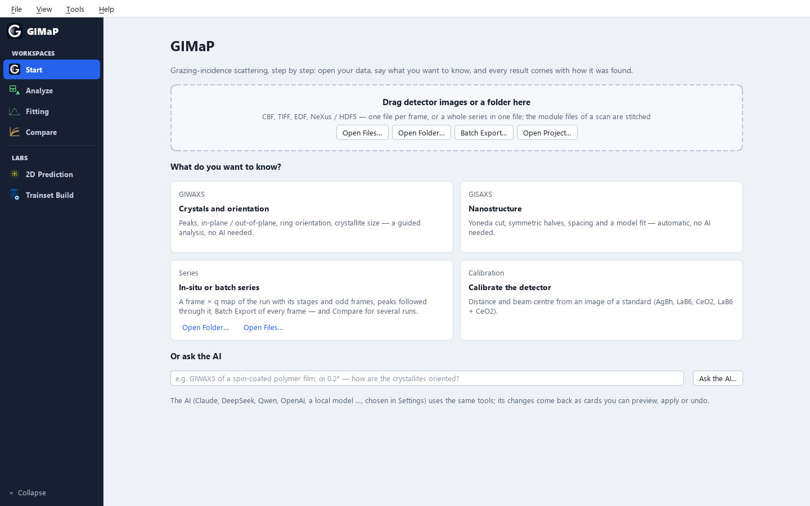
*The Start page: drop data or open it, choose what you want to know (the series card has its own
Open Folder… and Open Files… links), or ask the AI. Files opened before are listed under Recent.*

### 1.2 GIWAXS: a perovskite film

**1. Open the frame.** On the Start page press **Open Files…** and choose `S121_MAI_A2_00841.tif`
(or drag the file onto the window). **Analyze** opens. Check:

- the command bar names the file and its size, `2048×2048 px`;
- the step **Data** is ✓ and **Mask & corrections** says how many pixels are left out
  (`0.0058 % of the pixels left out`: isolated hot and dead pixels);
- **Geometry** shows **!** *No geometry yet*, and **Cuts** says *Needs a geometry*;
- a yellow banner says *No instrument profile for this detector (2048×2048)* and offers
  **Find Calibration Automatically**, **Enter Geometry…** and **Calibrate…**.

The detector image is shown in pixels. Without a geometry there are no q curves yet.

**2. Give it a geometry.** Press **Find Calibration Automatically** in the banner. GIMaP searches
the folders around the frame and finds `LaB6_2021_12_DESY_P08.poni`. Check:

- **Geometry** is ✓ with `811.8 mm · λ 0.6888 Å · αi 0°`;
- **Cuts** is ✓ (*Ring and bands*), and the curves appear;
- the **Results** step says where the geometry came from: *a saved calibration file (not re-checked
  against a standard image); found by the search: LaB6_2021_12_DESY_P08.poni*, and *1 question(s)*.

The geometry is now saved as the instrument profile *Detector 2048×2048*. Analyze uses it for every
frame of this size from now on (section 4.1). With your own data, make sure the file found is the
calibration of your measurement.

**3. Run the automatic analysis.** Press **Run Automatic Analysis** in the command bar. It takes a
few seconds; the **Results** tab shows each step as it is done. When it ends, the Results step
asks one question: the incidence angle. Type `0.075` in **Incidence angle αi (°)** and press
**Run Again with These Answers**.

**4. Read the results.** The Results tab begins with a line such as
*GIWAXS — 12 peaks (12 reliable), 3 rings analysed*. Below it:

- **Peaks**: q and FWHM in Å⁻¹, d in Å, L (Scherrer size, a lower bound) in nm, and whether the peak
  is out-of-plane (OOP) or in-plane (IP). Here you find peaks near q = 0.90, 1.00, 1.41, 1.99 and
  2.22 Å⁻¹. The data's README names 0.899 Å⁻¹ as PbI₂ (001) and 0.999 Å⁻¹ as MAPbI₃ (110).
  GIMaP does not assign phases: compare q with the lines of your material.
- The three rings with the largest peak area (and no warning), with their orientation (Herman's f)
  and where their maximum lies.
- **Checks**: shadowed and unmeasured χ ranges (the missing wedge next to qz) that bias f.
- **Geometry**: the profile, distance, beam centre, wavelength and αi used.

Select a peak and open **Fit details** to see the points it was fitted to, the Gaussian and its
background, and the errors. **Save Report…** keeps everything as a web page or Markdown. Switch the
image to **q map** or **Cake** to see the rings in q; **Sources** shows which pixels each curve uses.

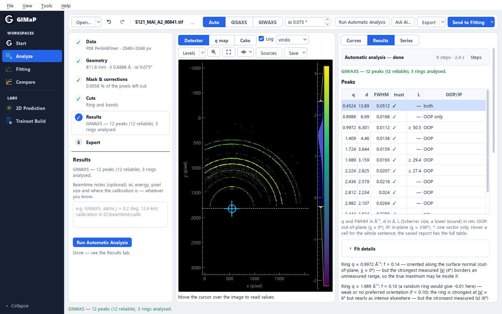
*The Results tab of a GIWAXS frame: the summary line, the peak table, Fit details and the ring
orientation; the checks follow further down.*

**5. Send to Fitting.** Press **Send to Fitting**. GIMaP writes
`gimap_analysis/S121_MAI_A2_00841_fit_input.dat` next to the frame (columns q, I, σ, pixels; q in
Å⁻¹; the `#` header lines say where the points come from) and opens **Fitting ▸ Single analysis**
with it. The step **Curve** says `S121_MAI_A2_00841_fit_input.dat · 2050 points fitted`.

For GIWAXS, I(q) is what is sent. Fitting's models are particle models (chapter 6), and a note at the
top of the Fitting page says so: they are particle form factors, not peaks, so for crystalline peaks the
peak table above is usually the result you want (peak fits of many frames: **Batch Export ▸ Peaks of
the ring regions**, section 5.7). The `_fit_input.dat` file is also the curve with its record, ready for
other programs.

### 1.3 GISAXS: silver nanoparticles

The source of these data describes the sample as Ag spheres with a radial paracrystal of peak
distance 53.6 nm (BornAgain's example *experiment_at_galaxi*).

**1. Open the frame.** **File ▸ Open Data…** (`Ctrl+O`), choose `galaxi_data.tif`. (If the GIWAXS
frame is still in the file list, click the new file there to show it, or press **Clear** in the step
Data first.) Analyze shows `1043×981 px` (rows × columns). **Mask & corrections** leaves out `1.4 %` of the pixels: the gaps
between the Pilatus modules. The banner asks for a geometry, as before.

**2. Give it a geometry.** Press **Find Calibration Automatically**. It finds `galaxi_bornagain.poni`:
**Geometry** shows `1730.0 mm · λ 1.34 Å · αi 0°`, and **Cuts** shows *Yoneda cut*. The mode stays
**Auto**: frames whose largest scattering angle is at most 20° are treated as GISAXS.

If **Geometry** shows `811.8 mm` instead and the Results step names `LaB6_2021_12_DESY_P08.poni`,
the search has taken the GIWAXS calibration from a folder nearby (section 1.1) and saved it as the
profile of this detector. Press **Geometry…** in the step Geometry, then **Delete profile**; move
the GIWAXS copy away and press **Find Calibration Automatically** again.

**3. Run the automatic analysis.** Press **Run Automatic Analysis**. This takes about half a minute
(the model fits are the slow part). The Results step then asks for αi. Type `0.463` in
**Incidence angle αi (°)** and press **Run Again with These Answers**.

The answer matters: with αi = 0° the Yoneda band was quoted at αf = 0.639°, with the right αi at
αf = 0.176°. The αi field in the command bar now shows `0.463 °` in orange: a value you set, which holds for every frame until you go back to the profile's αi (section 4.1).

**4. Read the results.**

| Part | What you see here | What to check |
|---|---|---|
| **Horizontal cut** | At the Yoneda band, rows 605–609 | The orange band on the image lies on the Yoneda band |
| Beam centre | x moved to the symmetry axis, x = 597.26 px | The documented direct beam is x = 597.1 px |
| Halves | *Mean of both halves*, with the reason | Both halves agree; otherwise the usable one is taken |
| **In-plane spacing** | A shoulder at \|qy\| ≈ 0.0113 Å⁻¹ (2π/q ≈ 55.6 nm): *a hint, not a resolved peak* | Close to the documented 53.6 nm |
| **Fit of I(qy)** | A table of solutions: model, R, h, D (nm), χ² | Several models may fit about equally well |

Here the Results tab also shows *1 point(s) to check*: **Model choice**. A random cylinder (χ² 1.26)
and a sphere (χ² 1.36) fit within 10 % of each other, so the curve alone does not decide the model.
GIMaP names the solutions whose D agrees with the measured spacing and leaves the choice to you. For
this sample you know the particles are spheres.

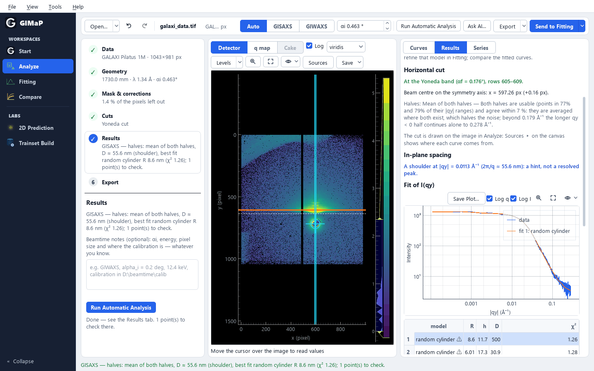
*The Results tab of a GISAXS frame: the cut, the spacing, the fitted curve and the table of solutions.*

**5. Send to Fitting.** Press **Send to Fitting**. GIMaP writes
`gimap_analysis/galaxi_data_fit_input.dat` (the halves as chosen in the Cuts step, here the mean;
q in Å⁻¹) and opens it in **Fitting ▸ Single analysis**: **Curve** ✓ `599 points fitted`, **Model**
`Sphere · 9 free`, **Fit** *Choose a method, then Fit*. Fitting shows q in nm⁻¹.

The Fit step has chosen **Predict parameters (fit1d)** for this curve (*Recommended for this curve: a
GISAXS cut not fitted yet*). It needs the fit1d kit (section 2.3). Without the kit, choose **Find the
particle shape (no AI)** in **Method** and press **Find the particle shape**. After about 15 s the
status line says *5 solutions; the best, Sphere (χ²ᵣ 1.39), is in Model*. Results lists the other
solutions under **Other solutions**; press **Refine These Values** to refine the sphere and get its
errors. The same curve opens with **Refine in Fitting** in Analyze's Results tab.

Sizes depend on the model and on its size distribution. BornAgain's model uses a log-normal
distribution of radii, GIMaP's models another one: compare radii with care.

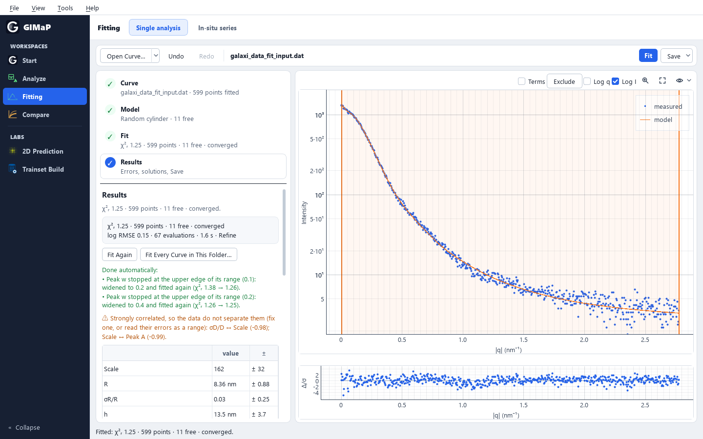
*Fitting ▸ Single analysis after a refining fit: the curve, the model over it, the fitting range
(orange) and the residuals.*

### 1.4 Where to go next

| You want to … | See |
|---|---|
| Set up the geometry of your own detector | Chapter 4 |
| Draw masks, choose cut regions, follow a series, export many frames | Chapter 5 |
| Fit a model properly, or a whole in-situ series | Chapter 6 |
| Compare runs or samples | Chapter 7 |
| Let an AI do the analysis while you watch | Chapter 9 |
| Know what each exported file contains | Chapter 11 |

## 2. Installation and updating

### 2.1 Windows: the portable version

No Python is needed; the package brings its own.

1. Open the [GitHub Releases](https://github.com/zyffcc/gisaxs_gui/releases) page and choose the
   latest release.
2. Download `00_Download_and_Install_GIMaP-<version>.bat` into an empty folder with a short path that
   you may write to (for example `C:\GIMaP`).
3. Double-click it. It downloads the package parts, verifies each one (SHA-256), joins and extracts
   them into the folder `GIMaP-<version>-windows-x64-portable` beside the installer, and starts
   GIMaP once.

**Starting GIMaP later.** Double-click `Start_GIMaP.bat` in the folder
`GIMaP-<version>-windows-x64-portable`; a desktop shortcut to that file is convenient. The first
start prepares the bundled Python environment for the folder, which takes a moment.

The installer and the launcher are batch files and are not signed. Windows may ask for confirmation
before it runs one, and an institution's antivirus may block it. Only run files from the GitHub
Releases page of GIMaP; otherwise run GIMaP from source (section 2.2).

### 2.2 Running from source

Install Python 3.10 or 3.11, then in the folder of the checkout:

```powershell
python -m venv .venv
.\.venv\Scripts\Activate.ps1
python -m pip install --upgrade pip
python -m pip install -r requirements.txt
python main.py
```

If PowerShell refuses to activate the environment, run
`Set-ExecutionPolicy -Scope Process -ExecutionPolicy Bypass` first. With Conda:

```powershell
conda create -n GUI python=3.11 -y
conda activate GUI
python -m pip install -r requirements.txt
python main.py
```

The trained weights of 1D Predict are in the Git repository (about 56 MB), so a checkout runs
everything, including 1D Predict (chapter 6). On macOS, BornAgain is installed separately: `README.md`
says how.

### 2.3 Optional parts

GIMaP runs without these. Each is needed only for the function named.

| Part | Needed for | How |
|---|---|---|
| An AI account or a local model | **Ask AI…**, **Tools ▸ Process with AI…** | The Python packages come with `requirements.txt`; set up the AI in **Tools ▸ Settings… ▸ Assistant** (chapter 9) |
| The fit1d kit (`gisaxs1d_gui_kit`) | **Predict parameters (fit1d)** in Fitting (also for every frame of an In-situ series) and the method *fit1d* in 1D Predict | Put it in `utils/gisaxs1d_gui_kit`, or name its folder in the environment variable `GISAXS1D_KIT_HOME` (chapter 6) |
| StarDist | Separating touching particles in **Tools ▸ SEM Particle Analysis…** | A separate Python environment with `requirements-sem-stardist.txt`, and a local model folder (chapter 8) |

TensorFlow runs on the CPU; a GPU set-up is not configured.

### 2.4 Updating

**Portable version.** Run the installer of the new version in the same way. It extracts into its own
folder; start the new `Start_GIMaP.bat` and delete the old folder when you no longer need it.

**Source checkout.** In the folder of the checkout, run:

```powershell
powershell -ExecutionPolicy Bypass -File tools\update_source.ps1
```

The script updates the branch from GitHub and says what it found and what it did. It puts your
uncommitted edits aside and back on top of the new version, leaves your data and results alone, and
stops before it would overwrite a file of yours. An edit that does not fit the new version stays put
aside, and the script says so. Commits of your own that are not on GitHub are kept on a backup branch
when the branch has to be moved to a rewritten history; `README.md` explains how to get them back. Add `-DryRun` to see what it would do without changing
anything. When it says the list of Python packages changed, run
`python -m pip install -r requirements.txt` again.

A checkout last updated before 2026-10-13 does not have the script yet. The history of `main` was
rewritten on that day: do not run `git pull`, merge or push from such a checkout. Move it first with
the steps in `README.md`, section *Updating a source checkout*; from then on use the script.

**What an update keeps.** Settings, instrument profiles, recent files and the fitting model are kept
in the user data folder, outside the program (section 3.11), so an update keeps them. Version 0.0.2
kept its settings inside its own program folder. A new portable folder does not carry them over and
starts with the defaults. A source checkout updated in place imports them once, at the first start,
while the user data folder holds no settings yet.

### 2.5 System and screen

Windows is the platform GIMaP is developed and tested on. A 1280 × 720 screen is enough (the
smallest window is 1024 × 640); a 1080p or larger screen is more comfortable for the detector image
beside the curves. GIMaP follows the display scaling of the operating system (for example 125 % or
150 %).

## 3. The window

### 3.1 The parts of the window

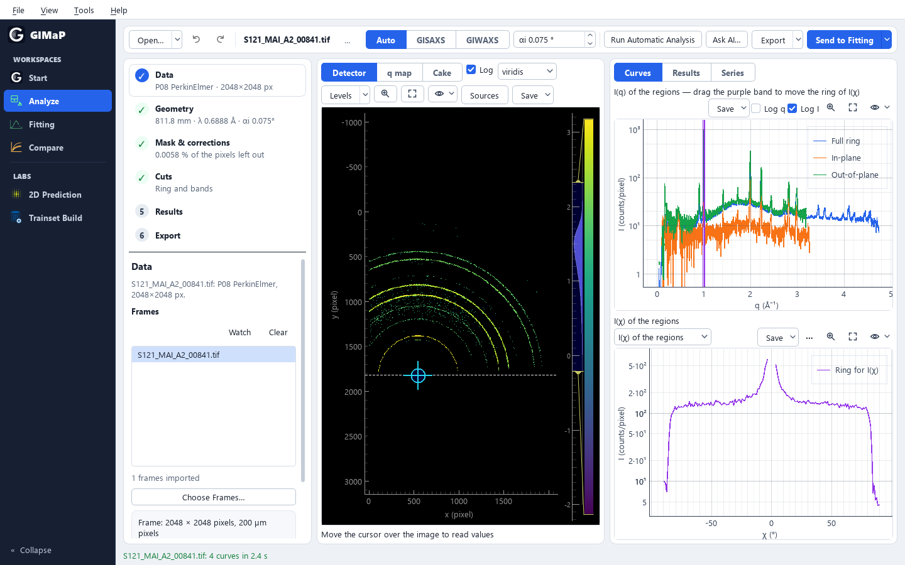
*Analyze: the sidebar, the command bar, the steps on the left with the frame list of the Data step (Choose
Frames… below it), the image in the middle, the curves on the right.*

- **The sidebar** (left) holds the pages. *Workspaces*: **Start**, **Analyze**, **Fitting**,
  **Compare**. *Labs*: **2D Prediction**, **Trainset Build**, the experimental machine-learning
  tools. **« Collapse** at its foot (or `Ctrl+B`) reduces it to icons. `Ctrl+1` … `Ctrl+6` switch pages.
- **The menu bar**: **File, View, Tools, Help** (section 3.6). The tool windows open from **Tools**.
- **The page.** Analyze and Fitting share one layout: a command bar at the top, the steps of the work
  on the left, the plots on the right.
- **Messages** appear as short notes at the bottom right. A note about a written file has an
  **Open Folder** button. Each page also has a status line at its foot.

The window title names the frame shown, and the project when one is open.

**Dropping files.** Detector frames, folders and `.gimap` projects can be dropped anywhere on the
window. A curve file (`.dat`, `.txt`) dropped while Fitting is shown opens there.

**Closing.** Closing GIMaP while something still runs — Batch Export, a Series map, the automatic
analysis, an AI analysis, a fit, an In-situ series, a 2D prediction, an SEM Particle Analysis — asks
first and lists what runs. **Yes** stops them and quits; **Cancel** keeps working. An SEM analysis
that is still finishing may ask you to close the window again once it has stopped.

### 3.2 The Start page

- **Drop box**: drag detector images or a folder onto it, or press **Open Files…**, **Open Folder…**,
  **Batch Export…** (a folder of raw frames straight to curves, with the settings of last time) or
  **Open Project…**. Analyze opens at once and shows the file, its detector and frames while the
  image loads.
- **Recent**: the five files, folders and projects opened last, with their folder (the full list is
  in **File ▸ Open Recent**).
- **What do you want to know?**: *Crystals and orientation* (GIWAXS), *Nanostructure* (GISAXS),
  *In-situ or batch series*, *Calibrate the detector*. Each opens the right place, with the mode
  chosen. The series card has two links of its own: **Open Folder…** (a folder of frames: one file per
  frame, or the module files of one scan) and **Open Files…** (chosen frames, or one NeXus/HDF5 file that
  holds the whole series); both end on Analyze's Series tab.
- **Or ask the AI**: describe your data and question, then **Ask the AI…** (chapter 9).

### 3.3 Steps and command bars

In Analyze and Fitting each step on the left says where it stands, with one line of what it found:

| Mark | Meaning |
|---|---|
| ✓ | Done, nothing to check |
| ! | Done, but look at it (a question, a warning) |
| × | Failed: the line says why |
| … | Running |
| a number | Not done yet |

Click a step to see its controls. The controls used most are shown; rare options are folded under a
heading you can open.

When Analyze's command bar is narrow, the long button texts are shortened (*Run Analysis*, *Batch…*,
*Fitting*); the full text stays in the tooltip.

### 3.4 Plots and images

**Curve plots.**

- The right mouse button opens a menu: **Reset View**, the log axes, **Copy Image**, **Copy Data**,
  and on plots with a **Save** button also **Plot as Figure…** and **Curves as Data…**.
- Dragging with the right button zooms; the mouse wheel zooms too.
- **Zoom** (the magnifier): drag a rectangle. Shift + drag works on every plot and image without the
  button. **Reset** shows everything again.
- **Log I** and **Log q** switch the axes. The eye button shows or hides each kind of mark.
- When a plot is narrow, its title wraps above it and its options move into a **⋯** menu.

**Detector images** (also the q map, the cake and the Series map) have **Zoom**, **Fit view**,
**Marks**, a colour map, **Log** and **Levels**. Next to each image is a histogram with two handles
for the colour limits. Section 5.4 describes the colour limits and marks in detail.

Saved figures always use the light colours, also when the screen shows the dark theme.

### 3.5 Tables

The result tables — the peaks and solutions of the automatic analysis, the tables of Fitting and of
Compare — can be copied. Select rows and press `Ctrl+C`, or use **Copy Rows** / **Copy Table** on
the right mouse button. The rows are copied with their column names, ready to paste into a
spreadsheet.

### 3.6 Menus

| Menu | Entries |
|---|---|
| File | Open Data… (`Ctrl+O`), Open Folder… (`Ctrl+Shift+O`), Open Recent, Open Project… (`Ctrl+Shift+P`), Save Project (`Ctrl+S`), Save Project As… (`Ctrl+Shift+S`), Labs Parameters ▸ Load… / Save As…, Exit |
| View | the workspaces (`Ctrl+1`…`Ctrl+7`), Collapse Sidebar (`Ctrl+B`), Full Screen (`F11`), Theme ▸ Light / Dark, Font Size ▸ Larger (`Ctrl++`) / Smaller (`Ctrl+-`) / Reset (`Ctrl+0`), Language ▸ English / 中文 |
| Tools | Geometry Calibration… (`Ctrl+Shift+G`), Format Converter… (`Ctrl+Shift+C`), Convert Current File…, XRR Series Extractor… (`Ctrl+Shift+R`), SEM Particle Analysis…, 1D Predict — Fit Many Curves…, Process with AI… (`Ctrl+Shift+L`), Settings… (`Ctrl+,`) |
| Help | User Manual (`F1`), GitHub Repository, Open User Data Folder, About GIMaP |

- While Fitting's Single analysis is shown, **File ▸ Open Data…** opens a curve and says so
  (*Open Curve…*).
- *Labs Parameters* are the settings of 2D Prediction and Trainset Build. Analyze keeps its own
  set-up in settings files (**Export ▸ Save Settings… / Load Settings…**, also used by Batch Export).
  A project keeps everything of one sample (section 3.8).
- **Tools ▸ 1D Predict — Fit Many Curves…** fits a list of curve files with the experimental neural
  model (chapter 6). The other tool windows are described in chapters 4 and 8.
- **Help ▸ User Manual** opens this manual in your web browser; in the Chinese interface it opens the
  Chinese edition.

### 3.7 Keyboard shortcuts

Besides the shortcuts in the menus:

| Where | Keys | What it does |
|---|---|---|
| Analyze | `Page Up` / `Page Down` | Previous / next imported frame (through the frames of a source, then on to the next source) |
| Analyze | `Ctrl+Z`, `Ctrl+Shift+Z` or `Ctrl+Y` | Undo / redo a change of the set-up |
| Analyze | `Ctrl+E` | Export the curves of this frame |
| Analyze | `Ctrl+Shift+E` | Batch Export… |
| Analyze | `F5` | Analyse the frame again |
| Analyze | `Delete` (in the frame list also `Backspace`) | Remove the selected source (all its frames), mask or cut region from its list (the files themselves are not touched) |
| Analyze | `Esc` | Stop picking the beam centre on the image; cancel drawing a mask |
| Fitting | `Ctrl+Return` | Fit |
| Fitting | `Ctrl+Z`, `Ctrl+Shift+Z` or `Ctrl+Y` | Undo / redo a change of the model |
| Compare | `Delete` | Remove the selected series from the table |
| Tables | `Ctrl+C` | Copy the selected rows with their column names |
| Geometry Calibration | `Esc` | Close the window (it asks first while a calibration runs) |

### 3.8 Projects

A project (`.gimap`, a JSON file) reopens a sample as it was left:

- the frames and the whole set-up of Analyze (mode, profile, masks and drawn regions, corrections,
  cuts), the frames chosen for import (section 5.1) and whether one cut is held for a series;
- the curve, halves, fitting range, left-out points and model of Fitting;
- the folder and choices of the In-situ series, and the series of Compare.

**File ▸ Save Project** (`Ctrl+S`) writes it; the first time it asks where (next to the first frame
by default). **Open Project…**, the Start page's **Open Project…**, **Open Recent** (projects first)
or dropping a `.gimap` file on the window opens it.

- Data are referenced by path, not copied. Series that Compare took from Analyze are kept in a second
  file, `<name>.compare.npz`, next to the project: move or copy the two files together.
- When a file has moved, the project still opens; a note
  says how many files are missing and names the first ones, and **Details…** lists them all.
- Opening a project replaces what the window holds: the frames of Analyze, the curve and the In-situ
  series of Fitting and the series of Compare of the sample before are closed. Save them first if you need them.
- After **Clear** in Analyze, what you open next is no longer that project: **Save Project** asks
  where to save instead of overwriting it.
- A project cannot be opened while a job runs (an In-situ series, Batch Export …): stop it first.
- A project keeps no fits of the In-situ series. When frames fitted there are not saved yet, opening a
  project asks first: **Save** (the table of every frame), **Discard** or **Cancel** (nothing changes).

### 3.9 Memory between sessions

- **Recent data**: every file or folder opened (dialog, drag and drop, Start page, Batch Export) is
  listed in **File ▸ Open Recent** and on the Start page, newest first. At most 8 are kept; files
  that no longer exist are left out; **Clear the List** empties it. Recent projects are kept apart
  (the last 6), listed first, and stay after **Clear the List**.
- **Last set-up**: when GIMaP closes after a frame was analysed, the Analyze set-up (mode, profile,
  masks, corrections, cut regions …) is kept in `last_analyze_setup.json` in the user data folder.
  With the first frame of the next session a note offers **Use It**. It is never applied without
  asking, since a new beamtime may need other settings.
- The window size and position, the theme, the font size and the language are restored at the next
  start.

### 3.10 When something goes wrong

An unexpected error does not close GIMaP. A window says what happened: **Show Details** shows the
technical report, **Copy Details** copies it for a bug report, and the work goes on. Every error is
written to `logs/errors.log` in the user data folder (**Open Log Folder**).

Files that cannot be read say why in words: empty (still being written?), not a detector image, a
damaged or incomplete NeXus file, a NeXus/HDF5 file another program is still writing, no permission.
Chapter 13 has more.

### 3.11 Settings and the user data folder

**Tools ▸ Settings…** (`Ctrl+,`) has four pages. Changes apply immediately; only the keys of the AI
are stored with their own **Save** button.

| Page | What it sets |
|---|---|
| **Appearance** | Light or dark theme, the font size, the interface language (English by default, or 中文). Values, units and file names are never translated. |
| **Analyze** | **Use the beam centre written in the file header** (CBF `Beam_xy`, NeXus `beam_center_x/y`): off by default, because many beamlines never update it, so the calibrated profile centre is kept. **Send horizontal cut to Fitting**: which half of the GISAXS horizontal cut Send to Fitting passes on (by default both halves on \|qy\| in two colours). |
| **Data** | Where the user data folder is (**Open**), and **Reset All Settings…** (instrument profiles are kept; restart GIMaP afterwards) |
| **Assistant** | The AI: which one, its standing instructions, models, keys and permissions (chapter 9) |

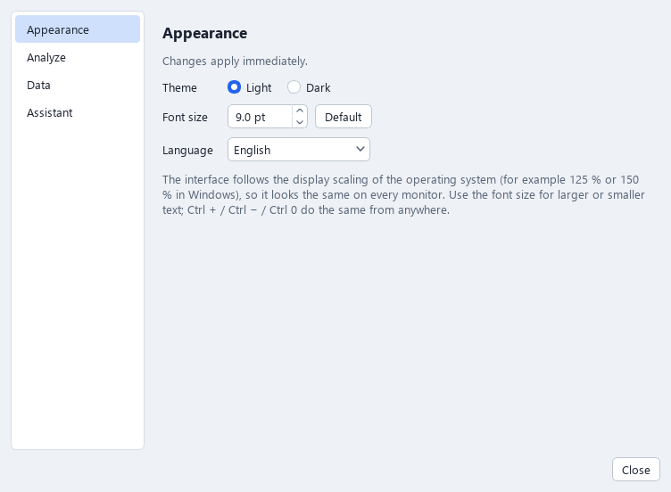
*Tools ▸ Settings…: the Appearance page.*

All settings, preferences, instrument profiles, the session and the fitting model are kept in one
user data folder outside the program:

- Windows: `%APPDATA%\GIMaP`;
- elsewhere: `~/.config/gimap` (`$XDG_CONFIG_HOME/gimap` when that variable is set);
- or the folder named in the environment variable `GIMAP_HOME`.

**Help ▸ Open User Data Folder** opens it. Updating the program never overwrites it.

## 4. Geometry and calibration

Without a geometry GIMaP shows the detector in pixels and nothing in q. This chapter explains where
the geometry comes from, the three ways to get one, the Geometry Calibration window, the pixel
coordinates of the beam centre, and how to adjust the centre in Analyze.

### 4.1 Instrument profiles

An *instrument profile* is a saved geometry for one detector: sample–detector distance, pixel size,
wavelength, beam centre and incidence angle αi. Profiles are kept in the user data folder
(`instrument_profiles.json`, section 3.11).

When a frame is opened, Analyze picks the profile that matches it:

- **Frame size.** A profile for another frame size is never used.
- **Detector name**, when the file states one (CBF and NeXus usually do, TIFF does not). A matching
  name counts more than the size.
- When several profiles match equally, the newest is used.

A different detector name does not rule a profile out: when nothing better matches, a profile of
the same frame size is used. So a profile made for a TIFF without a detector name is used for every
TIFF of that size. When you change set-up (distance, energy) but keep the detector, make or choose
a new profile.

The step **Geometry** shows the geometry in use (`811.8 mm · λ 0.6888 Å · αi 0°`). Its field
**Instrument profile** is set to **Automatic (match detector)**; choose a profile there to use it
instead.

**αi** is part of the profile, but the command bar has its own field. It shows the profile's αi
(*αi from profile* while no frame is shown). A value you type is shown in orange and is used for
every frame; it is also remembered for the next session, and a note at the first frame then says
so. Right-click the field ▸ **Back to Profile αi** to drop it.

**The beam centre in file headers** is not used by default: the calibrated profile centre is kept,
because many beamlines never update the header. **Tools ▸ Settings… ▸ Analyze ▸ Use the beam centre
written in the file header** changes that (section 3.11). **Beam centre ▸ Use File Header Centre**
takes the header centre as the centre of this session (section 4.5).

### 4.2 Three ways to a geometry

When no profile matches, a banner over the image says so and offers three buttons. The step
**Geometry** has **Find Calibration Automatically** and **Calibrate…** too, and **Geometry…** in
place of **Enter Geometry…**.

**Find Calibration Automatically.** GIMaP takes the first of these that fits the frame:

1. a calibration you named in the beamtime notes of the **Results** step: by path, or by file name
   alone when the file lies in the frame's folder or in a folder the notes name;
2. the instrument profile this detector already has;
3. ready calibration files (`.poni`, an exported `.json`) in the folders around the frame, up to
   three levels up, the one written closest in time to the frame first;
4. images of a standard there (AgBh, LaB₆, CeO₂), fitted and accepted when the standard's lines land
   within 0.5 % of their q.

The step **Results** says which calibration was used and where it was found. A `.poni` or `.json`
file is taken as it is: it is not checked against a standard image, and in this version not even
against the detector — a calibration of another detector (other pixel size, other frame size) in a
neighbouring folder can be applied. The result is saved as the instrument profile of the detector.

The search may pick the calibration of another experiment, for example in a folder that was copied
in one go (the file times then say nothing). Check the file named and the distance shown in
**Geometry**, or name the right one in the notes, or use one of the two other ways. A wrong profile
is removed with **Geometry…** ▸ **Delete profile**.

**Enter Geometry…** opens the dialog **Detector geometry**: **Profile name**,
**Sample–detector distance**, **Pixel size x** / **y**, **Wavelength**, **Beam centre x** / **y**
(section 4.4), **Centre step**, **Incidence angle αi**.

- **Save Profile** saves every value as an instrument profile for this detector and frame size. The
  saved geometry is used at once: a centre set earlier in this session for this detector is dropped,
  and **Instrument profile** goes back to **Automatic (match detector)**.
- **Apply Centre** uses the beam centre for this session only (section 4.5); the other values take
  effect only with **Save Profile**. With no profile in use, save one first.
- In the step Geometry the same dialog opens with **Geometry…**, filled with the geometry in use. Save
  it under the same name to change the profile, under a new name to keep both. **Delete profile**
  removes it.

**Calibrate…** opens the Geometry Calibration window (section 4.3) with the frame shown; Analyze
waits until you close it. Use it when the frame is an image of a standard, or open the standard's
image there. **Apply** in that window (also when opened from the **Tools** menu) saves the
profile, and Analyze analyses the frame again with it; a beam centre set earlier in this
session is dropped in favour of the calibrated one.

A fourth button, **Use Previous Geometry…**, appears only after an update from 0.0.2: it saves the
geometry of the former Cut & Fitting page as a profile.

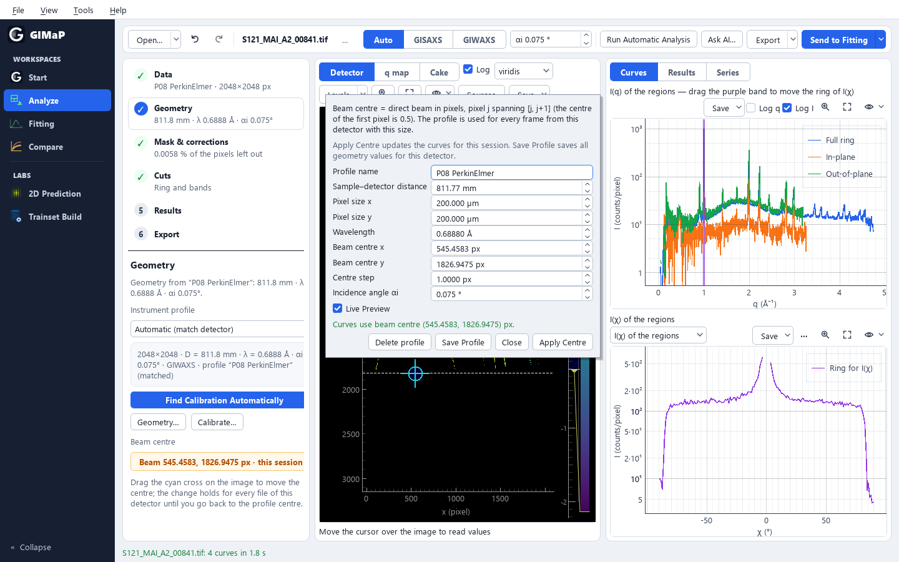
*Geometry…: the geometry of the profile in use, with Live Preview, Apply Centre and Save Profile;
the Beam centre button on the left shows a centre set for this session.*

### 4.3 The Geometry Calibration window

**Tools ▸ Geometry Calibration…** (`Ctrl+Shift+G`) calibrates a SAXS, GISAXS or GIWAXS detector
geometry without leaving the current page. It also opens from **Calibrate…** in Analyze and from the
Start page (*Calibrate the detector*).

1. Open an image of a calibration standard (NeXus/HDF5 such as `.nxs` or `.h5`, `.cbf`, `.tif` /
   `.tiff` or `.edf`) with **Open…**, or paste its path into the image field and press Enter. An image
   can also be dropped on the window. NeXus/HDF5 files are read as Analyze reads them (module files
   stitched, the same orientation; section 5.1). For a file of several frames, a row **Frames:** chooses
   **A single frame** (its number, counted from 1) or **Sum of all frames** (summed while you wait, with
   progress; it can be cancelled). A file with several equally likely image datasets asks which one.
2. Confirm the detected energy and pixel size. For a CBF with matching scan NXS metadata, the energy
   is filled in automatically. Enter the energy in keV if it is still missing.
3. Confirm the detector model. If it cannot be identified, choose a known detector from
   **Detector model**, or select **Custom pixel size** and enter the values in
   **Advanced configuration**. *Auto detected* keeps the pixel size of the file.
4. Choose the standard. When the path of the image — its file name or a folder above it — names one
   standard (for example `AgBh`, `LaB6` or `CeO2`), it is selected for you; when it names more than
   one, the field is set to **Auto Detect**; when it names none, the field is left as it was
   (**Auto Detect** when the window opens). Auto Detect tries every known standard.
5. **Estimated distance** is optional and steers the search: leave it on *Optional* when you do not
   know the distance, type the approximate distance when you do. When an image is opened the field is
   filled in only if the image file states a distance (a NeXus file can; the distance in a CBF or EDF
   header is not used) or, failing that, if a calibration was applied before, with the distance of
   that calibration: check that such a number is the distance of this set-up. **Distance range**
   limits the search (*Auto · 30–10000 mm*, *SAXS · 500–10000 mm*, *WAXS · 30–1500 mm*, or *Custom*
   with the bounds in **Advanced configuration**).
6. Click **Auto Calibration**. The calculation runs in the background; **Cancel** stops it after the
   current step.
7. Review the result: beam centre, distance, matched rings, RMS residual, confidence and warning of
   the **Selected solution**, and the **Candidate solutions** below. Selecting a candidate draws its
   rings. **Clean image** temporarily hides all overlays, **Reset view** restores the complete
   detector mosaic after zooming or panning, and **Focus image** hides the result panels to give tall
   WAXS mosaics more room. The horizontal divider can be dragged.
8. To adjust the result by hand, press **Manual refine**: drag the centre marker, edit the
   centre/distance values, or pair a detected ring with a theoretical peak (**Fit selected ring**).
   **Reset to fitted** goes back to the fitted solution and **Finish manual** closes the panel. The
   fitted values stay as they are until you press **Manual refine**.
9. Click **Apply** to save the geometry as the instrument profile of the detector. One note says what
   was applied and which profile Analyze will use. When the result moves the beam centre of a saved
   profile by more than 10 px or its distance by more than 5 %, the window asks before it overwrites
   that profile.

**Export Calibration…** writes the result as a `.json` file. It proposes
`<image name>.gimap-calibration.json` next to the calibration image; choose another folder when the
data folder should stay untouched. The record names the frame used, or that frames were summed. The
note after it opens the folder. **Import Calibration…** reads such a file back and selects its standard;
for a calibration made on summed frames it shows the first frame at once, then reads the same sum. An
exported `.json` can also be dropped on the window. **Open…** and **Import
Calibration…** start in the folder of the image shown, else in the folder used last.

**The overlays.** Solid yellow lines are matched theoretical rings, dashed orange lines are unused
theoretical rings, dotted cyan lines are detected experimental radii, and pink lines cross at the
beam centre; the legend above the image names each style. Partial WAXS arcs and centres outside the active detector area are
supported. A low-confidence result or a one-ring result should be treated as ambiguous and reviewed
by hand.

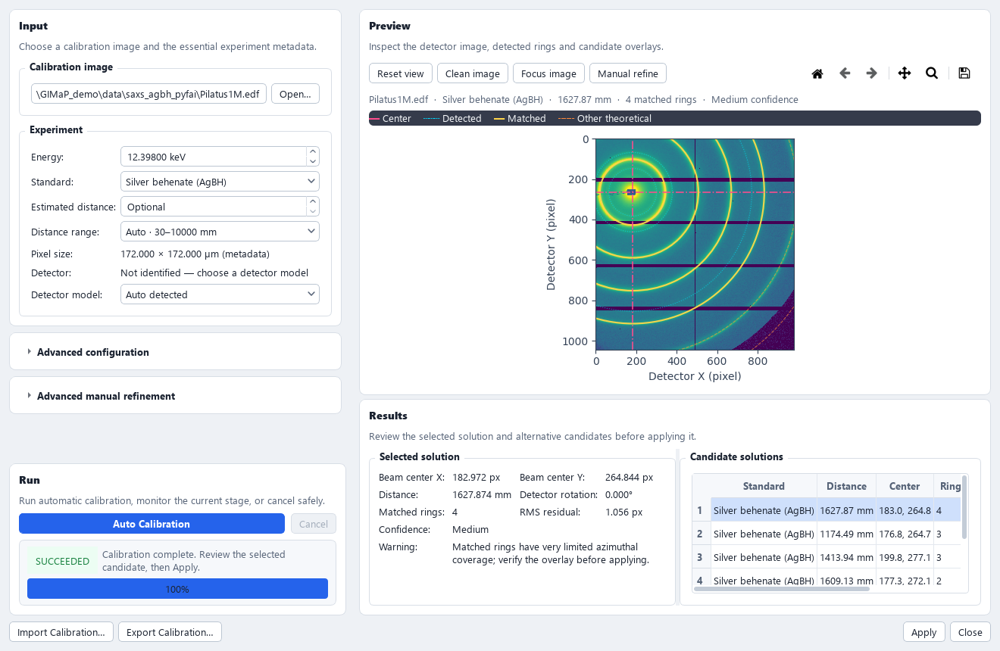
*Geometry Calibration: the fitted rings over the standard, the selected solution and the candidates.*

**The beam centre in this window** is shown and entered in the same pixel coordinates as in Analyze
(section 4.4). A centre can be compared or copied between this window and Analyze as it is. An
exported calibration file keeps its numbers as in earlier versions: there the beam centres count
pixel centres from 0, half a pixel lower than the window shows, and the file says so
(`metadata.center_convention`). Importing the file shows the same centre again.

**Known limitation: a wrong solution can come first.** Both cases below were seen on a silver
behenate image whose path does not name the standard.

- With the standard left on **Auto Detect** and no estimated distance, a solution of another standard
  can be ranked first: a LaB₆ solution at a much shorter distance came first, and the silver behenate
  solution was last in the list of candidates. Choose the standard yourself when you know it. An
  approximate distance helps Auto Detect too: with 1500 to 1800 mm typed in, the silver behenate
  solution came first on this image.
- A wrong estimated distance can mislead, also with the right standard: the search prefers solutions
  near the value in **Estimated distance**. With silver behenate chosen and 2000 mm typed in, a
  solution near 1830 mm came first, although the real distance is about 1630 mm; with the field left
  on *Optional*, the right solution came first.

**Estimated distance** can hold a number you did not type. It is never filled with a built-in value:
on a new installation it stays on *Optional*. But each time an image is opened it takes the distance
the image file states, or else the distance of the calibration applied last, also when you had typed
another value or cleared the field; with neither, a value you typed stays. The calibration applied
last may be the one of another set-up or detector. Enter the approximate distance of your set-up, or
set the field to 0 (it then shows *Optional*) when you do not know it.

Before you press **Apply**, check that the distance is the one of your set-up and that the drawn rings
lie on the rings of the image. This will be corrected in a later version.

### 4.4 Pixel coordinates

Analyze, Geometry Calibration and the XRR Series Extractor show and accept the beam centre in the
same pixel coordinates:

- pixel corners lie on whole numbers, so the centre of the first pixel is (0.5, 0.5);
- x counts from the left edge and y from the top edge of the image as shown (row 0 at the top);
- the beam centre is the position of the direct beam.

The same profile therefore shows the same numbers in all three windows, and a centre can be copied
from one to another as it is.

Other programs may count differently. The GALAXI frame of section 1.3, for example, documents its
direct beam at (597.1, 323.4) px counted from the bottom-left corner; in GIMaP that is
(597.1, 719.6) px.

**Exported files count from 0.** The calibration `.json` of Geometry Calibration and the CSV and JSON
records of the XRR Series Extractor count pixel centres from 0, half a pixel lower than the windows
show, as earlier versions did. Each file says so (`metadata.center_convention` in the calibration
file, `center_convention` in the XRR record). Importing such a file shows the window's numbers again.

Trainset Build (Labs) keeps the conventions of the training data it was made for (chapter 10).

### 4.5 The beam centre in Analyze

The profile's beam centre is used unless you change it. The step **Geometry** shows it on the button
**Beam centre** (`Beam x, y px · source`, to four decimal places); its menu has:

| Entry | What it does |
|---|---|
| **Pick on Image** | Click the direct beam on the detector image (view **Detector**, not the q map; `Esc` cancels) |
| **Enter Coordinates…** | Type the centre in a small window (below) |
| **Use File Header Centre** | Take the centre written in the file, when it has one (the entry shows it) |
| **Refine x by Symmetry** | GISAXS: the same search as **Make Left and Right Symmetric** (section 4.6) |
| **Back to Profile Centre** | Forget the centre set in this session |
| **Save to Profile** | Write the session centre into the instrument profile |

You can also drag the cyan cross on the image. A centre set in any of these ways holds for this
session and for every frame of the same detector size (rows × columns); frames of another size go
back to their profile's centre (or the header centre, when the setting above is on), and a note says
so. It is also kept in settings files and projects. **Save to Profile**
keeps it for good.

**Geometry…** and **Enter Coordinates…** open small windows that stay open while you work, so you
can adjust the centre and watch the curves:

- the coordinates show four decimal places;
- **Centre step** sets how far the arrow buttons, the arrow keys and the mouse wheel move the centre
  (down to 0.0001 px); both windows share it and it is remembered;
- **Apply Centre** uses the centre for this session and redraws the curves; adjust and apply as often
  as you like;
- with **Live Preview** on, every change redraws the curves by itself. Quick changes are combined,
  and a zoom you set on the curves is kept;
- **Save Profile** (in Geometry…) saves all geometry values and leaves the window open;
- **Close** keeps the centre applied last and drops values not applied.

The windows close when you change the file or frame, or clear the list, so that a centre typed for
one detector is never applied to another.

### 4.6 Make Left and Right Symmetric

In GISAXS the horizontal cut is symmetric about qy = 0. When the beam centre column is a little off,
the two halves of I(qy) do not match. **Make Left and Right Symmetric** (step **Cuts**, GISAXS) moves
the centre column onto the symmetry axis of the cut:

1. a coarse search over the whole horizontal cut finds the axis;
2. a refinement compares the column means of the valid pixels, as the curve shows them, left and
   right of the trial axis. Each pair is weighted by 1 / distance from the axis, so every factor of
   distance counts about the same and the many far pixels do not outweigh the low-q structure.
   Columns without measured pixels (gaps, masked columns) stay out, values are not interpolated
   across gaps, and points closer than 1 px to the axis are not used.

Only x changes; y is kept. The result is shown in a note (*coarse … → refined … px*). 0.0001 px is
the numerical stopping tolerance, not a measured uncertainty. When the data do not cover enough, or
several axes fit equally well, the centre stays as it was and the note says why.

The search runs in the background; press the button again (*Cancel Centre Search*) to stop it. The
new centre holds for this session (section 4.5); **Beam centre ▸ Save to Profile** keeps it. The
automatic analysis of a GISAXS frame does the same step by itself.

## 5. Analyze

Analyze is the one workspace for detector frames, GISAXS and GIWAXS alike. It turns a frame into
curves in q (Å⁻¹), shows where every point of a curve comes from, and writes the curves with a
record of how they were made. Fitting only fits curves; everything that touches the detector image
happens here.

The page has five parts (the picture in section 3.1 shows them with a GIWAXS frame):

| Part | What it holds |
|---|---|
| Command bar | **Open…** (its arrow: **Open Folder…**), ↶ ↷ (Undo / Redo), ‹ › (previous / next frame, when more than one frame is listed), the mode **Auto / GISAXS / GIWAXS**, αi, **Run Automatic Analysis** (with **Stop** while it runs), **Ask AI…**, **Export** ▾, **Batch Export…** (when more than one frame is listed), **Send to Fitting** ▾ |
| Steps (left) | **Data**, **Geometry**, **Mask & corrections**, **Cuts**, **Results**, **Export**. Each shows its state (✓, !, ✕ or running) and one line of what it found; click a step for its controls. Rarely used options are folded away. |
| Image (middle) | **Detector**, **q map** or **Cake** (GIWAXS), **Log**, the colour map, **Levels**, **Marks**, Zoom, **Fit view**, **Sources**, **Save** ▾; the values under the cursor below the image |
| Tabs (right) | **Curves** (an upper and a lower plot), **Results** (what the automatic analysis or the AI found, with its evidence), **Series** (every frame as intensity against frame and q) |
| Status line | What is happening, a progress bar and **Cancel**. A note at the bottom right says when a file was written, with **Open Folder**. |

On a narrow window the command bar shortens its long buttons (section 3.3) and, if needed, moves the
actions to a second row.

The mode: **Auto** reduces a frame as GIWAXS when the detector reaches beyond a scattering angle
2θ = 20°, otherwise as GISAXS. Auto decides again for every frame. Choose **GISAXS** or **GIWAXS**
to force it; the status line warns when a forced mode does not look right for the frame.

The αi field shows the profile's αi until you type a value; a typed value is shown in orange and
kept until you right-click it ▸ **Back to Profile αi** (section 4.1).

Geometry — instrument profiles, finding a calibration, the beam centre and its dialogs — is
described in chapter 4. This chapter starts from a frame that has a geometry.

### 5.1 Opening data and the frame list

GIMaP reads CBF, TIFF and EDF frames, and NeXus/HDF5 files (`.nxs`, `.nx`, `.nx5`, `.h5`, `.hdf5`,
`.hdf`). Files that belong together are one *source*: the module files of one detector are stitched,
a master is read with its data files, and every frame of a multi-frame file is a frame of the series
(*NeXus and HDF5 files* below).

1. Open frames in one of these ways:
   - **Open…** in the command bar (`Ctrl+O`), or its arrow ▸ **Open Folder…** (`Ctrl+Shift+O`);
   - drop files or a folder anywhere on the window;
   - the Start page or **File ▸ Open Recent**.
2. Analyze opens at once and looks at the sources in the background (**Cancel Import** stops a slow
   import). A folder that holds no frames itself but has them one level down (one subfolder per
   detector) is opened one level down, and the status line says which subfolders.
3. For a source of several frames, the window **Import Frames** asks which frames to list, for each
   source on its own: **All Frames**, **Frame Range** (first **to** last, **every** n-th) or **Specific
   Frames** (frame numbers separated by commas, counted from 1, for example `1, 5, 20`). Only references
   are listed: a frame is read when you show it, so a stack of thousands of frames opens quickly.
4. The **Data** step names the source while the image loads, then its detector, frame size and
   frames. The curves appear without further clicks once the frame has a geometry. Without one, a
   banner above the image offers **Find Calibration Automatically**, **Enter Geometry…** and
   **Calibrate…** (section 4.2).

**The frame list** (Data step) has one row per imported frame, whether it comes from a file of its own
or from a NeXus stack:

- Click a row to read and show that frame. `Page Up` / `Page Down`, or ‹ › in the command bar, step
  through the imported frames only.
- For a source of several frames a bar above the steps, **Frame [4] of 12**, chooses the frame
  (counted from 1). A frame that was not imported must first be added with **Choose Frames…**.
- **Choose Frames…** (under the list) changes the import selection later (**Keep Current Selection**
  leaves a source as it is). Build Map, Batch Export and Send Series to Fitting take the imported frames,
  then apply their own range, interval and sum. A sum never bridges frames that were left out; frame
  numbers, times and the files named in the records keep their original meaning. Changing the selection
  clears the Series map and the batch-fit preview of the old one. A project keeps the selection.
- To take a source off the list, right-click one of its rows — **Remove Source from List**, **Show in
  Folder**, **Copy Path** — or select it and press `Delete` or `Backspace`. All its frames go; the files
  themselves are not touched, and the rest of the list, the Series map and Batch Export go on without it.
- **Clear** empties the list (and the Series map with it).
- **Frames ▸ Sum** (folded under the list) adds consecutive frames for better statistics: the
  frame shown plus the next ones (the following files, or the following frames of a NeXus file).
  Batch Export and watching sum groups of the same size.
- Above the list the Data step says what the source shown consists of (for example *11 module files ·
  240 frames · stitched*), how its frames are oriented, and — in the warning colour — what is missing
  from it. **File header** gives the energy, distance and exposure (in s) the file states.
- When the files of a frame change (name, time or size), **F5**, showing the frame again and watching
  read it again; otherwise it is not read again.

**Watch** (next to **Clear**) watches a folder during a measurement: choose the folder, and it is
looked at every 2 s. New frames are listed and the newest is shown as soon as it is completely
written. Press **Watch** again to stop.

- A file, or a set of module files, that grows frame by frame while the detector writes is followed
  while it grows: each look takes the frames it already held at the look before, so the newest frame,
  which may still be being written, waits for the next look. The Data step says *Still growing: frame N
  is the newest complete one*. A Series map or Batch Export started meanwhile takes only these frames.
  A program on the same Windows PC that writes the file with HDF5's file locking locks it against
  reading: such a file is listed as being written and read once it is closed.
- With **Export ▾ ▸ Export New Frames While Watching** ticked, each complete new frame is exported
  once (next to the data, in `gimap_analysis/`; with **Sum**, only complete groups). A set of module
  files is exported once it is whole and has rested about 10 s; a module file missing is said in the
  status line.
- A Series map that is built already grows with the new frames, without a new **Build Map** (when
  export is on and there is no map yet, one is built with the chosen curve). Picking a row stops the map
  from following the newest frame; **Show the newest frame** under the Series options turns it back on.
- A file another program holds open is tried again at every look and said once in the status line; a
  source taken off the list comes back when it grows.

#### NeXus and HDF5 files

What a source is follows from what the files hold; a file name only proposes:

- **one frame per file** — each file is a frame; a folder of them is a series;
- **a series in one file** — a stack of frames (a grid of scan points × frames is read in storage
  order, and the Data step says so);
- **one file per detector module** (P03 Lambda 9M: `…_m01.nxs` … `…_m11.nxs`, each holding every
  frame) — one stitched frame per frame, named by the scan without `_m01`. The files are a set only
  when they hold the same dataset and module size at different module positions; files merely named
  alike stay separate, and the Data step says why;
- **a master with its data files** (Eiger: `…_master.h5` with `…_data_000001.h5` …) — one source whose
  frames run through the data files.

HDF5 files without a detector image (model weights, result tables) are not listed from a folder.

**The image** is the dataset the file marks as its default plot, else the `data` of the detector, else
the best image-shaped dataset; masks, flat fields and dark frames are never taken for the image. A file
with several images shows one and names the others (the Format Converter and Geometry Calibration let
you choose).

**Orientation.** Files written by the Lambda server (P03) are shown as GIMaP always showed them: the
modules stitched by their positions, then transposed and flipped (rotated by 90°); the Data step says
*P03 Lambda: transposed and flipped*. Every other NeXus/HDF5 image is read as stored, row 0 on top, like
a CBF or TIFF of the same detector (*Image as stored in the file*). Earlier versions turned these other
files as well: a geometry or mask made on such a file with an earlier version no longer fits it. Check
it (a square frame still matches its old instrument profile by size).

**Values.** Header values are read in their units — an exposure written in ms is shown in s, the energy
in eV or keV, the distance in mm or m; a value in a unit GIMaP does not know is left out, not guessed.
The detector's `pixel_mask` is applied, and in unsigned integer data the largest value of the type means
“no data”.

**What is missing is said, never filled in**: a module file that is missing (that part of the detector
stays empty), module files with different numbers of frames (the frames every module has are used), a
data file that is missing (the frames after it cannot be read), a frame beyond the end (an error, never
the last frame instead). A file still being written is read as far as it is and read again when it
changes; a file another program holds cannot be read until it is closed; a file left open by a program
that ended says so (`h5clear -s` on a copy of it makes it readable). Files compressed with bitshuffle or
LZ4 need the Python package `hdf5plugin` (in `requirements.txt`).

### 5.2 Mask and corrections

The **Mask & corrections** step says how many pixels are left out, and why: detector gaps and
marked pixels, hot and dead pixels found in this frame, your masks, the gap guard, the intensity
range, the background, and how many pixels were filled from the mirror side.

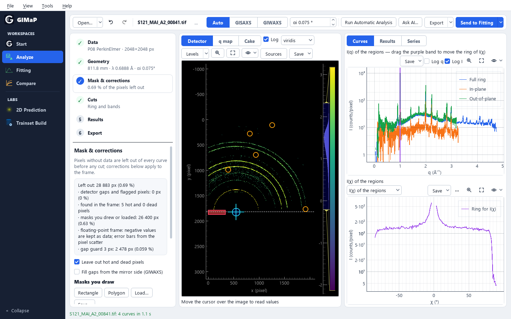

*The summary at the top counts each kind of pixel left out; on the image, amber circles mark the hot pixels found in this frame and the red rectangle is a drawn mask.*

**Show Masked Pixels on the Image** marks them on the detector image: red = left out, amber
circles = hot or dead pixels, cyan = filled from the mirror side (used in the curves).

**Which pixels count as data.** On an integer counting detector, negative values are gap codes
and are left out. On a floating-point frame (dark- or background-subtracted) negative values are
data and are kept.

**Bad pixels** — **Leave out hot and dead pixels** (on by default, remembered). In every frame
GIMaP leaves out:

- isolated hot pixels: brighter than all eight neighbours, by a factor of 5 and by 10 standard
  deviations (Poisson for counting detectors, a robust frame-wide noise for floating-point frames);
- dead pixels (counting detectors only): reading 0 while every neighbour has at least 20 counts;
- scattered bright pixels along a defective detector row or column, which the single-pixel test
  misses when they come in pairs.

Anything wider than one pixel — a Bragg spot, a streak, the beam-stop edge, a Yoneda band — is kept.
Whole rows or columns are never removed. The numbers go into the export record
(`bad_pixels_left_out`). Turn the option off to put these pixels back into the curves.

**Masks you draw:**

1. Press **Rectangle** and click two opposite corners on the detector image, or press **Polygon**
   and click the corners (double-click or `Enter` closes it, `Backspace` removes the last corner,
   `Esc` cancels).
2. The mask is outlined in red and left out of every curve at once.
3. **Remove Selected** (or `Delete` in the list) and **Clear Masks** remove masks; the detector
   gaps stay masked.
4. **Save…** writes the drawn masks as `.json` (in the pixel coordinates of section 4.4). **Load…**
   reads such a file, or a mask image of the same size (EDF or TIFF, non-zero = masked, as in pyFAI).

**Fill gaps from the mirror side (GIWAXS)** (off by default). A GIWAXS pattern is symmetric in
±q∥. A pixel without data (module gap, mask, hot pixel) takes the value at its mirror position
about the beam-centre column, interpolated between two columns that both have data. Where the
mirror has no data either, the gap stays. The record counts the filled pixels, and Fitting is told
that the counting statistics no longer hold.

**Corrections** (folded): a background frame (**Choose…**, with **Scale** and, for NeXus, **Frame**),
a valid raw intensity range (**Min** / **Max**), and the **Gap guard** (default 3 px; 0–20 px,
remembered), which also leaves out pixels this close to gaps and bad pixels.

The order is fixed: invalid detector pixels → hot and dead pixels → masks → background → gap guard
→ intensity range → mirror fill → intensity corrections. Curves, q map, cake and exports all use
the corrected frame.

**Intensity corrections (GIWAXS)** (folded, off by default). They divide each pixel by a factor;
q does not change:

| Correction | Factor | Enter |
|---|---|---|
| **Solid angle of each pixel (cos³2θ)** | cos³2θ for a flat detector, 1 at the beam | — |
| **Polarisation, factor** | pyFAI's formula with factor f | f (default 0.99): 0.95–0.99 at a synchrotron (horizontal), 0 for an unpolarised laboratory source, −1 vertical |
| **Absorption in the film** | the path in the film at exit angle αf, relative to αf = αi | **Thickness** (nm), **Attenuation length** 1/µ (µm, from tables such as CXRO or NIST) |

Peak positions do not change. Intensities compared across χ or q do — orientation, pole figures,
crystallinity ratios. Refraction is not included in the film absorption, so it is valid well above
the critical angle; with it on, pixels at or below the sample horizon are left out. For photon counts the error is propagated: a corrected pixel's variance is its
value divided by the factor. The JSON record (`intensity_corrections`) gives the formulas and
parameters.

### 5.3 Cuts

The **Cuts** step holds the cut positions. **Auto Cuts** returns to the automatic positions.

#### GISAXS: horizontal and vertical cut

GIMaP finds the Yoneda band (the brightest row between the sample horizon and an exit angle of
1.5°, measured beside the specular rod) and takes:

- the **horizontal cut** I(qy) in a band 5 px high at the Yoneda row (orange on the image);
- the **vertical cut** I(qz) in a band 10 px wide at the beam-centre column.

If no Yoneda band is found, the horizontal cut sits just above the horizon and the step says so —
check αi. To move a cut, drag the orange band on the image (its edges change its height), or
double-click a column to move the vertical cut. The step says whether the cut is at the Yoneda
band, set by hand, or above the horizon.

**Halves of the horizontal cut.** qy is signed: the two sides of the beam are two measurements of
the same structure. Choose which the curve for Fitting uses:

| Choice | Curve for Fitting |
|---|---|
| **Both halves on \|qy\| (two colours)** | both halves, folded onto \|qy\| |
| **Mean of both halves** | the average of the two |
| **qy < 0 half** / **qy > 0 half** | one side only |

The same choice is in **Send to Fitting ▾** and in **Tools ▸ Settings… ▸ Analyze**. **Make Left and Right
Symmetric** moves the beam-centre column onto the symmetry axis of the cut (only x changes;
section 4.6 describes how).

#### GIWAXS: regions, Ring / Sector / Spot

A GIWAXS frame gives I(q) in the upper plot and I(χ) in the lower plot. χ = 0° is the surface
normal and ±90° the sample plane.

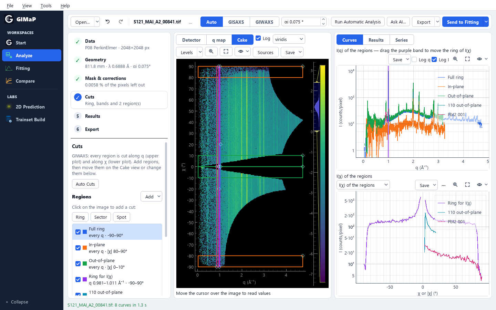

*Each region has its own colour, the same in the list, on the q map, on the Cake view and in the plots.*

Three views above the image:

- **Detector** — the frame as measured, in pixels;
- **q map** — the intensity regridded onto q∥ (qr) and qz;
- **Cake** — unwrapped onto χ against q: a ring is a vertical line, a region a rectangle.

**Save ▾** above the image: **View as Figure…** (the view with its colour bar) or **View Data as
CSV…** (the q map or the cake as a table with its axes).

**Regions.** A region is a q range × a χ range, optionally on both sides (±χ, folded onto |χ|).
Each region gives two curves in its own colour: I(q) (upper plot) and I(χ) (lower plot). The list
starts with the standard cuts — the full ring, the in-plane band, the out-of-plane band and the
ring of I(χ) — which the automatic analysis and the AI also use. Tick a region to show it.

**Add a cut with one click.** Press **Ring**, **Sector** or **Spot** under *Click on the image to
add a cut*, then click on the detector image, the q map or the Cake view:

| Button | Click | You get |
|---|---|---|
| **Ring** | a peak (also on the upper I(q) plot) | the peak's q window × every χ: I(χ) for orientation |
| **Sector** | a direction | every q within a few degrees of that χ (±5°, or the spot's width): I(q) along it |
| **Spot** | a spot | the spot's q window × its χ window: both profiles of the spot |

The region snaps to the peak: centre and FWHM are fitted from the pixels, and the window is
centre ± FWHM, without reaching into a neighbouring peak. A note gives q, d and the FWHM, with
Undo. If there is no clear peak near the click, a fixed width is used and the note says so. New
regions are named by position, for example `Ring q 0.998` or `Sector |χ| 85°`.

**Change a region exactly.** Select it and type its centre ± **Half width** (q to four decimals,
χ to 0.1°), or tick **All q**, **All χ**, **Both sides (±χ)**. The line below shows the range and
d = 2π/q. **Snap to Peak** re-centres the window on the nearest peak. **Remove Region** deletes it.
Regions can also be moved and resized on the Cake view.

**Add ▾** also has **Draw on the Cake View** (two corners), **Ring at the Strongest Peak**,
**In-plane Band (|χ| 70–90°)**, **Out-of-plane Band (|χ| 0–20°)**, **Whole Pattern**, and
**Save Cuts…** / **Load Cuts…** (a set of regions as JSON for the next data set; loading replaces
your regions, the standard cuts stay). **Strongest Ring** puts the I(χ) window back on the most
prominent ring.

**More cut settings** (folded): **Radial bins** (auto by default), the **I(q) axis** (q or 2θ),
and a **q box** (a q∥ × qz rectangle, values in Å⁻¹, draggable on the q map), which gives I(qz)
and I(q∥). The lower plot's drop-down chooses **I(χ) of the regions**, **q box: I(qz)** or
**q box: I(q∥)**.

### 5.4 Curves and results

**Where the points come from.** Each point is the mean intensity of the valid pixels in one bin.
A bin is never finer than one pixel. Bins with very few pixels (near the beam, at region edges) are
merged with their neighbours along q, never across a gap; I(χ) is not merged. Bins with no pixel —
gaps, masked χ ranges, the missing wedge — have no point, and the curve is broken there. The error
bar σ is √sum / n for integer counts without background; for floating-point frames, after
background subtraction or mirror fill it is the scatter of the pixels, s / √n. GIMaP never smooths
a curve: for smoother curves widen the region's χ range or lower **Radial bins**.

**Sources.** Press **Sources** to see on the detector image which pixels each curve comes from, in
the colours of the plots. Click a curve to see only its region.

**The plots.** Each curve plot has:

- **Log I** and **Log q** (log axes; for an I(χ) or 2θ plot the second reads **Log χ** / **Log 2θ**).
  With a log x axis, points at x ≤ 0 are not drawn: to see both halves of a GISAXS cut on a log q
  axis, choose |qy| (below). A window band you placed keeps its data range when you switch the axis.
- For a signed x (qy of the horizontal cut, χ of a ring): **±** (both halves), **+**, **−**, or
  **|qy|** / **|χ|** (both halves on |x|, the negative one dashed in a second shade). This changes
  only the display and **Plot as Figure…**, not the exported data or the curve for Fitting.
- Zoom (drag a rectangle; `Shift` + drag works in every view), Reset, and the Marks (eye) button.
- **Save ▾**: **Plot as Figure…** (a publication figure) or **Curves as Data…** (one CSV per curve
  plus a JSON record).
- The right-button menu (**Copy Image**, **Copy Data** …), zooming with the right button and the
  **⋯** menu of a narrow plot work as in every plot (section 3.4).

**Colour limits.** Next to every image is a histogram of the displayed values with two handles.
Drag a handle, or the band between them, for a quick change; the mouse wheel over the bar zooms it
for finer moves. **Levels ▾** has:

- **Auto for every frame** and its **Rule**: 1–99.7 %, 0.1–99.9 %, 5–95 %, Min–max, Mean ± 3σ;
- **Min** / **Max** typed in intensity units;
- **Auto Once** (a click on **Levels** itself does the same).

Limits you drag or type stay — for other frames, re-analysis and the live Series map — until you
choose Auto; the button then reads **Levels (fixed)**. They mean the same in log and linear
display. The detector, q map, cake and Series map each keep their own limits.

**Marks.** Every image has **Marks ▾**, every curve plot an eye button: one switch per kind of
mark — beam centre, sample horizon, cut bands, masks and cut regions, the pixel overlay, marked hot
and dead pixels, the q box, the colour bar, the window band — and **Show All Marks** / **Hide All
Marks**. Hidden marks stay hidden for other frames and the next session. The same menu removes
what you made: **Remove the Drawn Masks**, **Remove All Cut Regions**, **Remove the q Box** (Undo
brings them back). On the q map the beam centre is the direct beam (q∥ = 0, qz = 0), just below
the map; the sample horizon is drawn dashed at qz = k sin αi.

**Undo / Redo** (↶ ↷, `Ctrl+Z`, `Ctrl+Shift+Z` or `Ctrl+Y`). Every change of the set-up is one
step: a mask, a region added or moved, a band dragged, the profile, αi, the beam centre, the mode,
the corrections, the frames summed, a settings file loaded, an AI card applied. A drag, or a quick series of the same edit, is one
step. The tooltip says what the next Undo changes (for example *Undo: cut regions*). Saved
instrument profiles are not undone this way.

### 5.5 Run Automatic Analysis

**Run Automatic Analysis** runs GIMaP's standard procedure on the frame shown. It needs no AI and
works for GIWAXS and GISAXS.

Before running, you can type **Beamtime notes** in the **Results** step: αi, the energy, the
pixel size, where the calibration is — whatever you know.

**GIWAXS.** The run:

1. finds the geometry (the instrument profile, a calibration file near the data, or an image of a
   standard);
2. sums the last frames of a series: the last fifth of its frames, at most 10 (of fewer than ten
   frames, the last one alone);
3. finds the peaks and fits them;
4. compares in-plane and out-of-plane;
5. gives the orientation of the strongest reliable ring and Scherrer sizes.

The Results tab shows **Peaks**, **Checks** (shadows, artefacts, unmeasured ranges), **Geometry**
(where it came from: distance, beam centre, wavelength, αi), **Series** (with **Compare with the
Start of the Series**) and **Report**. Sizes are Scherrer lower bounds. Phases are not assigned
automatically.


*The peak table (q, d, FWHM, trust, Scherrer size L, OOP/IP); **Fit details** below it opens the fit of the selected peak.*

**GISAXS.** The run:

1. finds the geometry and, as for GIWAXS, sums the last frames of a series;
2. takes the horizontal cut at the Yoneda band (if none is found, it asks you to check αi);
3. moves the beam-centre column to the symmetry axis;
4. chooses the halves: their average when both are usable and agree, otherwise the usable one,
   with the reason (a half shadowed, cut by a gap, too short);
5. gives the in-plane distance 2π/q* (a shoulder only is reported as a hint);
6. fits I(qy) with physical models: spheres, vertical cylinders and random cylinders, with size
   spread and a distance D.

When several models fit within 10 % of the best χ², the curve alone does not decide the model: the
Results tab asks which one you expect and names the one that agrees with the measured spacing.
**Save Fitted Curve…** (q in Å⁻¹, I, σ and the best fit), **Save Fit Table…** (every solution with
its parameters in nm and χ²) and **Save Plot…** save the results; **Refine in Fitting** opens the
prepared curve (the halves chosen) in Fitting.


*The cut with its halves, the spacing, the fit (Log q / Log I) and the table of solutions.*

**Fit details** (closed under the peak table or the fit table until you open it; it then stays
open for later reports) follows the selected row:

- a peak: the points it was fitted to, with the Gaussian and its local linear background; q, d and
  FWHM with errors; height, area, background and slope; S/N, χ²ᵣ, the fit window, the Scherrer
  size, how peaks are found, and where the ring is measured, shadowed or missing on the q map;
- a model solution: every parameter (R, σR/R, h, D, σD/D, weight, amplitude, background,
  resolution), χ², convergence, evaluations and time, the q range, the start of D, the algorithm,
  its warnings, and **Show in Fitting**, which opens the curve in Fitting with that solution drawn.

**Questions only you can answer** (αi, the energy, the pixel size, the calibration file and its
standard, the GISAXS model) become fields in the Results step. Fill them in and press **Run Again with These Answers** (or `Enter` in a field).

**While it runs** the right side switches to Results. A panel shows the step in progress and the
time, and ticks off the phases. **Stop** (in the panel and the command bar) ends the run before
its next step. A step already running finishes first, and the panel says what it waits for (a
geometry fit or model fit can take a minute). What was found is kept: **Save Report…** or
**Discard**.

**Whose results.** The results belong to the frame they were run on. While a run lasts, the file
list is locked. When you show another frame, the Results step says which frame the results are
from; they come back with that frame. **Save Report…** writes a web page with the pictures (`.html`,
opens in any browser) or the text as Markdown (`.md`); the save dialog starts next to the data.

The sum the automatic analysis sets is for the frame it analyses. A Series map, Batch Export and Send
Series to Fitting do not use it (their dialog and the Series tab say so); to sum there, set **Data ▸
Frames ▸ Sum** yourself.

**Ask AI…** lets an AI do the same with the same tools while you watch (chapter 9).

### 5.6 Series map and stages

With several frames listed — files, a folder, or a multi-frame NeXus/HDF5 file — the **Series** tab
shows one curve of every frame as an intensity map against frame and q.

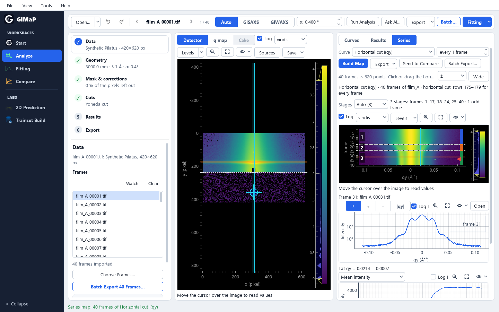

*Drag the horizontal band to pick a frame and the vertical band to pick a q window. The line above the map
names the curve, the frames and the cut held for every frame; the box beside it (±) chooses the halves of the
cut, and the frame axis counts from 1. Here a synthetic run of 40 frames: “3 stages: frames 1–17, 18–24, 25–40 ·
1 odd frame”. The odd frame is frame 34, where a few detector columns are hot (the short bright mark near
qy 0.05 Å⁻¹); the red arrow beside the map marks it, and it does not make a stage of its own.*

1. Choose the **Curve** (GISAXS: the horizontal cut by default; GIWAXS: I(q); every region's I(q)
   and I(χ) are in the list). Set **every n frame** for a first look at a long series.
2. Press **Build Map**. Every imported frame (or group of summed frames) is reduced with the current
   settings; the map grows as frames are done. Long series use several low-priority processes;
   progress, time left, **Pause** and **Stop** are shown, and rows already done stay.
3. Drag the horizontal band to pick a frame: its curve is drawn below; **Open** shows that frame in
   Analyze, with the cut of the series.
4. Drag the vertical band to pick a q window: further below, against frame, the **Mean intensity** or
   the peak in the window — **Peak position**, **Peak width (2.355 σ)**, **Peak area**, **Peak height**
   (centroid, 2.355 σ, area and height after a straight background). A window in a detector gap, or
   outside the data, has no value: the plot says so instead of drawing one.
5. **Export ▾** (once a map is built): **Map as CSV Table…**, **Map as Figure…**, **Stages as
   Table…**, **Selected Frame's Curve as Figure… / as Table…**, **Trace as Figure… / Trace as
   Table…** (the value of the lower plot for every frame), **Peak Table of Every Frame…**.

**One cut for the series.** While the cut is automatic, every frame of the map — and of a Batch
Export, a Send Series to Fitting and a watched folder's export — is cut where the frame on screen is:
for GISAXS the rows of the Yoneda band and the beam-centre column, for GIWAXS the ring of I(χ). A row
of the map then differs from the next by the sample, not by where it was cut. The line under the
buttons names the cut (*Cut of the series — horizontal cut: rows 202–206 for every frame*). A cut you
set yourself is the same for every frame anyway.

**What the map shows.**

- Every point is drawn at the x where it was measured: a line sits at its q, and a detector gap stays a
  gap (the exports keep the measured x).
- The frame axis counts the frames from 1, in whole numbers — for one multi-frame file the frame in the
  file, for several files the place in the list.
- For the GISAXS horizontal cut, the box beside the map chooses the halves: **±** both as measured,
  **+** or **−** one half, **|x|** both on |x|, or **mean**. The stages, the traces and the exports
  follow the choice.
- The line above the map says what it holds: the curve, its halves, the frames, the cut and any sum.
  When the settings change after the map was built it says *Built with other settings — Build Map
  again.*
- **Wide** gives the Series tab more room; the frame's curve and the trace below the map grow with it.

**Options: frames, cut, axes** (folded under the plots):

- **Frames** first **to** last (*the last*: the last frame listed): the frames a map takes; the line under
  the buttons says so when they are not all. **Clear** goes back to all.
- **Find the cut again in every frame**: each frame is cut anew instead of where the frame on screen is.
- **Frame axis**: **Frame number**, or **Time (s)** when the frames carry a time (their time stamps, or
  frame × exposure). In a saved picture every row has the same height, so the picture of skipped or
  unevenly timed frames does not show real time intervals; the CSV keeps every row's frame and time.
- **Stages compare**: **The whole x axis**, or **The x range shown in the map** (zoom the map and the
  stages follow).
- **Show the picked frame's image**: picking a row also shows that frame in Analyze.

The map is an image like the detector: Log, colour map and Levels work there too. The readout shows
frame, file, x and intensity. The map belongs to the list it was built from: list more files and it
stays, marked as the map of the earlier list; **Clear** removes it.

**Names of the exports.** Every file is named after the series, its curve and halves —
`<series>_<curve>[_<halves>]_map.csv`, `…_map.png`, `…_trace_<value>.csv`, `…_peaks.csv`, `…_stages.csv`
— and the frame picked after that frame, as Batch Export names it (`<frame>_<curve>[_<halves>].csv`).
Every table says in `#` lines which curve, halves, frames and cut it holds, with a JSON record of the
settings next to it.

**Results: batch fitting.** When a Batch Export fits every frame (section 5.7), a panel *Results: batch
fitting* appears below the map. Each frame done adds a row with its parameters, state and any reason it
failed. Select a row to see the points actually fitted with the model over them, or open **Parameter
trend** to follow one parameter against the frame number. It works also when the fitted curves are not
exported; q is in Å⁻¹ and lengths in nm. The results stay after Pause, Stop or the end, until **Clear**,
a new batch fit or another import selection.

**Stages.** As soon as the map is built, GIMaP cuts the series into stages and marks odd frames
(coloured stage bar, dashed boundaries, red arrows; the **Stages** row; folded *What changes, and
the odd frames*; **Change along the series** in the drop-down of the plot under the map). **Leave the odd frames out of
Batch Export** skips them in the next Batch Export of this list. **Send to Compare** puts the
series beside others. How stages and odd frames are found, and how to read them, is in chapter 7.

### 5.7 Batch Export

Batch Export reduces every imported frame with the current settings and writes what you choose.
Set up one frame (geometry, mask, cuts), then export all of them the same way.

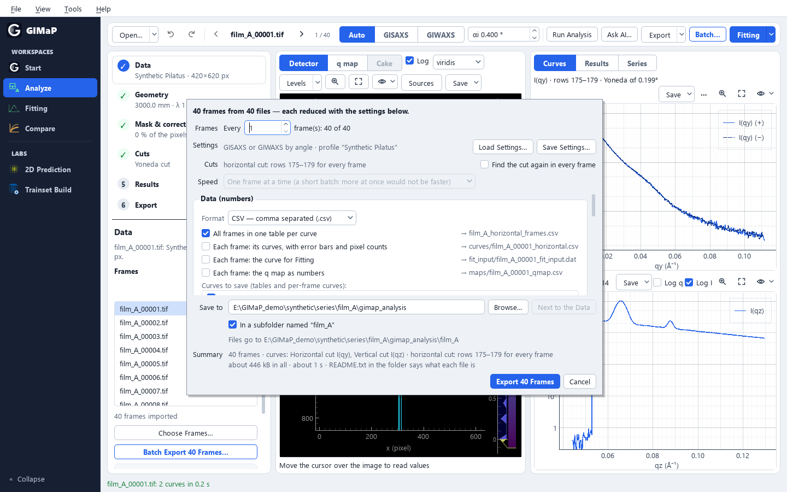

*Every option shows the file it writes. The Cuts row names the cut every frame gets; the Summary says how many
frames, which curves and about how big and how long the export is.*

**Where to start it:** **Batch Export…** in the command bar (`Ctrl+Shift+E`), **Batch Export N
Frames…** under the file list, **Batch Export…** in the Series tab, the Export step, **Export ▾**,
or the Start page with a folder of raw frames.

**The dialog:**

- Top: **Frames** (**Every** n-th listed frame), **Settings** (a summary, with **Load Settings…** /
  **Save Settings…**), **Cuts** (the cut every frame gets, with the box **Find the cut again in every
  frame**, section 5.6), **Speed**.
- Middle, four groups:

| Group | Options | Files |
|---|---|---|
| **Data (numbers)** — CSV (comma), TXT (tab) or DAT (space) | **All frames in one table per curve** (x first, one column per frame); **Each frame: its curves, with error bars and pixel counts**; **Each frame: the curve for Fitting**; **Each frame: the q map as numbers**; **Each frame: the unwrapped χ–q map as numbers** | `<name>_<curve>_frames.csv`, `curves/<frame>_<curve>.csv` (+ `_analysis.json`), `fit_input/<frame>_fit_input.dat`, `maps/<frame>_qmap.csv`, `maps/<frame>_cake.csv` |
| **Pictures** — PNG, TIFF, SVG or PDF | **Each frame: picture of the detector image**; **Each frame: picture of the q map**; **Colour scale**: each frame its own limits (1–99.7 %), or the limits on screen for every frame (comparable pictures) | `images/<frame>_detector.png`, `images/<frame>_qmap.png` |
| **Converted detector frames** — TIFF, EDF, NumPy or HDF5 | **Each frame: the detector data in another format** (values as read: modules stitched, frames summed) | `frames/<frame>.tif` |
| **Curve for Fitting** (GISAXS) | **Halves of the cut**: **Mean of both halves**, **q > 0 half** or **q < 0 half** — what the model fit takes in every frame | (named in the curves for Fitting) |
| **Fitting (optional)** | see below | `<name>_peak_fits.csv` or `<name>_model_fits.csv`, with a `.png` |

- Bottom: **Save to** (**Browse…**; the first time `gimap_analysis/` next to the data, then the last
  folder used; **Next to the Data** goes back to the folder beside the files, and a folder used last for
  other data is marked so) and **In a subfolder named “<name>”** (on by default). The line below says
  where the files go; **Export N Frames** starts the batch.

**Before it starts**, the **Summary** says how many frames, which curves, which cut and halves, and about
how big and how long the export will be. While the frame on screen is read again without the sum of the
automatic analysis, the Cuts row says so and Export waits. A folder that cannot be written is said at
once, with Export off. When the folder holds an earlier export of the same data (or curves for Fitting),
Export asks **Replace**, **Keep Both in a New Subfolder** or **Cancel**; the question names what Replace
would remove, and `Enter` answers Replace only when this export writes every such kind of file again —
otherwise Keep Both.

For tables and per-frame curves, tick the curves you want (**All** / **None**). In a table of all
frames, frames with the same points are put side by side; frames whose points differ only slightly
(rounding, a few missing columns) are matched row by row; only grids that really differ are interpolated
onto the first frame's x, never across a gap and never extrapolated. The table header says which. The
folder always gets `README.txt` (what each file is, the curve names, the units, the cut, the sum, the
frames that failed) and `<name>_batch.json` (the choices, the frames, every failed frame with its reason,
every file written, the cut of every frame, and the first frame's full settings).

**Names.** File names keep the frame index counted from 0 (`scan_00007_frame0003_sum3_…`; a file of one
frame has no `_frame`); headers, labels and picture titles count from 1 (*frame 4 of 12*), and every curve
file says in `#` lines which frame, sum and files it comes from. A set of module files is named by its
scan, without `_m01`.

**Fitting (optional)** — **No fitting** by default:

- **Peaks of the ring regions** (GIWAXS): every region with a q window (Ring or Spot) is one peak.
  It is fitted in the region's I(q), over the window plus one window width on each side, with a
  **Peak shape** (Pseudo-Voigt, Gaussian, Lorentzian) on a straight background. One row per frame
  and peak: q, d, FWHM and area with errors, height, η, χ²ᵣ, and a note when a fit is not
  significant, too wide or has too few points.
- **Particle model of the horizontal cut** (GISAXS): the half or the mean chosen in **Halves of the
  cut** fitted with spheres, random or vertical cylinders, with size spread and distance D (**Model**:
  automatic comparison or one; a cut of more than 1000 points is merged first). The two halves are
  never fitted together. One row per frame: `halves`, `points`, model, χ² and the parameters in nm.
  About half a minute per frame. The choice starts on the Cuts step's halves when they are the mean or
  one half, else on the last batch's. A frame without counts, or without points on the chosen half
  (*No points on the q > 0 half*), is not fitted and its reason is listed. The curves for Fitting still
  hold both halves with signed qy and name the choice.
- **Start values**: **The previous frame's result** (a slowly changing series), **The first frame's
  result, for every frame** (frames independent), or **Found anew in each frame**.
- **Try on This Frame** fits the frame on screen with these choices before the batch.
  **Also save the fitted curve of each frame** writes `fits/<frame>_<curve>_fit.csv` (peaks) or
  `fits/<frame>_model_fit.csv` (the particle model: the points fitted, in nm⁻¹, with the fit).
- A Gaussian or Lorentzian peak keeps η at exactly 0 or 1; only the Pseudo-Voigt fits it.
- The fits of every frame are shown as they come in the Series tab, under *Results: batch fitting*
  (section 5.6).

**In-situ corrections (reference peak)** (folded, GIWAXS): a peak that does not change during the
run (substrate, internal standard) corrects drifts. Give **Reference peak q** and **Search ±**
(Å⁻¹); the strongest point in that window is the peak. **Align the detector distance so the peak
sits at this q** scales each frame's distance; **Normalise the intensity to the peak height**
scales the intensities, with **One factor for the whole series (from the first frame)** or
**Every frame to its own peak**.

**Speed:**

| Speed | What it does |
|---|---|
| **Gentle** | one frame at a time; the computer stays free |
| **Balanced** (recommended) | several frames at once in low-priority processes (about a quarter of the cores, at most 4) |
| **Fast** | more at once (all cores but two, at most 8); other programs get slower |

The number at once never exceeds what half of the free memory allows (a Lambda 9M frame, 14.9
megapixels, needs about 1.4 GB while reduced). A short batch stays one frame at a time, and the
**Speed** box then says so. As an example, Lambda 9M frames with peak fitting took about 2.5 s each
one at a time, and less than 1 s each with *Balanced* (4 at once).

**After it ends** the status line says how many frames were exported, into which folder and in how
long, how many model fits succeeded and why the others did not; failed frames are listed with their
reasons (in the panel, in `README.txt` and in `<name>_batch.json`). A batch with failed frames or failed
fits does not end as a success.

**While it runs** a panel above the right tabs shows the frames being reduced, how many are done,
the time per frame and the time left, and the latest fit. **Pause** starts no new frames;
**Stop** ends the batch after the frames in progress — everything written stays, and the tables
are written for the frames done. The number of frames at once can be lowered while running. The
Series tab shows the map of the frames done so far, growing as they come; **Show the newest frame**
makes the curve below follow the newest frame (click a row to look at another one).

The choices and the folder are remembered for next time. **Save Settings…** / **Load Settings…**
keep the whole set-up (mode, instrument profile with its geometry, αi, centre, sum, masks,
corrections, cut regions, export choices) as a file: the next raw data need only **Batch Export…**
→ folder → **Export N Frames**. A mask or background file named in it that cannot be found is
listed and ignored.

### 5.8 Export and Send to Fitting

**Export** (command bar, `Ctrl+E`; **Export Curves…** in the Export step) writes, next to the data
in `gimap_analysis/`:

- one CSV per curve (`x, I, sigma, pixels`), named `<stem>_<curve>.csv`;
- `<stem>_analysis.json`: the source, geometry, where the beam centre came from, corrections, the
  number of bad pixels left out, the cuts;
- `<stem>_fit_input.dat`, the curve for Fitting.

`<stem>` is the file name; a frame of a multi-frame file adds `_frame` and its number, a sum adds
`_sum` and the number of frames summed.

If that folder cannot be written, GIMaP asks for another one. A note at the bottom right names
what was written, with **Open Folder**.

The **Export** step and **Export ▾** also have:

| Entry | Writes |
|---|---|
| **Save Image…** | the detector image or q map as shown, with a colour bar (PNG, TIFF, SVG, PDF) |
| **Save q-Map Data…** | the intensity on a regular q grid (qy–qz or q∥–qz) as a CSV table with its axes |
| **Save Plots…** (**Save Upper Plot…** / **Save Lower Plot…**) | the plots as figures, one column wide |
| **Save Settings…** / **Load Settings…** | the set-up as a file (5.7) |

Saved figures always use the light colours, whatever the theme on screen.

**Send to Fitting** writes `<stem>_fit_input.dat` in `gimap_analysis/` and opens it in Fitting.
The file has columns `q I sigma pixels`, q in Å⁻¹, and `#` header lines with the source, the gap
guard, the frame (*frame 4 of 12*) and the frames summed. GISAXS sends the whole horizontal cut
(signed qy), and Fitting uses the halves chosen (its arrow ▾ chooses them, as in the Cuts step; the
mean or one half is also written in the file); GIWAXS sends I(q), and Fitting opens it with a note
that its models are particle form factors, not peaks. Fitting shows q in nm⁻¹ and says so. When the
folder next to the data cannot be written, GIMaP asks for another one and keeps it for the session.

**Send Series to Fitting…** (in the arrow ▾ and the Export step) opens the Batch Export dialog with
only the curve for Fitting of each frame: choose **Every** n-th frame, the folder and, for GISAXS, the
**Halves of the cut**, then **Export and Open in Fitting** writes `fit_input/<frame>_fit_input.dat` for
every imported frame (or sum of frames) into a folder of its own, `<name>_fitting/` (next to any Batch
Export of the same data, which it leaves alone), and opens its `fit_input/` in **Fitting ▸ In-situ
series** (chapter 6).

## 6. Fitting

The **Fitting** page fits 1D curves with particle models. It has two modes, switched at the top of the page:

- **Single analysis** — one curve, in four steps (section 6.2).
- **In-situ series** — every curve of a folder, or every frame of a detector series, fitted with the model
  of Single analysis (section 6.6).

Switching between the two keeps each side's curve, model and results. With no curve open, the Curve step
offers both ways in side by side: **Open Curve…** and **Fit a Folder of Curves…**. For a series or a batch
of samples the usual way is: fit one representative curve here (predict, then refine), then press **Fit
Every Curve in This Folder…** in Results.

Fitting works in nm⁻¹ and labels every axis and field with its unit. Analyze works in Å⁻¹; the curve files it
writes for Fitting are in Å⁻¹ and are converted when they are opened.

Coming from version 0.0.2: the detector work of the former Cut & Fitting page now happens in **Analyze**,
which writes the curve that Fitting fits.

| Former Cut & Fitting control | Now |
|---|---|
| Import image, Previous / Next | Analyze file list |
| Detector parameters | Analyze instrument profile (**Geometry…**, **Calibrate…**) |
| Find Yoneda & Set Cut, cut thickness | Analyze's automatic horizontal cut (drag the band or enter rows) |
| Optimize Center X | **Analyze ▸ Beam centre ▸ Refine x by Symmetry** |
| Mask negative pixels + guard | **Mask & corrections** step ▸ **Corrections** (folded) ▸ **Gap guard** (3 px by default) |
| Stack | **Data** step ▸ **Frames** (folded) ▸ **Sum** |
| Cut region width | Fitting's **Fitting range** |
| In-situ CBF / NXS series | Analyze ▸ **Send Series to Fitting…**, or the frames themselves in **In-situ series** (section 6.6) |

### 6.1 Curves Fitting reads

Fitting reads `.dat` and `.txt` text curves:

- Analyze's curve files, `<name>_fit_input.dat`, have four columns — q (Å⁻¹), intensity, σ and the number of
  detector pixels averaged — and a header recording where the curve came from.
- Any other `.dat` / `.txt` file with columns `q I [σ]` opens too. A file whose header states the unit of q is read
  in that unit — `q in <unit>` in a `#` line, or the name of the first column (`q (1/A)`, `q_nm^-1`,
  `# columns: qy (1/A) …`, `# q [1/nm]  I`); Analyze's curve files state Å⁻¹. For a file that states none, set
  **Curve ▸ File ▸ q unit of files without one in their header** (Å⁻¹ by default). A file whose header states both
  Å⁻¹ and nm⁻¹ is not opened: *The header states q both in 1/A and in 1/nm; correct it to one unit.*

Fitting does not read `.csv` files, also not the CSV curves that Analyze exports. Use **Send to Fitting** in
Analyze, or open the `_fit_input.dat` written next to the CSV. A `.csv` dropped on Fitting is refused with
that reason.

Three ways to get a curve in:

1. **Open Curve…** in the command bar (`Ctrl+O` while Fitting is shown), or drop a curve file on the page.
2. **Analyze ▸ Send to Fitting** — writes `<name>_fit_input.dat` and opens it here. The halves chosen in
   Analyze become the **Halves of the cut** in Fitting:

   | In Analyze | In Fitting |
   |---|---|
   | Both halves on \|qy\| (two colours) — default | Both halves on \|q\| |
   | Mean of both halves | Mean of both halves |
   | qy < 0 half | q < 0 half |
   | qy > 0 half | q > 0 half |

   When the folder next to the data cannot be written, Analyze asks for another folder and keeps it for the
   session. A GIWAXS I(q) opens with a note at the top of the page: Fitting's models are particle form factors
   for the horizontal cut of a GISAXS frame, not diffraction peaks, so no particle-shape search is set up for it
   (for peaks use **Analyze ▸ Batch Export ▸ Peaks of the ring regions**).

3. **Analyze ▸ Results ▸ Fit details ▸ Show in Fitting** (after a GISAXS automatic analysis, section 5.5) —
   opens the same curve and puts the selected solution into **Model**. Sizes and spreads are converted and the
   scales are solved on the solution's own curve. The status line says how closely Fitting's model reproduces
   it: the same curve for spheres and random cylinders; Fitting's vertical cylinder weights radii by R⁴, so it
   is loaded as a start to refine. **Refine in Fitting** opens the curve without a solution.

### 6.2 Single analysis: one curve in four steps


*The step rail on the left, here with the Results step open: the quality, the next steps (Fit Again, Fit Every
Curve in This Folder…), what was done automatically at the edges of the ranges, the warnings and every value ± its
error; on the right the curve with the model, the orange fitting range and the residuals below.*

The page is laid out like Analyze: the steps on the left, each saying where it stands, and the plots on the right.

- **The curve plot**: the points (paler outside the fitting range), the model over the whole curve and the
  **orange band** of the fitting range (drag it). **Terms** also draws each part of the model: every particle,
  the background and the resolution peak.
- **The residual plot** below: (I − model)/σ, or ln(I/model) when the file has no σ.
- **The command bar**: **Open Curve…** (its menu: **Load Model…**), **Undo / Redo** (`Ctrl+Z` /
  `Ctrl+Shift+Z`: every change of the model, the fitting range or the left-out points is one step, and so is every
  fit, solution used and model loaded), **Fit** (`Ctrl+Return`), **Stop** and **Save** (**Data and Fit…**,
  **Plot…**, **Model…**).

**1. Curve**

- The file, its points, its q range in nm⁻¹ and Å⁻¹, the unit its q was read in and where that came from (*q read in
  Å⁻¹: stated in the file*, or *… not stated in the file: the setting for files without one*), and whether σ is in
  the file. The fit weights each point by 1/σ; without σ every point gets the same relative weight.
- **Halves of the cut**, for a cut through the beam (q < 0 and q > 0): **Mean of both halves** (averaged where
  both halves were measured; across a gap of one half, and beyond its end, the other half alone — never
  interpolated), **Both halves on |q|**, **q > 0 half** or **q < 0 half**. *Predict parameters*, *Find the
  particle shape* and the *AI proposal* take one curve: on **Both halves on |q|** they switch the box to the mean
  and say so; *Refine* and *Search* fit both halves.
- **Fitting range** in nm⁻¹, or drag the orange band; **Whole Curve** fits every point.
- Under *File* (folded): **q unit of files without one in their header** — Å⁻¹ by default; the In-situ series uses
  it too. A file whose header states its unit (Analyze's curves: Å⁻¹) is read in that unit, whatever is set here.
  Changing the setting opens a curve without a unit again in the new unit; for a curve that states one, the status
  line says why nothing changes. A project and the last session keep the unit a curve was read in and this
  setting. A curve saved before opens as it did, unless its header states another unit than the one saved: it is
  then read in the stated unit, and the status line (for a project, its notes) says so.
- **Leaving points out**: switch on **Exclude** above the plot, then click a point to leave it out of the fit
  (click again to take it back), or drag a box around several. They are drawn as red ×, the Curve step says how
  many, and **Include All** takes them back. The left-out points are kept with the curve (and in a project) and
  written in the fit's record.

**2. Model**

- **Add Particle** adds one card per particle: **Sphere**, **Random cylinder** or **Vertical cylinder**.
- Each card has **Distance D** on or off (the paracrystal interference between neighbours) and its values:
  scale, R and **σR/R**, h and **σh/h** for random cylinders, D and **σD/D**. Spreads are relative everywhere
  (as in Analyze's results and in 1D Predict).
- **fit** ticked: the fit may change the value. Unticked: the value stays fixed.
- **Ranges** shows each value's min – max. The fit keeps the value inside it; *Search the ranges* searches
  across it. A value typed outside its range widens the range.
- **Background and resolution peak**: I(q) = BG + k·[Σ particles + A/(1 + (|q|/w)^ν)]. The peak describes the
  tail of the direct and reflected beam and the resolution near q = 0. The factor k is fixed at 1 by default.
- After a fit every value shows its ± error, or *at a bound* when it stopped at the edge of its range and was
  not resolved (section 6.3, *Values at the edge of their range*).

A new installation starts with a neutral model, not with the values of an earlier fit. Set the particle and its
sizes for your sample, or let the Fit step find them.

**3. Fit** — one **Method** drop-down and one button:

- When a curve is opened the page chooses the method for it. An unfitted GISAXS horizontal cut gets **Predict
  parameters (fit1d)**, and the line under the method says *Recommended for this curve: a GISAXS cut not fitted
  yet.* Another curve with a model not yet edited gets **Find the particle shape (no AI)**; otherwise the choice
  stays as it was (a GIWAXS I(q) never gets a particle search). After a prediction or a shape search the method
  turns to **Refine the values in Model**.
- Under the method, only what it needs: **Particles** for Predict (section 6.4), **Families** for the shape search
  (*Try every family* or *The families in Model*).
- Press **Fit** in the command bar (`Ctrl+Return`) or the button below, which carries the method's name (for
  example **Refine**). A progress bar and **Stop** appear while it runs.
- **Resolve values at the edge of their range automatically** (on by default, remembered; the In-situ series
  follows it): see section 6.3.
- **Options** (folded): the settings of Predict (network, search, curve type, qz, systematic error; section 6.4),
  **Evaluations at most (Refine, Search)** (automatic by default) and **1D Predict Batch Window…** (section 6.5).

**4. Results**, from the top:

- The quality: χ²ᵣ (with σ) or the variance of ln I (without σ), the points, the free values, converged or not.
  After Predict a second line says that Model holds only a starting point.
- What to do next: **Refine These Values** (after a prediction or a shape search), **Fit Again** (the same
  method, with the values, fixed values and ranges now in Model) and **Fit Every Curve in This Folder…** (the
  In-situ series on this curve's folder, each curve starting from this model).
- *Done automatically* (green): values at the edge of their range that the fit widened and fitted again, with
  χ² before and after.
- Warnings (orange), only what you need to know: a value still at an edge, the kit's notes, strongly correlated
  pairs (|ρ| ≥ 0.95: the data do not separate them; fix one — the first two pairs are named, hover for the rest)
  or χ²ᵣ well above 1.
- The values, each ± its 1σ error (the covariance at the solution, scaled by χ²ᵣ). Select values and press
  **Fix**, **Let It Fit** or **Range…** (or right-click): the next **Fit Again** uses them. **Range…** shows the
  value's min – max in Model.
- **Other solutions** (folded): the solutions of *Find the particle shape* or of the AI proposal, each with its
  χ²ᵣ on these points. **Use This Solution** puts one into Model (Undo brings the previous model back). After
  Predict with several compositions, **Other compositions** instead (section 6.4).
- **Constraints and ranges** (folded, after Predict): every constraint passed to fit1d and where it came from.
- **Save Data and Fit…** writes a CSV — q (nm⁻¹ and Å⁻¹), I, σ, the model, the residuals and every term — with a
  JSON record next to it: the model, the fit (errors, bounds, correlations, what was done at the edges) and the
  points used. **Save Plot…** writes PNG or SVG; **Save Model…** writes the model as JSON, to load for another
  curve with **Load Model…**.
- **Run Log** (folded) at the bottom.

What to check:

- A fit belongs to the curve and points it was made on. When you change the halves, the fitting range or the
  left-out points afterwards, the Fit and Results steps say *Changed after the fit: Fit again*.
- Opening another curve stops a fit that is running; a fit that ends after that is not kept, and the status line
  says so.
- A save that fails (for example on a read-only file) leaves an earlier file as it was and says why.

The model, the method and the choices are kept for the next session, and the last curve opens again.

### 6.3 Fit methods

One **Fit** button runs the method chosen in **Method**:

| Method | What it does | When to use it |
|---|---|---|
| **Predict parameters (fit1d)** | A separate kit: network proposals and its own physical fit, for spheres and vertical cylinders, with errors and equivalent solutions (section 6.4). | The first step for a GISAXS cut (recommended). Needs the fit1d kit. |
| **Refine the values in Model** | Bounded least squares from the values in Model, with Fitting's own model; stays near them. | The model is close: after a prediction or a solution, after Analyze, or to get errors. |
| **Search the ranges, then refine** | Differential evolution across the ranges of the free values (log scale when a range spans 10× or more), then refinement from the three best starts. | The start is poor but you know the family and sensible ranges. Slower. |
| **Find the particle shape (no AI)** | The numerical fit of sphere, random cylinder and vertical cylinder from several starts, as in Analyze's automatic analysis. The solutions go to Results, the best into Model. | A first look at a new curve without the kit. Uses no network. |
| **AI proposal (1D Predict)** | The experimental V5 network proposes compositions and parameters, then corrects them numerically. Its solutions go to Results. | A second opinion on the family. Check and refine its solutions; do not report them as results. |

- The scales (every particle's scale, the background, the peak A) are solved exactly (non-negative least
  squares) at every step. The search therefore moves only sizes, spreads, distances and the peak's shape.
- **Stop**: *Refine* and *Search* keep the best values so far. Stopping *Find the particle shape*, the AI
  proposal or Predict produces no new result.
- The AI proposal also writes a run folder in `AI_Fitting_Output/` (section 6.5).

**Values at the edge of their range.** With **Resolve values at the edge of their range automatically** on,
a value that stops at the edge of its range after Predict, Refine or Search is dealt with by the fit itself;
Results lists what was done under *Done automatically*:

1. The range is widened on that side (sizes, distances and the peak width ×2 or ÷2; your own ranges are widened
   like the default ones; values you fixed are never touched) and the curve is fitted again, at most twice. The
   new fit is kept only when its χ² is not more than 2 % worse; otherwise the first fit stays and Results says
   why.
2. A value still at the edge after that — or one that cannot be widened, such as a size spread at its lower limit
   or D = 2R — means the curve is flat in that direction and gives only a bound. The fit moves the value inwards
   step by step, fixes it and refits the rest, as long as χ² stays within its 1σ tolerance, and reports the least
   extreme value as a one-sided bound (for example *≥ 0.549*). When even one step is clearly worse and the edge is
   a limit of the model itself (σR/R at 0.6), the curve wants a value beyond the model: the model may lack
   something.

Turn the box off to leave such values at their edge, with a warning.

### 6.4 fit1d

fit1d is a separate kit with its own networks and physics; in the Fit step it is the method **Predict
parameters (fit1d)**. It fits all the populations of one curve together. A good fit does not prove that the
composition is the true one.

**What to enter**

1. In **Fit**, select **Predict parameters (fit1d)** (preselected for an unfitted GISAXS cut). Under it,
   **Particles** chooses what it fits:
   - **Try spheres and vertical cylinders (1–3)** or **Try 1–3 vertical cylinders**: the kit fits every
     composition of these shapes and ranks them (by BIC); the best is shown. A Model not yet edited starts on the
     first of these for a GISAXS cut. The Model's values and ranges are not passed, since the populations differ
     between compositions.
   - **The particles in Model**: the 1–4 **Sphere** / **Vertical cylinder** particles you put in Model (repeated
     families are allowed), with Model's constraints (below). Random cylinders are not offered by fit1d.
2. Its settings are folded under **Options** in the Fit step:
   - **fit1d network**: **General network** (`cond_v2_ft4`) or **Au nanoparticles on Si (adapted)**
     (`cond_v2_ftr1`).
   - **fit1d search**: **Auto (more starts when needed)** (default here), **Fast (one search)** or
     **Robust (always many starts)**.
   - **fit1d curve type**: **GISAXS (Yoneda cut)** or **SAXS (dilute, no structure factor)**. SAXS ignores qz and
     has no structure factor or low-q term.
   - **Cut qz (nm⁻¹)**: for a Yoneda cut, tick it and enter the vacuum qz of the cut. It is not filled from
     Analyze. Unticked means qz = 0, with a warning when a sphere is present.
   - **fit1d systematic error (%)**: a relative error added to σ in quadrature (0 by default; 2–5 % suits
     bright measured curves). Without σ in the file, fit1d assumes Poisson errors and says so.
3. Press **Fit**. It runs in a separate process; **Stop** ends it without a result. Values at the edge of their
   range are resolved as described in section 6.3.

**Constraints from Model** (with **The particles in Model**): values you fixed and ranges you changed (different
from the default ones) are passed to the kit — R and D in nm, σR/R as it is, σD/D converted to the kit's w/D, and
a fixed background. Default ranges are left to the kit, which sets them from the q range of the curve. A range
beyond what this q range can measure is said before the fit. **Results ▸ Constraints and ranges** and the JSON
record list every constraint used and where it came from (Model, widened here, a bound).

**Other compositions.** After **Try …**, Results has a folded **Other compositions** list (up to six: χ²/point,
ΔBIC, which ones cannot be told apart, the kit's flags). Compositions within ΔBIC ≤ 10 of the best cannot be told
apart on this curve: choose from what you know of the sample. Select one to see its values ± errors,
equivalent ranges and states; **Use This Composition** predicts again with it, its values as the start (Undo
brings the previous model back).

**Reading the result**

- The plotted total, the **Terms**, the residuals and **Results** show fit1d's own result: χ²/point, its native
  parameter values, errors, states and equivalent-solution ranges. Parameter warnings are in the *state* column;
  hover for ranges.
- **Save ▸ Data and Fit…** keeps the native total, the components, the effective σ and the warnings in the CSV
  and its JSON record.
- The values copied into Model are only a manual starting point. **Refine These Values** afterwards uses the
  manual model's physics.
- Editing Model, the selected points or the fit1d settings marks the fit stale: its table and χ² are labelled as
  the previous result, the plot shows the manual starting model, and exporting the stale fit is refused. Fit
  again, or restore its conditions.

Physics note: fit1d uses number-weighted truncated Gaussian sizes (relative widths), a Hosemann paracrystal with
w = w_rel·D, q in nm⁻¹ and lengths in nm. Spheres on a Yoneda cut are evaluated at |q| = √(q∥² + qz²), vertical
cylinders at q∥. Its widths and forward curve differ from the manual model's.

**Installing the kit**: put the folder `gisaxs1d_gui_kit` in `utils/gisaxs1d_gui_kit` in the program folder, or
set the environment variable `GISAXS1D_KIT_HOME` to its folder, then start GIMaP again. It needs numpy and scipy
only, no TensorFlow and no V5 files. Without the kit, the method fails with a message that says where to put it.

### 6.5 1D Predict

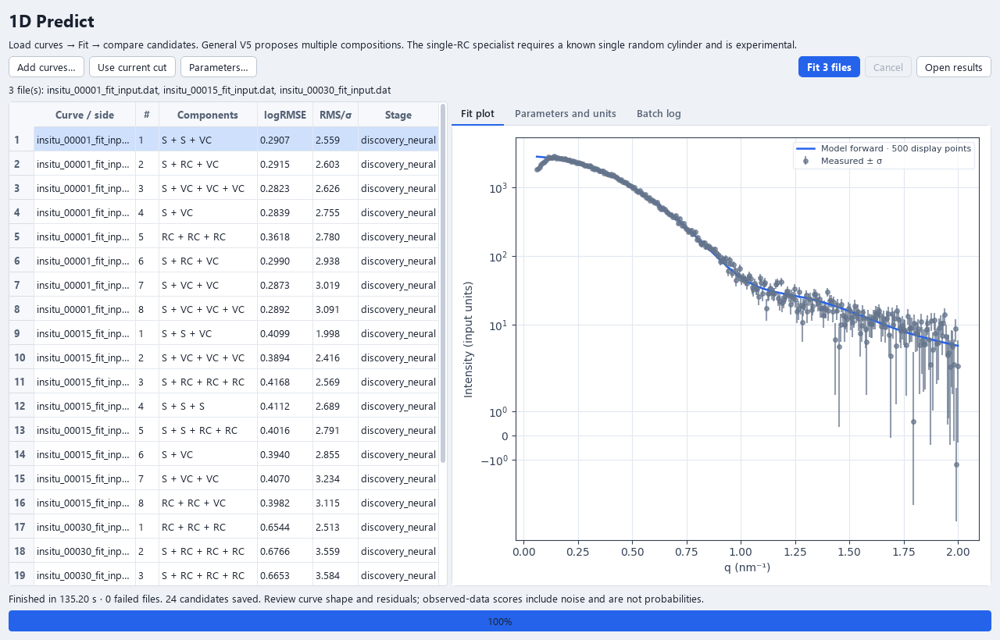

*The candidates of every curve on the left (with their Stage); the selected candidate's fit and parameters on the right.
The second line under the buttons, “q in Å⁻¹, as their header states: …”, says how the three Analyze curve files
(`_fit_input.dat`) are read, with no unit set by hand; **Curve / side** repeats it after each name (“· Å⁻¹”).*

**1D Predict** is the experimental neural model (Workflow V5). It proposes compositions and parameters for a curve
and corrects each proposal numerically against the measured points. Take its solutions as starts to check and
refine, not as results.

- **For the curve open in Fitting**: choose **AI proposal (1D Predict)** in the Fit step and press **Fit**; the
  solutions are listed in Results.
- **For a list of curve files**: **Tools ▸ 1D Predict — Fit Many Curves…** (or **1D Predict Batch Window…**
  under *Options* in the Fit step) opens the 1D Predict window. To fit every curve of a folder with your model,
  use the In-situ series instead (section 6.6).

**In the window**

1. **Add curves…** lists text curve files (`q I [σ]`; `.dat`, `.txt`, also comma-separated `.csv`). **Use current
   cut** takes the curve open in Fitting instead. The line under the buttons says in which unit of q each file is
   read: the unit its header states or, for a file whose header states none, the setting **q unit of files without
   one in their header**. A file whose header states both Å⁻¹ and nm⁻¹ is not fitted and is named there.
2. **Parameters…** sets:
   - **Fit method**: *General V5 (experimental)* (default), *Single RC specialist (experimental)*,
     *Physical fit (numerical)*, which uses no network, or *fit1d (network + physical fit)* (section 6.4).
   - **Complete composition**: the particle families when you know them.
   - **q unit of files without one in their header**: nm⁻¹ by default. A file whose header states its unit of q is
     read in that unit, whatever is set here; Analyze's `_fit_input.dat` files state Å⁻¹ and need no setting. A
     header states the unit with `q in <unit>` in a `#` line or in the name of the first column (`q (1/A)`,
     `q_nm^-1`, `# columns: qy (1/A) …`, `# q [1/nm]  I`). **Use current cut** is converted automatically.
   - **q sides**: *Each half separately*, *q > 0 half* or *q < 0 half*.
   - For fit1d: its search (**Fast** by default in this window), curve type, network, qz and systematic error.

   **Save Settings** keeps them.
3. **Fit curve** (**Fit N files** when several are listed) starts, **Cancel** stops (finished files stay saved),
   **Open results** opens the run folder.
4. The table lists the candidates of every curve and half: **Curve / side** (the file and + or −), **#**,
   **Components** (S sphere, RC random cylinder, VC vertical cylinder), **logRMSE**, **RMS/σ** and **Stage**; for a
   file, **Curve / side** also gives the unit its q was read in (hover to see where it comes from).
   Select one to see, in the tabs on the right, its **Fit plot**, its **Parameters and units** and the **Batch log**.

The **Stage** says what produced a candidate. For *Single RC specialist* it is *Neural model*, *Model + amplitude*
or *Numerical fallback*; fit1d rows say *fit1d*; *General V5* and *Physical fit* show the name of the step that
produced it (for example `discovery_neural`). Hover for the details and, for a fallback, the reason. The scores are
not probabilities.

*Single RC specialist* uses its network only for one **Random cylinder** in **Complete composition** and a curve
with native detector counts (Analyze's horizontal cut). Otherwise it falls back to its numerical fit and says why.

Selecting a fit1d row keeps its original curve and components visible; a manual model is copied only as a starting
point.

**Where the results go.** Each run writes a new folder `AI_Fitting_Output/v5_<date>_<time>/` in the folder GIMaP
was started from (for the portable version: the program folder). It holds `request.json`, `batch_summary.json`,
`top20_candidates.json`, `fitting_run_summary.json` and, for every curve and half, `solutions.json` (parameters,
units, the stage that ran and why), `display.npz` and `fitting_curves.csv` (*General V5* also writes
`candidates.npz`). `request.json` and `fitting_run_summary.json` list the unit each curve's q was read in
(`q_units`); each file's entry in `batch_summary.json` and its candidates in `top20_candidates.json` carry it as
`q_unit_read` and `q_unit_from`. The folders are not removed automatically. Fits you save yourself (**Save**) go
where you choose.

**Model files.** The model and its trained weights are in `modules/Fitting_1D_Model/Workflow_v5/`, both in the
portable version and in the Git repository, so 1D Predict runs from a source checkout too. Each network checks its
files against their checksums before it is used. With a changed or missing file *General V5* does not start, and
the message names the file. *Single RC specialist* goes on with its numerical fit and gives *Fast model
unavailable* as the reason (section 13.3). fit1d uses its separately installed kit.

### 6.6 In-situ series

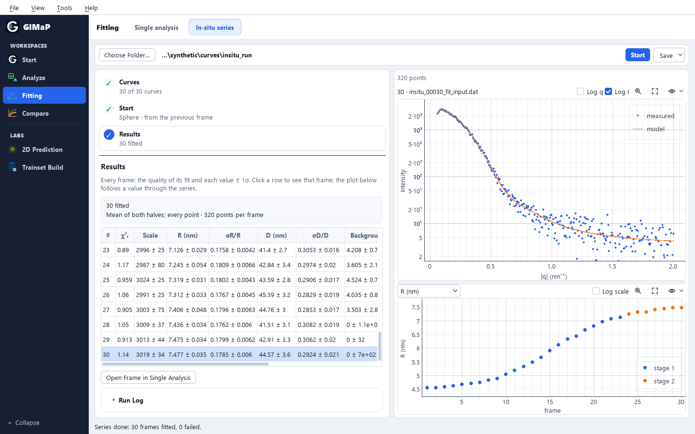

*The Results step on the left (the halves and points per frame, then every frame's χ²ᵣ and values ± 1σ); on the
right the selected frame's fit and, below it, the trend of R through the series, coloured by stage.*

Every curve of a folder, fitted with the model of Single analysis. The command bar has **Choose Folder…** and
**Start**; **Pause** and **Stop** appear while the series runs, **Save** once frames are fitted.

**1. Curves**

- **Choose Folder…** (or drop a folder on the page), **Fit Every Curve in This Folder…** in Single analysis'
  Results, or in Analyze list the frames and choose **Send Series to Fitting…**: every frame is exported
  (optionally summed N at a time) into `<name>_fitting/`, and the series opens here with its curves listed.
- **Files** is the pattern: `*_fit_input.dat` by default; any `.dat` / `.txt` curves work. **Also in
  subfolders** looks deeper.
- **Detector frames.** **Files** can also name detector files (`*.cbf`, `*.tif`, `*.edf`, `*.nxs` …), and a folder
  that holds frames but no curves switches to its frames by itself. Every frame (every frame of a NeXus/HDF5 file;
  a set of module files is one source; Analyze's **Sum** groups neighbouring frames) is cut as Analyze cuts the
  frame it has set up — instrument profile, αi, beam centre, masks and corrections, bad pixels, the cut of the
  series and the halves — giving the same curve as `<stem>_fit_input.dat` (q in Å⁻¹), in memory only: nothing is
  written next to the data. The step says whose set-up is used; while Analyze has no frame set up it says why and
  Start does not begin. **Take Analyze's Set-up** takes Analyze's set-up as it is now and cuts the frames again.
  The JSON record keeps Analyze's settings.
- The curves are listed in counting order of their names (`frame_2` before `frame_10`) and numbered 1, 2, 3 … in
  that order. **Frames**: first – last of these numbers, and **Every** n-th.
- **The unit of q**: every curve file is read in the unit its header states, else in Single analysis' **q unit of
  files without one in their header** (its value at Start, kept for the run). The step counts the listed curves by
  unit and where it came from — *2 curves: q in Å⁻¹, as their header states*; *1 curves: q in nm⁻¹, no unit in
  their header (Single analysis ▸ Curve ▸ File)* — and names a file whose header states both units: it is not
  fitted, and its frame says why. Detector frames are cut in Å⁻¹.
- **Watch for new curves**: while the series runs, the folder is looked at every 2 s and curves written into it
  (for example by Analyze during a measurement) are fitted too. A new file is taken once its size and time are the
  same at two looks; a file changed after it was read is fitted again; a folder that cannot be read is waited for.
- **Halves of the cut**: every frame is fitted on one curve — **Mean of both halves**, **q > 0 half** or **q < 0
  half**, never on both halves together. Until you choose, it takes the halves Analyze sent the curves with, else
  those of Single analysis unless they are both on |q|, else the mean; the line under it says where the value comes
  from. Curves with q on one side only have no halves, and the box says so. A frame without points on the chosen
  half fails with *No points on the q > 0 half* (or *q < 0*); it is never fitted on the other half instead.
- Once the curves are listed, they are compared in the background (section 7.1). The step says how many stages
  and odd frames there are, and the list is coloured by stage. **Leave out the odd frames** is on by default.

**2. Start**

- Every frame uses the model, the fitting range and the left-out points of Single analysis (**Edit in Single
  Analysis** changes them) and the halves of the Curves step. Values at the edge of their range are resolved as
  **Resolve values at the edge of their range automatically** in Single analysis says (section 6.3).
- **Each frame starts from**:
  - **The previous frame's result** (default) — for a slowly changing sample. A frame that did not converge
    makes the next one start from Single's model again.
  - **The model in Single analysis** — every frame independent of the others.
  - **The previous result; the Single model at each new stage** — follows the sample within a stage and starts
    afresh where the curves change course.
- **Method**: **Refine (fast)**, **Search the ranges, then refine (slow)** or **Predict each frame (fit1d)**.
- **Predict each frame (fit1d)** runs Predict on every frame, with the particles, fixed values and ranges of
  Single's model and the settings of Single's Fit step (it needs the fit1d kit). The table holds fit1d's values and
  errors, and the frame plot fit1d's own curve. **Prefer the solution that continues the previous frame** (on by
  default): each frame is fitted once more with every value held near the previous frame's; when that fit is as
  good as the free one within the kit's tolerance, it is taken (the smoothest of equally good solutions), otherwise
  the free fit is taken and the record says the sample changed there. It does not apply when every frame starts from
  Single's model, nor at the first frame of a new stage.
- Then **Start** in the command bar. **Pause** and **Stop** act after the frame being fitted; the frames done are
  kept. A project cannot be opened while a series runs (Stop first). A run started before the stages were found
  uses none (it says so).

**3. Results**

- How many frames were fitted, failed or did not converge, with the halves and points per frame.
- A table with a row per frame: χ²ᵣ, each free value ± 1σ, the **Points** fitted and the **Halves**. Click a row
  to see that frame's curve and model; a failed frame shows its reason.
- Below the frame plot: one value against the frame (or χ²ᵣ), with ±1σ error bars, in the colours of the stages.
  The plot is titled with the name of the series.
- **Open Frame in Single Analysis** takes a frame and its fitted model back to Single analysis to look closer.
- **Save ▸ Table of Every Frame…** writes a CSV (frame, file, χ²ᵣ, log RMSE, converged, points, halves used, every
  value and its error) with a JSON record next to it: the start model, the halves and where they came from, range,
  left-out points, method, every frame's state, reason and the unit its q was read in (`q_unit`, `q_unit_from`;
  `q_unit_of_files` is the setting for files without one), the poor fits (χ²ᵣ above 10) and which curves or frames
  were listed. **Trend Plot…** and **Selected Frame's Plot…** save the figures.
- Before results that are not saved are dropped — a second Start, other curves, a project opened — GIMaP asks:
  **Save**, **Discard** or **Cancel**.
- A series of GIWAXS I(q) curves gets the note of section 6.1 again after the run, with how many fits are poor.
- **Run Log** (folded) at the bottom.

A curve that cannot be read or fitted is marked ✗ in the list, and the series goes on. The folder and the choices
are kept for the next session and in a project.

## 7. Compare and stages

Stages and Compare answer what a series of scattering frames needs, without labels and without AI:

- which frames do not belong (odd frames);
- where the series changes course (stages), and how fast;
- which runs or samples are alike.

Everything uses Analyze's curves, with the same geometry, masks and cuts. They replace the Classification page of
version 0.0.2.

### 7.1 Stages and odd frames

**How they are found**

1. The curves are compared as log I, on the q points (almost) every frame has. By default each frame's mean level
   is removed, so only the shape counts.
2. Odd frames first: a frame that matches neither the 3 frames before nor the 3 after it, by far more than the
   change from frame to frame — over the whole curve, or only in a few points (about 1 %) where it differs from
   both sides in the same direction, such as a few hot detector columns in one frame. A real change of the sample
   is not odd: after a sudden change a frame matches the frames that follow, and in a steady change it lies
   between the frames before and after. Two or three such frames in a row (two at the start or end of the series)
   are each found. Left in, one such frame would become a component of its own and a false stage, and would enter
   the end state in Compare.
3. The main components of the other frames.
4. Stages: the components are cut into straight pieces in frame order (at least 5 frames per stage, at most 8
   stages). A stage is added only while it explains at least 5 % of the remaining change and more than noise
   would.
5. Progress: the frame by which half and 90 % of the change along the main component had happened.

**How to read them**

- A stage describes the series; it is not a phase by itself. A smooth change is also cut where its pace bends.
  What grows or falls between stages (relative to the rest of the curve) says whether the structure changed.
- Each odd frame comes with its reason. A difference near one q in a few points is most likely the detector:
  mask it in Analyze's **Mask & corrections** step and build the map again. A real event of the sample that lasts
  only one to three frames (a crystallite that flashes in one frame) is also marked odd; its reason says at which
  q and by how much. A change that persists is not odd.
- At the start or end of a series there are frames on one side only, so a change in the first or last one or two
  frames cannot be told from an artefact: it is marked odd with its reason. A watched series whose newest frame
  shows something new is judged again as more frames arrive.

**Where they appear**

- **Analyze ▸ Series** (section 5.6): a colour strip beside the map, dashed lines where a stage begins, red arrows
  at odd frames (**Marks ▸ Stages** hides them). **Stages** is *Auto (n)* or a number you choose. The folded
  *What changes, and the odd frames* lists the typical frame of each stage, what grows or falls most between
  stages, the half / 90 % frames and the reason of each odd frame. **Leave the odd frames out of Batch Export**
  does what it says. The plot under the map can show *Change along the series*. **Export ▸ Stages as Table…**
  writes every frame's stage, odd or not and why, with a JSON record of the method. The reasons are given on the
  map's own axis (χ, qy or q). **Options ▸ Stages compare** chooses the whole x axis or the range the map shows.
- **Fitting ▸ In-situ series** (section 6.6): the listed curves are compared as they will be fitted (with the
  halves, range and left-out points of Single analysis). The list is coloured by stage, **Leave out the odd
  frames** is on by default, and **Each frame starts from** offers **The previous result; the Single model at
  each new stage**.

### 7.2 The Compare page

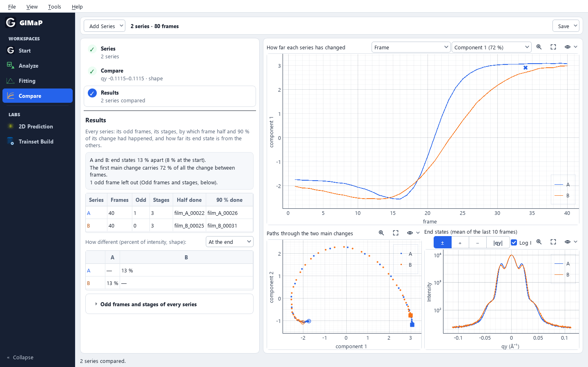

*Three steps on the left, here with the Results step open; on the right how far each series has changed, their paths
and their end states. Two synthetic runs of 40 frames, 3 stages each: A has one odd frame (frame 34, × on the change
plot), left out of its end state, so A's end-state curve has no spike from its hot columns near qy 0.05 Å⁻¹. A and B:
end states 13 % apart (8 % at the start).*

Typical use: open one sample in Analyze, build its map in the Series tab, press **Send to Compare**; repeat for
every sample. Two or more series are compared with each other; one alone is described.

**1. Series**

- **Add Series** adds **The Series Map of Analyze**, a **Folder of Curves…** (one series) or **Curve Files…**
  (together one series). Curve files need q and I columns (`.dat`, `.txt`, `.csv`, `.xy`, `.chi`; at least two
  per series, in counting order of their names: `frame_2` before `frame_10`). q in nm⁻¹ is converted to Å⁻¹
  when the header says so.
- A folder written by Analyze (a Batch Export folder, its `curves/`, or `gimap_analysis/`) holds several kinds of
  curves. One kind is one series: when there are several, a question asks which one (the curves for Fitting are
  named *the curve for Fitting*, files that are not Analyze's *other files*), and the series is named
  *<sample or batch> · <curve>*. A Batch Export table of all frames (`<name>_<curve>_frames.csv`) can be added as
  a series too.
- A folder or curve files can also be dropped on the page. The same map or folder is not added twice.
- Double-click a name to rename the series. **Remove Selected** (or `Delete`) and **Remove All** (the note that
  follows offers Undo).
- Long names are shortened on the plots and in the results to the part that differs between series; tables,
  CSV and JSON keep the full names.

**2. Compare**

- The **q range** compared (Å⁻¹; named after the axis of the series, for example **qy range**): the range every
  series covers. Narrow it to leave out a noisy edge or a detector artefact; **Whole Range** goes back.
- **Compare the shape only** (on by default): each frame's mean level is removed, so a brighter beam, a thicker
  film or a longer exposure is not a new structure. Off: the overall intensity counts too.
- **End state**: the mean of the last N frames of a series (10 by default; odd frames left out).
- Every change compares again after a moment, in the background. When a comparison fails (for example no common
  points in the range), Results says why and what to change.

**3. Results**

- Groups (three or more series): split where the end states clearly separate; no groups when they differ by less
  than 2 %.
- The series that differs most at the end and at the start.
- Per series: frames, odd frames, stages, the frame by which half and 90 % of its change had happened.
- A table of how different the series are, **At the end** or **At the start**, in percent of intensity.
- **Odd frames and stages of every series** (folded): each series' stages and its odd frames with their reasons.

**The plots on the right**

- **How far each series has changed** — along the main change chosen above the plot (**Component 1** explains the
  most), against **Frame** or **Share of the series (0–1)** for runs recorded at different rates; × marks an odd
  frame.
- **Paths through the two main changes** — ○ the first kept frame, ■ the last. With only one main change there is
  a note instead of empty axes.
- **End states** — the end-state curve of every series.

**Saving**

- **Save** appears once there is a comparison (it waits while the series are being compared again).
  **Save ▸ Table of Every Series…** or **Table of Every Frame…** writes a CSV with a JSON record.
- **Change Plot…**, **Paths Plot…**, **End States Plot…** save the figures, always in the light colours.
- The tables on the page can be copied (`Ctrl+C`, or right-click), with their column names.
- A project keeps the settings and the series: curve files by path, Analyze maps in `<project>.compare.npz`.

### 7.3 Before you conclude

- **A detector artefact that comes and goes makes odd frames.** A narrow spike at one q that appears in only some
  frames marks those frames odd, with the reason *probably the detector, not the sample*. Mask it in Analyze and rebuild the
  map; do not read it as a change of the sample.
- **Keep the compared range clear of artefacts and shadowed regions.** Over the full q range a series can look
  like an outlier because of a spike or a shadow. After narrowing the **q range** to the clean part, the
  difference at the end may be much smaller.
- **Look at both tables.** Check the differences **At the start** as well as **At the end**: series may differ
  where they began rather than where they ended.

## 8. Tool windows

Three windows of the **Tools** menu work beside the workspaces: they open over the page you are on and
leave it as it is. Each window remembers its size and position.

### 8.1 Format Converter

Open **Tools ▸ Format Converter…** (`Ctrl+Shift+C`) to write detector frames in another format.
**Tools ▸ Convert Current File…** opens it with the file shown in the active workspace. The source files
are only read, never changed.

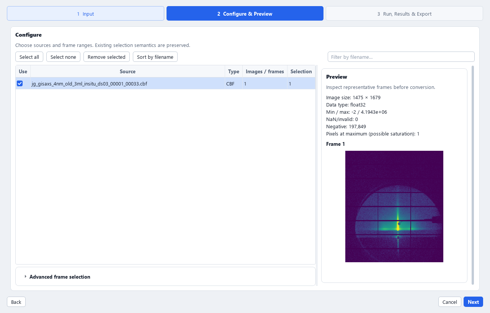
*Step 2: the sources to convert on the left; on the right the preview with the frame's size, data type, value range and counts of invalid, negative and saturated pixels (a multi-frame source shows its first, middle and last frame).*

The window has three steps; **Next** and **Back** move between them.

1. **Input** — **Add files**, **Add folder** or **Use currently opened file**. Files and folders can also
   be dropped on the window. The converter reads NeXus/HDF5 (`.nxs`, `.nx`, `.nx5`, `.h5`, `.hdf5`, `.hdf`), CBF
   and TIFF, with the same reader and orientation as Analyze (section 5.1). Single images and multi-frame files
   are recognised; a set of module files is one input (stitched, named by its scan without `_m01`), a master
   with its data files too; for a NeXus file with several datasets you choose the dataset. The list says what an
   input consists of and what the reader had to say about it (⚠ a module file missing, unequal frame counts). An
   HDF5 file without a detector image is refused, with the reason.
2. **Configure & Preview** — tick the sources to convert (**Select all**, **Select none**, a filter by
   file name (**Filter by filename…**), **Sort by filename**, **Remove selected**). For multi-frame NXS files, **Advanced frame
   selection** offers *All*, *Current frame*, *Frame range*, *Custom* (for example `1, 5, 8–20`) and
   *Every Nth frame*. The preview shows the first, middle and last frame.
3. **Run, Results & Export** — choose:

   | Setting | Choices |
   |---|---|
   | **Output format** | TIFF, CBF, HDF5 or NumPy (`.npy`) |
   | Destination | by default a folder `converted` next to the first input |
   | File names | a template for multi-frame sources, by default `{source}_{frame:06d}` (for example `scan_001_000123.tif`); **Add suffix automatically when names collide** (on by default) adds `_001`, `_002` … instead of stopping |
   | **Advanced output options** | the data type (the original values and type are kept by default; CBF may not keep NaN or floating-point values); the metadata JSON — by default one `conversion_metadata.json` for the whole conversion, or one JSON beside each image; **Export as one NeXus/HDF5 container** (`converted_images.h5`) |

   In a CBF, EDF or TIFF header the metadata is written as ASCII JSON (`json.loads` reads it back exactly, paths
   outside ASCII included). **Review & Convert** shows what will be written and its size before it starts.

While it runs, a window shows the progress with **Pause** and **Cancel** (the image being written is
finished first). Afterwards use **Open output folder** and **View report**. The report,
`conversion_report.json` in the destination folder, lists every frame written or failed; a later run into
the same folder replaces it.

EDF frames are not an input of the converter. With an EDF frame shown, **Convert Current File…** opens
the window without it and says why under the input list. To convert EDF frames — or any frame as
Analyze reads it, with modules stitched and frames summed — use **Analyze ▸ Batch Export ▸ Converted
detector frames** (TIFF, EDF, NumPy or HDF5; section 5.7).

### 8.2 XRR Series Extractor

Open **Tools ▸ XRR Series Extractor…** (`Ctrl+Shift+R`) to obtain an XRR curve from a GIWAXS/GISAXS
detector angle series. One point of the curve comes from each detector frame.

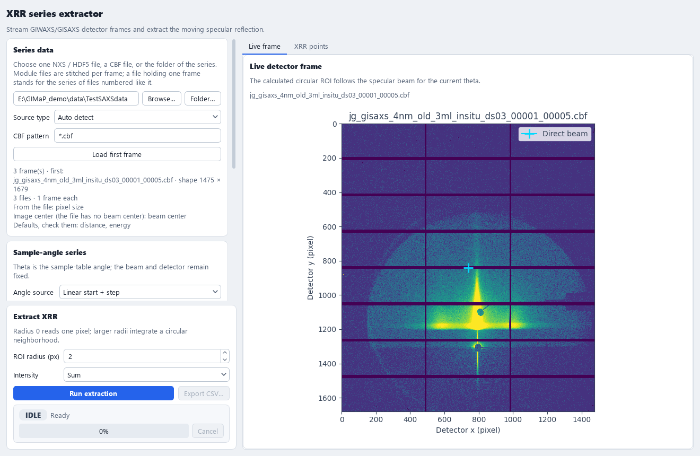
*Left: the series (**Browse…** for a file, **Folder…** for the folder of the series; below, what the series consists of and where each value comes from), θ (the geometry is further down) and the ROI. Right: the frame with the direct-beam cross and the ROI circle on the specular beam; the **XRR points** tab holds the curve.*

1. **Choose the series.** **Browse…** selects one NeXus/HDF5 file or a CBF file, **Folder…** the folder of the
   series; a file or folder can also be dropped on the window.
   - The module files of a set are stitched for each detector frame; a file of several frames gives one point
     per frame (when modules hold different numbers of frames, only the frames every module has are used).
   - A NeXus file that holds one frame stands for the series of files numbered like it; files numbered alike
     that do not fit (another frame size, more than one frame) are named and left out. A folder of NeXus files is
     read file after file.
   - For CBF, a glob pattern (**CBF pattern**, e.g. `*.cbf`): each naturally sorted file is one point.
2. **Set θ.** Either a linear sequence (**Theta start (°)** and **Theta step (°)**) or an NXS motor dataset with
   one θ value per frame.
3. **Set the geometry.** Detector distance, beam energy, pixel sizes and the direct-beam centre. Select
   in **Reflection direction** whether the specular reflection moves up or down in detector y.
   - The window starts from the last applied Geometry Calibration, marked *from last calibration*. When
     that calibration was of frames of another size, only its energy is taken.
   - **Load first frame** never overwrites a value you typed. A tag beside each field, and the summary,
     say whether a value comes from the file, the last calibration, the image centre or the built-in
     defaults.
   - **Pick direct-beam center** lets you click the centre on the frame.
4. **Set the ROI.** An ROI radius and `Sum` or `Mean`. Radius 0 reads one pixel; a larger radius
   integrates a circle around the calculated specular beam.
5. **Run extraction.** One full frame is loaded at a time: the window shows it with the ROI, records one
   point, and releases the frame. The whole series is never held in memory.
6. **Look and export.** Switch freely between **Live frame** and **XRR points**; processing updates both
   but never changes the tab. **Export CSV…** saves θ (°), qz (Å⁻¹), intensity, ROI position and
   valid-pixel count.

The CSV goes by default to `<source folder>/<source name>_xrr.csv`; for a CBF folder it goes into that
folder, named after it. A `.json` record beside it keeps every value that determines qz (series, θ,
distance, energy, pixels, centre, direction, ROI) and where each came from, and under `source_layout` what the
series consists of, every file read and the reader's warnings (the status line after a run repeats them).

**What is not corrected.** The extractor reports the raw ROI sum or mean. It does not apply monitor/flux
normalisation, footprint correction, background subtraction or resolution correction.

**Pixel coordinates.** The direct-beam centre is shown and entered in the same pixel coordinates as in
Analyze and Geometry Calibration: pixel corners lie on whole numbers, so the centre of the
first pixel is (0.5, 0.5); x counts from the left edge and y from the top edge (section 4.4). Hover over the centre
fields or the *ROI x* / *ROI y* headers to read this in the window. A centre can be copied between the
three windows as it is.

- The preview, its cross and ROI circle, and the *ROI x* / *ROI y* columns use the same pixels.
- A centre picked with the mouse is the point clicked: with radius 0, the pixel you click is the pixel
  that is read.
- The image centre the window falls back to (step 3) is the middle of the frame, (columns / 2, rows / 2).

The exported files count differently: `roi_center_x_px` / `roi_center_y_px` of the CSV and
`geometry.beam_center_x_px` / `beam_center_y_px` of the JSON record count pixel centres from 0, so they
are 0.5 px lower than the window shows, and the record says so (`center_convention`). If you noted a
centre from this window in a copy of GIMaP from before 2026-10-13, add 0.5 px to x and y: the window
counted pixel centres from 0 then.

**Known limitation: a beam centre from a NeXus header.** When a NeXus file written by the Lambda server
(P03) states a beam centre, the window takes the two numbers as column and row of the frame it shows,
without the turn (transpose and flip) the frame gets when it is loaded. The centre can then lie away from
the direct beam (Analyze applies the turn to the same header). The fields are marked *from file*, and the
value replaces the centre of the last calibration. Other NeXus/HDF5 files are read as stored, without a
turn, but the window still counts the header numbers half a pixel differently from Analyze. Before you run
the extraction, check on the preview that the cross lies on the direct beam, or use **Pick direct-beam
center**. CBF series are not affected.

### 8.3 SEM Particle Analysis

Open **Tools ▸ SEM Particle Analysis…** to measure particle sizes in an SEM image, or to load sizes
measured elsewhere from a CSV file. The window works on its own: it needs no prediction model, no
TensorFlow and no scattering data. A radius distribution predicted in **Labs ▸ 2D Prediction** can be
compared with it: **SEM comparison…** there opens this window with a copy of the prediction attached
(section 10.1).

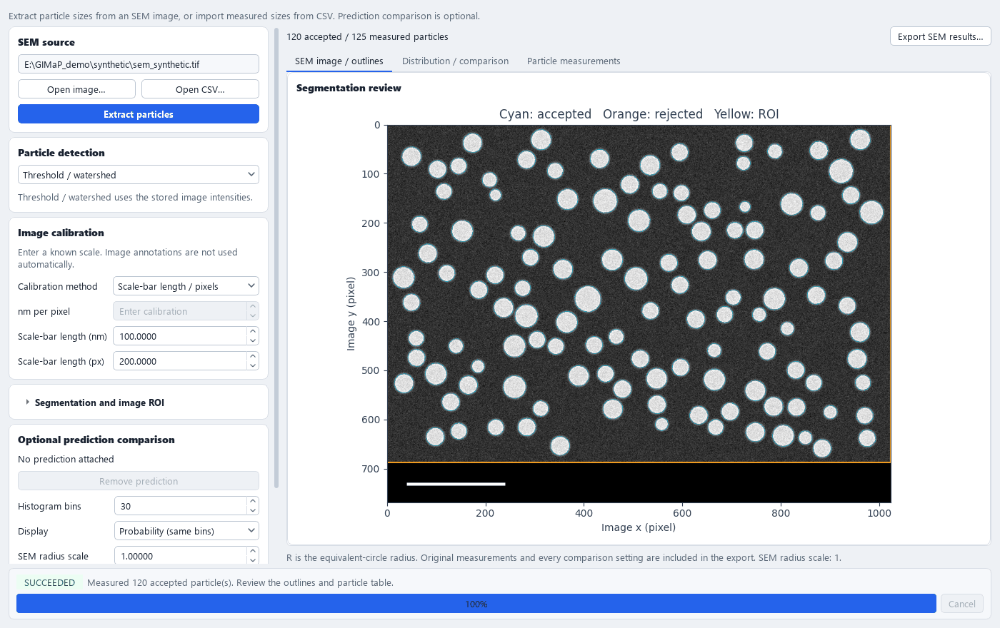
*Check the outlines first: cyan particles are kept, orange ones were rejected (the table says why), the yellow box is the ROI.*

What is measured is the **equivalent-circle radius of the projected area** of each particle:

```text
A_nm² = A_px × nm_per_pixel²
R_nm  = sqrt(A_px / pi) × nm_per_pixel
D_nm  = 2 × R_nm
```

`A_px` is the number of pixels of the particle. A particle that is not round is also given the radius
of the circle of the same area. The distribution is drawn against R; the table gives R and D.

#### Measuring an image

1. **Open the image.** Under **SEM source**, press **Open image…** and choose a TIFF, PNG, JPEG or BMP.
2. **Enter the calibration.** Under **Image calibration**, choose the **Calibration method**:
   - **nm per pixel** — type the value;
   - **Scale-bar length / pixels** — type the length of a scale bar in nm and its length in pixels;
     `nm_per_pixel = length_nm / length_px`.

   The calibration is **never guessed**. GIMaP does not read the scale-bar text, the magnification or
   the DPI of the file. Opening another file clears the value, and nothing can be extracted until a
   positive value is set for that file.
3. **Exclude the annotations.** In the folded section **Segmentation and image ROI**, tick **Use image
   ROI (pixel edges)** and type **ROI left x**, **ROI top y**, **ROI right x**, **ROI bottom y** so the
   scale bar, text and frame are outside. The ROI uses the pixel edges of the original image: row 0 is
   at the top, the centre of pixel (row i, column j) is at (j + 0.5, i + 0.5).
4. **Choose the detection** under **Particle detection** (see below), and its settings.
5. **Run.** The button under the source reads **Extract particles**, **Detect particles (local AI)** or
   **Measure labeled particles**, after the method.
6. **Review.** Look at **SEM image / outlines** and **Particle measurements**: which regions were kept,
   which were rejected and why. Only then use the distribution.

When no particle passes the filters, the candidates, their reasons and the outlines are still shown and
can be exported for review; there is then no distribution.

#### Detection methods

Changing the method makes the previous measurement invalid. GIMaP never switches to another method by
itself when one fails.

| Method | When to use it | What it needs |
|---|---|---|
| **Threshold / watershed** (default) | well-separated particles with clear contrast | nothing more |
| **StarDist (local AI)** | touching particles that a threshold cannot separate | a local Python with StarDist, and a local model folder |
| **Existing instance labels** | labels made elsewhere (StarDist outside GIMaP, corrected by hand …) | an integer TIFF/PNG label image |

**Threshold / watershed.** Settings in **Segmentation and image ROI**:

| Setting | What it does — and what to check |
|---|---|
| **Particle contrast**: Bright / Dark particles | bright: pixels above the threshold; dark: pixels at or below it |
| **Threshold**: Otsu / Manual | Otsu is computed from the finite values inside the ROI; Manual uses the value in **Stored intensity** (the stored intensity units of the image). Check that background and particles are separated. |
| **Split touching particles (watershed)**, **Watershed peak distance (px)** | separates touching particles; the distance decides into how many pieces a cluster is cut — look for over- and under-splitting |
| **Minimum area (px²)**, **Maximum area (px²)** | removes noise or large background regions — and possibly real particles; the maximum defaults to *No upper limit* |
| **Minimum circularity** | `4 pi A / perimeter²`; the value is kept in the table |
| **Exclude particles touching the ROI boundary** | on by default; particles cut by the ROI are rejected, with the reason |

Grey images are segmented on their stored intensities. Colour images are turned into grey with the
recorded luminance formula (0.2126 R + 0.7152 G + 0.0722 B). The contrast stretch on screen only helps
you see; it does not change the threshold, the areas or any measured value.

**StarDist (local AI)** — optional. It separates touching particles with a trained instance-segmentation
model, run on your computer.

- Set **Local Python executable** (a Python environment with StarDist and TensorFlow) and **Local
  instance model** (a folder with `config.json` and `weights_best.h5` or `weights_last.h5`); **Browse…**
  chooses them, **Check local resources** checks that the files are there.
- By default GIMaP looks in `~/.cache/gimap/sem/stardist/` (or the folder in `GIMAP_SEM_STARDIST_HOME`):
  the Python in `runtime/Scripts/python.exe` (Windows) or `runtime/bin/python`, the model in
  `models/2D_versatile_fluo/`.
- To set up that environment, use its own Python:
  `python -m pip install -r requirements-sem-stardist.txt` (StarDist 0.9.2, CSBDeep 0.8.2, TensorFlow
  2.15.1). The list installs the packages only, not the model weights; GIMaP's own environment does not
  need them.
- The model runs in a separate process on the CPU. The image is not uploaded, and no weights are
  downloaded. **Cancel** ends the process. A run is stopped after 15 minutes.
- **Instance AI options** (folded): **AI image scale**, **Probability threshold**, **NMS overlap
  threshold** (*Model default* uses the thresholds saved with the model), **Normalize low / high
  percentile** (computed inside the ROI; dark particles are inverted first).
- The outlines are put back on the original pixel grid before anything is measured: the AI image scale
  never changes the areas. The calibration, ROI and the area, circularity and boundary filters are the
  same for all three methods.

The official `2D_versatile_fluo` weights were trained on fluorescence images of cell nuclei: **they are
not validated for SEM**. Judge them on the outlines of your own images; more particles found does not
mean more accurate. A model trained on SEM images can be loaded from a local folder.

**Existing instance labels.** Open the SEM image first, then choose the label file. 0 is background and
every particle has its own positive integer. RGB colour maps, floating-point labels and multi-page files
are refused. The label image has the size of the SEM image, or exactly the size of the ROI you set. GIMaP
does not check that the labels were made from this image.

#### Sizes from a CSV file

Press **Open CSV…**, then in **CSV measurement settings** choose:

- **Value column**, and whether it holds a **Radius** or a **Diameter** (**Stored size quantity**);
- **Stored unit**: `nm`, `µm` or `pixels` (pixels need the **Image calibration** of that source);
- **Delimiter** (`\t` for a TSV) and **Rows before header**; **Read CSV columns** reads the column names
  again.

No column is chosen for you. Press **Import particle sizes**: diameters are halved, µm converted to nm.
Rows that are empty, not numbers, not finite or not positive are rejected, with the reason in the table.

#### Distribution and comparison

| Setting | Meaning |
|---|---|
| **Histogram bins**, **Minimum radius (nm)**, **Maximum radius (nm)** | the bins; the maximum defaults to *From data and prediction* |
| **Display** ▸ **Probability (same bins)** (default) | SEM and prediction rebinned to the same edges, each normalised to a sum of 1 within the range; what falls outside is reported |
| **Display** ▸ **Paper display (independent peak scaling)** | 60 SEM bins; the prediction on its own radius axis, minimum subtracted, scaled to the SEM peak — the heights are then no comparable probabilities |
| **SEM radius scale** | 1 by default; scales the SEM radii for the comparison only — the measured radii stay in the particle table |

After a change, press **Update distribution**; an export needs an up-to-date distribution. **Remove
prediction** keeps the SEM measurement and shows it alone. Opening the window again from the **Tools**
menu also removes a prediction attached before.

#### Export

**Export SEM results…** asks for a folder and writes a new subfolder `SEM_analysis_<date>_<time>/` in it.
It refuses to overwrite result files that are already there.

| File | Content |
|---|---|
| `sem_particles.csv` | every object: kept or not, R, D; for an image also area, centre, circularity and the reason of a rejection |
| `sem_distribution.csv` | the bin edges, the SEM probability and, if attached, the prediction |
| `sem_distribution.png` / `.pdf` / `.svg` | the distribution figure (light colours), with the prediction if attached |
| `sem_display_arrays.npz` | the arrays drawn, and the measured radii |
| `sem_overlay.png` / `.pdf` / `.svg` | outlines, kept and rejected objects and the ROI, for review (image only) |
| `sem_segmentation.npz` | the grey image at full resolution (no display stretch), the labels, the outline overlay (image only) |
| `sem_instance_labels.tif` | the labels as int32 at full resolution, original IDs — reusable with **Existing instance labels** (image only) |
| `sem_analysis.json` | sources with SHA-256, reader, calibration, ROI, method and its settings, filters, counts, comparison settings, the prediction's source, and the list of files |

The CSV files carry the source and settings in a `#` header line too. A StarDist run also records the
model's configuration, thresholds and the SHA-256 of its weights; the weights themselves are not copied.

Reading, extracting, updating the distribution and exporting run in the background. **Cancel** discards
the pending result; a file already being written may still be completed, and nothing already written is
deleted.

## 9. AI assistant

**Ask AI…** in Analyze's command bar, or **Tools ▸ Process with AI…** (`Ctrl+Shift+L`), lets an AI
analyse the frame shown in Analyze — GIWAXS or GISAXS — with the same tools you use. It switches the
mode, adjusts sectors and cuts, sets the I(χ) window, fits peaks or the horizontal cut and exports
files, and the page follows every step on screen. The AI is optional: **Run Automatic Analysis** gives
the standard results without it (section 5.5).

During a run a panel shows a summary of the AI's reasoning, each tool call (hover for its arguments and
result), the change cards and, at the end, the report.

### 9.1 The three brains and their set-up

Choose the brain in **Tools ▸ Settings… ▸ Assistant**, or under *Brain* in the start dialog (**Set Up
AI…** opens the settings).

| Brain | Billing | Set-up |
|---|---|---|
| **Claude Code — your Claude plan** (default) | counts against your Claude Pro or Max plan; no API key | Claude Code must be installed (the Claude desktop app includes it) and signed in once: **Sign In…** opens a window running `claude auth login`; choose your account, then press **Check**. Model and effort are set in Settings (empty model = Claude Code's default). |
| **Claude API — API key** | per token | `pip install anthropic` once; add a key in Settings (or set `ANTHROPIC_API_KEY`); **Test Connection** checks key and model. Default model `claude-opus-5`, effort *high*. |
| **Other AI providers — OpenAI-compatible API** | as the provider bills | `pip install openai` once. Under **Other AI providers** pick the provider (the address is filled in; change it for a local server or Azure), save its key or set its environment variable (e.g. `DEEPSEEK_API_KEY`, `DASHSCOPE_API_KEY`), choose a model (typed, suggested, or **Get List**) and press **Test Connection**. |

The other providers include DeepSeek, Qwen (Alibaba Cloud Model Studio), OpenAI, Kimi, Zhipu GLM, Google
Gemini, OpenRouter, SiliconFlow, Azure OpenAI and a model on your own computer or lab server (Ollama, LM
Studio, vLLM …). The model must support tool calling: **Test Connection** sends one tiny request with a
tool. Keys are kept in the user data folder, one per provider.

Claude Code gets only the GIMaP tools — no shell, files or web — and no API key is passed to it.

**Standing instructions for the AI** (**Tools ▸ Settings… ▸ Assistant**) are added to every run, for example where
your calibrations are kept or the energy of your beamline.

### 9.2 Starting a run

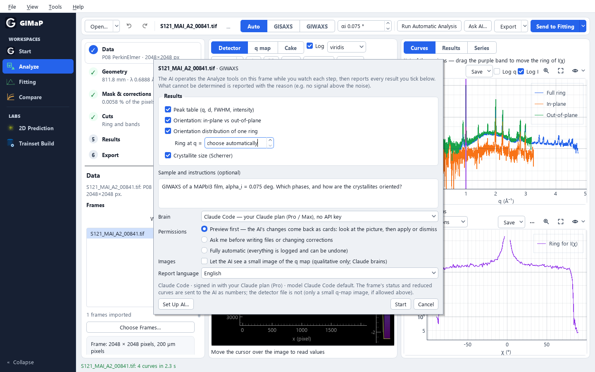
*The start dialog: results to report, notes, brain, permissions, report language. The line above the buttons says whether the brain is ready — here Claude Code, signed in with a Claude plan — and what is sent.*

1. Open a frame in Analyze and press **Ask AI…**.
2. Tick the results you want:
   - GIWAXS: *Peak table (q, d, FWHM, intensity)*, *Orientation: in-plane vs out-of-plane*,
     *Orientation distribution of one ring* (I(χ), maxima, Herman's orientation factor; pick the ring
     or let the AI choose), *Crystallite size (Scherrer)*;
   - GISAXS: *Horizontal cut at Yoneda, centred, halves chosen*, *In-plane distance 2π/q\**, *Fit of
     I(qy): shape, radius, distance*.
3. Optionally write notes in **Sample and instructions (optional)**: the sample, what you want to know,
   where the calibration is.
4. Choose the **Permissions**:

   | Permission | What happens |
   |---|---|
   | **Preview first** (recommended for new users) | every settings change the AI makes is undone when it finishes and comes back as a card to apply |
   | **Ask me before writing files or changing corrections** | a dialog asks for each such action; a refusal is respected |
   | **Fully automatic** | everything is done, logged and can be undone |

5. Choose whether the AI may see a small image of the q map (qualitative only; Claude brains) and the
   **Report language**, then press **Start**.

**Stop** ends a run at any time. The report lists each requested result as *done*, *partial* or *not
available* with the reason (for example “no peak above 3σ between 0.2 and 2.0 Å⁻¹”). The tables below it
come from the tool results, not from the AI's text. **Save Report…** writes an HTML report and a JSON
record (`<frame>_ai_report.html` / `.json`; proposed in `gimap_analysis/` next to the data when that
folder exists, otherwise next to the frame).

**Baseline first, then questions.** The AI may start with GIMaP's standard procedure in one step (the
same as Run Automatic Analysis, with each decision and its reason). Its choices are defaults, not limits:
the AI then follows what your question needs — the start of an in-situ series, lines every sample shares,
peak ratios, a peak the baseline skipped — and marks interpretations as hypotheses, with the numbers
behind them.

### 9.3 Change cards: preview, apply, undo

Every change the AI makes to Analyze (sector widths, a custom sector, a q box, the frame, the mode, αi,
the radial bins, the valid intensity range) is recorded; the AI can also suggest changes without making
them. They appear as cards under **Changes**: a picture of the q map with the change, the setting in
words, why the AI suggests it, and **Apply**, **Dismiss** or **Undo**. **Undo All** takes back every
applied change.

In *Preview first* the AI's own exploration is restored at the end. A setting the AI proposed a value
for shows only that proposal; otherwise the net change of each setting remains as a card. Changes that
ended where they started, or changed nothing visible, are left out.

### 9.4 Follow-up questions

When a run has finished, type a question in the field under the report (e.g. “Why is there almost no
signal in the in-plane sector?”) and press **Ask**. A new run on the same frame and settings answers it,
knowing what the previous run found, and can bring new cards.

### 9.5 A frame without geometry

When no instrument profile matches the frame, the AI does not stop; it looks for the geometry.

1. **What you named.** Files or folders named in the notes or in the standing instructions are read
   first — e.g. *“the calibration is D:\beamtime\calib\img_0005.cbf, 12.4 keV”*. A calibration named by
   its file name alone (*“calibration LaB6_take2.poni”*) is used too: the file of that name in the folder
   of the frame, or in a folder the notes name.
2. **A search.** The frame's folder and subfolders, the parent and its other subfolders, two folders up
   with their subfolders, and calibration / log folders three up; further folders up or down can be
   searched read-only. It looks for:
   - calibration results — pyFAI `.poni` files and calibrations exported by Geometry Calibration
     (`.json`);
   - images of a calibration standard, the standard taken from the file or folder name (AgBH / silver
     behenate, LaB6, CeO2, a LaB6 + CeO2 mixture; Si, Al2O3 and Cr2O3 are recognised but cannot be
     fitted yet); a multi-module NeXus series (`*_m01.nxs` … `*_m11.nxs`) counts as one image;
   - logs and parameter files (`.log`, `.fio`, `.txt` …) that state the energy, distance, beam centre or
     incidence angle.
3. **The choice.** It prefers a calibration of the same kind of detector file taken before the frame,
   with *giwaxs*/*waxs* and *final*/*redone* in its name. Standard images are fitted with GIMaP's
   calibration and judged by where the standard's lines land in q: within 0.2 % on average is good,
   within 0.5 % usable. When the name does not say which standard an image shows, every standard is
   fitted and compared the same way.
4. **Asking you.** Only when the numbers cannot decide, or the energy is nowhere to be found, a dialog
   **The AI asks** lists the options with their file times and folders, or asks you to type the value.

Files within two folders above the frame and files you named are read without asking; other files are
read after you agree (*Ask me before…*) or with a note in the panel (the other two permissions). Hidden and system
folders (`.ssh`, `AppData`, `Windows` …) are never read. The chosen geometry is saved as the instrument
profile of the detector — with *Ask me before…* only after you approve it — and the report states which file,
standard and values it came from. **Check it**: a calibration found by the search can belong to another
experiment (chapter 12).

### 9.6 What is sent, and what is kept

- **Sent to the AI**: the frame's status (file name, geometry, settings) and the reduced curves as
  numbers. The detector file itself is never sent; the small q-map image only when you allowed it. With
  a local model (Ollama, LM Studio …) nothing leaves your computer or lab network.
- **Shown**: the tokens of each run; with Claude Code also the plan's usage-limit warnings and the cost
  at API prices (for comparison only — a plan is not billed per token); with an API the estimated cost.
- **Kept on your computer**: every run in `assistant_runs/` of the user data folder; analyses the AI
  found missing in `assistant_feature_requests.jsonl` there.

**How to read the numbers.**

- Scherrer sizes are lower bounds of the coherence length unless the instrumental width is known; broad
  halos (FWHM above 15 % of q) get none.
- Herman's factor assumes a film that is isotropic in its plane and weighs each |χ| by sin χ. It is
  given only when at least 80 % of that weight is measured. With a partly measured ring, the report also
  gives f of a random ring over the same |χ| — the value to compare with.
- Regions far below the diffuse background at the same q (under 20 %: a shadow, an absorber, an
  insensitive detector area) count as unmeasured, and a sector lying in one is not compared. Intensity
  next to the qz axis may be unmeasured (missing wedge).
- Peaks one or two bins wide far above the background are marked as spikes (hot pixels, module edges),
  not diffraction.
- Crystallographic labels such as (100) or edge-on are used only when the sample notes or the data make
  the assignment clear.

### 9.7 Without the window

`tools/gimap_agent.py` runs the same standard procedure without the window, for scripts and other
agents: `python tools/gimap_agent.py auto <frames> --notes "…" --out <folder>` writes a `report.md` per
frame with every decision and what needs your answer. A series is analysed in its final state: the last
fifth of its frames summed, at most 10 (below ten frames the last frame alone); `--frame N` and `--sum K`
choose other frames. The module files of one detector are analysed once, however many of them are given,
in a folder named by the scan (a part missing is an open item of its report); `--series` takes files that
hold one frame each as one series. Its options, exit codes, where its defaults may
not fit your question, and how to check it on a GIWAXS measurement you know (`tools/eval_giwaxs_agent.py`;
a case built on your own data goes in `docs/agents/eval/local/`, which Git ignores) are described in
`docs/agents/giwaxs-playbook.md` and `docs/agents/gisaxs-playbook.md`.

## 10. Labs

The **Labs** pages (sidebar ▸ Labs) are experimental. Their settings are the *Labs parameters*: **File ▸
Labs Parameters ▸ Load… / Save As…** reads and writes them, together with Fitting's model.

### 10.1 2D Prediction

**2D Prediction** runs a trained prediction module on GISAXS detector frames. Three steps on the left,
the canvas on the right.

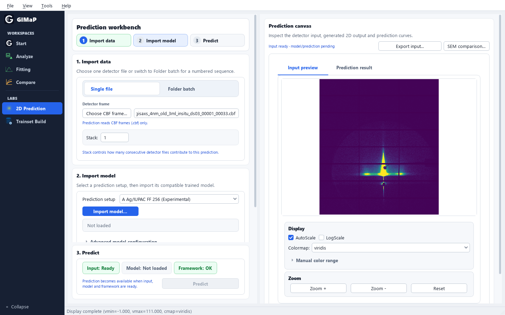
*A CBF frame is loaded and shown under Input preview; no model is imported yet. The three states under 3. Predict say what is still missing, and Predict stays disabled until all three are ready.*

1. **Import data.**
   - **Single file**: **Choose CBF frame…**, or drop a CBF frame on the canvas. **Stack** is how many
     consecutive detector files make one input.
   - **Folder batch**: a folder of numbered frames, the **Range** of frame numbers and **Files per
     prediction**; a line under the fields says how many files and predictions that makes.

   Prediction reads CBF frames (`.cbf`) only.
2. **Import model.** Choose the **Prediction setup** — a module from `modules/` (section 10.3) — and
   press **Import model...**; the line below says whether the model is loaded. Folded: **Advanced model
   configuration** (the framework check, **Reload Config**, **Edit Config**) and **Advanced model
   sources** (the model library).
3. **Predict.** Three states — *Input*, *Model*, *Framework* — say what is still missing; **Predict** is
   enabled when all three are ready. A prediction runs in the background; **Stop** ends it.

The canvas shows **Input preview** once a frame is loaded and **Prediction result** after a prediction.
*Preprocessed* shows the steps of the module in order with the image each one produced (click one to see
it large).

- **Export input...** saves the frame as displayed, with a JSON record.
- **Export result...** saves the result as a picture, its data beside it, and a JSON record of the
  module, the model, the preprocessing steps and the input file.
- A folder batch lists its results under **Batch results**, with filter, sorting and export.
- The **Activity log** is folded at the bottom.

**SEM comparison…** (above the canvas) opens **SEM Particle Analysis** (section 8.3) with the current
prediction attached, when the result has a radius axis in nm; otherwise the tool opens without a
prediction. Then open the SEM image or the sizes CSV there. What is attached is a copy: the radius distribution with its source (input files, module, model,
preprocessing, runtime). Changing the input or model on the prediction page afterwards does not change
an open comparison, and an outdated result is not attached again. Opening the SEM tool from the Tools
menu removes a prediction attached earlier.

The two distributions are not the same quantity. SEM gives the projected-area radius of the particles in
a small field of view, counted per particle. The prediction gives the radius distribution of the module's
model, from the scattering of the illuminated area. Read a difference as a result to discuss, not as an
error of either.

### 10.2 Trainset Build

**This feature is under development.**

**Trainset Build** designs a simulated GISAXS training set (BornAgain), checks it locally and prepares
the training. Five steps on the left, each with its state:

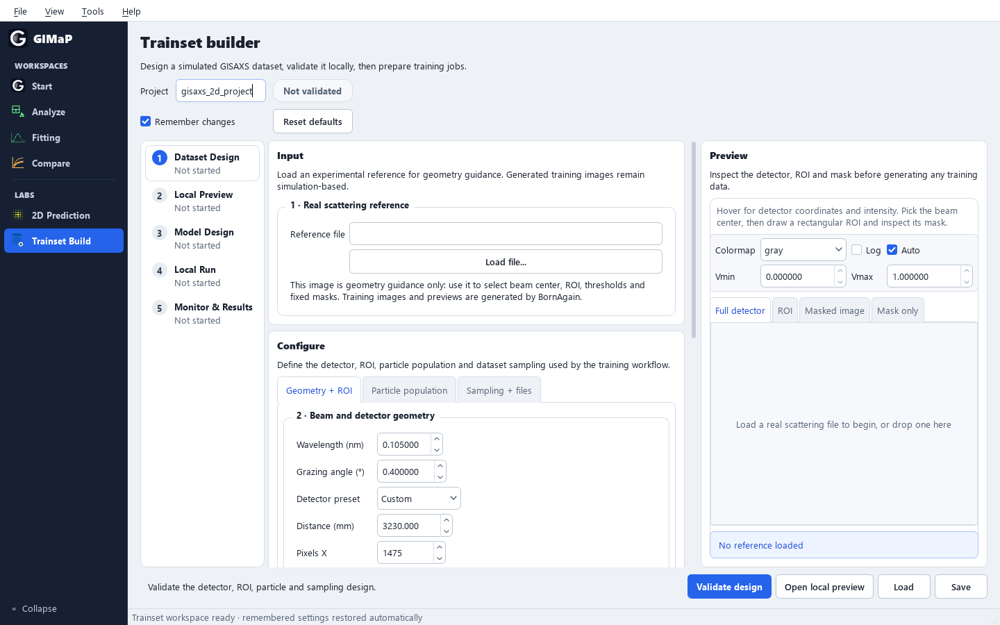
*Step 1, Dataset Design. The five steps and their states are on the left; the preview on the right shows the detector, region of interest and masks once a reference file is loaded.*

1. **Dataset Design** — optionally load a measured image as a reference for the geometry (**Load
   file...**: it guides the beam centre, the region of interest and the masks and is never used as a
   training image); then **Geometry + ROI**, **Particle population** and **Sampling + files**. **Validate
   design** checks the design.
2. **Local Preview** — simulated examples over the chosen parameter ranges, with the preprocessing
   (background, noise, masks and transforms under **Advanced preprocessing**).
3. **Model Design** — the training settings and the layers of the network.
4. **Local Run** — the job package, a local generation and training run with progress and **Stop
   safely**. Submission to the Maxwell cluster is disabled in this version.
5. **Monitor & Results** — the log, the metrics and the registration of the best model.

**Remember changes** keeps the design for the next session; **Reset defaults** restores the built-in
values (the note that follows offers Undo); **Load** and **Save** read and write a project file. In the
Chinese interface many texts of this page are still English.

### 10.3 Prediction modules

A prediction module is a folder under `modules/` with a `module.yaml`. Its main fields:

| Field | Meaning |
|---|---|
| `id`, `name`, `version` | internal identifier, the name shown, the version |
| `framework` | the model framework, for example TensorFlow/Keras |
| `model.model_path` | path to the trained model |
| `preprocess.entry`, `preprocess.steps`, `preprocess.params` | the preprocessing entry point, steps and parameters |
| `io.input_type`, `io.stack_axis`, `io.input_shape` | the input type (for example `cbf`), the stack axis, the model's input shape |
| `outputs` | the outputs: parameter names, ranges or output type |

When you add a module, make sure the model path, the input type, the preprocessing code and the output
definition match the trained model. A path to a machine-specific location must be changed on another
computer. For the SEM comparison, the radius output needs an axis in nm.

The V5 methods of 1D Predict use their bundled model in `modules/Fitting_1D_Model/Workflow_v5`; fit1d
uses its installed `gisaxs1d_gui_kit` instead (section 6.4).

## 11. Output files

GIMaP never changes your data files. Exports from Analyze go by default into a folder
**`gimap_analysis/` next to the data**; most other exports ask for a place and propose one. The user data
folder is `%APPDATA%\GIMaP` on Windows (or the folder in `GIMAP_HOME`; **Help ▸ Open User Data Folder**).

| Action | Files written | Default location | Record that comes with it |
|---|---|---|---|
| Analyze ▸ **Export** (`Ctrl+E`), **Export Curves…** | `<stem>_<curve>.csv` per curve, `<stem>_fit_input.dat`, `<stem>_analysis.json` (`_frameNNNN` added for a frame of a multi-frame file, `_sumN` when frames are summed) | `gimap_analysis/` next to the data, without a dialog; a folder dialog if it cannot be written | `<stem>_analysis.json` (settings, geometry, corrections, pixels left out) and `#` header lines |
| Analyze plots ▸ **Save ▸ Curves as Data…** | the CSV files of that plot and `_analysis.json` | folder dialog in `gimap_analysis/` | as Export |
| Analyze plots and images ▸ figures (**Plot as Figure…**, **View as Figure…** …) | PNG, TIFF, SVG or PDF, light colours | dialog in `gimap_analysis/` | none |
| Analyze ▸ **Save q-Map Data…**, **View Data as CSV…** | `<stem>_qmap.csv`, `<stem>_cake.csv` | dialog in `gimap_analysis/` | `#` header lines (source, frame, axes) |
| Analyze ▸ Series ▸ **Export** (**Map as CSV Table…**, **Map as Figure…**, **Stages as Table…**, **Trace as Table…**, **Peak Table of Every Frame…**, the selected frame's curve) | `<series>_<curve>[_<halves>]_map.csv`, `…_map.png`, `…_stages.csv`, `…_trace_<value>.csv`, `…_peaks.csv`; the frame picked as `<frame>_<curve>[_<halves>].csv` | dialog in `gimap_analysis/` | `#` header lines (curve, halves, frames, cut) and a `.json` of the settings next to each table |
| Analyze ▸ **Send to Fitting** | `<stem>_fit_input.dat` (q in Å⁻¹) | `gimap_analysis/` next to the data; a folder you choose (kept for the session) when that cannot be written | `#` header lines (source, frame, sum, curve, observation with the halves) |
| Analyze ▸ **Batch Export…** | per-curve tables `<batch>_<curve>_frames.csv` (or `.txt`, `.dat`), a fit table if you chose fitting, and subfolders `curves/`, `fit_input/`, `maps/`, `images/`, `frames/`, `fits/` after your choices; frame names keep the 0-based index (`…_frame0003_sum3_…`) | the last batch folder, else `gimap_analysis/` next to the data; by default in a subfolder named after the frames' folder (one file: its name; several folders: `batch`); **Keep Both** writes into a new subfolder | `README.txt` and `<batch>_batch.json` (every file written, the cut of every frame, failed frames and why); `curves/` also gets an `_analysis.json` per frame |
| Analyze ▸ **Send Series to Fitting…** | `fit_input/<frame>_fit_input.dat`, `README.txt`, `<batch>_batch.json` | a folder of its own, `<name>_fitting/`, next to any Batch Export of the same data | `README.txt`, batch JSON |
| Analyze ▸ **Export New Frames While Watching** | as Export, for each new frame | `gimap_analysis/` next to the frame | as Export |
| Analyze ▸ **Save Settings…**; Mask step ▸ **Save…**; Regions ▸ **Add ▸ Save Cuts…** | `analyze_settings.json`; `masks.json`; `cuts.json` | dialog in `gimap_analysis/` | the file is the record |
| Run Automatic Analysis ▸ **Save Report…** | `<stem>_report.html` (with pictures) or `.md` | the folder you chose last for frames of the same folder, else `gimap_analysis/` if it exists, else next to the frame | the report itself (no JSON) |
| Process with AI ▸ **Save Report…** | `<stem>_ai_report.html` + `<stem>_ai_report.json` | as above | the JSON |
| Process with AI (automatic) | a record of every run; missing analyses | user data folder: `assistant_runs/`, `assistant_feature_requests.jsonl` | — |
| Process with AI, when the AI exports | the curves as Export, and `<stem>_assistant.json` | `gimap_analysis/` next to the data | `<stem>_analysis.json`, `<stem>_assistant.json` |
| Fitting ▸ Single analysis ▸ **Save ▸ Data and Fit…** | `<curve>_fit.csv` + `<curve>_fit.json` (written as a pair) | the folder saved to last, else the folder a curve was last opened from, else the curve's folder | the JSON (model, method, range, left-out points; fit1d keeps its own curves and warnings) |
| Fitting ▸ **Save ▸ Plot…**, **Save ▸ Model…** | `<curve>_fit.png` / `.svg`; `<curve>_model.json` | as above | none; the model file |
| Fitting ▸ In-situ series ▸ **Save ▸ Table of Every Frame…** | `series_fit.csv` + `series_fit.json` | the series folder | the JSON (`gimap_series_fit_v2`: start model, halves and where they came from, every frame's state and reason; for detector frames Analyze's settings) |
| Fitting ▸ In-situ series ▸ **Trend Plot…**, **Selected Frame's Plot…** | `series_trend.png`, `series_frame.png` | the series folder | none |
| **Tools ▸ 1D Predict — Fit Many Curves…**, and Fitting's *AI proposal (1D Predict)* | a run folder: `request.json`, `batch_summary.json` …, a subfolder per curve with `solutions.json`, `fitting_curves.csv` … | `AI_Fitting_Output/v5_<date>_<time>_<µs>/` in the folder GIMaP was started from (portable version: the program folder); never removed automatically | `request.json` |
| Compare ▸ **Save ▸ Table of Every Series… / Table of Every Frame…** | `compare_series.csv` / `compare_frames.csv` + `.json` | the folder of the first series added from files, else the folder a series was last added from | `#` header lines and the JSON |
| Compare ▸ **Change Plot… / Paths Plot… / End States Plot…** | `compare_*.png` or `.svg` | as above | none |
| XRR Series Extractor ▸ **Export CSV…** | `<source>_xrr.csv` + `.json` | next to the source file; for a CBF folder inside it | the JSON (every value that determines qz and its origin; `center_convention`; `source_layout` with every file read) |
| Format Converter | converted frames, by default `<source>_<frame, 6 digits>.<ext>` (or one `converted_images.h5`) | `converted/` next to the first input | `conversion_report.json`, `conversion_metadata.json` (or one JSON per frame) |
| SEM Particle Analysis ▸ **Export SEM results…** | the files of section 8.3 | a new `SEM_analysis_<date>_<time>/` in the folder you choose; never overwrites | `sem_analysis.json`; `#` header line in the CSVs |
| 2D Prediction ▸ **Export input...** / **Export result...** | `<input>_input.png` + `.json`; `<input>_prediction.png` + `.json` (+ `.txt` when the result has a curve or map) | the export folder used last, else the input's folder | the JSON |
| 2D Prediction ▸ **Export result...** with several files | your choice of `prediction_results_<time>.jsonl`; `prediction_curves_<time>.txt` (or `prediction_parameters_<time>.txt`); images in `prediction_images_<time>/` | a folder you choose (starts at the export folder used last) | `#` header lines in the `.txt` |
| Trainset Build ▸ **Prepare job package** | a job folder (`config.yaml`, scripts, `manifest.json` …) | `trainset_jobs/<project>/` in the program folder (the workspace can be changed) | `manifest.json` (checksums) |
| Trainset Build ▸ **Save** | `<project>.yaml` | the project folder used last, else the program folder | the file |
| Geometry Calibration ▸ **Export Calibration…** | `<image>.gimap-calibration.json` | next to the calibrant image | the file (beam centre counted from pixel centres at 0, 0.5 px lower than the windows show; `metadata.center_convention`) |
| Geometry Calibration ▸ **Apply** | the instrument profile | user data folder: `instrument_profiles.json` | — |
| **File ▸ Save Project** | `<name>.gimap`; `<name>.compare.npz` when Compare holds maps from Analyze | next to the first frame | the project (data referenced by path) |
| **File ▸ Labs Parameters ▸ Save As…** | `gimap_parameters.json` | dialog in the folder GIMaP was started from | — |
| Errors (automatic) | `logs/errors.log` (moved to `errors.old.log` above 2 MB) | user data folder | — |
| `tools/gimap_agent.py` | a subfolder per frame (a set of module files: per scan; `--series`: `<name>_series/`) with `report.md`, `report.json`, curves, q map; `summary.md` + `summary.json` | `--out`; without it `assistant_runs/cli/<time>/` in the user data folder; never next to the data | `report.json` |

A save dialog for one file asks before it replaces that file; the record written beside it (for
example a `.json`) is replaced without a question. Exports without a file dialog — Export, **Curves as
Data…** (a folder dialog), Send to Fitting, watching, Batch Export, Send Series to Fitting, the AI's
exports, the converter's report and metadata JSON — replace files of the same name in their folder. Batch
Export and Send Series to Fitting first ask about an earlier export of the same data (**Replace**, **Keep Both
in a New Subfolder**, **Cancel**; section 5.7). The Format Converter never overwrites converted images (it adds
`_001` … or stops), and SEM Particle Analysis never overwrites its results.

**Text files.** Every text file GIMaP writes (CSV, TXT, DAT, the curves for Fitting, `README.txt`) is UTF-8
without a byte-order mark. GIMaP's own symbols are written in ASCII — `1/A`, `deg`, `2theta`, `alpha_i`, `chi`,
`sigma`, `+/-` — and file names, frame names and paths as they are; the JSON records keep every name exactly. A
script should read the files with `encoding="utf-8"` (for example `numpy.loadtxt(path, encoding="utf-8")`). A
name outside ASCII may be shown wrongly when a CSV is opened in Excel by a double-click; the numbers are not
affected.

## 12. Known limitations

Version 0.1.0 is a pre-release. These limitations are known; each comes with what to do.

| Limitation | What to do |
|---|---|
| **Fitting does not read `.csv` curves**, although Analyze exports its curves as CSV. | Use **Send to Fitting**, or open the `<name>_fit_input.dat` that Analyze writes; `.dat` and `.txt` files with columns `q I [σ]` open too. |
| **Geometry Calibration can put a wrong solution first.** With the standard on **Auto Detect** and no estimated distance, another standard can come first; a wrong **Estimated distance** misleads also with the right standard, and the field can hold a distance you did not type (section 4.3). | Choose the standard yourself when you know it. Leave **Estimated distance** on *Optional* or type the approximate distance of your set-up; set a number you did not type back to 0 unless it is that distance. Before **Apply**, check the distance and that the drawn rings lie on the rings of the image. |
| **An instrument profile is matched by detector name and frame size only**, and **a calibration found by the automatic search may belong to another experiment** (file times say nothing in a folder copied in one go) — or even to another detector: a `.poni` or `.json` is applied without checking its pixel size or frame size (section 4.2). | Read which file the report names and check the distance in **Geometry**. Name the calibration in the notes, or give it yourself; remove a wrong profile with **Geometry…** ▸ **Delete profile**. |
| **XRR Series Extractor can place a beam centre from a NeXus header wrongly** (files of the Lambda server, section 8.2). | Check on the preview that the cross lies on the direct beam, or use **Pick direct-beam center**. CBF series are not affected. |
| **NeXus/HDF5 files not written by the Lambda server are now read as stored** (earlier versions transposed and flipped them). A geometry or mask made on such a file with an earlier version no longer fits it (section 5.1). | Check the beam centre and masks of such data; calibrate again if needed. |
| **XRR intensities are raw**: no monitor normalisation, footprint, background or resolution correction. | Apply these corrections yourself to the exported CSV. |
| **Format Converter does not read EDF.** | Use **Analyze ▸ Batch Export ▸ Converted detector frames**. |
| **SEM sizes depend on the segmentation**, and the default StarDist weights are trained on cell nuclei, not SEM. The scale is never read from the image. | Enter the calibration from the scale bar; check every outline; prefer a model trained on SEM images. |
| **fit1d** (Predict parameters) offers spheres and vertical cylinders only, not random cylinders; with **Try …** compositions the Model's values and ranges are not passed. It needs the separately installed kit. | Use **The particles in Model** to pass fixed values and ranges; treat the result as a start for **Refine These Values**. Without the kit, use *Find the particle shape (no AI)*. |
| **2D Prediction reads CBF frames only.** | Convert other frames to CBF with the Format Converter. |
| **Trainset Build** is under development; submission to the Maxwell cluster is disabled. | Use the local run. |
| **Trainset Build (Labs) is not fully translated**: in the Chinese interface many texts are still English; 2D Prediction has a few such texts too. | — |
| After the interface language is switched in a session, a few texts keep the old language (e.g. the outcome line of a finished automatic analysis). | Run the analysis again, or restart. |
| Quitting GIMaP during a Batch Export keeps the files of the frames done, but the batch tables, `README.txt` and the batch's JSON record are not written. | End a batch with **Stop**: it writes them. |
| 1D Predict writes its run folders into the folder GIMaP was started from; they are not removed. | Delete old `AI_Fitting_Output/v5_…` folders yourself. |
| Windows is the platform GIMaP is developed and tested on. TensorFlow runs on the CPU; a GPU set-up is not configured. | — |

## 13. Troubleshooting, FAQ, version and contact

### 13.1 A file cannot be loaded

The message under the image says why in words: an empty file (still being written?), not a detector
image, a damaged or incomplete NeXus file, no permission. A NeXus/HDF5 file that another program is still
writing cannot be read until it is closed; one left open by a program that ended can be read after
`h5clear -s` on a copy; one compressed with a filter this installation cannot read needs the Python package
`hdf5plugin` (section 5.1, *NeXus and HDF5 files*). Otherwise check that the format is supported:
`.cbf` needs `fabio`, HDF5/NeXus files need `h5py` and the dataset where the reader expects it. For
another file format, contact the author (section 13.12).

### 13.2 A `.csv` curve does not open in Fitting

Fitting reads `.dat` and `.txt` curves. For a curve from Analyze use **Send to Fitting**, or open the
`_fit_input.dat` written next to the CSV.

### 13.3 1D Predict Does Not Start

*General V5* checks its model files (`modules/Fitting_1D_Model/Workflow_v5/`) against their checksums
before it runs, and does not start when one is missing or was changed: the message names the file.
*Single RC specialist* does not stop in that case; it goes on with its numerical fit and gives *Fast
model unavailable* as the reason of the solution. The portable version and the Git repository both
contain the files. In a source checkout:

- A checkout last updated before the weights were added does not have them yet: update it (section 2.4).
- A checkout made on Windows before 2026-10-13 holds some of these files with converted line endings,
  also after it was moved to the new `main` with the two plain commands, and `git status` does not show
  it. Run `tools\update_source.ps1`: it writes these files again, also when there is nothing new to
  download.
- A model file that you changed yourself is left alone by the script; `git status` lists it as modified.
  `git checkout -- modules/Fitting_1D_Model/Workflow_v5` puts the files of the repository back (and
  discards your changes in that folder).

The numerical methods of Fitting (*Refine the values in Model*, *Search the ranges, then refine*, *Find the
particle shape (no AI)*) use no model files: the check does not concern them. *Predict parameters (fit1d)*
needs its own kit under `utils/gisaxs1d_gui_kit` (or `GISAXS1D_KIT_HOME`); without it the method says where to
put the folder.

### 13.4 Predict is disabled, or the model is not imported (2D Prediction)

The three states above **Predict** say what is missing: *Input* (a CBF frame or a folder), *Model*
(press **Import model...**) and *Framework* (the framework the module needs is installed). When the model
does not load, check the module's `model.model_path`: a path to another computer must be changed.

### 13.5 SEM Particle Analysis does not extract

- The run button stays disabled until a positive **Image calibration** is set for this file.
- **StarDist (local AI)**: press **Check local resources**. It needs a Python with StarDist and
  TensorFlow (`requirements-sem-stardist.txt`) and a model folder with `config.json` and the weights.
  Nothing is downloaded for you.
- **Existing instance labels**: the labels must be an integer image of the size of the SEM image or of
  the ROI.
- No particle passes the filters: look at the rejected outlines and their reasons, then change the
  threshold, contrast, area limits or ROI.

### 13.6 The AI assistant does not start

The start dialog says whether the chosen brain is ready. Claude Code: install it, then **Sign In…** and
**Check** in **Tools ▸ Settings… ▸ Assistant**. Claude API: `pip install anthropic`, a key, **Test Connection**.
Other providers: `pip install openai`, a key, a model that supports tool calling, **Test Connection**.

### 13.7 TensorFlow / PyTorch not available, or a dependency is missing

`requirements.txt` asks for TensorFlow 2.15–2.16 (`tensorflow-intel` on Windows); 2.15.1 is the tested
version. PyTorch is not a dependency: a module that needs another framework needs that framework and its
loader code. For a missing package, activate the right Python environment and run
`pip install -r requirements.txt`.

### 13.8 Windows warns about the installer

The installer and the launcher are batch files (`.bat`) and are not signed, so Windows may ask before it
runs a downloaded one, and an institution's antivirus or application control may block it. Only run
files downloaded from the GitHub Releases page of GIMaP. Otherwise run GIMaP from source in a local
Python environment (section 2.2).

### 13.9 An export is empty or fails

- **Empty**: check the q or frame range, the masks, the cut, and that the frame has valid data. In
  Fitting, also the fitting range, the parameter bounds and the scale and background. In 2D Prediction,
  the stack and whether the module fits the data.
- **Fails**: check that the folder exists and can be written; do not export into protected system
  folders. When `gimap_analysis/` next to the data cannot be written (a read-only data share), Export
  asks for another folder.

### 13.10 The window is too large for the screen

GIMaP follows the display scaling of the operating system and fits a 1280 × 720 screen. If text is too
large or too small, use **View ▸ Font Size** or **Tools ▸ Settings… ▸ Appearance**; dense panels scroll
instead of being clipped. The window size and position are restored at the next start.

### 13.11 FAQ

**Is GIMaP production-ready?** No. Version 0.1.0 is a pre-release: treat it as beta scientific software
and check results that matter.

**Can I use my own trained model?** For 2D Prediction, yes, if it can be described by a module
configuration with a supported loader (section 10.3). For SEM Particle Analysis, any local StarDist model
folder. 1D Predict's V5 methods use their bundled model; fit1d offers the *General network* and *Au
nanoparticles on Si (adapted)* networks in its settings.

**Where are the results of 1D Predict saved?** In `AI_Fitting_Output/v5_<date>_<time>_<µs>/` in the
folder GIMaP was started from (for the portable version: the program folder). Fits you save yourself
(**Save**) go where you choose. Chapter 11 lists every output.

**Does anything leave my computer?** Only when you use the AI assistant with a remote brain: then the
frame's status and the reduced curves are sent as numbers, never the detector file (section 9.6).
StarDist runs locally and downloads nothing.

### 13.12 Version and Contact

This manual describes **GIMaP 0.1.0** (pre-release). **Help ▸ About GIMaP** shows the version of the
program you are running. `CHANGELOG.md` in the program folder lists what changed since 0.0.2 — the pages
that were replaced, where the settings are kept now — the changes not yet released, and the known
limitations of this version.

Contact: [yufeng.zhai@desy.de](mailto:yufeng.zhai@desy.de)
