# GIMaP User Manual

GIMaP is a desktop program for grazing-incidence X-ray scattering: GISAXS and GIWAXS. It turns
detector frames into calibrated curves (I(q), I(qy), I(χ)), finds peaks, orientation and sizes,
fits particle models to 1D curves, follows in-situ series and compares runs. Every curve keeps a
record of where it came from and with which settings.

This manual describes version 0.2.0, a pre-release. Treat it as beta scientific software and check
results that matter. The workspaces (Analyze, Fitting, Compare, Sputter) are for daily work; Sputter
runs an analysis package that comes with GIMaP (chapter 8). The Labs pages and 1D Predict are
experimental. **Help ▸ About GIMaP** shows the version you are running. `CHANGELOG.md` in the program
folder lists the changes since 0.0.2 and the known limitations; chapter 13 collects the limitations.

This manual says what to do and what you get. How GIMaP computes what it shows (formulas, thresholds,
error models) is in a separate reference, Physics and Methods
([`docs/Physics_Manual.md`](Physics_Manual.md), **Help ▸ Physics and Methods**). Where a method matters
for a decision, this manual links to its section there.

New to GIMaP? Start with chapter 1: two walk-throughs of about ten minutes each, on public data.

**Help ▸ User Manual** (`F1`) opens this manual as an offline page in your browser; `F1` opens it at the
chapter of the page shown. On the left are an expandable chapter outline and **Search this document**,
which searches headings and text. Click a chapter or a search result to jump to it; the outline marks
the current section. Press `/` to focus search, `Enter` to open the first result and `Esc` to clear it.
In a narrow window, **Contents** opens the outline. The page follows the light or dark appearance of
your browser or system, and prints in light colours. Formulas and commands are shown in fixed-width
blocks with their line breaks; long lines scroll within the block.

## Contents

1. Quick start
2. Installation and updating
3. The window
4. Geometry and calibration
5. Analyze
6. Fitting
7. Compare and stages
8. Sputter
9. Tool windows
10. AI assistant
11. Labs
12. Output files
13. Known limitations
14. Troubleshooting, FAQ, version and contact

## 1. Quick start

Two walk-throughs, each about ten minutes: one GIWAXS frame and one GISAXS frame, both public data.
Each goes the same way: open the frame, give it a geometry, run the automatic analysis, read the
results, send the curve to Fitting. No AI is used.

### 1.1 Before you start

The two data sets come with GIMaP, in the portable version and in a source checkout. They are in the
folder `tests/data/external/` of the program folder:

| Folder | Files | What it is |
|---|---|---|
| `giwaxs_p08_mapi/` | `S121_MAI_A2_00841.tif`, `LaB6_2021_12_DESY_P08.poni` | GIWAXS of a MAPbI₃ perovskite film, DESY P08, PerkinElmer 2048 × 2048 detector, notebook αi = 0.075° |
| `gisaxs_galaxi/` | `galaxi_data.tif`, `galaxi_bornagain.poni` | GISAXS of Ag nanoparticles, GALAXI (Jülich), Pilatus 1M, λ = 1.34 Å, αi = 0.463° |

`tests/data/external/README.md` gives their sources, licences and documented geometry.

1. Start GIMaP (chapter 2). The **Start** page opens.
2. Choose **Help ▸ Example Data ▸ GIWAXS — MAPbI₃ Film (DESY P08)…**. It copies the GIWAXS example
   (the frame, its `.poni` and example CIFs) to a folder you choose, by default
   `Documents\GIMaP examples\giwaxs_p08_mapi`, and opens the frame in Analyze. Step 1 of section 1.2 is
   then done. GIMaP writes its results next to the data, in a folder `gimap_analysis/`, so working on a
   copy keeps the program folder clean. You can also copy the folder yourself and open the frame from
   the Start page (section 1.2).
3. For section 1.3, choose **Help ▸ Example Data ▸ GISAXS — Ag Nanoparticles (GALAXI)…** the same way.
   Keep each example in a folder of its own, as the default folders do. **Find Calibration
   Automatically** takes a calibration file in the frame's own folder before one in the folders beside
   and above it (section 4.2), so each frame gets the `.poni` of its own example.

**Help ▸ Example Data** also has a silver behenate calibrant (pyFAI) and a GIWAXS frame taken with a
tilted detector (Xeuss). The tooltip of each entry names its source and licence, and the copy comes
with `SOURCE_AND_LICENCE.md`.

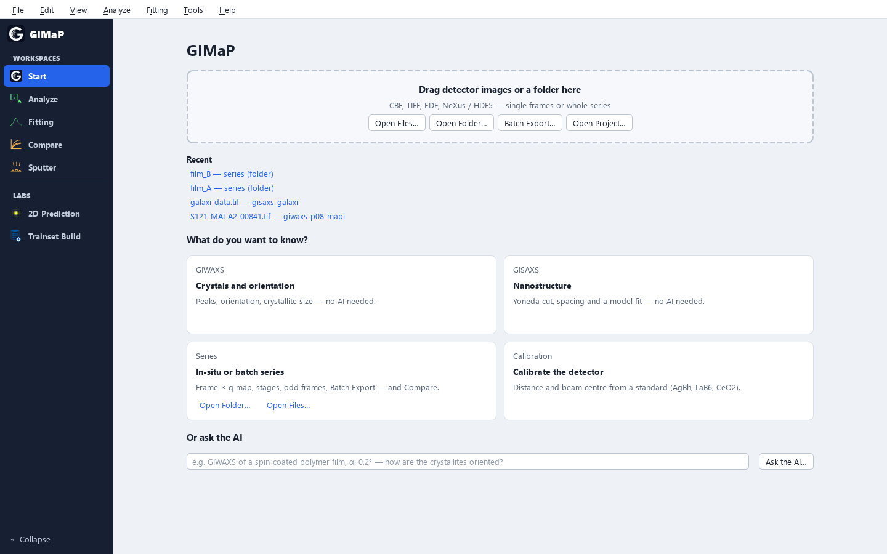
*The Start page: drop data or open it, choose what you want to know (the series card has its own
Open Folder… and Open Files… links), or ask the AI. Files opened before are listed under Recent.*

### 1.2 GIWAXS: a perovskite film

**1. Open the frame.** On the Start page press **Open Files…** and choose `S121_MAI_A2_00841.tif`
(or drag the file onto the window). **Analyze** opens. Check:

- the command bar names the file, and the step **Data** its size, `2048×2048 px`;
- the step **Data** is ✓ and **Mask & corrections** says how many pixels are left out
  (`0.0058 % of the pixels left out`: isolated hot and dead pixels);
- **Geometry** shows the distance and wavelength, and **Cuts** shows *Ring and bands*.

**2. Check the geometry.** Open **Geometry** and check that its source is
`LaB6_2021_12_DESY_P08.poni`, with a distance of 811.8 mm and a wavelength of 0.6888 Å.
Analyze reads the matching `.poni` beside the frame when it opens the frame. If the file is elsewhere,
choose **Load .poni…** and select it. Enter `0.075`, the value of the public example notebook, in the
**αi** field of the command bar and press Enter.

**3. Run the automatic analysis.** Press **Run Automatic Analysis**. The **Results** tab
shows the peaks and ring orientations. The run compares the entered 0.075° with the angle measured on
the frame, 0.501 ± 0.012°, and uses the measured one. To keep the notebook angle, select
**Geometry ▸ Keep entered αi** before running. The typed value stays in the set-up for the next frames.

**4. Read the results.** The Results tab begins with a line such as
*GIWAXS — 12 peaks (12 reliable), 3 rings analysed*. Below it:

- **Peaks**: q and FWHM in Å⁻¹, d in Å, L (Scherrer size, a lower bound) in nm, and whether the peak
  is out-of-plane (OOP) or in-plane (IP). Here you find peaks near q = 0.90, 1.00, 1.41, 1.99 and
  2.22 Å⁻¹. The data's README names 0.899 Å⁻¹ as PbI₂ (001) and 0.999 Å⁻¹ as MAPbI₃ (110).
  To compare candidate reflections, give the phases in **Phases** (section 5.9).
- The orientation summary marks the strongest reliable ring (by fitted area). For each analysed ring,
  compare the measured Hermans f with f_iso, the value of an isotropic ring over the same angles. Each
  ring also gives the statistical error, the systematic range, the pole fit and the position of the
  intensity maximum.
- **Checks** lists shadows and angular gaps, including the missing wedge next to qz.
- **Geometry**: the profile, distance, beam centre, wavelength and αi used.

Select a peak and open **Fit details** to see the points it was fitted to, the Gaussian, its
background and the errors. The warnings row lists the flags of the peak: a poor Gaussian fit (also
for a peak used in the ring analysis), overlap, the data edge or the bin width. **Save Report…** saves
a web page, Markdown and, after a completed analysis, a JSON record that can be replayed. Switch the
image to **q map** or **Cake** to see the rings in q; **Sources** shows which pixels each curve uses.

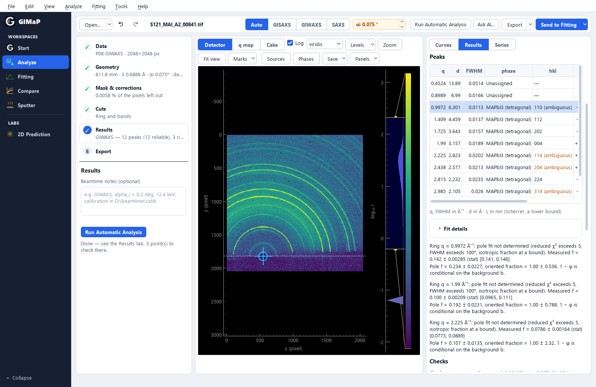
*The Results tab opens with the indexed peak count, orientation evidence for each candidate phase and warnings. The peak table and checks follow.*

**5. Send to Fitting.** Press **Send to Fitting**. GIMaP writes
`gimap_analysis/S121_MAI_A2_00841_fit_input.dat` next to the frame (columns q, I, σ, pixels; q in
Å⁻¹; the `#` header lines say where the points come from) and opens **Fitting ▸ Single analysis**
with it. The step **Curve** says `2050 points fitted` (the file's name is in the command bar).

For GIWAXS, the curve sent is I(q). Fitting's models are particle form factors (chapter 6), and a note
at the top of the Fitting page says so. For crystalline peaks, the peak table above is usually the
result you want; for peak fits of many frames, use **Batch Export ▸ Peaks of the ring regions**
(section 5.7). The `_fit_input.dat` file is also the curve with its record, ready for other programs.

### 1.3 GISAXS: silver nanoparticles

The source of these data describes the sample as Ag spheres with a radial paracrystal of peak
distance 53.6 nm (BornAgain's example *experiment_at_galaxi*).

**1. Open the frame.** First clear what section 1.2 left in Analyze. Press **Clear** in the step Data
(this also forgets the answers given there). Then right-click the αi field in the command bar ▸
**Back to Profile αi** to drop the αi typed for the previous sample. Open the GISAXS example
(**Help ▸ Example Data ▸ GISAXS — Ag Nanoparticles (GALAXI)…**, section 1.1), or choose
`galaxi_data.tif` with **File ▸ Open Data…** (`Ctrl+O`). Analyze shows `1043×981 px` (rows × columns).
**Mask & corrections** leaves out `1.4 %` of the pixels: the gaps between the Pilatus modules and bad
pixels.

**2. Check the geometry and the cut.** Open **Geometry**. With the example files in one folder,
Analyze uses `galaxi_bornagain.poni` when it opens the frame. Check 1730.0 mm and λ = 1.34 Å.
If you copied the frame alone, choose its calibration with **Load .poni…**. Enter the documented
`0.463` in **αi** in the command bar and press Enter. **Cuts** shows *Yoneda cut*: check the
horizontal band on the image. With αi entered, the exit angle of this band is 0.176° (0.639° at zero
incidence).

**3. Run the automatic analysis.** Press **Run Automatic Analysis**. The specular spot gives
αi = 0.462 ± 0.004°, which agrees with the entered 0.463°, so the run keeps 0.463°. The model fit takes
half a minute to a few minutes. To fit the horizontal cut yourself, go straight to **Send to Fitting**
(step 5).

**4. Read the results.**

| Part | What you see here | What to check |
|---|---|---|
| **Horizontal cut** | At the Yoneda band, rows 605–609 | The orange band on the image lies on the Yoneda band |
| Beam centre | x moved to the symmetry axis, x = 597.26 px | The documented direct beam is x = 597.1 px |
| Halves | *Halves: Mean of both halves*, the reason in its tooltip | Both halves agree; otherwise the usable one is taken |
| **Length scale 2π/q\*** | *2π/q\* = 55.6 nm at a shoulder of the cut (\|qy\| = 0.0113 Å⁻¹, no resolved peak): not necessarily the particle spacing.* | It is not the particle spacing. It is close to the documented 53.6 nm by chance: a BornAgain simulation of the same particles without interference shows the shoulder too |
| **Fit of I(qy)** | A table of solutions, most probable first: model, p (the solution's probability), R, h, D (nm) of each population in order of radius (a dash for D: no paracrystal) and χ²ᵣ. A ⚠ marks a value at a bound; the warning under the table names these values, and the tooltip names the bound | Which models compete, which values differ between solutions, and which values are at a bound |

The fit is **Predict parameters** (section 6.4). GIMaP's network proposes one or two populations of
spheres and upright cylinders, with or without a paracrystal. Each solution is refined by least squares
and weighted by its probability; the most probable one comes first. The probabilities compare only the
compositions that were tried. In this example (worked through in section 10.7), the first two rows are
the same model: a sphere with a paracrystal plus an upright cylinder. The model's probability rounds to
1.00, split 0.51 / 0.49 between the two solutions. Their radii and distances lie within each other's 68 %
intervals, so the report names no value to check. The two populations describe
the cut's broad log-normal sizes and its rise at low q. For this sample you know the particles are
spheres: fit that model in Fitting (step 5).

The screenshot shows an earlier fit: an upright cylinder with a paracrystal beside a second, larger
upright cylinder (R = 3.17 / 6.15 nm, D = 44 / – nm, χ²ᵣ 1.07, probability 0.39).

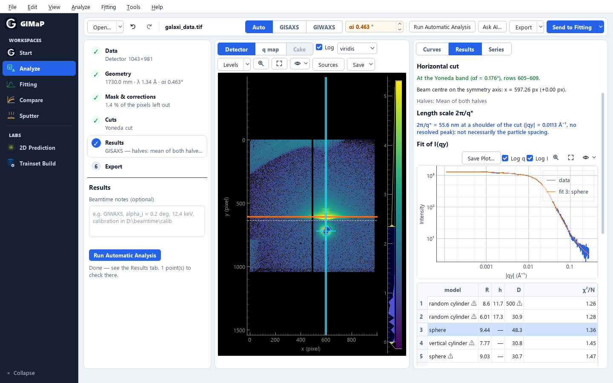
*The Results tab of a GISAXS frame: the cut, the length scale 2π/q\*, the fitted curve and the table of solutions.*

**5. Send to Fitting.** Press **Send to Fitting**. GIMaP writes
`gimap_analysis/galaxi_data_fit_input.dat` (the halves as chosen in the Cuts step, here the mean;
q in Å⁻¹) and opens it in **Fitting ▸ Single analysis**: **Curve** ✓ `598 points fitted`, **Model**
`Sphere · 9 free`, **Fit** *Ready to fit*. Fitting shows q in nm⁻¹.

For this unfitted cut the Fit step recommends **Predict parameters**. Check that **Model** contains a
sphere and that **Particles** shows **The particles in Model**, then press **Predict parameters**. With
both halves selected, Predict uses their mean; to fit one side only, select it in **Curve** first. The
status line gives the number of points fitted; check the intervals and warnings. Press
**Refine These Values** and check the residuals. Predict fits only the q window of its network, so its
point count can differ from Refine's. A spacing D at its bound, or marked unconstrained, is not a
measured particle distance.

In **Results**, rest the pointer on a parameter name to see what it means. When
**Review fit warnings…** appears, open it. **Save Curve and Parameters…** writes the curve to a CSV
file and the fit parameters, in full precision, to a JSON file beside it. **Save Plot…** saves PDF, SVG
or PNG.

Sizes depend on the model and its size distribution. BornAgain's model uses a log-normal distribution
of radii; Fitting's default and the automatic analysis use a Gaussian by number. To compare radii with
BornAgain's, choose *Log-normal, by number* under **Sizes**.

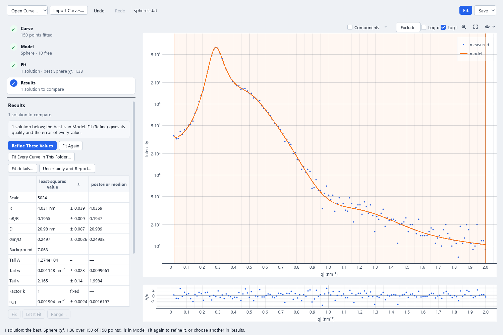
*After Predict parameters, Results shows the least-squares values and posterior medians. The model and residuals appear on the right.*

### 1.4 Where to go next

| You want to … | See |
|---|---|
| Set up the geometry of your own detector | Chapter 4 |
| Draw masks, choose cut regions, follow a series, export many frames | Chapter 5 |
| Fit a model properly, or a whole in-situ series | Chapter 6 |
| Compare runs or samples | Chapter 7 |
| Follow the islands of an in-situ sputter series | Chapter 8 |
| Let an AI do the analysis while you watch | Chapter 10 |
| Know what each exported file contains | Chapter 12 |

## 2. Installation and updating

### 2.1 Windows: the portable version

No Python is needed; the package brings its own.

1. Open the [GitHub Releases](https://github.com/zyffcc/gisaxs_gui/releases) page and choose the
   latest release. The package comes in one of two forms: one file,
   `GIMaP-<version>-windows-x64-portable.zip`, or, when that file is larger than GitHub allows
   (1900 MiB), its parts `GIMaP-<version>-windows-x64-portable.zip.part01`, `.part02` … with the
   installer `00_Download_and_Install_GIMaP-<version>.bat`.
2. Choose a folder with a short path that uses English letters only and that you may write to (for
   example `C:\GIMaP`).
   - **One ZIP:** download it, extract the whole ZIP into that folder, and double-click
     `Start_GIMaP.bat` in the folder `GIMaP-<version>-windows-x64-portable`.
   - **Parts:** download only `00_Download_and_Install_GIMaP-<version>.bat` into that folder (an empty
     one) and double-click it. It downloads the parts, verifies each one (SHA-256), joins and extracts
     them into the folder `GIMaP-<version>-windows-x64-portable` beside the installer, and starts
     GIMaP once. (`Install_GIMaP_parts.bat` joins and extracts parts you downloaded yourself, without
     checking them.)
3. To check a download yourself, compare its SHA-256 with the line for it in `SHA256SUMS.txt` on the
   release page. PowerShell prints it with `Get-FileHash -Algorithm SHA256` followed by the file name.

**What is in the folder.** `runtime\` (the bundled Python with all the packages GIMaP needs), the
program, `Start_GIMaP.bat`, the example data of section 1.1 (`tests\data\external\`), and `licenses\`:
the licence texts of everything in `runtime\`, with GIMaP's own `LICENSE` and `THIRD_PARTY_NOTICES.md`
(also **Help ▸ Third-party Notices**). `Update_GIMaP.bat` is also there; it updates only git clones
(section 2.4).

**Starting GIMaP later.** Double-click `Start_GIMaP.bat` in the folder
`GIMaP-<version>-windows-x64-portable`; a desktop shortcut to that file is convenient. The first
start prepares the bundled Python environment for the folder, which takes a few minutes.

**Path and memory.** The folder path must use English letters only, for example `D:\GIMaP`. Qt cannot
load its plugins from a path with other characters, such as a folder with a Chinese name (a localised
"Downloads"); `Start_GIMaP.bat` then says so and stops. Move the whole folder to a path with English
letters only and start it again. If the preparation at the first start (`tools\portable_unpack.py`)
fails, GIMaP does not start and the window gives the reason. If the reason is memory ("Not enough
memory resources are available to process this command"): restart the computer, close other programs,
check that virtual memory is on (System ▸ About ▸ Advanced system settings ▸ Performance Settings ▸
Advanced ▸ Virtual memory: automatic), keep a few GB free on that drive, and double-click
`Start_GIMaP.bat` again. If it still fails, extract the release ZIP again into an empty folder.

The installer and the launcher are batch files and are not signed. Windows may ask for confirmation
before it runs one, and an institution's antivirus may block it. Run only files from the GitHub
Releases page of GIMaP, or run GIMaP from source (section 2.2).

### 2.2 Running from source

**The simple way on Windows (no Python needed).** Double-click `Start_GIMaP.bat` in the folder that
holds `main.py`: a clone of the repository, or a ZIP of it (**Code ▸ Download ZIP** on GitHub). Windows
may extract the ZIP into a folder `gisaxs_gui-main` inside another `gisaxs_gui-main`; use the inner
one, which holds `main.py`. As for the portable version, the folder path must be short, writable and
use English letters only (section 2.1).

The first start sets up a private environment in the folder `.gimap`. It downloads uv (a small Python
installer, pinned version, checked against its SHA-256), Python 3.10 and the packages of
`requirements-full.txt` (the core and every optional part, about 2 GB). This takes 3-20 minutes,
depending on the connection; then GIMaP opens. Later starts are immediate. If the package installation
fails (for example for lack of free memory), it tries again one package at a time, which needs much
less memory and takes longer. When an update changes `requirements.txt`, the next start adds the
missing packages first. Nothing outside the folder is changed; deleting `.gimap` removes the
environment.

**Moving the folder.** The environment in `.gimap` belongs to the place where it was set up. After
you move or rename the folder, delete its `.gimap` folder and double-click `Start_GIMaP.bat`: the
environment is set up again for the new place. To build it again in place (for example when it was
damaged), run `powershell -NoProfile -ExecutionPolicy Bypass -File tools\setup_source_env.ps1 -Reinstall`.

**By hand.** GIMaP requires Python >=3.10 and is tested on 3.10 and 3.11. In the source folder, run

```powershell
python -m venv .venv
.\.venv\Scripts\Activate.ps1
python -m pip install --upgrade pip
python -m pip install -r requirements.txt
python main.py
```

If PowerShell refuses to activate the environment, run
`Set-ExecutionPolicy -Scope Process -ExecutionPolicy Bypass` first. With Conda:

```powershell
conda create -n GUI python=3.11 -y
conda activate GUI
python -m pip install -r requirements.txt
python main.py
```

`requirements.txt` is the core: Analyze, Geometry Calibration, Fitting with Predict parameters, Series, Batch Export, the
automatic analysis, XRR, Sputter and SEM. The optional parts have their own files: `requirements-tensorflow.txt`
(2D Prediction, Trainset training), `requirements-bornagain.txt` (BornAgain simulations) and
`requirements-ai.txt` (Process with AI); `requirements-full.txt` installs everything. A function whose package is
missing says which file to install.

Start GIMaP from such an environment with `python main.py`. `Start_GIMaP.bat` always uses its own
`.gimap` environment and sets one up beside yours.

**As a package, with a `gimap` command.** In the folder of the checkout, `python -m pip install -e .`
installs GIMaP with the packages of `requirements.txt` and adds the command `gimap`. `gimap` starts GIMaP;
`gimap frame_0001.cbf scan_folder sample.gimap` also opens what it names (frames and folders in Analyze, a
project as a project); `gimap --version` prints the version and `gimap --help` the options. `python main.py`
takes the same arguments. A wheel installation (`python -m pip install .` from a tagged checkout)
includes the English and Chinese manuals with their images, the detector catalogue and the Predict
weights. For the public frames under **Help ▸ Example Data**, install with `python -m pip install -e .`
and keep the checkout, where the examples stay in `tests/data/external/`.

The trained network of **Predict parameters** and 1D Predict is in the Git repository (about 13 MB,
section 6.4), so a checkout runs everything. On macOS, BornAgain is installed separately: `README.md`
says how.

### 2.3 Optional parts

GIMaP runs without these. Each is needed only for the function named.

| Part | Needed for | How |
|---|---|---|
| An AI account or a local model | **Ask AI…**, **Tools ▸ Process with AI…** | The Python packages come with `requirements-ai.txt` (in `requirements-full.txt` and `Start_GIMaP.bat`); set up the AI in **Tools ▸ Settings… ▸ Assistant** (chapter 10) |
| StarDist | Separating touching particles in **Tools ▸ SEM Particle Analysis…** | A separate Python environment with `requirements-sem-stardist.txt`, and a local model folder (chapter 9) |
| The analysis package | **Analyze** and **Static Frames** of the Sputter workspace | Comes with GIMaP (`utils/sputter_client`); it needs no further Python package. **Choose Folder…** or `GIMAP_SPUTTER_CLIENT` use another one (section 8.1) |

TensorFlow runs on the CPU; a GPU set-up is not configured.

### 2.4 Updating

**Windows portable version.** Get the new version as in section 2.1 (installer or ZIP). It goes into a
folder of its own. Start the new `Start_GIMaP.bat`, and delete the old folder when you no longer need
it. `Update_GIMaP.bat` does not update a portable folder: the folder has no `.git`, so the script says
so and changes nothing.

**macOS portable version.** Extract the new package into a new folder and open its `Start_GIMaP.command`.
Its first launch prepares the runtime for that package. Settings remain in the user data folder.

**Source checkout (a git clone).** Double-click `Update_GIMaP.bat` in the folder (it needs Git 2.16 or
newer), or run:

```powershell
powershell -ExecutionPolicy Bypass -File tools\update_source.ps1
```

The script updates the branch from GitHub and reports what it found and what it did:

- Your uncommitted edits are put aside and then applied again on top of the new version. An edit that
  does not fit the new version stays aside, and the script says so.
- Your data and results are left alone. The script stops before it would overwrite a file of yours.
- If the branch has to move to a rewritten history, your own commits that are not on GitHub are kept on
  a backup branch. `README.md` explains how to get them back.

Add `-DryRun` to see what the script would do without changing anything.

When the script says that a list of Python packages changed (`requirements.txt`) and you start GIMaP
with `Start_GIMaP.bat`, there is nothing to do: its next start adds the new packages. In an environment
you set up yourself (conda, venv), run the command the script prints for each changed list, such as
`python -m pip install -r requirements.txt`.

A folder from **Code ▸ Download ZIP** has no `.git` and is not a checkout: the script says so and
changes nothing. Download the ZIP again, or clone the repository with Git
(`git clone https://github.com/zyffcc/gisaxs_gui.git`); the script updates a clone from then on.
Extract a new ZIP into a new folder; its first `Start_GIMaP.bat` sets up the environment again (moving
`.gimap` over does not work, section 2.2). Your settings stay in the user data folder.

A checkout last updated before 2026-10-13 does not have the script yet. The history of `main` was
rewritten on that day, so do not run `git pull`, merge or push from such a checkout. Move it first with
the steps in `README.md`, section *Updating a source checkout*; from then on use the script.

**What an update keeps.** Settings, instrument profiles, recent files and the fitting model are kept
in the user data folder, outside the program (section 3.11), so an update keeps them. Version 0.0.2
kept its settings in its own program folder. A new portable folder does not take them over; it starts
with the defaults. A source checkout updated in place imports them once, at the first start, while the
user data folder holds no settings yet.

### 2.5 System and screen

GIMaP is released for Windows x64 and for macOS 15 or later, with separate Apple Silicon and Intel
packages. The release page lists the systems verified for each package. A 1280 × 720 screen is enough (the
smallest window is 1024 × 640); a 1080p or larger screen is more comfortable for the detector image
beside the curves. GIMaP follows the display scaling of the operating system (for example 125 % or
150 %).

### macOS portable package

Choose the package for **Apple Silicon (arm64)** or **Intel (x86_64)**; no Python installation is
needed. Extract the ZIP, then double-click `Start_GIMaP.command`. The first launch verifies and unpacks
its Python runtime into `~/Library/Application Support/GIMaP/runtimes/`; the Terminal window shows the
preparation and any launch errors. Later launches reuse that runtime. Keep the launcher, `app/` and
`runtime.tar.gz` together. The package is not signed yet: for a download you trust, use macOS's Open
action. Do not turn off system protection.

For source installations on a Mac with Python 3.10 or 3.11, run `python -m pip install -r requirements-release.txt` to select the official SciPy wheel for that interpreter and architecture.

## 3. The window

### 3.1 The parts of the window

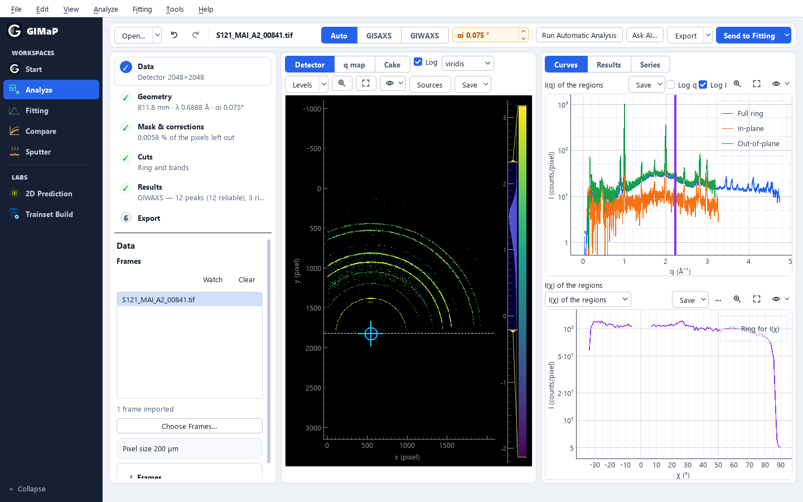
*Analyze: the sidebar, the command bar, the steps on the left with the frame list of the Data step (Choose
Frames… below it), the image in the middle, the curves on the right.*

- **The sidebar** (left) holds the pages. *Workspaces*: **Start**, **Analyze**, **Fitting**,
  **Compare**, **Sputter**. *Labs*: **2D Prediction**, the experimental machine-learning
  tools. **« Collapse** at its foot (or `Ctrl+B`) reduces it to icons. `Ctrl+1` … `Ctrl+6` switch pages
  in this order: Start, Analyze, Fitting, Compare, Sputter, 2D Prediction (so Sputter
  is `Ctrl+5`).
- **The menu bar**: **File, Edit, View, Analyze, Fitting, Tools, Help** (section 3.6). The tool windows
  open from **Tools**; **Analyze** and **Fitting** hold the commands of those two pages.
- **The page.** Analyze and Fitting share one layout: a command bar at the top, the steps of the work
  on the left, the plots on the right.
- **Messages** appear as short notes at the bottom right. A note about a written file has an
  **Open Folder** button. Each page also has a status line at its foot.

The window title names the frame shown, and the project when one is open. A `*` after the title marks
unsaved changes (section 3.8).

**Starting.** While GIMaP starts, a small window shows its version and what it is loading; the main window
follows a few seconds later. Compare and Sputter are built when you first open them. Starting GIMaP a
second time while it runs asks first. **Switch to It** brings the running window to the front and opens
there what the second start was given. **Start Anyway (Read-only Settings)** opens a second window that
saves neither settings nor session, so the two windows never overwrite each other's files.

**Small screens.** When the window is smaller than a page needs (below about 1200 × 690 for Analyze), the page
keeps its size and scroll bars appear, so plots and tables are not cut off.

**Dropping files.** Detector frames, folders and `.gimap` projects can be dropped anywhere on the
window. A curve file (`.dat`, `.txt`) dropped while Fitting is shown opens there.

**Closing.** When the work has unsaved changes, closing asks first: **Save** (the project, or a new one),
**Don't Save** or **Cancel**. Closing GIMaP while something still runs — Batch Export, a Series map, the automatic
analysis, an AI analysis, a fit, an In-situ series, a 2D prediction, an SEM Particle Analysis, a
Sputter analysis — asks first and lists what runs. **Yes** stops them and quits; **Cancel** keeps working. An SEM analysis
that is still finishing may ask you to close the window again once it has stopped.

### 3.2 The Start page

- **Drop box**: drag detector images or a folder onto it, or press **Open Files…**, **Open Folder…**,
  **Batch Export…** (a folder of raw frames straight to curves, with the settings of last time) or
  **Open Project…**. Analyze opens at once and shows the file, its detector and frames while the
  image loads.
- **Recent**: the five files, folders and projects opened last, with their folder (the full list is
  in **File ▸ Open Recent**).
- **What do you want to know?**: *Crystals and orientation* (GIWAXS), *Nanostructure* (GISAXS),
  *In-situ or batch series*, *Calibrate the detector*. Each opens the right place, with the mode
  chosen. The series card has two links of its own: **Open Folder…** (a folder of frames: one file per
  frame, or the module files of one scan) and **Open Files…** (chosen frames, or one NeXus/HDF5 file that
  holds the whole series); both end on Analyze's Series tab.
- **Or ask the AI**: describe your data and question, then **Ask the AI…** (chapter 10).

### 3.3 Steps and command bars

In Analyze and Fitting each step on the left says where it stands, with one line of what it found:

| Mark | Meaning |
|---|---|
| ✓ | Done, nothing to check |
| ! | Done, but look at it (a question, a warning) |
| × | Failed: the line says why |
| … | Running |
| a number | Not done yet |

A line too long for the step list ends in “…”; rest the pointer on the step to read all of it.

Click a step to see its controls. The controls used most are shown; rare options are folded under a
heading you can open.

The screen shows what you need each time you look: states, results, failures, missing or guessed
values, and where a value comes from. How to use a control, and what a section is for, are in
tooltips. Rest the pointer on the control or on the section title (the pointer shows a question mark
where a title has a tooltip).

When Analyze's command bar is narrow, the long button texts are shortened (*Run Analysis*, *Batch…*,
*Fitting*); the full text stays in the tooltip.

### 3.4 Plots and images

**Curve plots.**

- The right mouse button opens a menu: **Reset View**, the log axes, **Copy Image**, **Copy Data**,
  and on plots with a **Save** button also **Plot as Figure…** and **Curves as Data…**.
- Dragging with the right button zooms; the mouse wheel zooms too.
- **Zoom** (the magnifier): drag a rectangle. Shift + drag works on every plot and image without the
  button. **Reset** shows everything again.
- **Log I** and **Log q** switch the axes. The eye button shows or hides each kind of mark.
- When a plot is narrow, its title wraps above it and its options move into a **⋯** menu.

**Detector images** (also the q map, the cake and the Series map) have **Zoom**, **Fit view**,
**Marks**, a colour map, **Log** and **Levels**. Next to each image is a histogram with two handles
for the colour limits. Section 5.4 describes the colour limits and marks.

Saved figures always use light colours, also in the dark theme.

### 3.5 Tables

The result tables — the peaks and solutions of the automatic analysis, the tables of Fitting and of
Compare — can be copied. Select rows and press `Ctrl+C`, or use **Copy Rows** / **Copy Table** on
the right mouse button. The rows are copied with their column names, ready to paste into a
spreadsheet.

### 3.6 Menus

| Menu | Entries |
|---|---|
| File | Open Data… (`Ctrl+O`), Open Folder… (`Ctrl+Shift+O`), Open Recent, Open Project… (`Ctrl+Shift+P`), Save Project (`Ctrl+S`), Save Project As… (`Ctrl+Shift+S`), Labs Parameters ▸ Load… / Save As…, Exit |
| Edit | Undo (`Ctrl+Z`), Redo (`Ctrl+Y`; `Ctrl+Shift+Z` also works): the set-up in Analyze, the model in Fitting's Single analysis |
| View | *Workspaces* and *Labs*: the pages (`Ctrl+1`…`Ctrl+6`), Collapse Sidebar (`Ctrl+B`), Full Screen (`F11`), Theme ▸ Light / Dark, Font Size ▸ Larger (`Ctrl++`) / Smaller (`Ctrl+-`) / Reset (`Ctrl+0`), Language ▸ English / 中文 |
| Analyze | Run Automatic Analysis, Stop Automatic Analysis, Repeat Analysis (`F5`), Absolute Scale from a Standard…, Export Curves… (`Ctrl+E`), Batch Export… (`Ctrl+Shift+E`), Batch Export a Folder…, Send to Fitting, Send Both Cuts to Fitting, Send Series to Fitting…, Send Series to Compare, Set-up Files ▸ Save Settings… / Load Settings… / Save Cuts… / Load Cuts… / Save Masks… / Load Masks…, Figures ▸ Save Image… / Save q-Map Data… / Save View Data…, Tools ▸ Reproduce from Record…, Clear Frame List |
| Fitting | Open Curve…, Import Curves…, Fit a Folder of Curves…, Fit (`Ctrl+Return`), Stop Fit, Fit Several Curves Together…, Load Model…, Save Model…, Save Curve and Parameters…, Save Plot…, Batch / In-situ Series ▸ Start / Stop, 1D Predict — Fit Many Curves… |
| Tools | Geometry Calibration… (`Ctrl+Shift+G`), Format Converter… (`Ctrl+Shift+C`), Convert Current File…, XRR Series Extractor… (`Ctrl+Shift+R`), SEM Particle Analysis…, 1D Predict — Fit Many Curves…, Process with AI… (`Ctrl+Shift+L`), Settings… (`Ctrl+,`) |
| Help | User Manual (`F1`), Physics and Methods, Keyboard Shortcuts…, Example Data ▸ GISAXS — Ag Nanoparticles (GALAXI)… / SAXS — AgBh Calibrant (pyFAI)… / GIWAXS — MAPbI₃ Film (DESY P08)… / GIWAXS — PbTe, Tilted Detector (Xeuss)…, Report a Problem…, Open Log Folder, Open User Data Folder, GitHub Repository, Check for Updates…, How to Cite GIMaP…, Third-party Notices, About GIMaP |

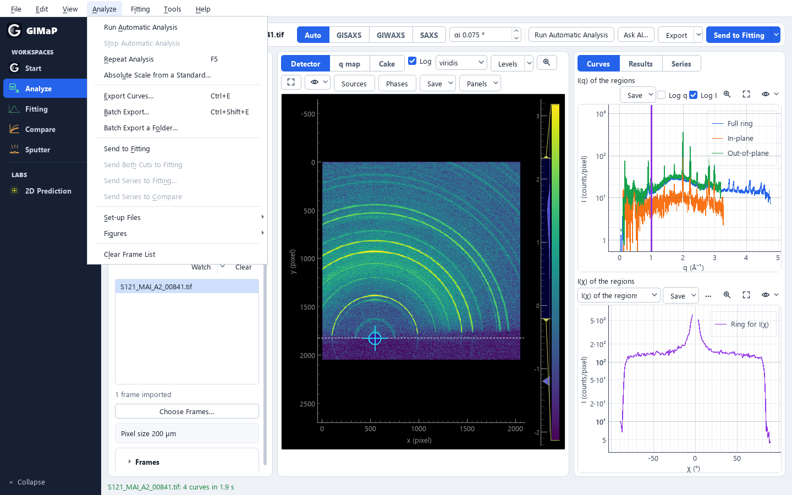
*The Analyze menu with one frame open in Analyze. Entries that cannot run now are greyed out; their tooltip says
why.*

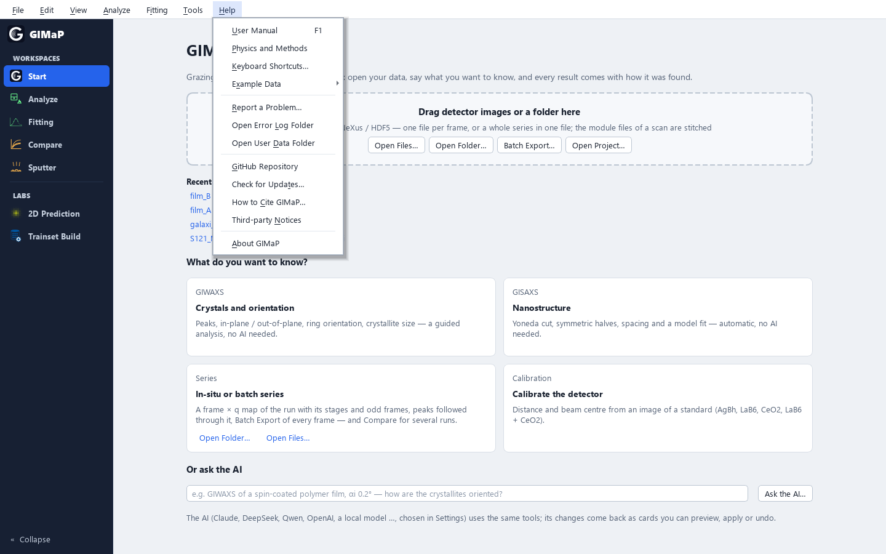
*The Help menu: the two manuals, the keyboard shortcuts, the example data (a submenu), where to report a problem,
the folders GIMaP keeps, and the links to GitHub, the citation, the notices and the version.*

- While Fitting's Single analysis is shown, **File ▸ Open Data…** opens a curve and says so
  (*Open Curve…*).
- **Edit ▸ Undo** and **Redo** act on the page shown: Analyze, or Fitting's Single analysis. The
  entry names what it would change (for example *Undo: cut regions*, *Undo: the fit (Refine)*). On the other pages
  they are greyed out.
- Every entry of **Analyze** and **Fitting** first shows its page (in Fitting the Single analysis, or
  the In-situ series for Fit a Folder of Curves… and Batch / In-situ Series ▸ Start / Stop), then does what
  the page's own button does. An entry that cannot run now is greyed out, and its tooltip says why
  (for example *Open a frame first.*).
- The keys shown next to Undo, Redo, Repeat Analysis, Export Curves…, Batch Export… and Fit belong to
  the page: they act while that page has the keyboard focus (section 3.7). The menu entries work from
  any page.
- *Labs Parameters* are the settings of 2D Prediction. The file also holds Fitting's model (the
  particles and global parameters of the Single analysis). **Load…** replaces Fitting's model with the
  one in the file, without asking, and keeps it as the stored model; save a project first if you need
  the current model. Analyze keeps its own set-up in settings files
  (**Analyze ▸ Set-up Files ▸ Save Settings… / Load Settings…**, also in the page's **Export** menu and
  used by Batch Export). A project keeps everything of one sample (section 3.8).
- **Tools ▸ 1D Predict — Fit Many Curves…** fits a list of curve files with the experimental neural
  model (chapter 6). The other tool windows are described in chapters 4 and 9.
- **Help ▸ User Manual** opens this manual in your web browser, offline; in the Chinese interface it
  opens the Chinese edition. **Physics and Methods** (how GIMaP computes what it shows) and
  **Third-party Notices** open the same way; a link from one of these documents to another opens the
  other one at that section. **Keyboard Shortcuts…** lists every key of the menus and of the pages in a
  table you can copy (`Ctrl+C`).
- **Help ▸ Example Data** copies one of the public examples that come with GIMaP to a folder you
  choose (by default `Documents\GIMaP examples\<example>`) and opens its frame in Analyze (section 1.1).
- **Help ▸ Report a Problem…** copies the versions of GIMaP, the operating system, Python, Qt, PyQt
  and numpy (no paths, no data) to the clipboard and opens a new issue on GitHub in your browser:
  paste them there. **Check for Updates…** opens the releases page on GitHub in your browser (newest
  first, pre-releases included); GIMaP itself makes no network request.

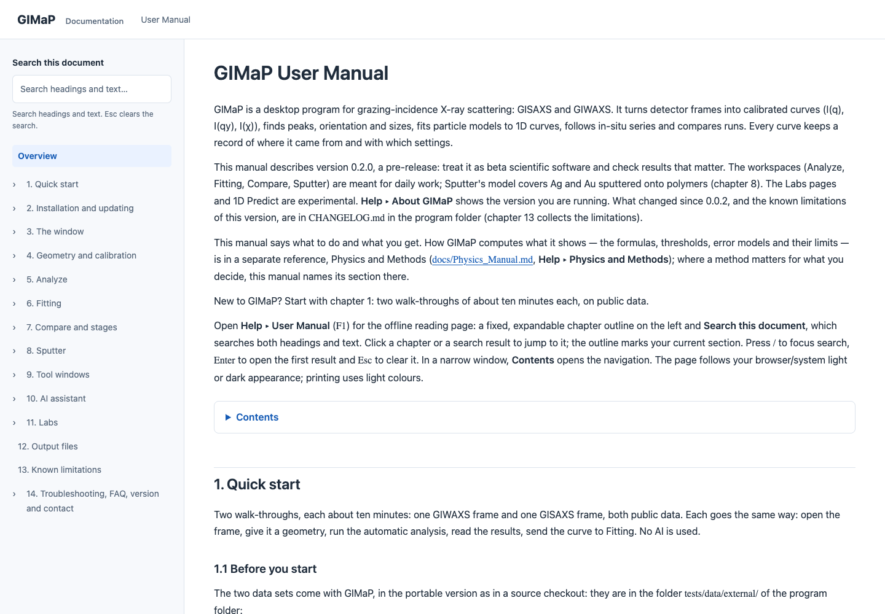
*The help reader: expandable chapters and text search stay beside the document while you read.*

### 3.7 Keyboard shortcuts

The keys of the File, View and Tools menus work on every page. The keys below belong to a page or a
window: they act while it has the keyboard focus. After switching pages with `Ctrl+1` … `Ctrl+6` or the
sidebar, click into the page first. The page keys marked *menu* are also shown in the Edit, Analyze and
Fitting menus (section 3.6); those entries work from any page. **Help ▸ Keyboard Shortcuts…** shows
the keys of the menus and this table in the program.

| Where | Keys | What it does |
|---|---|---|
| Analyze | `Page Up` / `Page Down` | Previous / next imported frame (through the frames of a source, then on to the next source) |
| Analyze | `Ctrl+Z`, `Ctrl+Shift+Z` or `Ctrl+Y` | Undo / redo a change of the set-up (*menu*: Edit ▸ Undo / Redo) |
| Analyze | `Ctrl+E` | Export the curves of this frame (*menu*: Analyze ▸ Export Curves…) |
| Analyze | `Ctrl+Shift+E` | Batch Export… (*menu*: Analyze ▸ Batch Export…) |
| Analyze | `F5` | Analyse the frame again (*menu*: Analyze ▸ Repeat Analysis) |
| Analyze | `Delete` or `Backspace` | Remove the selected source (all its frames), mask or cut region from its list (the files themselves are not touched) |
| Analyze | `Esc` | Stop picking the beam centre on the image; cancel drawing a mask |
| Analyze, drawing a polygon mask | `Return` (or `Enter`) / `Backspace` | Close the polygon (from three points on) / take back the last point |
| Fitting | `Ctrl+Return` | Fit (*menu*: Fitting ▸ Fit) |
| Fitting | `Ctrl+Z`, `Ctrl+Shift+Z` or `Ctrl+Y` | Undo / redo a change of the model (*menu*: Edit ▸ Undo / Redo) |
| Compare | `Delete` | Remove the selected series from the table |
| Tables | `Ctrl+C` | Copy the selected rows with their column names |
| Geometry Calibration | `Esc` | Close the window (it asks first while a calibration runs) |
| XRR Series Extractor | `Esc` | Stop picking the direct-beam centre on the preview; when not picking, close the window |

### 3.8 Projects

A project (`.gimap`, a JSON file) reopens a sample as it was left:

- the frames and the whole set-up of Analyze (mode, profile, masks and drawn regions, corrections,
  cuts), the frames chosen for import (section 5.1) and whether one cut is held for a series;
- the curve, halves, fitting range, left-out points, model and selected method of Fitting, and its results: the
  last fit (values, errors, χ²ᵣ, values at a bound, correlations), every solution of Predict parameters (probability,
  intervals, flags) and where a fit started from. They are shown again as they were. If the curve's file has
  changed since the project was saved (checked by its SHA-256), they are marked stale (*Changed after the fit:
  Fit again*) and the project's notes say so;
- the folder and choices of the In-situ series with its fitted frames (each frame's values, errors, χ²ᵣ and points,
  shown again once the curves are listed; a frame whose file is no longer listed is left out, and the status line
  says how many), and the series of Compare;
- the Sputter form (the input bar with the rate's unit, the geometry, the options of Analyze and of Static
  Frames), scan/mask/output paths and the reference to the result folder shown (the result is not copied). A project
  of an older version keeps its geometry; its result of the earlier method (Predict) is not opened.

**File ▸ Labs Parameters ▸ Save As…** saves the 2D Prediction settings, with Fitting's model, in a file of
their own. An older project without Sputter resets that workspace to its empty form.

**File ▸ Save Project** (`Ctrl+S`) writes it; the first time it asks where (next to the first frame
by default). **Open Project…**, the Start page's **Open Project…**, **Open Recent** (projects first)
or dropping a `.gimap` file on the window opens it.

- Data are referenced by path, not copied. Compare's embedded arrays are kept in a second file,
  `<name>.<generation>.compare.npz`, next to the project. Move or copy the `.gimap` and the file named by its
  `compare.arrays_file` together. Older `<name>.compare.npz` projects still open.
- Saving writes the new arrays and a temporary project file first, then replaces the `.gimap` in one step.
  If saving fails, the previous project and its arrays stay usable. An old array file stays behind if
  another program holds it open; the project names the array file it uses.
- While Compare is importing or restoring series, **Save Project** asks you to wait for the import or
  cancel it, so that no incomplete list is saved. Compare reads restored data in the background, in their
  saved order; read errors appear in Compare's status line and notes.
- When a file has moved, the project still opens; a note says how many files are missing and names the
  first ones, and **Details…** lists them all.
- Analyze restores the order of the sources, the source shown and its frame number. The source order also
  sets which neighbouring single-frame files go into **Sum**, and their order in a series. If the source
  shown is missing, Analyze shows the first imported frame of another source, and a note says so. If a
  NeXus chunk file is now represented by its master file, the frame number and the import selection are
  mapped into the master.
- A project saved with a method removed in 0.2.0 (*Predict parameters (fit1d)*, *Find the particle shape*) opens
  with the method the page chooses for its curve (section 6.2); the options of those methods are not read.
- Opening a project replaces what the window holds: the frames of Analyze, the curve and the In-situ
  series of Fitting and the series of Compare of the sample before are closed. Save them first if you need them.
- After **Clear** in Analyze, what you open next is no longer that project: **Save Project** asks
  where to save instead of overwriting it.
- Work that differs from what was last saved or opened puts a `*` after the window title. Opening another
  project or closing the window then asks first: **Save**, **Don't Save** or **Cancel**. Changing back what you
  changed removes the `*` again; looking at another frame of the list is no change.
- A project that cannot be opened is taken off **Open Recent**, and the message says so.
- A project cannot be opened while a job runs (an In-situ series, Batch Export …): stop it first.
- Opening a project replaces the fits of the In-situ series. When frames fitted there are not saved yet, opening a
  project asks first: **Save** (the table of every frame), **Discard** or **Cancel** (nothing changes).

### 3.9 Memory between sessions

- **Recent data**: every file or folder opened (dialog, drag and drop, Start page, Batch Export) is
  listed in **File ▸ Open Recent** and on the Start page, newest first. At most 8 are kept; files
  that no longer exist are left out; a file that could not be opened is taken off the list (a note says
  so). **Clear the List** empties it. Recent projects are kept apart (the last 6), listed first, and stay
  after **Clear the List**.
- **Last set-up**: when GIMaP closes after a frame was analysed, the Analyze set-up (mode, profile,
  masks, corrections, cut regions …) is kept in `last_analyze_setup.json` in the user data folder.
  With the first frame of the next session a note offers **Use It**. It is applied only when you accept,
  since a new beamtime may need other settings. It is not offered when you open a project, whose own
  set-up is used.
- **Autosave and recovery**: changed work is saved every 2 minutes and after each long job (Batch Export, the
  automatic analysis, a fit, an In-situ series …) to `autosave/session.gimap` in the user data folder, never
  while a job runs. When GIMaP was not closed properly (a crash, a power cut, a window ended in the Task
  Manager), the next start asks **GIMaP was not closed properly. Restore the work autosaved at …?**.
  **Restore** opens that work with a `*`: save it to keep it (**Save Project** writes to the project it came
  from). **Discard** deletes it. A normal close deletes the autosave.
- **Series map**: the autosave and a project keep the Series map (also one built live while watching) up to
  4 million values (x and intensity of every row). A larger map is not kept, and a note says to build it
  again. The project also keeps the reduction recipe of each row when recipes and values together fit in
  32 MB (UTF-8 recipe bytes plus 8 bytes per value). Above that, the map still reopens without the recipes:
  choose **Build Map** before you export it for replay.
- **Sputter**: the values of each scan folder's last Analyze (geometry, metal, mask, the substrate, the rate with
  its unit and whether it is a QCM reading, the mode, the start and duration of the deposition and the film
  thickness), the values used last (another folder does not take over the mask, the sample roll or a rate), the
  geometry presets, the folder of the analysis package and the result shown last (opened again at the next start).
  What an older version remembered for its earlier method (Predict) is not read.
- The window size and position, the positions of the dividers between panels (splitters), the theme, the
  font size and the language are restored at the next start.

### 3.10 When something goes wrong

An unexpected error does not close GIMaP. A window says what happened: **Show Details** shows the
technical report, **Copy Details** copies it for a bug report, and the work goes on. Every error is
written to `logs/errors.log` in the user data folder. The same folder holds:

- `gimap.log`: what each session did (its version, warnings, failed saves), also when GIMaP runs
  without a console; files of at most 1 MB, and the three before are kept;
- `crash.log`: the Python stack, when a crash of the system libraries ends GIMaP.

**Open Log Folder** in that window, or **Help ▸ Open Log Folder** at any time, opens the folder; when
nothing has been logged yet, the menu entry says so. To report a problem, **Help ▸ Report a Problem…**
(section 3.6) copies the versions to paste into the report.

Files that cannot be read say why in words: empty (still being written?), not a detector image, a
damaged or incomplete NeXus file, a NeXus/HDF5 file another program is still writing, no permission.
Chapter 14 has more.

### 3.11 Settings and the user data folder

**Tools ▸ Settings…** (`Ctrl+,`) has four pages. Changes apply immediately (the font size a moment after the
last arrow click, or at once with Enter); only the keys of the AI are stored with their own **Save** button.

| Page | What it sets |
|---|---|
| **Appearance** | Light or dark theme, the font size, the interface language (English by default, or 中文). Values, units and file names are never translated. |
| **Analyze** | **Use the beam centre written in the file header** (CBF `Beam_xy`, NeXus `beam_center_x/y`): off by default, so the calibrated profile centre is used; many beamlines never update the header centre. **Send horizontal cut to Fitting**: which half of the GISAXS horizontal cut Send to Fitting passes on (by default both halves on \|qy\| in two colours). |
| **Data** | Where the user data folder is (**Open**), and **Reset All Settings…** (instrument profiles are kept; restart GIMaP afterwards) |
| **Assistant** | The AI: which one, its standing instructions, models, keys and permissions (chapter 10) |

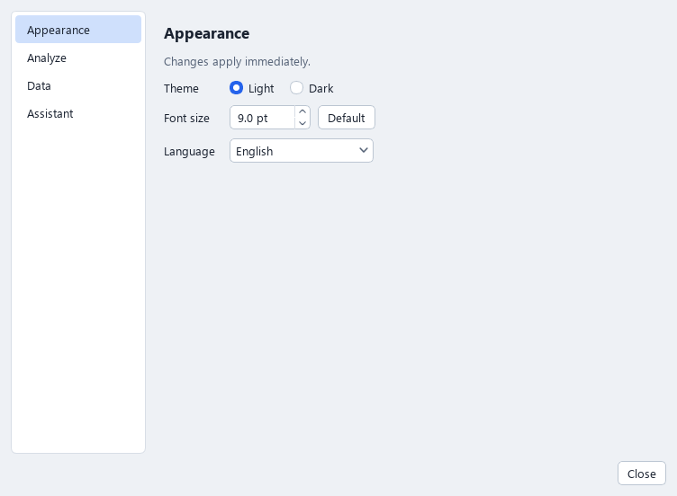
*Tools ▸ Settings…: the Appearance page.*

All settings, preferences, instrument profiles, the session and the fitting model are kept in one
user data folder outside the program, together with the error log (section 3.10), the result folders
of the Sputter workspace (chapter 8) and the records of the AI assistant's runs (chapter 10):

- Windows: `%APPDATA%\GIMaP`;
- elsewhere: `~/.config/gimap` (`$XDG_CONFIG_HOME/gimap` when that variable is set);
- or the folder named in the environment variable `GIMAP_HOME`.

**Help ▸ Open User Data Folder** opens it. Updating the program never overwrites it, and deleting the
program folder does not remove it.

- **One GIMaP per folder.** A running GIMaP holds `gimap.lock` there; a second start asks first (section 3.1).
  A lock left by a GIMaP that crashed is taken over without a question.
- **Settings of older versions.** The first time the default folder is opened, GIMaP imports once the settings
  an older version kept in the program folder (`config/user_parameters.json`, `config/user_settings.json`,
  `config/instrument_profiles.json`): settings only, never a session (the last Fitting curve, the recent and
  last folders stay behind). A folder named by `GIMAP_HOME` imports nothing.

## 4. Geometry and calibration

Without a geometry GIMaP shows the detector in pixels and nothing in q. This chapter explains where
the geometry comes from, the three ways to get one, the Geometry Calibration window, the pixel
coordinates of the beam centre, and how to adjust the centre in Analyze.

### 4.1 Instrument profiles

An *instrument profile* is a saved geometry for one detector: sample–detector distance, pixel size,
wavelength, beam centre and incidence angle αi. Profiles are kept in the user data folder
(`instrument_profiles.json`, section 3.11).

When a frame is opened, Analyze picks the profile that matches it:

- **Frame size.** A profile for another frame size is never used.
- **Detector name**, when the file states one (CBF and NeXus usually do, TIFF does not). A matching
  name counts more than the size.
- When several profiles match equally, the newest is used.

When nothing better matches, a profile of the same frame size is used, even with another detector
name. So a profile made for a TIFF without a detector name is used for every TIFF of that size. When
you change the set-up (distance, energy) but keep the detector, make or choose a new profile.

**A `.poni` beside the frames comes first.** The frame's own folder may hold a pyFAI `.poni` named
like the frame, or a single `.poni`. If the file fits the frame (frame size and pixel size, when it
states them, and a wavelength), its geometry is used ahead of a profile matched by name and size,
since such a profile may come from another experiment with the same detector. **Geometry** then says
*galaxi_bornagain.poni beside the frame*. A beam centre or geometry you save while that file is in use
names it, and from then on your saved profile is used.

**A profile picked for another detector is not used.** A profile chosen in **Instrument profile** (or
kept from a project) is set aside for frames of another frame size. Those frames take the `.poni`
beside them or the profile that matches them, and the banner says which profile was not used and why.
**Use “…” Anyway** in the banner uses it for frames of that size all the same.

The step **Geometry** shows the geometry in use (`811.8 mm · λ 0.6888 Å · αi 0°`). Its field
**Instrument profile** is set to **Automatic (match detector)**; choose a profile there to use it
instead.

**αi** in the command bar shows the angle used for the current frame. An incidence angle with a unit
in a mini-CBF or NeXus sample header comes before the profile value; for a sum, the headers of all
summed frames must agree. When the header has such an angle, right-click the field ▸
**Use frame-header αi** to go back to it.

A value you type is shown in orange and is used as the reference for every frame. It is remembered
for the next session, and a note at the first frame says so. Right-click the field ▸
**Back to Profile αi** to drop it; **Clear** in the step Data keeps it. The remembered value belongs to
the instrument profile it was set with. If the first frame of the next session has another profile,
or its detector has none yet, the value is not used. The field then shows the profile's αi, and a note
offers the old value in one step (**Use 0.075°**). If the frame cannot supply αi, Run Automatic
Analysis asks for it and suggests the old value. A value from the command bar is never written into an
instrument profile, so **Back to Profile αi** always returns to the profile's own value.

- An αi answered in the Results step (**Run Again with These Answers**) is set the same way, in orange,
  when the run keeps the detector's profile.
- When the run applies a calibration instead (one named in the beamtime notes, or one it found for a
  detector without a profile), the answered αi is saved with it in the instrument profile.

How a profile is chosen and what each override replaces is in
[Physics and Methods, section 1.4](Physics_Manual.md#14-where-the-geometry-of-a-frame-comes-from).

**Sample roll ψ.** Click ψ beside αi in the command bar to open **Geometry**; on a narrow screen, open
the Geometry step directly. Enter the roll in degrees, or click **Measure from frame**. A positive angle
tilts the sample normal toward lab right. The panel shows two estimates with their uncertainties: one
from the horizon and one from the symmetry of the rings (from the specular rod for GISAXS). A shadow
edge, the Yoneda band or the specular rod gives the direction of the surface. A tilt seen only in the
rings is kept as a fibre measurement; a significant ring tilt is taken as ψ only when an edge shows the
same surface tilt independently. When the estimates disagree, the current setting stays. Right-click
the angle ▸ **Use profile roll** to go back to the profile value. Check the detector calibration, rot3
in particular, before you read ψ as a misalignment of the sample.

The angle you enter or accept is saved with the Analyze set-up. **Run Automatic Analysis** uses a roll
entered in Analyze or on the command line, zero included, or a nonzero roll from the instrument
profile or `.poni` in use. Otherwise it measures ψ on the selected frame or frame sum and applies it
when |ψ| reaches three standard errors. The analysis JSON records ψ and the estimates. **Export .poni…**
writes them as GIMaP comments beside the standard pyFAI detector geometry. On the command line,
`--sample-roll-deg 0` reduces with zero roll. If you know independently that the fibre axis is the
surface normal, `--assume-fibre-normal` lets the ring symmetry give ψ; the report records this
assumption.

**Incidence angle from the frame.** The same **Measure from frame** button measures αi on the selected
exposure or frame sum. Check the calibrated direct-beam position first. The panel lists the features
found, the angle from each and its uncertainty. A narrow specular spot gives αi as half its angle from
the direct beam. When one feature carries at least 90 % of the weight (inverse variance), the panel
and the report name it. The report also gives the feature positions and the shadow intercept near the
direct beam. In GISAXS, set **Yoneda critical angle** to the film or substrate that makes the band:
Si, SiO₂, plate glass or Au (αc is calculated at the frame's wavelength), **Enter angle** for a known
αc, or **From film** for the film critical angle set for refraction. This choice does not change the
refraction setting for q.

**Run Automatic Analysis** compares the measured αi with the nominal one. Without a positive nominal
angle, it uses the measurement. If the two differ by more than three standard errors of the
measurement, it reports both and uses the measured one; otherwise it keeps the nominal value.
**Keep entered αi** keeps the nominal value even when the two disagree. On the command line,
`--keep-incidence` keeps the nominal angle, `--yoneda-material Si` sets the band material and
`--yoneda-critical-deg` its critical angle. The analysis record and the saved set-up keep the single
estimates, the calibration, the frame or sum, the reference and the choice made. A measurement holds
only for the frame and calibration it was made with.

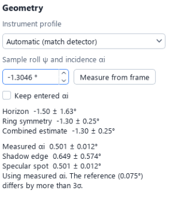

**The beam centre in file headers** is not used by default: the calibrated profile centre is kept,
because many beamlines never update the header. **Tools ▸ Settings… ▸ Analyze ▸ Use the beam centre
written in the file header** changes that (section 3.11). **Beam centre ▸ Use File Header Centre**
takes the header centre as the centre of this session (section 4.5).

### 4.2 Three ways to a geometry

When no profile matches, a banner over the image says so and offers **Find Calibration Automatically**,
**Load .poni…**, **Enter Geometry…** and **Calibrate…**. The step **Geometry** has **Find Calibration
Automatically**, **Calibrate…**, **Load .poni…** and **Export .poni…** too, and **Geometry…** in place of
**Enter Geometry…**.

**Load .poni…** reads a pyFAI `.poni` you choose. If the file states another frame size, or a pixel size
more than 1 % from the frame header's, GIMaP gives the reason and asks before using it. A file with a
wavelength becomes the instrument profile of this detector (with its tilt) and is selected in
**Instrument profile**, and the frame is analysed again. A file without a wavelength opens
**Detector geometry** filled with its values, the wavelength marked *Required*. **Export .poni…** writes
the geometry in use (or, in the dialog, its fields) as a pyFAI `.poni` (version 2.1: pixel sizes, frame
size, distance, PONI, rot1–rot3, wavelength) for pyFAI, GIXSGUI and other programs. A `.poni` holds no αi.

**Find Calibration Automatically.** GIMaP takes the first of these that fits the frame:

1. a calibration you named in the beamtime notes of the **Results** step: by path, or by file name
   alone when the file lies in the frame's folder or in a folder the notes name;
2. the instrument profile this detector already has;
3. ready calibration files (`.poni`, an exported `.json`) in the frame's folder and the folders around
   it (beside it, and up to three levels up). They are ranked by folder first: the frame's own
   folder, then its subfolders, the parent folder, the folders beside the frame's, and further up.
   Within one of these, the file written closest in time to the frame comes first, and a file written
   before the frame is preferred;
4. images of a standard there (AgBh, LaB₆, CeO₂), fitted and accepted when the standard's lines land
   within 0.5 % of their q.

The step **Results** says which calibration was used and where it was found. The result is saved as
the instrument profile of the detector.

A `.poni` or `.json` file is used as it is, without a check against a standard image. It is skipped
when it states a pixel size more than 1 % from the frame's, or another frame size. A TIFF often states
no pixel size and a `.poni` often no frame size; then two detectors look alike, and the calibration of
another detector in a neighbouring folder can be applied when the frame's own folder holds none. For
example, the GIWAXS `.poni` of section 1.1 fits the GALAXI TIFF as far as the search can tell; only its
folder ranks it after `galaxi_bornagain.poni`.

A calibration file the search found in another folder than the frame's (or one below it) is listed
with that folder (*galaxi_bornagain.poni (sibling folder gisaxs_galaxi)*), and it is checked further:

- It is skipped when the detector shape it states (`max_shape` of a `.poni`) is not the frame's; the
  reason is listed among the decisions.
- When it was made at another energy (more than 0.2 % from the frame's), its distance and beam centre
  are used with the frame's energy, as for any calibration, and a decision of its own says so
  (**Calibration**: *… made at another energy than the frame's*).

A file you named, or one beside the frame, is not checked this way.

When the frame's own header states a detector distance that differs from the calibration in use by
more than 5 %, the Data step says so (*⚠ The file header gives a detector distance of 370 mm, the
calibration in use 147.6 mm (151 % apart).*) and the automatic analysis lists it under
*Needs attention* as **detector distance**. A header often holds only a nominal distance, and then the
calibration is right. The same warning also appears when the calibration comes from another
experiment, so check which case applies.

**A tilted detector.** A `.poni` with a tilt (pyFAI's `Rot1`, `Rot2`, `Rot3`) gives a tilted geometry:
every pixel is placed where pyFAI places it, so q, χ, the solid angle and the polarisation factor are those of the
tilted detector ([Physics and Methods, section 3.7](Physics_Manual.md#37-the-detector-tilt-of-a-poni)). The step
**Geometry** and the summary say *detector tilt 6.06°*, and the automatic analysis lists it under *Decisions*. A
beam centre moved later (the GISAXS symmetry axis, or by hand) keeps the tilt. The Xeuss example of
**Help ▸ Example Data** is such a case: without its 6.06° tilt, |q| is off by up to 6.3 % (GIMaP 0.1
left the tilt out). Geometry Calibration fits the tilt (rot1, rot2; section 4.3), and the **Geometry**
dialog has fields for rot1, rot2 and rot3.

**Check rot3 on a GISAXS frame.** Powder rings fix rot1 and rot2. To check rot3, the rotation about the
beam, open **Geometry ▸ Check rot3 ▸ Measure Specular Rod** and click two points far apart on the rod.
Both qy values should be zero within the precision of your clicks. To use the angle shown, enter it in
**Geometry… ▸ Rotation about the beam rot3**, choose **Save Profile** and check again. If the direction
agrees but both qy values are offset, check the direct-beam centre. With
**Measure Horizon or Yoneda Band**, click two points on the same feature: their exit angles should
agree, and on the horizon both should be zero.

A `.poni` can state a detector orientation 1–4. GIMaP builds the geometry with the row and column
directions as stored. Load the frame in the same storage order as the calibration.

The search can pick the calibration of another experiment: one from a folder beside or above when the
frame's own folder holds none, or the wrong one of several in a folder copied in one go (the file
times then say nothing). Check the file named and the distance shown in **Geometry**. If they are
wrong, name the right file in the notes (a calibration named there is tried before the profile and the
search), or use one of the two other ways. **Geometry…** ▸ **Delete profile** removes a wrong profile.

**Enter Geometry…** opens the dialog **Detector geometry**: **Profile name**,
**Sample–detector distance**, **Pixel size x** / **y**, **Wavelength** and **Energy** (one value in two
units: typing one sets the other), **Detector tilt rot1**, **Detector tilt rot2**, **Rotation about the beam
rot3** (pyFAI's rotations in degrees; 0 is a detector perpendicular to the beam), **Beam centre x** / **y**
(section 4.4), **Centre step**, **Incidence angle αi**, and **Load .poni…** / **Export .poni…**.

- The line under **Energy** says where the wavelength comes from: *Wavelength from the file header.*,
  *Wavelength from LaB6.poni.*, *Wavelength of profile “…”.* or *Wavelength entered by you.* When the file
  states no wavelength or energy, both fields read *Required* and the line says so in orange: no value is
  assumed, and **Save Profile** and **Export .poni…** wait until you type one.

- **Save Profile** saves every value as an instrument profile for this detector and frame size. The
  saved geometry is used at once: a centre set earlier in this session for this detector is dropped,
  and **Instrument profile** goes back to **Automatic (match detector)**.
- **Apply Centre** uses the beam centre for this session only (section 4.5); the other values take
  effect only with **Save Profile**. With no profile in use, save one first.
- In the step Geometry the same dialog opens with **Geometry…**, filled with the geometry in use. Save
  it under the same name to change the profile, under a new name to keep both. **Delete profile**
  removes it.

**Calibrate…** opens the Geometry Calibration window (section 4.3) with the frame shown; Analyze
waits until you close it. Use it when the frame is an image of a standard, or open the standard's
image there. **Apply** in that window (also when opened from the **Tools** menu) saves the
profile, and Analyze analyses the frame again with it. The calibrated beam centre replaces a centre set
earlier in this session.

A fourth button, **Use Previous Geometry…**, appears only after an update from 0.0.2: it saves the
geometry of the former Cut & Fitting page as a profile.

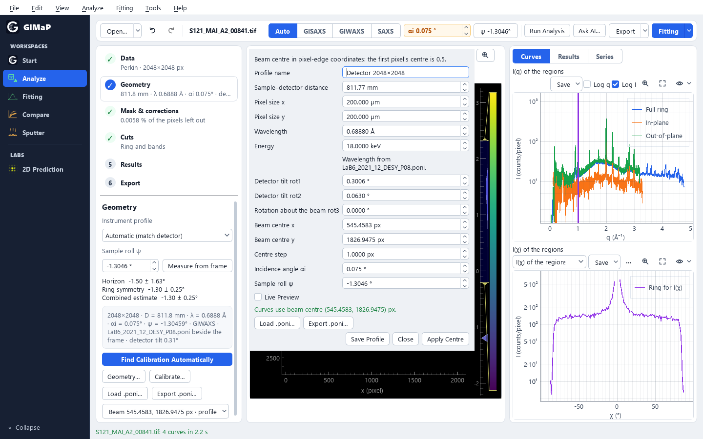
*Geometry…: the geometry in use (here from the LaB₆ `.poni` beside the P08 frame), with the energy, the line saying
where the wavelength comes from, the detector tilt rot1–rot3, Load .poni… / Export .poni…, Live Preview, Apply
Centre and Save Profile.*

### 4.3 The Geometry Calibration window

**Tools ▸ Geometry Calibration…** (`Ctrl+Shift+G`) calibrates a SAXS, GISAXS or GIWAXS detector
geometry without leaving the current page. It also opens from **Calibrate…** in Analyze and from the
Start page (*Calibrate the detector*).

1. Open an image of a calibration standard (NeXus/HDF5 such as `.nxs` or `.h5`, `.cbf`, `.tif` /
   `.tiff` or `.edf`) with **Open…**, or paste its path into the image field and press Enter. An image
   can also be dropped on the window. NeXus/HDF5 files are read as Analyze reads them (module files
   stitched, the same orientation; section 5.1). For a file of several frames, a row **Frames:** chooses
   **A single frame** (its number, counted from 1) or **Sum of all frames** (summed while you wait, with
   progress; it can be cancelled). A file with several equally likely image datasets asks which one.
2. Check the beam energy. Enter **Energy** (keV) or **Wavelength** (Å), whichever your experiment
   records; the other field follows (Physics and Methods, equation (1.1)). For the public AgBh example,
   enter `1.0` Å. The source line says where the value comes from: the file header, a companion scan
   NXS file, or you. **Auto Calibration** needs a value; enter it when neither the file nor a companion
   scan file gives one. A value carried over from the previous image may belong to another experiment:
   check it.
3. Check the pixel size. For a CBF or EDF whose dimensions match a known detector, it can read
   *from frame size; check*. If the size is right, leave **Detector model** on **Auto detected**;
   otherwise select the model, or enter **Custom pixel size** in **Advanced configuration**.
4. Choose the standard. When the path of the image — its file name or a folder above it — names one
   standard (for example `AgBh`, `LaB6` or `CeO2`), it is selected for you; when it names more than
   one, the field is set to **Auto Detect**; when it names none, the field is left as it was
   (**Auto Detect** when the window opens). Auto Detect tries every known standard.
5. **Estimated distance** is optional and steers the search. Leave it on *Optional* when you do not
   know the distance; otherwise type the approximate distance. Opening an image fills the field only
   with a distance stated in the image file (a NeXus file can; the distance in a CBF or EDF header is
   not used) or, failing that, with the distance of the calibration applied before. Check that such a
   number is the distance of this set-up. **Distance range** limits the search (*Auto · 30–10000 mm*,
   *SAXS · 500–10000 mm*, *WAXS · 30–1500 mm*, or *Custom* with the bounds in
   **Advanced configuration**). No solution outside the range is shown, also after the fit of centre
   and distance. When none lies in it, the calibration stops with
   *No solution lies within the distance range*: widen the range, or check the energy and the pixel
   size.
   An image of the standard taken at grazing incidence (AgBH on a wafer: arcs above the sample horizon,
   the specular rod through the beam, the Yoneda band) is recognised. The rod is left out of the ring
   search and the fit, and a horizontal band above the beam is not taken for a ring. For AgBH every
   order between the matched ones must be present, so the Yoneda band is not taken for the first ring
   of a solution at half the distance. The warnings of the solution say when this applied.
6. Under **Advanced configuration**, enter a measured rotation about the beam in **Fixed rot3**
   (degrees, default 0); the ring fit keeps that value. **Detector tilt: Refine rot1, rot2** (on by
   default) fits the tilt of the detector together with the centre and the distance when three or more
   rings give usable points
   ([Physics and Methods, section 3.8](Physics_Manual.md#38-detector-tilt-from-the-rings-of-the-standard)).
   With the option cleared, the centre and distance are still refined on the ring points when at least
   two rings are matched.
   Click **Auto Calibration**. After a first fit, GIMaP predicts where the other rings of the standard
   cross the detector, checks them in several azimuthal sectors and fits again with the rings the image
   supports. This finds weak outer rings needed for the tilt. A solution ranks lower when it misses
   strong rings, predicts rings that the image does not show, or fits the ring positions poorly. The
   calculation runs in the background; **Cancel** stops it after the current step.
7. Check the result. **Run** shows the number of matched rings, the confidence and the first warning.
   **Selected solution** shows the beam centre, the distance, **Detector tilt** (rot1 and rot2, for
   example *0.372°, 0.433°*, or *not refined*; the tooltip gives the 1σ), the matched rings,
   **Ring-point RMS**, the confidence and the warnings (marked ⚠; the tooltip says why each matters).
   The tooltip of **Ring-point RMS** also gives the RMS on the same points before refinement and, for a
   fitted tilt, the RMS with centre and distance refitted at zero tilt. Without a point fit,
   **Ring-radius RMS** is shown. **Candidate solutions** below lists the other solutions; select a row
   to draw its rings and to show its centre, ring count, residual and confidence in
   **Selected solution**. In a narrow window the table keeps the standard and the distance visible.
   **Clean image** hides all overlays for a moment, to compare the rings with the frame. **Reset view**
   shows the whole detector mosaic again after zooming or panning, and **Focus image** hides the result
   panels to give tall WAXS mosaics more room. The horizontal divider can be dragged.
   Each 1σ is one estimated standard error. With three rings, GIMaP also refits with each ring left
   out. If a pair of rings gives an unstable fit, the tilt 1σ comes from the covariance of the full
   fit, and the errors of beam centre and distance are the larger of the covariance error and the
   ring-to-ring error with the tilt fixed. Physics and Methods §3.3 gives the measured coverage of these
   errors.
8. To adjust the result by hand, press **Manual refine**: drag the centre marker, edit the
   centre/distance values, or pair a detected ring with a theoretical peak (**Fit selected ring**).
   **Reset to fitted** goes back to the fitted solution and **Finish manual** closes the panel. When
   you apply or export an edited centre or distance, its ring-point RMS and fit uncertainties are
   cleared; the ring-radius RMS still refers to the automatic ring matches.
9. Click **Apply** to save the geometry as the instrument profile of the detector. One note says what
   was applied and which profile Analyze will use. When the result moves the beam centre of a saved
   profile by more than 10 px or its distance by more than 5 %, the window asks before it overwrites
   that profile.

**Export .poni…** proposes `<image>.gimap-calibration.poni`. To use it, open the target frame in
Analyze and select this file with **Geometry ▸ Load .poni…**. For a transmission calibrant, check that
the mode is **SAXS** and look at I(q) and I(χ) in **Curves**; I(χ) names its q interval.

**Export Calibration…** writes the result as a `.json` file, or as a pyFAI `.poni` (choose *pyFAI geometry
(*.poni)* in the file dialog; the tilt is written as Rot1, Rot2, Rot3). It proposes
`<image name>.gimap-calibration.json` next to the calibration image; choose another folder when the
data folder should stay untouched. The record names the frame used, or that frames were summed. The
note shown afterwards opens the folder. **Import Calibration…** reads such a file back and selects its standard;
for a calibration made on summed frames it shows the first frame at once, then reads the same sum. An
exported `.json` can also be dropped on the window. **Open…** and **Import
Calibration…** start in the folder of the image shown, else in the folder used last.

**The overlays.** Solid yellow lines are matched theoretical rings, dashed orange lines unused
theoretical rings, dotted cyan lines peaks of the independent radial scan, and pink lines cross at the
beam centre. A weak ring found by the guided search is drawn solid yellow even when the radial scan
missed it. The legend above the image names each style. Partial WAXS arcs and centres outside the
active detector area are supported. Check a result with low confidence, or with one ring only, by hand.
How the rings are fitted, and what the RMS residual and the confidence measure, is in
[Physics and Methods, chapter 3](Physics_Manual.md#3-calibration).

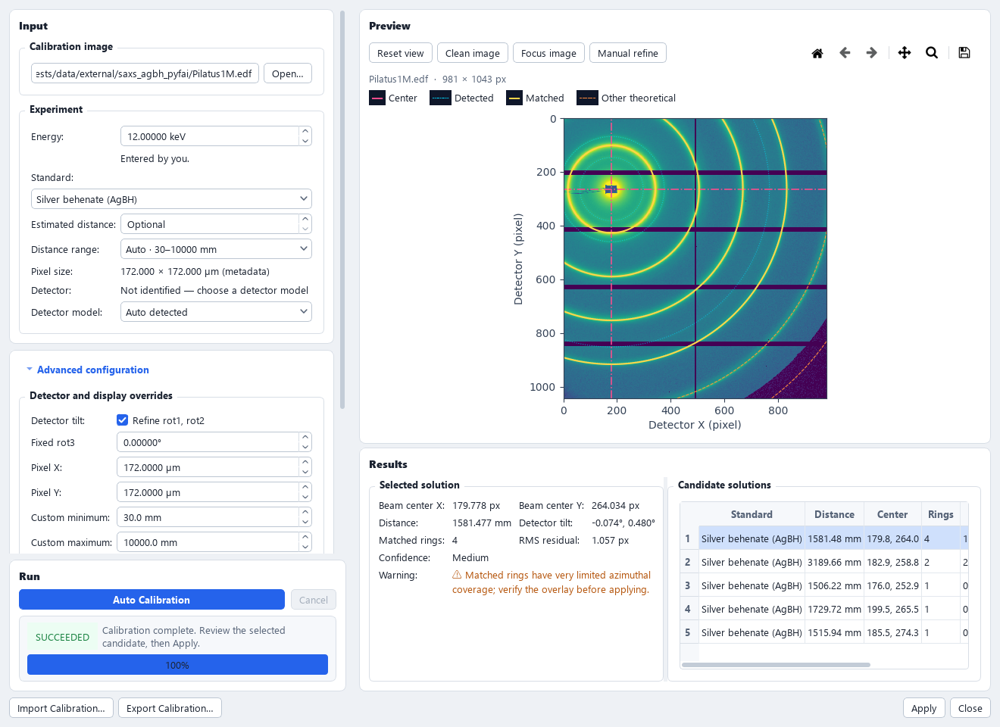
*Geometry Calibration: the fitted rings over the standard, the selected solution and the candidates.*

**The beam centre in this window** is shown and entered in the same pixel coordinates as in Analyze
(section 4.4), so a centre can be compared or copied between the two as it is. An exported
calibration file counts pixel centres from 0, half a pixel lower than the window shows, and says so
(`metadata.center_convention`). Importing the file shows the same centre again.

**Checking a transmission standard.** On the public silver behenate frame, **Auto Detect** matches
five rings at a distance of about 1634 mm, with *Optional* as with an estimate of 2000 mm. Choosing
silver behenate gives the same result.

An estimate changes how candidates are ranked. On a new installation the field starts at *Optional*.
When you open another image, a distance from its file or from the calibration applied last replaces
a typed value, 0 included; if neither gives a distance, your value stays. If the distance is unknown,
set the field to 0 to show *Optional*. Before pressing **Apply**, check the proposed distance against
your set-up and the ring overlay against the image.

### 4.4 Pixel coordinates

Analyze, Geometry Calibration and the XRR Series Extractor show and accept the beam centre in the
same pixel coordinates:

- pixel corners lie on whole numbers, so the centre of the first pixel is (0.5, 0.5);
- x counts from the left edge and y from the top edge of the image as shown (row 0 at the top);
- the beam centre is the position of the direct beam.

The same profile therefore shows the same numbers in all three windows, and a centre can be copied
from one to another as it is.

Other programs may count differently. The GALAXI frame of section 1.3, for example, documents its
direct beam at (597.1, 323.4) px counted from the bottom-left corner; in GIMaP that is
(597.1, 719.6) px.

**Exported files count from 0.** The calibration `.json` of Geometry Calibration and the CSV and JSON
records of the XRR Series Extractor count pixel centres from 0, half a pixel lower than the windows
show. Each file says so (`metadata.center_convention` in the calibration
file, `center_convention` in the XRR record). Importing such a file shows the window's numbers again.

The retired Trainset research code keeps its legacy coordinate convention; it is not a GIMaP workspace. The
conventions and the conversion between them are defined in
[Physics and Methods, sections 1.2 and 1.3](Physics_Manual.md#12-canonical-pixel-coordinates).

### 4.5 The beam centre in Analyze

The profile's beam centre is used unless you change it. The step **Geometry** shows it on the button
**Beam centre**, to four decimal places, with where it comes from: `Beam x, y px · profile`,
`· this session` or `· file header`. Its menu has:

| Entry | What it does |
|---|---|
| **Pick on Image** | Click the direct beam on the detector image (view **Detector**, not the q map; `Esc` cancels) |
| **Enter Coordinates…** | Type the centre in a small window (below) |
| **Use File Header Centre** | Take the centre written in the file, when it has one (the entry shows it) |
| **Refine x by Symmetry** | GISAXS: the same search as **Make Left and Right Symmetric** (section 4.6) |
| **Back to Profile Centre** | Forget the centre set in this session |
| **Save to Profile** | Write the session centre into the instrument profile |

You can also drag the cyan cross on the image. A centre set in any of these ways holds for this
session and for every frame of the same detector size (rows × columns); frames of another size go
back to their profile's centre (or the header centre, when the setting above is on), and a note says
so. Settings files and projects keep it too. **Save to Profile** keeps it for good.

**Geometry…** and **Enter Coordinates…** open small windows that stay open while you work, so you
can adjust the centre and watch the curves:

- the coordinates show four decimal places;
- **Centre step** sets how far the arrow buttons, the arrow keys and the mouse wheel move the centre
  (down to 0.0001 px); both windows share it and it is remembered;
- **Apply Centre** uses the centre for this session and redraws the curves; adjust and apply as often
  as you like;
- with **Live Preview** on, every change redraws the curves by itself. Quick changes are combined,
  and a zoom you set on the curves is kept;
- **Save Profile** (in Geometry…) saves all geometry values and leaves the window open;
- **Close** keeps the centre applied last and drops values not applied.

The windows close when you change the file or frame, or clear the list, so that a centre typed for
one detector is never applied to another.

### 4.6 Make Left and Right Symmetric

In GISAXS the horizontal cut is symmetric about qy = 0. When the beam centre column is a little off,
the two halves of I(qy) do not match. **Make Left and Right Symmetric** (step **Cuts**, GISAXS) moves
the centre column onto the symmetry axis of the cut:

1. a coarse search over the whole horizontal cut finds the axis;
2. a fine search, a few pixels around it, compares the column means of the valid pixels left and
   right of the trial axis. Only columns measured on both sides count (gaps and masked columns stay
   out, nothing is bridged across a gap). Each pair is weighted by 1 / distance from the axis, so
   the many far columns do not outweigh the low-q structure.

The scores, weights and acceptance rules are in
[Physics and Methods, section 8.2](Physics_Manual.md#82-beam-centre-column-from-mirror-symmetry).
Only x changes; y is kept. The result is shown in a note (*coarse … → refined … px*). 0.0001 px is
the numerical stopping tolerance, not a measured uncertainty. When the data do not cover enough, or
several axes fit equally well, the centre stays as it was and the note says why.

The search runs in the background; press the button again (*Cancel Centre Search*) to stop it. The
new centre holds for this session (section 4.5); **Beam centre ▸ Save to Profile** keeps it. The
automatic analysis of a GISAXS frame does the same step by itself.

## 5. Analyze

Analyze is the workspace for detector frames, GISAXS and GIWAXS alike. It turns a frame into
curves in q (Å⁻¹), shows where every point of a curve comes from, and writes the curves with a
record of how they were made. Everything that touches the detector image happens here; Fitting
fits the curves.

The page has five parts (the picture in section 3.1 shows them with a GIWAXS frame):

| Part | What it holds |
|---|---|
| Command bar | **Open…** (its arrow: **Open Folder…**), ↶ ↷ (Undo / Redo), ‹ › (previous / next frame, when more than one frame is listed), the mode **Auto / GISAXS / GIWAXS / SAXS**, αi, **Run Automatic Analysis** (with **Stop** while it runs), **Ask AI…**, **Export** ▾, **Batch Export…** (when more than one frame is listed), **Send to Fitting** ▾ |
| Steps (left) | **Data**, **Geometry**, **Mask & corrections**, **Cuts**, **Results**, **Export**. Each shows its state (✓, !, × or …, as in 3.3) and one line of what it found; click a step for its controls. Rarely used options are folded away. |
| Image (middle) | **Detector**, **q map** or **Cake** (GIWAXS), **Log**, the colour map, **Levels**, **Marks**, Zoom, **Fit view**, **Sources**, **Save** ▾, **Panels** ▾. Below the image, two lines give the values under the cursor: the pixel and its value, q with q_y or q_∥ and q_z, then 2θ, χ, αf (grazing incidence) and d = 2π/q (on the q map and the cake the point is given in q). The image is the widest panel; **Panels ▾** hides the steps or the curves and results to give it the whole room, and shows them again |
| Tabs (right) | **Curves** (an upper and a lower plot), **Results** (what the automatic analysis or the AI found, with its evidence), **Series** (every frame as intensity against frame and q) |
| Status line | What is happening, a progress bar and **Cancel**. A note at the bottom right says when a file was written, with **Open Folder**. |

On a narrow window the command bar shortens its long buttons (section 3.3) and, if needed, moves the
actions to a second row.

The mode: **Auto** reduces a frame as GIWAXS when the detector reaches beyond a scattering angle
2θ = 20°, otherwise as GISAXS. Auto decides again for every frame. Choose **GISAXS** or **GIWAXS**
to force it; the status line warns when a forced mode does not look right for the frame.

**SAXS** (SAXS/WAXS in transmission) reduces a frame taken in transmission: I(q) over the whole ring, I(χ) from
−180° to 180° (χ 0° to the right of the beam, 90° up), the cut regions, the q map in q_y–q_z and the cake. There is
no horizon, no Yoneda cut and no missing wedge. Auto chooses SAXS when no αi is known and either the file name names
a standard (AgBh, LaB₆, CeO₂) or the frame is small-angle and shows at least three sharp rings about the beam
centre, each through at least 80 % of the directions the detector covers; the status line says so. An αi above 0
always means grazing incidence. On a SAXS frame, Run Automatic Analysis writes the cuts, fits no particle model and
says so under **technique**. If the frame is a grazing-incidence one after all, give αi or the technique.

The αi field shows the profile's αi until you type a value; a typed value is shown in orange and
kept until you right-click it ▸ **Back to Profile αi** (section 4.1).

Geometry — instrument profiles, finding a calibration, the beam centre and its dialogs — is
described in chapter 4. This chapter starts from a frame that has a geometry.

### 5.1 Opening data and the frame list

GIMaP reads CBF, TIFF and EDF frames, and NeXus/HDF5 files (`.nxs`, `.nx`, `.nx5`, `.h5`, `.hdf5`,
`.hdf`). Files that belong together are one *source*: the module files of one detector are stitched,
a master is read with its data files, and every frame of a multi-frame file is a frame of the series
(*NeXus and HDF5 files* below).

1. Open frames in one of these ways:
   - **Open…** in the command bar or **File ▸ Open Data…** (`Ctrl+O`), or the arrow of **Open…** ▸
     **Open Folder…** or **File ▸ Open Folder…** (`Ctrl+Shift+O`);
   - drop files or a folder anywhere on the window;
   - the Start page or **File ▸ Open Recent**.
2. Analyze opens at once and looks at the sources in the background (**Cancel Import** stops a slow
   import). A folder that holds no frames itself but has them one level down (one subfolder per
   detector) is opened one level down, and the status line says which subfolders.
3. For a source of several frames, the window **Import Frames** asks which frames to list, for each
   source on its own: **All Frames**, **Frame Range** (first **to** last, **every** n-th) or **Specific
   Frames** (frame numbers separated by commas, counted from 1, for example `1, 5, 20`). Only references
   are listed: a frame is read when you show it, so a stack of thousands of frames opens quickly.
4. The **Data** step names the source while the image loads, then its detector, frame size and
   frames. The curves appear without further clicks once the frame has a geometry. Without one, a
   banner above the image offers **Find Calibration Automatically**, **Load .poni…**, **Enter Geometry…**
   and **Calibrate…** (section 4.2).

**Frames listed already.** When you open or drop files or a folder while frames are listed, GIMaP asks
whether to **Replace** them or **Add to List**. Frames added must come from the same detector: when the
first new frame has another size than the frame shown, nothing is added and the status line says why
(*These frames are 1043×981 …; the frames listed are 2048×2048 …*). A list never mixes two detectors, so
Batch Export never mixes two geometries.

When you replace a sample, the question lists the phases shown, the hidden cuts and a typed αi: check them.
**Replace and reset** uses the new frame's incidence setting, hides the previous sample's phases
and shows all cuts and marks. The phases stay defined in **Phases**.

**The frame list** (Data step) has one row per imported frame, whether it comes from a file of its own
or from a NeXus stack:

- Click a row to read and show that frame. `Page Up` / `Page Down`, or ‹ › in the command bar, step
  through the imported frames only.
- For a source of several frames a bar above the steps, **Frame [4] of 12**, chooses the frame
  (counted from 1). A frame that was not imported must first be added with **Choose Frames…**.
- **Choose Frames…** (under the list) changes the import selection later (**Keep Current Selection**
  leaves a source as it is). Build Map, Batch Export and Send Series to Fitting take the imported frames,
  then apply their own range, interval and sum. A sum never spans frames that were left out. Frame
  numbers, times and the files named in the records refer to the original source. Changing the selection
  clears the Series map and its batch-fit preview. A project keeps the selection.
- To take a source off the list, right-click one of its rows — **Remove Source from List**, **Show in
  Folder**, **Copy Path** — or select it and press `Delete` or `Backspace`. All its frames go; the files
  themselves are not touched, and the rest of the list, the Series map and Batch Export go on without it.
- **Clear** (or **Analyze ▸ Clear Frame List**) empties the list, and the Series map with it.
- **Frames ▸ Sum** (folded under the list) adds consecutive frames for better statistics: the
  frame shown plus the next ones (the following files, or the following frames of a NeXus file).
  Batch Export and watching sum groups of the same size.
- Above the list the Data step says what the source shown consists of (for example *11 module files ·
  240 frames · stitched*), how its frames are oriented, and — in the warning colour — what is missing
  from it. **File header** gives the energy, distance and exposure (in s) the file states.
- **F5** (**Analyze ▸ Repeat Analysis**), showing the frame again and watching read a frame again when
  its files have changed (name, time or size).

**Watch** (next to **Clear**) watches a folder during a measurement: choose the folder, and it is
looked at every 2 s. New frames are listed and the newest is shown as soon as it is completely
written. Press **Watch** again to stop.

- A file, or a set of module files, that grows frame by frame while the detector writes is followed,
  even when its size and timestamp stay the same. Files written recently or still held by their writer
  are checked at every look. Each look takes the frames that were there at the look before, so the
  newest frame, which may still be written, waits for the next look. The Data step says *Still growing:
  frame N is the newest complete one*. A Series map or Batch Export started meanwhile takes only these
  frames. A program on the same Windows PC that writes the file with HDF5 file locking blocks reading:
  the file is listed as being written and read once it is closed.
- With **Export ▾ ▸ Export New Frames While Watching** ticked, each complete new frame is exported
  once (next to the data, in `gimap_analysis/`; with **Sum**, only complete groups). A set of module
  files is exported once it is whole: at once when it has as many module files as another set of the
  folder, otherwise after its files have stayed unchanged for about 10 s. A set with fewer module files
  than another set waits about 30 s and is then exported as it is (a detector may have had a module
  switched off). A module file that is missing or cannot be read is named in the status line, and the
  set waits until it is there.
- A Series map that is built already grows with the new frames, without a new **Build Map** (when
  export is on and there is no map yet, one is built with the chosen curve). Picking a row stops the map
  from following the newest frame; **Show the newest frame** under the Series options turns it back on.
- A file another program holds open is tried again at every look and said once in the status line; a
  source taken off the list comes back when it grows.

**Online mode** — the arrow of **Watch**:

- **Pause Watching** stops the looks; when you untick it, everything written meanwhile is listed and reduced.
  Stopping the watch also ends a pause.
- **Settle Time**: **Two Looks (2 s)** (the default: a new file is read once it is the same at two looks), **5 s**,
  **10 s** or **30 s** — for a detector that pauses while it writes a file, so that a frame is never read
  half-written.
- **Add New Frames to the Series Map** (on by default): every complete new frame is reduced with the set-up on
  screen and its curve appended to the Series map (section 5.6), its traces and its timeline, also when no map was
  built and nothing is exported. A map started by the watch begins with the frame on screen when watching began.
  Only the curves are kept, never the frames: 1000 frames of 200 points take about 3 MB.
- **Record Every Frame in the Results Database**: the curve of every frame appended to the map also goes into
  `gimap_analysis/gimap_series.sqlite` next to the data (about once a second), with its frame, file, time and the
  settings of the map, and so does every skipped file. Compare reads it (section 7.2), so a run can be compared
  again later without its frames.
- **Skipped Files…** opens the log of the files the watch could not take, with the time and the reason: held by
  the program writing it, a failed reduction, a frame without the curve of the map.
- **Fit New Frames in Fitting…** exports the frame on screen, switches **Export New Frames While Watching** on
  and opens `gimap_analysis/` in **Fitting ▸ In-situ series** with **Watch for new curves** ticked, and starts
  there once the curves are listed: every curve written so far and every new one is fitted from the result of the
  one before (section 6.5). It does not start while the model in Single analysis is still the starting guess; the
  status line then asks you to set the model up on a frame and press **Start**.

These choices are remembered between sessions. On a desktop computer, listing, reducing, appending and recording
a frame of 20,000 pixels takes about 60 ms (`tools/benchmarks/insitu_online.py`).

#### NeXus and HDF5 files

GIMaP decides what a source is from what the files hold; the file name is only a hint:

- **one frame per file** — each file is a frame; a folder of them is a series;
- **a series in one file** — a stack of frames (a grid of scan points × frames is read in storage
  order, and the Data step says so);
- **one file per detector module** (P03 Lambda 9M: `…_m01.nxs` … `…_m11.nxs`, each holding every
  frame) — one stitched frame per frame, named by the scan without `_m01`. Files form a set when they
  hold the same dataset and module size at different module positions. Files that are only named alike
  stay separate, and the Data step says why;
- **a master with its data files** (Eiger: `…_master.h5` with `…_data_000001.h5` …) — one source whose
  frames run through the data files.

HDF5 files without a detector image (model weights, result tables) are not listed from a folder.

**The image** is the dataset the file marks as its default plot, else the `data` of the detector, else
the best image-shaped dataset; masks, flat fields and dark frames are never taken for the image. A file
with several images shows one and names the others (the Format Converter and Geometry Calibration let
you choose).

**Orientation.** Files written by the Lambda server (P03) are stitched by module position, then transposed
and flipped (rotated by 90°); the Data step says *P03 Lambda: transposed and flipped*. Every other NeXus/HDF5
image is read as stored, row 0 on top, like a CBF or TIFF of the same detector (*Image as stored in the file*).
Earlier versions also rotated these other files, so a geometry or mask made on such a file with an earlier
version no longer fits it. Check it: a square frame still matches its old instrument profile by size.

**Values.** Header values are read in their units — an exposure written in ms is shown in s, the energy
in eV or keV, the distance in mm or m. A value in a unit GIMaP does not know is left out.
The detector's `pixel_mask` is applied, and in unsigned integer data the largest value of the type means
“no data”.

**Missing parts are reported, never filled in**: a module file that is missing (that part of the detector
stays empty), module files with different numbers of frames (the frames every module has are used), a
data file that is missing (the frames after it cannot be read), a frame beyond the end (an error). A file
still being written is read as far as it is and read again when it changes; a file another program holds
cannot be read until it is closed; a file left open by a program that ended says so (`h5clear -s` on a copy
of it makes it readable). Files compressed with bitshuffle or LZ4 need the Python package `hdf5plugin` (in
`requirements.txt`).

### 5.2 Mask and corrections

The **Mask & corrections** step starts with the folded sections that scale the intensities: **Normalisation**,
**Corrections** (dark frame, background, gap guard, intensity range) and **Intensity corrections** (GIWAXS, with the
Lorentz factor). **Detector and curve errors** follows. When the intensities are scaled, the step's line in the
step list says so first (*intensity × 1.25*, *Lorentz factor*). Below the sections, the step says how many pixels
are left out, and why: detector gaps and marked pixels, hot and dead pixels found in this frame, your masks, the
gap guard, the intensity range, the background, and how many pixels were filled from the mirror side.

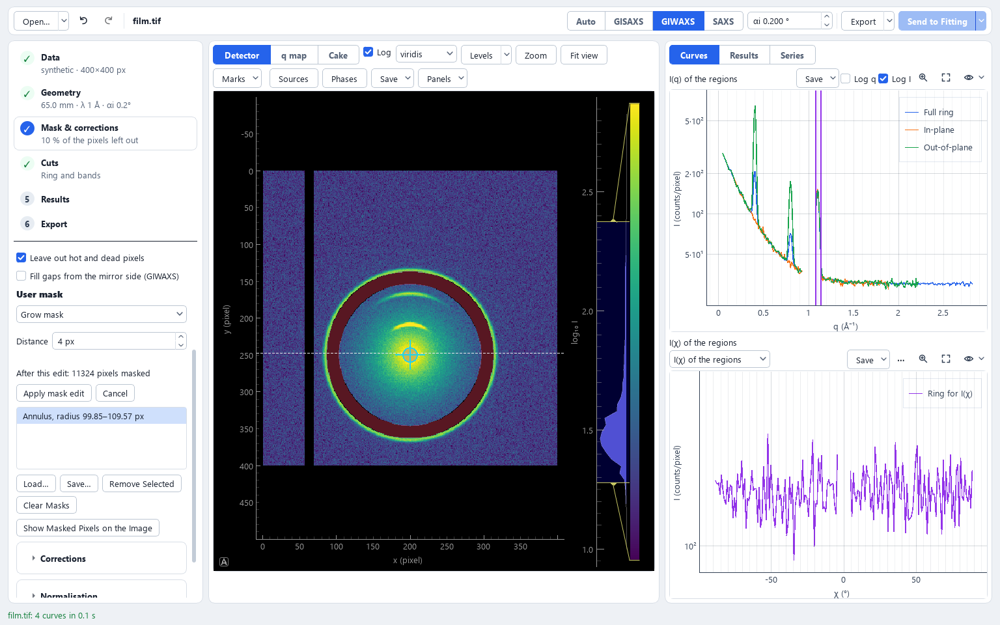

*On this synthetic frame, the red ring previews a four-pixel expansion of the drawn annulus. The pixel count beside Apply mask edit gives the size of the proposed user mask.*

**Show Masked Pixels on the Image** marks them on the detector image: red = left out, amber
circles = hot or dead pixels, cyan = filled from the mirror side (used in the curves).

**Which pixels count as data.** On an integer counting detector, negative values are gap codes
and are left out. On a floating-point frame (dark- or background-subtracted) negative values are
data and are kept.

**Bad pixels** — **Leave out hot and dead pixels** (on by default, remembered). In every frame
GIMaP leaves out isolated hot pixels, dead pixels (counting detectors only) and scattered bright
pixels along a defective detector row or column; the criteria are in
[Physics and Methods, section 4.4](Physics_Manual.md#44-bad-pixels-found-in-the-frame). Anything wider
than one pixel — a Bragg spot, a streak, the beam-stop edge, a Yoneda band — is kept, and whole rows
or columns are never removed. The numbers go into the export record (`bad_pixels_left_out`). Turn the
option off to put these pixels back into the curves.

**User mask**

Choose a tool under **User mask**. **Exclude pixels** adds the selected area to the mask.
**Include pixels** restores that area wherever the detector and other corrections allow it.

| To select | What to do |
|---|---|
| Rectangle or ellipse | Press **Draw** and click opposite corners of its bounding box. |
| Polygon | Press **Draw** and click the vertices. Double-click or press `Enter` to close, `Backspace` to remove a vertex, or `Esc` to cancel. |
| Circle or annulus | Press **Draw** and click the centre. For a circle, click the rim. For an annulus, click the inner rim, then the outer rim. |
| Freehand stroke | Choose **Brush** or **Eraser**, set **Radius** in pixels, press **Draw** and drag. The eraser restores pixels from earlier edits. |
| Ring about the direct beam | Choose **Beam-centred q annulus** and enter **Inner q** and **Outer q** in Å⁻¹. This uses the current detector geometry. |

Drawing previews the total number of pixels in the user mask. Press **Apply mask edit** to use it
in all curves. Excluding a rectangle or polygon applies it as soon as you finish drawing.

For a q annulus or a value rule, press **Preview mask**, check the total and press **Apply mask edit**.
**Above threshold** and **Below threshold** act on raw values. For a relative threshold, tick
**Multiple of the median** and enter the multiplier. The median uses the remaining valid pixels.
**Saturated pixels** includes the threshold itself: enter the saturation level for the exposure.
**Negative pixels** selects values below zero. With frame summing on, these rules compare the sum.

**Grow mask** and **Shrink mask** expand and erode the current user mask by a circular radius in pixels.
**Invert mask** swaps masked and unmasked pixels. Edits run in list order. **Remove Selected** or
`Delete` removes one edit. **Clear Masks** leaves zero pixels in the user mask. Edit ▸ **Undo** and
**Redo** work for drawing, rules, loading, removal and clearing.

**Save…** writes a GIMaP `.json` recipe that repeats the edits on each frame; keep any mask images the
recipe references. To save the resulting user mask of this frame instead, choose EDF, TIFF, NumPy
(`.npy`) or Fit2D (`.msk`). The image stores 0 for unmasked and 1 for masked. Detector gaps and
automatic bad-pixel exclusions are tracked separately. A record beside it (for example
`masks.edf.json`) gives the frame, geometry, settings and mask sources. **Load…** accepts these
recipes, older rectangle/polygon JSON files and mask images of the same shape as the frame.
As in pyFAI, any non-zero image pixel is masked. See Physics and Methods, section 4.5.

**Fill gaps from the mirror side (GIWAXS)** is off by default. Use it for a sample whose scattering
is symmetric in ±q∥. Each gap pixel takes its intensity from the opposite in-plane angle at the same
exit angle; on a tilted detector this partner can lie in another row. All pixels used in the
interpolation must be measured. The missing wedge stays empty. The export records the
number of filled pixels. Curves using mirror filling use pixel scatter for their error bars. The orientation
curve uses measured pixels and their own uncertainties (sections 5.4–5.5).

Under **Corrections**, choose a beam-off **Dark frame** `K` and a background frame `B` from the same detector.
Set **Dark scale** for the sample and **Scale** for the background. For a raw background,
**Dark scale for background** uses the background-to-dark exposure ratio, or the sample dark scale if either header
lacks an exposure; clear **Auto** to enter another ratio. Select **Background is already dark-subtracted** for a processed
background. For NeXus, choose the frame number. You can also set a valid raw intensity range (**Min** / **Max**)
and the **Gap guard** (default 3 px; 0–20 px, remembered), which also leaves out pixels this close to gaps and bad
pixels. **Refraction in the film, αc** computes q_z inside a film of that critical angle (q∥ does not change;
pixels below αc are left out of the q maps and of the cuts in q_z). It is off by default; Physics and Methods 2.6.

For a **Flat field**, choose a uniform exposure `D_ff` of the sample detector's shape (the first image of a detector file, or a NumPy `.npy` array). The flat field is off by default. With a dark loaded, the flat uses the flat-to-dark exposure ratio, or the sample dark scale if an exposure is missing. Select **Flat is already dark-subtracted** for a processed flat. The response `F_ff` has mean one over kept pixels. **Flat-field threshold** excludes pixels at or below the chosen response (default 0.05). The status line gives the mean and the number excluded. For propagated uncertainties, supply the flat in raw counts or ADU. Batch Export, series and the folder watch use these settings. The JSON record includes dark scales, threshold, file digests and the error model used. A combined batch record gives the model of each frame in `frame_error_models`. [Physics and Methods 4.10](Physics_Manual.md#410-flat-field-detector-response)

Open **Detector and curve errors**. Clear **Use instrument profile settings** to edit **Counts per ADU (gain)**, **Offset (ADU)** and **Error model**. Raw intensity becomes `gain × (ADU − offset)`. **Automatic** chooses from the storage type and corrections. For integer CCD data and counts corrected inside the detector, choose the model yourself: **Poisson**, **Scatter of the pixels**, or **Given σ frame**. A σ frame gives each sample pixel's standard deviation in its input units. Use **Save detector settings to profile** to reuse these choices with that instrument. If a neighbouring `.poni` file supplies the geometry, select the saved instrument profile to use its detector settings.

By default, scatter errors for bins with fewer than ten pixels use a variance fitted across the curve. Where this fit predicts zero or negative variance, the measured pixel scatter there sets a lower limit, so those bins stay usable for orientation analysis when they have measurable scatter. For low-count Poisson data, switch **Poisson variance** from **Observed intensity** to **Smoothed intensity** to estimate counting noise from neighbouring points. Curve intensities keep their measured values. Exports carry the chosen σ, and Fitting has its own weighting options. [Physics and Methods 6.4](Physics_Manual.md#64-curve-error-models)

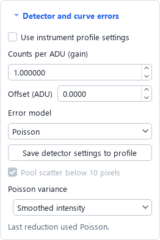

The order is fixed: invalid detector pixels → hot and dead pixels → masks → dark frame → background → pixels the
flat field leaves out → gap guard → intensity range (on the values as measured) → division by the flat field →
mirror fill → intensity corrections → normalisation. On a rotated detector the angle-dependent corrections are applied to the measured mirror partners before interpolation. Curves, q map, cake and exports all use the corrected frame.

**Normalisation** (folded, every term off by default; GISAXS and GIWAXS). Its first line says which header
values the frame shown offers (*In the file header: exposure 20 s; Monitor = 5000*). After every other correction
each frame is multiplied by **A_abs / (t_exp · M · T · d)**:

| Term | Enter |
|---|---|
| **Exposure t_exp** | *From the file header* (the exposure time the file states; of a sum of frames, their sum) or *Typed* (s) |
| **Monitor M** | a monitor of the header (*Header: I0 = …*: EDF keywords, the `Flux` of a Pilatus CBF, a NeXus `NXmonitor`; of a sum of frames, their sum) or *Typed* |
| **Transmission T** | 0 < T ≤ 1 |
| **Thickness d** | mm |
| **Absolute scale A_abs** | a factor from a glassy-carbon or water measurement in the same set-up |

The line under the fields says by what the frame was multiplied, each term with its source, and the unit of the
intensity, which the plots, the CSV column and the fit input then carry (*counts/(pixel·s·monitor)*). The error
bars are multiplied by the same factor; photon counts keep their Poisson errors. A frame whose header lacks the
value chosen is not analysed, and the status line says why. The JSON record (`normalisation`) and every curve file
(`# intensity: …` line) state the factor and each term with its source; the settings file keeps the choice
([Physics and Methods 4.12](Physics_Manual.md#412-normalisation-exposure-monitor-transmission-thickness-absolute-scale)).

**Calibrating with a secondary standard**

1. Measure the standard in transmission with the same instrument set-up as the sample. Choose the instrument profile
   in Analyze or open a frame with geometry. Open **Analyze ▸ Absolute Scale from a Standard…**.
2. Choose the standard's detector file and frame number, or a reduced radial curve containing q, I and optionally σ.
   For a frame, check the current mask, dark, flat field and background first. Use the appropriate empty-cell or
   empty-beam subtraction. For a curve, supply corrected intensity before frame normalisation. Enter the standard's
   exposure, monitor, transmission and thickness in mm. Use 1 for an unused exposure, monitor or transmission term.
3. Choose **Water** and its measured temperature, or **Reference curve file** and your reference table (for example,
   your SRM 3600 certificate). Supply q, differential scattering cross section in cm⁻¹ and pointwise standard
   uncertainty in cm⁻¹. Select the q unit for each file independently. Enter any shared **one-standard-deviation**
   scale uncertainty once as a percentage. Use zero for a component with no supplied uncertainty.
4. Leave both q limits blank for the overlap, or enter a range in Å⁻¹. For water, select its flat SAXS plateau.
   Click **Fit Scale**. Inspect the overlay and the residual (scaled measurement minus reference). A trend in the
   residual points to a background mismatch or an unsuitable q range.
5. Enter the **sample** thickness in mm and click **Apply Scale**. GIMaP converts both thicknesses to cm and saves
   A_abs, its standard uncertainty, source and UTC date in the instrument profile. Set the sample's own exposure,
   monitor and transmission under **Mask & Corrections ▸ Normalisation**, using the same monitor convention as for
   the standard. For a later sample, **Use Saved Scale** reuses the profile calibration with its new thickness.
   After a change in detector distance, pixel size, tilt or wavelength, calibrate again for the new set-up.

The curve CSV labels intensity in `cm^-1`. In the frame JSON, `normalisation.standard_calibration` identifies the
standard measurement, the reference, the fitted q range and A_abs ± σ_A_abs. σ_A_abs is common to the whole curve. The
pointwise σ column gives the statistical uncertainty of each reduced point. For a combined batch table,
each entry in `frame_normalisations` links its sample terms to the standard in the batch JSON.
A later series normalisation to a target peak height gives relative intensities.

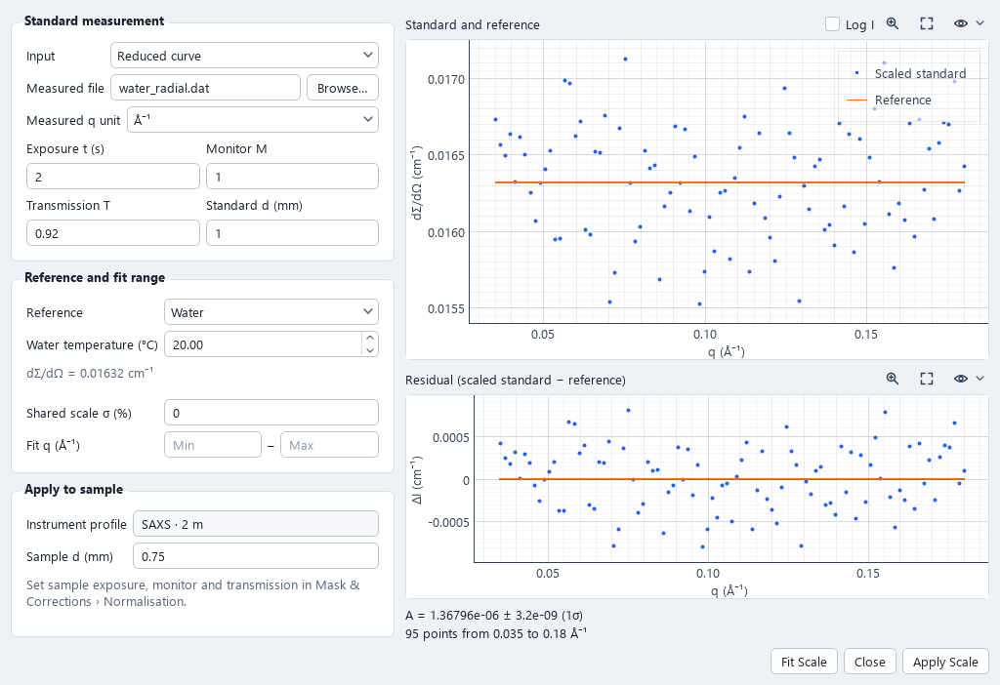

**Intensity corrections (GIWAXS)**. The frame corrections are off by default. Their factors change intensities
at fixed q. Ring orientation has its own polarisation and exit-angle settings.

| Correction | Enter |
|---|---|
| **Solid angle of each pixel (cos³2θ)** | — |
| **Polarisation, factor** | f (default 0.99): 0.95–0.99 at a synchrotron (horizontal), 0 for an unpolarised laboratory source, −1 vertical |
| **Absorption in the film** | Select a **Film model**. For refracted waves use **Enter δ and β** or **Film CIF**. Clear **Thick film limit** to enter a measured **Thickness** in nm. |
| **Lorentz factor for peak areas** | **Incidence-plane half-width** in horizontal detector pixels (default 2) |

Near the horizon, use **Choose CIF…** to supply the film composition, or enter δ and β at the frame wavelength in units of 10⁻⁶. Both choices account for the shallow
penetration of an evanescent wave below the critical angle. If only an attenuation length is known, use
**Attenuation length** with the film thickness and the tabulated length 1/µ in µm. This geometrical
approximation holds when both incident and exit angles are well above the critical angle.
All three choices exclude pixels at or below the horizon. The correction changes intensities at fixed q
and propagates to their errors. The frame JSON records the formula and parameters in `intensity_corrections`.
[Physics and Methods, chapter 5](Physics_Manual.md#5-intensity-corrections-for-giwaxs)

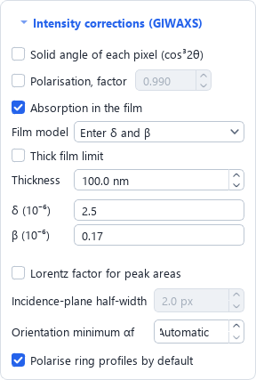

Select **Lorentz factor for peak areas** to compare integrated crystalline intensities of a fibre texture. The map
uses the GIXSGUI weight cos αi |q_y|/k. The radial curve sums these weighted pixels in each q bin, and the peak
table uses that curve. To compare fitted areas from different uniform q grids as total weighted counts, divide each area by its q-bin width. The exclusion band follows the whole plane of incidence. A half-width of two excludes
pixels with |q_y|/k below twice the horizontal pixel size divided by the detector distance. [Physics and Methods 5.6](Physics_Manual.md#56-lorentz-factor-of-a-fibre-texture)

The ring profile I(χ) always uses pixel means before Lorentz weighting. **Polarise ring profiles by default**
applies the horizontal polarisation parameter 0.99 when the frame polarisation is off. Set the frame parameter
to match your source, or clear the ring option to leave polarisation off when it is off for the frame.
**Orientation minimum αf** excludes pixels by their exit angle. **Automatic** uses twice the film critical
angle when supplied, otherwise twice the incidence angle. Enter a threshold in degrees to override it.

The command-line equivalent is `--orientation-min-exit-deg` in degrees.

### 5.3 Cuts

The **Cuts** step holds the cut positions. **Auto Cuts** returns to the automatic positions.

#### GISAXS: horizontal and vertical cut

GIMaP finds the Yoneda band (the brightest row between the sample horizon and an exit angle of
1.5°, measured beside the specular rod) and takes:

- the **horizontal cut** I(qy) in a band 5 px high at the Yoneda row (orange on the image);
- the **vertical cut** I(qz) in a band nominally 10 px wide. Its inner edge clears the projected specular rod by 15 columns when possible: Analyze tries the right side first, then the left. If neither side fits, it uses the side with more room and warns. For a broad rod, move the cut further out.

If no Yoneda band is found, the horizontal cut sits just above the horizon and the step says so —
check αi. To move a cut, drag the orange band on the image (its edges change its height), or
double-click a column to move the vertical cut. The step says whether the cut is at the Yoneda
band, set by hand, or above the horizon.

**Halves of the horizontal cut.** qy is signed: the two sides of the beam are two measurements of
the same structure. Choose which the curve for Fitting uses:

| Choice | Curve for Fitting |
|---|---|
| **Both halves on \|qy\| (two colours)** | both halves, folded onto \|qy\| |
| **Mean of both halves** | the average of the two |
| **qy < 0 half** / **qy > 0 half** | one side only |

The same choice is in **Send to Fitting ▾** and in **Tools ▸ Settings… ▸ Analyze**. **Make Left and Right
Symmetric** moves the beam-centre column onto the symmetry axis of the cut (only x changes;
section 4.6 describes how).

#### GISAXS: cuts of your own

Under the halves is the **List of cuts**. Its first two rows are the automatic cuts — **Yoneda cut**, the one Fitting
takes, and **Vertical cut** — and you can add as many named cuts as you need:

- **Add ▾** — a horizontal band (I(qy)), a vertical band (I(qz)), a box (I(qy) or I(qz)), a sector (I(qyz) in one
  direction from the direct beam) or a line in any direction (I(s) along it). A new cut starts where it is easy to
  see and is selected, so you can type its position at once.
- **Draw on the image or the q map** — Horizontal, Vertical and Sector take one click, Box two opposite corners, Line
  its two ends. Esc cancels.
- The editor under the table sets the position: centre ± half width of a band, from–to of a box (and whether it is
  cut along qy or qz), χ ± half width and the q range of a sector, the start and end points and the half width of a
  line. The list beside **Add** chooses the unit: **q (Å⁻¹)**, **Angles (°)** (the exit angles: αf of qz, 2θf of
  qy on the sample horizon) or **Pixels (px)** (rows on the beam-centre column, columns along the calculated horizon). The line
  under the editor gives the position in the other two units.
- Tick a row to show or hide its curve and outline. Double-click a name to rename it. **Duplicate** copies the
  selected cut (of an automatic cut: a band of your own at the same q, to move elsewhere). **Remove** deletes it;
  Ctrl+Z brings it back. Typing the Yoneda cut sets its rows, as dragging the orange band does. **Auto Cuts**
  returns the automatic cuts to their places and keeps yours.

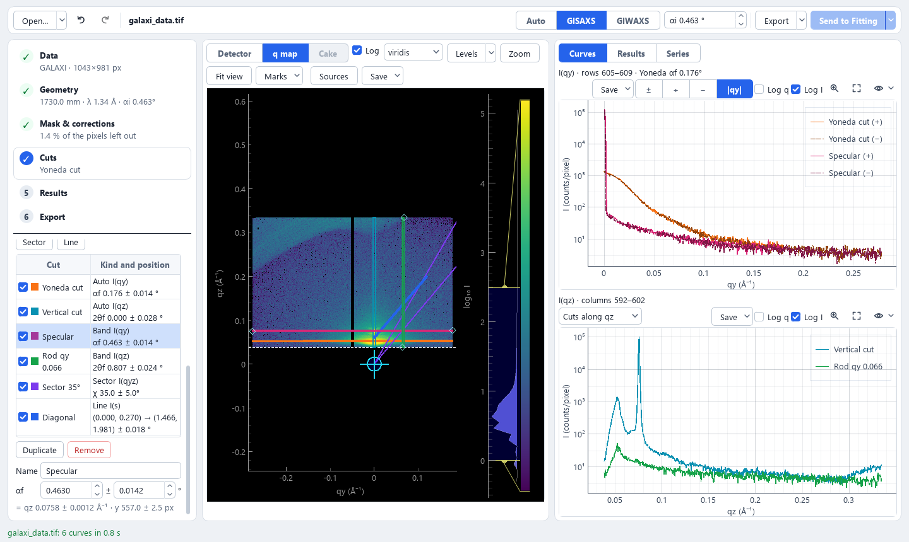

*The Yoneda cut, a band at the specular reflection, a vertical band at a Bragg rod, a sector and a line, each in its
own colour in the table, on the q map and in the plots; the band selected is typed in exit angles.*

A cut has one colour everywhere: its row, its curve, its outline on the detector and on the q map, and its pixels
under **Sources**. Horizontal bands and boxes along qy are in the upper plot with the Yoneda cut, vertical bands and
boxes along qz in the lower plot; when there are sectors or lines, the list above the lower plot shows them. On the
q map you can drag and resize bands and boxes. A pixel belongs to a cut when the q of its centre lies inside (whole
pixels; only those above the horizon), so on the detector a band of constant qz curves slightly.

Cuts are kept in q: they hold for every frame of the same set-up, also in Batch Export and series maps, and **Save
Settings…** saves them. When a frame of another detector or geometry comes (detector, frame size, pixel size,
distance, wavelength, beam centre or tilt), the Cuts step asks: **Keep Cuts** or **Remove Cuts**; until you choose,
the cuts are applied at the same q. Each exported cut states its definition in q — and in αf or 2θf — in the
`# region:` line of its CSV and in `_analysis.json`; the automatic cuts add the qz and αf (qy and 2θf) of their band
edges.

#### GIWAXS: regions, Ring / Sector / Spot

A GIWAXS frame gives I(q) in the upper plot and I(χ) in the lower plot. χ = 0° is the surface
normal and ±90° the sample plane.

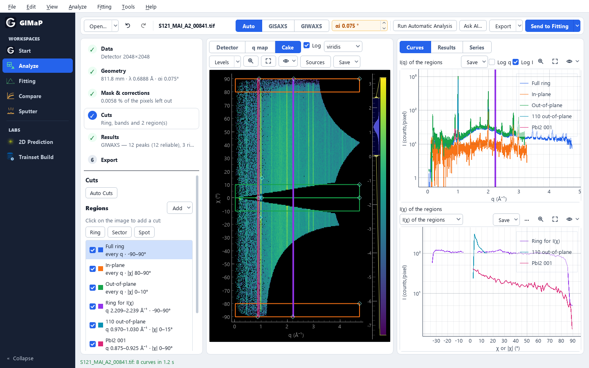

*Each region has its own colour, the same in the list, on the q map, on the Cake view and in the plots.*

Three views above the image:

- **Detector** — the frame as measured, in pixels;
- **q map** — the intensity regridded onto q∥ (qr) and qz. The grid is never finer than the detector
  samples q (at most 800 × 800 cells for GIWAXS, 600 × 600 for GISAXS), so the cells of the measured
  region hold a pixel; what stays blank was not measured (gaps, the mask, the missing wedge). The view
  opens on the measured cells;
- **Cake** — unwrapped onto χ against q: a ring is a vertical line, a region a rectangle.

**Save ▾** above the image: **View as Figure…** (the view with its colour bar) or **View Data as
CSV…** (the q map or the cake as a table with its axes). To publish an indexed q map, set the
zoom, tick the phases and regions to include, then choose **View as Figure…** or **Save Image…**.
After choosing the file, set width and height in cm, font, point size and image resolution in dpi.
PDF and SVG keep the arcs, spot markers, labels and region boundaries as vectors over the intensity
image. PNG uses the chosen resolution. The legend identifies the visible phases and regions.

**Regions.** A region is a q range × a χ range, optionally on both sides (±χ, folded onto |χ|).
Each region gives two curves in its own colour: I(q) (upper plot) and I(χ) (lower plot). The list
starts with the standard cuts — the full ring, the in-plane band, the out-of-plane band and the
ring of I(χ) — which the automatic analysis and the AI also use. Tick a region to show it.

**Add a cut with one click.** Press **Ring**, **Sector** or **Spot** under *Click on the image to
add a cut*, then click on the detector image, the q map or the Cake view:

| Button | Click | You get |
|---|---|---|
| **Ring** | a peak (also on the upper I(q) plot) | the peak's q window × every χ: I(χ) for orientation |
| **Sector** | a direction | every q within a few degrees of that χ (±5°, or the spot's width): I(q) along it |
| **Spot** | a spot | the spot's q window × its χ window: both profiles of the spot |

The region snaps to the peak: centre and FWHM are fitted from the pixels, and the window is
centre ± FWHM, without reaching into a neighbouring peak. A note gives q, d and the FWHM, with
Undo. If there is no clear peak near the click, a fixed width is used and the note says so. New
regions are named by position, for example `Ring q 0.998` or `Sector |χ| 85°`.

**Change a region exactly.** Select it and type its centre ± **Half width** (q to four decimals,
χ to 0.1°), or tick **All q**, **All χ**, **Both sides (±χ)**. The line below shows the range and
d = 2π/q. **Snap to Peak** re-centres the window on the nearest peak. **Remove Region** deletes it.
Regions can also be moved and resized on the Cake view.

**Add ▾** also has **Draw on the Cake View** (two corners), **Ring at the Strongest Peak**,
**In-plane Band (|χ| 70–90°)**, **Out-of-plane Band (|χ| 0–20°)**, **Whole Pattern**, and
**Save Cuts…** / **Load Cuts…** (a set of regions as JSON for the next data set; loading replaces
your regions, the standard cuts stay). **Strongest Ring** puts the I(χ) window back on the most
prominent ring.

**More cut settings** (folded): **Radial bins** (auto by default), the **I(q) axis** (q or 2θ),
and a **q box** (a q∥ × qz rectangle, values in Å⁻¹, draggable on the q map), which gives I(qz)
and I(q∥). The lower plot's drop-down chooses **I(χ) of the regions**, **q box: I(qz)** or
**q box: I(q∥)**.

### 5.4 Curves and results

**Where the points come from.** Each point is normally the mean intensity of the valid pixels in one bin.
The default radial bin width follows the change in q across a detector pixel. With **Lorentz factor for peak areas**
selected, radial I(q) gives the weighted sum per q bin. For radial means, bins with very few pixels near the beam
or a region edge are merged with their neighbours along q. I(χ) and Lorentz-weighted radial sums keep their bins.
Detector gaps, masked χ ranges and the missing wedge can leave bins empty. The curve breaks across missing ranges.

The error bar σ follows **Detector and curve errors**. Automatic mode uses counting errors for raw integer counts
and pixel scatter for floating-point, dark-subtracted, background-subtracted or mirror-filled frames. You can also
supply a σ frame. With observed Poisson errors a bin of zero counts receives the error of one count.
**Smoothed intensity** changes the Poisson error estimate only. To average more measured pixels per radial point,
widen the region's χ range or lower **Radial bins**. [Physics and Methods, sections 6.4 and 6.5](Physics_Manual.md#64-curve-error-models)

**Sources.** Press **Sources** to see on the detector image which pixels each curve comes from, in
the colours of the plots. Click a curve to see only its region.

**The plots.** Each curve plot has:

- **Log I** and **Log q** (log axes; for an I(χ) or 2θ plot the second reads **Log χ** / **Log 2θ**).
  With a log x axis, points at x ≤ 0 are not drawn: to see both halves of a GISAXS cut on a log q
  axis, choose |qy| (below). A window band you placed keeps its data range when you switch the axis.
- For a signed x (qy of the horizontal cut, χ of a ring): **±** (both halves), **+**, **−**, or
  **|qy|** / **|χ|** (both halves on |x|, the negative one dashed in a second shade). This changes
  only the display and **Plot as Figure…**; the exported data and the curve for Fitting stay as they are.
- Zoom (drag a rectangle; `Shift` + drag works in every view), Reset, and the Marks (eye) button.
- **Save ▾**: **Plot as Figure…** (a publication figure) or **Curves as Data…** (one CSV per curve
  plus a JSON record).
- The right-button menu (**Copy Image**, **Copy Data** …), zooming with the right button and the
  **⋯** menu of a narrow plot work as in every plot (section 3.4).

**Colour limits.** Next to every image is a histogram of the displayed values with two handles.
Drag a handle, or the band between them, for a quick change; the mouse wheel over the bar zooms it
for finer moves. **Levels ▾** has:

- **Auto for every frame** and its **Rule**: 1–99.7 %, 0.1–99.9 %, 5–95 %, Min–max, Mean ± 3σ;
- **Min** / **Max** typed in intensity units;
- **Auto Once** (a click on **Levels** itself does the same).

Limits you drag or type stay — for other frames, re-analysis and the live Series map — until you
choose Auto; the button then reads **Levels (fixed)**. They mean the same in log and linear
display. The detector, q map, cake and Series map each keep their own limits.

In **Log** display, pixels at or below 0 (the noise of a dark- or background-subtracted frame) are drawn in the
lowest colour of the map (at the 0.1 % percentile of the positive values), and the automatic limits come from the
positive values only; masked pixels stay without colour. In linear display the limits are percentiles of all
values and the bar is drawn around them, so a frame whose brightest pixels are a thousand times its typical ones
keeps a readable bar. This changes only the display.

**Marks.** Every image has **Marks ▾**, every curve plot an eye button: one switch per kind of
mark — beam centre, sample horizon, cut bands, masks and cut regions, the pixel overlay, marked hot
and dead pixels, the q box, the colour bar, the window band — and **Show All Marks** / **Hide All
Marks**. Hidden marks stay hidden for other frames and the next session. The same menu removes
what you made: **Remove the Drawn Masks**, **Remove All Cut Regions**, **Remove the q Box** (Undo
brings them back). On the q map the beam centre is the direct beam (q∥ = 0, qz = 0), just below
the map; the sample horizon is drawn dashed at qz = k sin αi.

**Undo / Redo** (↶ ↷, `Ctrl+Z`, `Ctrl+Shift+Z` or `Ctrl+Y`). Every change of the set-up is one
step: a mask, a region added or moved, a band dragged, the profile, αi, the beam centre, the mode,
the corrections, the frames summed, a settings file loaded, an AI card applied. A drag, or a quick series of the same edit, is one
step. The tooltip says what the next Undo changes (for example *Undo: cut regions*). Saved
instrument profiles are not undone this way.

### 5.5 Run Automatic Analysis

**Run Automatic Analysis** runs GIMaP's standard procedure on the frame shown, for GIWAXS and GISAXS.
It needs no AI.

Before running, type what you know in **Beamtime notes** in the **Results** step: αi, the energy, the
pixel size, where the calibration is. An angle in the notes or in your answer takes precedence over the
αi of the command bar. *Decisions* records the reference αi, the comparison with the frame and the angle used.
**Geometry ▸ Keep entered αi** uses the entered value after this comparison.

**GIWAXS.** The run:

1. finds the geometry (the instrument profile, a calibration file near the data, or an image of a
   standard);
2. sums the last frames of a series: the last fifth of its frames, at most 10 (of fewer than ten
   frames, the last one alone);
3. finds the peaks and fits them;
4. compares in-plane and out-of-plane;
5. gives the orientation of the strongest reliable ring and Scherrer sizes.

The Results tab shows **Peaks**, **Checks** (shadows, artefacts, unmeasured ranges), **Geometry**
(where it came from: distance, beam centre, wavelength, αi), **Series** (with **Compare with the
Start of the Series**) and **Report**. Sizes are Scherrer lower bounds. Peaks are assigned only to
the phases you give (**Phases**, section 5.9).

The *Decisions* section of the report (**Show the Full Text**) states which q axis was used. For kinematic q
it gives the size of the refraction shift of q_z near the horizon, about k·sin αi near or below the film's
critical angle. The statistical peak uncertainties come from the recorded reduction model (Poisson, pixel scatter
or a supplied σ frame) and exclude geometry uncertainty.

GIMaP fits up to 12 of the most prominent candidate peaks (the command line's `--max-peaks` fits more). When more
qualify, *Decisions* and the line under the peak table say how many candidates there were and how many of the 12
gave a peak (a fit can merge two candidates or reject one); the peak table, the rings and the series hints come
from these 12. The saved report gives q, d and the FWHM of each peak with their ±. When a fit's reduced χ² is
above 1, its ± are multiplied by √χ²_r. A peak whose fit has χ²_r above 10 is marked *poor fit* in the caveat
column: its shape is not one Gaussian on a line, so read its width and size with care. A *lamellar (1:2:3:4)* hint
needs its orders one after the other: a peak near five times the first q without the third and fourth order is
not listed. A peak within 1.5 widths of the end of the data (*at the end of the data: check*) is not used for the
rings, the sizes or the series hints, because its shape may be cut off.

For each analysed ring the report gives the exit-angle exclusion and the polarisation. Ring I(χ) and its
uncertainties use only measured pixels, so a radial curve with mirror filling can use another error model.
The measured Hermans f appears as f ± statistical error [systematic range], beside the isotropic reference f_iso
of the same bins. After the exit-angle cut, GIMaP leaves out contiguous horizon bins at or below 5% of the ring's
median net intensity and reports their |χ| interval. The systematic range repeats the calculation with this cut
off, at 5% and at 10%, the exit-angle threshold at half, one and twice its nominal value, the background shifted
by one fitted standard error (by 20% when that error is unavailable), and the horizon gap, a weak tail and the
wedge near 0° left empty or filled from neighbouring bands or a determined pole fit
([Physics and Methods 7.7](Physics_Manual.md#77-ring-orientation-and-the-hermans-orientation-factor)). The report
names the scenario at each limit. When the limits differ by more than 0.05, the ring headline and **Needs attention**
say that the measured χ range does not determine the orientation factor. The command-line `azimuthal_last_ring.csv`
header records the factors and limits of the analysed ring of that curve.


*The summary distinguishes ambiguous matches from indexed peaks with orientation evidence. Open the full report here, or inspect a peak in the table below.*

**GISAXS.** The run:

1. finds the geometry and, as for GIWAXS, sums the last frames of a series;
2. takes the horizontal cut at the Yoneda band (if none is found, it asks you to check αi);
3. moves the beam-centre column to the symmetry axis;
4. chooses the halves: their average when both are usable and agree, otherwise the usable one,
   with the reason (a half shadowed, cut by a gap, too short);
5. gives the length scale 2π/q\* of a side maximum, or else of a shoulder, of the cut: *a length
   scale, not necessarily the particle spacing; check it with a model fit*. A form factor or the tail
   of the direct beam also makes a shoulder, so 2π/q\* is never reported as the spacing. The report
   section is **Length scale 2π/q\***; the decision **length scale** says where it is, and once what it is;
6. fits I(qy) with **Predict parameters**, Fitting's network method (section 6.4). GIMaP's network
   proposes one or two populations of spheres and upright cylinders, with or without a paracrystal
   distance D, and their values. Each solution is refined by least squares and weighted by its posterior
   probability. The length scale 2π/q\* is independent of the fit. Confirm the model in Fitting.

**Fit level.** The fit uses what is known about the sample and the cut; the report states the level and the
reason under *Decisions*:

- known substrate, wavelength and both cut angles: four-term DWBA (level 4);
- unknown substrate, both angles known: the Born term at the cut's vacuum q_z = (2π/λ)(sin αi + sin αf)
  (level 2);
- either angle unknown: the effective interface at q_z = 0 (level 1).

**Substrate.** Enter `substrate = Si` on a separate line in the session notes, or use `--substrate Si` on the
command line. `--substrate` sets the reflecting substrate of the fit. If you also use the Yoneda band to measure
αi, give the material that makes the band with `--yoneda-material` (section 4.1); the two materials can differ for
a coated wafer. The command-line material keys are `Si`, `SiO2`, `glass` and `Au`. File headers and notes also
accept `SiO₂`, silicon, silicon dioxide, fused silica, plate glass and gold, in any letter case. In the current
NeXus entry, `sample/substrate` holds the material name, or is a group with `material` or the dimensionless
datasets `delta` and `beta`. A film on this substrate goes in its `top_layer` subgroup with `delta`, `beta`, and
either `thickness_nm` or `thickness` with length units. All optical constants are at the measured wavelength.
If the file gives incomplete or unsupported optics, the fit leaves them out and the report says why. Correct an
invalid substrate given in the session before fitting.

**The table of solutions.** The solutions are ranked by probability **p**, or by **BIC weight** if evidence
sampling failed. Probabilities are relative to the compositions that were tried; the single solution of a
composition you gave has none (*only this composition was tried*). R, h and D show every population, in the order
of the radii (`3.06 / 6.02`, `49.4 / –`: – for a population without a paracrystal). The table's χ²ᵣ is
Σ((I − model)²/σ²)/(N − number of free values) over the fitted points, with the curve's σ: the number Fitting shows
for the same solution. Predict parameters leaves out the points below the network's q window (q < q_max/300); the
report says how many (*fitted: 596 of 598 points; 2 below the network's q window*). The run reports the most
probable solution, and the table selects it.

A non-linear value that ends on a bound of its range is not determined by the curve. The table marks it ⚠, and a
warning under the table names it by rank (*⚠ Not determined by the curve (at a search bound) — 1: D, …*); its
tooltip gives the bound (*D at its upper bound*). **Fit details** and the report's note column say the same, and
when the reported solution has such a value, a point to check (**Fit**) says so. The amplitudes, the background
and the beam-tail amplitude are fitted non-negative and do not count as values at a bound; one that ends at 0 is
named among the report's *Decisions* (*fit caveat: Background at 0, the non-negativity limit*).

A reported solution with χ²ᵣ above 10, the limit of Fitting's poor fits (section 6.5), misses the curve by far
more than its noise. A point to check (**Fit**) then says that none of the compositions tried describes the cut
and that its R and D are not measurements. The Bragg rings of a powder or a calibrant give such a misfit.

At level 2, Predict parameters flags a sphere or random cylinder with q_z·R > 1.2 as `qzR_cov` (its interval may
underestimate the uncertainty), and above 2 also as `qzR_fail` (strong model error). At levels 2 and 4, an upright
cylinder with q_z·R above 2 is flagged `cyl_sphere`, a possible sphere of similar radius, also when its height is
unknown. To include the exit-reflected path for spheres on a level-2 cut, use **Send to Fitting**, enter
αi, αf and λ under Model ▸ **Spheres in grazing incidence** and run Predict parameters again.

The Results tab asks you to choose a model only when another composition has a probability (or BIC weight) of at
least 0.2. It names the competing models with the total probability or weight of each, and marks models whose most
probable solution has D within 15 % of the cut's length scale 2π/q\*. When the reported model has several
solutions, the fit decision also gives the reported solution's own probability or weight. When another solution of
the same model has a probability or weight of at least 0.2, the analysis compares R, h and D of each population.
If the 68 % intervals of every value of the two solutions overlap, the two starts ended in one mode, and the
decision records the overlap. If the intervals of a value do not overlap, or an interval is missing, the report
names the value to check. Refine from each starting solution in **Fitting** and compare the fits.

The report gives the refined R, h and D of the reported solution with their 68 % intervals (*fit intervals: R (1)
3.17 [3.04, 3.26] nm …*: the refined value, then its interval). When the posterior's sampling did not converge,
the intervals come from the least-squares errors. The table, the notes, Fit details and the report use the names
of Fitting's Model table: Tail A, Tail w and Tail ν for the beam tail, Diffuse A, w and H for the diffuse term, σ_q,
Scale, and with several populations the
population's number in brackets (R (2), σR/R (1)). The report lists the keys of its CSV and JSON files with these
names. The notes about the background, the beam tail and the resolution follow those about the particles.

**Save Fitted Curve…** (q in Å⁻¹, I, σ and the fit the run reports), **Save Fit Table…** (every solution with its
probability, parameters in nm, the 68 % intervals of R, h and D, χ²ᵣ and the number of fitted points, the values at
a bound in `at_bounds` and the reported one in `chosen`) and **Save Plot…** save the results. **Refine in Fitting**
opens the prepared curve (the halves chosen) in Fitting.

As for GIWAXS, the report's *Decisions* (**Show the Full Text**) say what the numbers are. q is kinematic. Near
the critical angle, refraction mostly shifts q_z, most at the Yoneda band, by about k·sin αi; the line gives this
value for your frame (q_y and 2π/q\* barely change). The σ of the cuts, which normalise χ²ᵣ, come from the
recorded Poisson, pixel-scatter or supplied σ model and exclude geometry uncertainty. The intervals of R, h and D
come from the posterior given those σ, so they include neither the geometry nor the choice of model.


*The cut with its halves, the length scale 2π/q\*, the fit (Log q / Log I) and the table of solutions.*

**Fit details** (closed under the peak table or the fit table until you open it; it then stays
open for later reports) follows the selected row:

- a peak: the points it was fitted to, with the Gaussian and its local linear background; q, d and
  FWHM with errors; height, area, background and slope; S/N, χ²ᵣ, the fit window, the Scherrer
  size, and where the ring is measured, shadowed or missing on the q map (how the peak was fitted and how
  peaks are found, with the thresholds of the run, is the tooltip of **Fit details**);
- a model solution: every parameter (R, σR/R, h, D, σD/D, weight, Scale, Background, Tail A, Tail w, Tail ν,
  Diffuse A, Diffuse w, Diffuse H, σ_q),
  with the 68 % interval of R, h and D, its probability, χ²ᵣ with the points it is of, log RMSE, convergence and time, the points and q range, whether
  you gave the composition or the network chose it, its warnings and values at a bound, and **Show in Fitting**,
  which opens the curve in Fitting with that solution drawn.

**Questions only you can answer** (αi, the energy, the pixel size, the calibration file and its
standard, the GISAXS model) become fields in the Results step. Fill them in and press **Run Again with These Answers** (or `Enter` in a field).

**While it runs** the right side switches to Results. A panel shows the step in progress and the
time, and ticks off the phases. **Stop** (in the panel and the command bar) ends the run before
its next step. A step already running finishes first, and the panel says what it waits for (a
geometry fit or model fit can take a minute). What was found is kept: **Save Report…** or
**Discard**.

The GIWAXS **Result summary** gives the number of indexed and ambiguous peaks and the measured
ring orientations by candidate phase. Read the flags before assigning a phase or quoting an orientation.
**Show the Full Text** and **Save Report…** are beside the summary. The detailed checks follow the peaks.

**Save Peak Table…** beside **Peaks** writes one CSV row per fitted peak, with uncertainties,
indexing alternatives and flags. An empty phase and hkl identify an unassigned peak. The comment lines record the source,
geometry, corrections and phase information. For the ring marked **Strongest reliable ring by
fitted area**, read the measured orientation factor together with its isotropic reference and
systematic range. A completed run with only orientation caveats lists them under **Orientation
checks**. When αi is missing from both the setup and the frame measurement, the report asks for it.

**Whose results.** The results belong to the frame they were run on. While a run lasts, the file
list is locked. When you show another frame, the Results step says which frame the results are
from; they come back with that frame. Under **Save Report…**, choose **Replayable report** (`.json`) to repeat the analysis later. To read the results, save a web page with pictures (`.html`) or Markdown (`.md`).
Both readable formats carry a section **Mask** and a section **Record**: the GIMaP version, the input file with its
SHA-256, the calibration file with its path and SHA-256 when the run took the geometry from one, the
instrument profile with its source (a profile made from a file names that file's path), and the
corrections (background, gap guard, bad pixels, intensity corrections).

The sum the automatic analysis sets is for the frame it analyses. A Series map, Batch Export and Send
Series to Fitting do not use it (their dialog and the Series tab say so); to sum there, set **Data ▸
Frames ▸ Sum** yourself.

**Ask AI…** lets an AI do the same with the same tools while you watch (chapter 10).

### 5.6 Series map and stages

With several frames listed — files, a folder, or a multi-frame NeXus/HDF5 file — the **Series** tab
shows one curve of every frame as an intensity map against frame and q.

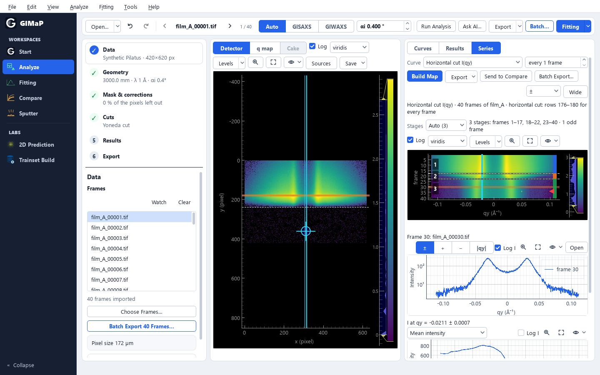

*Drag the horizontal band to pick a frame and the vertical band to pick a q window. The line above the map
names the curve, the frames and the cut held for every frame; the box beside it (±) chooses the halves of the
cut, and the frame axis counts from 1. Here a synthetic run of 40 frames: “3 stages: frames 1–17, 18–22, 23–40 ·
1 odd frame”. The odd frame is frame 34, where a few detector columns are hot (the short bright mark near
qy 0.05 Å⁻¹); the red arrow beside the map marks it, and it does not make a stage of its own.*

1. Choose the **Curve** (GISAXS: the horizontal cut by default; GIWAXS: I(q); every region's I(q)
   and I(χ) are in the list). For a first look at a long series, set the box beside **Curve** to
   *every n frame* (for example *every 5 frame*).
2. Press **Build Map**. Every imported frame (or group of summed frames) is reduced with the current
   settings; the map grows as frames are done. Long series use several low-priority processes;
   progress, time left, **Pause** and **Stop** are shown, and rows already done stay.
3. Drag the horizontal band to pick a frame: its curve is drawn below; **Open** shows that frame in
   Analyze, with the cut of the series.
4. Drag the vertical band to pick a q window: further below, against frame, the **Mean intensity** or
   the peak in the window — **Peak position**, **Peak width (2.355 σ)**, **Peak area**, **Peak height**
   (centroid, 2.355 σ, area and height after a straight background). A window in a detector gap, or
   outside the data, has no value, and the plot says so.
5. **Export ▾** (once a map is built): **Map as CSV Table…**, **Map as Figure…**, **Stages as
   Table…**, **Selected Frame's Curve as Figure… / as Table…**, **Trace as Figure… / Trace as
   Table…** (the value of the lower plot for every frame), **Peak Table of Every Frame…**, **Save Results
   Database…** (every frame's curve into `gimap_series.sqlite`, which Compare reads, with the fits of *Results: batch
   fitting* when a Batch Export fitted the frames; added to a database that is there, a frame recorded before
   replaced) and **Timeline as Table…**.

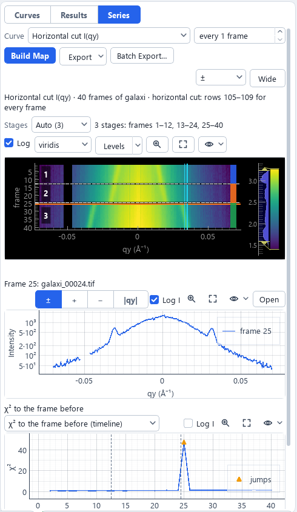

*The timeline of 40 frames made of the public GALAXI frame with a side peak that moves at once at frame 25: χ² ≈ 1 between frames that differ by noise alone, ▲ at the jump, dashed lines at the stage boundaries.*

The neighbour-frame comparison follows the Timeline in Xi-cam. [Xi-cam, section 3.4](https://journals.iucr.org/s/issues/2018/04/00/xe5032/)

**The timeline.** The drop-down of the plot under the map also has **χ² to the frame before (timeline)** and
**χ² to the reference frame (timeline)**: for every frame, how far its curve is from the one before it, or from
the reference frame (**Options ▸ Reference frame**, the first by default), in units of the noise of each x
column, which is taken from the series itself. Two frames that differ by noise alone give about 1; a transition
stands out as a peak. Dashed lines mark the stage boundaries, ▲ the jumps (the frames where the series changes at
once) and × the odd frames. **Click a point** of the plot under the map — of the timeline or of any other trace —
to pick that frame and show it in Analyze. **Timeline as Table…** writes per frame both χ², whether it is a jump,
its stage and whether it is odd. How it is computed: [Physics and Methods, section 11.12](Physics_Manual.md#1112-the-timeline-how-far-each-frame-is-from-its-neighbour-and-from-a-reference-frame).

**One cut for the series.** While the cut is automatic, every frame of the map — and of a Batch
Export, a Send Series to Fitting and a watched folder's export — is cut where the frame on screen is:
for GISAXS the selected horizontal rows and vertical columns, for GIWAXS the ring of I(χ). The rows
of the map then differ only by the sample. The line under the buttons names the cut (*Cut of the
series — horizontal cut: rows 202–206 for every frame*). A cut you set yourself is the same for
every frame anyway.

**What the map shows.**

- Every point is drawn at the x where it was measured: a line sits at its q, and a detector gap stays a
  gap (the exports keep the measured x).
- The frame axis counts the frames from 1, in whole numbers — for one multi-frame file the frame in the
  file, for several files the place in the list.
- For the GISAXS horizontal cut, the box beside the map chooses the halves: **±** both as measured,
  **+** or **−** one half, **|x|** both on |x|, or **mean**. The stages, the traces and the exports
  follow the choice.
- The line above the map says what it holds: the curve, its halves, the frames, the cut and any sum.
  When the settings change after the map was built it says *Built with other settings — Build Map
  again.*
- **Wide** gives the Series tab more room; the frame's curve and the trace below the map grow with it.

**Options: frames, cut, axes** (folded under the plots):

- **Frames** first **to** last (*the last*: the last frame listed): the frames a map takes; the line under
  the buttons says so when they are not all. To take every frame again, set the first frame to 1 and the
  last to *the last*.
- **Find the cut again in every frame**: each frame is cut anew instead of where the frame on screen is.
- **Frame axis**: **Frame number**, or **Time (s)** when the frames carry a time (their time stamps, or
  frame × exposure). In a saved picture every row has the same height, so the picture of skipped or
  unevenly timed frames does not show real time intervals; the CSV keeps every row's frame and time.
- **Stages compare**: **The whole x axis**, or **The x range shown in the map** (zoom the map and the
  stages follow).
- **Show the picked frame's image**: picking a row also shows that frame in Analyze.

The map is an image like the detector: Log, colour map and Levels work there too. The readout shows
frame, file, x and intensity. The map belongs to the list it was built from: list more files and it
stays, marked as the map of the earlier list; **Clear** under the frame list removes it.

**Names of the exports.** Every file is named after the series, its curve and halves —
`<series>_<curve>[_<halves>]_map.csv`, `…_map.png`, `…_trace_<value>.csv`, `…_peaks.csv`, `…_stages.csv`
— and the frame picked after that frame, as Batch Export names it (`<frame>_<curve>[_<halves>].csv`).
Every table says in `#` lines which curve, halves, frames and cut it holds, with a JSON record of the
settings next to it.

**Results: batch fitting.** When a Batch Export fits every frame (section 5.7), a panel *Results: batch
fitting* appears below the map. Each frame done adds a row with its parameters, state and any reason it
failed. Select a row to see the points actually fitted with the model over them, or open **Parameter
trend** to follow one parameter against the frame number. It works also when the fitted curves are not
exported; q is in Å⁻¹ and lengths in nm. The results stay after Pause, Stop or the end, until **Clear**,
a new batch fit or another import selection.

**Stages.** As soon as the map is built, GIMaP cuts the series into stages and marks odd frames
(coloured stage bar, dashed boundaries, red arrows; the **Stages** row; folded *What changes, and
the odd frames*; **Change along the series** in the drop-down of the plot under the map). **Leave the odd frames out of
Batch Export** skips them in the next Batch Export of this list. **Send to Compare** (or **Analyze ▸
Send Series to Compare**) puts the series beside others. How stages and odd frames are found, and how to
read them, is in chapter 7.

### 5.7 Batch Export

Batch Export reduces every imported frame with the current settings and writes what you choose.
Set up one frame (geometry, mask, cuts), then export all of them the same way.

The dialog says where each folder of frames gets its geometry: *geometry from LaB6.poni beside them*, *profile
“…”, as the frame on screen*, or *the profile picked or the one that fits their detector and size, read frame by
frame; a frame without one gives no q curves*. The summary line names the geometry of the frame on screen. When
no frame can have a geometry (none on screen, no `.poni` beside any frame, no instrument profile), the dialog
says *No geometry: q curves cannot be made* and **Export** stays off.

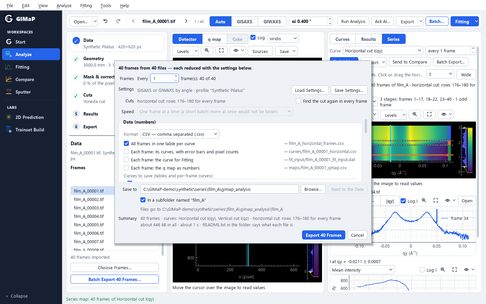

*Every option shows the file it writes. The Cuts row names the cut every frame gets; the Summary says how many
frames, which curves and about how big and how long the export is.*

**Where to start it:** **Batch Export…** in the command bar or **Analyze ▸ Batch Export…**
(`Ctrl+Shift+E`), **Batch Export N Frames…** under the file list, **Batch Export…** in the Series tab, the
Export step or **Export ▾**. For a folder of raw frames, **Analyze ▸ Batch Export a Folder…** or the Start
page opens the folder and then the dialog, once its first frame is analysed.

**The dialog:**

- Top: **Frames** (**Every** n-th listed frame), **Settings** (a summary, with **Load Settings…** /
  **Save Settings…**), **Cuts** (the cut every frame gets, with the box **Find the cut again in every
  frame**, section 5.6), **Speed**.
- Middle, four groups:

| Group | Options | Files |
|---|---|---|
| **Data (numbers)** — CSV (comma), TXT (tab) or DAT (space) | **All frames in one table per curve** (x first, one column per frame); **Each frame: its curves, with error bars and pixel counts**; **Each frame: its q curves as NXcanSAS (.h5)** (section 5.8; always HDF5, whatever the format); **Each frame: the curve for Fitting**; **Each frame: the q map as numbers**; **Each frame: the unwrapped χ–q map as numbers** | `<name>_<curve>_frames.csv`, `curves/<frame>_<curve>.csv` (+ `_analysis.json`), `nxcansas/<frame>_nxcansas.h5`, `fit_input/<frame>_fit_input.dat`, `maps/<frame>_qmap.csv`, `maps/<frame>_cake.csv` |
| **Pictures** — PNG, TIFF, SVG or PDF | **Each frame: picture of the detector image**; **Each frame: picture of the q map**; **Colour scale**: each frame its own limits (1–99.7 %), or the limits on screen for every frame (comparable pictures) | `images/<frame>_detector.png`, `images/<frame>_qmap.png` |
| **Converted detector frames** — TIFF, EDF, NumPy or HDF5 | **Each frame: the detector data in another format** (values as read: modules stitched, frames summed; in the type the file stores, with the gap codes and the pixels without data marked as the Format Converter writes them, section 9.1; pixels left out only by the hot-pixel test or a drawn mask keep their values) | `frames/<frame>.tif` |
| **Curve for Fitting** (GISAXS) | **Halves of the cut**: **Mean of both halves**, **q > 0 half** or **q < 0 half** — what the model fit takes in every frame | (named in the curves for Fitting) |
| **Fitting (optional)** | see below | `<name>_peak_fits.csv` or `<name>_model_fits.csv`, with a `.png` |

- Bottom: **Save to** (**Browse…**; the first time `gimap_analysis/` next to the data, then the last
  folder used; **Next to the Data** goes back to the folder beside the files, and a folder used last for
  other data is marked so) and **In a subfolder named “`<name>`”** (on by default). The line below says
  where the files go; **Export N Frames** starts the batch.

**Before it starts**, the **Summary** says how many frames, which curves and halves, and about
how big and how long the export will be (the cut is said by the Cuts row; what each file is, by `README.txt` in the
folder). While the frame on screen is read again without the sum of the
automatic analysis, the Cuts row says so and Export waits. A folder that cannot be written is said at
once, with Export off. When the folder holds an earlier export of the same data (or curves for Fitting),
Export asks **Replace**, **Keep Both in a New Subfolder** or **Cancel**. The question names what Replace
would remove. `Enter` answers Replace when this export writes every such kind of file again, otherwise
Keep Both.

For tables, per-frame curves and NXcanSAS files, tick the curves you want (**All** / **None**). In a table of all
frames, frames with the same points are put side by side. Frames whose points differ only slightly
(rounding, a few missing columns) are matched row by row. Frames on grids that really differ are interpolated
onto the first frame's x, without crossing a gap or extrapolating. The table header says which. The
folder always gets `README.txt` (what each file is, the curve names, the units, the cut, the sum, the
frames that failed) and `<name>_batch.json` (the choices, the frames, every failed frame with its reason,
every file written, the cut of every frame, and the first frame's full settings).

**Names.** File names keep the frame index counted from 0 (`scan_00007_frame0003_sum3_…`; a file of one
frame has no `_frame`); headers, labels and picture titles count from 1 (*frame 4 of 12*), and every curve
file says in `#` lines which frame, sum and files it comes from. A set of module files is named by its
scan, without `_m01`.

**Fitting (optional)** — **No fitting** by default:

- **Peaks of the ring regions** (GIWAXS): every region with a q window (Ring or Spot) is one peak.
  It is fitted in the region's I(q), over the window plus one window width on each side, with a
  **Peak shape** (Pseudo-Voigt, Gaussian, Lorentzian) on a straight background. One row per frame
  and peak: q, d, FWHM and area with errors, height, η, χ²ᵣ, and a note when a fit is not
  significant, too wide or has too few points.
- **Particle model of the horizontal cut** (GISAXS): the half or the mean chosen in **Halves of the
  cut** fitted with **Predict parameters**, as in section 5.5 (**Model**: **Automatic (the network chooses the
  composition)** — one or two populations of spheres and upright cylinders, with or without a paracrystal — or
  one sphere, random cylinder or vertical cylinder with a paracrystal; a cut of more than 1000 points is merged
  first). Every frame is predicted from its own data, without start values. The two halves are never fitted
  together. One row per frame, the most probable solution: `halves`, `points`, model, `chi2` (χ²ᵣ, as in section
  5.5), `probability` and the parameters in nm. From some seconds to a few minutes per frame, depending on the number of points and the computer. The halves
  preselected are those of the Cuts step when it shows the mean or one half, otherwise those of the last batch.
  A frame without counts, or without points on the chosen half (*No points on the q > 0 half*), is not fitted
  and its reason is listed. The curves for Fitting still hold both halves with signed qy and name the choice.
- **Start values** (peaks only): **The previous frame's result** (a slowly changing series), **The first frame's
  result, for every frame** (frames independent), or **Found anew in each frame**.
- **Try on This Frame** fits the frame on screen with these choices before the batch.
  **Also save the fitted curve of each frame** writes `fits/<frame>_<curve>_fit.csv` (peaks) or
  `fits/<frame>_model_fit.csv` (the particle model: the points fitted, in nm⁻¹, with the fit).
- A Gaussian or Lorentzian peak keeps η at exactly 0 or 1; only the Pseudo-Voigt fits it.
- The fits of every frame are shown as they come in the Series tab, under *Results: batch fitting*
  (section 5.6).

**In-situ corrections (reference peak)** (folded, GIWAXS): a peak that does not change during the
run (substrate, internal standard) corrects drifts. Give **Reference peak q** and **Search ±**
(Å⁻¹); the strongest point in that window is the peak. **Align the detector distance so the peak
sits at this q** scales each frame's distance; **Normalise the intensity to the peak height**
scales the intensities so that the reference peak has the height in **Peak height after** (1 by
default), with **One factor for the whole series (from the first frame)** (the default) or **Every
frame to its own peak**. Both are off by default; `<name>_batch.json` keeps these settings
(`series_correction`). The formulas are in
[Physics and Methods, section 6.10](Physics_Manual.md#610-reference-peak-corrections-of-a-series).

**Speed:**

| Speed | What it does |
|---|---|
| **Gentle** | one frame at a time; the computer stays free |
| **Balanced** (recommended) | several frames at once in low-priority processes (about a quarter of the cores, at most 4) |
| **Fast** | more at once (all cores but two, at most 8); other programs get slower |

The number of frames at once never exceeds what half of the free memory allows (a Lambda 9M frame, 14.9
megapixels, needs about 1.4 GB while reduced). A short batch runs one frame at a time, and the
**Speed** box then says so. For example, Lambda 9M frames with peak fitting take about 2.5 s each
one at a time, and less than 1 s each with *Balanced* (4 at once).

**After it ends** the status line says how many frames were exported, into which folder and in how
long, how many model fits succeeded and why the others did not; failed frames are listed with their
reasons (in the panel, in `README.txt` and in `<name>_batch.json`). A batch with failed frames or failed
fits does not end as a success.

**While it runs** a panel above the right tabs shows the frames being reduced, how many are done,
the time per frame and the time left, and the latest fit. **Pause** starts no new frames;
**Stop** ends the batch after the frames in progress — everything written stays, and the tables
are written for the frames done. The number of frames at once can be lowered while running. The
Series tab shows the map of the frames done so far, growing as they come; **Show the newest frame**
makes the curve below follow the newest frame (click a row to look at another one).

The choices and the folder are remembered for next time. **Save Settings…** / **Load Settings…** (in the
dialog, in **Export ▾** and in **Analyze ▸ Set-up Files**) keep the whole set-up (mode, instrument profile with its geometry, αi, centre, sum, masks,
corrections, cut regions, export choices) as a file: the next raw data need only **Batch Export…**
→ folder → **Export N Frames**. A mask or background file named in it that cannot be found is
listed and ignored.

### 5.8 Export and Send to Fitting

**Export** (command bar, `Ctrl+E`, and the **Analyze** menu) writes into `gimap_analysis/` next to the data.
**Export Curves…** in the Export step asks for the folder first — it starts in the folder chosen last (remembered
between sessions), else next to the data — and writes the same files there:

- one CSV per curve (`x, I, sigma, pixels`), named `<stem>_<curve>.csv`; a cut region's curves carry the region's
  name (`<stem>_ring_q1_0.csv` and `<stem>_ring_q1_0_chi.csv` for a region *ring q1.0*), with its key added when
  two regions share a name or a name is that of another curve (`<stem>_ring_q1_0_region3.csv`); Batch Export
  keeps the keys (`region1`), as its tables do;
- `<stem>_analysis.json`: the source, geometry, where the beam centre came from, corrections, the
  number of bad pixels left out, the cuts;
- `<stem>_fit_input.dat`, the curve for Fitting (**Analyze ▸ Send Both Cuts to Fitting** also writes the vertical
  cut beside it as `<stem>_fit_input_qz.dat`, section 6.6);
- with **Also as NXcanSAS (.h5)** ticked (below **Export Curves…** in the Export step; remembered between sessions),
  also `<stem>_nxcansas.h5`: the curves against q as **NXcanSAS** (HDF5, NeXus definition NXcanSAS 1.1), which
  SasView, SASfit, other NeXus programs and Fitting (section 6.1) open. Each curve is a SASentry of its own,
  titled with the frame, the curve and which q its Q is. A horizontal cut keeps its signed qy (both halves; a
  program that fits |Q| sees each |q| twice, so fit one half there); a vertical cut has qz. Each entry holds Q in
  1/angstrom as Analyze computed it, I (1/cm after standard calibration, arbitrary units otherwise), Idev = σ, a mask of the points
  without a finite value, the wavelength, the distance, the pixel size and αi (as the sample's pitch), and the same
  record as `_analysis.json` (as JSON in a note of SASprocess). I(χ) and curves shown against 2θ are only in their
  CSVs, because NXcanSAS has no angle axis. The box applies to **Save the Curves of the Plot** and **Export
  New Frames While Watching** too.

`<stem>` is the file name; a frame of a multi-frame file adds `_frame` and its number, a sum adds
`_sum` and the number of frames summed.

If that folder cannot be written, GIMaP asks for another one. A note at the bottom right names
what was written, with **Open Folder**.

Figures, map data and settings files:

| Entry | Where | Writes |
|---|---|---|
| **Save Image…** | Export step, **Export ▾**, **Analyze ▸ Figures** | the detector image or q map as shown, with a colour bar (PNG, TIFF, SVG, PDF) |
| **Save q-Map Data…** | Export step, **Export ▾**, **Analyze ▸ Figures** | the intensity on a regular q grid (qy–qz or q∥–qz) as a CSV table with its axes |
| **Save Plots…** | Export step | the upper and lower plots as figures, one column wide |
| **Save Upper Plot…** / **Save Lower Plot…** | **Export ▾** | one of the two plots |
| **Save Settings…** / **Load Settings…** | **Export ▾**, **Analyze ▸ Set-up Files**, the Batch Export dialog | the set-up as a file (section 5.7) |

The image's own **Save ▾** (section 5.3) and **Analyze ▸ Figures ▸ Save View Data…** save the q map or
the cake as a table with its axes.

Saved figures always use the light colours, whatever the theme on screen.

**Send to Fitting** writes `<stem>_fit_input.dat` in `gimap_analysis/` and opens it in Fitting.
The file has columns `q I sigma pixels`, q in Å⁻¹, and `#` header lines with the source, the gap
guard, the frame (*frame 4 of 12*) and the frames summed. GISAXS sends the whole horizontal cut
(signed qy), and Fitting uses the halves chosen (its arrow ▾ chooses them, as in the Cuts step; the
mean or one half is also written in the file); GIWAXS sends I(q), and Fitting opens it with a note
that its models are particle form factors, not peaks. Fitting shows q in nm⁻¹ and says so. When the
folder next to the data cannot be written, GIMaP asks for another one and keeps it for the session.

**Send Series to Fitting…** (in the arrow ▾, the Export step and the **Analyze** menu) opens the Batch Export dialog with
only the curve for Fitting of each frame: choose **Every** n-th frame, the folder and, for GISAXS, the
**Halves of the cut**, then **Export and Open in Fitting** writes `fit_input/<frame>_fit_input.dat` for
every imported frame (or sum of frames) into a folder of its own, `<name>_fitting/` (next to any Batch
Export of the same data, which it leaves alone), and opens its `fit_input/` in **Fitting ▸ In-situ
series** (chapter 6).

### 5.9 Phases: indexing and pole figures

**Phases** in the image toolbar opens the **Phases and Indexing** window (GIWAXS frames). It has four tabs.

For the public P08 example, use **Add from CIF…** to load `MAPbI3_reference.cif` and
`PbI2_reference.cif` from the frame's folder. These are the comparison structures used in the
indexing example. The MAPbI₃ model includes only the Pb and I sites. For Xeuss, load
`PbTe_bulk_reference.cif` from its folder. With the supplied geometry the peaks near 1.57,
1.82 and 2.58 Å⁻¹ lie below the bulk PbTe (111), (200) and (220) reflections. Leave a peak unassigned when
its separation from a reference exceeds the reported tolerance.

**Phases.** **Add from CIF…** opens in the current frame’s folder; select one or more CIFs in the same dialog.
Each file supplies the cell, the symmetry operations and the atom sites (intensities |F|² from the atoms). A CIF
copied from a paper often names its space group (`_symmetry_space_group_name_H-M`, the Hall symbol or the number)
without listing the operations. GIMaP then generates them from the symbol — every space group in the setting of
*International Tables*, and the common alternative settings (`P 21/n`, `Pbnm`, `R-3m` on rhombohedral axes, both
origin choices) — and the **Symmetry** column says *operations from the space group (none in the CIF)*. When it
cannot (a symbol it cannot read or does not know, a cell of another shape than the symbol needs, no space group
named), the phase gives **positions only**: every hkl of the cell, without intensities or extinctions. The
**Symmetry** column then starts with ⚠ while the phase is listed, its tooltip and **Selected Phase** say why,
and peaks assigned to this phase are *tentative* (marked **?** in the peak table, said so in the report). The phase
is named after `_chemical_name_common`, `_chemical_name_mineral` or the data block; the sum formula is the tooltip
of the name. **Add Cell** adds a cell you type in, with its lattice **Centring** (P, A, B, C, I, F, R): its
allowed reflections all get intensity 1. Under **Selected Phase** you change the name, the cell and the
**Orientation**: **Powder (random orientation)**, **Plane (hkl) parallel to the substrate** or **Axis [uvw] along the
surface normal**, with the three indices. Click the **Show** cell to hide or show a phase. When switching samples, check the visible phases before running the analysis. Each phase has its colour; the names are
written in the corner of the image. **Overlay** sets **q max** (3 Å⁻¹), the **hkl labels**, and **Shift the fibre spots
for refraction in the film**, with **αc of the film** (0: the αc of the refraction correction, section 5.2) and
**Also the reflected channel (DWBA)**.

**Selected Phase** and the assignment report list the occupied atoms per unit cell after symmetry expansion, the CIF sum formula and Z. A difference is flagged, also when the diffraction model lists only part of the bulk composition. The optical calculation uses the complete sum formula and Z when both are usable.

What is drawn:

- a fibre phase: a dot at (±q∥, qz) of every reflection on the **q map**, at its pixel on the **Detector** and at
  (q, χ) on the **Cake**; the dot grows with m·|F|², hollow dots are in the missing wedge (not seen by the detector)
  or in the reflected channel; hover a dot for its hkl, d, q∥, qz and χ;
- a powder phase: arcs of its rings on the q map and the detector, lines on the cake;
- every phase: a dashed line at each ring on **I(q)**, labelled for the strongest.

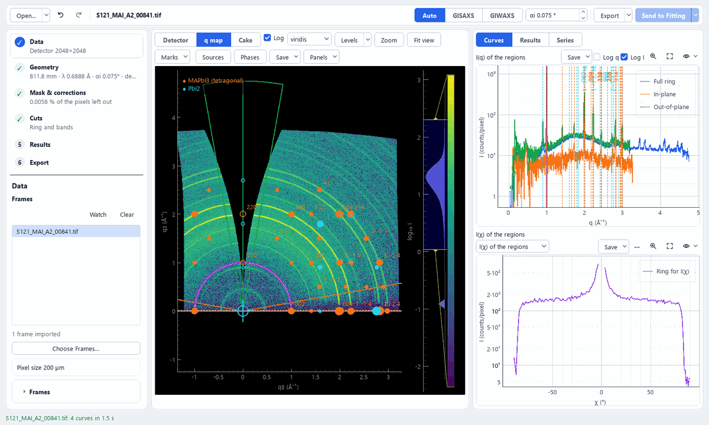

**Reflections.** The table lists, for every phase shown, the fibre spots or rings: hkl, d, q, q∥, qz, χ, the
multiplicity m, |F|² and the intensity relative to the strongest (100). Copy it with Ctrl+C. Select a row and press
**Pole Figure of This Ring**: the I(χ) ring moves onto that reflection and its pole figure is fitted with χ0 of the
reflection.

**Pole Figure.** Move the purple band over I(q) onto the ring, then choose **Fit Pole Figure**. The fit folds
the background-subtracted pixel means to |χ| and uses N(χ) ∝ [I(χ) − b] sin χ. **Automatic** obtains b from a
Gaussian peak on a local linear background in the radial pixel means, falling back to the adjacent bins.
You can also type b. The minimum exit angle from **Mask & Corrections** applies to the fit.
**Fit up to χ** restricts it further (default 90°).

Choose a **Model** for the oriented population. **Gaussian + isotropic** is a Gaussian in polar angle about a
cone at χ0. **Gaussian mosaic + isotropic** describes Gaussian angular spread about a preferred axis.
**Maier–Saupe + isotropic** describes axial order with density proportional to exp(m cos²γ), where γ is the
angle to the preferred axis. The last two average over all azimuths of the tilted axis. Under **Direction**,
fix χ0 along the normal or in the sample plane, enter its value, or fit it.

Read f and its same-bin isotropic reference f_iso together. The limits below identify which assumptions about the missing angles
and attenuation give the smallest and largest f. Compare these with f from the full fitted distribution, including the missing wedge.
The plot shows the measured points and the fit. The results give the oriented fraction 1 − φ, FWHM, χ0, 2D
order and reduced χ². The oriented fraction depends on the background b. A fit is marked
*not determined* if it fails to converge, reduced χ² exceeds 5, a fitted parameter reaches a bound, or
FWHM exceeds 100°. The result gives the reason and leaves that fit's wedge fill out of the measured f range.
The report also shows any weak |χ| interval excluded next to the exit-angle cut.

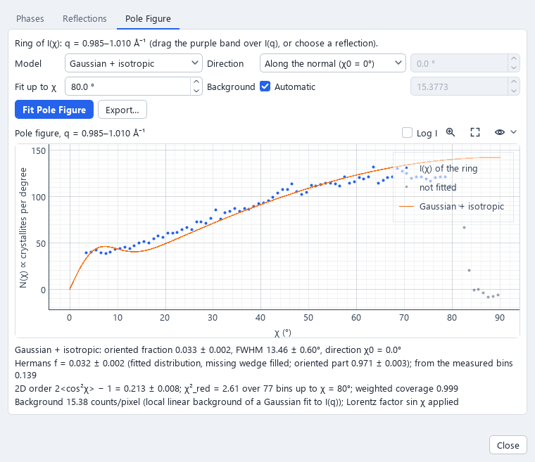

**Export…** writes the pole figure as CSV (`<frame>_pole_figure.csv`, in
`gimap_analysis/` next to the data by default) and `<frame>_indexing.json` beside it: the phases (with the CIF and its
SHA-256), the reflection table, the settings and the fit. The CSV header and JSON record include measured f, f_iso and the scenarios at the systematic limits.

**Crystal orientation (from phase).** Show the phases to be tested in **Phases**. In **Pole Figure**, select
**Crystal orientation (from phase)** under **Model**, then choose **Fit Crystal Orientation**. GIMaP searches I(q)
for peaks and jointly fits the usable rings assigned to each phase. Each ring has its own local background and
intensity scale. The rings constrain one distribution for the phase. It can contain randomly oriented crystallites
and up to two oriented populations. Each population has its own plane parallel to the substrate and its own mosaic
FWHM. A sharp and a broad population can align with the same plane. With only one independent reflection pole
direction, the fit tests a single fibre axis at one or two widths.
To set the window for one ring, move the purple band over its peak before fitting. If the band spans several
detected peaks, each keeps its own window. Automatic analysis calculates its ring windows from the radial peaks.
When the CIF composition gives the film's optical constants at the measurement wavelength, the model sorts each
measured pixel by its pole angle inside the film and averages transmission and attenuation along its external ray
(thick-film limit when the thickness is unknown). The radial window stays the one on the displayed q map. The fit
accounts for any film correction applied to the frame and uses measured bins down to the horizon; a minimum exit
angle you set and **Fit up to χ** still apply. Without optical constants the usual exit-angle limit applies. A
window containing reflections from different phases is excluded. Reflections of the same phase in one window
contribute to the same curve.

Select a phase and q value under **Show ring**. Points are the measured N(χ), the solid line is the joint fit
and the dashed lines show the individual reflection families, including their shares of the isotropic population.
The legend gives each family's share of the ring intensity.
Read **Orientation determined** or **Orientation not determined** first. For each oriented population the panel
gives the fitted substrate-parallel plane (h k l), mosaic FWHM in degrees, and percentage of all crystallites of
that phase. The ± values are statistical standard errors. The component percentages sum to **Total oriented**.
**Near-random** marks a component whose inclusion has weak support or whose weak angular modulation leaves its fraction poorly separated from random material. The panel pools these crystallites under **isotropic including near-random**. Only resolved components have a plane label. The exported JSON records the fitted width, fraction uncertainty and change in BIC when the component is replaced with random material.
Check ΔBIC and the reduced χ² for the joint fit and the displayed ring.
When the orientation is undetermined, all listed planes, widths and fractions are conditional on the preferred candidate. A broad fraction below three standard errors with absolute correlation above 0.99 with the isotropic fraction is pooled in a two-population fit.
The crystal Hermans factor describes the fitted distribution of fibre axes. The measured ring f describes that
ring over its measured angles. The panel gives δ and β when film optics are available.
**Export…** writes the selected ring and its component curves to `<frame>_crystal_orientation.csv`
and the phase results, settings and sources to `<frame>_crystal_orientation.json`. Automatic analysis with phases also
includes a **Crystal orientation** section and a `crystal_orientation` record in the report JSON.

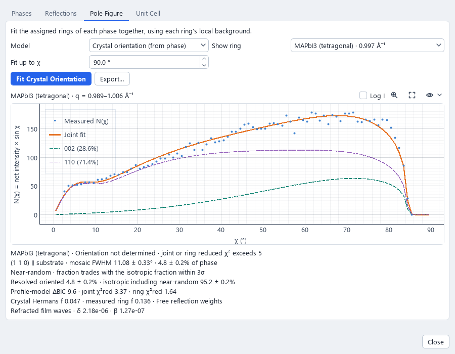

**In the automatic analysis.** With phases shown (or `--phase FILE.cif` on the command line, repeated for several),
**Run Automatic Analysis** assigns each peak to the nearest reflection within max(3σ, FWHM/2): the **Peaks** table of
Results gets the columns **phase**, **hkl** and **Δq**. An hkl marked **ambiguous** has two or more candidate
reflections within the window. Hover over hkl for alternatives and over Δq for the window and the fractional
spacing difference Δd/d. **Unassigned** means no reflection matched. The **Phase assignment** report lists these
results and identifies the q axis used, including the film critical angle if refraction was applied.
Transmitted and reflected channels can split a ring above the film critical angle.
Each analysed ring also gets a pole-figure fit next to its Hermans f. The
formulas are in [Physics and Methods 7.10 and 7.11](Physics_Manual.md#710-reflection-overlay-and-phase-assignment).

**Unit Cell.** After loading the reference phases, open **Unit Cell**. Select a phase to see its free lattice parameters in Å or degrees, volume in ų, one-standard-error uncertainties, and relative changes against the CIF. The reference keeps the original CIF values if you edit the trial cell for indexing. For a hand-entered phase, the typed cell supplies the reference. After fitting, the program updates the expected reflection positions and checks the assignments again. It excludes overlapping families because texture can change their relative intensities. The table lists measured q, the residual for each accepted reflection and reasons for exclusions. The results give the fitted q zero shift and its standard error, the range from omitting each accepted centre, and the effect of repeating the reduction with and without film refraction. Strain errors include the reference uncertainties supplied in the CIF. A rank-deficient phase shows the reason the cell could not be determined. With film αc set in the reduction or enabled in the overlay, the refinement uses transmitted-channel q.

For a fibre-textured sample, fit **Crystal orientation (from phase)** in **Pole Figure**, then return to **Unit Cell**. If one fibre axis is determined and the measured sectors constrain both projections, the tab also shows in-plane and out-of-plane strain, with the CIF uncertainties propagated through both projections. **Export Cell…** writes the results for all visible phases, full covariance, residuals, settings, frame source and CIF references to `<frame>_cells.json`. Automatic analysis with phases includes the same estimates under **Refined unit cells** and `cell_refinement` in the report JSON.

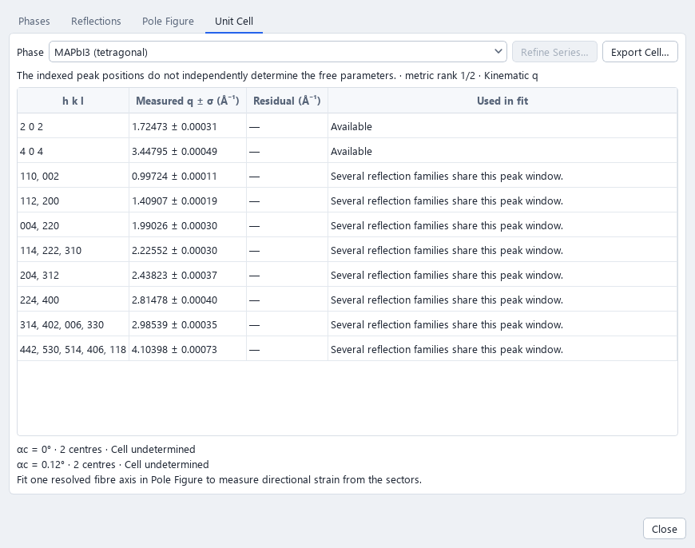

**Refine Series…** starts tracking the indexed peaks over the range and stride selected in Analyze’s series controls. Each point uses one detector frame. Choose the phase and **Cell parameter** to plot a, c or another free parameter together with volume and 1σ bars. The horizontal axis uses elapsed seconds from timestamps or an estimate from the recorded exposure or frame interval. Without timing it uses frame number. The program checks each tracked peak for overlap at that frame’s provisional metric. Missing or insufficient independent peaks leave gaps. **Export Table…** writes one CSV row per frame and phase plus a JSON record of sources, settings, tracks and residuals. See [Physics and Methods §7.12](Physics_Manual.md#712-unit-cell-refinement-from-indexed-peaks).

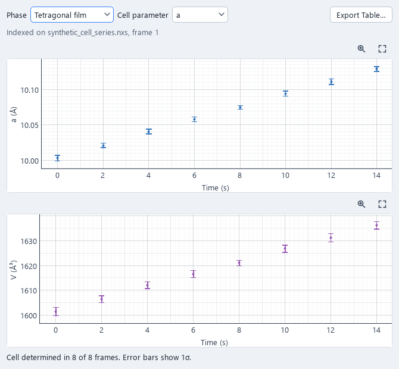

## 6. Fitting

The **Fitting** page fits 1D curves with particle models. Two modes are switched at the top of the page:

- **Single analysis** — one curve, in four steps (section 6.2).
- **Batch / In-situ series** — selected text curves (also several intensity columns of one file), every curve of a
  folder, or every frame of a detector series, all fitted with the model of Single analysis (section 6.5).

Each mode keeps its curve, model and results when you switch. With no curve open, the Curve step offers
**Open Curve…** and **Fit a Folder of Curves…**. For a series or a batch of samples, fit one representative curve
here (predict its parameters, then refine), then press **Fit Every Curve in This Folder…** in Results.
For selected TXT/DAT files or a shared-q table, use **Import Curves…** in either mode's command bar or the
**Fitting** menu. Dropping several curve files on Single analysis opens the same import preview.

Fitting works in nm⁻¹ and labels every axis and field with its unit. Analyze works in Å⁻¹; its curve files for
Fitting are in Å⁻¹ and are converted on opening.

Coming from version 0.0.2: the detector work of the former Cut & Fitting page is now in **Analyze**, which writes
the curve that Fitting fits.

| Former Cut & Fitting control | Now |
|---|---|
| Import image, Previous / Next | Analyze file list |
| Detector parameters | Analyze instrument profile (**Geometry…**, **Calibrate…**) |
| Find Yoneda & Set Cut, cut thickness | Analyze's automatic horizontal cut (drag the band or enter rows) |
| Optimize Center X | **Analyze ▸ Beam centre ▸ Refine x by Symmetry** |
| Mask negative pixels + guard | **Mask & corrections** step ▸ **Corrections** (folded) ▸ **Gap guard** (3 px by default) |
| Stack | **Data** step ▸ **Frames** (folded) ▸ **Sum** |
| Cut region width | Fitting's **Fitting range** |
| In-situ CBF / NXS series | Analyze ▸ **Send Series to Fitting…**, or the frames themselves in **Batch / In-situ series** (section 6.5) |

### 6.1 Curves Fitting reads

Fitting reads `.dat`, `.txt` and `.csv` text curves and NXcanSAS files (`.h5`):

- Analyze's curve files, `<name>_fit_input.dat`, have four columns — q (Å⁻¹), intensity, σ and the number of
  detector pixels averaged — and a header recording where the curve came from.
- Any other `.dat` / `.txt` file with columns `q I [σ]` opens too. A header can state the unit of q: `q in <unit>`
  in a `#` line, or the name of the first column (`q (1/A)`, `q_nm^-1`, `# columns: qy (1/A) …`,
  `# q [1/nm]  I`). The file is then read in that unit; Analyze's curve files state Å⁻¹. For a file that states
  none, set **Curve ▸ File ▸ q unit of files without one in their header** (Å⁻¹ by default, also in the 1D Predict
  window). A file whose header states both Å⁻¹ and nm⁻¹ is not opened: *The header states q both in 1/A and in 1/nm;
  correct it to one unit.*
  For a file that states no unit, a warning says so — *Unit of q assumed: Å⁻¹ (not stated in the file). If its q is
  in nm⁻¹, every length found (R, D) is wrong by a factor of 10 …* — with how to change it. The warning appears in
  the Curve card, in the Fit step, in the status line when the curve opens and in Results next to the values. When
  the q range in the assumed unit is also implausible for a GISAXS or SAXS cut (|q| beyond 10 nm⁻¹ = 1 Å⁻¹, or the
  whole curve below 0.02 nm⁻¹), the warning says that instead, and that R and D come out 10× too small or too large.
  A title line above the line of column names counts as part of the header. Rows that are not numbers, or hold NaN or inf, are
  left out, and the card and the status line give their number (*3 rows of the file could not be read as numbers
  and were left out.*).
- NXcanSAS files (`.h5`, HDF5 written by Analyze, SasView, Mantid and other programs; `.hdf5` and `.nxs` through
  **All files**): each SASdata group of the file is a curve — Q, I, Idev as σ, and Gaussian Qdev when present. q is
  read in the unit the file states on Q: 1/angstrom and 1/nm as they are, 1/m converted to nm⁻¹. The Curve card says
  *q read in Å⁻¹: stated in the file*. A Q whose unit Fitting does not know is read as if no unit were stated.
  Points that the file's mask leaves out are not fitted. For a file of several curves, **Open Curve…** (or a
  dropped file) asks which one to open and names it *file.h5 · curve 2*; **Import Curves…** takes every curve. A
  file of fits (Save ▸ Data and Fit, an In-situ series' **Fits as NXcanSAS…**) holds the fitted points and the model
  of each curve. Only its measured curves are offered (the first is preselected; a single one opens at once), and
  **Import Curves…** takes those, so the fits of a series open again as a series. An HDF5 file of detector frames is
  not a curve: dropped on the window, it goes to Analyze.

A `.csv` file is read by its column names: q is the column named q (`q`, `qy (A^-1)`, `q_nm^-1` …), I the one named
I or intensity, σ the one named sigma, σ, err or dI, and the Gaussian q width the one named dQ or sigma_q. Other
columns (a model, residuals, terms, pixel counts) are ignored. So the cuts of the command line (`horizontal.csv`,
the names in its last `#` line), Analyze's curve tables and Fitting's own **Save ▸ Save Curve and Parameters…**
table open as they are. That table has q twice, in nm⁻¹ and then in Å⁻¹; the first is taken, in nm⁻¹. q is read in
the unit its column name states. A CSV without a header, with two or three columns, is read as `q I [σ]`, like a
`.dat` file. When the header is ambiguous (two intensities, q of two axes, or no header and more columns),
**Choose Columns** shows the header and the first ten rows, as **Import Curves…** does. It asks which column is q, I and σ
(or none), and the unit of q when the q column's name states none. The record of a fit names the columns read
(`curve.columns_read`).

Single-curve text files without column names use `q I [σ]`. To supply Gaussian resolution, name the columns,
for example `# q_nm^-1 I sigma dQ`. dQ is one standard deviation, in the q column's unit by default.
Analyze's fourth column holds pixel counts and is not read as dQ. To split `q I1 I2 …` into curves, use
**Import Curves…**.

**Import selected files or several curves from one file**

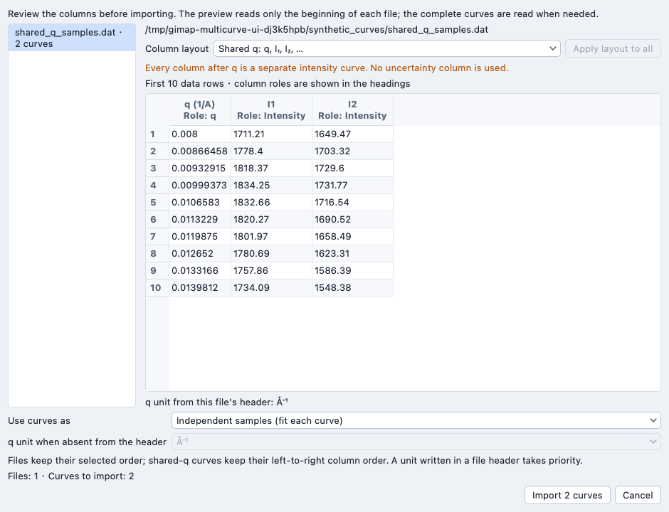

1. Click **Import Curves…** and select one or more `.txt` / `.dat` files, or NXcanSAS `.h5` files. A preview, which
   you can cancel, shows the first ten data rows, the column roles, the q unit and the total number of curves. The
   files are not changed. An NXcanSAS file gives every curve in it (one per SASdata group, in file order; the rows
   shown are those of the first), and the column layout does not apply to it.
2. For each file, check **Column layout**:

   | Layout | Interpretation |
   |---|---|
   | **Single curve: q, I, optional σ** | Column 1 is q, column 2 is I, column 3 (when present) is σ. |
   | **Shared q: q, I₁, I₂, …** | Column 1 is shared q; each remaining column is a separate intensity curve with no supplied σ. |

   A header such as `q I sigma` or `q I1 I2` suggests the matching layout. Without a clear header the default is
   **Single curve**, because numbers alone cannot tell σ from I₂; select **Shared q** yourself when it applies.
   **Apply layout to all** sets the layout for files with matching columns.
   Columns labelled as errors (such as `sigma`, `sigma1`) are never imported as shared-q intensities, and columns
   labelled as intensities are never used as σ. A file with an error column in another place must be rearranged
   into one of the two layouts.
   GIMaP Analyze's marked `q I sigma pixels` exports always stay one curve. Paired errors (`q I1 sigma1 I2 sigma2`)
   are not supported by this importer.
3. Choose **Use curves as**. **Independent samples (fit each curve)** is the default: each curve starts from the
   same Single analysis model, with no stage detection, odd-frame exclusion or continuity between curves.
   **Time series (file and column order)** takes the files in the displayed order, then the columns from left to
   right; check that this is the intended experimental order. It enables the usual series controls (section 6.5).
4. Set **q unit when absent from the header**. It starts from the Single analysis setting; a unit in a file's header
   takes priority. Click **Import N curves** to open the selection in **Batch / In-situ series**.
   Select a representative curve and press **Open Frame in Single Analysis** to set up or refine the model, then
   return and press **Start**. The fit range and left-out points also come from Single analysis: check them before
   Start.

The list and results name each curve by its file and intensity column. A project keeps the exact selection and
column mapping, including header names; on reopening it reports missing files or changed columns. The CSV and JSON
exports keep the source file and the q/I/σ columns used. A mapped curve opened in Single analysis keeps this source
in its fit record; **Import Curves from This File…** returns to the preview. The original files must stay
available. **Watch for new curves** is not available for a fixed selection: import again to change its files or
columns, or use folder mode to watch ordinary single-curve files.

Missing σ stays missing. Refine and Search then weight ln I equally; Predict parameters takes a relative σ from the
scatter of ln I about its trend (section 6.4). Each imported curve keeps q, I and its σ aligned by row; invalid
values in one intensity column do not remove valid points from another curve.

Other ways to get a single curve in:

1. **Open Curve…** in the command bar (`Ctrl+O` while Fitting is shown), or drop a curve file on the page.
2. **Analyze ▸ Send to Fitting** writes `<name>_fit_input.dat` and opens it here. The halves chosen in
   Analyze become the **Halves of the cut** in Fitting:

   | In Analyze | In Fitting |
   |---|---|
   | Both halves on \|qy\| (two colours) — default | Both halves on \|q\| |
   | Mean of both halves | Mean of both halves |
   | qy < 0 half | q < 0 half |
   | qy > 0 half | q > 0 half |

   When the folder next to the data cannot be written, Analyze asks for another folder and keeps it for the
   session. A GIWAXS I(q) opens with a note at the top of the page: Fitting's models are particle form factors for
   the horizontal cut of a GISAXS frame, so no method is recommended for it. For diffraction peaks, use
   **Analyze ▸ Batch Export ▸ Peaks of the ring regions**.

3. **Analyze ▸ Results ▸ Fit details ▸ Show in Fitting** (after a GISAXS automatic analysis, section 5.5) opens the
   same curve and puts the selected solution into **Model**. The automatic analysis uses Fitting's own model
   (Predict parameters, sizes *Gaussian, by number*), so the solution comes in unchanged; the status line says how
   closely Model reproduces the solution's curve. **Refine in Fitting** opens the curve without a solution.

### 6.2 Single analysis: one curve in four steps

To continue a saved fit, open the arrow beside **Open Curve…**, choose **Open Saved Fit…** and select the JSON
written by **Save Curve and Parameters…**. GIMaP checks the source curve's SHA-256 and restores its column or frame
selection, q unit, halves, range, excluded points and saved model. You can cancel the check in its progress window
and keep the curve already open. Change a setting and run the fit. **Results ▸ Compare with Saved Fit…** shows the
saved and current values, errors, bounds and point counts side by side. The new fit JSON names the original record
by path and SHA-256. Choose a new file name to keep both records.

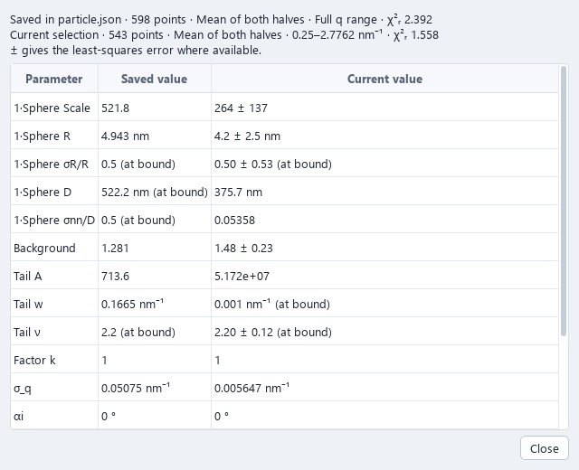


*After Predict parameters, Results shows the least-squares values and posterior medians. The model and residuals appear on the right.*

The page is laid out like Analyze: the steps on the left, each saying where it stands, and the plots on the right.

- **The curve plot**: the points (paler outside the fitting range), the model over the whole curve and the
  **orange band** of the fitting range (drag it). **Components** (off at first) shows the additive contributions to
  the intensity: particles, the constant background and any beam-tail or low-q term. The total model is a thicker
  solid line; contributions are thinner dashed or dotted lines. The arrow beside **Components** chooses which
  contributions are shown.
- **The residual plot** below shows (I − model)/σ for the selected intensity weights, or ln(I/model) for a log fit.
- **The command bar**: **Open Curve…** (its menu: **Load Model…**), **Undo / Redo** (`Ctrl+Z` / `Ctrl+Shift+Z`),
  the selected fit method (`Ctrl+Return`), **Stop** and **Save** (**Save Curve and Parameters…**, **Plot…**,
  **Model…**, **Solutions…**). Every change of the model, the fitting range or the left-out points is one undo step,
  and so is every fit, solution used and model loaded. After Undo or Redo the status line names the step
  (*Undone: the fit (Refine).*), and the buttons' tooltips name the step they would take (*Undo: solution 2 in Model
  (Ctrl+Z)*).

Showing or hiding contributions keeps the current x/y limits, including a manual zoom. By default, automatic limits
and **Reset** use only the data and the total model, so small component tails can lie below the visible range. To
see them, select **Include components in auto range** in the component menu; the view resets at once, and later
**Reset** uses the same choice. Log axes do not draw zero or negative values. These choices affect only the
display: fits, residuals and **Save ▸ Save Curve and Parameters…** keep the complete model and all contributions.
Contributions are intensities that add up to the model, not particle fractions. For a batch result, choose
**Open Frame in Single Analysis** to inspect its contributions here.

**1. Curve**

- The card shows the points, the q range in nm⁻¹ (in Å⁻¹ in the card's tooltip), *σ from the file*, and the unit q
  was read in with its source (*q read in Å⁻¹: stated in the file*, or *… not stated in the file: the setting for
  files without one*). The fit weights each point by 1/σ. Points whose σ is zero, negative or missing are left out of
  the fit, and the card gives their number (*4 points with a zero, negative or missing σ were left out: they cannot
  be weighted …*). The card says *σ from the file* only when the fitted points are weighted by it.
  Without σ, a warning in the card says what each method does — *⚠ No σ in the file. Predict parameters: a relative
  σ of 3.4 %, estimated from the scatter of ln I about its trend. Refine and Search: ln I is fitted, every point
  weighted alike.* — and the Fit step repeats it for the method chosen. Points with a negative or zero intensity are
  counted. With σ they are fitted like any other point (*12 of the 400 fitted points have a negative or zero
  intensity (9 negative, 3 zero): they are kept and weighted by their σ …*, in the card and in the status line when
  the curve opens). Without σ they are left out, because ln I has no value there, and a warning gives their number.
- How to set the fitting range, what Add Particle offers, what each method does and how to fix values are in the
  tooltips of those controls; the steps themselves say where things stand.
- **Halves of the cut**, for a cut through the beam (q < 0 and q > 0): **Mean of both halves** (averaged where
  both halves were measured; across a gap of one half, and beyond its end, the other half alone, never
  interpolated), **Both halves on |q|**, **q > 0 half** or **q < 0 half**. *Predict parameters* fits one curve:
  on **Both halves on |q|** it switches the box to the mean and says so. *Refine* and *Search* fit both halves.
- **Fitting range** in nm⁻¹, or drag the orange band; **Whole Curve** fits every point.
- Under *File* (folded): **q unit of files without one in their header**, Å⁻¹ by default; the In-situ series uses
  it too. A file whose header states its unit (Analyze's curves: Å⁻¹) is always read in that unit. Changing the
  setting reopens a curve without a unit in the new unit; for a curve that states one, the status line says why
  nothing changes. A project and the last session keep this setting and the unit each curve was read in. A saved
  curve opens as it did, unless its header states another unit than the one saved: it is then read in the stated
  unit, and the status line (for a project, its notes) says so.
- **Leaving points out**: switch on **Exclude** above the plot, then click a point to leave it out of the fit
  (click again to take it back), or drag a box around several. They are drawn as red ×, the Curve step says how
  many, and **Include All** takes them back. The left-out points are kept with the curve (and in a project) and
  written in the fit's record.

**2. Model**

- **Add Particle** adds one card per particle: **Sphere**, **Random cylinder**, **Vertical cylinder** or
  **Core–shell sphere** (a core of radius R in a shell of thickness **t**, the core's contrast **ρc/ρs** times the
  shell's; for Refine and Search only, since Predict parameters does not propose it).
- Each card has **S(q)** on or off (the interference between neighbours). With it on, **Interference** chooses the
  function: **1D paracrystal** (the default: D and **σnn/D**, the relative standard deviation of the distance
  between neighbours), **2D hexagonal paracrystal** (a disordered hexagonal lattice in the plane, averaged over its
  orientation: D and σnn/D) or **Hard spheres (Percus–Yevick)** (radius **R_HS** and volume fraction **φ**). The last
  two are for Refine and Search. **Coupling** is LMA (P·S, the default) or DA (sizes independent of positions)
  ([Physics and Methods, sections 9.5](Physics_Manual.md#95-structure-factor-one-dimensional-paracrystal) and
  [9.14](Physics_Manual.md#914-models-for-manual-fitting)). The values are scale, R and **σR/R**, h and **σh/h** for
  random cylinders, t and ρc/ρs for core–shell spheres, and those of the interference function. Spreads are relative
  everywhere (as in Analyze's results and in 1D Predict). The scale is the intensity of the particles at q = 0,
  where every form factor is 1.
  For upright cylinders with a height distribution, DA averages the scattering amplitude over heights as well as
  radii. This changes the contrast of the structure peak in the horizontal cut.
- Each value is one line: its name (the tooltip gives its name in links, such as `R_1`), the value, ± its error after a
  fit, **min** and **max** (with **Ranges**), **fit** and **=** (link). Two populations fit on one screen.
- For **Refine** and **Search**, choose **Sizes** for each population. **Gaussian, by number** uses centre R and
  width σ = R·(σR/R), restricted to positive radii within four σ. **Log-normal, by number (median)** uses median
  M and s = SD(ln R); its number mean is M exp(s²/2) and its relative standard deviation √(exp(s²) − 1).
  **Schulz (Gamma), by number** uses number mean R and relative standard deviation w, with shape 1/w² and scale Rw².
  The results give the number mean and relative standard deviation after normalization. Saved models keep their
  original laws. Models with the new laws, weights or file resolution are saved in the `gimap_fit_model_v3` JSON
  format.
- Under **Resolution**, choose **Constant σ_q** (0 gives an unsmeared curve) or **Resolution from the file**.
  The latter averages each particle term at |qᵢ + dQᵢ Z|, with Z a standard normal variable. dQ must be finite and
  nonnegative at each fitted point; a point with a width of zero is evaluated directly.
- Under **Weights**, **σ from the file** uses the residual (I − model)/σ, **Relative (σ = I)** uses (I − model)/I
  and **Poisson (σ = √I)** uses (I − model)/√I. **None (fit ln I)** uses ln I − ln model; this is also the default
  when the file has no usable σ. Relative, Poisson and log fits use positive intensities only.
  **Save Curve and Parameters** records these choices, and the fit report lists them. [Physics and Methods, chapter 9](Physics_Manual.md#93-size-distributions)

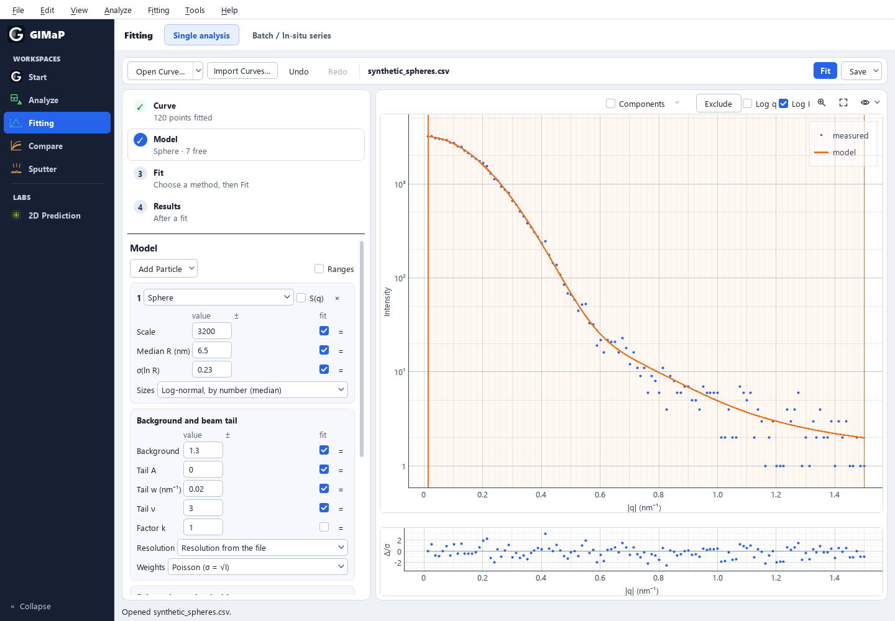

- **fit** ticked: the fit adjusts the value. Unticked: the value stays fixed.
- **=** links the value to another (**Same as**: e.g. one σR/R for two populations) or to an expression of others
  (**Expression…**: `2*R_1`, `R_1 + t_shell_1`; numbers, + − * / **, sqrt, exp, log, min, max …). A linked value is
  greyed. It follows the others while you edit and in every fit, is not fitted itself, and takes its error from
  theirs. The card **Links and constraints** lists every link (× unlinks), **Particles do not overlap** (D ≥ 2R,
  R_HS ≥ R while both are fitted; on by default) and the inequality constraints. **Add Constraint…** takes, for
  example, `D_2 >= 2*R_2 + 3`. Links and constraints are saved with the model and in the fit's record. Removing a
  particle removes the links and constraints that read it ([Physics and Methods, section 9.15](Physics_Manual.md#915-links-and-constraints-between-parameters)).
- **Ranges** shows each value's min – max. The fit keeps the value inside it; *Search the ranges* searches
  across it. Typing a value outside its range widens the range. For linear terms such as intensity and background,
  **∞** means no upper limit; untick it to enter a finite maximum.
- **Background and beam tail**: a constant background, the beam tail A / (1 + (|q|/w)^ν) at q = 0 (**Tail A**,
  **Tail w**, **Tail ν**: the wings of the resolution function about the direct and reflected beam; Predict parameters
  fixes ν at 2), and the q resolution **σ_q** (0, off,
  by default). An overall factor k, fixed at 1 by default, multiplies the particles and the tail. The tail's ranges
  follow the curve: A up to 10× its largest intensity, w from 0.3 q_min to min(30 q_min, q_max), ν from 1 to 6.
  They are set when a curve opens with the starting model and when Refine or Search starts from the generic ranges
  (the status line says so); ranges you type are kept. A tail at an edge of its range, or with no finite error, is
  flagged after the fit ([Physics and Methods, section 9.6](Physics_Manual.md#96-parameters-and-defaults)). The model as a formula, and how **σnn/D** relates to the σD/D of earlier versions and of 1D Predict, are in Physics and
  Methods, [section 9.2](Physics_Manual.md#92-the-intensity-model) and
  [section 9.5](Physics_Manual.md#95-structure-factor-one-dimensional-paracrystal).
- **Diffuse term**: the diffuse scattering of a rough interface, A_d (1 + (|q|/w)²)^−(1+H) (**Diffuse A**,
  **Diffuse w** = 1/ξ with ξ the correlation length, **Diffuse H** the Hurst exponent). It is off in a new model
  (Diffuse A = 0, fixed); free Diffuse A, w and H to use it. Predict parameters uses it.
- **Spheres in grazing incidence**: αi, αf, λ and the effective reflection coefficient |r|, arg r. With αi = αf = 0
  (the default), spheres are evaluated at q_z = 0, the effective interface approximation, which needs nothing about
  the substrate. Enter αi, αf (the row of the cut) and λ to evaluate spheres as the direct plus the exit-reflected
  path, and free |r| and arg r to fit the reflection. The manual DA uses the same paths for upright cylinders with a
  height distribution. After a fit with the angles entered, the results show q₊R of every sphere.
  **Substrate** (under the values): *Unknown* (the default, the levels above), a material of the table (**Si**,
  **SiO₂**, **Glass (plate)**, **Au**: δ and β at the cut's λ, 4.9–30 keV) or **Typed δ, β**. With a substrate and
  both angles, spheres use the four-term DWBA, with Fresnel reflection for a bare interface or Parratt reflection
  for a specified film (|r| and arg r are then not used). The line below says which level is in use (*Level:
  Four-term DWBA, substrate known on Si (δ = …, β = …)*). Predict parameters uses the same substrate in the
  likelihood and keeps it in each solution
  ([Physics and Methods, section 9.17](Physics_Manual.md#917-the-four-term-dwba-with-a-known-substrate)). When to use which, with examples on Si and on a polymer film:
  [Physics and Methods, section 9.10](Physics_Manual.md#910-spheres-and-cylinders-in-a-horizontal-cut-the-effective-interface-approximation);
  how to read a fit with three populations: [section 9.11](Physics_Manual.md#911-the-three-population-model).
- After a fit every value shows its ± error, or *⚠ at a bound* (orange) when it stopped at the edge of its range
  (section 6.3, *Values at the edge of their range*).

A new installation starts with a neutral model. Set the particle and its sizes for your sample, or let the Fit step
find them.

**3. Fit** — one **Method** drop-down and one button. **Method** has three entries: **Predict parameters**
(GIMaP's network, then least squares), **Refine the values in Model** and **Search the ranges, then refine**
(section 6.3).

- When a curve opens, the page chooses its method. An unfitted GISAXS horizontal cut gets **Predict parameters**,
  and the line under **Method** says why: *Recommended for this curve: a GISAXS cut not fitted yet.* Every other
  curve keeps the method chosen before; a GIWAXS I(q) never gets a recommendation. After a prediction the method
  turns to **Refine the values in Model**. If GIMaP's network is missing, the line under the method says so and
  names its file (section 14.3).
- For Predict parameters, **Particles** sets the compositions tried, and **Cut geometry and substrate…** sets the
  scattering model (section 6.4).
- Press **Fit** in the command bar (`Ctrl+Return`) or the button below, which carries the method's name (for
  example **Refine**). A progress bar and **Stop** appear while it runs. **Refine** and **Search** continue from
  their own result while χ²ᵣ falls by more than 0.1 % (at most 5 more runs; the Run Log and the report give the
  number).
- **Options** (folded): **Evaluations at most (Refine, Search)** (automatic by default) and **1D Predict Batch
  Window…** (section 6.4).

**4. Results**, from the top:

- The quality: χ²ᵣ (with σ) or the variance of ln I (without σ), the points, the free values and whether the fit
  converged. When no curve that Refine or Search tried was better than the start, it says *did not improve on the
  start values*: the start values are kept, the fit is not called converged and no errors are given. Without σ this
  happens when the start already describes ln I better than any curve whose scales the fit solves; change a value,
  or use Search. Refine and Search refuse a curve with fewer points than free values plus one (*Only 5 points in the
  fitting range for 9 free values: a fit needs at least 10 …*) and a curve with no intensity above zero.
  After Predict parameters it gives the number of solutions and says that the most probable is in Model; **Refine**
  then reports the fit quality and the uncertainties the data allow.
- What to do next: **Refine These Values** (after a prediction), **Fit Again** (the same
  method, with the values, fixed values and ranges now in Model) and **Fit Every Curve in This Folder…** (the
  In-situ series on this curve's folder, each curve starting from this model).
- **Fit details…** (labelled **Review fit warnings…** when a warning is flagged) opens a separate window, which does
  not block the page, with boundary diagnostics, correlations and assumptions. After Predict parameters it gives the
  posterior of the solution in Model (section 6.4).
- **Uncertainty and Report…** (after Refine or Search): **Errors and correlations** lists every free and linked
  value with its 1σ error, shows the correlation matrix as a heat map with its values, and names the pairs with
  |r| > 0.9. **χ² profile** fixes one value at a grid of values, fits the others again and gives the Δχ² = 1
  interval (**Run Profile**, **Stop**). **Fit report** shows the report — data file and its SHA-256, q range, model,
  every value ± error with its status, χ²ᵣ, the correlated pairs, the settings — as Markdown, HTML or text, to
  **Copy** or **Save Report…** ([Physics and Methods, section 9.16](Physics_Manual.md#916-uncertainty-after-refine-and-search)).
  A value the curve does not determine (its error not finite, or above 10× the value) is marked ⚠ in the table and
  the report.
  **Posterior check (MCMC)** samples again with a second sampler. For a Predict parameters solution it samples the
  same posterior (same likelihood, model error and prior) and checks the Monte Carlo accuracy of this mode. For a
  Refine or Search result it samples the fit's likelihood. **Run Check** starts two independent ensembles at
  dispersed importance samples or, when starts are missing, at draws from the prior box. **Steps** (default 3000)
  and **Walkers** apply to each ensemble. **Seed** reproduces the run. **Stop** keeps the completed steps. The table
  compares the MCMC median and 68 % / 95 % intervals with Predict's sampled intervals when available, or else with
  the least-squares reference. Read the autocorrelation time τ and the split R̂ across ensembles together. The
  verdict needs at least 50 τ kept steps per ensemble and R̂ below 1.05 for every value. A ⚠ marks non-overlapping
  68 % intervals. **Trace of** plots one value along the run. **Save Check…** writes the run and its diagnostics as
  JSON. The Fit Report includes the check for the current model and data.
  [Physics and Methods, section 9.19](Physics_Manual.md#919-posterior-check-by-mcmc).

  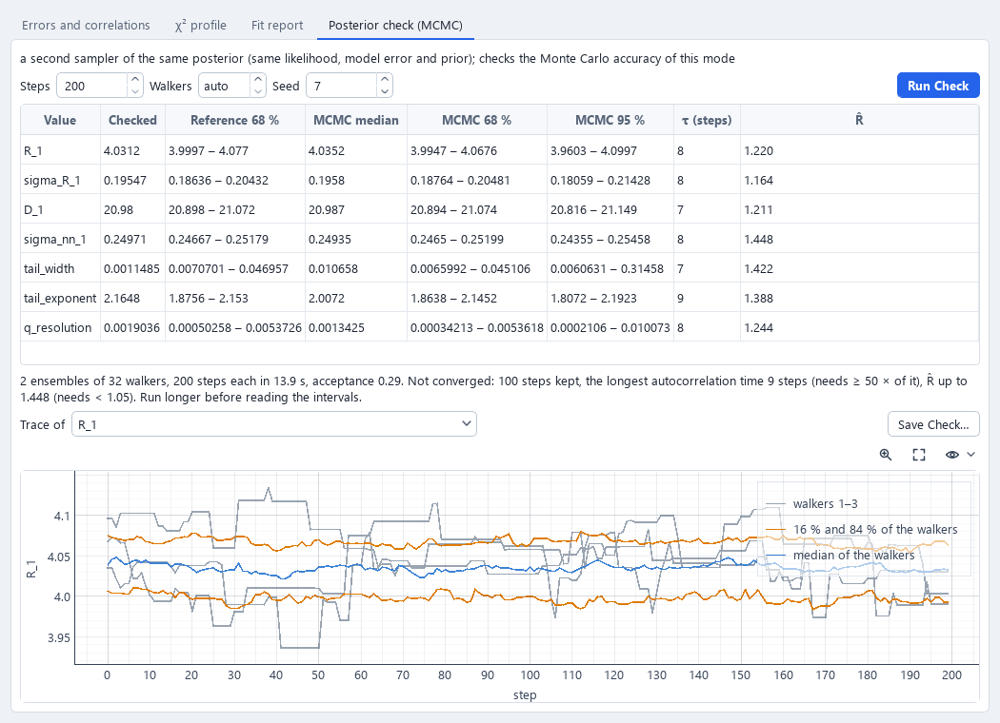

  *A short run after Predict compares the sampled intervals and reports τ and split R̂. Here the ensembles have yet to converge.*

- When there are several solutions (of Predict parameters, or of Analyze), the drop-down above the parameter table
  switches the whole solution: parameters, errors, total curve, components and residuals together. The exported
  record names the selected solution. Each entry gives the solution's number and name — numbered (*Sphere #1*,
  *Sphere #2*) when two have the same composition — its χ²ᵣ, p and short flags (*⚠ at bound: Tail ν*; the full
  sentences on hover), and *incomplete* for a solution kept when Predict was stopped. After **Refine These Values**
  the first entry is that fit (*Refined from solution 1 (Refine) · χ²ᵣ 1.04*), and the quality box says that the
  values come from a new refinement of solution 1. The solution's own values and intervals stay with it below.
- Right-click the curve: **Show components** and **Components** show or hide each population, the constant
  background and the low-q term. This changes only the display.
- The values, each ± its 1σ error (the covariance at the solution, scaled by χ²ᵣ). With a Predict parameters
  solution in Model and no fit since, ± is half the width of the solution's 68 % posterior interval (the tooltip
  gives the interval; the column header says which ± is shown). The scales and the background then show **–**:
  Predict solves them for every sample, so they have no interval. Select values and press **Fix**, **Let It Fit** or
  **Range…** (or right-click); the next **Fit Again** uses them. **Range…** shows the value's min – max in Model. A
  free value without an error from the fit shows **–**, and its tooltip says why (at a bound of its range, the Scale
  of its population or Tail A at 0, or not constrained by the curve).
- **Other solutions** (folded): the solutions of *Predict parameters*, each with its χ²ᵣ and either its probability
  **p** or its **BIC weight** (the column tooltips define both; the row tooltip gives the number of points behind
  χ²ᵣ). R and D show every population, in the order of the radii (`3.06 / 6.02`, `49.4 / –`). For two solutions of
  the same composition, the tooltip names the values in which they differ (σnn/D, σ_q …). A solution from
  **Show in Fitting** shows the χ²ᵣ of Analyze's fit (section 5.5) until you fit it.
  **Use This Solution** puts one into Model (Undo brings the previous model back). **Export Solutions…** (also
  **Save ▸ Solutions…**) writes every solution: `<curve>_solutions.csv` (a row per solution and parameter: the
  composition, probability, χ²ᵣ and its points, flags, whether it is incomplete, and the value, posterior median,
  68 % and 95 % intervals and least-squares error), `<curve>_solutions.json` (the record of Save Curve and
  Parameters with every solution under `predict`) and `<curve>_solutions_curves.csv` (the points and every
  solution's model, residual and terms).
- **Save Curve and Parameters…** writes a CSV with q (nm⁻¹ and Å⁻¹), I, the σ used in the objective, the model,
  the residuals, dQ in nm⁻¹ when file resolution was used, and each model term. A JSON record next to it holds the
  model, the fit (errors, values at a bound, correlations) and the points used; after Predict parameters also every
  solution (`predict`: composition, probability, χ²ᵣ, flags and every value with its median and intervals). Choose
  the type **NXcanSAS (*.h5)** for an HDF5 file with two SASentry groups: the points fitted (Idev = the σ used for
  fitting, Qdev = dQ when used) and the model, with Q = |q| in 1/nm. The record is then next to the file and inside
  it. **Save Plot…** writes the plot and residuals as a PNG, SVG or PDF on white, with the visible terms, the shaded
  fitting range and, with file-σ weighting, the measured error bars. **Save Model…** writes the model as JSON, to
  load for another curve with **Load Model…**.
- **Run Log** (folded) at the bottom.

What to check:

- A fit belongs to the curve and points it was made on. When you change the halves, the fitting range or the
  left-out points afterwards, the Fit and Results steps say *Changed after the fit: Fit again*.
- Opening another curve stops a running fit; a fit that ends after that is discarded, and the status line says so.
- A save that fails (for example on a read-only file) leaves the earlier file unchanged and says why.

The model, the method and the choices (**Particles** too) are kept for the next session, and the last curve opens
again. A different curve that arrives during startup takes precedence.

### 6.3 Fit methods

One **Fit** button runs the method chosen in **Method**. Fitting has one network method, **Predict parameters**,
and two least-squares methods that start from Model as it is:

| Method | What it does | When to use it |
|---|---|---|
| **Predict parameters** | GIMaP's network proposes compositions and values; Fitting's model weighs them against the curve (a posterior), and least squares refines each solution. Every solution has its probability and the 68 % interval of each value (section 6.4). | A GISAXS cut whose particles or sizes are unknown; it also tells how probable each solution is and how well the curve fixes every value. Chosen for an unfitted GISAXS cut. |
| **Refine the values in Model** | Bounded least squares from the values in Model, with Fitting's own model; stays near them. | The model is close: after a prediction or a solution, after Analyze, or to get errors. |
| **Search the ranges, then refine** | Differential evolution across the ranges of the free values (log scale when a range spans 10× or more), then refinement from the three best starts. | The start is poor but you know the family and sensible ranges. Slower. |

- The scales (every particle's scale, the background, the peak A) are solved within their limits by bounded
  weighted least squares at every step, so the search moves only sizes, spreads, distances and the peak's shape.
- **Stop**: *Refine* and *Search* keep the best values so far, and the result is reported as stopped, never as
  converged. Stopping *Predict parameters* keeps the solutions sampled so far, marked *incomplete* (section 6.4).

**Values at the edge of their range.** Model's fixed values and min–max ranges are hard limits for Refine and
Search, including population scales and global terms. The fit never widens a range or fixes a free value by itself.
A value that stopped at an edge of its range is named under **Fit details…** (*… stopped at a bound of its range:
widen the range or fix it.*): change its range in Model (**Range…**) or fix it, then **Fit Again**. Predict
parameters searches the network's full range for each proposed value and flags values at its bounds. Level 4 keeps
supplied upright-cylinder heights and widths fixed (section 6.4).

### 6.4 Predict parameters and 1D Predict

**Predict parameters** finds the particles of a cut and their values from the curve. You choose which particles to
try and, if you know them, the cut's angles and substrate. You get one or more solutions, each with its probability,
the 68 % interval of every value and flags for what to check.

It is Fitting's one network method. GIMaP's network, trained on simulated cuts of Fitting's own model, proposes
compositions and values. The model weighs them against the measured points (a posterior), and least squares refines
every solution. The intervals and probabilities allow the model an error of 5 % of the intensity at every point,
since the model describes a measured curve only to a few per cent; the fit itself and its χ²ᵣ use the curve's own σ.
The network (about 13 MB) comes with GIMaP and runs with numpy; nothing else has to be installed.
[Physics and Methods, section 9.13](Physics_Manual.md#913-predict-parameters) describes the method and its
benchmarks. The scripts in `tools/benchmarks/` of a source checkout compare **Predict parameters** with Search on
simulated cuts ([README](../tools/benchmarks/README.md)).

- **For the curve open in Fitting**: the method **Predict parameters** of the Fit step (below).
- **For a list of curve files**: **Tools ▸ 1D Predict — Fit Many Curves…** (or **1D Predict Batch Window…**
  under *Options* in the Fit step) opens the 1D Predict window (further below). To fit every curve of a folder with
  your model, use the In-situ series instead (section 6.5); its **Predict each frame** runs Predict parameters on
  every frame.
- Analyze's **Run Automatic Analysis** (section 5.5), Batch Export's **Particle model of the horizontal cut**
  (section 5.7), **Process with AI** (chapter 10) and the command line fit a GISAXS cut with Predict parameters too.

**What to enter in the Fit step**

1. In **Fit**, select **Predict parameters** (preselected for an unfitted GISAXS cut). Under it, **Particles**
   chooses what it tries:
   - **The particles in Model**: the 1–3 particles of Model — their families, and whether each has the paracrystal
     (**Distance D**). The populations are taken in the order of their radii. With no particle in Model, Predict
     takes **Spheres and upright cylinders (1–2)**.
   - **Spheres and upright cylinders (1–2)** or **Any particles (1–3)**: the network proposes the four
     compositions it finds most probable among these, and its most probable for every number of populations; their
     probabilities decide.
2. Open **Cut geometry and substrate…** and enter the incidence and exit angles in degrees and the wavelength in nm
   or the photon energy in keV. For a known substrate, select Si, SiO₂, plate glass or Au (4.9–30 keV), or select
   **Typed δ, β** and enter both optical constants at the cut's wavelength. For a coated substrate, tick **Top layer**
   and enter the film thickness in nm and its δ and β. The Fit panel and Fit details name the substrate.
   The geometry sets the level of the scattering model:
   - level 1, the effective interface: both angles zero;
   - level 2, the Born term at the cut's q_z: a single angle;
   - level 3, the two-path model with a fitted effective reflection coefficient: both angles, substrate **Unknown**;
   - level 4, the four-term DWBA: both angles and a known substrate, with Fresnel reflection for a bare substrate or
     Parratt reflection for the film.

   With **The particles in Model**, each upright cylinder keeps its supplied height, width, size law and coupling.
   With several populations, identify them by increasing radius when you enter the heights or read the results.
   Model and the saved solutions keep the geometry. How each particle is computed at each level:
   [Physics and Methods, section 9.13](Physics_Manual.md#913-predict-parameters).

   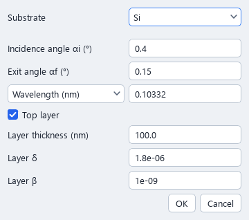

   Predict uses its own Gaussian size model, whichever of the three number distributions Model has, except for
   level-4 upright cylinders with supplied heights. It uses its own q resolution and the curve's measured σ.
   Models saved by earlier versions keep their Predict size-law and coupling conventions.
3. Without σ in the file, Predict takes a relative σ from the scatter of ln I about its trend (at least 1 %); the
   Curve card names its value, and the 1D Predict window uses the same estimate.
4. Press **Fit**. It runs in a separate process. The line under the bar gives the step — *Step 1 of 3 · Network
   proposals: composition 2 of 4*, *Step 2 of 3 · Refining the modes …*, *Step 3 of 3 · Sampling the posterior:
   solution 2 of 3* — the time since the start and, once an item of the step is done, about how long the step still
   takes. **Stop** ends it at once. Solutions whose posterior was sampled before Stop are kept, marked *incomplete*,
   with probabilities over those alone; with none sampled, nothing changes. For a curve of a few hundred points
   it takes some seconds with **The particles in Model**, from some tens of seconds to a few minutes with
   **Spheres and upright cylinders (1–2)** and a few minutes or more with **Any particles (1–3)**, whose random
   cylinders are slow (20–30 s per least-squares fit). The time grows with the number of points and of compositions
   tried, and depends on the computer. Sizes *Gaussian, by intensity* take several times longer than *Gaussian, by
   number*, whose averages come from tables. Predict uses half the computer's logical processors, at most 12 (the
   environment variable `GIMAP_PREDICT_THREADS` sets another number); the results are the same with any number.

Predict has nothing else to set. Step 1 weights the network's samples of each composition against the curve.
Step 2 refines the most probable values by least squares; when none refines below χ²ᵣ 2, it searches the ranges of
the two best compositions. Step 3 samples the posterior around the solutions within a BIC of 20 of the best (at
most four), which gives their probabilities and intervals.

A solution keeps the geometry and any upright-cylinder height distributions supplied for level 4. Batch solutions
also store the fitted model, including its resolution and parameter bounds, so opening one in Fitting reproduces
its curve. A fixed value or a narrower range in the receiving Model can change the transferred curve.
**Refine** afterwards keeps the values you fix.

**Reading the result**

- The solutions go to **Results ▸ Other solutions**, highest weight first, each with χ²ᵣ and its probability **p**
  or **BIC weight**. The highest-ranked solution is in Model, and **Method** turns to
  **Refine the values in Model**. A composition is the particle family of each population and whether it has a
  paracrystal, in order of increasing radius. How the weights are computed, and the BIC weights used when sampling
  fails, is in [Physics and Methods, section 9.13](Physics_Manual.md#913-predict-parameters).
  The probabilities compare the compositions tried and the distinct solutions of each. A solution with p 0.6 next
  to one with 0.4 means that the curve does not decide between them. With two or three populations this is common:
  another R of one population at the same D, or the paracrystals of two populations exchanged, can describe the
  curve as well. Predict tries these too and lists them; look at the others before you report one. Probabilities
  are relative to the compositions tried: with **The particles in Model** only one is tried, and its single solution
  shows no probability (*Only this composition was tried*).
- χ²ᵣ = Σ((I − model)²/σ²)/(N − number of free values), with the curve's σ, over the points Predict fitted. Points
  below the network's q window are left out, and the status line, the table's tooltip and Fit details give their
  number (*χ²ᵣ 1.04 over 596 of 598 points; 2 below the network's q window*). The same number is shown wherever the
  solution appears. A later **Refine** fits every point of the fitting range and says so when its χ²ᵣ is over other
  points.
- **Results** shows the **least-squares value** used in Model beside the **posterior median** and its central 68 %
  interval (hover over the median, or open **Fit details…**). The JSON record, solutions CSV and fit report keep
  both. **BIC weight** marks a comparison that fell back to BIC. For evidence comparisons, Fit details gives the
  effective sample size, the bootstrap error of the log evidence (200 resamples) and the resulting 68 % Monte Carlo
  range of the composition probability. Below 50 effective samples the sampled quantiles use tempered weights. A
  dash means that no sampled estimate is available.
- **Fit details…** gives the number of fitted points and the point spacing near the measured intensity maximum, as a
  ratio to the validation grid (397 linearly spaced points over 0.02–2 nm⁻¹, Δq = 0.005 nm⁻¹). A ratio of 3 means
  that the points near the maximum are three times as far apart as on that grid. Below 80 points, check whether the
  cut resolves its features. Above 400 points, sampling can fall back to BIC: rebin to 150–250 log-spaced points and
  run Predict parameters again.
- For a measured cut with a reflected beam, select **Reflected beam present in the data**. For a level-1 fit, enter
  the measured q₊ under **Measured q_z for level-1 flags (nm⁻¹)** if you know it; this value affects only the flags.
  On such cuts, levels 1 and 2 flag sphere and random-cylinder radii above q_z·R = 1.2 (`qzR_cov`): their 68 % intervals are then too narrow. Level 2 adds `qzR_fail` above 2. Use both
  angles for level 3, or fit the four-term DWBA with a known substrate. Level 3 flags interval coverage above 1.7,
  and the level-1 `qzR` radius-bias flag also starts above 1.7.
  At levels 2–4, an upright cylinder with fitted q₊R > 2 may stand for a sphere of similar radius (`cyl_sphere`).
  At any level, a cylinder with a known height also gets this flag if 0.8 ≤ h/(2R) ≤ 1.25 and q_z·R > 1.2.
  The coverage at each level is in [Physics and Methods, section 9.13](Physics_Manual.md#913-predict-parameters).
- **Fit details…** also shows the 68 % intervals, extended to include the least-squares value: the refined value
  first, then its interval, e.g. `R 4.12 [4.08, 4.16] nm`, and the probability. When a refined value lies at an end
  of its interval, a line says so (*the refined value lies at the edge of the posterior: the model describes this
  curve only within the model error*). Below it come the remarks, one line per kind:
  - a value the curve says little about (its interval spans most of its allowed range);
  - a value at a bound;
  - strongly correlated values;
  - few effective samples (the intervals are then rough);
  - values from a fit with the model error added to σ;
  - solutions compared by χ² and their number of values (BIC), because the posterior's sampling did not converge —
    usually a curve the model does not describe within its errors; the intervals are then the least-squares errors.

  The remarks about the background, the beam tail and the resolution follow in one paragraph (*Background, beam
  tail and resolution: …*); an absent term (Tail A = 0) is not flagged. The values are named as in Model (Tail ν,
  σ_q, σR/R (1): the population's number in brackets).
  A population whose size the curve does not show is named too: one whose Guinier region lies at or below the
  lowest q, or one smaller than the curve resolves (a smooth background). In the first case the curve shows only its
  decay, which roughness or a rise at low q also produce: check it before you report particles of that size.
  A sphere or random cylinder fitted at q_z = 0 (no angles in Model) whose q_z·R at the cut is above 1.7 is named as
  well: its radius is then biased, usually too small; give both angles. GIMaP can say this only where it knows the
  cut's angles, as in the automatic analysis (section 5.5), or when you enter the measured q₊ yourself.
- **Refine These Values** (or **Refine the values in Model**) then gives the least-squares errors under Model's own
  limits.

The network covers cuts spanning a factor 10–300 in q (points below q_max/300 are left out, with a note), one to
three populations, and radii from 0.5/q_max to 5/q_min.

**The 1D Predict window**

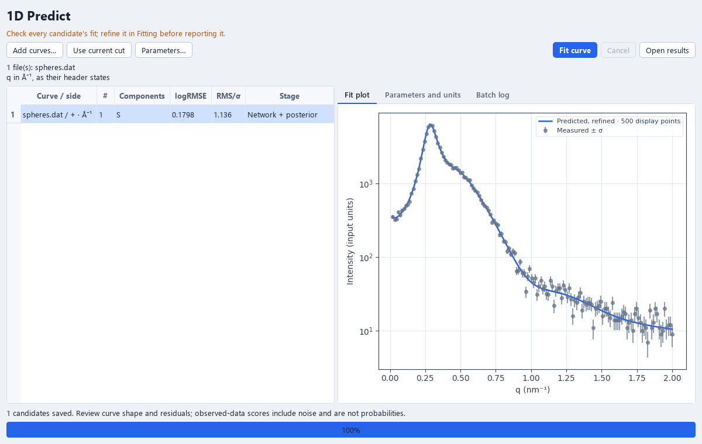

*The selected curve and its candidate appear on the left. The right-hand panels show the fit and its parameters. Indicate a reflected beam in the settings when the measurement contains one.*

The window runs Predict parameters on every curve listed; it has no other method.

1. **Add curves…** lists text curve files (`q I [σ]`; `.dat`, `.txt`, also comma-separated `.csv`). **Use current
   cut** takes the curve open in Fitting instead. The line under the buttons gives the unit of q each file is read
   in: the unit its header states or, for a file whose header states none, the setting **q unit of files without
   one in their header**. A file whose header states both Å⁻¹ and nm⁻¹ is not fitted and is named there.
2. **Parameters…** sets:
   - **Complete composition**: up to three boxes for the particle families, when you know them (each population with
     the paracrystal). With every box on *Auto / unused*, the network chooses among all compositions.
   - **q unit of files without one in their header**: Å⁻¹ by default, as on the Fit page (settings saved with nm⁻¹
     keep it). A file whose header states its unit of q is read in that unit (how a header states it: section 6.1);
     Analyze's `_fit_input.dat` files state Å⁻¹ and need no setting. **Use current cut** is converted
     automatically. When a file states no unit, a warning under the status line names the file, the assumed unit
     and how to change it. The candidate's tooltip and its *Parameters and units* text repeat it, and the records
     keep it (`curve_notes`).
   - **q sides**: *Each half separately*, *q > 0 half* or *q < 0 half*.
   - **Cut geometry and substrate…** applies one measured geometry and substrate to every curve in this run.
     With a substrate selected, both cut angles set q_z, and level 4 replaces the **Cut qz** setting.
   - **Cut qz (nm⁻¹)**: the cut's q_z, at whose Born term spheres are evaluated. Unticked (the default), q_z = 0,
     the effective interface. The exit-reflected path needs both angles: fit such a curve on the Fit page with the
     angles in Model.
   - **Relative σ added to counting σ** (10 % by default) and **Absolute σ added to counting σ** apply only to **Use
     current cut** on a curve that Analyze wrote with the pixel counts of its detector columns. They are added in
     quadrature to the counting σ. A curve without σ gets the relative σ of Predict parameters, estimated from the
     scatter of ln I about its trend (the same value as on the Fit page; points with a negative or zero intensity
     are left out). Each candidate records it (`sigma_source`, `sigma_relative`, `curve_notes`).

   The files are read as on the Fit page: any header lines (also a title line above the column names), and commas,
   tabs, semicolons or spaces between columns. Negative and zero intensities are counted in each candidate's
   `curve_notes`.

   **Save Settings** keeps them. Settings saved with an earlier method (*General V5*, *Single RC specialist*,
   *Physical fit* or *fit1d*) open as Predict parameters; only fit1d's cut qz is kept, as **Cut qz**.
3. **Fit curve** (**Fit N files** when several are listed) starts, **Cancel** stops (finished files stay saved),
   **Open results** opens the run folder.
4. The table lists the candidates of every curve and half: **Curve / side** (the file and + or −; for a file also
   the unit its q was read in, with its source on hover), **#**, **Components** (S sphere, RC random cylinder, VC
   vertical cylinder), **logRMSE**, **RMS/σ** and **Stage**.
   Select one to see, in the tabs on the right, its **Fit plot**, its **Parameters and units** and the **Batch log**.

The **Stage** of every candidate is *Network + posterior* (Predict parameters); hover for its probability and
flags.

**Where the results go.** Each run of the window writes a new folder `AI_Fitting_Output/v5_<date>_<time>_<µs>/` in the GIMaP user data folder (also for the portable version). **Help ▸ Open User Data Folder** opens it. It holds `request.json`, `batch_summary.json`,
`top20_candidates.json`, `fitting_run_summary.json` and, for every curve and half, `solutions.json` (parameters,
units, the stage that ran, the probabilities and intervals), `display.npz` and
`fitting_curves.csv`. `request.json` and `fitting_run_summary.json` list the unit each curve's q was read in
(`q_units`); each file's entry in `batch_summary.json` and its candidates in `top20_candidates.json` carry it as
`q_unit_read` and `q_unit_from`. The folders are not removed automatically. Fits you save yourself (**Save**) go
where you choose.

**The network file.** The weights of Predict parameters are in `src/gimap/features/fitting/domain/posterior/data/`
(`flow_v1.npz`, with its record `flow_v1.json` and model card `MODEL_CARD.md`), both in the portable version and in
the Git repository. Predict checks them against the SHA-256 in the record before it uses them; with a changed or
missing file it does not start, and the message names the file (section 14.3). Predict parameters replaces the
earlier methods *General V5*, *Single RC specialist*, *Predict parameters (fit1d)* and *Find the particle shape (no
AI)*, removed in 0.2.0 (Physics and Methods, chapter 10).

### 6.5 In-situ series

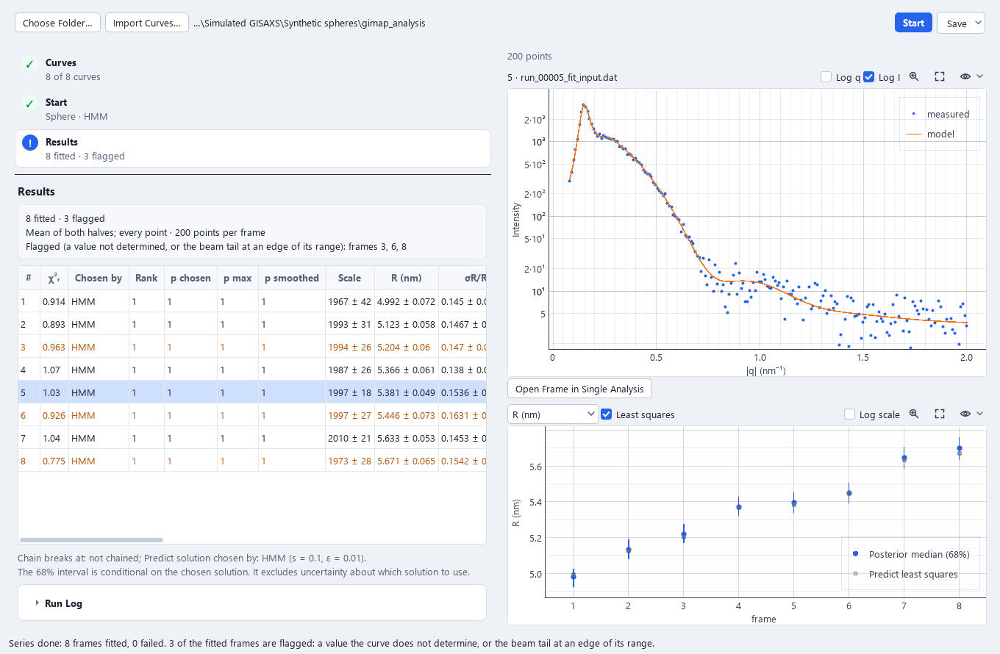

*Four synthetic detector frames fitted with a sphere model. At 7 s the model misses part of the measured curve. The table flags frame 4 and the trend shows R and D with their least-squares standard errors.*

The **Batch / In-situ series** tab fits curves with the model of Single analysis. The command bar has
**Import Curves…**, **Choose Folder…** and **Start**; **Pause** and **Stop** appear while fitting runs, and
**Save** once frames are fitted. **Import Curves…** takes selected files and shared-q tables (section 6.1).
The folder and time-series controls below apply to folder mode and ordered sequences. Imported independent samples
all start from the same model and have no stage detection, odd-frame exclusion or continuity.

Folder discovery, unit-header inspection, previews, detector-frame cuts and watching run in the background.
While the first list and preview are prepared, **Start** is unavailable and **Stop** cancels the preparation.
**Stop** while a curve or frame is being read takes effect when the read returns: that frame is skipped and not
counted as a failed fit. **Pause** lets the current frame finish first. Completed results stay.

**1. Curves**

- **Choose Folder…** (or drop a folder on the page), **Fit Every Curve in This Folder…** in Single analysis'
  Results, or, in Analyze, list the frames and choose **Send Series to Fitting…**. Analyze exports every frame
  (optionally summed N at a time) into `<name>_fitting/`, and the series opens here with its curves listed.
- The frame range and halves controls wait until listing has finished. The start strategy, method and follow choice
  can still be changed, and a project saved during preparation keeps them.
- **Files** is the pattern: `*_fit_input.dat` by default; any `.dat` / `.txt` curves work. **Also in
  subfolders** looks deeper.
- **Detector frames.** **Files** can also name detector files (`*.cbf`, `*.tif`, `*.edf`, `*.nxs` …), and a folder
  that holds frames but no curves switches to its frames by itself. Every frame is cut as Analyze cuts the frame it
  has set up: instrument profile, αi, beam centre, masks and corrections, bad pixels, the cut of the series and the
  halves. A NeXus/HDF5 file gives every frame, a set of module files is one source, and Analyze's **Sum** groups
  neighbouring frames. Each frame gives the same curve as `<stem>_fit_input.dat` (q in Å⁻¹), in memory only:
  nothing is written next to the data. The step says whose set-up is used. While Analyze has no frame set up, it
  says why and Start does not begin. **Take Analyze's Set-up** takes Analyze's current set-up and cuts the frames
  again. The JSON record keeps Analyze's settings.
- Folder curves are listed in counting order of their names (`frame_2` before `frame_10`) and numbered 1, 2, 3 … in
  that order. **Frames**: first – last of these numbers, and **Every** n-th.
- **The unit of q**: every curve file is read in the unit its header states, else in Single analysis' **q unit of
  files without one in their header** (its value at Start, kept for the run). The step counts the listed curves by
  unit and source — *2 curves: q in Å⁻¹, as their header states*; *1 curves: q in nm⁻¹, no unit in their header
  (Single analysis ▸ Curve ▸ File)*. A file whose header states both units is named and not fitted, and its frame
  says why. Detector frames are cut in Å⁻¹.
  Imported selections keep the fallback unit chosen in the import preview; a unit in a file's header still wins.
- **Watch for new curves**: while the series runs, the folder is checked every 2 s, and curves written into it
  (for example by Analyze during a measurement) are fitted too. A new file is taken once its size and time are the
  same at two checks. A file changed after it was read is fitted again. A folder that cannot be read is waited for.
- **Halves of the cut**: every frame is fitted on one curve — **Mean of both halves**, **q > 0 half** or **q < 0
  half**. Until you choose, it takes the halves Analyze sent the curves with; else those of Single analysis, unless
  they are both on |q|; else the mean. The line under it says where the value comes from. Curves with q on one side
  only have no halves: the box is switched off, and its tooltip says why. A frame without points on the chosen half
  fails with *No points on the q > 0 half* (or *q < 0*); it is not fitted on the other half.
- Once the curves are listed, they are compared in the background (section 7.1). The step says how many stages
  and odd frames there are, and the list is coloured by stage. **Leave out the odd frames** is on by default.

**2. Start**

- Every frame uses the model, the fitting range and the left-out points of Single analysis (**Edit in Single
  Analysis** changes them) and the halves of the Curves step. Every method keeps Model's fixed values and limits;
  values at a bound are reported, and the limits stay as they are (section 6.3).
- **Each frame starts from**:
  - **The previous frame's result** (default) — for a slowly changing sample. A frame that did not converge
    makes the next one start from Single's model again.
  - **The model in Single analysis** — every frame independent of the others.
  - **The previous result; the Single model at each new stage** — follows the sample within a stage and starts
    afresh where the curves change course.
  - **Previous result, Predict at chain breaks** — each frame starts from the preceding fit. Predict parameters
    (section 6.4) retries the frame when the fit fails or does not converge, when a new stage begins, or when χ²ᵣ
    exceeds 2 and is more than 3 times its value at the preceding frame or at the start of the current chain.
    Predict uses the particles of Single's model. Among the solutions at least a tenth as probable as the most
    probable one, it takes the one closest to the preceding frame. The better of the two fits is kept and sets the
    reference χ²ᵣ for the new chain. If the manual size law, weights or resolution differ, Refine starts from the
    network values with the manual settings before the two fits are compared. A value at a bound (the beam tail,
    the background or any other), a value the curve does not determine and a poor fit are flagged separately. A
    model with no particle or more than three is only refined (the Run Log says so).
- **Refine again in a backward pass**: once every frame is done, each frame from the last but one to the first is
  refined from the result of the frame after it, and the better of its two fits is kept. A sample whose first frames
  are hard to fit is then followed back from where the fit is sure. Not while **Watch for new curves** waits for
  curves.
- **Method**: **Refine (fast)**, **Search the ranges, then refine (slow)** or **Predict each frame**.
- **Predict each frame** gets solutions for each curve with the particles of the starting model. **Prefer the
  solution that continues the previous frame** (on by default) takes the closest eligible solution in ln R, ln D
  and ln(σ_R/R). A solution is eligible when its probability is at least 0.2 times the maximum for that frame; a
  chained restart uses 0.1. With no previous fit, at a new stage, or with an independent start, *Predict each frame*
  takes the most probable solution. Turn off both continuity options to take the most probable solution in every
  frame. A change of the cutoff or of the pass direction can move a step in the series.
- **Smooth across frames (hidden Markov model)** uses the whole series to choose a path through the Predict
  solutions. **Log step per frame (s)** sets the expected size of change between selected frames; the default, 0.1,
  is about 10 %. A smaller value favours smoother paths and can suppress a short-lived change. While frames arrive,
  each is first chosen on its own; when the queue is empty, GIMaP computes the path. With **Watch for new curves**,
  later frames can change earlier choices.
- Then press **Start** in the command bar. **Pause** and **Stop** act after the frame being fitted; Stop during
  reading skips that frame's fit (see above). The frames done are kept. A project cannot be opened while a series
  runs (Stop first). A run started before the stages were found uses no stages and says so.

**3. Results**

- How many frames were fitted, failed or did not converge, with the halves and points per frame. A frame whose beam
  tail stopped at an edge of its range, or with a value without a finite error, is **flagged**: marked in the list,
  counted at the end of the run and listed under `flagged` in the record.
- A table with a row per frame: χ²ᵣ, each free value ± 1σ, **Started from**, the **Flags**, the **Points** fitted
  and the **Halves**. Click a row to see that frame's curve and model; a failed frame shows its reason. **Started
  from** says where the frame's kept fit started: *continued from frame n* (the frame before; in the *backward
  pass*, the frame after), *restarted from Predict (why the chain broke)* — with the rule that chose Predict's
  solution on hover —, *… (the chain broke: why)* when the continued fit was still the better one, or *from the
  model in Single analysis*. **Flags** says what to know before trusting the row: failed, not converged, a poor fit,
  values at a bound of their range, the beam tail at an edge, a value the curve does not determine.
- For a Predict run or restart, **Chosen by** gives the rule and the reference frame. **Rank**, **p chosen** and
  **p max** refer to the single-frame evidence (rank 1 is the most probable). **p smoothed** is the probability of
  the path's state given the series. Discarded restarts are labelled. The line below the table gives the run's
  rules. Projects saved before these probabilities were recorded leave those cells empty.
- The trend shows posterior medians and central 68 % intervals for parameters with a Predict posterior.
  Select **Least squares** to add the selected solution's least-squares value as a small open symbol.
  The interval leaves out the uncertainty of which solution was kept. Parameters fitted only by least squares show
  their fitted values and standard errors.
  The plot is titled with the name of the series. When the curves record when their frames were measured (curves
  for Fitting that Analyze wrote from frames with a time stamp), the box beside the value plots it against
  **Time (s)** since the first fitted frame.
- Select **Radius and spacing (nm)** to plot R and D for the same particle on one axis. The legend names the
  estimates and the error bars. **Save Trend…** writes the displayed trend. **Save Table…** writes all fitted
  parameters and their errors. When detector times are available on a common clock, the CSV includes
  `elapsed_time_s` relative to the earliest timed fitted frame. The JSON keeps the recorded detector times.
- **Review frame n** selects the first result marked for review in the Results table; the note above its measured
  curve gives the reason. A flagged frame can still have a converged fit.
- **Open Frame in Single Analysis** takes a frame and its fitted model back to Single analysis to look closer.
- **Save ▸ Table of Every Frame…** writes a CSV (frame, file, χ²ᵣ, log RMSE, converged, points, halves used, every
  value and its error) with a JSON record next to it. The record holds the start model, the halves and where they
  came from, range, left-out points, method, every frame's state, reason and the unit its q was read in (`q_unit`,
  `q_unit_from`; `q_unit_of_files` is the setting for files without one), the poor fits (χ²ᵣ above 10) and the
  curves or frames listed. The table includes `flags`, `start_from` (previous, next, single or predict),
  `start_frame`, `chain_break`, `predict_choice`, `fit_pass`, `chain_reference_frame` and `chain_reference_chi2`.
  The record also gives the start method and whether a backward pass was requested.
  For frames with predictions, the CSV includes the selected rank, single-frame probabilities, reference and
  smoothed probability. The JSON stores the selection policy, all HMM state probabilities in rank order and the
  outcome of each chained restart. **Save ▸ Series report…** writes these frame decisions and the chain-break
  thresholds as a Markdown table with the source file names. **Fits as NXcanSAS…** writes, for every fitted frame,
  the fitted points and the model at their q (one `.h5`, two entries per frame, each with the frame's record and
  its role, data or model; Q in 1/nm). **Results Database…** writes every frame's fit — state, χ²ᵣ, values and
  errors, flags, where it started — into `gimap_series.sqlite`; a database in the folder of the curves or up to two
  folders above it (Analyze's, next to its curves) is offered first. **Trend Plot…** and **Selected Frame's Plot…**
  save the figures.
- Before results that are not saved are dropped — a second Start, other curves, a project opened — GIMaP asks:
  **Save**, **Discard** or **Cancel**.
- A series of GIWAXS I(q) curves gets the note of section 6.1 again after the run, with how many fits are poor.
- **Run Log** (folded) at the bottom.

A curve that cannot be read or fitted is marked ✗ in the list, and the series goes on. The folder or imported
selection, its units and choices are kept for the next session and in a project. Mapped sources keep their column
indices and names in the result records; JSON indices start at 0, and the preview numbers columns from 1.

### 6.6 Several curves fitted together

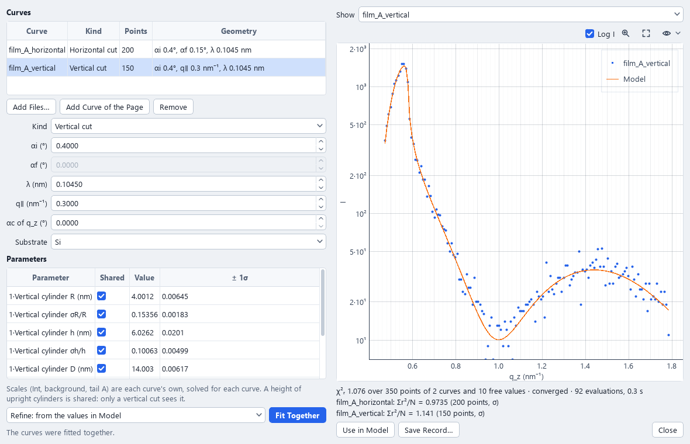

*A cylinder model fitted to the two GALAXI cuts. The data rise above the model at the high-q end of the vertical
cut. Read the vertical reduced χ² and the warning below the plot when interpreting the reported height.*

**Fitting ▸ Fit Several Curves Together…** fits a list of curves with one χ², typically the horizontal and the
vertical cut of one GISAXS frame. The vertical cut constrains the height of upright cylinders and the vertical
extent of the particles. The fit starts from the model in Single analysis.

For one particle population, **Particle shape** also changes the model in Single analysis. To fit an independent
height and radius for upright cylinders, choose **Vertical cylinder**. Check the measured cuts with **Show**, select
the sample's **Substrate**, then choose **Fit Together**. The plot shows the points used for the selected curve and
its fitted model. The line above the plot gives the last fit's radius and, for a model with height, its height in
nm, each with its 1σ fit error when available. Read the vertical reduced χ² and the range check before quoting a
height.

- **Curves**: **Add Files…** (curve files), **Add Curve of the Page** (the curve in Single analysis, with the angles
  of its Model) and **Remove**. **Analyze ▸ Send Both Cuts to Fitting** writes the frame's horizontal cut
  (`<stem>_fit_input.dat`) and its vertical cut (`<stem>_fit_input_qz.dat`, next to the data in `gimap_analysis/`, or
  where you choose when that folder cannot be written) and lists both here with their geometry. Under the list, the
  selected curve's **Kind** — *Horizontal cut* (αi, αf, λ), *Vertical cut* (αi, λ, **q∥** of its columns and, when
  Analyze refracted its q_z, **αc of q_z**) or *Other curve (q_z = 0)* — and its values.
- **Substrate** (all curves): a vertical cut is computed in the four-term DWBA and needs it (Si, SiO₂, Glass (plate),
  Au or **Typed δ, β**); a horizontal cut with both angles is then in the four-term DWBA as well.
- **Lowest exit angle of the vertical cut** defaults to 2 αc, where αc is the critical angle of the selected
  substrate at that cut’s wavelength. Set it to 0 to keep all valid exit angles. The plot, the point count in the
  summary and the fit use the same range.
- **Parameters**: every free value of Model, **Shared** (fitted once; by default every particle value) or not (one
  value per curve). The scales — every population's Int, the background, Tail A — always belong to each curve, so
  every curve has its own scale and background. When a vertical cut is listed, upright cylinders get their height h
  and σh/h, shared. If the model has no starting height and the exit-angle limit is positive, Refine tries 10, 5 and
  20 nm and starts at the value with the smallest residual sum of squares.
- **Fit Together** with *Refine* (from the values in Model) or *Search the ranges, then refine*; a progress bar and
  **Stop** (the best values so far are kept). The summary gives χ²ᵣ over all points and each curve's Σr²/N; **Show**
  picks the curve drawn with its model. **Use in Model** puts the values of the first horizontal cut (shared values
  included; a height fixed at the joint value) into Model; **Save Record…** writes every curve with its model, errors,
  the shared values, χ² and the covariance (JSON).
- **Save Report…** writes the fit summary and parameter values as Markdown. The record and the report give the
  exit-angle limit in substrate critical angles and in degrees. With supplied or Poisson uncertainties,
  **Needs attention** flags a vertical reduced χ² above 3. The model leaves out the particle layer’s effective refractive
  index, so the fitted height is likely too low for a dense or high-Z layer. The warning points to *Physics and
  Methods* §9.18 for the height biases measured in the BornAgain benchmark.
  For a fitted cylinder height, the report also gives the height from a second fit over the full vertical range
  (from 2 αc if you selected the full range). A warning appears if the two heights differ by more than twice their
  combined standard error or by more than 2 % of the selected height. The report says when the two ranges contain
  the same usable points or the comparison fit fails. Both heights assume a dilute layer and uncorrelated heights
  and radii; if height and radius are correlated, both ranges can give similar, biased heights.

**Fit Several Curves Together** warns when the exported vertical band crosses qy = 0 or its centre has |qy| below 0.02 nm⁻¹. The particle model leaves out the specular reflection: if the band includes it, move the cut beside the ridge and send both curves again. The vertical-cut model and its check against BornAgain are in
[Physics and Methods, section 9.18](Physics_Manual.md#918-several-curves-fitted-together-the-vertical-cut).

## 7. Compare and stages

Stages and Compare answer three questions about a series of scattering frames, without labels and without AI:

- which frames do not belong (odd frames);
- where the series changes course (stages), and how fast;
- which runs or samples are alike.

Both use Analyze's curves, with the same geometry, masks and cuts. They replace the Classification page of
version 0.0.2. Stages here are segments of a series found from its curves alone; the growth stages of a sputter
series (islands, coalescence, film) are a different thing, described in chapter 8.

### 7.1 Stages and odd frames

**How they are found**

1. The curves are compared as log I, on the q points (almost) every frame has. By default each frame's mean level
   is removed, so only the shape counts.
2. Odd frames first: a frame that differs from both the 3 frames before and the 3 after it by far more than the
   change from frame to frame. The difference can span the whole curve, or only a few points (about 1 %) where the
   frame differs from both sides in the same direction, such as a few hot detector columns in one frame. A real
   change of the sample is not odd: after a sudden change a frame matches the frames that follow, and in a steady
   change it lies between the frames before and after. Two or three such frames in a row (two at the start or end
   of the series) are each found. Left in, an odd frame would become a component of its own and a false stage, and
   would enter the end state in Compare.
3. The main components of the other frames.
4. Stages: the components are cut into straight pieces in frame order (at least 5 frames per stage, at most 8
   stages). A stage is added only while it explains at least 5 % of the remaining change and more than noise
   would. A series of more than 1,500 frames (odd frames left out) is first averaged in blocks of consecutive
   frames, so a stage boundary is then known to within one block.
5. Progress: the frame by which half and 90 % of the change along the main component had happened.

The criteria and the stopping rule are in [Physics and Methods, chapter 11](Physics_Manual.md#11-series).

**How to read them**

- A stage describes the series; it is not by itself a phase. A smooth change is also cut where its pace bends.
  What grows or falls between stages (relative to the rest of the curve) tells whether the structure changed.
- Each odd frame comes with its reason. A difference near one q in a few points is most likely the detector:
  mask it in Analyze's **Mask & corrections** step and build the map again. A real event of the sample that lasts
  only one to three frames (a crystallite that flashes in one frame) is also marked odd; its reason gives the q and
  the size of the change. A change that persists is not odd.
- At the start or end of a series there are frames on one side only, so a change in the first or last one or two
  frames cannot be told from an artefact: it is marked odd with its reason. In a watched series, a newest frame
  that shows something new is judged again as more frames arrive.

**Where they appear**

- **Analyze ▸ Series** (section 5.6): a colour strip beside the map, dashed lines where a stage begins, red arrows
  at odd frames (**Marks ▸ Stages** hides them). **Stages** is *Auto (n)* or a number you choose. The folded
  *What changes, and the odd frames* lists the typical frame of each stage, what grows or falls most between
  stages, the half / 90 % frames and the reason of each odd frame. **Leave the odd frames out of Batch Export**
  does what it says. The plot under the map can show *Change along the series*. **Export ▸ Stages as Table…**
  writes every frame's stage, odd or not and why, with a JSON record of the method. The reasons are given on the
  map's own axis (χ, qy or q). **Options ▸ Stages compare** chooses the whole x axis or the range the map shows.
- **Fitting ▸ Batch / In-situ series** (section 6.5): the listed curves are compared as they will be fitted (with the
  halves, range and left-out points of Single analysis). The list is coloured by stage, **Leave out the odd
  frames** is on by default, and **Each frame starts from** offers **The previous result; the Single model at
  each new stage**.

### 7.2 The Compare page

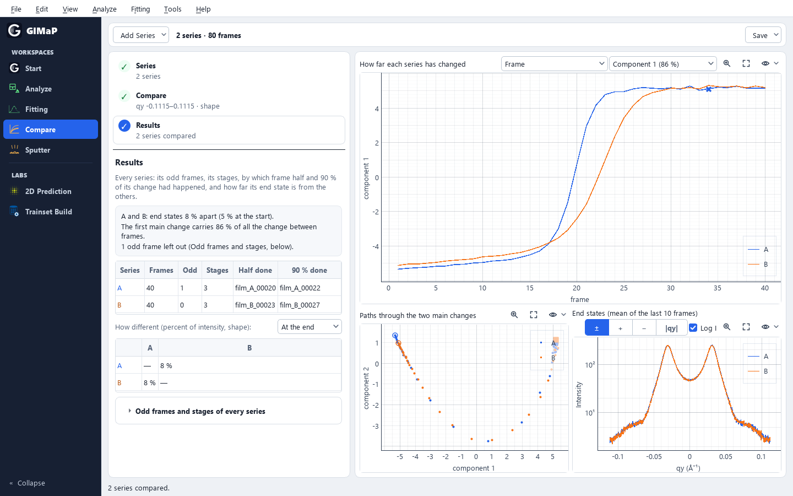

*Three steps on the left, here with the Results step open; on the right how far each series has changed, their paths
and their end states. Two synthetic runs of 40 frames, 3 stages each: A has one odd frame (frame 34, × on the change
plot), left out of its end state, so A's end-state curve has no spike from its hot columns near qy 0.05 Å⁻¹. A and B:
end states 8 % apart (5 % at the start).*

Typical use: open one sample in Analyze, build its map in the Series tab, press **Send to Compare**; repeat for
every sample. Two or more series are compared with each other; one alone is described.

**1. Series**

- **Add Series** adds **The Series Map of Analyze**, a **Folder of Curves…** (one series), **Curve Files…**
  (together one series) or a **Results Database…** (`gimap_series.sqlite`, written by Analyze's Series tab or a
  watched folder: one curve of one series, without its frames; a question asks which when it holds several). Curve files need q and I columns (`.dat`, `.txt`, `.csv`, `.xy`, `.chi`; at least two
  per series, in counting order of their names: `frame_2` before `frame_10`). q in nm⁻¹ is converted to Å⁻¹
  when the header says so.
- A folder written by Analyze (a Batch Export folder, its `curves/`, or `gimap_analysis/`) holds several kinds of
  curves. One kind is one series: when there are several, a question asks which one (the curves for Fitting are
  named *the curve for Fitting*, files that are not Analyze's *other files*), and the series is named
  *`<sample or batch>` · `<curve>`*. A Batch Export table of all frames (`<name>_<curve>_frames.csv`) can be added as
  a series too.
- A folder or curve files can also be dropped on the page. The same map or folder is not added twice.
- Folder discovery and curve reading run in a background queue; folders are added in the order requested.
  The job panel shows progress and **Cancel**. Cancel removes unfinished series and queued imports; series
  already read in full stay. A directory scan or single-table read in progress finishes before its result is
  discarded; reading separate curves stops between files.
  Opening a project uses the same queue for its curves and sidecar arrays, and read errors are shown here.
- Double-click a name to rename the series. **Remove Selected** (or `Delete`) and **Remove All** (the note that
  follows offers Undo).
- Long names are shortened on the plots and in the results to the part that differs between series; tables,
  CSV and JSON keep the full names.

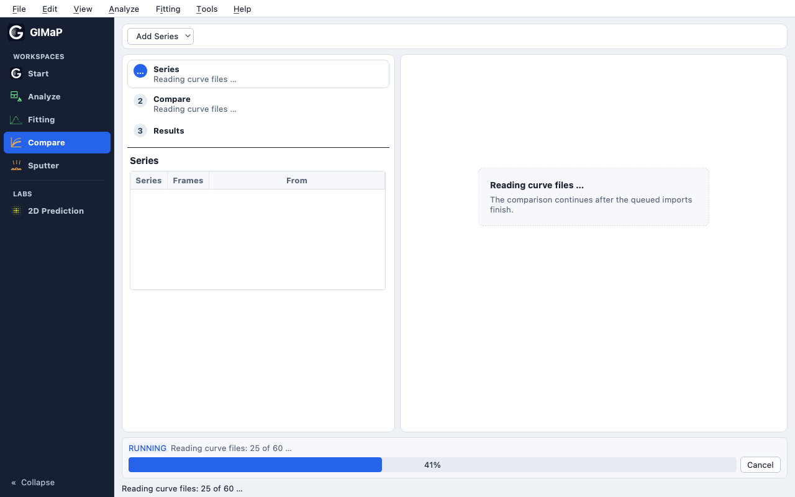

*Importing 60 synthetic curves: the window stays responsive and Cancel stops unfinished imports.*

**2. Compare**

- The **q range** compared (Å⁻¹; named after the axis of the series, for example **qy range**): the range every
  series covers. Narrow it to leave out a noisy edge or a detector artefact; **Whole Range** goes back.
- **Compare the shape only** (on by default): each frame's mean level is removed, so a brighter beam, a thicker
  film or a longer exposure does not count as a new structure. Off: the overall intensity counts too.
- **End state**: the mean of the last N frames of a series (10 by default; odd frames left out).
- Every change starts a new comparison in the background after a moment. When a comparison fails (for example no
  common points in the range), Results says why and what to change.
- Changing the series, q range, shape-only choice or end-frame count hides the old results at once and disables
  the table and plot exports until the current settings have been compared. Going back to the settings of an
  existing result restores it at once if the series have not changed. An import that adds no series keeps the
  existing comparison; new data are compared after the queue finishes.
- The series must share their x axis (qy, q or χ). Series on different axes — say a GISAXS qy map and a GIWAXS
  q map — are not compared, and Results names the axes (*The series have different x axes: …*).

**3. Results**

- Groups (three or more series): the series are joined step by step by how alike their end states are, and the
  groups are cut at the largest jump in that joining distance. There are no groups when that jump is less than
  twice the step before it, or when no two series differ by more than 2 %
  ([Physics and Methods, section 11.10](Physics_Manual.md#1110-compare)).
- The series that differs most at the end and at the start.
- Per series: frames, odd frames, stages, the frame by which half and 90 % of its change had happened.
- A table of how different the series are, **At the end** or **At the start**, in percent of intensity.
- **Odd frames and stages of every series** (folded): each series' stages and its odd frames with their reasons;
  where each stage changed most from the one before (the q that grew and fell most, in %) is its tooltip and is in
  the JSON record.

**The plots on the right**

- **How far each series has changed** — along the main change chosen above the plot (**Component 1** explains the
  most), against **Frame** or **Share of the series (0–1)** for runs recorded at different rates; × marks an odd
  frame.
- **Paths through the two main changes** — ○ the first kept frame, ■ the last. With only one main change there is
  a note instead of empty axes.
- **End states** — the end-state curve of every series.

**Saving**

- **Save** appears once there is a comparison (it waits while the series are being compared again).
  **Save ▸ Table of Every Series…** or **Table of Every Frame…** writes a CSV with a JSON record: the method and
  settings, and per series its source, odd frames with their reasons, stages, half / 90 % of the change, the
  differences at the end and at the start and `stage_details` — for every boundary between stages the x where the
  curve grew and fell most (`grows_most`, `falls_most`: `x` on the record's `x_label`, `percent` relative to the rest
  of the curve) and the same as a sentence.
- **Change Plot…**, **Paths Plot…**, **End States Plot…** save the figures, always in the light colours.
- The tables on the page can be copied (`Ctrl+C`, or right-click), with their column names.
- A project keeps the settings and the series: curve files by path, embedded arrays in
  `<project>.<generation>.compare.npz` (section 3.8). Finish or cancel pending imports before saving the project.

### 7.3 Before you conclude

- **A detector artefact that comes and goes makes odd frames.** A narrow spike at one q that appears in only some
  frames marks those frames odd, with the reason *probably the detector, not the sample*. Mask it in Analyze and rebuild the
  map; do not read it as a change of the sample.
- **Keep the compared range clear of artefacts and shadowed regions.** Over the full q range a series can look
  like an outlier because of a spike or a shadow. After narrowing the **q range** to the clean part, the
  difference at the end may be much smaller.
- **Look at both tables.** Check the differences **At the start** as well as **At the end**: series can already
  differ where they began.

## 8. Sputter

**Project files.** File ▸ Save Project saves this workspace's form (the input bar, the geometry and the options) and the references to the result folders shown. Opening a project restores them; an older project without Sputter clears this workspace. Keep result folders beside their inputs when moving a project; missing folders are reported.


The **Sputter** workspace (sidebar, `Ctrl+5`) follows an in-situ sputter deposition: the PILATUS CBF frames of
one scan, taken while a metal is sputtered onto a substrate. Under its input bar it has two views, chosen with
**Main Screen | Details** at the right of the bar:

- the **main screen** (shown first, section 8.1) shows the result of **Analyze**: for each time window the measured
  image beside the image of a model, and the grains that model stands for — radius R, height H, distance D, gap,
  size distribution width, coverage and, when there is one, the thickness of the continuous metal layer under the
  grains — with their evolution over the scan. Analyze runs a separate analysis package;
- **Details** (section 8.2) holds the geometry, the options of Analyze and of samples measured after their
  deposition, the room the frames Analyze imports take (**Storage**), and five tabs about the result the main screen
  shows: **Windows**, **Growth Process**, **Report**, **Logs** and **Steps**.

What the main screen shows is in [Physics and Methods, section 12.1](Physics_Manual.md#121-analyze-what-the-main-screen-shows).

### 8.1 The main screen: Analyze

**What you need.** Nothing more: the analysis package comes with GIMaP (`utils/sputter_client` of the program
folder; a folder with `code` and `models` that runs in GIMaP's own Python, with NumPy, SciPy and Matplotlib, no
PyTorch). To use another package, choose its folder with **Choose Folder…** (**Details ▸ Analyze options ▸
Analysis package**) or set the environment variable `GIMAP_SPUTTER_CLIENT` to it; both take precedence over the
one that comes with GIMaP. A folder named so that is not an analysis package (moved since, or the wrong folder) is
passed over: the package that comes with GIMaP runs, and the **Analysis package** line, marked, says why in its
tooltip. Without any package the main screen says so; **Open Result…** shows a folder analysed before all the
same.

**The input bar**, from the left (with **In Situ** chosen at its left end; **After Deposition** is for samples
measured after their deposition, see *Samples measured after their deposition* below):

1. **Choose…**: the folder of one scan (its CBF frames, or a scan folder with them in one subfolder such as
   `p2m/`). A line under the bar then sums up the frames, the detector, the exposure and the time.
2. **Metal** (Ag, Au, Cu) and **Substrate** (Si, TiO₂, PS, PET, PSBMA, PNO, PEO, Polymer). **Polymer** is a
   polymer film of another or unknown kind, a block copolymer for instance: the model describes every polymer as one
   film layer, and which polymer it is changes the metal's sizes by a few percent; Ag and Cu run on every polymer. The
   package has a network for some pairs only: for another pair Analyze stops at once, and **Details** of the job
   status shows the package's sentence that names the pairs it has.
3. **Rate**: the deposition rate, which is needed, in the unit chosen beside it: **Å/s** (the default — what a
   quartz balance shows) or **nm/s** (1 nm/s = 10 Å/s). Tick **QCM reading** when the number is the reading of the
   quartz balance: the package takes 0.6 of it as the rate at the sample. Unticked, it is the rate at the sample
   itself. The unit is remembered with the rate for each scan folder. Once the header of the scan is read, the line
   under the bar adds the nominal thickness the rate reaches at the last frame (rate at the sample × the time from the
   start of the deposition to the last frame, or to its end when a duration is given). A rate at the sample above
   1 nm/s or below 0.005 nm/s is unusual for sputtering: before Analyze runs it asks whether the unit is right
   (**Analyze Anyway** or **Cancel**).
4. The line below says the geometry that will be used — energy or wavelength, distance, incidence angle, beam
   centre, sample roll — or which of them are still to enter. **Edit** opens Details at these fields (section 8.2
   says where their values come from). An empty beam centre is estimated from the frames; the sample
   roll is 0 unless you enter one, and without a **Mask** the package uses the pixel mask its network for this metal
   and substrate was trained with - the P03 mask of 2021 for Cu on PEO, of 2025 for the others (both are under
   **More options**, section 8.2). On top of that mask, or of the one you give, the package masks what the frames
   themselves show to be unusable: dead and hot pixels, the beamstop and its holder (the automatic mask; a mask of
   another detector size is not used, the automatic mask then stands alone). Hover over the name of the result to
   see the mask it was read with.
5. **Analyze**. The job status at the right says in one line what the analysis is doing now, and its bar shows the
   share that is done. **Cancel** ends it at once; frames that were read completely are kept for the next run.
   **Details** shows the package's messages. While the analysis runs, the main screen shows what it is doing and what
   it has found so far (the live view):

   - At the top, the same line across the view, with counts and, where the pace is known, the time still to go — for
     example *Reading frames: 400 of 1,200 · about 4 min left*, *Network cu_v4: drawing the candidates with the
     forward model, window 7 of 24*, *Comparing the networks: cu_p5 21.5, cu_v4 12.5 → cu_v4*, *Joint fit: iteration 2
     of 6 · median fit deviation 11.3 · 5:40 so far, about 11 min left* (seconds per iteration so far times the
     iterations left: the time if the fit takes all of them), *Drawing the main screen: window 5 of 20*. Between the
     events of the package it names the step (*Step 3 of 4: Writing the report…*). A line without a count of its own —
     a network starting, the network proposing candidates for every window, the joint fit preparing, a step — adds how
     long the run has been at it once that is 10 s: *Starting network cu_p5 (the first of 2 to compare) · 0:45 so
     far*. With a newer analysis package the
     joint fit also says how far it is inside an iteration, several times a minute: *Joint fit: iteration 3 of 6 ·
     derivatives: 12 of 20 windows · 6:12 so far, about 9 min left* (the derivatives are the long part of an
     iteration; the time left is seconds per window × the windows left in this iteration + seconds per iteration ×
     the iterations after it).
   - At the left, the four steps — **Read the frames**, **Find the solutions**, **Write the report**, **Draw the
     images** — each with its state and one line of what it found (frames read so far, time windows solved, the
     network that fits the data better, windows drawn), and the time since the start with the number of processes
     and how many of them are at work now (*Running for 03:12 · Processes: 16 · 14 at work now*; a process at work
     computes or reads from disk). While the solutions are
     found the line says what the network is doing and how far it has come: the network inputs prepared, the
     network proposing candidates, the windows solved and the model images computed, the windows refined (Refine:
     every window gets its candidates first, then each is refined), the iterations of the whole-scan refinement
     (Full). The bar of the job status moves on inside each step as well.
   - **The steps as a tree** (a newer analysis package): the four steps become a checklist of the steps and their
     sub-steps — reading the frames (beam centre, pixel mask, reading, start of the deposition), the time windows,
     each network, the comparison of the networks, the joint fit (preparing, iterations) and writing the result. ○ is
     still to come, ● at work — with the line of what happens now under it —, ✓ done, with what it found at the
     right (cut when long; hover for all of it), ✗ failed, – skipped. A step folds its sub-steps away once it is done;
     ▸ opens them again. A step that saved what it found ends in ›: click it to see it at the right — the beam centre
     and the pixel mask on the detector summed (masked pixels in red, the beam +, the sample horizon dashed), the
     frames read, the count rate with its baseline and the start of the deposition, the time windows, the fit
     deviation of each network, the joint fit's median fit deviation per iteration with its current solution (R, H, D,
     the continuous layer t_b and the coverage; it follows every iteration while it is open). **Back to the
     Analysis** closes it.
   - At the right, the step at work in one paragraph, with a picture and a plot. Reading the frames: the detector
     summed over sampled frames, with the pixels the mask leaves out in red, the direct beam (+) and the sample
     horizon (dashed), beside the frames read last on the grid of q_y and exit angle; below, the count rate of every
     frame read so far, which rises as the metal is deposited. Finding the solutions (and the two steps after it):
     the measured image of the window solved last beside the model image of its solution, its values in the line
     under them, and the radius, height, distance and coverage of every window solved so far.
   - **Reading from disk.** A newer analysis package also says how long its processes spend reading the frame files
     from disk: the line of **Read the frames** becomes, for example, *Reading 312 of 1,241 frames · disk 0.82 s per
     frame (85 % of the time)*, and keeps the disk part once the frames are read. When the disk takes at least
     0.15 s per frame and at least half of the time (or the package says so), a note above the pictures says that
     reading the frames from this disk is the slow part — a USB or network drive, or an on-access virus scan of every
     file — and that copying the scan folder to a local SSD first makes the import faster. More processes do not
     help then. With a fast disk, or an older package, nothing more is shown.
   - **When nothing happens.** When none of the analysis's processes has computed or read for a minute and the
     package has said nothing new, a note across the live view says so — the package has most likely stopped on an
     error inside one of its processes and will not go on by itself — with the last line of its log, and **Stop
     Analysis** ends it. The line at the top and the job status then say *No progress for 1:10: the analysis
     package's processes are all waiting*. GIMaP does not stop it for you: a disk that does not answer looks the same
     for a while.
   - A click on a step that has started shows what it found; a click on the step at work follows the analysis
     again. When the analysis ends, its result replaces the live view (after a failure or **Cancel**, what was shown
     before comes back). What the live view shows is not the result: the result is what the package writes at the
     end, with every candidate of every window.
   - **Preliminary result.** In mode Refine the network's result (its candidates and their time path) is ready
     within minutes while the joint fit of the whole scan goes on. The live view stays in front with its steps;
     **Show the Preliminary Result** in it opens the result on the main screen, with a note under the window selector
     that the joint fit is running. A line under the window selector says what the analysis does now (the same line as above),
     and **Steps** beside it shows the live view with its steps again. After every iteration of the joint fit, its current solution is drawn dashed over the evolution — radius, height, distance,
     gap and coverage in their colours, named *Joint fit, iteration k of n* in the legend — and the next iteration
     replaces it. The tiles keep the values of the solution shown. When the analysis ends, the final result (which
     holds the joint fit) replaces the preliminary one and the dashed lines go.

Analysing the same request again shows the result it has. **Details ▸ Analyze options** has the rest:

| Field | What it is for |
|---|---|
| **Mode** | **Auto**: Quick for Si and TiO₂, Refine for polymer substrates. **Quick**: the network's candidates, each drawn by the physical model (about a second per time window). **Refine**: also refines the solution of every window (minutes per window on a polymer). **Full**: a longer refinement of every window and of the whole scan together (hours). For Cu and Ag on a polymer film, Refine and Full — whichever of the package's networks fits the scan best — also start every film window from two more points — the model's film-density fluctuation switched on, and a dense film with small grains on it and the fluctuation on —, refine each on its own and let the joint fit choose; over the scan the joint fit then keeps only the metal amount and the film thickness from decreasing (not the grain size, spacing and coverage: on a closed film the grains are relief on it). On the tested polymer scans this lowered the fit deviation and let the thickness fringes of a continuous film come out; the joint fit takes several times longer. |
| **Growth-law prior** | Whether the joint fit of the whole scan keeps the grain distance D and radius R near the growth laws D = D₁ h^p and R = R₁ h^q of the metal on this substrate before the film forms (h: the metal amount; *Physics and Methods*, section 12.1). **Auto** (the default): on for Ag on PS, where it passed a held-out test whose criteria were fixed before the runs; off for the other systems. **On**: for every system with a law in the package; for a system without one it changes nothing. **Off**: never. Only the joint fit uses it (Refine and Full; Auto picks Refine for polymers). For a sample that grows differently from the package's reference scans, choose **Off**. **Details ▸ Report** says whether it was used and whose laws; the export's `METHODS.md` gives the laws. |
| **Parallel processes** | How many processes the analysis runs at once, for Analyze and Static Frames. **Automatic (N)** (the default): one per core, two cores left free and at most 16, fewer when the free memory is short; N is worked out again whenever the box is shown and when the analysis starts. Or a number from 1 to the computer's cores. Kept for the next session. The live view and **Details ▸ Report** say how many ran. |
| **Start of deposition (s)** | The time of the scan at which the deposition started. Empty: found in the data. |
| **Deposition duration (s)** | How long the deposition lasted after its start; the metal amount stays constant afterwards. Empty: to the end of the scan. If the deposition stopped before the end of the scan, enter it: otherwise every window after the stop is fitted with too much metal and its values are wrong. When the field is empty but the scan looks stopped — the lateral scale read from the counts stops growing and the windows after that fit clearly worse — a line under the window selector says *the deposition may have stopped about … s after its start (… nm)* in the warning colour, and its tooltip says why; the report begins with the same reminder. Enter your recipe's duration (the time given is an estimate, often a little late) and analyse again; if the deposition went on, ignore it. The reminder does not change the result, and with the joint fit (mode Refine, Auto on a polymer film) it may not appear although the deposition stopped: always enter the duration when you know it (*Physics and Methods*, section 12.1). |
| **Polymer film thickness (nm)** | Shown for a polymer substrate. Empty: the package's own value for that polymer. |
| **Analysis package** | The folder in use, and **Choose Folder…**. |
| **Open Report**, **Open Folder** | The package's report of the result shown (every quantity with its range and where it comes from) in the program that opens Markdown files, and the result's folder in the file manager. The report is also in **Details ▸ Report**. |
| **Export…** | Also in the top bar beside **Open Result…**. Asks for a folder and writes `<scan>_export` into it: `evolution` and `patterns` as PDF and SVG (fonts embedded) and PNG at 300 dpi, `solution.csv` (the solution shown in each window — the joint fit, or the one you chose — with its fit deviation; units in the column names), `all_solutions.csv` (every solution of every window), `METHODS.md` (geometry, frames, mask, network, the joint fit's κ and Δt, the fit deviation's definition and median, the package — all taken from this result's records) and a README. Nothing is computed again; a package older than the export says so. |

**Reading the result.** The main screen shows one time window:

- **The window.** The slider, the arrows beside it or a click on the evolution plots choose it; beside the slider
  are its time in the scan and the nominal deposit at that time. While you drag the slider the time, the values and the
  mark follow at once and the pictures are drawn when it rests.
- **Structure at any time** (under the window line): a time of the scan that is not one of the analysed windows.
  **Analyze This Time** gives within seconds the joint fit interpolated there (**Interpolated (joint fit)**: between the
  two neighbouring windows, along the logarithm of the time since the onset, as the joint fit is smooth), then refines
  it to the frames of that time (**Refined**, about a minute or more), which is shown. The time becomes a window of its
  own, marked *on demand*, among the windows in time order: images, values, evolution and Export treat it as any
  window. The times you analysed stay with the result until the scan is analysed again.
- **Measured image** and **Model image**: the count rate over q_y and the exit angle, on the same axes and with
  one logarithmic colour scale. The scale is set by the measured image, so it does not change with the solution;
  cells without data are empty in both. Drag on either image to draw a line: it is drawn on both, and below them
  **Along the line** plots the measured (dots) and the model count rate (line) of the cells it crosses, in order —
  against q_y for a line that runs more along q_y, against the exit angle otherwise; the values are those of the
  images, not interpolated. The line stays when you choose another window or solution, and its curves follow;
  **Clear Line** removes it.
- **Solution shown**: the solutions of this window — **Candidate 1** to **3** of the network and, when the
  analysis refined, **Refined** and **Joint fit (whole scan)** (every window refined together over the scan, smooth in
  time) — each with its *fit deviation*: how far its model image is from the measured one (lower is better; it
  compares the solutions of one window). The solution shown first is the one that a smooth evolution over the whole
  scan selects — the joint fit when there is one —, which removes most of the ambiguity of a single window; it need
  not be the one with the lowest fit deviation. Choose another one when its image matches better by eye: the values, the
  model image and the evolution follow, and the choice is kept with the result. **Back to Default** takes it back.
- **The values**: **Radius R**, **Height H**, **Continuous layer t_b** (the thickness of the continuous metal layer
  under the grains; 0 while they are separate islands), **Distance D** (centre to centre), **Gap** (D − 2R), **Size
  distribution width** (σ of a log-normal distribution of the radius) and **Coverage** of the solution shown. A
  quantity that the model of this sample does not have is not shown; t_b only for a result of a newer analysis
  package, which lists it.
- **The evolution**: R, H, t_b (dark gold), D and the gap (nm) and the coverage over the time in the scan, for the
  solution shown in each window; the dashed line marks the window shown. With a newer analysis package faint bands
  behind both plots mark the stages of the growth — **Separate islands**, **Coalescence** (coverage above 0.5),
  **Continuous film** (half of the metal in the continuous layer) and **After the deposition** — named where the band
  is wide enough (see **Details ▸ Growth Process**).
- **Patterns | Real Space | Components**, at the right of the window line: **Real Space** draws the solution shown in place of
  the two images, in nm. Left a cut through a row of grains: the substrate (a polymer film is drawn, its
  thickness not to scale), the continuous layer under the grains when there is one, and the grains with their
  radius and height. On a polymer film a line under the views says that no metal inside the polymer is drawn: the
  model has none, and for Cu the data did not resolve it (chapter 13). Right the view from above: grains with the
  radius and size distribution of the solution. The
  whole scan is drawn as one growing film: the view has the same size in nm in every window — its height is that of
  the highest metal of the scan, so the cut keeps its size as the film grows —, and the grains of a window are
  those of the window before. While the film is open, new nuclei appear in free places where the
  distance D shrinks (nucleation) and neighbouring islands merge into one round island where it grows
  (coalescence). From about half coverage on, nothing disappears or moves any more: the islands grow together into
  worm-like clusters and then a connected film, and what stays open are channels down to the substrate. The metal
  drawn covers the share of the view the solution's coverage gives and never less than before (with a continuous
  layer at least 85 %: the model's layer has no lateral structure of its own, so the channels of the picture are an
  illustration). Samples measured after deposition are drawn the same way, ordered by their nominal thickness. The
  positions are an illustration; the sizes are those of the solution. The cut on the left runs through the middle
  of the view from above. It follows the window and the solution you choose. Grains that touch are drawn as one piece; a
  piece that runs across the whole view is darker, and the line above the picture says whether the grains are
  separate, coalescing or a connected network (percolated). Once the film is joined - a continuous layer under the
  grains, or grains joined into a network across the view - it is drawn as the film itself, not as grains: the view
  from above shows the height of the metal (lighter where it is low, darker where the relief rises) with the holes of
  a network in the colour of the substrate, the cut is the film's profile along the middle of that view, and the line
  says *Continuous film … nm, grains on top: …* or that the network crosses the view. The tiles then speak of the film
  too: **Film height H**, **Relief radius R** and **Relief spacing D** (the lateral correlation length of the film's
  surface, not the distance of separate particles); **Gap** is not shown.
- **Components** splits the model image of the solution shown into its physical terms — **Grains and islands**,
  **Large clusters**, **Film fluctuation and network**, **Voids under the film**, **Substrate seen through the metal**,
  **Fluorescence**, **Beam-path background** …; on porous TiO₂ **Clusters in the pores**, **Clusters on the cap layer**
  and **Metal network in the pores**. Each term with at least 0.1 % of the model counts gets a small image (at most
  six, the largest first), on the colour scale of the measured image, so a term that contributes little looks dark;
  its title gives its share of the counts. The terms add up to the model image. At the right, **Share of the model
  counts**: every term over the scan for the solution shown in each window, the window shown marked. A result of an
  older analysis package says that it does not split its model.

When the data cannot tell two solutions apart, both are there, as candidates with similar fit deviations: compare
their images. A window the package could not use (no frames in it, for example) says why in place of its images.

**Metal in a porous TiO₂ layer.** The model has no lattice of grains there, so there is no height, distance, gap or
coverage. The values are the **Island radius (relative)** — follow how it changes, not its number — the size
distribution width, the **Island share** (of the metal in islands that can be resolved; it can exceed 1 early on),
the **Cap share** (of the metal in the cap on the TiO₂ particles), the **Vertical** and **Lateral correlation**
lengths of the metal network in the pores and the **Film share**. The evolution shows the three lengths at the left
and the three shares at the right. **Real Space** draws the layer: left a cross-section to scale, with the TiO₂
particles, the metal in the pores as a band at the depth where the model puts it, and the cap on the share of the
particle tops it covers; right the top of one particle enlarged, with the cap at its thickness and the clusters at
their size. The line below says how much metal has been deposited and how much of it is in islands, in the cap and
in the pores.

**Samples measured after their deposition.** A sample measured after its deposition — one of a thickness series
of Au films, for example — has no deposition rate and no frames from before the deposition. Choose **After
Deposition** at the left of the input bar (**In Situ** is a scan recorded during the deposition). The bar then holds
**Add Samples…** and a line that sums up the samples, and the **Sample List** stands at the left of the main screen
and of Details (the switch **Sample List** at the right of the bar hides or shows it):

1. **Add Samples… ▸ Folder…**: a folder of samples — each folder in it with CBF frames is one sample, however deep
   the frames lie (measurement folders, `run1` …; frames whose file name says GIWAXS are left out) — or one sample's
   folder; **CBF File…** takes one frame as a sample. A folder that holds nothing but one folder (an archive unpacked
   into a folder of the same name) is looked into. Zip archives are not opened: unpack them first. Samples in the
   list already are not added again.
2. GIMaP reads each folder's name. The **nominal thickness** is a number followed by `nm` or by the metal (`10Au`,
   `6.5nm`, `6p5_Au`); `H` or `HiPIMS` right before it marks a HiPIMS deposition. What stands before it is the
   substrate (`850` of `850_H10Au`): a folder beside the samples named just that (`850`) is their **bare substrate**
   — another piece of the same substrate without metal, measured the same way, which gives the substrate part of the
   images; without one the film is taken to lie directly on Si. The samples of one substrate and one deposition
   method are a **series** (`850 · DC`, `850 · HiPIMS`; DC is named only where HiPIMS samples of the same substrate
   are listed too), analysed into a folder of its own. A sample whose name gives no thickness is listed unticked
   with *Thickness?*: double-click its **nm** to enter it. Only Au films can be analysed: a folder named with another
   metal is listed unticked (*Not Au*).
3. **The list** shows each series — its bare substrate and how many of its samples are analysed — with its samples:
   a box (ticked: Analyze runs it; the box of a series ticks all of its samples), the name and the nominal thickness
   (double-click either to change it) and the state: *Waiting*, *At work…*, *Fit 2.91* once analysed (its fit
   deviation), *Failed* (the reason in the tooltip). A right-click offers **Analyze This Sample**, **Analyze This
   Series**, **Show Result**, **Bare Substrate…** or **No Bare Substrate (on Si)** for the whole series, **Open
   Folder** and **Remove**; **Edit** selects all or none and removes samples.
4. **Analyze** runs the ticked samples one after another, in the order of the list. The job status says *Sample 3 of
   12: 850_6Au* and its step, and the bar covers the whole list. While a sample runs the main screen shows three
   steps: the frames of the sample read (the detector summed, the usable frames summed, which frames are left out and
   why), the solution of each frame as it is found (measured and model image of the frame solved last; below, the
   series with every frame solved so far at the sample's nominal thickness), and the sample added to its series. A
   sample that fails is marked and the next one starts; **Cancel** stops the sample at work and the ones after it
   (those analysed stay in their series). A sample analysed before with the same frames and values is not run
   again; samples analysed before with other frames or values are replaced after one question that names them all.
   When the samples are done, the samples of each series analysed are fitted together as one growing film (*Fitting
   the samples of … together as one growing film*): ordered by nominal thickness, a thicker sample is built on the
   thinner one - radius, spacing, continuous layer, film height, metal amount and coverage (below closure) may not
   decrease from one sample to the next. About 5-10 minutes per series on a desktop; the samples keep their own
   solutions if it fails.
   A series of one sample, or an older analysis package, skips this step.
5. Afterwards the main screen shows the series of the last sample analysed: one sample in place of each time window
   — its value is the median over its frames — and the evolution along the nominal thickness. Choose a sample in the
   list to see its series at that sample; moving along the series on the main screen chooses its row.
6. **Export…** (beside **Open Result…**, and in Details) writes `samples_report` into a folder you choose:
   `report.html`, one file to send, in the interface language, with every series of the list in two parts. **Separate
   particles** — the grains stand apart or touch without joining across the picture: radius R, height H, spacing D,
   the gap D − 2R and the coverage. **Connected film** — a continuous layer under the grains, or grains joined into a
   network: there are no separate particles any more, so the film's thickness and density, its height and the relief
   of its surface (height, radius, spacing) are given. Each part has its table (with the nominal thickness, the
   stage, the metal amount h_m and the fit deviation) and its panel of the figure against the nominal thickness; the
   report says from which thickness on the film is connected, and shows each sample's measured and model images with
   two cuts. `samples.csv` lists every sample with its part. Parts and stages follow the **Real Space** picture of the
   main screen and the captions of its tiles: *separate islands*, *grains in contact* (touching, no cluster across
   the picture), *grains joined into a network*; with a continuous layer, *grains on a thin layer* while it is
   thinner than the grains stand above it, else a *continuous film*, or a *film with a density below 1* below 0.95 of
   the bulk density.

Under **Details ▸ Static Frames (after deposition)**: the **Results folder** (each series goes into a folder of its
own in it, named after the series; a series already there is added to), the **Mode** (Quick, Refine or Full), the
geometry of these frames (empty fields keep the package's own values, which **Package Values** fills in; **Masks of
the Package** lists the pixel masks it brings) and the log. One analysis runs at a time. The list is kept with the
project and for the next session.

The package supports Au films at an incidence angle near 0.40°; what it says about other cases appears in the
section's log.

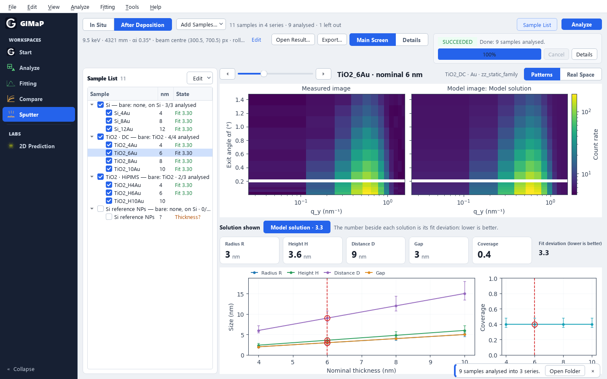
*After Deposition with a folder of samples added — here invented folders and the test suite's made-up results
(synthetic images, invented values). Left the Sample List: three series with their bare substrate, each sample with
its nominal thickness read from the folder name and its fit deviation; a sample whose name gives no thickness is
left out (*Thickness?*) and its series listed last; one sample is not analysed yet. Right the series of the sample
chosen, at that sample.*

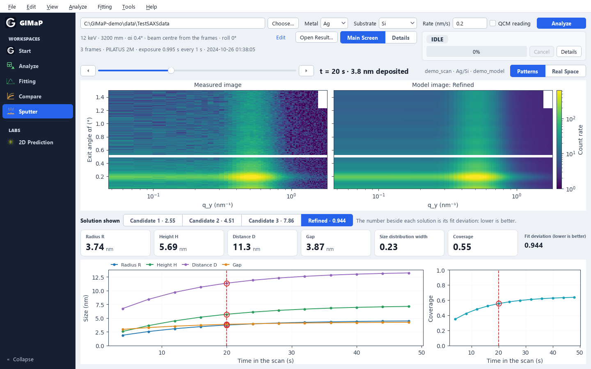
*The main screen with a result — here a made-up one: synthetic images and invented values, and three PILATUS CBF
frames from the repository's `TestSAXSdata/` folder standing in for the scan folder. Top: the input bar, the
geometry in one line and the job status of Analyze. Below: the window chosen with the switch Patterns | Real
Space, the measured image beside the model image of the solution shown, the solutions with their fit deviations, the values, and the evolution over the scan.*

**Before you conclude.** The values are those of a physical model whose image reproduces the measured one, on an
evolution that is smooth over the scan. They were not compared with an independent measurement of your sample
(SEM, AFM, XRR), and the nominal deposit and the metal amount scale with the rate you give. The package's report
(**Details ▸ Report**) says for every quantity whether it is read from the counts, a model value or an estimate.

**Open Result…** shows a result analysed before: choose its folder, or the scan's results folder to get its newest
result. A folder without a result of Analyze (one of the earlier method, Predict, which is no longer part of GIMaP)
is not opened. Chapter 12 says where the results are.

**Compare scans.** **Compare…** (in the bar, beside **Export…**) puts several results side by side — for example the
same metal on a homopolymer and on a block copolymer. Its list holds the result shown and the results analysed in the
results folder, newest first; the result shown and the newest other one start ticked, so after analysing two scans one
click compares them. Tick more, or take one from any folder with **Add Result…**; double-click a name to change it
(the name labels the plots and the files); **Remove** takes a result off the list and leaves its files.

- **Horizontal axis**: **Nominal deposit** (rate × time of each window: scans sputtered at different rates are
  compared at the same amount of metal) or **Time** since the onset of the deposition.
- **Curves**: one small plot per quantity, one colour per result. Dots joined by a line are the solution shown in each
  window, as chosen on the main screen (radius R, height H, distance D, gap, coverage, the continuous layer t_b);
  open squares are what the package's report reads from the data without the model — the film thickness from the
  fringes, the grain height from its fringe, the optical density of the metal (α/α_c)² and the lateral scale 2π/q.
- **Growth**: first how each result was analysed (metal, substrate, model family — the package's network that fitted the
  scan best — and mode), then the growth descriptors of each result in a column (the metal amount at coverage 0.5 and at which the
  film forms, the growth laws of D and R, the distance and the radius once the film has formed) and the metal amount
  at which each stage starts.
- **Export…** writes `compare_curves.csv` and `compare_growth.csv` (the folder, metal, substrate, model family and
  mode of every result in `#` lines) and the plots `compare.png` (300 dpi) and `compare.pdf` into a folder you choose.

GIMaP computes none of these values: it reads them from each result and places them side by side. Results are only as
comparable as their inputs — the same metal, the rate given the same way (QCM reading or at the sample) and the same
mode.

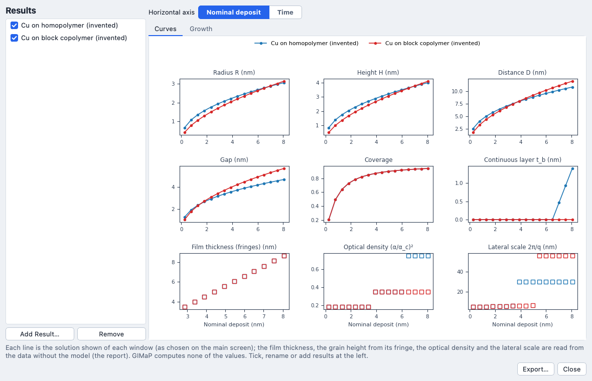
*Compare Scans with two made-up results (invented values): one metal on two polymers, against the nominal deposit.
Open squares are read from the data without the model.*

### 8.2 Details

**Main Screen | Details** at the right of the bar switches to Details. At the left, from the top:

- **Sample and geometry**: **X-rays** (**Energy (keV)** or **Wavelength (nm)**), **Distance (mm)**, **Incidence αi
  (°)** and **Beam centre (px)** (col, row). Check every value. Beside each, the page says where it comes from —
  this folder's last Analyze, a preset, for the energy a `Wavelength` line of the header or the scan's NeXus file,
  or the last run of any folder (*please check*) — or asks for it: a PILATUS header holds neither the distance nor
  the incidence angle. The `E<eV>` in a flat-field file name is the detector's calibration energy, not necessarily
  the beam's: it is shown beside the field and never filled in. A value to check and an energy of the files that
  differs from the one used are shown as a warning (⚠); the tooltip of the line says why. An empty **Beam centre
  (px)** is estimated from the frames; a centre you give is in Analyze's pixel coordinates (section 4.4). **Save
  Geometry as Preset…** fills in later scans of this detector and flat field within one beamtime (a week either
  side of the scan, to start with). Section 3.9 says what else is remembered.
- **Analyze options** (section 8.1).
- **Static Frames (after deposition)**, collapsed (section 8.1, *Samples measured after their deposition*).
- **More options**, collapsed:

| Field | What it is for |
|---|---|
| **Mask** | A detector mask (`.npy`, optional), remembered for this folder only. **Masks of the Package** offers the pixel masks the analysis package brings. |
| **Sample roll (°)** | 0 when neither this folder nor a preset gives one (the page says so). |
| **Save results in** | Where the result folders go (default: the folder `sputter` in the user data folder). |

**Storage** (folded, under More options): the frames Analyze imports are kept so that the same scan is not read
again — often a few gigabytes per scan. They are in GIMaP's local folder (on Windows
`%LOCALAPPDATA%\GIMaP\sputter_client`, on macOS `~/Library/Caches/GIMaP/sputter_client`), not in the user data folder,
which on Windows roams with the profile. Opened, the section lists each import (its size, when an analysis last used it,
where it is), their total and the size of the results. **Remove Selected** and **Remove Unused For** *n* **days** remove
imports after asking; the one an analysis is using stays. **Limit of the imports** (default 5 GB, 0 for no limit): when
an analysis starts and when it ends, the imports not used for the longest time are removed until the rest fit — never
the one in use, never a result. Imports an older GIMaP kept in the user data folder are still used and are listed as
*user data folder (older GIMaP)*; nothing moves them.

At the right, five tabs about the result the main screen shows (before there is one, each says *Analyze a scan or
open a result*):

- **Windows**: one row per time window (for a series of samples measured after their deposition, per sample) with
  the solution shown on the main screen — the time, the nominal thickness, its values, its fit deviation and which
  solution it is. Choosing another solution on the main screen changes its row. `Ctrl+C` copies the selected rows.
- **Growth Process** (an in-situ scan analysed with a newer package): which solutions it is made from (the joint fit
  of the whole scan, or the smooth path through the windows); **Stages of the growth** with their time range and metal
  amount; **Growth laws** against the metal amount h — the amount at coverage 0.5 and at which the film forms, D = D₁ h^p
  and R = R₁ h^q before the film, D and R once the film has formed, the coarsening after the deposition stopped, the
  median fit deviation and the steps back between windows — each beside the median and range of the same metal on
  the same substrate over the scans the package was built from, and whether this scan lies within, below or above
  it; and **Physical terms of the model**: per window the share of each term for the solution shown (it follows your
  choices). Metal amounts are equivalent thicknesses: they do not depend on the X-ray wavelength.
- **Report**: the network the analysis used and the networks it tried with their fit deviation, the mode, the pixel
  mask and the run time; then **Time per step**, a small table of every step with its time (m:ss) — the import row
  adds the frames read of how many and the disk's seconds per frame with their share of the time — the total of all
  steps and the number of processes; a note when reading the frames from disk was the slow part (as in the live
  view); and the package's report (`REPORT.md`). A result of an older package has the rows it can (no reading facts,
  no processes).
- **Logs**: the log of each step of the analysis (`analyze_*.log`), one at a time.
- **Steps**: the steps of the analysis as the live view showed them, each with what it found; click a step marked ›
  to see its picture at the right. A result of an older analysis package says that it has no record of its steps.

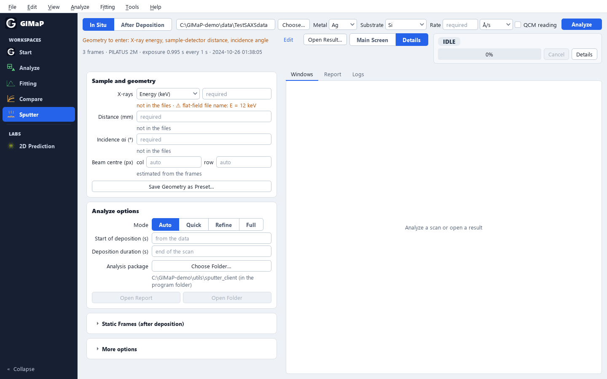
*Details with a folder chosen. Here three PILATUS CBF frames from the repository's `TestSAXSdata/` folder stand in
for a scan (they are not a sputter series, so no result is shown): the line under the input bar sums up the frames,
the detector, the exposure and the time. The energy, distance and incidence angle are not in the files, so the page
asks for them (the flat-field energy is shown beside the energy, not filled in); an empty beam centre is estimated
from the frames.*

### 8.3 Output files

A result of Analyze is in a subfolder of the scan's folder, `sputter/<scan>-<code>/iampred-<code>`: the package's
report (`REPORT.md`, `report.png`, `report.csv`) and figures, `windows.csv`, `analysis.json`, the logs of its steps
(`analyze_*.log`), the data of the main screen (`main/main.json` and one `w_<t>.npz` and `.png` per time window),
your choices of a solution (`main/choices.json`) and `gimap_request.json`. Chapter 12 lists them all.

## 9. Tool windows

This chapter describes three windows of the **Tools** menu: Format Converter, XRR Series Extractor and SEM
Particle Analysis. The other entries of that menu are described with their work: Geometry Calibration
(section 4.3), 1D Predict (section 6.4) and Process with AI (chapter 10). The windows work beside the
workspaces: they open over the page you are on and leave it as it is. Each window remembers its size and
position. What each tool computes, in which units and pixel coordinates, and what it does not correct is in
[Physics and Methods, chapter 13](Physics_Manual.md#13-tool-windows-and-labs).

### 9.1 Format Converter

Open **Tools ▸ Format Converter…** (`Ctrl+Shift+C`) to write detector frames in another format.
**Tools ▸ Convert Current File…** opens it with the file shown in the active workspace. The source files
are only read.

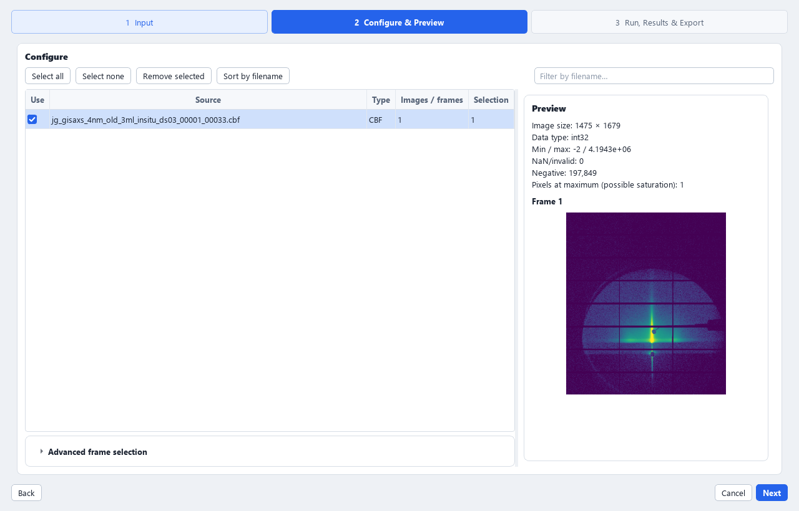
*Step 2: the sources to convert on the left; on the right the preview with the frame's size, data type, value range and counts of invalid, negative and saturated pixels (a multi-frame source shows its first, middle and last frame).*

The window has three steps; **Next** and **Back** move between them.

1. **Input** — **Add files**, **Add folder** or **Use currently opened file**. Files and folders can also
   be dropped on the window. The converter reads NeXus/HDF5 (`.nxs`, `.nx`, `.nx5`, `.h5`, `.hdf5`, `.hdf`), CBF
   and TIFF, with the same reader and orientation as Analyze (section 5.1). Single images and multi-frame files
   are recognised; a set of module files is one input (stitched, named by its scan without `_m01`), a master
   with its data files too; for a NeXus file with several datasets you choose the dataset. The list shows what
   each input consists of and the reader's warnings (⚠ a module file missing, unequal frame counts). An HDF5 file
   without a detector image is refused, with the reason.
2. **Configure & Preview** — tick the sources to convert (**Select all**, **Select none**, a filter by
   file name (**Filter by filename…**), **Sort by filename**, **Remove selected**). For multi-frame NXS files, **Advanced frame
   selection** offers *All*, *Current frame*, *Frame range*, *Custom* (for example `1, 5, 8–20`) and
   *Every Nth frame*. The preview shows the first, middle and last frame.
3. **Run, Results & Export** — choose:

   | Setting | Choices |
   |---|---|
   | **Output format** | TIFF, CBF, HDF5 or NumPy (`.npy`). A format that every input already has is not offered (HDF5 is, for the container) |
   | **Destination** | by default a folder `converted` next to the first input |
   | File names | a frame of a single-frame source keeps the source's name (`<source>.tif`). For multi-frame sources the **Multi-frame template**, by default `{source}_{frame:06d}` (or `{source}_img_{frame:06d}`), for example `scan_001_000123.tif`. The frame number counts from 1, unlike Batch Export's names, where `_frame0003` counts from 0. **Add suffix automatically when names collide** (on by default) adds `_001`, `_002` … instead of stopping |
   | **Advanced output options** | the data type (the stored values and type are kept by default, see below; CBF holds integers: it keeps neither NaN nor fractional or negative floating-point values); **Write metadata sidecar JSON** (on by default): **One metadata file for the whole conversion** (`conversion_metadata.json`, the default) or **One JSON file beside each output image**; **Export as one NeXus/HDF5 container** (`converted_images.h5`, or `converted_images_001.h5` … when that file exists) |

   In a CBF or TIFF header the metadata is written as ASCII JSON (`json.loads` reads it back exactly, paths
   outside ASCII included). On the third step the button reads **Review & Convert**: it shows what will be
   written and its size, and **Convert** there starts the conversion.

**Pixels without data.** A converted frame reads back in GIMaP as its source does: the same pixels without data
(module gaps, bad pixels, masked or not covered by a module), the same values elsewhere, and integer counts stay
counts (counting errors, the dead-pixel test). The exception is a floating-point frame written as CBF, which
holds integers: fractional parts are cut, and a negative value (−1 or less) reads back as a gap code, a pixel
without data. Use TIFF or HDF5 for such frames. By default (**Keep the stored data type**) a frame is written
in the type its file stores (the preview's **Data type**), not as the reader's 32-bit float:

| Source | Written as |
|---|---|
| Integer counts (Pilatus CBF or TIFF, NeXus) | the stored type; gap codes as stored (Pilatus −1, −2). A pixel the reader had set aside (a NeXus `pixel_mask` pixel, a gap between stitched modules) is −1. An unsigned frame that needs −1 is written in a signed type that holds every value (uint32 → int32); in HDF5 it keeps its type and the largest value of the type marks the pixel |
| Floating-point frames | as stored, NaN on every pixel without data (CBF holds integers: −1 there; values truncated, negative values read back as gap codes) |
| **Save as 32-bit float** | 32-bit float, NaN on every pixel without data (CBF: −1) |
| **Convert to uint16 …** / **Clip to the uint16 range** | uint16 from the pixels with data (scaled onto 0–65534, or cut at 65535); 65535 on the pixels without data |

An HDF5 output (and the container) also marks every pixel without data in the NeXus
`/entry/instrument/detector/pixel_mask` (bit 0), which GIMaP and other NeXus readers honour. Each frame's
metadata says what was done under `pixel_values`: the stored and written types, how many pixels have no data and
how they are written; for a floating-point frame in CBF also how many pixels read back without data
(`pixels_read_back_without_data`), how many negative values become gap codes (`negative_data_read_as_gap_codes`)
and how many values were truncated (`values_truncated`). In a `.npy` file, which GIMaP does not open as a frame,
−1 or NaN is the mark. The uint16 modes keep the mark only in HDF5: a TIFF or CBF carries no mask, so a pixel
without data reads back from it as a valid pixel of 65535 (chapter 13). The rules are in
[Physics and Methods, section 13.3](Physics_Manual.md#133-format-converter).

While it runs, a window shows the progress with **Pause** and **Cancel** (the image being written is
finished first). Afterwards use **Open output folder** and **View report**. The report,
`conversion_report.json` in the destination folder, lists every frame written or failed; a later run into
the same folder replaces it.

EDF frames are not an input of the converter. With an EDF frame shown, **Convert Current File…** opens
the window without it and says why under the input list. To convert EDF frames — or any frame as
Analyze reads it, with modules stitched and frames summed — use **Analyze ▸ Batch Export ▸ Converted
detector frames** (TIFF, EDF, NumPy or HDF5; section 5.7).

### 9.2 XRR Series Extractor

Open **Tools ▸ XRR Series Extractor…** (`Ctrl+Shift+R`) to obtain an XRR curve from a GIWAXS/GISAXS
detector angle series. One point of the curve comes from each detector frame.

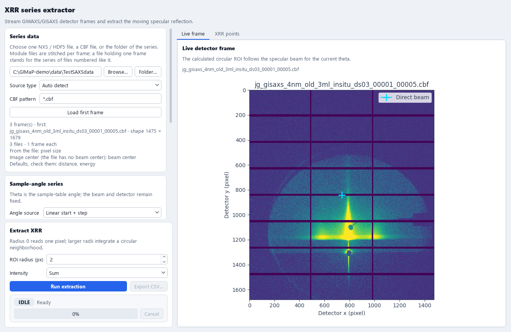
*Left: the series (**Browse…** for a file, **Folder…** for the folder of the series; below, what the series consists of and which values are not in the file), θ (the geometry is further down) and the ROI. Right: the frame with the direct-beam cross and the ROI circle on the specular beam; the **XRR points** tab holds the curve.*

1. **Choose the series.** **Browse…** selects one NeXus/HDF5 file or a CBF file, **Folder…** the folder of the
   series; a file or folder can also be dropped on the window.
   - The module files of a set are stitched for each detector frame; a file of several frames gives one point
     per frame (when modules hold different numbers of frames, only the frames every module has are used).
   - A NeXus file that holds one frame stands for the series of files numbered like it; files numbered alike
     that do not fit (another frame size, more than one frame) are named and left out. A folder of NeXus files is
     read file after file.
   - For CBF, a glob pattern (**CBF pattern**, e.g. `*.cbf`): each naturally sorted file is one point.
2. **Set θ.** Either a linear sequence (**Theta start (°)** and **Theta step (°)**) or an NXS motor dataset with
   one θ value per frame, in degrees, rad, mrad or urad (also µrad/μrad). Unknown units and non-finite angles stop
   the extraction.
3. **Set the geometry.** Enter the distance, energy, pixel sizes and direct-beam centre. In **Detector rotations**, check pyFAI rot1, rot2 and rot3 in degrees and **pyFAI orientation** (1–4). Missing rotations default to zero and orientation defaults to 3. **Reflection direction** chooses the upward or downward ray in the laboratory. With detector roll the spot can move across columns.
   - The window starts from the last applied Geometry Calibration, marked *from last calibration*. When
     that calibration was of frames of another size, only its energy is taken.
   - **Load first frame** never overwrites a value you typed. A tag beside each field says whether a value
     comes from the file, the last calibration, the image centre or the built-in defaults; the summary under
     **Load first frame** warns only of the values that are not in the file and need checking
     (*⚠ Not in the file — check: …*).
   - If a file gives an unsupported orientation or tilt, the summary names the field and its value; check the
     source tag beside the value used for extraction. Full turns of rot3 are equivalent.
   - **Pick direct-beam center** lets you click the centre on the frame.
4. **Set the ROI.** An ROI radius and `Sum` or `Mean`. Radius 0 reads one pixel; a larger radius
   integrates a circle around the calculated specular beam.
5. **Run extraction.** One full frame is loaded at a time: the window shows it with the ROI, records one
   point, and releases the frame. The whole series is never held in memory.
6. **Look and export.** Switch freely between **Live frame** and **XRR points**; processing updates both
   but never changes the tab. **Export CSV…** saves θ (°), qz (Å⁻¹), intensity, ROI position and
   valid-pixel count.

The CSV goes by default to `<source folder>/<source name>_xrr.csv`; for a folder chosen with **Folder…** (CBF
or NeXus files) it goes into that folder, named after it. A `.json` record beside it keeps every value that determines qz (series, θ,
distance, energy, pixels, centre, direction, ROI) and where each came from, and under `source_layout` what the
series consists of, every file read and the reader's warnings (the status line after a run repeats them).

**What is not corrected.** The extractor reports the raw ROI sum or mean, without monitor/flux normalisation,
footprint correction, background subtraction, resolution correction or θ offset. Negative gap codes of integer
frames and the pixels the reader masks are left out; negative values in floating-point frames stay data.
Analyze's drawn masks and bad-pixel search are not applied.

**Pixel coordinates.** The direct-beam centre is shown and entered in the same pixel coordinates as in
Analyze and Geometry Calibration: pixel corners lie on whole numbers, so the centre of the
first pixel is (0.5, 0.5); x counts from the left edge and y from the top edge (section 4.4). Hover over the centre
fields or the *ROI x* / *ROI y* headers to read this in the window. A centre can be copied between the
three windows as it is. XRR rounds the applied beam centre to two decimal places. Geometry Calibration
shows the fitted centre to the precision of its uncertainty, and Analyze shows four decimal places.
All three use the coordinates saved by **Apply**.

- The preview, its cross and ROI circle, and the *ROI x* / *ROI y* columns use the same pixels.
- A centre picked with the mouse is the point clicked: with radius 0, the pixel you click is the pixel
  that is read.
- The image centre the window falls back to (step 3) is the middle of the frame, (columns / 2, rows / 2).

The exported files count differently: `roi_center_x_px` / `roi_center_y_px` of the CSV and
`geometry.beam_center_x_px` / `beam_center_y_px` of the JSON record count pixel centres from 0, so they
are 0.5 px lower than the window shows, and the record says so (`center_convention`). If you noted a
centre from this window in a copy of GIMaP from before 2026-10-13, add 0.5 px to x and y: the window
counted pixel centres from 0 then.

**NeXus header centre.** XRR and Analyze now use the same displayed centre, including the P03 transpose and vertical flip. A stitched module set with no unique header centre uses calibration or an explicitly picked centre. Check the cross on the preview before extraction.

### 9.3 SEM Particle Analysis

Open **Tools ▸ SEM Particle Analysis…** to measure particle sizes in an SEM image, or to load sizes
measured elsewhere from a CSV file. The window works on its own: it needs no prediction model, no
TensorFlow and no scattering data. A radius distribution predicted in **Labs ▸ 2D Prediction** can be
compared with it: **SEM comparison…** there opens this window with a copy of the prediction attached
(section 11.1).

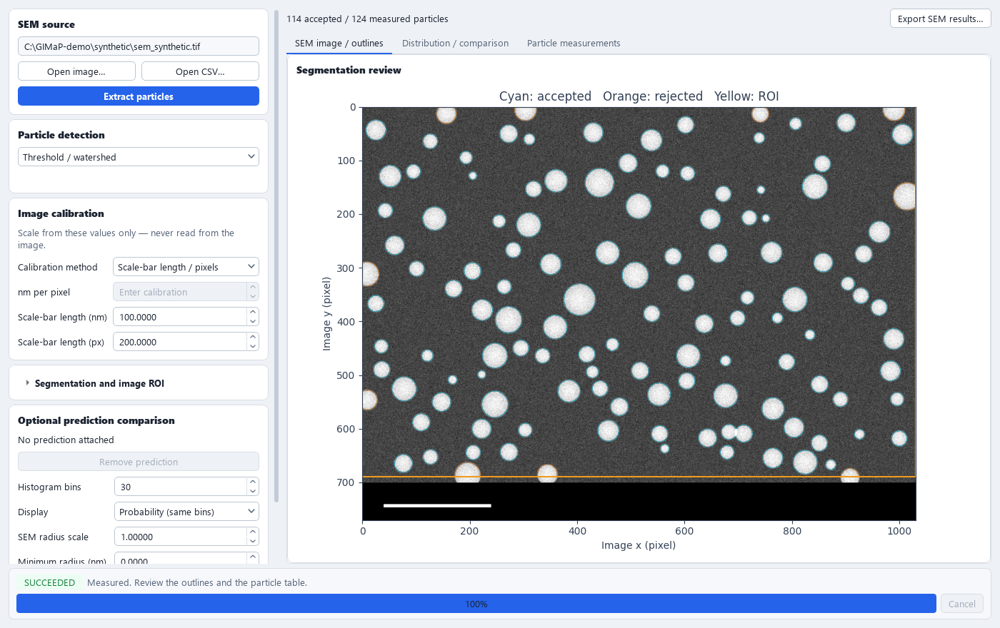
*Check the outlines first: cyan particles are kept, orange ones were rejected (the table says why), the yellow box is the ROI.*

What is measured is the **equivalent-circle radius of the projected area** of each particle:

```text
A_nm² = A_px × nm_per_pixel²
R_nm  = sqrt(A_px / pi) × nm_per_pixel
D_nm  = 2 × R_nm
```

`A_px` is the number of pixels of the particle. A particle that is not round is also given the radius
of the circle of the same area. The distribution is drawn against R; the table gives R and D. The
segmentation, the filters and the comparison with a prediction are defined in
[Physics and Methods, section 13.2](Physics_Manual.md#132-sem-particle-analysis).

#### Measuring an image

1. **Open the image.** Under **SEM source**, press **Open image…** and choose a TIFF, PNG, JPEG or BMP.
2. **Enter the calibration.** Under **Image calibration**, choose the **Calibration method**:
   - **nm per pixel** — type the value;
   - **Scale-bar length / pixels** — type the length of a scale bar in nm and its length in pixels;
     `nm_per_pixel = length_nm / length_px`.

   The calibration is **never guessed**: GIMaP does not read the scale-bar text, the magnification or
   the DPI of the file. Opening another file clears the value; set a positive value for that file before
   extracting.
3. **Exclude the annotations.** In the folded section **Segmentation and image ROI**, tick **Use image
   ROI (pixel edges)** and type **ROI left x**, **ROI top y**, **ROI right x**, **ROI bottom y** so the
   scale bar, text and frame are outside. The ROI uses the pixel edges of the original image: row 0 is
   at the top, the centre of pixel (row i, column j) is at (j + 0.5, i + 0.5).
4. **Choose the detection** under **Particle detection** (see below), and its settings.
5. **Run.** The button under the source reads **Extract particles**, **Detect particles (local AI)** or
   **Measure labeled particles**, after the method.
6. **Review.** Look at **SEM image / outlines** and **Particle measurements**: which regions were kept,
   which were rejected and why. Only then use the distribution.

When no particle passes the filters, the candidates, their reasons and the outlines are still shown and
can be exported for review; there is then no distribution.

#### Detection methods

Changing the method makes the previous measurement invalid. GIMaP never switches to another method by
itself when one fails.

| Method | When to use it | What it needs |
|---|---|---|
| **Threshold / watershed** (default) | well-separated particles with clear contrast | nothing more |
| **StarDist (local AI)** | touching particles that a threshold cannot separate | a local Python with StarDist, and a local model folder |
| **Existing instance labels** | labels made elsewhere (StarDist outside GIMaP, corrected by hand …) | an integer TIFF/PNG label image |

**Threshold / watershed.** Settings in **Segmentation and image ROI**:

| Setting | What it does — and what to check |
|---|---|
| **Particle contrast**: Bright / Dark particles | bright: pixels above the threshold; dark: pixels at or below it |
| **Threshold**: Otsu / Manual | Otsu is computed from the finite values inside the ROI; Manual uses the value in **Stored intensity** (the stored intensity units of the image). Check that background and particles are separated. |
| **Split touching particles (watershed)**, **Watershed peak distance (px)** | separates touching particles; the distance decides into how many pieces a cluster is cut — look for over- and under-splitting |
| **Minimum area (px²)**, **Maximum area (px²)** | removes noise or large background regions — and possibly real particles; the maximum defaults to *No upper limit* |
| **Minimum circularity** | `4 pi A / perimeter²`; the value is kept in the table |
| **Exclude particles touching the ROI boundary** | on by default; particles cut by the ROI are rejected, with the reason |

Grey images are segmented on their stored intensities. Colour images are turned into grey with the
recorded luminance formula (0.2126 R + 0.7152 G + 0.0722 B). The contrast stretch on screen only helps
you see; it does not change the threshold, the areas or any measured value.

**StarDist (local AI)** — optional. It separates touching particles with a trained instance-segmentation
model, run on your computer.

- Set **Local Python executable** (a Python environment with StarDist and TensorFlow) and **Local
  instance model** (a folder with `config.json` and `weights_best.h5` or `weights_last.h5`); **Browse…**
  chooses them, **Check local resources** checks that the files are there.
- By default GIMaP looks in `~/.cache/gimap/sem/stardist/` (or the folder in `GIMAP_SEM_STARDIST_HOME`):
  the Python in `runtime/Scripts/python.exe` (Windows) or `runtime/bin/python`, the model in
  `models/2D_versatile_fluo/`.
- To set up that environment, use its own Python:
  `python -m pip install -r requirements-sem-stardist.txt` (StarDist 0.9.2, CSBDeep 0.8.2, TensorFlow
  2.15.1). The list installs the packages only, not the model weights; GIMaP's own environment does not
  need them.
- The model runs in a separate process on the CPU. The image is not uploaded, and no weights are
  downloaded. **Cancel** ends the process. A run is stopped after 15 minutes.
- **Instance AI options** (folded): **AI image scale**, **Probability threshold**, **NMS overlap
  threshold** (*Model default* uses the thresholds saved with the model), **Normalize low / high
  percentile** (computed inside the ROI; dark particles are inverted first).
- The outlines are put back on the original pixel grid before anything is measured: the AI image scale
  never changes the areas. The calibration, ROI and the area, circularity and boundary filters are the
  same for all three methods.

The official `2D_versatile_fluo` weights were trained on fluorescence images of cell nuclei: **they are
not validated for SEM**. Judge them on the outlines of your own images; more particles found does not
mean more accurate. A model trained on SEM images can be loaded from a local folder.

**Existing instance labels.** Open the SEM image first, then choose the label file. 0 is background and
every particle has its own positive integer. RGB colour maps, floating-point labels and multi-page files
are refused. The label image has the size of the SEM image, or exactly the size of the ROI you set. GIMaP
does not check that the labels were made from this image.

#### Sizes from a CSV file

Press **Open CSV…**, then in **CSV measurement settings** choose:

- **Value column**, and whether it holds a **Radius** or a **Diameter** (**Stored size quantity**);
- **Stored unit**: `nm`, `µm` or `pixels` (pixels need the **Image calibration** of that source);
- **Delimiter** (`\t` for a TSV) and **Rows before header**; **Read CSV columns** reads the column names
  again.

No column is chosen for you. Press **Import particle sizes**: diameters are halved, µm converted to nm.
Rows that are empty, not numbers, not finite or not positive are rejected, with the reason in the table.

#### Distribution and comparison

| Setting | Meaning |
|---|---|
| **Histogram bins**, **Minimum radius (nm)**, **Maximum radius (nm)** | the bins; the maximum defaults to *From data and prediction* |
| **Display** ▸ **Probability (same bins)** (default) | SEM and prediction rebinned to the same edges, each normalised to a sum of 1 within the range; what falls outside is reported |
| **Display** ▸ **Paper display (independent peak scaling)** | 60 SEM bins; the prediction on its own radius axis, minimum subtracted, scaled to the SEM peak — the heights are then no comparable probabilities |
| **SEM radius scale** | 1 by default; scales the SEM radii for the comparison only — the measured radii stay in the particle table. Any other value is shown as a warning under the tabs (*⚠ SEM radius scale: …*) |

After a change, press **Update distribution**; an export needs an up-to-date distribution. **Remove
prediction** keeps the SEM measurement and shows it alone. Opening the window again from the **Tools**
menu also removes a prediction attached before.

#### Export

**Export SEM results…** asks for a folder and writes a new subfolder `SEM_analysis_<date>_<time>/` in it.
It refuses to overwrite result files that are already there.

| File | Content |
|---|---|
| `sem_particles.csv` | every object: kept or not, R, D; for an image also area, centre, circularity and the reason of a rejection |
| `sem_distribution.csv` | the bin edges, the SEM probability and, if attached, the prediction |
| `sem_distribution.png` / `.pdf` / `.svg` | the distribution figure (light colours), with the prediction if attached |
| `sem_display_arrays.npz` | the arrays drawn, and the measured radii |
| `sem_overlay.png` / `.pdf` / `.svg` | outlines, kept and rejected objects and the ROI, for review (image only) |
| `sem_segmentation.npz` | the grey image at full resolution (no display stretch), the labels, the outline overlay (image only) |
| `sem_instance_labels.tif` | the labels as int32 at full resolution, original IDs — reusable with **Existing instance labels** (image only) |
| `sem_analysis.json` | sources with SHA-256, reader, calibration, ROI, method and its settings, filters, counts, comparison settings, the prediction's source, and the list of files |

The CSV files carry the source and settings in a `#` header line too. A StarDist run also records the
model's configuration, thresholds and the SHA-256 of its weights; the weights themselves are not copied.

Reading, extracting, updating the distribution and exporting run in the background. **Cancel** discards
the pending result; a file being written is finished, and files already written stay.

## 10. AI assistant

**Ask AI…** in Analyze's command bar, or **Tools ▸ Process with AI…** (`Ctrl+Shift+L`), lets an AI
analyse the frame shown in Analyze — GIWAXS or GISAXS — with the same tools you use. It switches the
mode, adjusts sectors and cuts, sets the I(χ) window, fits peaks or the horizontal cut and exports
files, and the page follows every step on screen. The AI is optional: **Run Automatic Analysis** gives
the standard results without it (section 5.5).

During a run a panel shows a summary of the AI's reasoning, each tool call (hover for its arguments and
result), the change cards and, at the end, the report.

### 10.1 The three brains and their set-up

Choose the brain in **Tools ▸ Settings… ▸ Assistant**, or under *Brain* in the start dialog (**Set Up
AI…** opens the settings).

| Brain | Billing | Set-up |
|---|---|---|
| **Claude Code — your Claude plan** (default) | counts against your Claude Pro or Max plan; no API key | Claude Code must be installed (the Claude desktop app includes it: `claude.exe` under `%LOCALAPPDATA%\Packages\Claude_…\LocalCache\Roaming\Claude\claude-code`, found by itself or chosen with **Browse…** beside **Program**) and signed in once: **Sign In…** opens a window running `claude auth login`; choose your account, then press **Check**. Model and effort are set in Settings (empty model = Claude Code's default). |
| **Claude API — API key** | per token | `pip install anthropic` once; type the key under **API key** in Settings and press **Save** (or set `ANTHROPIC_API_KEY`); **Test Connection** checks key and model. Default model `claude-opus-5`, effort *high*. |
| **Other AI providers — OpenAI-compatible API** | as the provider bills | `pip install openai` once. Under **Other AI providers** pick the provider (the address is filled in; change it for a local server or Azure), save its key or set its environment variable (e.g. `DEEPSEEK_API_KEY`, `DASHSCOPE_API_KEY`), choose a model (typed, suggested, or **Get List**) and press **Test Connection**. |

The other providers include DeepSeek, Qwen (Alibaba Cloud Model Studio), OpenAI, Kimi, Zhipu GLM, Google
Gemini, OpenRouter, SiliconFlow, Azure OpenAI and a model on your own computer or lab server (Ollama, LM
Studio, vLLM …). The model must support tool calling: **Test Connection** sends one tiny request with a
tool.

**Where the keys are kept.** **Save** puts the key in the operating system's credential store (for example
Windows Credential Manager) when an installed adapter gives GIMaP access to it. Otherwise GIMaP saves keys in
plain text in the user data folder (section 3.11): the Claude API key in `claude_api_key.txt`, other providers'
keys in `assistant_provider_keys.json`. Anyone who can read these files can read the keys. Saving such a key
again once a credential store is available moves it into the store. **Remove** deletes the saved key. A saved
key takes precedence over the provider's environment variable.

Claude Code gets only the GIMaP tools — no shell, files or web — and no API key is passed to it.

**Standing instructions for the AI** (**Tools ▸ Settings… ▸ Assistant**) are added to every run, for example where
your calibrations are kept or the energy of your beamline.

### 10.2 Starting a run

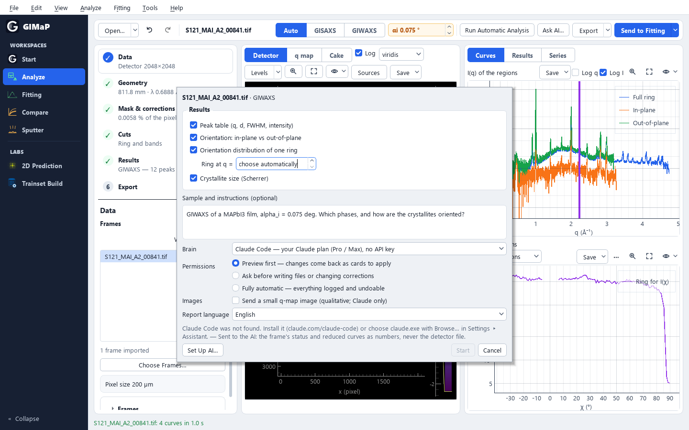
*The start dialog: results to report, notes, brain, permissions, report language. The line above the buttons says whether the brain is ready and what is sent. Here Claude Code is not installed on this computer, so the line says where to get it (or to choose `claude.exe` in Settings ▸ Assistant) and **Start** stays greyed out; with Claude Code signed in, the line names the plan and the model instead.*

1. Open a frame in Analyze and press **Ask AI…**.
2. Tick the results you want:
   - GIWAXS: *Peak table (q, d, FWHM, intensity)*, *Orientation: in-plane vs out-of-plane*,
     *Orientation distribution of one ring* (I(χ), maxima, Hermans orientation factor; pick the ring
     or let the AI choose), *Crystallite size (Scherrer)*;
   - GISAXS: *Horizontal cut at Yoneda, centred, halves chosen*, *Length scale 2π/q\* of the cut*, *Fit of
     I(qy): shape, radius, distance*.
3. Optionally write notes in **Sample and instructions (optional)**: the sample, what you want to know,
   where the calibration is.
4. Choose the **Permissions**:

   | Permission | What happens |
   |---|---|
   | **Preview first** (recommended for new users) | every settings change the AI makes is undone when it finishes and comes back as a card to apply |
   | **Ask before writing files or changing corrections** | a dialog asks for each such action; a refusal is respected |
   | **Fully automatic** | everything is done, logged and can be undone |

5. Choose whether to **Send a small q-map image (qualitative; Claude only)** — the AI then judges the map by
   eye, every number still comes from the tools — and the **Report language**, then press **Start**. What a
   run does is the tooltip of **Start**.

**Stop** ends a run at any time. The report lists each requested result as *done*, *partial* or *not
available* with the reason (for example “no peak above 3σ between 0.2 and 2.0 Å⁻¹”). The tables below it
come from the tool results, not from the AI's text. **Save Report…** writes an HTML report and a JSON
record (`<frame>_ai_report.html` / `.json`; proposed in `gimap_analysis/` next to the data when that
folder exists, otherwise next to the frame).

**Baseline first, then questions.** The AI can start with GIMaP's standard procedure in one step (the
same as Run Automatic Analysis, with each decision and its reason). Its choices are starting points: the AI
then follows what your question needs — the start of an in-situ series, lines every sample shares,
peak ratios, a peak the baseline skipped — and marks interpretations as hypotheses, with the numbers
behind them.

### 10.3 Change cards: preview, apply, undo

Every change the AI makes to Analyze (sector widths, a custom sector, a q box, the frame, the mode, αi,
the radial bins, the valid intensity range) is recorded; the AI can also suggest changes without making
them. They appear as cards under **Changes**: a picture of the q map with the change, the setting in
words, why the AI suggests it, and **Apply**, **Dismiss** or **Undo**. **Undo All** takes back every
applied change.

In *Preview first* the AI's own exploration is restored at the end. A setting the AI proposed a value
for shows only that proposal; otherwise the net change of each setting remains as a card. Changes that
ended where they started, or changed nothing visible, are left out.

### 10.4 Follow-up questions

When a run has finished, type a question in the field under the report (e.g. “Why is there almost no
signal in the in-plane sector?”) and press **Ask**. A new run on the same frame and settings answers it,
knowing what the previous run found, and can bring new cards.

### 10.5 A frame without geometry

When no instrument profile matches the frame, the AI does not stop; it looks for the geometry.

1. **What you named.** Files or folders named in the notes or in the standing instructions are read
   first — e.g. *“the calibration is D:\beamtime\calib\img_0005.cbf, 12.4 keV”*. A calibration named by
   its file name alone (*“calibration LaB6_take2.poni”*) is used too: the file of that name in the folder
   of the frame, or in a folder the notes name.
2. **A search.** The frame's folder and subfolders, the parent and its other subfolders, two folders up
   with their subfolders, and calibration / log folders three up; further folders up or down can be
   searched read-only. It looks for:
   - calibration results — pyFAI `.poni` files and calibrations exported by Geometry Calibration
     (`.json`);
   - images of a calibration standard, the standard taken from the file or folder name (AgBH / silver
     behenate, LaB6, CeO2, a LaB6 + CeO2 mixture; Si, Al2O3 and Cr2O3 are recognised but cannot be
     fitted yet); a multi-module NeXus series (`*_m01.nxs` … `*_m11.nxs`) counts as one image;
   - logs and parameter files (`.log`, `.fio`, `.txt` …) that state the energy, distance, beam centre or
     incidence angle.
3. **The choice.** Ready calibration files are listed by folder first (the frame's own folder, then
   its subfolders, the parent folder, the folders beside it, further up), then by file time. Of the
   standard images it prefers one of the same kind of detector file taken before the frame, with
   *giwaxs*/*waxs* and *final*/*redone* in its name. Standard images are fitted with GIMaP's
   calibration and judged by where the standard's lines land in q: within 0.2 % on average is good,
   within 0.5 % usable ([Physics and Methods, section 3.4](Physics_Manual.md#34-quality-measures)). When the name does not say which standard an image shows, every standard is
   fitted and compared the same way.
4. **Asking you.** Only when the numbers cannot decide, or the energy is nowhere to be found, a dialog
   **The AI asks** lists the options with their file times and folders, or asks you to type the value.

Files within two folders above the frame and files you named are read without asking; other files are
read after you agree (*Ask before…*) or with a note in the panel (the other two permissions). Hidden and system
folders (`.ssh`, `AppData`, `Windows` …) are never read. The chosen geometry is saved as the instrument
profile of the detector — with *Ask before…* only after you approve it — and the report states which file,
standard and values it came from. **Check it**: a calibration found by the search can belong to another
experiment (chapter 13).

### 10.6 What is sent, and what is kept

- Before the first request to a service, including **Get List** or **Test Connection** in Settings,
  GIMaP names the destination and asks for permission. Declining cancels the request. GIMaP remembers
  approval for that service in `settings.json`.
- **Data sent during analysis.** The service receives your instructions, frame information (including its
  name, geometry and settings), and tool results such as reduced curves and fitted parameters.
  Enabling image previews also sends a small q-map image. A locally hosted model receives these data
  on the computer or lab server you selected.
- **Shown**: the tokens of each run; with Claude Code also the plan's usage-limit warnings and the cost
  at API prices (for comparison only — a plan is not billed per token); with an API the estimated cost.
- **Records on your computer.** Each run in `assistant_runs/` identifies the provider and the model
  reported by the service, or the requested model if the service omits its name. You can also find these
  fields in the exported AI tables, the curve's analysis JSON and the saved AI report. Suggestions for missing
  analyses go in `assistant_feature_requests.jsonl`. Section 10.1 describes API key storage.

**How to read the numbers.** The rules behind them are in Physics and Methods:
[section 7.7](Physics_Manual.md#77-ring-orientation-and-the-hermans-orientation-factor) (Hermans),
[section 7.8](Physics_Manual.md#78-crystallite-size-scherrer) (Scherrer) and
[chapter 8](Physics_Manual.md#8-gisaxs-automatic-analysis) (GISAXS).

- Scherrer sizes are lower bounds of the coherence length unless the instrumental width is known; broad
  halos (FWHM above 15 % of q) get none.
- The Hermans factor assumes a film that is isotropic in its plane and weighs each |χ| by sin χ. It is
  given when at least 80 % of that weight is measured. Read its statistical error together with the range from
  varying the exit angle, horizon intensity threshold, background and assumed densities in the attenuated and
  unmeasured edge bins. A pole fit extrapolates into unmeasured angles: check its reported quality before
  interpreting the oriented fraction (section 5.9).
- Regions far below the diffuse background at the same q (under 20 %: a shadow, an absorber, an
  insensitive detector area) count as unmeasured, and a sector lying in one is not compared. Intensity
  next to the qz axis may be unmeasured (missing wedge).
- Peaks one or two bins wide far above the background are marked as spikes (hot pixels, module edges),
  not diffraction.
- Crystallographic labels such as (100) or edge-on are used only when the sample notes or the data make
  the assignment clear.

### 10.7 Without the window

`tools/gimap_agent.py` runs the same standard procedure without the window, for scripts and other
agents: `python tools/gimap_agent.py auto <frames> --notes "…" --out <folder>` writes a `report.md` per
frame with every decision and what needs your answer. A series is analysed in its final state: the last
fifth of its frames summed, at most 10 (below ten frames the last frame alone); `--frame N` and `--sum K`
choose other frames; `--max-peaks N` fits more than the 12 most prominent candidate peaks. The module files of
one detector are analysed once, however many of them are given, in a folder named by the scan (a missing part is
an open item of its report); `--series` takes files that hold one frame each as one series.

- **Frames.** An argument may be a file, a pattern such as `*.tif` or a folder. A pattern the shell did not
  expand (PowerShell does not) is expanded by GIMaP, in natural order (`f2` before `f10`); a folder stands for
  every detector image in it (`.cbf`, `.tif`, `.tiff`, `.edf`, NeXus/HDF5; subfolders are not searched; the
  files given as `--calibration`, `--mask` or `--flat-field` are left out). `summary.md` says how many files each pattern or
  folder gave; one that gives none is an error (exit code 1).
- **Values that cannot be used.** `--incidence-deg` must be above 0° and below 90°, and a `--calibration`,
  `--mask` or `--flat-field` file must exist. Otherwise the command ends with the reason and exit code 1 before
  anything is read; it never replaces a calibration you named with one it found.
- **A calibration that is not the frame's.** A calibration nobody named, which the search took from another folder
  than the frame's (or one below it), is an open item of the report with its full path (*calibration found by the
  search*; exit code 2): give it as `--calibration` when it is the right one. A `.poni` that states another
  detector shape than the frame's — in `max_shape`, or by the detector it names (a Pilatus 300K file on a Pilatus
  1M frame) — is not used: *the calibration does not match this frame*. In a GISAXS run, a symmetry axis more than
  100 px from the calibrated beam centre is not applied (the report says *not applied* and asks for the
  calibration of this measurement), and a symmetry axis that could not be found is an open item too.
- **Folders.** Each frame has its own folder under `--out`, named by the frame, and `summary.md` links every
  row to its `report.md`. Frames of the same name in different folders get the nearest folder name that tells
  them apart (`<name>_<folder>`), else a number. An `--out` folder that already holds the summary of an earlier
  run is refused (exit code 1); `--overwrite` replaces that run: the frame folders its `summary.json` lists
  are removed first, nothing else.
- **Mask.** `--mask FILE` applies one mask to every frame, read as **Load Masks** in Analyze reads it: a GIMaP
  masks `.json` recipe (ordered shapes, rules and image sources) or a mask image of the frame's size whose non-zero pixels are left out. A frame
  the mask does not fit fails with the reason. `report.md` (section **Mask**) and `report.json` (`mask`) always
  say which mask was applied, or that none was; detector gaps and the bad pixels found automatically are
  named apart from it.
- **Flat field.** `--flat-field PATH` divides every frame by a flat field (detector response) as the **Flat
  field** of Analyze's Corrections does: a detector image of the frame's size or a `.npy` array, normalised to
  mean 1, pixels at or below 0.05 of it left out. A frame it does not fit fails with the reason. `report.md`
  names it among the **Decisions** (*flat field: divided by flat.npy (120 pixels left out)*) and in **Record**
  (the file with its SHA-256); `report.json` has it in `inputs` and in `analysis_record.corrections.flat_field`.
- **Record.** `report.json` names the release, the UTC time, the options as given (the notes too), and every
  input file (the frame's files, the calibration, a mask, a flat field) by path, size and SHA-256; for a model fit also the
  network, the SHA-256 of its weights and the seed. `summary.json` is one object with the release, the time, the
  options and the frame reports (`frames`). Every CSV starts with `#` lines that name the release, the inputs
  with their SHA-256 and the geometry. Its column names are plain ASCII with one spelling of the units
  (`qy (A^-1), I, sigma`; `chi (deg)`), so a program that reads in the system's code page reads them. The curve,
  q-map, cake and fit-input files Analyze exports in the window carry the same lines. `report.md` has the section
  **Record** of the window's saved report (section 5.5); it also gives the pixel size and the energy, defines the
  *asymmetry* it prints for the symmetry axis and names the distance disorder σnn/D, as Fitting's Model table
  does. In `report.json`, `geometry` holds the values q was computed with (for GISAXS its beam-centre x is the
  refined symmetry axis), and `calibration` holds the calibration as it was read. A run repeated on the same input
  gives the same files except for the time and the durations. All keys are listed in
  [Physics and Methods, section 14.10](Physics_Manual.md#1410-the-record-of-a-run-without-the-window).
- **Curves as NXcanSAS.** `--curve-format nxcansas` writes the curves against q of each frame as one NXcanSAS file,
  `curves_nxcansas.h5`, instead of their CSVs (as Analyze's **Also as NXcanSAS (.h5)** writes it, section 5.8; the
  I(χ) of the last ring stays `azimuthal_last_ring.csv`, the fit stays `fit_curve.csv`); `--curve-format both`
  writes both; `csv`, the default, writes the CSVs only. `call … --out` takes the option too.
- **Language and time.** `report.md` and `summary.md` are in English. `--language zh` writes only their section
  headings (the `##` lines) in Chinese; the titles, the tables and their column names, the decisions, the
  questions and every other sentence stay English, as do `report.json` and the CSVs. In the window the headings
  follow the program's language. The GISAXS model fit takes from some seconds to a few minutes per frame,
  depending on the number of points and the computer; `--no-fit` leaves it out.

**Worked example (GALAXI GISAXS).** From the source folder, this command analyses the public GALAXI frame with
its calibration and the reported incidence angle of 0.463°:

```sh
python -m tools.gimap_agent auto tests/data/external/gisaxs_galaxi/galaxi_data.tif --calibration tests/data/external/gisaxs_galaxi/galaxi_bornagain.poni --incidence-deg 0.463 --out fig4
```

Open `fig4/galaxi_data/report.md`. *Decisions* gives the fit level and the cut's vacuum q_z. *Needs attention*
flags the upright cylinder as a possible sphere (`cyl_sphere:R_2`); the BornAgain reference of this frame uses
spheres of radius 5.75 nm. The same folder holds:

- `horizontal.csv`, the signed Yoneda cut, and `vertical.csv`, the vertical cut;
- `fit_curve.csv`, the most probable fit against |qᵧ|, the two sides averaged where they overlap; `sigma` is the
  pointwise standard error, and `fit_sigma` includes the correlation between points that share interpolated
  measurements;
- `fit_solutions.csv`, the candidate solutions and their weights. Here the two leading solutions give overlapping
  intervals for the sphere radius, D and the cylinder radius, so the report records one mode found from two
  starts and asks nothing about the values;
- `qmap.png` and `report.json`.

Exit code 2 means that the report has an item that needs attention. The run summaries are `fig4/summary.md` and
`fig4/summary.json`.

`docs/agents/giwaxs-playbook.md` and `docs/agents/gisaxs-playbook.md` describe its options and exit codes, where
its defaults may not fit your question, and how to check it on a GIWAXS measurement you know
(`tools/eval_giwaxs_agent.py`; put a case built on your own data in `docs/agents/eval/local/`, which Git ignores).

## 11. Labs

The **Labs** pages (sidebar ▸ Labs) are experimental. Their settings are the *Labs parameters*: **File ▸
Labs Parameters ▸ Load… / Save As…** reads and writes them, together with Fitting's model.

### 11.1 2D Prediction

**2D Prediction** runs a trained prediction module on GISAXS detector frames. Three steps on the left,
the canvas on the right.

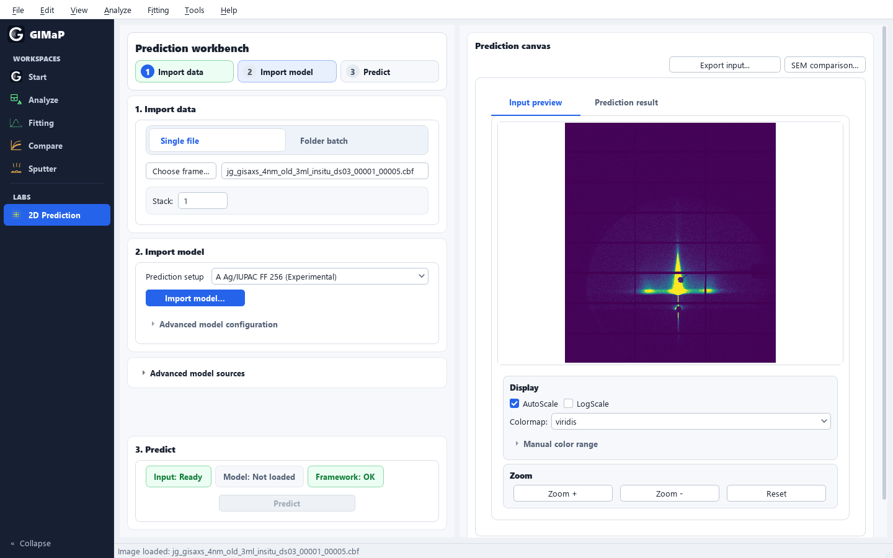
*A CBF frame is loaded and shown under Input preview; no model is imported yet. The three states under 3. Predict say what is still missing, and Predict stays disabled until all three are ready.*

1. **Import data.**
   - **Single file**: **Choose CBF frame…**, or drop a CBF frame on the canvas. **Stack** is how many
     consecutive detector files make one input.
   - **Folder batch**: a folder of numbered frames, the **Range** of frame numbers and **Files per
     prediction**; a line under the fields says how many files and predictions that makes.

   Prediction reads CBF frames (`.cbf`) only.
2. **Import model.** Choose the **Prediction setup** — a module from `modules/` (section 11.3) — and
   press **Import model...**; the *Model* state under 3. Predict says whether it is loaded. Folded: **Advanced model
   configuration** (the framework check, **Reload Config**, **Edit Config**) and **Advanced model
   sources** (the model library).
   - The shipped modules come without a model. The first **Import model...** asks for the folder of the
     trained model (a TensorFlow SavedModel folder). GIMaP remembers that folder for you in the user data
     folder (section 3.11), not in the module's `module.yaml`, so the program files stay unchanged; the
     next **Import model...** loads it without asking.
   - Press **Import model...** again once the model is loaded to choose another folder.
   - The Activity log says when a module has no model yet, and names a remembered folder that no longer
     exists. **Reset All Settings…** also forgets the remembered folders.
3. **Predict.** Three states — *Input*, *Model*, *Framework* — say what is still missing; **Predict** is
   enabled when all three are ready. A prediction runs in the background; **Stop** ends it.

The canvas shows **Input preview** once a frame is loaded and **Prediction result** after a prediction.
*Preprocessed* shows the steps of the module in order with the image each one produced (click one to see
it large).

- **Export input...** saves the frame as displayed, with a JSON record.
- **Export result...** saves the result as a picture, its data beside it, and a JSON record of the
  module, the model, the preprocessing steps and the input file.
- A folder batch lists its results under **Batch results**, with filter, sorting and export.
- The **Activity log** is folded at the bottom.

**SEM comparison…** (above the canvas) opens **SEM Particle Analysis** (section 9.3) with the current
prediction attached, when the module declares a radius axis in nm in its `module.yaml` (section 11.3);
otherwise the tool opens without a prediction and the Activity log says why. Of the shipped modules
only `Au_Silicon_15nm` declares its axes. Then open the SEM image or the sizes CSV there. What is attached is a
copy: the radius distribution with its source (input files, module, model, preprocessing, runtime). Changing the
input or model on the prediction page afterwards leaves an open comparison as it is, and an outdated result is
not attached again.

The two distributions are different quantities. SEM gives the projected-area radius of the particles in a small
field of view, counted per particle. The prediction gives the radius distribution of the module's model, from the
scattering of the illuminated area. A difference between them is a result to discuss; it does not show that
either is wrong.

### 11.2 Trainset Build

Trainset Build has been removed from GIMaP. Train models outside GIMaP and import a compatible model into 2D
Prediction (section 11.3); existing training files are not deleted.

### 11.3 Prediction modules

A prediction module is a folder under `modules/` with a `module.yaml`. Its main fields:

| Field | Meaning |
|---|---|
| `id`, `name`, `version` | internal identifier, the name shown, the version |
| `framework` | the model framework, for example TensorFlow/Keras |
| `model.model_path` | the default model: empty, or a path relative to the module folder. A folder chosen with **Import model...** is kept in your user data folder and takes precedence |
| `preprocess.entry`, `preprocess.steps`, `preprocess.params` | the preprocessing entry point, steps and parameters |
| `io.input_type`, `io.stack_axis`, `io.input_shape` | the input type (for example `cbf`), the stack axis, the model's input shape |
| `outputs` | the outputs: parameter names, ranges or output type; for a distribution, `axes: row` and `axes: column` with `key`, `label`, `unit`, `min`, `max` |

When you add a module, make sure the input type, the preprocessing code and the output definition match
the trained model. Leave `model_path` empty: each user chooses the model with **Import model...**, which never
writes into `module.yaml`. A path that a `module.yaml` already names is used when no folder was chosen. A module
that external training tools register names the model file of this computer in its `module.yaml`. What 2D
Prediction does with a frame, and what it does not correct, is in
[Physics and Methods, section 13.4](Physics_Manual.md#134-2d-prediction-labs).

For the SEM comparison, the module must declare the radius axis: `outputs: axes: row` with `key: r`,
`unit: nm`, `min` and `max`, as in `Au_Silicon_15nm`. A distribution whose module declares no axes is
drawn on placeholder axes (0.05–15 nm on both), which are not a physical scale, and is not attached to the SEM
comparison.

Predict parameters uses its network in `src/gimap/features/fitting/domain/posterior/data/` (section 6.4), not a
prediction module.

The 1D Predict `request.json` and `fitting_run_summary.json` identify the network's record by SHA-256 (the record
names the SHA-256 of the weights, checked when they are loaded). The request records the normalized options and the
random-seed policy: Predict parameters uses a fixed seed.

## 12. Output files

**Reading a reported uncertainty.** Reports and result labels round positive uncertainties to two significant digits and estimates to the same decimal place. In a cell table, `8.9335(22) Å` means `8.9335 ± 0.0022 Å`. A measured angle keeps this precision wherever the report repeats it. A zero uncertainty appears as `± 0` or `(0)`. If the uncertainty is unavailable, only the estimate appears. For long table entries, read the numbered notes below the table. Calculations and JSON and CSV exports keep their full precision.

GIMaP keeps your input files intact. Analyze saves exports in **`gimap_analysis/` next to the data** by default. Most other exports open a save dialog. On a read-only share, choose a writable folder for XRR CSVs, the Format Converter’s `converted/` output, calibrations and projects.

Open **Help ▸ Open User Data Folder** to find settings and saved runs (section 3.11). The default is `%APPDATA%\GIMaP` on Windows and `~/.config/gimap` elsewhere. Set `GIMAP_HOME` to use another folder.

| Action | Files written | Default location | Record that comes with it |
|---|---|---|---|
| Analyze ▸ **Export** (`Ctrl+E`), **Export Curves…** | `<stem>_<curve>.csv` per curve, plus `<stem>_fit_input.dat` and `<stem>_analysis.json`. Names include `_frameNNNN` for a multi-frame source and `_sumN` for a sum. **Also as NXcanSAS (.h5)** adds `<stem>_nxcansas.h5`. | `gimap_analysis/` next to the data. A dialog opens if the folder is unwritable. | `<stem>_analysis.json` (settings, geometry with the tilt of a `.poni`, corrections, pixels left out, error model, binning, UTC time of writing) and `#` header lines |
| Analyze plots ▸ **Save ▸ Curves as Data…** | the CSV files of that plot and `_analysis.json` | folder dialog in `gimap_analysis/` | as Export |
| Analyze plots and images ▸ figures (**Plot as Figure…**, **View as Figure…**, **Analyze ▸ Figures ▸ Save Image…** …) | PNG, TIFF, SVG or PDF, light colours | dialog in `gimap_analysis/` | none |
| Analyze ▸ **Save q-Map Data…**, **View Data as CSV…** (also **Analyze ▸ Figures**) | `<stem>_qmap.csv`, `<stem>_cake.csv` | dialog in `gimap_analysis/` | `#` header lines (source, frame, axes) |
| Analyze ▸ Series ▸ **Export** (**Map as CSV Table…**, **Map as Figure…**, **Stages as Table…**, **Selected Frame's Curve as Figure…** / **as Table…**, **Trace as Figure…** / **Trace as Table…**, **Peak Table of Every Frame…**) | `<series>_<curve>[_<halves>]_map.csv`, `…_map.png`, `…_stages.csv`, `…_trace_<value>.csv` and `….png`, `…_peaks.csv`; the frame picked as `<frame>_<curve>[_<halves>].csv` and `.png` (figures also as TIFF, SVG or PDF) | dialog in `gimap_analysis/` | `#` header lines (curve, halves, frames, cut) and a `.json` of the settings next to each table; none for the figures |
| Analyze ▸ Series ▸ **Export ▸ Save Results Database…**; Watch ▾ ▸ **Record Every Frame in the Results Database** | `gimap_series.sqlite` (SQLite: every frame's curve as reduced, with its frame, file and time; the skipped files) | dialog in `gimap_analysis/`; while watching, `gimap_analysis/` next to the data | the settings of the map, in the database |
| Analyze ▸ Series ▸ **Export ▸ Timeline as Table…** | `<series>_<curve>[_<halves>]_timeline.csv` | dialog in `gimap_analysis/` | `#` header lines and a `.json` (method, reference frame, jumps) |
| Fitting ▸ In-situ series ▸ **Save ▸ Fits as NXcanSAS…** / **Results Database…** | `series_fits.h5` (points fitted and model of every fitted frame); `gimap_series.sqlite` (every frame's fit) | the folder of the curves; a database found there or up to two folders above | each entry holds the frame's record; the database the fit settings |
| Analyze ▸ **Send to Fitting** | `<stem>_fit_input.dat` (q in Å⁻¹) and `<stem>_fit_input.json`. **Send Both Cuts to Fitting** also writes the vertical cut as `<stem>_fit_input_qz.dat` and `.json`. | `gimap_analysis/` beside the data, or the writable folder chosen for this session | JSON reduction record and `#` header lines (source, frame, sum, curve and observation) |
| Analyze ▸ **Batch Export…** | Each curve has a `<batch>_<curve>_frames.csv` table (or `.txt`, `.dat`). Fitting adds `<batch>_peak_fits.csv` or `<batch>_model_fits.csv` and its trend plot, `<batch>_peak_fits.png` (model suffix `_model_fits.png`). Optional fitted curves go in `fits/<frame>_<peak or model>_fit.csv`. Other selected outputs use `curves/`, `nxcansas/`, `fit_input/`, `maps/`, `images/` and `frames/`. Frame names keep the zero-based index (`…_frame0003_sum3_…`). | Last batch folder, otherwise `gimap_analysis/` beside the data. The default subfolder uses the frames’ folder name, the filename for a single file, or `batch` for several folders. **Keep Both** creates a new subfolder. | `README.txt` and `<batch>_batch.json` list files written, each frame’s cut and reasons for failed frames. `curves/` also holds an `_analysis.json` per frame. |
| Analyze ▸ **Send Series to Fitting…** | `fit_input/<frame>_fit_input.dat`, `README.txt`, `<batch>_batch.json` | a folder of its own, `<name>_fitting/`, next to any Batch Export of the same data | `README.txt`, batch JSON |
| Analyze ▸ **Export New Frames While Watching** | as Export, for each new frame | `gimap_analysis/` beside each frame. If it is read-only, choose a writable folder once per session. Cancelling disables watched exports and the status line explains why. | as Export |
| Analyze ▸ **Save Settings…**; Mask step ▸ **Save…**; Regions ▸ **Add ▸ Save Cuts…** | `analyze_settings.json`; `masks.json` or a mask image (section 5.2); `cuts.json` | dialog in `gimap_analysis/` | JSON recipes are self-describing. Mask images have a companion `<filename>.json`. |
| Run Automatic Analysis ▸ Peaks ▸ **Save Peak Table…** | `<stem>_peaks.csv` | the folder proposed by the save dialog | source, settings and phase assignment in the CSV header |
| Run Automatic Analysis ▸ **Save Report…** | `.html` (with pictures), `.md`, or a replayable `.json` for a completed run | Last save folder used this session for frames from the same folder. Otherwise, an existing `gimap_analysis/` or the frame’s folder. | select JSON for replay |
| Process with AI ▸ **Save Report…** | `<stem>_ai_report.html` + `<stem>_ai_report.json` | as above | the JSON |
| Process with AI (automatic) | a record of every run; missing analyses | user data folder: `assistant_runs/`, `assistant_feature_requests.jsonl` | — |
| Process with AI, when the AI exports | the curves as Export, and `<stem>_assistant.json` | `gimap_analysis/` next to the data | `<stem>_analysis.json`, `<stem>_assistant.json` |
| Fitting ▸ Single analysis ▸ **Save ▸ Save Curve and Parameters…** | `<curve>_fit.csv` (or NXcanSAS `<curve>_fit.h5`) + `<curve>_fit.json` (written as a pair) | the folder saved to last, else the folder a curve was last opened from, else the curve's folder | the JSON (model, method, range, left-out points; every solution of Predict parameters) |
| Fitting ▸ Single analysis ▸ **Save ▸ Solutions…** (**Export Solutions…**) | `<curve>_solutions.csv` + `<curve>_solutions.json` (written as a pair) + `<curve>_solutions_curves.csv` | as Save Curve and Parameters | the JSON (the fit record with every solution, its values and intervals) |
| Fitting ▸ **Save ▸ Plot…**, **Save ▸ Model…** | `<curve>_fit.png` / `.svg`; `<curve>_model.json` | as above | none; the model file |
| Fitting ▸ Batch / In-situ series ▸ **Save ▸ Table of Every Frame…** | `series_fit.csv` + `series_fit.json` | the series folder | the JSON (`gimap_series_fit_v2`: start model, halves and where they came from, every frame's state and reason; for detector frames Analyze's settings) |
| Fitting ▸ Batch / In-situ series ▸ **Save ▸ Series report…** | `series_fit.md` | series folder | frame decisions, probabilities and run settings |
| Fitting ▸ Batch / In-situ series ▸ **Trend Plot…**, **Selected Frame's Plot…** | `series_trend_<value>.png` uses the table column name, e.g. `series_trend_chi2_reduced.png`. The paired radius and spacing trend for particle 1 uses `series_trend_1_R_D_nm.png`. `series_frame_<NNNNN>.png` uses a five-digit frame number starting at 1. SVG (`.svg`) is also available. Before fitting, the defaults are `series_trend.png` and `series_frame.png`. | the series folder | none (the title in the picture names the value or frame) |
| **Tools ▸ 1D Predict — Fit Many Curves…** | a run folder: `request.json`, `batch_summary.json` …, a subfolder per curve with `solutions.json`, `fitting_curves.csv` … | `AI_Fitting_Output/v5_<date>_<time>_<µs>/` in the GIMaP user data folder; never removed automatically | `request.json` |
| Compare ▸ **Save ▸ Table of Every Series… / Table of Every Frame…** | `compare_series.csv` / `compare_frames.csv` + `.json` | the folder of the first series added from files, else the folder a series was last added from (while it is there), else your home folder | `#` header lines and the JSON |
| Compare ▸ **Change Plot… / Paths Plot… / End States Plot…** | `compare_*.png` or `.svg` | as above | none |
| Sputter ▸ **Analyze** (section 8.1) | a folder per request: `analysis.json` (status, model family, steps, the files), the package's `REPORT.md`, `report.png`, `report.csv`, `windows.csv`, `summary.json`, `evolution.png`, `patterns.png` and step logs, and `main/` with `main.json` and one `w_<t>.npz` + `w_<t>.png` per time window (the measured image and the model image of every solution) | the scan's folder in the user data folder (or **More options ▸ Save results in**): `sputter/<scan>-<code>/iampred-<code>/`; the same request to the same package shows the result it has. The frames as the package read them are kept in GIMaP's local folder (`%LOCALAPPDATA%\GIMaP\sputter_client\` on Windows, `~/Library/Caches/GIMaP/sputter_client/` on macOS), at most 5 GB by default (**Details ▸ Storage**); the steps' details are in the result's `trace/` | `gimap_request.json` (the request, the label of the imported scan, the package and its version, the Python, the command) |
| Sputter ▸ another **Solution shown** on the main screen | `choices.json`: the solution chosen per time window, where it is not the default | the result's `main/`; when it cannot be written, the user data folder: `sputter_client/choices/` | the file itself (result folder, GIMaP version, time) |
| Sputter ▸ **Compare…** ▸ **Export…** (section 8.1) | `compare_curves.csv` (every quantity of every ticked result against the nominal deposit or the time), `compare_growth.csv` (the growth table), `compare.png` (300 dpi) and `compare.pdf` | a folder you choose (starts beside the first result) | `#` header lines: every result's folder, scan, metal, substrate, model family and mode, and where the values come from |
| XRR Series Extractor ▸ **Export CSV…** | `<source>_xrr.csv` + `.json` | next to the source file; for a folder chosen with **Folder…**, inside it, named after it | the JSON (every value that determines qz and its origin; `center_convention`; `source_layout` with every file read) |
| Format Converter | converted frames: `<source>.<ext>` for a single-frame source; for a multi-frame source by default `<source>_<frame counted from 1, 6 digits>.<ext>`; `_001` … added on a name collision; or one `converted_images.h5` (`converted_images_001.h5` … when it exists) | `converted/` next to the first input | `conversion_report.json`, `conversion_metadata.json` (or one JSON per frame) |
| SEM Particle Analysis ▸ **Export SEM results…** | the files of section 9.3 | a new `SEM_analysis_<date>_<time>/` in the folder you choose; never overwrites | `sem_analysis.json`; `#` header line in the CSVs |
| 2D Prediction ▸ **Export input...** / **Export result...** | `<input>_input.png` + `.json`; `<input>_prediction.png` + `.json` (+ `.txt` when the result has a curve or map) | the export folder used last, else the input's folder | the JSON |
| 2D Prediction ▸ **Export result...** with several files | your choice of `prediction_results_<time>.jsonl`; `prediction_curves_<time>.txt` (or `prediction_parameters_<time>.txt`); images in `prediction_images_<time>/` | a folder you choose (starts at the export folder used last) | `#` header lines in the `.txt` |
| Geometry Calibration ▸ **Export .poni…** | `<image>.gimap-calibration.poni` | beside the standard image by default | pyFAI geometry and wavelength |
| Geometry Calibration ▸ **Export Calibration…** | `<image>.gimap-calibration.json` | next to the calibrant image | the file (beam centre counted from pixel centres at 0, 0.5 px lower than the windows show; `metadata.center_convention`) |
| Geometry Calibration ▸ **Apply** | the instrument profile | user data folder: `instrument_profiles.json` | — |
| **Tools ▸ Settings… ▸ Assistant** ▸ **API key** ▸ **Save** | API credential for the selected provider. **Remove** deletes it. | OS credential store when available, otherwise `claude_api_key.txt` or `assistant_provider_keys.json` in plain text in the user data folder | section 10.1 |
| **File ▸ Save Project** | `<name>.gimap`; `<name>.<generation>.compare.npz` when Compare holds embedded arrays | next to the first frame | the project (data referenced by path); move the current `compare.arrays_file` with it (section 3.8). Sputter results stay in their result folder |
| **File ▸ Labs Parameters ▸ Save As…** | `gimap_parameters.json` | save dialog in the current working folder | — |
| Errors (automatic) | `logs/errors.log` (moved to `errors.old.log` above 2 MB) | user data folder | — |
| **Help ▸ Example Data** | the example's frame with its `.poni` (and mask), and `SOURCE_AND_LICENCE.md` | a folder you choose, by default `Documents/GIMaP examples/<example>/`; files already there are kept | `SOURCE_AND_LICENCE.md` (source and licence of the data) |
| `tools/gimap_agent.py` | Each frame folder contains `report.md`, `report.json`, a q map, curves and fit tables. CSV `#` headers give the release, input SHA-256 digests and geometry. Module files share one folder per scan. `--series` uses `<name>_series/`. Same-name frames from different folders use `<name>_<folder>/`. Top-level `summary.md` links each report, with `summary.json` alongside. | `--out`, otherwise `assistant_runs/cli/<time>/` in the user data folder. To reuse a folder containing an earlier summary, specify `--overwrite`. | `report.json` records the release, UTC time, original options, each input’s path, size and SHA-256, mask or absence of one, and Analyze’s frame record. Fits also record network, weight SHA-256 and seed. |

**Which release wrote a file.** Look for `software_version`, for example `GIMaP v0.2.0`, in the following records.

- Analyze writes it in `_analysis.json`, the settings file and the JSON beside series and stages tables.
- Batch Export and Send Series to Fitting write it in `<batch>_batch.json`. Their `README.txt` says *Written by GIMaP v…*.
- Fitting writes it in `<curve>_fit.json` and `series_fit.json`. Compare, Geometry Calibration, the XRR Series Extractor, SEM Particle Analysis, 2D Prediction and the Format Converter also record it.

In Analyze records, `software_version` gives the release and `software` gives `GIMaP Analyze 1`, the name
of the record format. The records of Sputter, the AI assistant, `tools/gimap_agent.py` (`report.json`,
`summary.json` and the `#` lines of its CSV tables) and 1D Predict's run folders name it too; records written by
earlier versions may not ([Physics and Methods, section 14.5](Physics_Manual.md#145-version-of-the-software)).

**Reproduce a reduction or fit.** Open **Analyze ▸ Tools ▸ Reproduce from Record…**. Select the record for your result, then choose an output folder.

- For one frame, use `<stem>_analysis.json`. For Batch Export, use `<batch>_batch.json`.
- For a Series map or the selected frame’s profile, use the JSON beside its CSV table.
- For Fitting, use the fit or solutions JSON saved with the result.
- For **1D Predict — Fit Many Curves**, use `fitting_run_summary.json` for the run or `solutions.json` for one fitted half.

You can also reproduce a reduction from a terminal.

```text
gimap reproduce example_analysis.json --out check
```

For a completed automatic analysis, select its exported JSON or run `gimap reproduce report.json --out check`. GIMaP reads the original frames, repeats the angle measurements and reduction, then uses the recorded settings for structural analysis. If the run used `--assume-fibre-normal`, replay uses that assumption when measuring sample roll.

With phase CIFs, replay compares GIWAXS phase assignments, orientation verdicts and parameters, and cell refinement results. It includes the reason for withholding a cell. For GISAXS fits, it compares each solution and its probability or BIC weight. Read `reproduced_report.json` for the new values and `comparison.json` for the differences by section.

Use a fresh destination for each comparison. Without `--out`, the command creates `<record stem>_reproduced/` beside the JSON. This folder holds the recalculated CSV columns and `comparison.json`. Batch results use numbered subfolders.

**identical** means every numerical column matches bit for bit, including recorded uncertainties and pixel counts. For **different** results, check the largest relative difference in each column. The exit code is 0 for identical values, 2 for a difference and 1 for an error.

Keep the input files with the record. Relative paths start in the record’s folder. If an input has moved, place an identical copy with its original filename beside the JSON. Replay verifies the SHA-256 and lists the paths and digests it used under `relocated_inputs` in `comparison.json`. For inputs with the same filename, keep separate folders. Update their paths in a copy of the JSON and retain the original digests.

The reduction record includes frame indices and sums, the geometry and instrument profile, and mask edits in order with their source files and final bitmaps. It also records dark, background and flat-field settings, intensity corrections, normalisation, cuts, bins and the error model. A manual fit records fitted points, starting model and solver settings. Predict parameters records the network, sampling settings and seed. To check bitwise agreement, use the same software and numerical environment. The record gives the GIMaP version and, when available, the source commit.

**Reading `<stem>_analysis.json`.**

- `created` gives the UTC time the record was written (ISO 8601).
- `error_model` gives the source of each point’s σ. `poisson` applies to photon counts and `scaled_poisson` to counts with GIWAXS intensity corrections. `pixel_scatter` applies to processed values, such as dark- or background-subtracted data or pixels filled from the mirror side.
- `binning` gives the GIWAXS radial bin count, q range and bin width. It also gives the rule for joining sparse bins and the final I(q) point count. GISAXS gives one point per detector column or row.
- In `geometry`, `rot1_rad`, `rot2_rad` and `rot3_rad` are pyFAI detector rotations. All three are zero for a detector perpendicular to the beam (section 4.2). Geometry includes tilt, so `dropped_tilt_deg`, `flat_detector_q_error_max` and the other `flat_detector_…` and `dropped_…` fields are `null`.
- The instrument profile’s `source` identifies who chose the geometry. Run Automatic Analysis and `tools/gimap_agent.py` write `automatic analysis: <file>`. Process with AI writes `assistant: <file>` followed by the provider and model. Profiles saved before 0.2.0 use `assistant:` for both workflows. [Physics and Methods, section 14.2](Physics_Manual.md#142-the-record-stem_analysisjson)

**Replacing files.** A single-file save dialog asks before replacing the selected file. It replaces the companion record (such as a `.json`) without another prompt.

- Export, **Curves as Data…** (folder dialog), Send to Fitting, watched exports and AI exports replace same-name files in the destination folder. The Format Converter also replaces its report and metadata JSON.
- Batch Export and Send Series to Fitting ask what to do with an earlier export of the same data. Choose **Replace**, **Keep Both in a New Subfolder** or **Cancel** (section 5.7).
- The Format Converter protects converted images (it adds
`_001` … or stops), and SEM Particle Analysis never overwrites its results. Sputter writes the tables of a
result folder again when you change the rate, t0 or end or add refined windows, and **Register best model in 2D
Prediction** replaces the module of the same project.

**Text files.** Read CSV, TXT, DAT, Fitting curves and `README.txt` as UTF-8 without a byte-order mark. GIMaP writes ASCII symbols (`1/A`, `deg`, `2theta`, `alpha_i`, `chi`, `sigma`, `+/-`) and preserves file names, frame names and paths in exports and JSON records. In a script, use `encoding="utf-8"`, for example `numpy.loadtxt(path, encoding="utf-8")`. Double-clicking a CSV in Excel can garble non-ASCII names. The numbers keep their values.

**In the user data folder.** Besides the files of the table, GIMaP keeps there `settings.json` (the settings
and what the pages remember, section 3.9), `instrument_profiles.json`, `session.json`, `model_parameters.json`
(Fitting's model), `last_analyze_setup.json` and `logs/`; the AI assistant's `assistant_runs/`,
`assistant_feature_requests.jsonl` and any file-based API keys (section 10.1); and Sputter's result folders in
`sputter/`, which are never removed. Delete old
result folders yourself, or choose **More options ▸ Save results in** on a data disk for long scans. The frames Sputter ▸
Analyze imports are in the local folder `%LOCALAPPDATA%\GIMaP\sputter_client` (macOS
`~/Library/Caches/GIMaP/sputter_client`, Linux `~/.cache/gimap/sputter_client`), kept under a limit (**Details ▸
Storage**, default 5 GB); those an older GIMaP kept in `sputter_client/` of the user data folder are still used, and
Storage lists and removes them. Outside
that folder, `Start_GIMaP.bat` keeps Matplotlib's font cache in `%LOCALAPPDATA%\GIMaP\matplotlib`, and on
Windows whether a few cards of Fitting and 2D Prediction are folded is kept in the registry, under
`HKEY_CURRENT_USER\Software\GIMaP`.

**The Windows package.** In the ZIP, `licenses\` holds the component licences and `licenses\README.txt` lists them. The ZIP also includes `THIRD_PARTY_NOTICES.md` (**Help ▸ Third-party Notices**) and `LICENSE`. The release page lists the SHA-256 for each download in `SHA256SUMS.txt`. Check a file with `Get-FileHash -Algorithm SHA256 <file>` in PowerShell, or check the files you downloaded with `sha256sum -c --ignore-missing SHA256SUMS.txt`.

## 13. Known limitations

Version 0.2.0 is a pre-release. For the assumptions of each method, see [Physics and Methods, chapter 15](Physics_Manual.md#15-what-gimap-does-not-model).

| Limitation | What to do |
|---|---|
| **An automatic calibration match can come from another experiment.** | Profiles match by detector name and frame size, so check the reported file and the distance in **Geometry**. Supply the right calibration directly or in the notes and remove a wrong profile with **Geometry…** ▸ **Delete profile** (§4.2). |
| **Geometry Calibration fits silver behenate, LaB₆, CeO₂ and a LaB₆ + CeO₂ mixture only.** | For Si, Al₂O₃ or Cr₂O₃, the AI recognises the filename (§10.5). Calibrate the image in pyFAI, then name the `.poni` in your notes or place it beside the frames (§4.2). |
| **Calibration 1σ depends on the parameter and the matched rings.** | Check the ring overlays for a shared shift. Even with several rings, 1σ can be too small for beam x and rot1 (Physics and Methods §3.3). |
| **Powder rings leave rot3 undetermined and constrain tilt weakly at SAXS distances.** | Use a wide-angle standard for rot1 and rot2. Check rot3 against a GISAXS ridge and the horizon in **Geometry ▸ Check rot3**. |
| **GIMaP reads flat-detector `.poni` orientations 1–4.** | Load the frame in the same row and column order as the calibration (§4.2). |
| **Older masks and geometry may use a different NeXus/HDF5 orientation.** | GIMaP keeps the stored orientation of files written outside the Lambda server. Check the beam centre and mask alignment and recalibrate if needed (§5.1). |
| **Flat-field errors treat the measured flat mean as fixed.** | Supply a uniform exposure in counts or ADU to estimate Poisson noise. Account for shared uncertainty when comparing curves that use the same flat (§5.2). |
| **GIMaP subtracts dark and background in frame units before normalisation.** | Set **Scale** and **Dark scale** from the exposure or monitor ratio of the sample to each reference. Enter the sample transmission and thickness (§5.2). |
| **A frame may give an ambiguous incidence angle.** | Check the direct-beam calibration and the estimates from the shadow edge, specular spot and Yoneda band. If a feature is missing or ambiguous, use a known reference and **Keep entered αi**. |
| **At ψ = 0 the automatic Yoneda search and horizontal cut average detector rows.** | Analyze warns if the horizon varies by more than half a row across the frame. Add a horizontal band in q for a constant exit angle. |
| **Kinematic q omits film refraction.** | Near the critical angle, q_z can shift by order k·sin αi, and a reflected-beam ring can remain after a transmitted-channel correction. Check the reported q axis, apply the film critical angle if known, and quote geometry uncertainty separately from peak-fit errors. |
| **Run Automatic Analysis (GIWAXS) fits at most 12 candidate peaks.** | The peak table, sectors, rings and series hints use the most prominent candidates. Check the total in *Decisions* (§5.5) and fit more with `tools/gimap_agent.py auto … --max-peaks N` (§10.7) or ask the AI to run `find_peaks` with `max_peaks`. |
| **A q-scale error can mimic lattice strain.** | Check the calibrant and sample distance before interpreting strain. Cell errors assume the calibration and chosen indices, so compare the measured ring sequence with those indices and inspect peak residuals (§5.9). |
| **The film transmission model misses asymmetric ring shadows.** | Measure incidence and roll, compare signed sectors and check the q window on the frame. Use the size and χ of the largest residual to judge whether the fit supports reporting an oriented fraction (§5.9). |
| **Mirror filling needs a measured partner and leaves the missing wedge empty.** | For the Hermans factor f, check f_iso, the assumptions at both systematic limits and the pole fit (§5.9). A hidden peak stronger than the edge band can put f outside that range. |
| **Series maps store x and I without σ.** | Read timeline χ² as a distance scaled by each column’s frame-to-frame noise (§5.6). For pointwise σ, use Batch Export ▸ Each frame: its curves, with error bars. |
| **Quitting during Batch Export skips the batch summary.** | Completed frame files stay. End the batch with **Stop** to write the batch tables, `README.txt` and the JSON record. |
| **Cancel waits for the current Compare or Fitting read.** | Press Cancel or Stop once. When the read finishes, GIMaP discards the unfinished import or skips the frame fit and keeps completed results (§§6.5, 7.2). |
| **Curve import cannot identify three headerless columns or read interleaved errors.** | Choose `q I [sigma]` or `q I1 I2 …` in **Import Curves…** (§6.1). Split `q I1 sigma1 I2 sigma2` into one `q I sigma` file per curve. |
| **A fixed import cannot watch for new files or columns.** | Import again to change the selection, or use folder mode to watch single-curve files (§6.1). |
| **Broad sizes, roughness or a low-q rise can favour the wrong particle shape.** | From the cut alone, Run Automatic Analysis and Batch Export try one or two populations of spheres or upright cylinders (Gaussian sizes by number, local monodisperse approximation, §5.5). To test a known composition, including random cylinders, choose **The particles in Model** in **Fitting**, run Predict parameters, refine and check the residuals. |
| **A side peak can appear without particle interference.** | Report 2π/q\* as a characteristic length. Use independent evidence to establish particle spacing. [Physics and Methods, section 8.5](Physics_Manual.md#85-the-model-fit-and-how-the-solution-is-chosen) |
| **Core–shell spheres and two interference models need a manual fit.** | In Model, select core–shell spheres (q_z = 0), the 2D hexagonal paracrystal (infinite domains) or Percus–Yevick hard spheres (3D liquid). Run Refine or Search from known values or a Predict solution with spheres. [Physics and Methods, section 9.14](Physics_Manual.md#914-models-for-manual-fitting) |
| **Intensity weighting and random cylinders slow the fit.** | Allow tens of seconds for **Search the ranges** with *Gaussian, by intensity* and up to minutes for random cylinders. Narrow the R, h and σR/R ranges, set **Sizes** to *Gaussian, by number* if appropriate, or start **Refine** close to the curve. |
| **Vertical cuts support spheres and upright cylinders only.** | Take the vertical cut beside the specular rod and use horizontal cuts for random cylinders and core–shell spheres. Fitting ▸ Fit Several Curves Together uses the columns’ q∥, omits q resolution and the rod, and fits each cut’s population scales separately (§6.6). |
| **Correlated radii and heights can bias cylinder heights in both fit ranges.** | The joint fit assumes a dilute layer with independent radii and heights. Compare heights from the two ranges and check the vertical cut’s reduced χ² (§6.6). |
| **The substrate table covers Si, SiO₂, plate glass and Au from 4.9 to 30 keV.** | Enter δ and β for other substrates. At level 4 (smooth interfaces, particles in air), enter a known oxide or polymer film’s thickness, δ and β under **Top layer** (§6.4). |
| **A posterior check can miss a distant solution.** | Compare Predict’s other solutions even when both MCMC ensembles agree (§6.2). Allow hours for a check with random cylinders. |
| **Predict results vary slightly across numerical library builds.** | To reproduce solution probabilities, interval endpoints, standard errors and flags near bounds, keep the cut and settings. Record the operating system and Python, NumPy and SciPy versions. |
| **Surface reflection affects sphere radii above q₊R ≈ 1.7.** | Without both incidence and exit angles, Predict uses the Born term at the cut’s q_z or the effective interface. Give both angles above this threshold (R ≈ 3 nm at α_i = 0.4°, 12 keV) and use level 4 (four-term DWBA) for a known substrate. [Physics and Methods, section 9.13](Physics_Manual.md#913-predict-parameters) |
| **Weak reflection leaves the sphere radius ambiguous.** | With both angles and an unknown substrate, a smaller sphere with a larger \|r\| can give the same two-path fit. Far above the critical angle, compare `refl_amp` in Model with the substrate value and fix it to that value before refining if they differ substantially. |
| **XRR exports raw intensities.** | Check the ROI and valid-pixel counts because XRR skips Analyze masks and bad-pixel detection. Apply monitor, footprint, background, resolution and θ-offset corrections to the exported curve as needed (§9.2). |
| **Format Converter does not read EDF.** | Use **Analyze ▸ Batch Export ▸ Converted detector frames**. |
| **In uint16 TIFF or CBF, missing pixels read back as valid 65535 values.** | In Format Converter, keep the stored data type (the default) or write HDF5 to preserve gaps and bad pixels (§9.1). |
| **SEM extraction needs a scale for each image.** | Enter the known nm per pixel or calibrate from a scale bar of known length. |
| **SEM sizes depend on segmentation.** | Check every outline and prefer a model trained on SEM images. The default StarDist weights were trained on cell nuclei. |
| **2D Prediction reads CBF frames only.** | Convert other frames to CBF with the Format Converter. |
| **2D Prediction uses only the module’s preprocessing.** | Choose a module trained for your setup because 2D Prediction applies no frame geometry or corrections (§11.3). |
| **The Ag and Cu distribution modules have no calibrated axes.** | Read only the distribution shape on the 0.05–15 nm placeholder axes. Add the trained model’s axes to `module.yaml` for physical sizes, including the radius axis for SEM comparison (§11.3). |
| **Some text keeps its original language after a language switch.** | Run the analysis again or restart GIMaP. |
| **Older reduction or fit records may lack a reproduction recipe.** | Look for the `reproduction` block (§12). If it is missing, export a fresh record from the original inputs and settings. |
| **Without a supported credential store, saved API keys are plain text.** | Anyone who can read your user data folder can read the keys. On a shared computer, use the provider’s environment variable or **Remove** the saved key after use (§10.1). |
| **Sputter ▸ Analyze reads Cu with networks trained for Cu on two polymer films (a homopolymer and a block copolymer)**. | For Cu on another substrate, choose **Polymer** for a polymer film and compare the model image with the measured one before using the values. |
| **Sputter draws and reports no metal inside a polymer film.** The model has no metal that went into the polymer. For Cu on polymer films two forms were tested — clusters buried below the film, also in the whole-scan fit, and a Cu/polymer composite layer with Cu domains — and the data did not resolve either; Ag on polymer films was not tested. Why these measurements cannot tell: the incidence angle (0.4°) is above the critical angles of the metal, the polymer and Si, so the beam goes through the whole film and the image holds no depth selection; clusters smaller than about 1.5 nm and dissolved atoms scatter almost evenly over the measured q_y range; the polymer films have no lateral structure of their own that metal in one of their phases could make stronger; and metal missing against the quartz balance cannot be told from an error of the balance or of the intensity scale. A line under the **Real Space** views and the last section of the report (*What the model does not describe*) say so. | Do not read the missing metal in the picture as no metal: GISAXS here cannot tell. Use a depth-resolved measurement for it: GISAXS at several incidence angles around the critical angles of the polymer and the metal, XRR or neutron reflectivity, or cross-section microscopy (TEM with EDX). |
| **Sputter can still miss the thickness fringes of a continuous film on a polymer** — the horizontal stripes along the exit angle once the film has formed. Refine and Full start the film windows from a dense film with the film-density fluctuation on and keep only the metal amount and the film thickness from decreasing, which matched them on the tested scans; a window whose joint solution did not take that film, and a result of Quick (no joint fit), can miss them and then has part of its fit deviation from them. | Take the film thickness from the fringes themselves (the report's film thickness is read from them); in the film stage read the model's base layer as its closest description, not as a measurement, and compare the model image with the measured one (**Patterns**, a line drawn on the images). |
| **Sputter ▸ Analyze away from 12 keV: the any-energy networks were checked on simulated scans, not on measured ones.** Every system has a network trained at one wavelength (0.105 nm for Cu, 12 keV for the others) and αi 0.40°, and an any-energy network trained at 8–15 keV and αi 0.25–0.55°. Within 5 % of the one-wavelength network's wavelength (for Au: at 12 keV only) the package runs that network, the earlier networks of the same kind and, where the optical constants are the same, the any-energy network, and shows the one that fits best. Elsewhere in 8–15 keV it analyses the scan with the any-energy network at its own energy. On simulated scans at 10 and 14 keV the any-energy networks came closer to the true values than the one-wavelength networks; measured scans at other energies or from other beamlines have not been available to check them. On TiO₂ neither network fits every measured scan best: at 12 keV both run and the better one is shown, away from 12 keV only the any-energy network is available. Outside 8–15 keV the package computes the optical constants at the scan's own energy from its table (4–30 keV), the networks give only the starting solutions, and **Auto** picks **Refine**; the result is the joint fit's. A photon energy outside 4–30 keV is refused when the scan is imported, with the reason. A scan analysed by an any-energy network at an αi outside 0.25–0.55° gets a warning in the log of the network step under **Details**. | Away from 12 keV (Cu: 0.105 nm) judge the result by its fit deviation; outside 8–15 keV use **Refine** or **Full**. Keep the photon energy that was measured: changing it to match a network scales every q. |
| **Sputter ▸ Analyze runs the analysis package that comes with GIMaP**, which analyses only the pairs of metal and substrate the package has a network for; its values are model values that were not compared with an independent measurement of your sample (section 8.1). The frames it reads are kept, one copy per request that changes the import (rate, geometry, mask, substrate …), in GIMaP's local folder, at most 5 GB together by default: the ones not used for the longest time are removed first. | Judge a solution by its model image beside the measured one, and compare with SEM, AFM or XRR where you can. **Details ▸ Storage** lists the imports, removes them and sets the limit. |
| **Sputter reads folders of CBF frames only** (chapter 8). | For NeXus series, use Analyze's series map (section 5.6) and Fitting's in-situ series (section 6.5). |
| **Sputter keeps every result folder** in the user data folder unless you chose another place; nothing removes them, and **File ▸ Save Project** holds the Sputter form and references its result folder. | For long scans choose **More options ▸ Save results in** on a data disk; delete old folders yourself; open a result again with **Open Result…**. |
| **TensorFlow runs on the CPU on Windows and macOS.** | Use the bundled CPU runtime. |

## 14. Troubleshooting, FAQ, version and contact

### 14.1 A file cannot be loaded

Read the message under the image. It identifies empty files, damaged or incomplete NeXus files, other file types and permission errors.

- If a file is empty or still being written, wait for the writer to finish and close it. If the writer stopped with a NeXus/HDF5 file open, run `h5clear -s` on a copy.
- For an unreadable HDF5 compression filter, install `hdf5plugin` (section 5.1, *NeXus and HDF5 files*). HDF5/NeXus also needs `h5py` and a detector dataset in a supported location. For `.cbf`, check that `fabio` is installed.
- For a permission error, check read access. To request support for another format, use **Help ▸ Report a Problem…** or contact the author (section 14.12).

### 14.2 A `.csv` curve asks for its columns

Fitting asks when the header leaves q, I or σ ambiguous (section 6.1). Examples include two intensity columns, two q axes or more than three columns without a header.

In **Choose Columns**, select a different column for each quantity, or rename the header to `q, I, sigma`. If Fitting refuses the file type, use one of the supported formats `.dat`, `.txt`, `.csv` or `.h5`.

### 14.3 1D Predict Does Not Start

In Fitting and 1D Predict, *Predict parameters* checks `src/gimap/features/fitting/domain/posterior/data/flow_v1.npz` against the SHA-256 in `flow_v1.json`. If either file is missing or the weights have changed, the message names the file.

The portable package and Git repository include both files. For a source checkout, update missing files as described in section 2.4. If you edited a network file, the update keeps your changes and `git status` lists it as modified. To discard edits in that folder and restore the repository copies, run `git checkout -- src/gimap/features/fitting/domain/posterior/data`. Git stores the weights as binary (`.gitattributes`).

Without the network, Fitting skips its GISAXS recommendation for Predict parameters. Select it to see the missing file under **Method** (section 6.2). *Refine the values in Model* and *Search the ranges, then refine* work without network files.

### 14.4 Predict is disabled, or the model is not imported (2D Prediction)

**Predict** needs all three states above it to be ready. For *Input*, select a CBF frame or folder. For *Model*, press **Import model...**. For *Framework*, install the framework the module needs.

If the model fails to load, the Activity log shows the folder GIMaP tried. Use **Import model...** to choose a local folder if the one in `module.yaml` is missing or belongs to another computer. The same button changes the folder of a loaded model.

### 14.5 SEM Particle Analysis does not extract

- **Run button disabled.** Extraction needs a scale for this file. Set a positive **Image calibration**.
- **StarDist (local AI)** fails to start if a local resource is missing. It needs a local Python with StarDist and TensorFlow (`requirements-sem-stardist.txt`), plus a model folder containing `config.json` and the weights. Provide these locally and press **Check local resources**.
- For **Existing instance labels**, GIMaP needs an integer label image. Use labels with the dimensions of the SEM image or its ROI.
- **No particles remain.** The filters rejected all outlines. Inspect the rejected outlines and their reasons, then adjust the threshold, contrast polarity, area limits or ROI.

### 14.6 The AI assistant does not start

The start dialog shows whether the selected AI provider is ready. Open **Tools ▸ Settings… ▸ Assistant** and check the setup for that provider.

- **Claude Code** needs an installed program and an active sign-in. Install Claude Code, or use **Browse…** beside **Program** to select `claude.exe` under `%LOCALAPPDATA%\Packages\Claude_…\LocalCache\Roaming\Claude\claude-code`. Then use **Sign In…** and **Check**.
- **Claude API** needs the Python package and a valid key. Run `pip install anthropic`, enter the key and press **Test Connection**.
- **Other providers** also need a model that supports tool calling. Run `pip install openai`, enter the key, choose that model and press **Test Connection**.

If an environment key seems to have no effect, GIMaP checks the saved key first. Replace an incorrect or expired key, or press **Remove** to use the environment variable.

### 14.7 Sputter does not analyse, or TensorFlow is missing

**TensorFlow and other packages.** `requirements-tensorflow.txt` asks for TensorFlow `>=2.15,<=2.16`
(`tensorflow-intel` on Windows), which in practice installs a 2.15 release; 2.15.1 is the tested version. For a
missing package, activate the right Python environment and run `pip install -r` with the file the message names
(`requirements-full.txt` for everything).

**Sputter ▸ Analyze.** The job status in the input bar says what stopped it:

- *The analysis package was not found*, or *… is not an analysis package: … is missing*: the program folder has no
  complete `utils/sputter_client` (the package that comes with GIMaP), and no package was chosen. Choose
  the package's folder with **Choose Folder…** (the folder that holds `code` and `models`), or set the environment
  variable `GIMAP_SPUTTER_CLIENT` to it (section 8.1).
- *Give the deposition rate (Å/s or nm/s)*, *Give the photon energy or the wavelength* and the like: a value of the
  input bar or of the geometry is missing; the line under the bar names the geometry still to enter, and **Edit**
  shows its fields.
- *The analysis stopped with an error (failed at …)* or *(exit code …)*: press **Details**; the log under
  **Analyze options** ends with the package's last lines. A last line *no network for … on …* means that the
  package has no network for this metal on this substrate; the line names the pairs it has.
- *No progress for …: the analysis package's processes are all waiting*: the package has stopped working without
  ending. The note in the live view shows the last line of its log, and **Stop Analysis** ends it (section 8.1,
  *When nothing happens*).
- An import that stops with *this scan is at … keV …; the optics are tabulated from 4 to 30 keV*: the photon energy is
  outside the package's table of optical constants; check the energy or wavelength under **Details ▸ Sample and
  geometry** (chapter 13).
- *The analysis finished, but this package does not write the data of the main screen*: the package is an older
  one; its report is in the folder named. Use a newer package.
- **Open Result…** says *… holds no result of the analysis (main/main.json)*: the folder holds no finished
  result of Analyze.

### 14.8 Windows warns about the installer

Windows warns about the unsigned installer and launcher (`.bat`), and your institution's security software may block them. Use the files from GIMaP's GitHub Releases page and verify them against `SHA256SUMS.txt` (chapter 12, *The Windows package*). If your institution blocks batch files, run GIMaP from source in a local Python environment (section 2.2).

### 14.9 An export is empty or fails

- **Export is empty.** The selection may contain no valid data. Check the q or frame range, masks, cut and frame values. In Fitting, also check the fitting range, parameter bounds, scale and background. In 2D Prediction, check the frame stack count and whether the module suits the data.
- **Export fails.** The destination may be missing or read-only. Choose an existing, writable folder outside protected system folders. Export asks for one if it cannot write `gimap_analysis/` beside the data. On a read-only share, choose another folder for XRR CSVs, Format Converter, Geometry Calibration exports and projects too.

### 14.10 The window is too large for the screen

GIMaP follows the operating system’s display scaling and fits a 1280 × 720 screen. If the text looks too large or small, adjust **View ▸ Font Size** or **Tools ▸ Settings… ▸ Appearance**. Scroll to see the rest of a dense panel. GIMaP restores the window size and position at the next start.

### 14.11 FAQ

**Is GIMaP production-ready?** Version 0.2.0 is a pre-release. Treat it as beta scientific software and check important results.

**Can I use my own trained model?** In 2D Prediction, describe the model in a module configuration with a supported loader (section 11.3). In SEM Particle Analysis, select a local StarDist model
folder. Predict parameters uses the network that comes with GIMaP (`tools/ml1d` trains another one). Sputter uses
the analysis package that comes with GIMaP in
`utils/sputter_client/`, or another one you choose (section 8.1); a new package comes with a GIMaP update.

**Where are the results of 1D Predict saved?** Open `AI_Fitting_Output/v5_<date>_<time>_<µs>/` in the GIMaP user data folder. For fits saved with **Save**, look in the folder you chose (chapter 12).

**Which fitting method should I choose?** For a GISAXS cut with unknown particles, use **Predict parameters**. This is Fitting’s network method and gives each solution with its probability. If the model is close to the curve, use **Refine the values in Model**. If the starting values are poor but you know the particle family and its ranges, use **Search the ranges, then refine** (section 6.3).

**Where are Sputter's results saved?** In `sputter/<scan>-<code>/` of the user data folder, or in the folder
set with **More options ▸ Save results in** (section 8.2; chapter 12); a result of Analyze is in its subfolder
`iampred-<code>/`. They are kept until you delete them.

**Does anything leave my computer?** Your data leave it only when you use a remote AI assistant (Claude Code, Claude API or another provider's server), which receives the frame status and numerical values of reduced curves. The detector file stays on your computer. Sending a small q-map image requires your permission (section 10.6). With a model on your computer or lab server, the data stay on that network. StarDist, Predict parameters and 2D Prediction run locally without downloads. GIMaP itself does not go online.

**Help ▸ GitHub Repository**, **Check for Updates…**, **Report a Problem…** and the 2D Prediction model library open your browser on request. **Report a Problem…** copies the GIMaP and system versions to the clipboard and opens a new GitHub issue. You choose what to paste and submit. The clipboard summary contains no paths or data.

### 14.12 Version and Contact

This manual describes **GIMaP 0.2.0** (pre-release). Check your installed version in **Help ▸ About GIMaP**. The program folder contains `CHANGELOG.md` with changes since 0.0.2, unreleased changes and known limitations.

- **Help ▸ Check for Updates…** opens GitHub Releases in your browser. Compare the latest version (pre-releases included, newest first) with the version in About. GIMaP itself sends no update request. See section 2.4 to update.
- **Help ▸ How to Cite GIMaP…** displays the reference from `CITATION.cff`, including a DOI if the file supplies one. Use **Copy** or **Copy BibTeX**. Cite the version recorded in `software_version` (chapter 12). If the field is missing, as in older records, check **Help ▸ About GIMaP** (chapter 13).
- **Licence.** GIMaP uses the MIT licence (`LICENSE`). For the licences of bundled components (including PyQt5 under GPL-3.0) and example data, open **Help ▸ Third-party Notices**. **Help ▸ About GIMaP** shows the licence and the Python, Qt, PyQt and numpy versions. Use **Copy** to copy them.

Contact: [yufeng.zhai@desy.de](mailto:yufeng.zhai@desy.de)
