# GIMaP 用户手册

GIMaP 是掠入射 X 射线散射（GISAXS、GIWAXS）的桌面分析软件。它把探测器帧变成标定好的曲线
（I(q)、I(qy)、I(χ)），找峰、取向和尺寸，用颗粒模型拟合一维曲线，跟踪原位序列，并比较不同的测量。
每条曲线都记着它从哪里来、用了哪些设置。

本手册对应 0.1.0 版，这是预发布版（pre-release）：请把它当作测试阶段的科学软件，重要的结果要核对。
工作区（分析、拟合、比较）可以用于日常工作；实验室（Labs）页面和一维预测（1D Predict）是实验性的。
**帮助 ▸ 关于 GIMaP**（Help ▸ About GIMaP）显示正在运行的版本。自 0.0.2 以来的改动和这一版的已知限制
写在程序文件夹里的 `CHANGELOG.md` 中（第 12 章汇总了已知限制）。

第一次用 GIMaP？从第 1 章开始：两个各约十分钟的练习，用的是公开数据。

## 目录

1. 快速入门
2. 安装与更新
3. 主窗口
4. 几何与标定
5. 分析（Analyze）
6. 拟合
7. 比较与阶段
8. 工具窗口
9. AI 助手
10. 实验室
11. 输出文件
12. 已知限制
13. 故障排除、常见问题、版本与联系

## 1. 快速入门

两个练习，各约十分钟：一帧 GIWAXS、一帧 GISAXS，都是公开数据。两个练习的步骤相同：打开帧、给它几何、
运行自动分析、看结果、把曲线发送到拟合。全程不用 AI。

### 1.1 开始之前

两组数据在 GIMaP 仓库的 `tests/data/external/` 文件夹里：

| 文件夹 | 文件 | 内容 |
|---|---|---|
| `giwaxs_p08_mapi/` | `S121_MAI_A2_00841.tif`、`LaB6_2021_12_DESY_P08.poni` | MAPbI₃ 钙钛矿薄膜的 GIWAXS，DESY P08，PerkinElmer 2048 × 2048 探测器，αi = 0.075° |
| `gisaxs_galaxi/` | `galaxi_data.tif`、`galaxi_bornagain.poni` | Ag 纳米颗粒的 GISAXS，GALAXI（于利希），Pilatus 1M，λ = 1.34 Å，αi = 0.463° |

数据的来源、许可证和文献给出的几何见 `tests/data/external/README.md`。

1. 取得文件。源码版本里已经有了。便携版不带这些文件：请从 GitHub 仓库下载这两个文件夹
   （在 `tests/data/external` 下）。
2. 把 GIWAXS 文件夹复制到你自己的位置，例如 `C:\GIMaP-demo\giwaxs`。GIMaP 把结果写在数据旁边的
   `gimap_analysis/` 文件夹里；用副本可以让程序文件夹保持干净。
3. 到 1.3 节时再复制 GISAXS 文件夹，而且不要放在 GIWAXS 副本旁边：先删掉那个副本，或者换一个磁盘。
   **自动查找标定**（Find Calibration Automatically）也会搜索帧旁边和上面几层的文件夹；GIWAXS 副本离得近时，
   它会把 `LaB6_2021_12_DESY_P08.poni` 用在 GISAXS 帧上。
4. 启动 GIMaP（第 2 章），打开的是**开始**（Start）页。

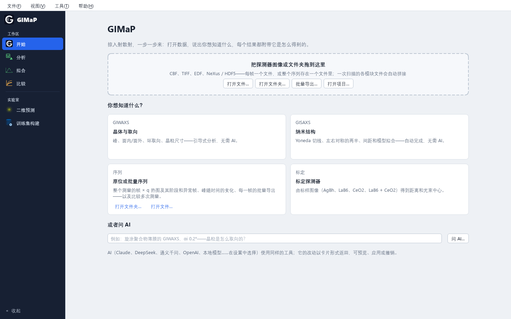
*开始页：拖入或打开数据，选择你想知道什么（序列卡片有自己的“打开文件夹…”和“打开文件…”链接），或者问 AI。
打开过的文件会列在“最近”下面。*

### 1.2 GIWAXS：钙钛矿薄膜

**1. 打开帧。** 在开始页按**打开文件…**（Open Files…），选择 `S121_MAI_A2_00841.tif`（也可以把文件
拖到窗口上）。**分析**（Analyze）页打开。核对：

- 命令栏显示文件名和尺寸 `2048×2048 px`；
- **数据**（Data）步骤是 ✓；**掩膜与校正**（Mask & corrections）写出排除了多少像素
  （“排除了 0.0058 % 的像素”：孤立的热像素和死像素）；
- **几何**（Geometry）显示 **!** 和“还没有几何”，**切线**（Cuts）写着“需要几何”；
- 一条黄色提示条说“此探测器（2048×2048）没有仪器配置”，并提供**自动查找标定**、**输入几何…**（Enter Geometry…）和**标定…**（Calibrate…）。

探测器图像以像素显示。没有几何时还没有 q 曲线。

**2. 给它几何。** 按提示条里的**自动查找标定**。GIMaP 在帧周围的文件夹里搜索，找到
`LaB6_2021_12_DESY_P08.poni`。核对：

- **几何**变成 ✓，显示 `811.8 mm · λ 0.6888 Å · αi 0°`；
- **切线**变成 ✓（环和条带），曲线出现；
- **结果**（Results）步骤写出几何的来源：“已保存的标定文件（没有再用标样图像检查）；由自动搜索找到：
  LaB6_2021_12_DESY_P08.poni”，并有 1 个问题。

这个几何现在保存为仪器配置 *Detector 2048×2048*。从此以后，分析对这个尺寸的每一帧都用它（4.1 节）。
处理自己的数据时，要确认找到的文件是你这次测量的标定。

**3. 运行自动分析。** 按命令栏的**运行自动分析**（Run Automatic Analysis）。只需要几秒；**结果**标签页
逐项显示已完成的步骤。结束后，结果步骤问一个问题：入射角。在**入射角 αi (°)**（Incidence angle αi (°)）
里输入 `0.075`，按**用这些答案再运行一次**（Run Again with These Answers）。

**4. 看结果。** 结果标签页的第一行类似“GIWAXS — 12 个峰（12 个可靠），分析了 3 个环”。下面是：

- **峰**（Peaks）：q 和 FWHM 的单位是 Å⁻¹，d 是 Å，L（Scherrer 尺寸，是下限）是 nm，以及峰在面外（OOP）
  还是面内（IP）。这里能看到 q ≈ 0.90、1.00、1.41、1.99 和 2.22 Å⁻¹ 附近的峰。数据的 README 把
  0.899 Å⁻¹ 标为 PbI₂ (001)，0.999 Å⁻¹ 标为 MAPbI₃ (110)。GIMaP 不判定物相：请拿 q 和你的材料的衍射线对照。
- 峰面积最大（且没有警告）的三个环，以及它们的取向（Herman 取向因子 f）和极大值的位置。
- **检查**（Checks）：被遮挡和没测到的 χ 范围（qz 旁边的缺失楔形区），它们会让 f 偏低。
- **几何**：用到的配置、距离、光束中心、波长和 αi。

选中一个峰，打开**拟合细节**（Fit details），可以看到拟合用到的点、高斯峰和它的背景，以及各个误差。
**保存报告…**（Save Report…）把全部内容存成网页或 Markdown。把图像切换到 **q 图**（q map）或
**展开图**（Cake），可以在 q 中看环；**来源**（Sources）显示每条曲线用了哪些像素。

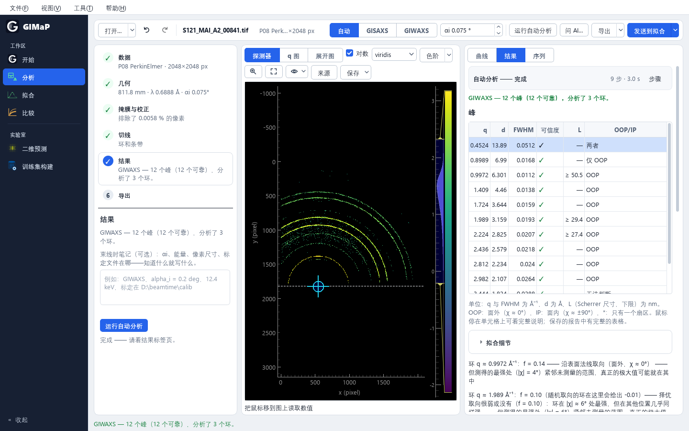
*一帧 GIWAXS 的结果标签页：总结行、峰表、拟合细节和环的取向；检查在更下面。*

**5. 发送到拟合。** 按**发送到拟合**（Send to Fitting）。GIMaP 在帧旁边写出
`gimap_analysis/S121_MAI_A2_00841_fit_input.dat`（列为 q、I、σ、像素数；q 的单位是 Å⁻¹；以 `#` 开头的
头行写明这些点从哪里来），并在**拟合 ▸ 单条分析**（Fitting ▸ Single analysis）里打开它。**曲线**
（Curve）步骤显示“S121_MAI_A2_00841_fit_input.dat · 拟合 2050 个点”。

GIWAXS 发送的是 I(q)。拟合的模型是颗粒模型（第 6 章），拟合页顶部的提示也这样说：它们是颗粒的形状因子，
不描述衍射峰。所以对晶体的峰，上面的峰表通常就是你要的结果（许多帧的峰拟合用**批量导出 ▸ 环区域中的峰**，
5.7 节）。`_fit_input.dat` 文件同时也是带记录的曲线，可以交给其他程序。

### 1.3 GISAXS：银纳米颗粒

数据来源把样品描述为 Ag 球，带径向准晶格（paracrystal），峰间距 53.6 nm（BornAgain 的示例
*experiment_at_galaxi*）。

**1. 打开帧。** **文件 ▸ 打开数据…**（File ▸ Open Data…，`Ctrl+O`），选择 `galaxi_data.tif`。（如果文件
列表里还有 GIWAXS 那一帧，在列表里点新文件来显示它，或者先在数据步骤里按**清除**（Clear）。）分析页显示
`1043×981 px`（行 × 列）。**掩膜与校正**排除了 `1.4 %` 的像素：Pilatus 模块之间的缝隙。和前面一样，
提示条要求几何。

**2. 给它几何。** 按**自动查找标定**。它找到 `galaxi_bornagain.poni`：**几何**显示
`1730.0 mm · λ 1.34 Å · αi 0°`，**切线**显示 Yoneda 切线。模式保持**自动**（Auto）：探测器上最大散射角
不超过 20° 的帧按 GISAXS 处理。

如果**几何**显示的是 `811.8 mm`，结果步骤里写的是 `LaB6_2021_12_DESY_P08.poni`，说明搜索从附近的文件夹拿了
GIWAXS 的标定（见 1.1 节），并把它存成了这个探测器的配置。在几何步骤里按**几何…**（Geometry…），再按
**删除配置**（Delete profile）；把 GIWAXS 副本移走，再按一次**自动查找标定**。

**3. 运行自动分析。** 按**运行自动分析**。大约需要半分钟（慢的是模型拟合）。然后结果步骤询问 αi。在
**入射角 αi (°)** 里输入 `0.463`，按**用这些答案再运行一次**。

这个答案很重要：αi = 0° 时，Yoneda 带被标在 αf = 0.639°；αi 正确时是 αf = 0.176°。命令栏的 αi 框现在
以橙色显示 `0.463 °`：这是你设的值，在你回到配置中的 αi 之前对每一帧都有效（4.1 节）。

**4. 看结果。**

| 部分 | 这里看到的 | 要核对的 |
|---|---|---|
| **水平切线**（Horizontal cut） | 在 Yoneda 带上，第 605–609 行 | 图上的橙色带落在 Yoneda 带上 |
| 光束中心 | x 移到对称轴上，x = 597.26 px | 文献给出的直射束 x = 597.1 px |
| 两半 | **两半取平均**（Mean of both halves），并写出理由 | 两半一致；否则取能用的那一半 |
| **面内间距**（In-plane spacing） | \|qy\| ≈ 0.0113 Å⁻¹ 处的肩（2π/q ≈ 55.6 nm）：是提示，不是分辨出的峰 | 接近文献的 53.6 nm |
| **I(qy) 拟合**（Fit of I(qy)） | 解的表格：模型、R、h、D（nm）、χ² | 几个模型可能拟合得差不多好 |

结果标签页这里还写着“1 处需要查看”：**模型选择**。随机取向圆柱（χ² 1.26）和球（χ² 1.36）的 χ² 相差不到
10 %，单凭曲线定不了模型。GIMaP 指出 D 与实测间距一致的解，把选择留给你。对这个样品，你知道颗粒是球。

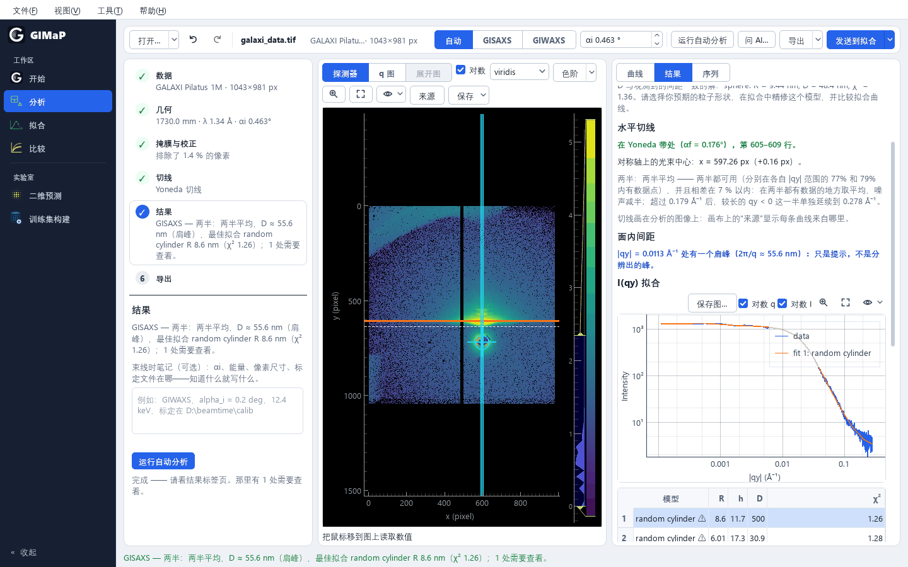
*一帧 GISAXS 的结果标签页：切线、间距、拟合曲线和解的表格。*

**5. 发送到拟合。** 按**发送到拟合**。GIMaP 写出 `gimap_analysis/galaxi_data_fit_input.dat`（用切线步骤
选定的两半，这里是平均；q 的单位是 Å⁻¹），并在**拟合 ▸ 单条分析**里打开：**曲线** ✓
“拟合 599 个点”，**模型**（Model）“球 · 9 个自由参数”，**拟合**（Fit）“选择方法，然后拟合”。
拟合页里 q 以 nm⁻¹ 显示。

拟合步骤已经为这条曲线选好**预测参数（fit1d）**（Predict parameters (fit1d)；“推荐用于这条曲线：尚未拟合的 GISAXS 线切。”）。
它需要 fit1d 工具包（2.3 节）。没有工具包时，在**方法**（Method）里选**寻找颗粒形状（不用 AI）**（Find the particle shape (no AI)），
按**寻找颗粒形状**（Find the particle shape）。大约 15 秒后，状态行写着“5 个解；最好的 球（χ²ᵣ 1.39）已放入模型……”。
其他解列在结果的**其他解**（Other solutions）里；按**精修这些数值**（Refine These Values）精修这个球并得到它的误差。
在分析页的结果标签页里按**在拟合中精修**（Refine in Fitting），打开的也是这条曲线。

尺寸取决于模型和它的尺寸分布。BornAgain 的模型用对数正态的半径分布，GIMaP 的模型用的是另一种：比较半径时要小心。

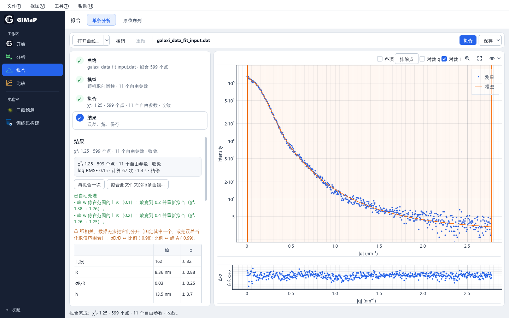
*拟合 ▸ 单条分析，精修拟合之后：曲线、叠在上面的模型、拟合范围（橙色）和残差。*

### 1.4 接下来看哪里

| 你想…… | 见 |
|---|---|
| 为自己的探测器设置几何 | 第 4 章 |
| 画掩膜、选切线区域、跟踪序列、导出很多帧 | 第 5 章 |
| 认真拟合一个模型，或拟合整个原位序列 | 第 6 章 |
| 比较不同的测量或样品 | 第 7 章 |
| 让 AI 做分析，你在旁边看 | 第 9 章 |
| 知道每个导出文件里有什么 | 第 11 章 |

## 2. 安装与更新

### 2.1 Windows：便携版

不需要 Python，安装包自带。

1. 打开 [GitHub Releases](https://github.com/zyffcc/gisaxs_gui/releases) 页面，选择最新的版本。
2. 把 `00_Download_and_Install_GIMaP-<version>.bat` 下载到一个路径短、你有写权限的空文件夹里
   （例如 `C:\GIMaP`）。
3. 双击它。它下载安装包的各个部分，逐个校验（SHA-256），合并并解压到安装程序旁边的文件夹
   `GIMaP-<version>-windows-x64-portable`，然后启动一次 GIMaP。

**以后启动 GIMaP。** 双击 `GIMaP-<version>-windows-x64-portable` 文件夹里的 `Start_GIMaP.bat`；
在桌面上为它建一个快捷方式会很方便。第一次启动时要为这个文件夹准备自带的 Python 环境，需要一点时间。

安装程序和启动程序是批处理文件，没有签名。Windows 运行前可能要求确认，单位的杀毒软件也可能拦截。
只运行 GIMaP 的 GitHub Releases 页面上的文件；否则请从源码运行 GIMaP（2.2 节）。

### 2.2 从源码运行

**Windows 上最简单的方法（不需要懂 Python）。** 在仓库的克隆文件夹，或者仓库 ZIP 解压出的文件夹
（GitHub 上 **Code ▸ Download ZIP**，解压到路径较短、可写的位置）里，双击 `Start_GIMaP.bat`。第一次启动会在
文件夹里的 `.gimap` 中建立一个专用环境：下载 uv（一个小的 Python 安装工具，固定版本，并核对 SHA-256）、
Python 3.10 以及 `requirements.txt` 里的包（约 2 GB，3–20 分钟），然后打开 GIMaP。以后的启动是即时的。
文件夹以外的东西都不会被改动；删掉 `.gimap` 就去掉了这个环境。溅射（Sputter）工作区的模型是 GIMaP 的一部分
（`utils\sputter_toolkit`）；它需要的 PyTorch（`requirements-sputter.txt`，约 1.2 GB）由 `Start_GIMaP.bat` 装好，
缺少时在第一次**预测**（Predict）时安装（7.4 节）。

**手动方式。** 安装 Python 3.10 或 3.11，然后在源码文件夹里运行：

```powershell
python -m venv .venv
.\.venv\Scripts\Activate.ps1
python -m pip install --upgrade pip
python -m pip install -r requirements.txt
python main.py
```

如果 PowerShell 拒绝激活环境，先运行 `Set-ExecutionPolicy -Scope Process -ExecutionPolicy Bypass`。
用 Conda：

```powershell
conda create -n GUI python=3.11 -y
conda activate GUI
python -m pip install -r requirements.txt
python main.py
```

溅射（Sputter）工作区的模型在仓库里（`utils/sputter_toolkit`），在 PyTorch（CPU）上运行：第一次**预测**时会把
PyTorch 装进 GIMaP 所用的 Python。想事先装好，就在同一个环境里运行 `python -m pip install -r requirements-sputter.txt`。

一维预测训练好的权重在 Git 仓库里（约 56 MB），所以源码版本什么都能运行，包括一维预测（第 6 章）。
在 macOS 上，BornAgain 要单独安装：方法见 `README.md`。

### 2.3 可选部分

没有这些 GIMaP 也能运行。每一项只在表中所列的功能里需要。

| 部分 | 用于 | 怎样装 |
|---|---|---|
| AI 账号或本地模型 | **问 AI…**（Ask AI…）、**工具 ▸ 用 AI 处理…**（Tools ▸ Process with AI…） | Python 包已在 `requirements.txt` 里；在**工具 ▸ 设置… ▸ AI 助手**（Tools ▸ Settings… ▸ Assistant）里设置 AI（第 9 章） |
| fit1d 工具包（`gisaxs1d_gui_kit`） | 拟合页的**预测参数（fit1d）**（Predict parameters (fit1d)，也用于原位序列的每一帧）和一维预测中的方法 *fit1d* | 放在 `utils/gisaxs1d_gui_kit`，或用环境变量 `GISAXS1D_KIT_HOME` 指定它的文件夹（第 6 章） |
| StarDist | **工具 ▸ SEM 粒径分析…**（Tools ▸ SEM Particle Analysis…）里分开相互接触的颗粒 | 单独的 Python 环境，装 `requirements-sem-stardist.txt`，再加一个本地模型文件夹（第 8 章） |
| PyTorch（CPU） | 溅射工作区的**预测**（Predict） | 第一次预测时装进 GIMaP 的 Python（约 1.2 GB，需要联网），或由 `Start_GIMaP.bat` 安装；手动安装用 `python -m pip install -r requirements-sputter.txt`（7.4 节） |

TensorFlow 在 CPU 上运行；GPU 环境没有配置。

### 2.4 更新

**便携版。** 用同样的方法运行新版本的安装程序。它解压到自己的文件夹；启动新的 `Start_GIMaP.bat`，
旧文件夹不再需要时删掉即可。

**源码版本。** 双击文件夹里的 `Update_GIMaP.bat`（需要装有 Git），或者运行：

```powershell
powershell -ExecutionPolicy Bypass -File tools\update_source.ps1
```

这个脚本从 GitHub 更新当前分支，并说明它看到了什么、做了什么。它把你还没提交的修改先放到一边，
再放回新版本之上；不碰你的数据和结果；在会覆盖你自己的文件之前停下。和新版本合不上的修改会留在一边，
脚本会说明。分支要移到改写过的历史上时，你自己的、GitHub 上没有的提交保存在一个备份分支里；
怎样取回见 `README.md`。加上 `-DryRun` 可以只看它会做什么，
不做任何改动。它说 Python 包的列表变了时，再运行一次 `python -m pip install -r requirements.txt`。

2026-10-13 之前最后一次更新的源码版本还没有这个脚本。`main` 的历史在那天改写过：不要在这样的副本里运行
`git pull`、合并或推送。先按 `README.md` 中 *Updating a source checkout* 一节的步骤迁移，以后就用这个脚本。

**更新会保留什么。** 设置、仪器配置、最近的文件和拟合模型都保存在程序之外的用户数据文件夹里（3.11 节），
所以更新会保留它们。0.0.2 版把设置存在自己的程序文件夹里：新的便携版文件夹不会带过来，从默认值开始；
原地更新的源码版本会在第一次启动、用户数据文件夹里还没有设置时导入一次。

### 2.5 系统与屏幕

GIMaP 在 Windows 上开发和测试。1280 × 720 的屏幕就够用（窗口最小为 1024 × 640）；1080p 或更大的屏幕
能更舒服地并排显示探测器图像和曲线。GIMaP 跟随操作系统的显示缩放（例如 125 % 或 150 %）。

## 3. 主窗口

### 3.1 窗口的各部分

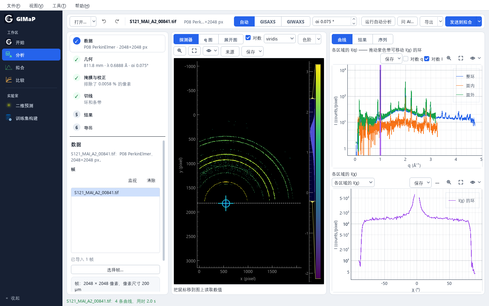
*分析页：侧栏、命令栏、左边的步骤和数据步骤的帧列表（下面是“选择帧…”）、中间的图像、右边的曲线。*

- **侧栏**（左边）列出各个页面。工作区：**开始**（Start）、**分析**（Analyze）、**拟合**（Fitting）、
  **比较**（Compare）。实验室（Labs）：**二维预测**（2D Prediction）、**训练集构建**（Trainset Build），
  即实验性的机器学习工具。侧栏底部的 **« 收起**（« Collapse，或 `Ctrl+B`）把它缩成图标。
  `Ctrl+1` … `Ctrl+7` 切换页面。
- **菜单栏**：**文件、视图、工具、帮助**（File, View, Tools, Help；3.6 节）。工具窗口从**工具**菜单打开。
- **页面。** 分析和拟合的布局相同：上面是命令栏，左边是工作的各个步骤，右边是图。
- **消息**以短通知的形式出现在右下角。关于已写出文件的通知带有**打开文件夹**（Open Folder）按钮。
  每个页面底部还有自己的状态行。

窗口标题显示当前的帧；打开了项目时也显示项目名。

**拖入文件。** 探测器帧、文件夹和 `.gimap` 项目可以拖到窗口的任何地方。拟合页显示时拖入的曲线文件
（`.dat`、`.txt`）在拟合页打开。

**关闭。** 还有任务在运行时关闭 GIMaP——批量导出、序列热图、自动分析、AI 分析、一次拟合、原位序列、
二维预测、SEM 粒径分析——会先询问并列出正在运行的任务。选**是**（Yes）会停止它们并退出；选**取消**（Cancel）
继续工作。还在收尾的 SEM 分析可能会请你在它停下后再关一次窗口。

### 3.2 开始页

- **拖放框**：把探测器图像或文件夹拖到上面，或按**打开文件…**（Open Files…）、**打开文件夹…**
  （Open Folder…）、**批量导出…**（Batch Export…，用上次的设置把一个文件夹的原始帧直接变成曲线）或
  **打开项目…**（Open Project…）。分析页立即打开，在图像载入期间就显示文件、探测器和帧数。
- **最近**（Recent）：最近打开的五个文件、文件夹和项目，带有所在的文件夹（完整的列表在
  **文件 ▸ 最近打开**里）。
- **你想知道什么？**（What do you want to know?）：**晶体与取向**（GIWAXS）、**纳米结构**（GISAXS）、
  **原位或批量序列**、**标定探测器**。每一项打开相应的地方，并选好模式。序列这张卡片另有两个链接：
  **打开文件夹…**（Open Folder…，一个文件夹的帧：每帧一个文件，或一次扫描的各模块文件）和**打开文件…**
  （Open Files…，选定的帧，或装着整个序列的一个 NeXus/HDF5 文件）；两者都停在分析页的序列标签页上。
- **或者问 AI**（Or ask the AI）：写下你的数据和问题，再按**问 AI…**（Ask the AI…；第 9 章）。

### 3.3 步骤与命令栏

在分析和拟合页，左边的每个步骤都显示自己的状态，并用一行字说明它得到了什么：

| 标记 | 含义 |
|---|---|
| ✓ | 完成，没有要核对的 |
| ! | 完成，但要看一看（有问题或警告） |
| × | 失败：那一行写着原因 |
| … | 正在运行 |
| 数字 | 还没做 |

点一个步骤就显示它的控件。常用的控件直接显示；少用的选项折叠在一个可以展开的标题下面。

分析页的命令栏窄的时候，长的按钮文字会缩短（“运行分析”、“批量…”、“拟合”）；完整的文字留在提示里。

### 3.4 图与图像

**曲线图。**

- 右键打开菜单：**重置视图**（Reset View）、对数坐标、**复制图片**（Copy Image）、**复制数据**（Copy Data）；
  带**保存**（Save）按钮的图还有**曲线图存为图片…**（Plot as Figure…）和**曲线存为数据…**（Curves as Data…）。
- 按住右键拖动可以缩放；鼠标滚轮也可以缩放。
- **缩放**（Zoom，放大镜）：拖出一个矩形。不按这个按钮时，Shift + 拖动在所有图和图像上都能用。
  **重置**（Reset）重新显示全部。
- **对数 I**（Log I）和**对数 q**（Log q）切换坐标轴。眼睛按钮显示或隐藏每一类标记。
- 图窄的时候，标题换到图的上方，选项收进 **⋯** 菜单。

**探测器图像**（还有 q 图、展开图和序列热图）有**缩放**、**适配视图**（Fit view）、**标记**（Marks）、
色图、**对数**（Log）和**色阶**（Levels）。每张图像旁边有一个带两个手柄的直方图，用来调颜色范围。
颜色范围和标记的细节见 5.4 节。

保存的图总是用浅色配色，即使屏幕上是深色主题。

### 3.5 表格

结果表格——自动分析的峰和解、拟合和比较页的表格——都可以复制。选中几行按 `Ctrl+C`，或在右键菜单里用
**复制所选行**（Copy Rows）/ **复制整个表格**（Copy Table）。复制的行带有列名，可以直接粘贴到电子表格里。

### 3.6 菜单

| 菜单 | 菜单项 |
|---|---|
| 文件（File） | 打开数据…（`Ctrl+O`）、打开文件夹…（`Ctrl+Shift+O`）、最近打开、打开项目…（`Ctrl+Shift+P`）、保存项目（`Ctrl+S`）、项目另存为…（`Ctrl+Shift+S`）、实验室参数 ▸ 载入… / 另存为…、退出 |
| 视图（View） | 各个工作区（`Ctrl+1`…`Ctrl+7`）、收起侧栏（`Ctrl+B`）、全屏（`F11`）、主题 ▸ 浅色 / 深色、字号 ▸ 放大（`Ctrl++`）/ 缩小（`Ctrl+-`）/ 重置（`Ctrl+0`）、语言 ▸ English / 中文 |
| 工具（Tools） | 几何标定…（`Ctrl+Shift+G`）、格式转换…（`Ctrl+Shift+C`）、转换当前文件…、XRR 序列提取…（`Ctrl+Shift+R`）、SEM 粒径分析…、一维预测——拟合多条曲线…、用 AI 处理…（`Ctrl+Shift+L`）、设置…（`Ctrl+,`） |
| 帮助（Help） | 用户手册（`F1`）、GitHub 仓库、打开用户数据文件夹、关于 GIMaP |

- 显示拟合的单条分析时，**文件 ▸ 打开数据…** 打开的是曲线，菜单项也会这样写（打开曲线…）。
- **实验室参数**（Labs Parameters）是二维预测和训练集构建的设置。分析页的设置另存为设置文件
  （**导出 ▸ 保存设置… / 载入设置…**，Export ▸ Save Settings… / Load Settings…，批量导出也用它）。
  项目保存一个样品的全部内容（3.8 节）。
- **工具 ▸ 一维预测——拟合多条曲线…**（Tools ▸ 1D Predict — Fit Many Curves…）用实验性的神经网络模型
  拟合一组曲线文件（第 6 章）。其他工具窗口见第 4 章和第 8 章。
- **帮助 ▸ 用户手册**在网页浏览器里打开本手册；界面是中文时打开中文版，是英文时打开英文版。

### 3.7 快捷键

除了菜单里的快捷键：

| 在哪里 | 按键 | 作用 |
|---|---|---|
| 分析 | `Page Up` / `Page Down` | 上一个 / 下一个已导入的帧（先走完一个数据源的帧，再到下一个数据源） |
| 分析 | `Ctrl+Z`，`Ctrl+Shift+Z` 或 `Ctrl+Y` | 撤销 / 重做对设置的一次修改 |
| 分析 | `Ctrl+E` | 导出这一帧的曲线 |
| 分析 | `Ctrl+Shift+E` | 批量导出… |
| 分析 | `F5` | 重新分析这一帧 |
| 分析 | `Delete`（在帧列表里也可以用 `Backspace`） | 从列表中移除选中的数据源（它的全部帧）、掩膜或切线区域（文件本身不受影响） |
| 分析 | `Esc` | 停止在图上点选光束中心；取消正在画的掩膜 |
| 拟合 | `Ctrl+Return` | 拟合 |
| 拟合 | `Ctrl+Z`，`Ctrl+Shift+Z` 或 `Ctrl+Y` | 撤销 / 重做对模型的一次修改 |
| 比较 | `Delete` | 从表格中移除选中的序列 |
| 表格 | `Ctrl+C` | 复制选中的行，带列名 |
| 几何标定 | `Esc` | 关闭窗口（标定正在运行时会先询问） |

### 3.8 项目

项目（`.gimap`，一个 JSON 文件）把一个样品恢复成离开时的样子：

- 分析页的帧和全部设置（模式、配置、掩膜和画出的区域、校正、切线），导入时选的帧（5.1 节），以及序列是否沿用同一条切线；
- 拟合页的曲线、两半、拟合范围、排除的点和模型；
- 原位序列的文件夹和选项，以及比较页的序列。

**文件 ▸ 保存项目**（File ▸ Save Project，`Ctrl+S`）写出项目；第一次会问保存在哪里（默认在第一帧旁边）。
**打开项目…**、开始页的**打开项目…**、**最近打开**（项目排在前面），或把 `.gimap` 文件拖到窗口上，
都能打开它。

- 数据按路径引用，不复制。比较页从分析页取来的序列保存在项目旁边的第二个文件 `<name>.compare.npz` 里：
  移动或复制时两个文件一起。
- 文件移走了，项目照样能打开；一条通知说有多少文件找不到，并列出前几个，
  **详情…**（Details…）列出全部。
- 打开项目会替换窗口里现有的内容：之前那个样品在分析页的帧、在拟合页的曲线和原位序列、在比较页的序列都会关闭。
  需要的话先保存。
- 在分析页按**清除**之后，接着打开的内容就不再属于那个项目：**保存项目**会询问保存位置，而不是覆盖它。
- 有任务在运行时（原位序列、批量导出……）不能打开项目：先停止任务。
- 项目不保存原位序列的拟合结果。那里有拟合完、还没保存的帧时，打开项目之前会先问：**保存**（Save，每一帧的结果表）、
  **丢弃**（Discard）或**取消**（Cancel，什么都不改）。

### 3.9 会话之间记住的内容

- **最近的数据**：每个打开过的文件或文件夹（对话框、拖放、开始页、批量导出）都列在**文件 ▸ 最近打开**
  和开始页上，最新的在前。最多保留 8 个；已不存在的文件不列出；**清空列表**（Clear the List）清空它。最近的项目单独保存
  （最后 6 个），排在前面，**清空列表**之后仍然保留。
- **上次的设置**：分析过一帧之后关闭 GIMaP 时，分析页的设置（模式、配置、掩膜、校正、切线区域……）保存在
  用户数据文件夹的 `last_analyze_setup.json` 里。下次会话打开第一帧时，一条通知提供**使用**（Use It）。
  不经询问绝不会套用，因为新的束线时可能需要别的设置。
- **溅射**：每个扫描文件夹上次预测时的值（几何、金属、聚合物、掩膜、时间窗、沉积速率、t0 和沉积结束时间）、上次使用的值（掩膜和样品
  滚转角不会带到别的文件夹）、几何预设，以及上次显示的结果（下次启动时再打开）；PyTorch 每次启动都重新检查。
- 窗口的大小和位置、主题、字号和语言在下次启动时恢复。

### 3.10 出错时

意外的错误不会关闭 GIMaP。一个窗口说明发生了什么：**显示详细信息**（Show Details）显示技术报告，
**复制详细信息**（Copy Details）把它复制下来用于报告问题，工作可以继续。每个错误都写进用户数据文件夹里的
`logs/errors.log`（**打开日志文件夹**，Open Log Folder）。

读不了的文件会用文字说明原因：空文件（还在写入？）、不是探测器图像、损坏或不完整的 NeXus 文件、
另一个程序还在写的 NeXus/HDF5 文件、没有权限。更多内容见第 13 章。

### 3.11 设置与用户数据文件夹

**工具 ▸ 设置…**（Tools ▸ Settings…，`Ctrl+,`）有四页。修改立即生效；只有 AI 的密钥要用它自己的**保存**（Save）按钮保存。

| 页 | 设置的内容 |
|---|---|
| **外观**（Appearance） | 浅色或深色主题、字号、界面语言（默认英文，或中文）。数值、单位和文件名从不翻译。 |
| **分析**（Analyze） | **使用文件头中写的光束中心**（Use the beam centre written in the file header；CBF 的 `Beam_xy`、NeXus 的 `beam_center_x/y`）：默认关闭，因为很多束线从不更新它，所以保留标定过的配置中心。**发送到拟合的水平切线**（Send horizontal cut to Fitting）：发送到拟合时传 GISAXS 水平切线的哪一半（默认两半都画在 \|qy\| 上，两种颜色）。 |
| **数据**（Data） | 用户数据文件夹在哪里（**打开**），以及**重置所有设置…**（Reset All Settings…；仪器配置保留，之后要重启 GIMaP） |
| **AI 助手**（Assistant） | 用哪个 AI、它的常驻说明、模型、密钥和权限（第 9 章） |

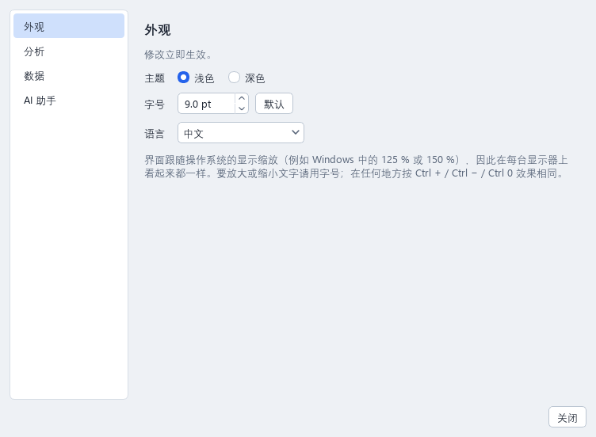
*工具 ▸ 设置…：外观页。*

所有设置、偏好、仪器配置、会话和拟合模型都保存在程序之外的一个用户数据文件夹里：

- Windows：`%APPDATA%\GIMaP`；
- 其他系统：`~/.config/gimap`（设置了 `$XDG_CONFIG_HOME` 时为 `$XDG_CONFIG_HOME/gimap`）；
- 或者环境变量 `GIMAP_HOME` 指定的文件夹。

**帮助 ▸ 打开用户数据文件夹**（Help ▸ Open User Data Folder）打开它。更新程序从不覆盖它。

## 4. 几何与标定

没有几何时，GIMaP 只以像素显示探测器，没有任何 q。本章说明几何从哪里来、得到几何的三种方法、几何标定窗口、
光束中心的像素坐标，以及怎样在分析页调整中心。

### 4.1 仪器配置

*仪器配置*（instrument profile）是为一个探测器保存的几何：样品–探测器距离、像素尺寸、波长、光束中心和入射角 αi。
仪器配置保存在用户数据文件夹里（`instrument_profiles.json`，3.11 节）。

打开一帧时，分析页挑选与它匹配的配置：

- **帧尺寸。** 不同帧尺寸的配置一律不用。
- **探测器名**，前提是文件写了它（CBF 和 NeXus 通常有，TIFF 没有）。名字匹配比尺寸匹配更重要。
- 几个配置匹配程度相同时，用最新的那个。

探测器名不同并不排除一个配置：没有更好的匹配时，帧尺寸相同的配置也会被采用。所以，为一个没有探测器名的 TIFF
建的配置，会用于同样尺寸的每一个 TIFF。换了装置（距离、能量）而探测器不变时，
要新建或选择另一个配置。

**几何**（Geometry）步骤显示正在用的几何（`811.8 mm · λ 0.6888 Å · αi 0°`）。它的**仪器配置**
（Instrument profile）一栏设为**自动（匹配探测器）**（Automatic (match detector)）；在这里选一个配置，就改用它。

**αi** 是配置的一部分，但命令栏有自己的 αi 框。它显示配置里的 αi（还没有显示帧时显示“αi 来自配置”，
αi from profile）。你输入的值以橙色显示，用于每一帧；下次启动时它也会被记住，并在第一帧时用一条通知说明。
右键这个框 ▸ **回到配置中的 αi**（Back to Profile αi）可以去掉它。

**文件头里的光束中心**默认不用：保留标定过的配置中心，因为很多束线从不更新文件头。
**工具 ▸ 设置… ▸ 分析 ▸ 使用文件头中写的光束中心**（Tools ▸ Settings… ▸ Analyze ▸ Use the beam centre
written in the file header）可以改变这一点（3.11 节）。**光束中心 ▸ 使用文件头中的中心**
（Beam centre ▸ Use File Header Centre）把文件头里的中心作为本次会话的中心（4.5 节）。

### 4.2 得到几何的三种方法

没有匹配的配置时，图像上方的提示条会说明，并提供三个按钮。**几何**步骤里也有**自动查找标定**和**标定…**，
并用**几何…**代替**输入几何…**。

**自动查找标定**（Find Calibration Automatically）。GIMaP 取以下来源中第一个适合这一帧的：

1. 你在**结果**（Results）步骤的束线时笔记里写明的标定：写路径，或者只写文件名（文件在这一帧所在的文件夹里，
   或在笔记写明的文件夹里）；
2. 这个探测器已有的仪器配置；
3. 帧周围文件夹里（最多向上三级）现成的标定文件（`.poni`、导出的 `.json`），写入时间离这一帧最近的优先；
4. 那里的标样图像（AgBh、LaB₆、CeO₂），拟合后，标样的衍射线落在各自 q 的 0.5 % 以内才接受。

**结果**步骤写明用了哪个标定、在哪里找到的。`.poni` 或 `.json` 文件按原样采用：不会用标样图像核对，
这一版甚至不核对它是否属于这台探测器——相邻文件夹里另一台探测器（像素尺寸、帧尺寸都不同）的标定也可能被采用。结果保存为这个探测器的仪器配置。

搜索可能挑到别的实验的标定，例如在一次性复制过来的文件夹里（文件时间这时说明不了什么）。请核对它写出的文件和**几何**步骤显示的距离，
或者在笔记里写明正确的文件，或者改用下面两种方法。错误的配置可以用 **几何…**（Geometry…）▸ **删除配置**（Delete profile）删掉。

**输入几何…**（Enter Geometry…）打开**探测器几何**（Detector geometry）对话框：**配置名称**（Profile name）、
**样品–探测器距离**（Sample–detector distance）、**像素尺寸 x** / **y**（Pixel size x / y）、
**波长**（Wavelength）、**光束中心 x** / **y**（Beam centre x / y；4.4 节）、**中心调整步长**（Centre step）、
**入射角 αi**（Incidence angle αi）。

- **保存配置**（Save Profile）把所有数值保存为这个探测器和帧尺寸的仪器配置。保存的几何立即生效：本次会话之前
  为这个探测器设的中心被丢弃，**仪器配置**一栏回到**自动（匹配探测器）**。
- **应用中心**（Apply Centre）只在本次会话使用这个光束中心（4.5 节）；其他数值只有**保存配置**后才生效。
  还没有配置可用时，先保存一个。
- 在几何步骤里，用**几何…**（Geometry…）打开的是同一个对话框，填好了正在用的几何。用原来的名字保存就是修改这个
  配置，用新名字保存则两个都保留。**删除配置**（Delete profile）删掉它。

**标定…**（Calibrate…）打开几何标定窗口（4.3 节），载入当前显示的帧；关闭这个窗口之前，分析页会等待。
当这一帧本身就是标样图像时用它，也可以在那里打开标样图像。在那个窗口里按**应用**（Apply；从**工具**菜单打开时
也一样）就保存配置，分析页用它重新分析这一帧；本次会话之前设的光束中心会被丢弃，改用标定得到的中心。

第四个按钮**使用上一次的几何…**（Use Previous Geometry…）只在从 0.0.2 更新后出现：它把原 Cut & Fitting
页面的几何保存为配置。

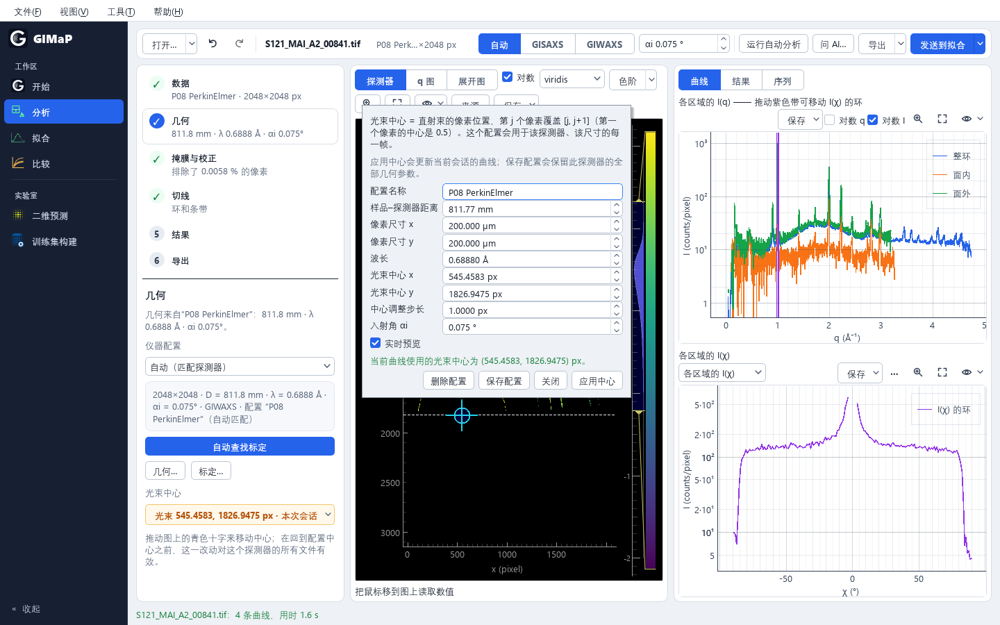
*几何…：正在用的配置的几何，带实时预览、应用中心和保存配置；左边的光束中心按钮显示本次会话设的中心。*

### 4.3 几何标定窗口

**工具 ▸ 几何标定…**（Tools ▸ Geometry Calibration…，`Ctrl+Shift+G`）在不离开当前页面的情况下，
标定 SAXS、GISAXS 或 GIWAXS 探测器的几何。分析页的**标定…**和开始页的**标定探测器**（Calibrate the detector）
也能打开它。

1. 用**打开…**（Open…）打开一张标样图像（NeXus/HDF5，如 `.nxs` 或 `.h5`；`.cbf`、`.tif` / `.tiff` 或
   `.edf`），或把路径粘贴到图像栏里按回车。也可以把图像拖到窗口上。NeXus/HDF5 文件按分析页的方式读
   （模块文件拼接，方向相同；5.1 节）。多帧的文件出现**帧：**（Frames:）一行，选**单帧**（A single frame，
   填帧号，从 1 数）或**全部帧求和**（Sum of all frames，读的时候显示进度，可以取消）。一个文件里有几个
   同样可能的图像数据集时，会问用哪一个。
2. 确认检测到的能量和像素尺寸。CBF 有对应的扫描 NXS 元数据时，能量会自动填好。仍然缺能量时，以 keV 输入。
3. 确认探测器型号。识别不了时，在**探测器型号**（Detector model）里选一个已知的探测器，或选
   **自定义像素尺寸**（Custom pixel size），并在**高级配置**（Advanced configuration）里输入数值。
   **自动检测**（Auto detected）保留文件里的像素尺寸。
4. 选择标样。图像的路径——文件名或它上面的某个文件夹——只出现一种标样（例如 `AgBh`、`LaB6` 或 `CeO2`）时，
   自动选中它；出现多于一种时，这一栏设为**自动识别**（Auto Detect）；一种都没有时，保持原样
   （窗口打开时是自动识别）。自动识别会试遍所有已知的标样。
5. **估计距离**（Estimated distance）是可选的，用来引导搜索：不知道距离就保持“可选”（Optional），
   知道就输入大致的距离。打开图像时，只有在图像文件写明了距离时（NeXus 文件可以；CBF 或 EDF 头里的距离不用），
   或者没有这个但以前应用过标定时（用那次标定的距离），这一栏才会被填上：请核对这样的数是不是这套装置的距离。
   **距离范围**（Distance range）限定搜索（*自动 · 30–10000 mm*、*SAXS · 500–10000 mm*、
   *WAXS · 30–1500 mm*，或*自定义*（Custom），用高级配置里的上下限）。
6. 点**自动标定**（Auto Calibration）。计算在后台进行；**取消**（Cancel）在当前这一步之后停止。
7. 检查结果：**选定解**（Selected solution）的光束中心、距离、匹配的环、RMS 残差、置信度和警告，以及下面的
   **候选解**（Candidate solutions）。选中一个候选解就画出它的环。**纯图像**（Clean image）暂时隐藏所有叠加，
   **重置视图**（Reset view）在缩放或平移后恢复完整的探测器拼图，**聚焦图像**（Focus image）隐藏结果面板，
   给高的 WAXS 拼图更多空间。水平分隔条也可以拖动。
8. 要手动调整结果，按**手动精修**（Manual refine）：拖动中心标记，编辑中心 / 距离的数值，或把检测到的环和
   理论峰配对（**拟合所选环**，Fit selected ring）。**恢复拟合值**（Reset to fitted）回到拟合得到的解，
   **结束手动**（Finish manual）关闭这个面板。在按手动精修之前，拟合值保持不变。
9. 点**应用**（Apply），把几何保存为这个探测器的仪器配置。一条通知说明应用了什么、分析页将用哪个配置。
   结果使已保存配置的光束中心移动超过 10 px，或距离变化超过 5 % 时，窗口会先询问，再覆盖那个配置。

**导出标定…**（Export Calibration…）把结果写成 `.json` 文件。它建议的文件是标定图像旁边的
`<图像名>.gimap-calibration.json`；不想改动数据文件夹时，请另选文件夹。之后的通知可以打开文件夹。
记录里写明用的是哪一帧，或者是几帧之和。**导入标定…**（Import Calibration…）把这样的文件读回来，并选上它的
标样；在几帧之和上做的标定先立即显示第一帧，再读同样的和。导出的 `.json` 也可以拖到窗口上。**打开…**和
**导入标定…**从当前图像所在的文件夹开始，没有的话从上次用过的文件夹开始。

**叠加线。** 黄色实线是匹配上的理论环，橙色虚线是没有用上的理论环，青色点线是检测到的实验半径，
粉色线交于光束中心；图像上方的图例说明每种线型。支持只有一部分的 WAXS 弧，以及中心在探测器有效区域之外的情况。置信度低的结果
或只有一个环的结果应当视为不确定，要手动检查。

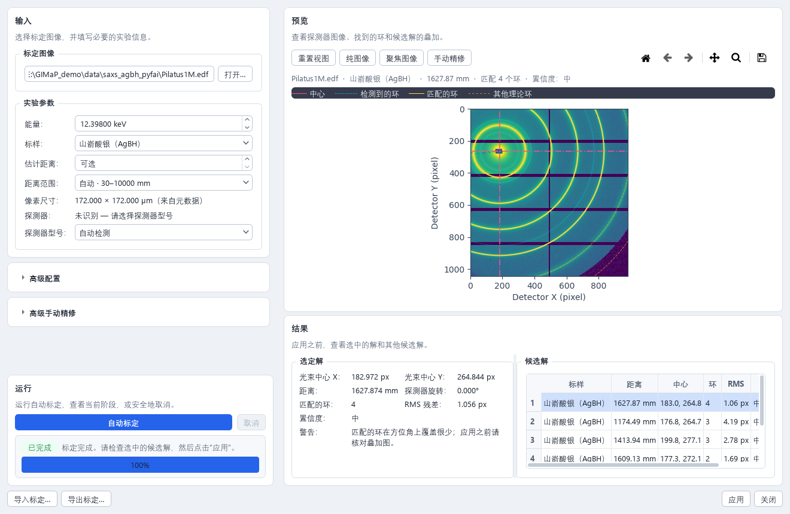
*几何标定：标样上拟合出的环、选定解和候选解。*

**这个窗口里的光束中心**用和分析页相同的像素坐标显示和输入（4.4 节），可以在两处直接对照或抄写。
导出的标定文件仍按以前版本的方式记数：其中光束中心按像素中心从 0 数，比窗口显示的小半个像素，文件里写明了这一点
（`metadata.center_convention`）。导入这个文件后，窗口显示的中心和原来相同。

**已知限制：错误的解可能排在第一。** 下面两种情况都是在一张路径里没有标样名的山嵛酸银（silver behenate，AgBh）
图像上看到的。

- 标样保持**自动识别**、没有估计距离时，另一种标样的解可能排在第一：一个距离短得多的 LaB₆ 解排在第一，
  山嵛酸银的解排在候选表的最后。知道标样时请自己选。大致的距离对自动识别也有帮助：这张图上输入 1500 到
  1800 mm 时，山嵛酸银的解排在第一。
- 估计距离错了会带偏结果，选对了标样也一样：搜索偏向**估计距离**附近的解。选了山嵛酸银、输入 2000 mm 时，
  排在第一的是约 1830 mm 的解，而实际距离约为 1630 mm；这一栏保持“可选”时，正确的解排在第一。

**估计距离**里可能有一个不是你输入的数。它从不填入内置的值：新安装时它保持“可选”。但每次打开图像，
它都会取图像文件写明的距离，没有的话取最近一次应用的标定的距离，即使你之前输入了别的值或清空了这一栏；
两者都没有时，你输入的值保留。最近一次应用的标定可能属于别的装置或别的探测器。请输入你这套装置的大致距离；
不知道时把这一栏设为 0（这时显示“可选”）。

按**应用**之前，请核对距离是不是你这套装置的距离，画出的环是否落在图像的环上。这一点会在以后的版本中改正。

### 4.4 像素坐标

分析页、几何标定窗口和 XRR 序列提取窗口用同一套像素坐标显示和输入光束中心：

- 像素的角点落在整数上，所以第一个像素的中心是 (0.5, 0.5)；
- x 从图像（按显示的样子）的左边起算，y 从上边起算（第 0 行在上）；
- 光束中心是直射束的位置。

因此同一个配置在三个窗口里显示同样的数，中心可以从一处直接抄到另一处。

别的程序可能用别的数法。例如 1.3 节的 GALAXI 帧，文献给出的直射束是从左下角数的 (597.1, 323.4) px；
在 GIMaP 里是 (597.1, 719.6) px。

**导出的文件从 0 数。** 几何标定导出的 `.json`，以及 XRR 序列提取的 CSV 和 JSON 记录，都按像素中心从 0 数，
比窗口显示的小半个像素，和以前的版本一样。每个文件都写明了这一点（标定文件里是 `metadata.center_convention`，
XRR 记录里是 `center_convention`）。导入这样的文件后，窗口显示的仍是窗口的数。

训练集构建（实验室）沿用它的训练数据所用的约定（第 10 章）。

### 4.5 分析页里的光束中心

除非你修改，用的都是配置里的光束中心。**几何**步骤把它显示在**光束中心**（Beam centre）按钮上
（`Beam x, y px · 来源`，四位小数）；它的菜单有：

| 菜单项 | 作用 |
|---|---|
| **在图上点选**（Pick on Image） | 在探测器图像上点直射束（只在**探测器**视图，不在 q 图上；`Esc` 取消） |
| **输入坐标…**（Enter Coordinates…） | 在一个小窗口里输入中心（见下） |
| **使用文件头中的中心**（Use File Header Centre） | 用文件里写的中心（如果有的话；菜单项上显示它） |
| **按对称性细化 x**（Refine x by Symmetry） | GISAXS：和**使左右对称**（Make Left and Right Symmetric）相同的搜索（4.6 节） |
| **回到配置中的中心**（Back to Profile Centre） | 丢掉本次会话设的中心 |
| **保存到配置**（Save to Profile） | 把本次会话的中心写进仪器配置 |

也可以在图上拖动青色十字。用以上任何一种方式设的中心，都对本次会话中所有相同探测器尺寸（行 × 列）的帧有效；
尺寸不同的帧回到它们配置里的中心（打开上面那个设置时，用文件头里的中心），并有一条通知说明。设置文件和项目也会记下它。**保存到配置**让它长期有效。

**几何…** 和**输入坐标…** 打开的小窗口在你操作时保持打开，你可以一边调中心一边看曲线：

- 坐标显示四位小数；
- **中心调整步长**（Centre step）设定上下箭头按钮、方向键和鼠标滚轮每次移动多少（最小 0.0001 px）；
  两个窗口共用这个值，并且会记住；
- **应用中心**（Apply Centre）在本次会话中使用这个中心并重画曲线；可以反复调整和应用；
- 勾选**实时预览**（Live Preview）后，每次改动都会自动重画曲线。快速连续的改动会合并处理，你在曲线上设的缩放会保留；
- **保存配置**（在几何… 里）保存全部几何数值，窗口保持打开；
- **关闭**（Close）保留最后一次应用的中心，丢掉还没应用的输入。

换文件或换帧、清空列表时，这些窗口会关闭，这样为一个探测器输入的中心永远不会被用到另一个探测器上。

### 4.6 使左右对称

GISAXS 的水平切线关于 qy = 0 对称。光束中心列稍有偏差时，I(qy) 的两半对不上。**使左右对称**
（Make Left and Right Symmetric；**切线**步骤，GISAXS）把中心列移到切线的对称轴上：

1. 先在整条水平切线上粗搜索，找到对称轴；
2. 再精修：比较试探轴左右两边有效像素的列均值（和曲线显示的一致）。每一对按 1 / 到轴的距离加权，这样距离每增大
   同样的倍数，权重大致相同，远处大量的像素不会压过低 q 的结构。没有测到像素的列（缝隙、整列被掩膜）不参与，
   不跨缝隙插值，离轴不到 1 px 的点不用。

只改 x，y 保持不变。结果显示在一条通知里（粗定位 … → 精修 … px）。0.0001 px 是数值计算的停止容差，
不是测量的不确定度。数据覆盖不够，或有几个轴拟合得同样好时，中心保持原样，通知会说明原因。

搜索在后台运行；再按一次这个按钮（此时显示**取消中心搜索**，Cancel Centre Search）就停止。新的中心对本次会话有效
（4.5 节）；**光束中心 ▸ 保存到配置**让它长期有效。GISAXS 帧的自动分析会自己做这一步。

## 5. 分析（Analyze）

**分析**（Analyze）是处理探测器帧的唯一工作区，GISAXS 和 GIWAXS 都在这里。它把一帧变成以 q（Å⁻¹）为横轴的曲线，
显示曲线上每个点来自图上哪里，并把曲线连同“怎么得到的”记录一起写出。**拟合**（Fitting）只拟合曲线；
凡是涉及探测器图像的操作都在这里。

页面分五部分（3.1 节的截图显示了打开一帧 GIWAXS 时的这五部分）：

| 部分 | 内容 |
|---|---|
| 命令栏 | **打开…**（Open…，箭头里是 **打开文件夹…**（Open Folder…））、↶ ↷（撤销 / 重做）、‹ ›（上一帧 / 下一帧，列出多于一帧时出现）、模式 **自动 / GISAXS / GIWAXS**（Auto / GISAXS / GIWAXS）、αi、**运行自动分析**（Run Automatic Analysis，运行时旁边出现 **停止**（Stop））、**问 AI…**（Ask AI…）、**导出**（Export）▾、**批量导出…**（Batch Export…，列出多于一帧时出现）、**发送到拟合**（Send to Fitting）▾ |
| 步骤（左） | **数据**（Data）、**几何**（Geometry）、**掩膜与校正**（Mask & corrections）、**切线**（Cuts）、**结果**（Results）、**导出**（Export）。每一步显示状态（✓、!、✕ 或进行中）和一句结论；点开是这一步的控件，少用的选项折叠起来。 |
| 图像（中） | **探测器**（Detector）、**q 图**（q map）或 **展开图**（Cake，GIWAXS）、**对数**（Log）、色图、**色阶**（Levels）、**标记**（Marks）、缩放、**适配视图**（Fit view）、**来源**（Sources）、**保存**（Save）▾；图下方是光标处的读数 |
| 标签页（右） | **曲线**（Curves，上下两个曲线图）、**结果**（Results，自动分析或 AI 的发现及其证据）、**序列**（Series，每一帧的强度对帧号和 q 的热图） |
| 状态行 | 正在做什么、进度条和 **取消**（Cancel）。写出文件后右下角有提示，带 **打开文件夹**（Open Folder）。 |

窗口较窄时，命令栏会缩短长按钮的文字（3.3 节），必要时把操作按钮移到第二行。

模式：**自动** 时，探测器最远处的散射角超过 2θ = 20° 的帧按 GIWAXS 处理，否则按 GISAXS。自动模式每一帧都重新判断。
选 **GISAXS** 或 **GIWAXS** 可以强制指定；强制的模式看起来不适合当前帧时，状态行会提醒。

αi 框在你输入之前显示配置中的 αi；输入的值以橙色显示，一直保留，直到你右键 ▸
**回到配置中的 αi**（Back to Profile αi）（4.1 节）。

几何——仪器配置、查找标定、光束中心及其对话框——见第 4 章。本章从一帧已经有几何开始。

### 5.1 打开数据与帧列表

GIMaP 读取 CBF、TIFF 和 EDF 帧，以及 NeXus/HDF5 文件（`.nxs`、`.nx`、`.nx5`、`.h5`、`.hdf5`、`.hdf`）。
属于一起的文件是一个*数据源*：同一探测器的各模块文件拼接起来，master 文件和它的数据文件一起读，多帧文件里的每一帧都是
序列中的一帧（见下面的 *NeXus 与 HDF5 文件*）。

1. 用以下任一方式打开帧：
   - 命令栏的 **打开…**（`Ctrl+O`），或它的箭头 ▸ **打开文件夹…**（`Ctrl+Shift+O`）；
   - 把文件或文件夹拖到窗口任意位置；
   - 开始页，或 **文件 ▸ 最近打开**（File ▸ Open Recent）。
2. 分析页立即打开，在后台检查这些数据源（导入慢时，**取消导入**（Cancel Import）可以停止）。打开的文件夹自己没有帧、
   下一层有（每个探测器写一个子文件夹）时，就打开下一层，状态行说明打开了哪些子文件夹。
3. 有多帧的数据源时，**导入帧**（Import Frames）窗口问要列出哪些帧，每个数据源分别选：**全部帧**（All Frames）、
   **帧范围**（Frame Range，首帧到末帧，每 n 帧取一帧）或**指定帧**（Specific Frames，用逗号分隔的帧号，从 1 数，
   例如 `1, 5, 20`）。列出的只是引用：显示哪一帧才读哪一帧，所以几千帧的堆栈也能很快打开。
4. **数据** 步骤在图像载入期间先显示数据源的名字，载入后显示探测器、图像尺寸和帧。帧有几何时，曲线自动出现，不需要再点。
   没有几何时，图像上方的提示条提供 **自动查找标定**（Find Calibration Automatically）、**输入几何…**（Enter Geometry…）
   和 **标定…**（Calibrate…），见 4.2 节。

**帧列表**（数据步骤）里每个已导入的帧一行，不论它来自单独的文件还是 NeXus 堆栈：

- 点一行即读取并显示这一帧。`Page Up` / `Page Down`，或命令栏的 ‹ ›，只在已导入的帧之间前后切换。
- 有多帧的数据源时，步骤上方出现一条 **帧 [4] 共 12 帧**（Frame [4] of 12），用来选帧（从 1 数）。没有导入的帧，
  要先用 **选择帧…** 加进来。
- **选择帧…**（Choose Frames…，在列表下方）事后修改导入的选择（**保留当前选择**（Keep Current Selection）让一个数据源保持原样）。
  生成热图、批量导出和把序列发送到拟合处理已导入的帧，再用各自的范围、间隔和求和。求和不会跨过没有导入的帧；帧号、时间和
  记录里写的文件保持原来的意义。改变选择会清除旧选择的序列热图和批量拟合预览。项目保存这个选择。
- 要从列表中去掉一个数据源：右键它的某一行 —— **从列表移除整个数据源**（Remove Source from List）、
  **在文件夹中显示**（Show in Folder）、**复制路径**（Copy Path）—— 或选中后按 `Delete` 或 `Backspace`。它的全部帧都被移除；
  文件本身不受影响，列表的其余部分、序列热图和批量导出照常继续。
- **清除**（Clear）清空列表（序列热图一并清除）。
- **帧 ▸ 求和**（Frames ▸ Sum，折叠在列表下方）把连续几帧相加以改善统计：当前帧加上后面几帧（后续文件，或 NeXus 文件中的后续帧）。
  批量导出和监视文件夹时按同样的组大小求和。
- 列表上方，数据步骤写出当前数据源由什么组成（例如 *11 module files · 240 frames · stitched*）、帧的方向，以及（用警告色）
  它缺了什么。**文件头**（File header）一行写出文件里的能量、距离和曝光时间（以 s 计）。
- 一帧的文件变了（名称、修改时间或大小）时，**F5**、重新显示这一帧和监视文件夹都会重新读它；没变就不重读。

**监视**（Watch，在 **清除** 旁边）在测量期间监视一个文件夹：选好文件夹后，每 2 秒看一次。新帧写完即加入列表，并显示最新的一帧。
再按一次 **监视** 停止。

- 探测器一帧一帧写进的一个文件（或一组模块文件）在增长时就跟着：每次只取上一次看时已经在文件里的帧，最新的一帧可能还在写，
  等下一次再取。数据步骤写着 *还在增长：第 N 帧是目前最新的完整帧*。这期间开始的序列热图或批量导出也只取这些帧。
  同一台 Windows 电脑上的程序如果用 HDF5 的文件锁写文件，别人就读不了它：这样的文件显示为正在写入，关闭后再读。
- 勾选 **导出 ▾ ▸ 监视时导出新帧**（Export New Frames While Watching）后，每个完整的新帧导出一次（写到数据旁边的
  `gimap_analysis/`；设置了 **求和** 时只导出凑齐的组）。一组模块文件要等到齐全、并静止约 10 秒后才导出；缺模块文件时状态行会说明。
- 已经生成的序列热图会随新帧增长，不需要再按 **生成热图**（开启导出而还没有热图时，会用所选的曲线自动生成一张）。
  点选热图的一行后，热图不再跟随最新的帧；序列选项里的 **显示最新的帧**（Show the newest frame）可以恢复跟随。
- 另一个程序占着不放的文件每次都再试，并在状态行说明一次；从列表移除的数据源再增长时会重新列出。

#### NeXus 与 HDF5 文件

数据源是什么由文件的内容决定，文件名只作提议：

- **一个文件一帧**——每个文件是一帧；一文件夹这样的文件是一个序列；
- **一个文件装整个序列**——一摞帧（扫描点 × 帧的网格按存储顺序读，数据步骤会说明）；
- **每个探测器模块一个文件**（P03 Lambda 9M：`…_m01.nxs` … `…_m11.nxs`，每个文件都有全部帧）——每帧拼成一幅，以扫描名
  （不带 `_m01`）命名。只有这些文件装着同一个数据集、模块尺寸相同、模块位置各不相同时，才算一组；只是名字相像的文件各自单独读，
  数据步骤说明原因；
- **master 加数据文件**（Eiger：`…_master.h5` 和 `…_data_000001.h5` …）——一个数据源，帧依次分布在各数据文件里。

不含探测器图像的 HDF5 文件（模型权重、结果表）不会从文件夹中列出。

**图像**取文件标为默认绘图的数据集，没有的话取探测器的 `data`，再没有就取最像图像的数据集；掩膜、平场和暗场从不当作图像。
一个文件里有几幅图像时，显示一幅并列出其余的（格式转换和几何标定里可以选）。

**方向。** Lambda 服务器（P03）写的文件照 GIMaP 一直以来的方式显示：各模块按位置拼接，再转置并上下翻转（旋转 90°）；数据步骤写
*P03 Lambda: transposed and flipped*。其他所有 NeXus/HDF5 图像按存储原样读，第 0 行在上，与同一探测器的 CBF 或 TIFF 相同
（*Image as stored in the file*）。以前的版本把这些文件也转了：用以前的版本在这种文件上做的几何或掩膜不再适用。请核对
（正方形的帧仍会按尺寸匹配到旧的仪器配置）。

**数值。** 文件头的值按各自的单位读——以 ms 写的曝光时间显示为 s，能量可以是 eV 或 keV，距离可以是 mm 或 m；GIMaP 不认识的单位
不取，不猜。探测器的 `pixel_mask` 会被采用；无符号整数数据中，该类型的最大值表示“无数据”。

**缺了什么就说什么，从不补上**：缺一个模块文件（探测器的那部分留空）、各模块文件的帧数不同（只用每个模块都有的帧）、缺一个数据文件
（它之后的帧读不了）、要的帧超出末尾（报错，不会改读最后一帧）。还在写的文件读到写好的部分，变了再重读；另一个程序占着的文件
在它关闭之前读不了；写入程序没关文件就结束了时会说明（对它的副本运行 `h5clear -s` 就能读）。用 bitshuffle 或 LZ4 压缩的文件
需要 Python 包 `hdf5plugin`（已在 `requirements.txt` 中）。

### 5.2 掩膜与校正

**掩膜与校正** 步骤说明排除了多少像素以及原因：探测器缝隙与标记像素、本帧找到的热 / 死像素、你的掩膜、缝隙保护、
强度范围、背景，以及从镜像一侧补齐了多少像素。

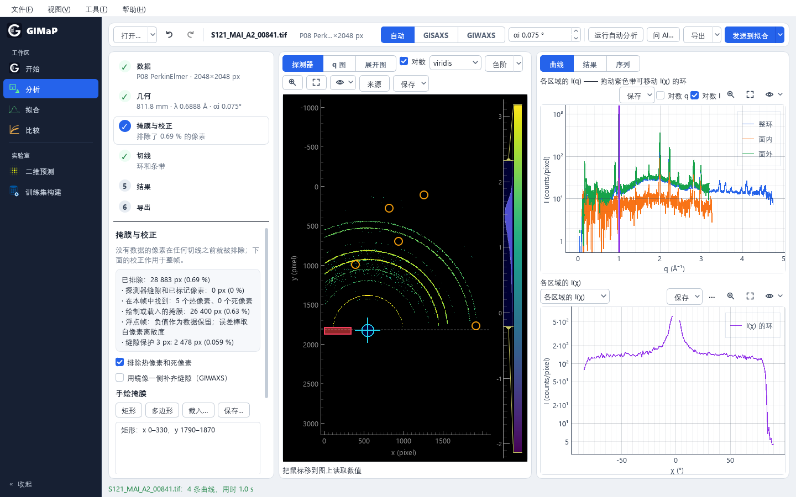

*顶部的摘要按类统计被排除的像素；图上琥珀色圆圈标出本帧找到的热像素，红色矩形是手绘掩膜。*

**在图上显示被掩膜的像素**（Show Masked Pixels on the Image）在探测器图上标出它们：红色 = 排除，
琥珀色圆圈 = 热 / 死像素，青色 = 由镜像补齐（参与曲线计算）。

**哪些像素算数据。** 整数计数探测器上的负值是缝隙码，被排除。浮点帧（已扣暗场或背景）上的负值是数据，保留。

**坏像素** —— **排除热像素和死像素**（Leave out hot and dead pixels，默认开，会记住）。GIMaP 在每一帧中排除：

- 孤立的热像素：比周围 8 个邻居都亮，且高出 5 倍和 10 个标准差（计数探测器用泊松标准差，浮点帧用全帧的稳健噪声）；
- 死像素（只在计数探测器上判断）：读数为 0，而每个邻居都至少有 20 counts；
- 缺陷探测器行 / 列上零散的亮像素——它们成对出现时，单像素检测发现不了。

凡是宽于一个像素的东西——布拉格斑点、条纹、beam stop 边缘、Yoneda 带——都保留。不会整行整列去掉。
排除的数量写进导出记录（`bad_pixels_left_out`）。关掉这个选项，这些像素就回到曲线里。

**手绘掩膜**（Masks you draw）：

1. 按 **矩形**（Rectangle），在探测器图上点两个对角；或按 **多边形**（Polygon），逐个点击角点
   （双击或 `Enter` 闭合，`Backspace` 删除最后一点，`Esc` 取消）。
2. 掩膜以红色轮廓显示，并立即从所有曲线中排除。
3. **删除所选**（Remove Selected，或在列表中按 `Delete`）和 **清除掩膜**（Clear Masks）删除掩膜；探测器缝隙始终保持掩膜。
4. **保存…**（Save…）把手绘掩膜存为 `.json`（使用 4.4 节的像素坐标）。**载入…**（Load…）读取这种文件，
   或同尺寸的掩膜图像（EDF 或 TIFF，非零 = 掩膜，与 pyFAI 相同）。

**用镜像一侧补齐缝隙（GIWAXS）**（Fill gaps from the mirror side (GIWAXS)，默认关）。GIWAXS 图样对 ±q∥ 对称。
没有数据的像素（模块缝隙、掩膜、热像素）取它关于光束中心列的镜像位置的值，在两列之间插值，两列都须有数据。
镜像处也没有数据的地方保持空缺。导出记录写明补齐的像素数，并告诉拟合：计数统计不再成立。

**校正**（Corrections，折叠）：背景帧（**选择…**（Choose…），以及 **比例**（Scale），NeXus 文件还有 **帧**（Frame））、
有效原始强度范围（**最小** / **最大**（Min / Max））、**缝隙保护**（Gap guard，默认 3 px，可设 0–20 px，会记住）——
离缝隙和坏像素这么近的像素也被排除。

处理顺序固定：探测器无效像素 → 热 / 死像素 → 掩膜 → 背景 → 缝隙保护 → 强度范围 → 镜像补齐 → 强度校正。
曲线、q 图、展开图和导出都使用处理后的帧。

**强度校正（GIWAXS）**（Intensity corrections (GIWAXS)，折叠，默认关）。每个像素除以一个因子；q 不变：

| 校正 | 因子 | 需要输入 |
|---|---|---|
| **每个像素的立体角（cos³2θ）**（Solid angle of each pixel (cos³2θ)） | 平板探测器为 cos³2θ，光束处为 1 | — |
| **偏振，因子**（Polarisation, factor） | pyFAI 的公式，因子 f | f（默认 0.99）：同步辐射 0.95–0.99（水平偏振），非偏振的实验室光源为 0，竖直偏振为 −1 |
| **薄膜内的吸收**（Absorption in the film） | 出射角 αf 下光在薄膜中的路径，相对于 αf = αi | **厚度**（Thickness，nm）、**衰减长度**（Attenuation length）1/µ（µm，查 CXRO 或 NIST 等表） |

峰位不变。在 χ 或 q 之间比较强度时会变——取向、极图、结晶度比值。薄膜吸收不含折射，因此只在远高于临界角时有效；开启后，位于样品地平线及其下方的像素被排除。
对光子计数，误差随之传递：校正后像素的方差为其值除以因子。JSON 记录（`intensity_corrections`）写明公式和参数。

### 5.3 切线

**切线** 步骤管理切线位置。**自动切线**（Auto Cuts）回到自动给出的位置。

#### GISAXS：水平切线与竖直切线

GIMaP 找到 Yoneda 带（在样品地平线与出射角 1.5° 之间、镜面反射棒两侧测得的最亮行），然后取：

- **水平切线** I(qy)：Yoneda 行处高 5 px 的条带（图上为橙色）；
- **竖直切线** I(qz)：光束中心列处宽 10 px 的条带。

找不到 Yoneda 带时，水平切线放在地平线上方，步骤里会说明——请检查 αi。要移动切线，在图上拖动橙色条带
（拖动边缘可改变高度），或双击某一列来移动竖直切线。步骤会说明切线位于 Yoneda 带、由手动设置，还是在地平线上方。

**水平切线的两半**（Halves of the horizontal cut）。qy 有正负：光束两侧是同一结构的两次测量。选择送去拟合的曲线用哪部分：

| 选项 | 拟合用的曲线 |
|---|---|
| **两半都画在 \|qy\| 上（两种颜色）**（Both halves on \|qy\| (two colours)） | 两半都折叠到 \|qy\| 上 |
| **两半取平均**（Mean of both halves） | 两半的平均 |
| **qy < 0 半边** / **qy > 0 半边**（qy < 0 half / qy > 0 half） | 只用一侧 |

同一选项也在 **发送到拟合 ▾** 和 **工具 ▸ 设置… ▸ 分析**（Tools ▸ Settings… ▸ Analyze）中。**使左右对称**（Make Left and Right Symmetric）把光束中心列移到
切线的对称轴上（只改 x；方法见 4.6 节）。

#### GIWAXS：区域，环 / 扇区 / 斑点

一帧 GIWAXS 在上图给出 I(q)，在下图给出 I(χ)。χ = 0° 是表面法线方向，±90° 是样品平面。

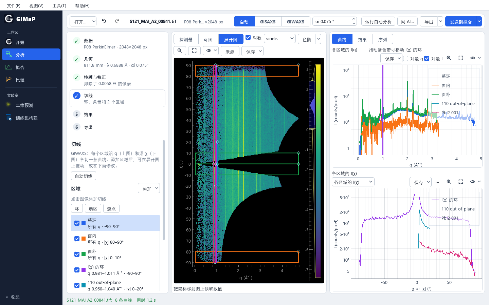

*每个区域有自己的颜色，在列表、q 图、展开图和曲线图中相同。*

图像上方有三种视图：

- **探测器** —— 测得的原始帧，单位为像素；
- **q 图** —— 强度重新网格化到 q∥（qr）和 qz 上；
- **展开图** —— 展开为 χ 对 q：环是竖线，区域是矩形。

图像上方的 **保存 ▾**：**当前视图存为图片…**（View as Figure…，带色标）或 **当前视图数据存为 CSV…**
（View Data as CSV…，q 图或展开图的数据表，带坐标轴）。

**区域**（Regions）。一个区域 = 一个 q 范围 × 一个 χ 范围，可选两侧（±χ，折叠到 |χ|）。每个区域以自己的颜色给出两条曲线：
I(q)（上图）和 I(χ)（下图）。列表一开始就有标准切线——整环、面内带、面外带和 I(χ) 的环——自动分析和 AI 也使用它们。
勾选区域即显示。

**点一下添加切线。** 在 *点击图像添加切线*（Click on the image to add a cut）下按 **环**（Ring）、**扇区**（Sector）
或 **斑点**（Spot），再在探测器图、q 图或展开图上点一下：

| 按钮 | 点在 | 得到 |
|---|---|---|
| **环** | 一个峰（也可点上方 I(q) 曲线图上的峰） | 该峰的 q 窗口 × 所有 χ：用于取向的 I(χ) |
| **扇区** | 一个方向 | 该 χ 附近几度内（±5°，或斑点的宽度）的所有 q：沿该方向的 I(q) |
| **斑点** | 一个斑点 | 斑点的 q 窗口 × χ 窗口：该斑点的两条曲线 |

区域会自动对准峰：中心和 FWHM 由像素拟合得到，窗口为中心 ± FWHM，不会伸进相邻的峰。提示中给出 q、d 和 FWHM，并可撤销。
点击处附近没有明确的峰时，使用固定宽度，提示会说明。新区域按位置命名，例如 `Ring q 0.998` 或 `Sector |χ| 85°`。

**精确修改区域。** 选中区域，输入中心 ± **半宽**（Half width，q 精确到四位小数，χ 精确到 0.1°），或勾选 **全部 q**（All q）、
**所有 χ**（All χ）、**两侧（±χ）**（Both sides (±χ)）。下面一行显示实际范围和 d = 2π/q。**对准峰**（Snap to Peak）
把窗口重新对准最近的峰。**移除区域**（Remove Region）删除它。区域也可以在展开图上拖动和缩放。

**添加 ▾**（Add）中还有 **在展开图上绘制**（Draw on the Cake View，点两个对角）、**最强峰处的环**（Ring at the Strongest Peak）、
**面内带（|χ| 70–90°）**（In-plane Band (|χ| 70–90°)）、**面外带（|χ| 0–20°）**（Out-of-plane Band (|χ| 0–20°)）、
**整个图样**（Whole Pattern），以及 **保存切线…** / **载入切线…**
（Save Cuts… / Load Cuts…，区域集合存为 JSON，供下一组数据使用；载入会替换你添加的区域，标准切线不变）。
**最强的环**（Strongest Ring）把 I(χ) 的窗口放回最显著的环上。

**更多切线设置**（More cut settings，折叠）：**径向分箱**（Radial bins，默认自动）、**I(q) 的横轴**（I(q) axis，q 或 2θ），
以及 **q 框**（q box，一个 q∥ × qz 矩形，单位 Å⁻¹，可在 q 图上拖动），给出 I(qz) 和 I(q∥)。下图的下拉框选择
**各区域的 I(χ)**、**q 框：I(qz)** 或 **q 框：I(q∥)**。

### 5.4 曲线与结果

**曲线上的点从哪里来。** 每个点是一个 bin 内有效像素的平均强度。bin 不比一个像素更细。像素很少的 bin（光束附近、区域边缘）
沿 q 与相邻 bin 合并，但不跨越缝隙；I(χ) 不合并。没有像素的 bin——缝隙、被掩膜的 χ 范围、缺失楔——没有点，曲线在那里断开。
误差棒 σ：未扣背景的整数计数为 √sum / n；浮点帧、扣背景或镜像补齐后为像素的离散度 s / √n。GIMaP 从不平滑曲线：
想要更平滑的曲线，就加宽区域的 χ 范围或调小 **径向分箱**。

**来源。** 按 **来源**，探测器图上会以曲线图中的颜色显示每条曲线来自哪些像素。点一条曲线，只看它的区域。

**曲线图。** 每个曲线图有：

- **对数 I**（Log I）和 **对数 q**（Log q）（对数坐标轴；I(χ) 或 2θ 的图上后者为 **Log χ** / **Log 2θ**）。
  横轴取对数时，x ≤ 0 的点不画：要在对数 q 轴上看 GISAXS 切线的两半，请选 |qy|（见下）。切换坐标轴时，
  你放置的窗口带保持原来的数据范围。
- x 有正负时（水平切线的 qy、环的 I(χ)）：**±**（两半）、**+**、**−**，或 **|qy|** / **|χ|**（两半都画在 |x| 上，
  负半边用另一深浅的虚线）。这只改变显示和 **曲线图存为图片…**，不改变导出的数据和拟合用的曲线。
- 缩放（拖出矩形；在任何视图中按住 `Shift` 拖动也可以）、重置，以及标记（眼睛）按钮。
- **保存 ▾**：**曲线图存为图片…**（Plot as Figure…，论文图）或 **曲线存为数据…**（Curves as Data…，每条曲线一个 CSV
  加一份 JSON 记录）。
- 右键菜单（**复制图片**（Copy Image）、**复制数据**（Copy Data）…）、按住右键拖动缩放，以及窄图的 **⋯** 菜单，
  和所有曲线图一样（3.4 节）。

**色阶。** 每幅图像旁边是显示值的直方图，带两个手柄。拖动手柄或两者之间的带可以快速调整；在色标上滚动鼠标滚轮可放大色标，
做更细的调整。**色阶 ▾** 中有：

- **每帧自动**（Auto for every frame）及其 **规则**（Rule）：1–99.7 %、0.1–99.9 %、5–95 %、最小–最大、均值 ± 3σ；
- 以强度单位输入的 **最小** / **最大**；
- **自动一次**（Auto Once；直接点 **色阶** 按钮也一样）。

拖动或输入的上下限会一直保持——换帧、重新分析、实时序列热图都不会重置——直到你选回自动；此时按钮显示
**色阶（固定）**（Levels (fixed)）。上下限在对数和线性显示下含义相同。探测器图、q 图、展开图和序列热图各自保存自己的上下限。

**标记。** 每幅图像有 **标记 ▾**，每个曲线图有一个眼睛按钮：每类标记一个开关——光束中心、样品地平线、切线带、
掩膜和切线区域、像素叠加层、标出的热 / 死像素、q 框、色标、窗口带——以及 **显示全部标记** / **隐藏全部标记**
（Show All Marks / Hide All Marks）。隐藏的标记在换帧和下次启动时仍保持隐藏。同一菜单可删除你画的东西：
**删除画的掩膜**（Remove the Drawn Masks）、**删除全部切线区域**（Remove All Cut Regions）、**删除 q 框**（Remove the q Box），
都可撤销。在 q 图上，光束中心是直射束（q∥ = 0，qz = 0），位于图的正下方；样品地平线以虚线画在 qz = k sin αi 处。

**撤销 / 重做**（↶ ↷，`Ctrl+Z`、`Ctrl+Shift+Z` 或 `Ctrl+Y`）。对设置的每次改动是一步：画一个掩膜、添加或移动区域、
拖动条带、仪器配置、αi、光束中心、模式、校正、求和的帧数、载入设置文件、应用 AI 卡片。一次拖动或同类改动的快速连续操作算一步。
提示会说明下一次撤销改的是什么（例如 *Undo: cut regions*）。已保存的仪器配置不能这样撤销。

### 5.5 运行自动分析

**运行自动分析** 对当前显示的帧执行 GIMaP 的标准流程。它不需要 AI，GIWAXS 和 GISAXS 都适用。

运行前，可以在 **结果** 步骤中填写 **束线时笔记**（Beamtime notes）：αi、能量、像素尺寸、标定文件在哪——知道什么就写什么。

**GIWAXS。** 运行时依次：

1. 确定几何（仪器配置、数据附近的标定文件，或标样图像）；
2. 序列取最后的若干帧求和：最后五分之一的帧，至多 10 帧（不到十帧时只取最后一帧）；
3. 寻峰并拟合；
4. 比较面内与面外；
5. 给出最强可靠环的取向和 Scherrer 尺寸。

结果标签页显示 **峰**（Peaks）、**检查**（Checks：阴影、伪影、没测到的范围）、**几何**（Geometry：来源、距离、光束中心、
波长、αi）、**序列**（Series，带 **与序列开头比较**（Compare with the Start of the Series））和 **报告**（Report）。
尺寸是 Scherrer 下限。物相不会自动指认。


*峰表（q、d、FWHM、可信度、Scherrer 尺寸 L、OOP/IP）；下方的 **拟合细节** 展开后显示所选峰的拟合。*

**GISAXS。** 运行时依次：

1. 确定几何，并与 GIWAXS 一样，序列取最后的若干帧求和；
2. 在 Yoneda 带取水平切线（找不到时提示检查 αi）；
3. 把光束中心列移到对称轴上；
4. 选择两半：两半都可用且一致时取平均，否则用可用的一半，并写出理由（一半被遮挡、被缝隙切断、太短）；
5. 给出面内间距 2π/q*（只有 shoulder 时作为提示）；
6. 用物理模型拟合 I(qy)：球、竖直圆柱和随机取向圆柱，含尺寸分布和间距 D。

多个模型的 χ² 都在最佳值的 10 % 以内时，单凭曲线无法决定模型：结果标签页会问你预期哪一个，并指出与测得间距一致的那个。
**保存拟合曲线…**（Save Fitted Curve…：q（Å⁻¹）、I、σ 和最佳拟合）、**保存拟合表…**（Save Fit Table…：每个解及其参数（nm）
和 χ²）和 **保存图…**（Save Plot…）保存结果；**在拟合中精修**（Refine in Fitting）在拟合中打开准备好的曲线（按所选的两半）。


*切线及其两半、间距、拟合图（对数 q / 对数 I）和解的表格。*

**拟合细节**（Fit details，在峰表或拟合表下方，默认收起；打开后之后的报告也保持打开）跟随选中的行：

- 峰：拟合用到的点、高斯峰及其局部线性背景；q、d、FWHM 及其误差；峰高、面积、背景与斜率；S/N、χ²ᵣ、拟合窗口、
  Scherrer 尺寸、寻峰方法，以及该环在 q 图上测到、被遮挡或没测到的部分；
- 模型解：每个参数（R、σR/R、h、D、σD/D、权重、振幅、背景、分辨率）、χ²、是否收敛、计算次数与用时、q 范围、D 的初值、
  算法、警告，以及 **在拟合中查看**（Show in Fitting）——在拟合中打开曲线并画出这个解。

**只有你能回答的问题**（αi、能量、像素尺寸、标定文件及其标样、GISAXS 的模型）会在结果步骤中变成输入框。填好后按 **用这些答案再运行一次**
（Run Again with These Answers），或在输入框中按 `Enter`。

**运行期间**，右侧切换到结果标签页。顶部的面板显示正在进行的步骤和用时，并逐项勾选已完成的阶段。**停止**（面板和命令栏中都有）
在下一步开始前结束运行。正在进行的一步会先做完，面板说明在等什么（几何拟合或模型拟合可能要一分钟左右）。
已得到的结果会保留：**保存报告…**（Save Report…）或 **丢弃**（Discard）。

**结果属于哪一帧。** 结果属于运行时的那一帧。运行期间文件列表被锁定。切换到别的帧时，结果步骤会说明这些结果来自哪一帧；
回到那一帧时结果随之恢复。**保存报告…** 写出带图片的网页（`.html`，任何浏览器都能打开）或 Markdown 文本（`.md`）；保存对话框从数据所在文件夹开始。

自动分析设的求和只用于它分析的那一帧。序列热图、批量导出和把序列发送到拟合不用它（对话框和序列标签页会这样说明）；
要在那里求和，请自己设 **数据 ▸ 帧 ▸ 求和**。

**问 AI…** 让 AI 用同样的工具做同样的事，你在一旁看着（第 9 章）。

### 5.6 序列热图与阶段

列出多帧——多个文件、一个文件夹，或一个多帧的 NeXus/HDF5 文件——后，**序列** 标签页把每一帧的同一条曲线显示为强度对帧号和 q 的热图。

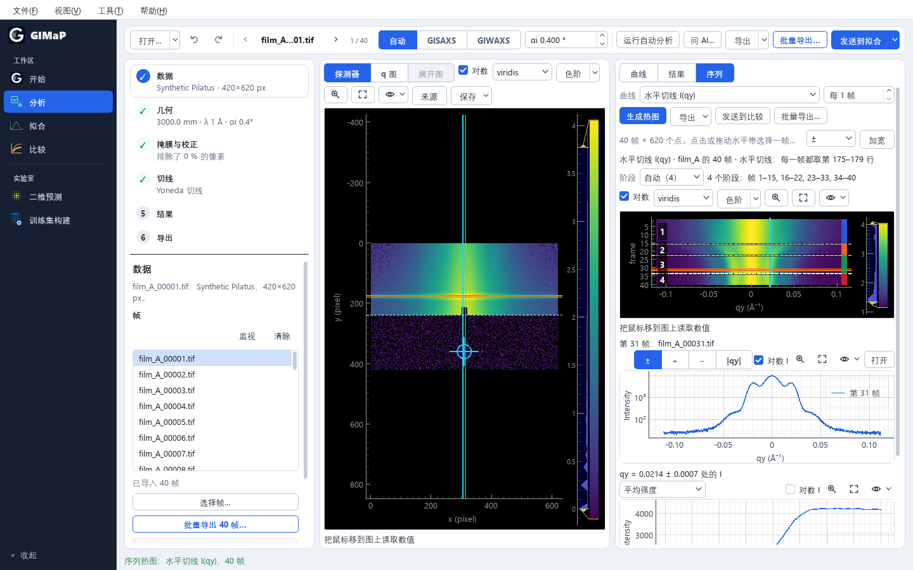

*拖动水平带选帧，拖动竖直带选 q 窗口。热图上方一行写出曲线、帧和每帧都用的切线；旁边的下拉框（±）选择切线的两半，帧轴从 1 数。
这里是一个 40 帧的合成序列：“3 个阶段：帧 1–17, 18–24, 25–40 · 1 个异常帧”。异常帧是第 34 帧，那一帧有几列探测器像素过亮
（qy 0.05 Å⁻¹ 附近短短的一个亮点）；热图旁的红色箭头标出它，它没有自成一个阶段。*

1. 选择 **曲线**（Curve；GISAXS 默认水平切线，GIWAXS 默认 I(q)；每个区域的 I(q) 和 I(χ) 都在列表里）。
   长序列可设 **每 n 帧** 取一帧，先快速看全貌。
2. 按 **生成热图**（Build Map）。每个已导入的帧（或每组相加的帧）用当前设置处理，热图随之逐步长出。长序列在多个低优先级进程中处理；
   面板显示进度、剩余时间，可 **暂停**（Pause）和 **停止**，已完成的行保留。
3. 拖动水平带选一帧：下方画出它的曲线；**打开**（Open）用序列的切线在分析页中显示这一帧。
4. 拖动竖直带选一个 q 窗口：再下方画出随帧变化的 **平均强度**（Mean intensity），或窗口中的峰——**峰位**（Peak position）、
   **峰宽（2.355 σ）**（Peak width (2.355 σ)）、**峰面积**（Peak area）、**峰高**（Peak height）（扣去直线背景后的质心、2.355 σ、
   面积和峰高）。窗口落在探测器缝隙里或数据之外时没有值：图上说明，不画点。
5. **导出 ▾**（热图生成后出现）：**热图导出为 CSV 表…**（Map as CSV Table…）、**热图导出为图片…**（Map as Figure…）、
   **阶段表…**（Stages as Table…）、**所选帧的曲线（图）… / （表格）…**（Selected Frame's Curve as Figure… / as Table…）、
   **随帧变化的曲线（图）… / （表格）…**（Trace as Figure… / Trace as Table…，下方曲线图每帧的值）、
   **每帧的峰表…**（Peak Table of Every Frame…）。

**整个序列一条切线。** 切线是自动的时候，热图的每一帧——以及批量导出、把序列发送到拟合和监视文件夹的自动导出——都切在屏幕上
这一帧切的地方：GISAXS 为 Yoneda 带的行和光束中心列，GIWAXS 为 I(χ) 的环。于是热图上相邻两行的差别来自样品，而不是切在哪里。
按钮下面一句写明这条切线（*序列的切线——horizontal cut: rows 202–206 for every frame*）。你自己设的切线本来就每帧相同。

**热图显示的是什么。**

- 每个点画在它测到的 x 上：谱线在它自己的 q 处，探测器缝隙保持为缺口（导出保留测到的 x）。
- 帧轴从 1 数，整数刻度——一个多帧文件时是文件里的帧号，几个文件时是在列表中的位置。
- GISAXS 水平切线时，热图旁的下拉框选择两半：**±** 两侧原样，**+** 或 **−** 一侧，**|x|** 两侧都画在 |x| 上，或 **mean**
  （两侧平均）。阶段、随帧变化的曲线和导出都跟随这个选择。
- 热图上方一行写出它的内容：曲线、两半、帧、切线和求和。生成之后设置改了，它会说
  *这张热图是用另一套设置生成的——请再点“生成热图”。*
- **加宽**（Wide）给序列标签页更多空间；热图下面的帧曲线和随帧变化的曲线随之变宽。

**选项：帧、切线、坐标轴**（Options: frames, cut, axes，折叠在图的下方）：

- **帧**（Frames）首帧 **到** 末帧（*最后一帧*：列表的最后一帧）：热图取的帧；不是全部帧时，按钮下面会写明。**清除** 恢复为全部。
- **在每一帧里重新找切线**（Find the cut again in every frame）：每帧重新找切线，而不是切在屏幕上这一帧切的地方。
- **帧轴**（Frame axis）：**帧号**（Frame number），或帧带有时间时的 **时间 (s)**（Time (s)，各帧的时间戳，或帧号 × 曝光时间）。
  保存的图片里每行等高，跳帧或时间间隔不等的帧在图上不表示真实的时间间隔；CSV 保留每行的帧号和时间。
- **阶段比较**（Stages compare）：**整个 x 轴**（The whole x axis），或 **热图当前显示的 x 范围**（The x range shown in the map，
  缩放热图，阶段随之改变）。
- **同时显示所选帧的图像**（Show the picked frame's image）：点选一行时也在分析页里显示那一帧。

热图和探测器图一样：对数、色图和色阶都能用。读数显示帧号、文件、x 和强度。热图属于生成它时的文件列表：之后再列出文件，
热图保留并标明是之前列表的热图；**清除** 会删除它。

**导出文件的名字。** 每个文件以序列、曲线和两半命名——`<序列>_<曲线>[_<两半>]_map.csv`、`…_map.png`、`…_trace_<量>.csv`、
`…_peaks.csv`、`…_stages.csv`——所选帧的文件按批量导出给这一帧的名字（`<帧>_<曲线>[_<两半>].csv`）。每个表格的 `#` 行写出它是
哪条曲线、哪两半、哪些帧、哪条切线，旁边有一个同名的 JSON 记录设置。

**结果：批量拟合。** 批量导出拟合每一帧时（5.7 节），热图下方出现 *结果：批量拟合*（Results: batch fitting）面板。每完成一帧就加一行：
参数、状态和失败的原因。选一行可看实际拟合的点和叠在上面的模型；**参数趋势**（Parameter trend）画出一个参数随帧号的变化。
不导出拟合曲线文件也能看；q 的单位为 Å⁻¹，长度为 nm。暂停、停止或结束后结果都保留，直到 **清除**、新一次批量拟合或改变导入的选择。

**阶段。** 热图一生成，GIMaP 就把序列分成若干阶段并标出异常帧（彩色阶段条、边界虚线、红色箭头；**阶段**（Stages）一行；
折叠的 *变化了什么，以及异常帧*；热图下方曲线图的下拉框中的 **沿序列的变化**（Change along the series））。
**批量导出时跳过异常帧**（Leave the odd frames out of Batch Export）让这个列表的下一次批量导出跳过它们。
**发送到比较**（Send to Compare）把这个序列放到其他序列旁边。阶段和异常帧怎样得到、怎样解读，见第 7 章。

### 5.7 批量导出

批量导出用当前设置处理每个已导入的帧，并写出你选择的内容。先把一帧设置好（几何、掩膜、切线），再用同样的方式导出全部。

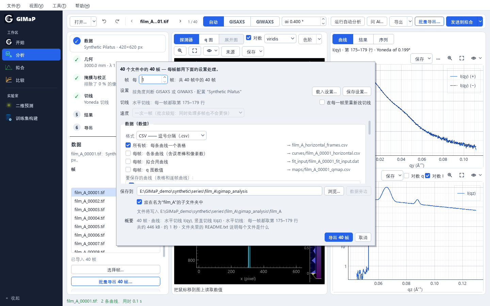

*每个选项旁边都写出它会生成的文件。切线一行写出每帧用的切线；概要写出多少帧、哪些曲线，以及导出大约多大、多久。*

**从哪里打开：** 命令栏的 **批量导出…**（`Ctrl+Shift+E`）、文件列表下的 **批量导出 N 帧…**、序列标签页的 **批量导出…**、
导出步骤、**导出 ▾**，或在开始页选一个原始数据文件夹。

**对话框：**

- 上方：**帧**（Frames，**每**（Every）n 帧取一帧）、**设置**（Settings，设置摘要，带 **载入设置…** / **保存设置…**（Load Settings… / Save Settings…））、
  **切线**（Cuts，每帧用的切线，旁边是 **在每一帧里重新找切线** 勾选框，见 5.6 节）、**速度**（Speed）。
- 中间四组：

| 组 | 选项 | 文件 |
|---|---|---|
| **数据（数值）**（Data (numbers)）—— CSV（逗号）、TXT（制表符）或 DAT（空格） | **所有帧：每条曲线一个表格**（第一列 x，之后每帧一列）；**每帧：各条曲线（含误差棒和像素数）**；**每帧：拟合用曲线**；**每帧：q 图数值**；**每帧：χ–q 展开图数值** | `<名称>_<曲线>_frames.csv`、`curves/<帧>_<曲线>.csv`（+ `_analysis.json`）、`fit_input/<帧>_fit_input.dat`、`maps/<帧>_qmap.csv`、`maps/<帧>_cake.csv` |
| **图片**（Pictures）—— PNG、TIFF、SVG 或 PDF | **每帧：探测器图像的图片**；**每帧：q 图的图片**；**色阶**（Colour scale）：每帧自己的上下限（1–99.7 %），或屏幕上的上下限、所有帧相同（图片可以相互比较） | `images/<帧>_detector.png`、`images/<帧>_qmap.png` |
| **转换格式的探测器帧**（Converted detector frames）—— TIFF、EDF、NumPy 或 HDF5 | **每帧：探测器数据转为其他格式**（按读取的值：模块已拼接、帧已求和） | `frames/<帧>.tif` |
| **拟合用曲线**（Curve for Fitting，GISAXS） | **切线的两半**（Halves of the cut）：**两半取平均**、**q > 0 一半** 或 **q < 0 一半**——每帧的模型拟合用哪一部分 | （写在拟合用曲线里） |
| **拟合（可选）**（Fitting (optional)） | 见下 | `<名称>_peak_fits.csv` 或 `<名称>_model_fits.csv`，以及同名 `.png` |

- 下方：**保存到**（Save to，**浏览…**（Browse…）；第一次是数据旁边的 `gimap_analysis/`，之后是上次用的文件夹；
  **数据旁边**（Next to the Data）回到数据所在的文件夹，上次用于别的数据的文件夹会注明）和
  **放在名为“<名称>”的子文件夹中**（In a subfolder named “<name>”，默认勾选）。下面一行写明文件会写到哪里；
  **导出 N 帧**（Export N Frames）开始批量导出。

**开始之前**，**概要**（Summary）写出多少帧、哪些曲线、哪条切线和哪两半，以及导出大约多大、多久。屏幕上的帧在去掉自动分析的求和
重新读的时候，切线一行会说明，**导出** 等它读完。写不了的文件夹立即说明，**导出** 不可用。文件夹里已有同一数据的导出（或拟合用曲线）
时，导出会问 **替换**（Replace）、**两者都保留（写到新的子文件夹）**（Keep Both in a New Subfolder）或 **取消**；问题里写出替换
会删掉哪些文件。只有这次导出会重写替换要删的每一种文件时，`Enter` 才是替换，否则是两者都保留。

选择表格和逐帧曲线时，勾选需要的曲线（**全部** / **无**（All / None））。在所有帧的表格里，点完全相同的帧并排放；点只差一点
（舍入、缺几列）的帧逐行对齐；只有网格真的不同时才插值到第一帧的 x 上，不跨缺口、不外推。表头写明是哪一种。文件夹里总会写
`README.txt`（每种文件是什么、曲线名称、单位、切线、求和、失败的帧）和 `<名称>_batch.json`（选项、帧列表、每个失败的帧及原因、
写出的每个文件、每帧的切线，以及第一帧的完整设置）。

**名字。** 文件名里的帧号从 0 数（`scan_00007_frame0003_sum3_…`；只有一帧的文件不带 `_frame`）；表头、标签和图片标题从 1 数
（*frame 4 of 12*），每个曲线文件在 `#` 行里写出它来自哪一帧、怎样求和、读了哪些文件。一组模块文件以扫描名命名，不带 `_m01`。

**拟合（可选）**——默认 **不拟合**（No fitting）：

- **环区域中的峰**（Peaks of the ring regions，GIWAXS）：每个有 q 窗口的区域（环或斑点）是一个峰。在该区域的 I(q) 中拟合，
  范围为窗口两侧各加一个窗口宽度，**峰形**（Peak shape）可选 Pseudo-Voigt、高斯、洛伦兹，加直线背景。每帧每个峰一行：
  q、d、FWHM、面积及其误差，峰高、η、χ²ᵣ，拟合不显著、太宽或点太少时写明原因。
- **水平切线的颗粒模型**（Particle model of the horizontal cut，GISAXS）：用球、随机取向圆柱或竖直圆柱（含尺寸分布和间距 D）
  拟合 **切线的两半** 里选的那一半或平均（**模型**（Model）：自动比较或指定一种；多于 1000 个点的切线先合并）。两半从不一起拟合。
  每帧一行：`halves`、`points`、模型、χ² 和各参数（nm）。约半分钟一帧。这个选择的初值：切线步骤选的是平均或某一半时用它，
  否则用上次批量导出的选择。没有计数、或所选的一半没有点（*No points on the q > 0 half*）的帧不拟合，原因列出来。
  拟合用曲线仍包含两半（qy 带正负），并写明所选的两半。
- **起始值**（Start values）：**上一帧的结果**（The previous frame's result；缓慢变化的序列）、
  **第一帧的结果（所有帧都用）**（The first frame's result, for every frame；帧之间互不影响），
  或 **每帧重新寻找**（Found anew in each frame）。
- **在当前帧上试拟合**（Try on This Frame）在批量之前用这些选项拟合当前显示的帧。**同时保存每帧的拟合曲线**
  （Also save the fitted curve of each frame）写出 `fits/<帧>_<曲线>_fit.csv`（峰）或 `fits/<帧>_model_fit.csv`
  （颗粒模型：拟合用到的点，单位 nm⁻¹，以及拟合）。
- 高斯峰和洛伦兹峰的 η 固定为 0 或 1；只有 Pseudo-Voigt 拟合 η。
- 每帧的拟合随做随显示在序列标签页的 *结果：批量拟合* 里（5.6 节）。

**原位校正（参考峰）**（In-situ corrections (reference peak)，折叠，GIWAXS）：用测量中不变的峰（衬底、内标）校正漂移。
填写 **参考峰 q**（Reference peak q）和 **搜索 ±**（Search ±，单位 Å⁻¹）；该窗口中最强的点就是这个峰。
**对齐探测器距离，使峰位于此 q**（Align the detector distance so the peak sits at this q）按帧缩放探测器距离；
**按峰高归一化强度**（Normalise the intensity to the peak height）缩放强度，可选
**整个序列用同一系数（取自第一帧）**（One factor for the whole series (from the first frame)）或
**每帧按各自的峰**（Every frame to its own peak）。

**速度：**

| 速度 | 做法 |
|---|---|
| **温和**（Gentle） | 一次一帧；电脑保持空闲 |
| **均衡**（Balanced，推荐） | 在低优先级进程中同时处理几帧（约四分之一的核心数，最多 4） |
| **快速**（Fast） | 同时处理更多帧（除两个以外的全部核心，最多 8）；其他程序会变慢 |

同时处理的帧数不超过一半空闲内存所允许的数量（一帧 Lambda 9M 图像，1490 万像素，处理时约需 1.4 GB）。
批次很短时只一次一帧，**速度** 框里会这样写明。举例：Lambda 9M 的帧、开启峰拟合，一次一帧约 2.5 s/帧，
*均衡*（同时 4 帧）不到 1 s/帧。

**结束后**，状态行写出导出了多少帧、写到哪个文件夹、用了多久，模型拟合成功了几帧、其余为什么没有成功；失败的帧连同原因逐一列出
（在面板里、`README.txt` 里和 `<名称>_batch.json` 里）。有帧失败或拟合失败的批次不以成功结束。

**运行期间**，右侧标签页上方的面板显示正在处理的帧、已完成数、每帧用时和剩余时间，以及最新的拟合。**暂停** 不再开始新的帧；
**停止** 在正在处理的帧完成后结束批次——已写出的都保留，表格包含已完成的帧。运行中可以调低同时处理的帧数。
序列标签页显示已完成各帧的热图，随帧完成而增长；**显示最新的帧**（Show the newest frame）让下方的曲线跟随最新的帧
（点某一行可看别的帧）。

选项和文件夹会记住，下次打开即是上次的选择。**保存设置…** / **载入设置…** 把整套设置（模式、仪器配置及其几何、αi、中心、
求和、掩膜、校正、切线区域、导出选项）存为一个文件：下一批原始数据只需 **批量导出…** → 文件夹 → **导出 N 帧**。
设置中提到的掩膜或背景文件找不到时，会列出并忽略。

### 5.8 导出与发送到拟合

**导出**（命令栏，`Ctrl+E`；导出步骤中为 **导出曲线…**（Export Curves…））在数据旁边的 `gimap_analysis/` 中写出：

- 每条曲线一个 CSV（`x, I, sigma, pixels`），名为 `<stem>_<曲线>.csv`；
- `<stem>_analysis.json`：来源、几何、光束中心的来源、校正、排除的坏像素数、切线；
- `<stem>_fit_input.dat`：拟合用曲线。

`<stem>` 是文件名；多帧文件中的一帧会加上 `_frame` 和帧号，求和时加上 `_sum` 和相加的帧数。

该文件夹无法写入时，GIMaP 会让你另选文件夹。右下角的提示列出写了什么，并带 **打开文件夹**。

**导出** 步骤和 **导出 ▾** 中还有：

| 项 | 写出 |
|---|---|
| **保存图像…**（Save Image…） | 当前显示的探测器图或 q 图，带色标（PNG、TIFF、SVG、PDF） |
| **保存 q 图数据…**（Save q-Map Data…） | 规则 q 网格（qy–qz 或 q∥–qz）上的强度，CSV 表格，带坐标轴 |
| **保存曲线图…**（Save Plots…：**保存上方曲线图…** / **保存下方曲线图…**） | 曲线图存为图片，单栏宽 |
| **保存设置…** / **载入设置…** | 整套设置存为文件（5.7） |

保存的图片总是使用浅色配色，与屏幕上的主题无关。

**发送到拟合** 在 `gimap_analysis/` 中写出 `<stem>_fit_input.dat` 并在拟合中打开。文件的列为 `q I sigma pixels`，
q 单位为 Å⁻¹，`#` 开头的行记录来源、缝隙保护、帧（*frame 4 of 12*）和相加的帧数。GISAXS 送出整条水平切线（qy 带正负），
拟合页按所选的两半使用它（箭头 ▾ 中选择，与切线步骤相同；选平均或一半时也写进文件）；GIWAXS 送出 I(q)，拟合页打开时提示
它的模型是颗粒的形状因子，不是峰。拟合页以 nm⁻¹ 显示 q，并标明单位。数据旁边的文件夹写不了时，GIMaP 让你另选一个，
并在本次会话里记住它。

**把序列发送到拟合…**（Send Series to Fitting…，在箭头 ▾ 和导出步骤中）打开只写拟合用曲线的批量导出对话框：
选好 **每**（Every）n 帧取一帧、文件夹，GISAXS 还有 **切线的两半**，**导出并在拟合中打开**（Export and Open in Fitting）
为每个已导入的帧（或每组相加的帧）写出 `fit_input/<帧>_fit_input.dat`，写进它自己的文件夹 `<名称>_fitting/`（在同一数据的
批量导出旁边，不动那次导出），并在 **拟合 ▸ 原位序列**（Fitting ▸ In-situ series）中打开它的 `fit_input/`（第 6 章）。

## 6. 拟合

**拟合**（Fitting）页用颗粒模型拟合一维曲线。页面顶部切换两种方式：

- **单条分析**（Single analysis）——一条曲线，分四步（6.2 节）。
- **原位序列**（In-situ series）——用单条分析的模型拟合一个文件夹里的每条曲线，或一个探测器序列的每一帧（6.6 节）。

来回切换时，两边各自的曲线、模型和结果都保留。没有打开曲线时，曲线步骤并排给出两个入口：**打开曲线…**（Open Curve…）
和**拟合一个文件夹的曲线…**（Fit a Folder of Curves…）。一个序列或一批样品通常这样做：先在这里拟合一条有代表性的曲线
（预测，再精修），然后在结果里按**拟合此文件夹的每条曲线…**（Fit Every Curve in This Folder…）。

拟合页内部用 nm⁻¹，每个坐标轴和输入框都标明单位。分析页用 Å⁻¹；它为拟合写出的曲线文件也是 Å⁻¹，打开时自动换算。

从 0.0.2 版过来的用户：原 Cut & Fitting 页的探测器部分现在由**分析**（Analyze）页承担，它写出拟合页要拟合的曲线。

| 原 Cut & Fitting 的控件 | 现在 |
|---|---|
| Import image、Previous / Next | 分析页的文件列表 |
| Detector parameters | 分析页的仪器配置（**几何…**（Geometry…）、**标定…**（Calibrate…）） |
| Find Yoneda & Set Cut、cut 厚度 | 分析页自动的水平切线（拖动条带或输入行号） |
| Optimize Center X | **分析 ▸ 光束中心 ▸ 按对称性细化 x**（Analyze ▸ Beam centre ▸ Refine x by Symmetry） |
| Mask negative pixels + guard | **掩膜与校正**（Mask & corrections）步骤 ▸ **校正**（Corrections，折叠）▸ **缝隙保护**（Gap guard，默认 3 px） |
| Stack | **数据**（Data）步骤 ▸ **帧**（Frames，折叠）▸ **求和**（Sum） |
| Cut region width | 拟合页的**拟合范围**（Fitting range） |
| In-situ CBF / NXS 序列 | 分析页 ▸ **把序列发送到拟合…**（Send Series to Fitting…），或直接在**原位序列**里用这些帧（6.6 节） |

### 6.1 拟合页读哪些曲线

拟合页读 `.dat` 和 `.txt` 文本曲线：

- 分析页的曲线文件 `<name>_fit_input.dat` 有四列——q（Å⁻¹）、强度、σ、参与平均的探测器像素数——文件头记录曲线的来源。
- 其他列为 `q I [σ]` 的 `.dat` / `.txt` 文件也能打开。文件头注明了 q 单位的文件按注明的单位读取——`#` 行里的
  `q in <单位>`，或第一列的列名（`q (1/A)`、`q_nm^-1`、`# columns: qy (1/A) …`、`# q [1/nm]  I`）；分析页的曲线文件注明 Å⁻¹。
  没有注明单位的文件，在**曲线 ▸ 文件 ▸ 文件头未注明时的 q 单位**（Curve ▸ File ▸ q unit of files without one in their header）
  里设（默认 Å⁻¹）。文件头同时注明 Å⁻¹ 和 nm⁻¹ 的文件打不开：*文件头同时注明了 q 的单位 1/A 和 1/nm；请改成只注明一种单位。*

拟合页不读 `.csv` 文件，分析页导出的 CSV 曲线也不读。请在分析页用**发送到拟合**（Send to Fitting），或打开 CSV 旁边写出的
`_fit_input.dat`。把 `.csv` 拖到拟合页上会被拒绝，并说明原因。

曲线进入拟合页的三种方式：

1. 命令栏里的**打开曲线…**（Open Curve…，拟合页显示时按 `Ctrl+O`），或把曲线文件拖到页面上。
2. **分析页 ▸ 发送到拟合**：写出 `<name>_fit_input.dat` 并在这里打开。分析页选的两半对应拟合页的**切线的两半**（Halves of the cut）：

   | 分析页 | 拟合页 |
   |---|---|
   | 两半都画在 \|qy\| 上（两种颜色）（Both halves on \|qy\| (two colours)，默认） | \|q\| 上的两半（Both halves on \|q\|） |
   | 两半取平均（Mean of both halves） | 两半取平均（Mean of both halves） |
   | qy < 0 半边（qy < 0 half） | q < 0 一半（q < 0 half） |
   | qy > 0 半边（qy > 0 half） | q > 0 一半（q > 0 half） |

   数据旁边的文件夹写不了时，分析页让你另选一个文件夹，并在本次会话里记住它。GIWAXS 的 I(q) 打开时，页面顶部有一条提示：
   拟合页的模型是 GISAXS 水平切线的颗粒形状因子，不描述衍射峰，所以不为它安排颗粒形状搜索（峰用**分析 ▸ 批量导出 ▸
   环区域中的峰**）。

3. GISAXS 自动分析之后（5.5 节），**分析页 ▸ 结果 ▸ 拟合细节 ▸ 在拟合中查看**（Results ▸ Fit details ▸ Show in Fitting）：
   打开同一条曲线，并把选中的解放进**模型**（Model）。尺寸和分布宽度经过换算，各 scale 在该解自己的曲线上求解。
   状态行写出拟合页的模型与该解相差多少：球和随机取向圆柱给出同一条曲线；拟合页的竖直圆柱按 R⁴ 给半径加权，
   所以只作为精修的起点载入。**在拟合中精修**（Refine in Fitting）只打开曲线，不带解。

### 6.2 单条分析：一条曲线，四步


*左边是步骤栏，这里打开的是结果步骤：质量、下一步（再拟合一次、拟合此文件夹的每条曲线…）、在范围边上自动处理了什么、警告，
以及每个值 ± 误差；右边是曲线与模型、橙色的拟合范围，下面是残差。*

布局和分析页相同：左边是步骤，每步写出当前状态；右边是图。

- **曲线图**：数据点（拟合范围外的颜色较淡）、整条曲线上的模型、拟合范围的**橙色条带**（可拖动）。
  **各项**（Terms）把模型的每一部分也画出来：每种颗粒、背景、分辨率峰。
- 下面的**残差图**：(I − model)/σ；文件里没有 σ 时为 ln(I/model)。
- **命令栏**：**打开曲线…**（菜单里有**载入模型…**（Load Model…））、**撤销 / 重做**（Undo / Redo，`Ctrl+Z` /
  `Ctrl+Shift+Z`：模型、拟合范围或排除的点的每次改动都是一步，每次拟合、选用解、载入模型也各是一步）、**拟合**（Fit，`Ctrl+Return`）、**停止**（Stop）和**保存**（Save：**数据与拟合…**、
  **曲线图…**、**模型…**）。

**1. 曲线**（Curve）

- 文件、点数、q 范围（nm⁻¹ 与 Å⁻¹）、q 按什么单位读取及单位从哪里来（*q 按 Å⁻¹ 读取：文件中注明*，或 *……：文件中未注明：
  用“文件头未注明时的 q 单位”的设置*）、文件里有没有 σ。拟合按 1/σ 给每个点加权；没有 σ 时每个点的相对权重相同。
- **切线的两半**，用于穿过光束的切线（q < 0 与 q > 0）：**两半取平均**（两半都测到的地方取平均；一半有缺口处和它到头之后
  只用另一半，从不插值）、**|q| 上的两半**、**q > 0 一半**或 **q < 0 一半**。*预测参数*、*寻找颗粒形状*和 *AI 建议*只能
  拟合一条曲线：选着 **|q| 上的两半** 时它们把下拉换成平均并说明；*精修*和*搜索*仍拟合两半。
- **拟合范围**，单位 nm⁻¹，也可以拖动橙色条带；**整条曲线**（Whole Curve）拟合所有点。
- 折叠的*文件*里：**文件头未注明时的 q 单位**（q unit of files without one in their header）——默认 Å⁻¹，原位序列也用它。
  文件头注明了单位的文件（分析页的曲线：Å⁻¹）按注明的单位读取，不管这里怎么设。改这个设置时，没有注明单位的曲线按新单位重新打开；
  注明了单位的曲线不变，状态行说明原因。项目和上次的会话保存曲线读取时用的单位和这个设置。之前保存的曲线照旧打开；
  只有文件头注明的单位与保存的不同时按文件头读取，状态行（项目则在打开项目的提示里）说明。
- **排除点**：打开图上方的**排除点**（Exclude），点一个点把它排除在拟合之外（再点一次恢复），或拖一个框排除框里的点。
  排除的点画成红色 ×，曲线步骤写出排除了几个，**全部恢复**（Include All）把它们放回。排除的点随曲线（和项目）保存，
  并写进拟合记录。

**2. 模型**（Model）

- **添加颗粒**（Add Particle）为每种颗粒加一张卡片：**球**（Sphere）、**随机取向圆柱**（Random cylinder）或
  **竖直圆柱**（Vertical cylinder）。
- 每张卡片有**间距 D**（Distance D）开关（相邻颗粒之间的准晶干涉）和各个值：scale、R 与 **σR/R**，随机取向圆柱还有
  h 与 **σh/h**，以及 D 与 **σD/D**。分布宽度一律是相对值（与分析页的结果和一维预测相同）。
- 勾选**拟合**（fit）：拟合可以改这个值。不勾选：这个值固定不变。
- **范围**（Ranges）显示每个值的 min – max。拟合把值限制在范围内；*在范围内搜索*在整个范围里搜索。输入范围外的值会扩大范围。
- **背景与分辨率峰**（Background and resolution peak）：I(q) = BG + k·[Σ 颗粒 + A/(1 + (|q|/w)^ν)]。
  这个峰描述直射束和反射束的尾巴以及 q = 0 附近的分辨率。因子 k 默认固定为 1。
- 拟合之后每个值显示 ± 误差；停在范围边上、又没有被处理掉的值显示*到达边界*（at a bound；见 6.3 节的*停在范围边上的值*）。

新安装从一个中性的模型开始，不带以前某次拟合的值。请按你的样品设颗粒类型和尺寸，或者让拟合步骤去找。

**3. 拟合**（Fit）——一个**方法**（Method）下拉框，一个按钮：

- 打开曲线时，页面替它选好方法。还没拟合过的 GISAXS 水平切线选**预测参数（fit1d）**（Predict parameters (fit1d)），
  方法下面一行写*推荐用于这条曲线：尚未拟合的 GISAXS 线切。*其他曲线在模型还没编辑过时选**寻找颗粒形状（不用 AI）**；
  否则保持原来的选择（GIWAXS 的 I(q) 从不选颗粒搜索）。预测或寻找形状之后，方法自动换成**精修模型中的数值**
  （Refine the values in Model）。
- 方法下面只多出它需要的：预测下面是**粒子**（Particles，6.4 节），寻找形状下面是**颗粒类型**（Families：*逐一尝试每种类型*或
  *模型里的类型*）。
- 按命令栏的**拟合**（`Ctrl+Return`），或下面那个以方法命名的按钮（例如**精修**（Refine））。运行时显示进度条和**停止**。
- **自动处理停在范围边上的数值**（Resolve values at the edge of their range automatically，默认勾选，会记住；原位序列也跟随它）：
  见 6.3 节。
- 折叠的**选项**（Options）里：预测的设置（网络、搜索、曲线类型、qz、系统误差；6.4 节）、**最多计算次数（精修、搜索）**
  （Evaluations at most (Refine, Search)，默认自动）和**一维预测批量窗口…**（1D Predict Batch Window…，6.5 节）。

**4. 结果**（Results），从上往下：

- 质量：χ²ᵣ（有 σ 时）或 ln I 的方差（没有 σ 时）、点数、自由参数个数、是否收敛。预测之后第二行说明模型里只是一个起点。
- 下一步：**精修这些数值**（Refine These Values，预测或寻找形状之后）、**再拟合一次**（Fit Again，同一方法，用模型里现在的值、
  固定的值和范围）和**拟合此文件夹的每条曲线…**（Fit Every Curve in This Folder…，对这条曲线所在的文件夹打开原位序列，
  每条曲线从这个模型开始）。
- *已自动处理：*（Done automatically，绿色）：拟合自己放宽并重新拟合过的、停在范围边上的值，带前后的 χ²。
- 警告（橙色），只写真正要知道的：仍停在边上的值、工具包的说明、强相关的参数对（|ρ| ≥ 0.95：数据分不开它们，固定其中一个——
  只列前两对，其余悬停可见），或 χ²ᵣ 远大于 1。
- 各个值 ± 1σ 误差（解处的协方差，按 χ²ᵣ 缩放）。选中若干值，按**固定**（Fix）、**参与拟合**（Let It Fit）或**范围…**
  （Range…）（右键也一样）：下一次**再拟合一次**就用上。**范围…** 在模型里显示这个值的 min – max。
- 折叠的**其他解**（Other solutions）：*寻找颗粒形状*或 AI 建议给出的解，各带它在这些点上的 χ²ᵣ。**使用这个解**（Use This Solution）
  把它放进模型（撤销可以换回原来的模型）。预测试过几种组成之后，这里是**其他组成**（Other compositions，6.4 节）。
- 折叠的**约束与范围**（Constraints and ranges，预测之后）：传给 fit1d 的每个约束和它的来源。
- **保存数据与拟合…**（Save Data and Fit…）写出 CSV——q（nm⁻¹ 与 Å⁻¹）、I、σ、模型、残差和每一项——旁边是 JSON 记录：
  模型、拟合（误差、边界、相关、在边界处做了什么）和用到的点。**保存图…**（Save Plot…）写 PNG 或 SVG；**保存模型…**（Save Model…）
  把模型写成 JSON，可以用**载入模型…**给另一条曲线用。
- 最下面是折叠的**运行日志**（Run Log）。

要检查的地方：

- 拟合属于做拟合时的那条曲线和那些点。之后改了两半、拟合范围或排除的点，拟合和结果步骤会写
  *拟合后已更改：请重新拟合*（Changed after the fit: Fit again）。
- 打开另一条曲线会停止正在进行的拟合；在那之后才结束的拟合不保留，状态行会说明。
- 保存失败（例如文件只读）时，原来的文件不变，并说明原因。

模型、方法和各项选择下次启动时恢复，上次的曲线也会重新打开。

### 6.3 拟合方法

一个**拟合**按钮执行**方法**里选中的方法：

| 方法 | 做什么 | 什么时候用 |
|---|---|---|
| **预测参数（fit1d）**（Predict parameters (fit1d)） | 一个单独的工具包：网络给出建议，再用它自己的物理拟合，适用于球和竖直圆柱，带误差和等价解（6.4 节）。 | GISAXS 切线的第一步（推荐）。需要 fit1d 工具包。 |
| **精修模型中的数值**（Refine the values in Model） | 从模型里的值出发，用拟合页自己的模型做有界最小二乘，停在附近。 | 模型已经接近：预测或选用解之后、从分析页来之后，或者要误差时。 |
| **在范围内搜索，再精修**（Search the ranges, then refine） | 在自由参数的范围内做差分进化（范围跨 10 倍以上时按对数），再从最好的三个起点精修。 | 起点差，但知道颗粒类型和合理的范围。较慢。 |
| **寻找颗粒形状（不用 AI）**（Find the particle shape (no AI)） | 对球、随机取向圆柱和竖直圆柱从多个起点做数值拟合，与分析页的自动分析相同。解进入结果，最好的放进模型。 | 没有工具包时第一次看一条新曲线。不用网络。 |
| **AI 建议（一维预测）**（AI proposal (1D Predict)） | 实验性的 V5 网络给出组成和参数，再做数值修正。解进入结果。 | 对颗粒类型要一个参考意见。它的解要检查、精修，不要直接当结果报告。 |

- 各 scale（每种颗粒的 scale、背景、峰的 A）每一步都精确求解（非负最小二乘），所以搜索只改尺寸、分布宽度、间距和峰的形状。
- **停止**：*精修*和*搜索*保留目前最好的值。停止*寻找颗粒形状*、AI 建议或预测不产生新结果。
- AI 建议也会在 `AI_Fitting_Output/` 下写一个运行文件夹（6.5 节）。

**停在范围边上的值。** 勾选**自动处理停在范围边上的数值**时，预测、精修或搜索之后停在范围边上的值由拟合自己处理；
结果的*已自动处理*里列出做了什么：

1. 在那一侧放宽范围（尺寸、间距和峰宽 ×2 或 ÷2；你自己设的范围和默认范围一样放宽；你固定的值从不改动），重新拟合，最多两轮。
   新的拟合只有在 χ² 没有变差 2 % 以上时才保留；否则保留原来的拟合，结果里说明原因。
2. 放宽之后仍在边上的值——或者不能放宽的边，例如停在下限的分布宽度、D = 2R——说明曲线在那个方向上是平的，只能给出一个界：
   拟合把这个值一步步向里移动，固定它、重新拟合其余参数，只要 χ² 还在 1σ 容差之内就继续，最后报告其中**最不极端**的值，
   作为单侧界（例如 *≥ 0.549*）。连一步都明显变差、而这个边又是模型本身的极限（σR/R 为 0.6）时，说明曲线要的是模型以外的值：
   模型可能缺了什么。

取消勾选，这些值就停在边上，并给出警告。

### 6.4 fit1d

fit1d 是一个单独的工具包，有自己的网络和物理模型；在拟合步骤里它是方法**预测参数（fit1d）**。它对一条曲线的所有颗粒群一起拟合。
拟合得好不能证明这个组成就是真的。

**要输入什么**

1. 在**拟合**里选**预测参数（fit1d）**（还没拟合过的 GISAXS 切线会预先选好）。下面的**粒子**（Particles）决定它拟合什么：
   - **尝试球和竖直圆柱（1–3 群）**（Try spheres and vertical cylinders (1–3)）或**尝试 1–3 群竖直圆柱**（Try 1–3 vertical cylinders）：
     工具包拟合这些形状的每一种组成，并按 BIC 排序，显示最好的一种。模型还没编辑过时，GISAXS 切线默认用第一项。
     因为各组成的颗粒群不同，模型里的值和范围不传过去。
   - **模型中的粒子**（The particles in Model）：你在模型里放的 1–4 个**球** / **竖直圆柱**（同一类型可以重复），带上模型的约束
     （见下）。fit1d 不提供随机取向圆柱。
2. 它的设置折叠在拟合步骤的**选项**里：
   - **fit1d 网络**（fit1d network）：**通用网络**（General network，`cond_v2_ft4`）或
     **Si 上的 Au 纳米颗粒（已适配）**（Au nanoparticles on Si (adapted)，`cond_v2_ftr1`）。
   - **fit1d 搜索策略**（fit1d search）：**自动（需要时多起点）**（这里的默认）、**快速（一次搜索）**或**稳健（总是多起点）**。
   - **fit1d 曲线类型**（fit1d curve type）：**GISAXS（Yoneda 线切）**或 **SAXS（稀薄体系，无结构因子）**。SAXS 忽略 qz，
     没有结构因子和低 q 项。
   - **线切的 qz（nm⁻¹）**（Cut qz (nm⁻¹)）：Yoneda 切线要勾选并输入切线的真空 qz。它不会从分析页自动带入。
     不勾选按 qz = 0 计算，模型里有球时给出警告。
   - **fit1d 系统误差（%）**（fit1d systematic error (%)）：按平方和加到 σ 上的相对误差（默认 0；明亮的实测曲线用 2–5 %）。
     文件里没有 σ 时，fit1d 按泊松误差计算并写明。
3. 按**拟合**。它在单独的进程里运行；**停止**结束它，不产生结果。停在范围边上的值按 6.3 节的方式处理。

**来自模型的约束**（选**模型中的粒子**时）：你固定的值和改过的范围（与默认范围不同的）传给工具包——R 和 D 用 nm，σR/R 原样，
σD/D 换算成工具包的 w/D，固定的背景也传。默认范围留给工具包，它按曲线的 q 范围来定。范围超出这个 q 范围能测到的大小时，拟合前会说明。
**结果 ▸ 约束与范围**和 JSON 记录列出用到的每个约束及其来源（模型、这里放宽的、一个界）。

**其他组成。** 用**尝试 …**之后，结果里有折叠的**其他组成**（最多六种：χ²/点、ΔBIC、哪些分不开、工具包的标记）。与最好的一种
ΔBIC ≤ 10 的组成在这条曲线上分不开：请按你对样品的了解来选。选中一种可以看它的各值 ± 误差、等价范围和状态；**使用这个组成**
（Use This Composition）以它的值为起点、用这个组成重新预测（撤销可以换回原来的模型）。

**怎么读结果**

- 图上的总曲线、**各项**、残差和**结果**显示 fit1d 自己的结果：χ²/点、它的原生参数值、误差、状态和等价解范围。
  参数的警告在*状态*（state）列，悬停可以看范围。
- **保存 ▸ 数据与拟合…** 在 CSV 和 JSON 记录里保留原生的总曲线、各分量、有效 σ 和警告。
- 复制到模型里的值只是手动拟合的起点。之后用**精修这些数值**时，用的是手动模型的物理。
- 改了模型、选中的点或 fit1d 设置后，这次拟合标为过期：表格和 χ² 标为之前的结果，图上画手动的初始模型，
  并拒绝导出过期的拟合。重新拟合，或者恢复原来的条件。

物理说明：fit1d 用数目加权的截断高斯尺寸分布（相对宽度）、Hosemann 准晶 w = w_rel·D，q 用 nm⁻¹，长度用 nm。
Yoneda 切线上的球按 |q| = √(q∥² + qz²) 计算，竖直圆柱按 q∥。它的宽度定义和正演曲线与手动模型不同。

**安装工具包**：把文件夹 `gisaxs1d_gui_kit` 放到程序文件夹的 `utils/gisaxs1d_gui_kit`，或者把环境变量
`GISAXS1D_KIT_HOME` 设为它所在的文件夹，然后重新启动 GIMaP。它只需要 numpy 和 scipy，不需要 TensorFlow，也不需要 V5 的文件。
找不到工具包时，这个方法失败，消息里说明该放在哪里。

### 6.5 一维预测

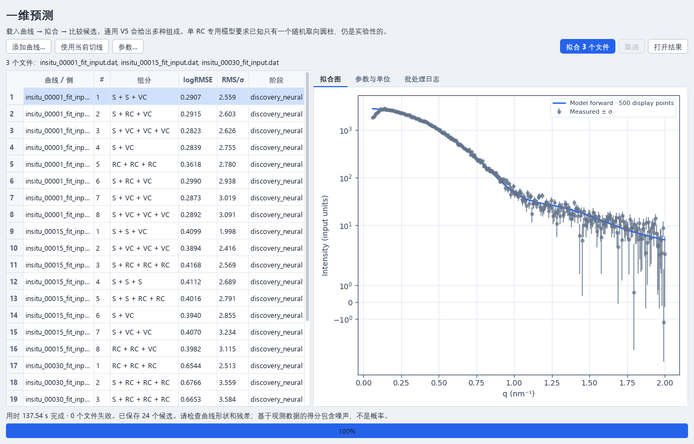

*左边是每条曲线的候选解（带阶段列）；右边是选中候选的拟合和参数。按钮下面第二行“q 按文件头注明的 Å⁻¹：…”说明三个分析页曲线文件
（`_fit_input.dat`）按什么单位读取，没有手动设单位；**曲线 / 侧**在每个文件名后面也写出它（“· Å⁻¹”）。*

**一维预测**（1D Predict）是实验性的神经网络模型（Workflow V5）。它为一条曲线给出组成和参数，再把每个建议按实测点做数值修正。
它的解是要检查、精修的起点，不是结果。

- **拟合页里打开的曲线**：在拟合步骤选 **AI 建议（一维预测）**，按**拟合**；解列在结果里。
- **一组曲线文件**：**工具 ▸ 一维预测——拟合多条曲线…**（Tools ▸ 1D Predict — Fit Many Curves…），或拟合步骤*选项*里的
  **一维预测批量窗口…**，打开一维预测窗口。要用你的模型拟合一个文件夹的每条曲线，请用原位序列（6.6 节）。

**窗口里的操作**

1. **添加曲线…**（Add curves…）列出文本曲线文件（`q I [σ]`；`.dat`、`.txt`，也可以是逗号分隔的 `.csv`）。**使用当前切线**（Use current cut）
   改用拟合页里打开的曲线。按钮下面一行写出每个文件的 q 按什么单位读取：文件头注明的单位；文件头没有注明的，按设置
   **文件头未注明时的 q 单位**（q unit of files without one in their header）。文件头同时注明 Å⁻¹ 和 nm⁻¹ 的文件不拟合，也在这一行列出。
2. **参数…**（Parameters…）里设：
   - **拟合方法**（Fit method）：*通用 V5（实验性）*（General V5 (experimental)，默认）、*单 RC 专用模型（实验性）*
     （Single RC specialist (experimental)）、不用网络的*物理拟合（数值）*（Physical fit (numerical)），或
     *fit1d（网络 + 物理拟合）*（6.4 节）。
   - **完整组成**（Complete composition）：知道时填颗粒类型。
   - **文件头未注明时的 q 单位**（q unit of files without one in their header）：默认 nm⁻¹。文件头注明了 q 单位的文件
     按注明的单位读取，不管这里怎么设；分析页的 `_fit_input.dat` 注明 Å⁻¹，不用设。文件头用 `#` 行里的 `q in <单位>`，
     或第一列的列名（`q (1/A)`、`q_nm^-1`、`# columns: qy (1/A) …`、`# q [1/nm]  I`）注明单位。**使用当前切线**自动换算。
   - **q 的两侧**（q sides）：*两半分别拟合*（Each half separately）、*q > 0 一半*或 *q < 0 一半*。
   - fit1d 的设置：搜索策略（这个窗口默认**快速**）、曲线类型、网络、qz 和系统误差。

   **保存设置**（Save Settings）保留它们。
3. **拟合曲线**（Fit curve；列出多个文件时为**拟合 N 个文件**）开始，**取消**（Cancel）停止（已完成文件的结果保留），
   **打开结果**（Open results）打开运行文件夹。
4. 表格列出每条曲线每一半的候选：**曲线 / 侧**（文件名和 + 或 −）、**#**、**组分**（S 球，RC 随机取向圆柱，VC 竖直圆柱）、
   **logRMSE**、**RMS/σ** 和**阶段**（Stage）；文件的行在**曲线 / 侧**里还写出 q 读取时的单位（悬停可以看单位从哪里来）。选中一行，在右边的标签页里看它的**拟合图**、**参数与单位**和**批处理日志**。

**阶段**列说明候选从哪里来。*单 RC 专用模型*的候选是*神经网络模型*（Neural model）、*模型 + 幅值*（Model + amplitude）
或*数值回退*（Numerical fallback）；fit1d 的行写 *fit1d*；*通用 V5* 和*物理拟合*显示产生它的步骤名（例如
`discovery_neural`）。悬停可以看详情，回退时还有原因。这些分数不是概率。

*单 RC 专用模型*只在**完整组成**为一个**随机取向圆柱**、且曲线带原生探测器计数（分析页的水平切线）时使用它的网络；
否则退回它的数值拟合，并说明原因。

选中 fit1d 的行时，图上保留它原来的曲线和分量；复制过去的手动模型只是起点。

**结果写在哪里。** 每次运行在启动 GIMaP 的文件夹（便携版是程序文件夹）里新建一个文件夹
`AI_Fitting_Output/v5_<date>_<time>/`。里面有 `request.json`、`batch_summary.json`、`top20_candidates.json`、
`fitting_run_summary.json`，以及每条曲线每一半的 `solutions.json`（参数、单位、运行的阶段及原因）、`display.npz` 和
`fitting_curves.csv`（*通用 V5* 还写 `candidates.npz`）。`request.json` 和 `fitting_run_summary.json` 列出每条曲线的 q
按什么单位读取（`q_units`）；`batch_summary.json` 里每个文件的条目和 `top20_candidates.json` 里它的候选用 `q_unit_read`、
`q_unit_from` 记下同样的信息。这些文件夹不会自动删除。自己用**保存**存的拟合写在你选的位置。

**模型文件。** 模型和训练好的权重在 `modules/Fitting_1D_Model/Workflow_v5/`，便携版和 Git 仓库里都有，所以从源码运行也能用一维预测。
每个网络使用前按校验和检查自己的文件。文件被改动或缺失时，*通用 V5* 不启动，消息里写出文件名；*单 RC 专用模型*继续做它的
数值拟合，并以 *Fast model unavailable* 作为原因（13.3 节）。fit1d 用单独安装的工具包。

### 6.6 原位序列

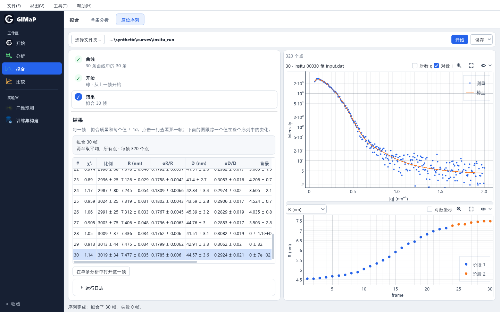

*左边是结果步骤（每帧用的两半和点数，然后是每帧的 χ²ᵣ 和各值 ± 1σ）；右边是选中帧的拟合，下面是 R 随帧的变化，按阶段着色。*

用单条分析的模型拟合一个文件夹里的每条曲线。命令栏有**选择文件夹…**（Choose Folder…）和**开始**（Start）；
序列运行时出现**暂停**（Pause）和**停止**，有帧拟合完后出现**保存**。

**1. 曲线**（Curves）

- **选择文件夹…**（或把文件夹拖到页面上）、单条分析结果里的**拟合此文件夹的每条曲线…**，或在分析页列出这些帧后选
  **把序列发送到拟合…**：每一帧都导出到 `<名称>_fitting/`（可以每 N 帧相加），然后序列在这里打开，曲线已经列出。
- **文件**（Files）是文件名模式：默认 `*_fit_input.dat`；任何 `.dat` / `.txt` 曲线都可以。**包括子文件夹**
  （Also in subfolders）往下层找。
- **探测器帧。** **文件**也可以写探测器文件（`*.cbf`、`*.tif`、`*.edf`、`*.nxs` ……）；只有帧、没有曲线的文件夹会自动换成它的帧。
  每一帧（NeXus/HDF5 文件的每一帧；一组模块文件是一个数据源；分析页的**求和**把相邻帧合成一组）都按分析页对已设置好的那一帧的
  切法来切——仪器配置、αi、光束中心、掩膜与校正、坏像素、序列的切线和两半——得到与 `<stem>_fit_input.dat` 相同的曲线（q 为 Å⁻¹），
  只在内存里，数据旁边不写任何文件。这一步写出用的是谁的设置；分析页还没有设置好的帧时说明原因，**开始**不会运行。
  **采用 Analyze 的设置**（Take Analyze's Set-up）采用分析页现在的设置，重新切这些帧。JSON 记录保存分析页的设置。
- 曲线按文件名的计数顺序列出（`frame_2` 在 `frame_10` 之前），并按这个顺序编号 1、2、3……
  **帧**（Frames）：这些编号的第一帧 – 最后一帧，**每**（Every）n 帧取一帧。
- **q 的单位**：每个曲线文件按文件头注明的单位读取，没有注明的按单条分析的**文件头未注明时的 q 单位**（开始时的值，整次运行不变）。
  这一步按单位和来源数出列出的曲线——*2 条曲线：q 按文件头注明的 Å⁻¹*；*1 条曲线：q 按 nm⁻¹，文件头未注明单位
  （单条分析 ▸ 曲线 ▸ 文件）*——并点名文件头同时注明两种单位的文件：它不拟合，那一帧说明原因。探测器帧按 Å⁻¹ 切。
- **监视新曲线**（Watch for new curves）：序列运行时每 2 秒看一次文件夹，写进去的新曲线（例如测量过程中分析页写出的）也会接着拟合。
  新文件在两次看到的大小和时间都相同时才拿来；读过之后又变了的文件重新拟合；文件夹读不了时等它恢复。
- **切线的两半**（Halves of the cut）：每帧只拟合一条曲线——**两半取平均**、**q > 0 一半**或 **q < 0 一半**，从不两半一起。
  你没有选时，它取分析页送出这些曲线时的两半，否则取单条分析的两半（不是 |q| 上的两半时），再否则取平均；下面一行写出这个值的来源。
  只有一侧 q 的曲线没有两半可选，下拉框会说明。所选的一半没有点的帧失败，原因为 *No points on the q > 0 half*（或 *q < 0*），
  不会改用另一半。
- 曲线列出后在后台互相比较（7.1 节）。这一步写出有几个阶段、几个异常帧，列表按阶段着色。**跳过异常帧**
  （Leave out the odd frames）默认打开。

**2. 开始**（Start）

- 每一帧都用单条分析的模型、拟合范围和排除的点（**在单条分析中编辑**（Edit in Single Analysis）去改它们），以及曲线步骤的两半。
  停在范围边上的值按单条分析里**自动处理停在范围边上的数值**的选择处理（6.3 节）。
- **每一帧的初值来自**（Each frame starts from）：
  - **上一帧的结果**（The previous frame's result，默认）——适合缓慢变化的样品。某一帧没收敛时，下一帧重新从单条分析的模型开始。
  - **单条分析里的模型**（The model in Single analysis）——每一帧相互独立。
  - **上一帧的结果；每个新阶段从单条分析的模型开始**（The previous result; the Single model at each new stage）——
    在一个阶段内跟着样品走，在曲线转向的地方重新开始。
- **方法**（Method）：**精修（快）**（Refine (fast)）、**在范围内搜索，再精修（慢）**（Search the ranges, then refine (slow)）
  或**逐帧预测（fit1d）**（Predict each frame (fit1d)）。
- **逐帧预测（fit1d）**对每一帧做预测，用单条分析模型里的粒子、固定的值和范围，以及单条分析拟合步骤里的设置（需要 fit1d 工具包）。
  表格里是 fit1d 的值和误差，帧图画 fit1d 自己的曲线。**优先选择延续上一帧的解**（Prefer the solution that continues the previous
  frame，默认勾选）：每帧再拟合一次，所有值都限制在上一帧的值附近；这次拟合在工具包的容差内和自由拟合一样好时就采用它（等价解中
  最平滑的序列），否则采用自由拟合，并在记录里写明样品在这里变了。每帧都从单条分析的模型开始时，以及新阶段的第一帧，不用这条规则。
- 然后按命令栏的**开始**。**暂停**和**停止**在当前帧拟合完后生效，已完成的帧保留。序列运行时不能打开项目（先停止）。
  阶段还没找到就开始的运行不用阶段（会说明）。

**3. 结果**

- 拟合了几帧、失败几帧、几帧没收敛，以及每帧用的两半和点数。
- 表格每帧一行：χ²ᵣ、每个自由值 ± 1σ、拟合的**点数**（Points）和**两半**（Halves）。点一行可以看那一帧的曲线和模型；
  失败的帧显示原因。
- 帧图下面：一个值（或 χ²ᵣ）随帧的变化，带 ±1σ 误差棒，按阶段着色。图的标题是序列的名字。
- **在单条分析中打开这一帧**（Open Frame in Single Analysis）把这一帧和它的拟合模型送回单条分析细看。
- **保存 ▸ 每一帧的结果表…**（Table of Every Frame…）写出 CSV（帧、文件、χ²ᵣ、log RMSE、是否收敛、点数、所用的两半、每个值及其误差），
  旁边是 JSON 记录：初始模型、两半及其来源、范围、排除的点、方法、每帧的状态、原因和 q 读取时的单位（`q_unit`、`q_unit_from`；`q_unit_of_files` 是未注明单位的文件所用的设置）、拟合差的帧（χ²ᵣ 大于 10），以及列出了哪些曲线或帧。
  **趋势图…**（Trend Plot…）和**所选帧的曲线图…**（Selected Frame's Plot…）保存图。
- 没保存的结果要被丢掉之前——再按一次开始、换了曲线、打开项目——GIMaP 会问：**保存**、**丢弃**或**取消**。
- GIWAXS I(q) 的序列跑完后，6.1 节的那条提示再次出现，并说明有几帧拟合得差。
- 最下面是折叠的**运行日志**（Run Log）。

读不了或拟合失败的曲线在列表里标 ✗，序列继续。文件夹和各项选择下次启动时恢复，也随项目保存。

## 7. 比较与阶段

阶段和**比较**（Compare）页回答一个散射序列需要回答的问题，不需要标签，也不需要 AI：

- 哪些帧不属于这个序列（异常帧）；
- 序列在哪里转向（阶段），变得多快；
- 哪些测量或样品彼此相像。

它们都用分析页约化出的曲线，几何、掩膜和切线都相同。它们取代 0.0.2 版的 Classification 页。7.4 节介绍溅射（Sputter）
工作区，它用训练好的模型跟踪原位溅射序列的阶段。

### 7.1 阶段与异常帧

**怎么找出来的**

1. 曲线按 log I 比较，只用（几乎）每一帧都有数据的 q 点。默认去掉每帧的平均水平，只比较形状。
2. 先找异常帧：一帧与它之前 3 帧和之后 3 帧都不一致，差别远大于帧与帧之间的变化——或者在整条曲线上，或者只在少数几个点上（约 1 %），
   而且与前后两侧的差别方向相同，例如某一帧里几列过亮的探测器像素。样品真实的变化不算异常：突变之后的帧与后面的帧一致，持续变化中的帧落在前后两侧之间。
   连续两三帧（序列开头或末尾两帧）这样的帧都会被找出。如果留着，这样一帧会自己成为一个主成分，被切成一个假的阶段，还会进入比较页的终态。
3. 其余帧的主成分。
4. 阶段：按帧的顺序把主成分切成若干直线段（每个阶段至少 5 帧，最多 8 个阶段）。每多加一个阶段，它至少要解释剩余变化的 5 %，并且多于噪声能解释的部分。
5. 进度：沿主成分完成一半和 90 % 变化时的帧。

**怎么读**

- 阶段是对序列的描述，本身不等于相。平滑的变化也会在变化速度拐弯处被切开。阶段之间哪里增长、哪里减少（相对于曲线的其余部分），才说明结构是否改变。
- 每个异常帧都写出原因。差别集中在某个 q 附近的少数几个点上，多半是探测器：在分析页的**掩膜与校正**步骤里遮掉那里，再重建热图。
  样品只持续一到三帧的真实事件（例如某个晶粒只在一帧里闪亮）也会被标为异常帧，原因里写出在哪个 q、变了多少。持续下去的变化不算异常。
- 序列开头和末尾只有一侧的帧可比，开头或末尾一两帧里的变化分不出是样品还是伪影，会标为异常帧并写出原因。
  监视中的序列，最新一帧里出现新东西时，等后面的帧到了会重新判断。

**出现在哪里**

- **分析页 ▸ 序列**（Analyze ▸ Series，5.6 节）：热图旁的彩色阶段条，阶段开始处的虚线，异常帧处的红色箭头
  （**标记 ▸ 阶段**（Marks ▸ Stages）可以隐藏）。**阶段**（Stages）选*自动（n）*或你指定的数目。折叠的
  *变化了什么，以及异常帧*（What changes, and the odd frames）列出每个阶段的典型帧、阶段之间增长或减少最多的地方、
  完成一半 / 90 % 的帧，以及每个异常帧的原因。**批量导出时跳过异常帧**（Leave the odd frames out of Batch Export）
  如其所说。热图下方的图可以显示*沿序列的变化*（Change along the series）。**导出 ▸ 阶段表…**（Export ▸ Stages as Table…）
  写出每帧的阶段、是否异常及原因，旁边是记录方法的 JSON。原因用热图自己的横轴（χ、qy 或 q）表述。**选项 ▸ 阶段比较**
  （Stages compare）选整个 x 轴或热图当前显示的范围。
- **拟合页 ▸ 原位序列**（6.6 节）：列出的曲线按将要拟合的方式比较（用单条分析的两半、范围和排除的点）。列表按阶段着色，
  **跳过异常帧**默认打开，**每一帧的初值来自**多一个选项**上一帧的结果；每个新阶段从单条分析的模型开始**。

### 7.2 比较页

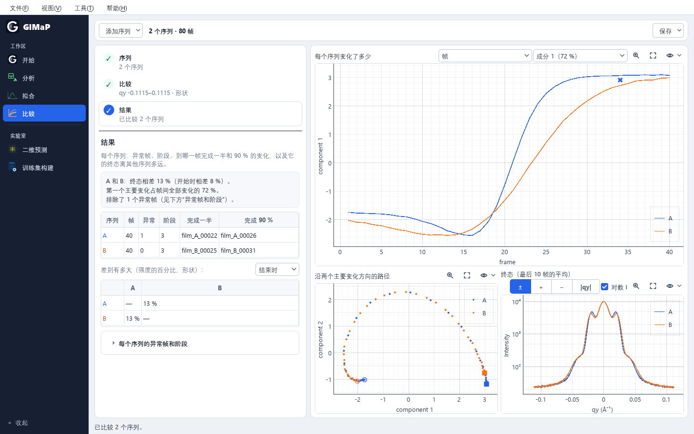

*左边三步，这里打开的是结果步骤；右边是每个序列变化了多少、它们的路径和终态。两个 40 帧的合成序列，各 3 个阶段：A 有 1 个异常帧
（第 34 帧，变化图上的 ×），它不计入 A 的终态，所以 A 的终态曲线在 qy 0.05 Å⁻¹ 附近没有那几列过亮像素造成的尖峰。A 和 B：
终态相差 13 %（开始时相差 8 %）。*

常见用法：在分析页打开一个样品，在序列标签页生成热图，按**发送到比较**（Send to Compare）；每个样品重复一次。
两个以上的序列相互比较；只有一个时只描述它。

**1. 序列**（Series）

- **添加序列**（Add Series）可以加**分析页的序列热图**（The Series Map of Analyze）、**曲线文件夹…**（Folder of Curves…，
  一个序列）或**曲线文件…**（Curve Files…，合起来一个序列）。曲线文件要有 q 和 I 两列（`.dat`、`.txt`、`.csv`、`.xy`、
  `.chi`；每个序列至少两个文件，按文件名的计数顺序排列：`frame_2` 在 `frame_10` 之前）。文件头写明 nm⁻¹ 时 q 换算成 Å⁻¹。
- 分析页写的文件夹（批量导出的文件夹、它的 `curves/`，或 `gimap_analysis/`）里有好几种曲线。一种曲线是一个序列：有几种时会问
  选哪一种（拟合用曲线叫*拟合用曲线*，不属于分析页导出的文件叫*其他文件*），序列名为 *<样品或批次> · <曲线>*。
  批量导出的所有帧表格（`<名称>_<曲线>_frames.csv`）也可以作为一个序列加入。
- 文件夹或曲线文件也可以拖到页面上。同一个热图或文件夹不会重复加入。
- 双击名字可以给序列改名。**删除所选**（Remove Selected，或按 `Delete`）和**全部移除**（Remove All，随后的提示里可以撤销）。
- 名字很长时，图和结果里只显示各序列不同的部分；表格、CSV 和 JSON 保留完整的名字。

**2. 比较**（Compare）

- 比较的 **q 范围**（q range，Å⁻¹；按序列的坐标轴命名，例如 **qy 范围**）：所有序列都覆盖的范围。收窄它可以去掉有噪声的边缘或探测器伪影；**全部范围**（Whole Range）复原。
- **只比较形状**（Compare the shape only，默认打开）：去掉每帧的平均水平，所以更亮的光束、更厚的薄膜或更长的曝光不算新的结构。
  关闭时整体强度也算在内。
- **终态**（End state）：一个序列最后 N 帧的平均（默认 10 帧，不含异常帧）。
- 每次改动后稍等片刻就在后台重新比较。比较失败时（例如范围内没有共同的点），结果里说明原因和怎么改。

**3. 结果**（Results）

- 分组（三个以上序列时）：在终态明显分开的地方切开；差别小于 2 % 时不分组。
- 结束时和开始时差别最大的序列。
- 每个序列：帧数、异常帧、阶段、完成一半和 90 % 变化时的帧。
- 序列两两之间差别的表，**结束时**（At the end）或**开始时**（At the start），以强度的百分比表示。
- 折叠的**每个序列的异常帧和阶段**（Odd frames and stages of every series）：每个序列的阶段，以及它的异常帧和原因。

**右边的图**

- **每个序列变化了多少**（How far each series has changed）——沿图上方选的主要变化方向（**成分 1** 解释得最多），
  对**帧**（Frame），或者对**在序列中的比例（0–1）**（Share of the series (0–1)，用于记录速率不同的测量）；× 标出异常帧。
- **沿两个主要变化方向的路径**（Paths through the two main changes）——○ 第一个保留的帧，■ 最后一帧。只有一个主要变化时显示说明，不画空坐标。
- **终态**（End states）——每个序列的终态曲线。

**保存**

- 有了比较结果后才出现**保存**（重新比较期间暂不可用）。**保存 ▸ 每个序列的表…**（Table of Every Series…）或**每一帧的结果表…**（Table of Every Frame…）写出 CSV 和 JSON 记录。
- **变化图…**（Change Plot…）、**路径图…**（Paths Plot…）、**终态图…**（End States Plot…）保存图，总是用浅色配色。
- 页面上的表格可以复制（`Ctrl+C` 或右键），带列名。
- 项目保存设置和序列：曲线文件按路径，分析页的热图存进 `<project>.compare.npz`。

### 7.3 下结论之前

- **时有时无的探测器伪影会造成异常帧。** 某个 q 处的窄尖峰只在部分帧出现时，这些帧被标为异常，原因写的是*多半是探测器，不是样品*。
  在分析页遮掉它再重建热图，不要把它当成样品的变化。
- **比较范围要避开伪影和阴影区。** 在全 q 范围比较时，一个序列可能因为尖峰或阴影显得离群。把 **q 范围**收窄到干净的部分后，
  结束时的差别可能小得多。
- **两张表都要看。** 除了**结束时**，也看**开始时**的差别：序列的差别可能在起点，而不在终点。

### 7.4 溅射：溅射序列的尺寸、间距和厚度

**溅射**（Sputter）工作区（侧栏）用随 GIMaP 提供的训练模型（`utils/sputter_toolkit`）读取原位溅射序列——金属溅射到
聚合物上时的 CBF 帧。它逐个时间窗给出颗粒尺寸 R（平底半球的底面半径，h = R）、分辨出关联峰时的中心间距 D、生长阶段、
能说出的金属厚度，以及每个值有多可信。

**三步预测。**

1. **数据 ▸ 选择…**（Data ▸ Choose…）：一个扫描的文件夹——它的 CBF 帧所在的文件夹，或只有一个子文件夹存放帧的扫描文件夹
   （`p2m/`）。页面读取第一帧的文件头（几 kB，不读像素），用一行说明有多少帧、探测器和序列号、像素尺寸、曝光和时间。
2. **样品与几何**（Sample and geometry）：核对填好的值。每个值旁边写着它的来源：
   - *来自文件头*（from the file header）或*来自该扫描的 NeXus 文件*：X 射线能量，取自文件头的 `Wavelength` 行或同一扫描
     NeXus 文件的 `beam_energy`——请核对。平场文件名里的 `E<eV>` 是探测器的标定能量，不一定是光束的能量：它只写在字段旁边
     （*平场文件名写着 E = … keV*），从不填入；
   - *沿用这个文件夹上次的值*（as last used for this folder）：这个文件夹上次预测时的值（文件头的能量不同时写在旁边）；
   - *来自预设 <名称>*（from preset）：与这个扫描相符的、你保存的几何预设（见下）；
   - *上次使用的值——请核对*（last used — please check）：上次任何文件夹预测时的值——样品滚转角和掩膜除外，它们属于一套
     实验装置；
   - *文件中没有——请填写*（not in the files — please enter）：没有已知的值。PILATUS 的文件头里既没有距离也没有入射角；
   - *文件中没有：假定为 0——请核对*（not in the files: 0 assumed — please check）：这个文件夹和预设都没有给出样品滚转角时。

   光束中心留空时由帧估计；给出的光束中心使用分析页的像素坐标（4.4 节）。**金属**（Metal）：Ag、Au，或 Cu——用 Ag 模型
   近似，仅供参考（网络是为 Ag 和 Au 训练的）。
3. **预测**（Predict）。第一次会先把 PyTorch 装进 GIMaP 自己的 Python（*第 1/2 步*，约 1.2 GB，需要联网；进度条跟随下载）。
   然后读帧（进度条跟随已读的帧数）、把计数合并成时间窗（0.5 s；前 5 s 为 0.1 s）、运行模型（*第 2/2 步*）。**取消**（Cancel）
   立即停止，读帧的进程也一起停止；安装在 pip 开始写入软件包之前都可以停止。**详情**（Details）显示 pip 和模型的消息。损坏的帧
   被略去并计数。刚选的文件夹的文件头还在读取时按下预测，预测会在表单按它填好之后开始；没有 CBF 帧的文件夹会被拒绝。

任务状态下面的一行写着运行模型的 Python，以及 PyTorch 是否已就绪。

**把几何存为预设…**（Save Geometry as Preset…）为这台探测器（序列号）和这个平场在一段日期内（一次束线时间；默认是扫描
前后各一周）的每个扫描保存页面上的几何：这样的扫描就按预设填写。各文件夹的值和预设保存在 GIMaP 的设置里（3.9 节）。

**更多选项**（More options）：聚合物、样品滚转角、探测器掩膜（`.npy`；只取这个文件夹上次预测时的掩膜）、时间窗、
**沉积速率（nm/s）**、**沉积开始 t0（s）**和**沉积结束（s）**（Deposition end (s)）
（都可选）、**结果保存在**（Save results in）、**打开结果文件夹…**（Open Results Folder…）、**加入精修时间窗…**（Add Refined
Windows…，在别处算好的物理精修时间窗）和**解释**（Explanation）。挡板是手动关闭的，扫描可以在沉积结束后继续：
给出沉积结束的时间，此后名义厚度保持在 速率 × (t_end − t0)。留空时沉积持续到扫描结束（说明里写明）。

**结果。** 每个请求有自己的文件夹：用户数据文件夹里的 `sputter/<扫描>-<代码>`（或在**结果保存在**里）；代码由扫描和分析依赖的
每个值以及模型的版本得出。相同的请求重用它的文件夹——停止过的运行从停下的地方继续——换了几何、或 GIMaP 换了模型，就用
新的文件夹（第 11 章）。

- 给出了沉积速率、并且有足够多（至少 10 个）时间窗显示出金属的关联峰时，默认的解释是 P03 研究所用的**文献方法（质量守恒）**
  （Literature method (mass balance)，等级 **Lit**；见下面的“文献方法”）。**解释**把模型自己的方法作为第二个选择提供——
  **物理路径（网络）**（Physical path (network)）：随时间只走一条阶段路径——成核前、岛、聚并、膜——膜不会退回成岛。每个岛时间窗
  的 R 和 D 都是网络估计（等级 **P**），所以数值不会在相邻时间窗之间在精修值和网络值之间跳来跳去；精修值保留在“时间窗”表中。
  没有速率（或有峰的时间窗太少）时，物理路径是默认解释。文件夹里有时，**解释**还提供逐窗选择（等级 A、B、C）、学习选择器（L）
  和时间一致路径（S、T）。物理路径上成膜起点的区间画成阴影：起点确立时为实色；不成膜也同样相容（“起点未确立”）、或路径没有
  起点但不排除更晚的起点时，画成斜线。
- **尺寸趋势**（Size Trend）：每个时间窗的 R 和 D 画成淡色点，平滑后的趋势画成线；× 标出直接值 2π/q*，红圈标出与它不一致
  的 D。**金属厚度**（Metal thickness）一栏把岛体积等效厚度 t_eq 画成一条带——按六角排列的半球计算的可见岛中的金属；
  有条件的值，误差约 2–3 倍——给了沉积速率时再画名义厚度 速率 × (t − t0)；**沉积结束**之后它保持在 速率 × (t_end − t0)，成为
  平台，结束时间也标出（*沉积结束 … s*；结束时间在最后一个时间窗之后或第一个时间窗之前时只写在图例里，时间轴仍只覆盖各时间窗）。
  没有速率时也标出结束时间。膜时间窗加阴影：*膜：厚度未确定*。路径的成膜起点和它的区间也标出。有沉积速率时，
  上方的横轴还给出名义厚度 δ = 速率 × (t − t0)，刻度只到沉积结束为止。光斑可能移出样品的时间窗（见下）在 R、D、TS 特征长度 L
  和 t_eq 上画成空心灰点，*光斑可能移出样品（样品台平移）*（beam may be off the sample (stage translation)；没有调制时为
  *光斑可能移出样品或光束中断*（beam may be off the sample or interrupted））：淡色点、趋势线和 t_eq 线都不含它们。文献方法不使用它们的峰，所以在文献方法下，D 栏中的空心点是它们的 2π/q*。
- **由 q_z 干涉条纹得到的岛高度 H。**金属生长时，低 q_y（0.05–0.15 nm⁻¹）处的竖直切线上出现向更低 q_z 移动的极小值：
  岛（或金属层）竖直形状因子的干涉条纹。显示结果后，GIMaP 在后台测量它们（`utils/sputter_fringes`，只用 numpy 和 scipy；
  几秒到半分钟；消息在**详情**里），并在尺寸趋势中加一栏 **H，由 q_z 干涉条纹得到的岛高度（nm）**（H, island height from
  q_z fringes (nm)）——不勾选**显示细节**也显示，因为它是直接测量——画出每个时间组（1 s）的 H 及其 68% 区间（空心：只在光束
  一侧看到）、给了沉积速率时用于对照的名义厚度 δ，以及第一个极小值进入探测器 q_z 范围之前 H 所低于的上限（*低于测量范围：
  H < … nm*）。H = 2π n / Q，Q = kz(αi) + kz(αf)，取金属内部的值：它是岛或金属层的竖直尺寸，只有形成连续膜之后才等于膜厚。
  级次 n 从第一个进入范围上端的极小值数起；范围内有几个条纹周期时由整条切线的锁相拟合得到，或由同时出现的已知级次的极小值
  得到。时间组足够时，金属的 αc 由干涉条纹拟合得到，否则用由电子密度算出的块体值（Cu 2.46、Ag 2.77、Au 4.66 e/ų），误差
  取 ±0.02°。探测器模块间隙从数据中读出；在同一 αf 停留 20 s 以上的极小值（探测器的行、膜自身的条纹）和光斑可能移出样品
  的时间窗都不用。没有移动的极小值、或无法确定级次时，不给出 H。输出 `fringe_heights.csv` 和 `fringe_summary.json` 写在
  结果文件夹的 `fringes_v1/` 中（结果文件夹不能写入时写在用户数据文件夹的 `sputter_fringes/<结果文件夹>/` 中）；分箱的帧、
  金属或工具改变后会重新测量。
- 预测按钮下的结果行给出时间窗数、成膜起点（文献方法下为它的渗流），以及强度周期性调制时的*强度调制周期（可能来自样品台平移）*
  （intensity modulation period (sample stage translation?)）。沉积时样品台来回平移，免得光束一直损伤同一处；在行程两端，光斑
  （掠入射下长达数毫米）可能到达样品边缘或移出样品，强度在每个来回中下凹一到两次。只凭数据不能证明调制的来源，所以页面用问句，
  不作断言。路径和趋势线对调制取平均。有时间窗看起来光斑移出了样品时，结果行给出它们的个数：*… 个时间窗光斑可能移出样品
  （样品台平移）*（没有调制时为 *… 个时间窗光斑可能移出样品或光束中断*）。
- **光斑移出样品。**强度降到前后各一个调制周期内水平的一半以下时，这个下凹被标出（水平取两侧相邻时间窗强度的 90% 分位数中
  较低的一侧，所以生长中强度的稳步上升或下降不会被当成下凹）：散射少了一半以上，就像光斑有一半以上移出了样品。标出的是整个
  下凹，而不只是谷底：紧挨着它、强度仍低于各自水平 80% 的时间窗一起标出，因为光斑要经过好几个时间窗才移出样品又移回来。
  没有周期性调制时只标出极深的下凹——低于前后各 10 s 内水平的 20%，连同它的两侧（光斑可能移出了样品，或光束中断）；单次较浅的
  下凹不归因于样品台。最前和最后的时间窗两侧的相邻时间窗不够，不作判断。这样的时间窗里没有 Yoneda 峰脊、而其他大多数时间窗有时，
  原因中会写明。这些时间窗在“时间窗”表中保留各自的数值，但不参与阶段投票（路径沿用相邻时间窗的阶段），趋势线、来回变化的计数
  （R 和 D 的锯齿在它们之间分段计数）、成膜起点的质量核对以及文献方法的 D 趋势和对网络的检验都不含它们（文献方法把它们的峰标为
  *光斑可能移出样品*，不使用）。结构示意按这样的时间窗自己的数值画出并加以说明；分镜图和中位数不用它们。
- **时间窗**（Windows）：每个时间窗的阶段（规则给出的和路径上的）、数值、等级、典型误差、t_eq、名义厚度、*光斑可能移出样品*
  （Beam may be off the sample；原因在悬停提示和*光斑说明*（Beam note）列中）和说明；测得由 q_z 干涉条纹得到的 H 之后，
  还有每个时间窗时间上最近的时间组的 **H 条纹（nm）**（H fringes (nm)）和 **H 条纹 68% 区间（nm）**（H fringes 68% (nm)）
  （进入范围之前为 *< 上限*；悬停提示是状态）；`Ctrl+C` 复制行。
- **文献对照**（Literature）：在 δ 上把这个序列与已发表的生长数据对照（见下）。
- **可靠性**（Reliability；测得由 q_z 干涉条纹得到的 H 之后，有一段说明 H 是什么、能测量它的 q_z 范围、αc 及其来源，以及
  直线拟合的生长速率 dH/dt）：各等级的含义、模拟得到的典型误差、物理路径的假设、用它之前和之后的来回变化、强度调制周期、
  有多少时间窗光斑可能移出样品，以及厚度值的含义；文献方法下还有它的定义、渗流，以及有多少项检验一致。
- **结构示意**（Structure Sketch）：某个时间窗拟合模型的示意图（侧视和俯视，整个序列用同一把标尺）；膜时间窗画成不带颗粒的
  连续膜。Cu 的结果在示意图、保存的图像和分镜图上都写明是用 Ag 模型读取的。
- **在分析中查看**（Show in Analyze；在**时间窗**表的一行、**结构示意**——它显示的时间窗——或**尺寸趋势**（Size Trend）的一点——时间上
  最近的时间窗——上点右键）：在分析页中查看这个时间窗的探测器帧，与模型求和的帧相同。分析页中列出的帧被换成这个时间窗的原始帧
  （结果的 `binned/chunk_*.json` 列出它们的文件名，从 `gimap_request.json` 记录的扫描文件夹读取），**求和**（Sum）设为它们的
  数目并显示第一帧，所以图像和切线都是全部这些帧之和。αi 设为溅射页的值（标为由你设置）；预测时给出了光束中心时，光束中心也
  一样；模型自行估计的光束中心只在通知里写出。距离和波长来自分析页的仪器配置：选用距离相差 0.5 mm 以内、波长相差 0.1% 以内的
  配置；不会新建配置——没有时通知会写出应输入的值（几何步骤 ▸ **几何…**）。通知写明时间窗（时间范围和求和的帧数），原先列出的
  帧被替换时也会说明。分析页的自动分析或批处理正在运行、或正在监视文件夹时，什么都不改变，通知说明原因；扫描文件夹被移走或缺帧时，
  在溅射页上说明。
- 运行之后修改**沉积速率**、**t0** 或**沉积结束**（没有速率时也一样），只重写所显示结果的物理路径文件，不会重新读帧。不是正数
  的速率、不在 t0 之后的结束时间会被拒绝，**加入精修时间窗…**也一样。如果显示的结果属于**数据**里
  所选扫描以外的另一个扫描，这些值留给所选扫描的下一次**预测**。显示的解释保持不变；去掉速率时，文献方法（它需要速率）退回到
  物理路径。

**文献方法。** P03 上溅射生长的原位 GISAXS 研究（Schwartzkopf 2015、Bulut 2024、Gensch 2019/2021）并不拟合 R：它们由沉积速率
（石英晶体微天平）得到名义厚度 δ，取直接关联峰的间距 D = 2π/q*，按六角排列的平底半球（h = R）的质量守恒算出 R：
δ = 2.418·R³/D²，覆盖率 θ = (2π/√3)(R/D)²。渗流是 2R = D 的第一个 δ。这些研究在渗流之后仍报告 D、R 和 2R/D；本页在渗流之后
保留 D = 2π/q*，但不再给 R——这是本页自己的选择，依据是分子动力学模拟（Abraham 2016）发现网络形成后 R 失去岛的意义。给出沉积
速率后，页面按这些研究的做法计算（等级 **Lit**），并默认显示它；网络的物理路径是第二个视图，“文献对照”页比较二者：

- δ = 速率 × (t − t0)。没有 **t0** 时把第一帧当作沉积开始（这是假设，说明里写明）：若沉积在第一帧或之后才开始，δ 是上限。
  **沉积结束**之后 δ 保持在 速率 × (t_end − t0)：之后的时间窗用这个 δ（说明里写明有几个，或写明沉积在最后一个时间窗之后才结束），**文献对照**页也把它们画在这个 δ 上。
- 只有分辨出峰的时间窗才有 D = 2π/q*。可能来自聚合物的峰（沉积开始前就有的峰、比该 δ 下所有已发表 D 高出一倍以上的峰、出现
  在聚合物间距上的跳变或离群峰）、与 D 的趋势相差 2 倍以上的峰、比之前的峰高出 2 倍以上（超出自 t0 以来可能的生长）的跳变，
  以及长时间无峰之后出现的峰，在“时间窗”表中标出（*文献方法*：宿主（聚合物）峰、离群、晚出现的峰），不参与计算。D 的趋势不会
  下降。D 的检验统计所有未使用的峰，并把晚出现的峰与趋势末端比较，所以间隔之后 D 的下降能看出来。光斑可能移出样品的时间窗，
  它们的峰也不使用（*光斑可能移出样品*；说明里写明个数）。
- 渗流取成核之后（δ > 0.4 nm）2R/D 的趋势第一次达到 1 处。它的 68% 区间包含时间窗的离散以及速率和 t0 的误差：下端按速率高 10%、
  t0 早 2 s 计算，上端反之（给出 **t0** 时用 ±0.5 s 代替 ±2 s）。这些误差是工程上的选择，页面不改变它们（工具包的 `physical`
  命令可以用 `--rate-error` 和 `--t0-error` 改）。2π/q* 的系统误差不在区间内。在这些误差范围内 2R/D 可能达到 1、也可能达不到
  时（它的趋势一直接近 1），渗流记为*无法确定*：页面说明它最早可能从哪个 δ 开始，全程给出 R，**尺寸趋势**（Size Trend）页把
  区间用斜线一直画到峰阶段结束。即使按较高的速率和较早的 t0，峰在 2R/D 达到 1 之前就消失时，只给出下限。有渗流时，渗流之后的
  时间窗算作膜：D = 2π/q* 继续给出，不给 R。
- 这个 R **按构造**与文献一致——用的是同一个质量守恒。独立的检验是 D(δ) 的形状、渗流 δ 与已发表阈值的比较，以及网络自己的
  2R/D（覆盖率由它决定，两者算一项检验）和质量守恒（与 2R/D 用同样的网络 R 和 D）。

**文献对照**（Literature）页：在 δ 上（对数轴）画四幅图：D（逐窗的 2π/q*、它的趋势、未使用的峰、网络的 D，以及该金属已发表的
D(δ)——Au/PS 取自 Bulut 2024 和 Schwartzkopf 2015，Ag/PS 和 Ag/PMMA 取自 Gensch 2019/2021，Cu/石墨烯取自 Hodas 2017——每条都
标出引用键）；文献方法和网络的 2R/D，附已发表的范围和 2R = D 线；两者的覆盖率，附已发表的数值；以及 η = t_eq/δ，即网络看到的
岛中金属占名义量的比例（文献中按构造为 1；低于 0.5 时提示，这是工程上的选择）。该金属与宿主的已发表渗流区间加了阴影；文献
方法的渗流及其区间（无法确定时用斜线）和网络路径的 TS 起点也标出。下面每项检验写明*一致*、*不一致*或*无法检验*、测得了什么、
文献报道了什么，以及参考文献（带 DOI）：成核之后 D 不随 δ 减小；渗流 δ 和 TS 起点与已发表区间比较；网络的 2R/D 及其覆盖率，
以及网络的质量守恒；TS 膜厚随 δ 的变化（模型不能确定膜厚时无法检验）。每个已发表阈值按其标注的 ± 计（没有标注的按 ±10%），
所以只有一个已发表数值的类别（Si 上的 Au）也是一个区间，而不是单个数。对 Cu，渗流分别按半球（f = 1）和已发表的 f = 2.75 比较；
两者结论不同时，比较无法判定。宿主的类别取自**聚合物**（Polymer）（种类未知时用该金属所有聚合物的区间，并说明；PNO、PSBMA、
PEO 没有已发表数据）。没有沉积
速率时，这一页说明怎样给出（**更多选项 ▸ 沉积速率（nm/s）**），此时只检验 D 是否单调。

**下结论之前。**

- 连续膜的厚度无法确定：在模拟中模型的估计等于它的先验。页面改为给出 t_eq（只在岛时间窗）和名义厚度；膜上带颗粒的模型正在
  计划中。
- 膜上带颗粒的情形没有建模：有分辨出的峰时这样的时间窗算作岛，没有峰时膜模型把颗粒吸收进去。
- R 的绝对值依赖半球条件（h = R）；趋势比单个值可靠。文献方法中 R 随形状因子 f = H/R 按 f^(−1/3) 变化：文献报道氧化物上的
  Ag 更扁，PS-b-PEO 上的 Cu 约为 f ≈ 2.75。
- 与文献的对照依赖沉积速率（GISAXS 不测量它；别处的 QCM 速率要换算到样品位置）、t0、金属在聚合物上的粘附（这些聚合物上未知；
  文献假定为 1），以及 D = 2π/q*——聚并开始后、D > 10 nm 时它的误差可超过 40%。已发表的阈值来自别的腔体和速率：速率依赖
  （δc ∝ F^−χ，χ ≈ 0.07–0.17）比腔体之间的差别弱，所以这些区间是对照，不是预测。

## 8. 工具窗口

**工具**（Tools）菜单里有三个窗口，和工作区并排使用：窗口打开在当前页面之上，不改变这个页面。每个窗口都记住自己的大小和位置。

### 8.1 格式转换

打开 **工具 ▸ 格式转换…**（Tools ▸ Format Converter…，`Ctrl+Shift+C`），把探测器帧写成另一种格式。
**工具 ▸ 转换当前文件…**（Convert Current File…）打开窗口时会带上当前工作区显示的文件。源文件只读，不会被改动。

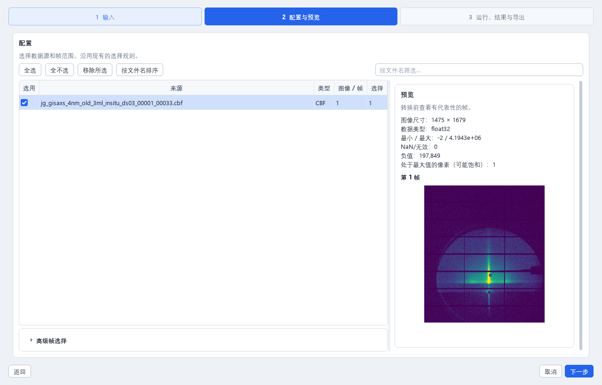
*第 2 步：左边是要转换的源文件；右边是预览，以及这一帧的尺寸、数据类型、数值范围和无效、负值、饱和像素的数目（多帧源文件显示第一帧、中间帧和最后一帧）。*

窗口分三步，用 **下一步**（Next）和 **返回**（Back）切换。

1. **输入**（Input）：**添加文件**（Add files）、**添加文件夹**（Add folder）或 **使用当前打开的文件**（Use currently
   opened file），也可以把文件和文件夹拖到窗口上。转换器读取 NeXus/HDF5（`.nxs`、`.nx`、`.nx5`、`.h5`、`.hdf5`、`.hdf`）、
   CBF 和 TIFF，读取器和方向与分析页相同（5.1 节）；能识别单幅图像和多帧文件；一组模块文件是一个输入（拼接，以扫描名命名，
   不带 `_m01`），master 和它的数据文件也是；NeXus 文件里有多个数据集时，由你选择数据集。列表写出一个输入由什么组成，
   以及读取器的说明（⚠ 缺模块文件、帧数不同）。不含探测器图像的 HDF5 文件不能作为输入，并说明原因。
2. **配置与预览**（Configure & Preview）：勾选要转换的源文件（**全选**（Select all）、**全不选**（Select none）、
   **按文件名筛选…**（Filter by filename…）、**按文件名排序**（Sort by filename）、**移除所选**（Remove selected））。多帧 NXS 文件可在
   **高级帧选择**（Advanced frame selection）里选 *全部*、*当前帧*、*帧范围*、*自定义*（例如 `1, 5, 8–20`）或
   *每 N 帧*。预览显示第一帧、中间帧和最后一帧。
3. **运行、结果与导出**（Run, Results & Export）：选择

   | 设置 | 选项 |
   |---|---|
   | **输出格式**（Output format） | TIFF、CBF、HDF5 或 NumPy（`.npy`） |
   | 输出位置 | 默认是第一个输入旁边的 `converted` 文件夹 |
   | 文件名 | 多帧源文件的命名模板，默认 `{source}_{frame:06d}`（例如 `scan_001_000123.tif`）；勾选 **文件名冲突时自动添加后缀**（Add suffix automatically when names collide，默认勾选）时加上 `_001`、`_002` …，不勾选时遇到同名文件就停下 |
   | **高级输出选项**（Advanced output options） | 数据类型（默认保留原始数值和类型；CBF 可能保留不了 NaN 或浮点数值）；元数据 JSON——默认整次转换一个 `conversion_metadata.json`，也可以每幅图像旁边一个 JSON；**导出为一个 NeXus/HDF5 容器文件**（Export as one NeXus/HDF5 container，`converted_images.h5`） |

   写 CBF、EDF 或 TIFF 时，文件头里的元数据是 ASCII JSON（`json.loads` 能原样读回，非 ASCII 的路径也一样）。
   **检查并转换**（Review & Convert）在开始前列出要写的内容和大小。

运行时会弹出进度窗口，可以 **暂停**（Pause）和 **取消**（Cancel）（正在写的那幅图像会先写完）。结束后可用
**打开输出文件夹**（Open output folder）和 **查看报告**（View report）。报告是输出文件夹里的
`conversion_report.json`，列出每一帧写成还是失败；之后再往同一文件夹转换时会替换它。

转换器不读 EDF 帧。显示的是 EDF 帧时，**转换当前文件…** 打开的窗口里没有这个文件，输入列表下面会说明原因。
要转换 EDF 帧，或者按分析读取的样子转换任意帧（拼接模块、帧求和），请用
**分析 ▸ 批量导出 ▸ 转换格式的探测器帧**（Analyze ▸ Batch Export ▸ Converted detector frames；TIFF、EDF、NumPy 或 HDF5，见 5.7 节）。

### 8.2 XRR 序列提取

打开 **工具 ▸ XRR 序列提取…**（Tools ▸ XRR Series Extractor…，`Ctrl+Shift+R`），从 GIWAXS/GISAXS 探测器的角度序列得到
XRR 曲线。每一帧给出曲线上的一个点。

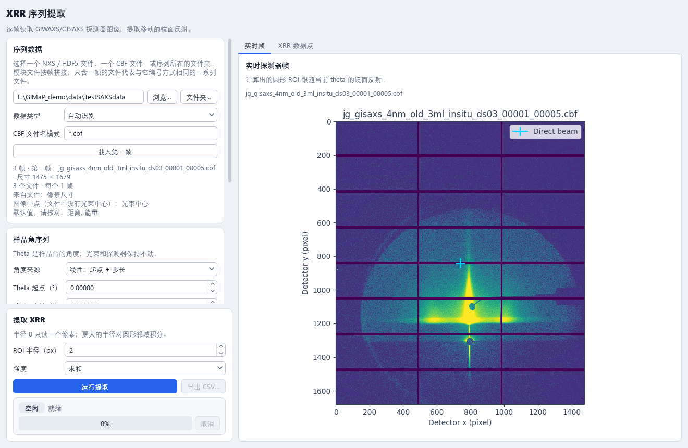
*左边：序列（**浏览…** 选文件，**文件夹…** 选序列所在的文件夹；下面写出序列由什么组成、每个值从哪里来）、θ（几何在下面）和 ROI。
右边：帧上的直射束十字和落在镜面反射上的 ROI 圆；曲线在 **XRR 数据点** 标签页里。*

1. **选择序列。** **浏览…**（Browse…）选一个 NeXus/HDF5 文件或 CBF 文件，**文件夹…**（Folder…）选序列所在的文件夹；
   文件或文件夹也可以拖到窗口上。
   - 一组模块文件每帧拼成一幅；一个多帧文件每帧一个点（各模块帧数不同时只用每个模块都有的帧）。
   - 只有一帧的 NeXus 文件代表编号方式与它相同的那一串文件；编号相像但对不上的文件（帧尺寸不同、不止一帧）会列出并排除。
     一文件夹的 NeXus 文件逐个读。
   - CBF 再给一个通配模式（**CBF 文件名模式**（CBF pattern），例如 `*.cbf`）：按自然顺序排列的每个文件是一个点。
2. **设置 θ。** 用线性序列（**Theta 起点（°）**（Theta start）和 **Theta 步长（°）**（Theta step）），或者用 NXS
   里每帧一个 θ 值的电机数据集。
3. **设置几何。** 探测器距离、光束能量、像素尺寸和直射束中心；再在 **反射方向**（Reflection direction）里选镜面反射在探测器 y 方向上向上还是向下移动。
   - 窗口从最近一次应用的几何标定开始，标记为 *（来自上次标定）*（from last calibration）。那次标定的帧尺寸不同时，
     只采用它的能量。
   - **载入第一帧**（Load first frame）不会覆盖你输入的值。每个字段旁的标签和摘要说明每个值来自文件、上次标定、
     图像中心还是内置默认值。
   - **选取直射束中心**（Pick direct-beam center）可以在帧上点出中心。
4. **设置 ROI。** ROI 半径，以及 `求和`（Sum）或 `平均`（Mean）。半径 0 只读一个像素；更大的半径对算出的镜面反射点周围的圆形区域积分。
5. **运行提取**（Run extraction）。每次只载入一整帧：窗口显示它和 ROI，记下一个点，再释放这一帧。整个序列不会同时放进内存。
6. **查看与导出。** **实时帧**（Live frame）和 **XRR 数据点**（XRR points）可随时切换；处理过程会更新两者，但不会替你切换标签页。
   **导出 CSV…**（Export CSV…）保存 θ（°）、qz（Å⁻¹）、强度、ROI 位置和有效像素数。

CSV 默认写到 `<源文件夹>/<源文件名>_xrr.csv`；CBF 文件夹则写进这个文件夹里，以文件夹命名。旁边的 `.json`
记录保存决定 qz 的每一个值（序列、θ、距离、能量、像素、中心、方向、ROI）以及各自的来源，并在 `source_layout` 下写出序列由什么组成、
读了哪些文件和读取器的警告（运行结束后状态行也会重复这些警告）。

**没有做的校正。** 提取器给出的是 ROI 的原始求和或平均值，不做监视器 / 通量归一化、足印校正、背景扣除或分辨率校正。

**像素坐标。** 直射束中心的显示和输入与分析、几何标定使用同一套像素坐标（见 4.4 节）：像素角点在整数上，第一个像素的中心是
(0.5, 0.5)；x 从左边缘数，y 从上边缘数。把鼠标停在中心字段或 *ROI x* / *ROI y* 表头上，窗口里也能看到这段说明。
中心值可以在三个窗口之间直接复制。

- 预览图、十字和 ROI 圆，以及 *ROI x* / *ROI y* 列，用的都是同一套像素。
- 用鼠标选的中心就是点击的位置：半径为 0 时，点哪个像素就读哪个像素。
- 窗口退回使用的图像中心（第 3 步）是帧的正中，即 (列数 / 2, 行数 / 2)。

导出的文件数法不同：CSV 里的 `roi_center_x_px` / `roi_center_y_px` 和 JSON 记录里的
`geometry.beam_center_x_px` / `beam_center_y_px` 从 0 开始数像素中心，所以比窗口显示的小 0.5 px，记录里写明了这一点
（`center_convention`）。如果你在 2026-10-13 之前的 GIMaP 里从这个窗口记下过中心，请把 x 和 y 各加 0.5 px：那时窗口从 0 开始数像素中心。

**已知限制：NeXus 文件头里的光束中心。** Lambda 服务器（P03）写的 NeXus 文件写有光束中心时，窗口把这两个数直接当作所显示帧的列和行，
没有做帧在载入时的转向（转置和翻转），因此中心可能偏离直射束（分析会对同一个文件头做这个转向）。这时字段标记为 *来自文件*
（from file），并且这个值会取代上次标定的中心。其他 NeXus/HDF5 文件按存储原样读，没有转向，但窗口对文件头里这两个数的数法仍与
分析差半个像素。运行提取之前，请在预览里确认十字落在直射束上，或者用 **选取直射束中心**。CBF 序列不受影响。

### 8.3 SEM 粒径分析

打开 **工具 ▸ SEM 粒径分析…**（Tools ▸ SEM Particle Analysis…），测量 SEM 图像中的颗粒尺寸，或者从 CSV 文件载入别处测好的粒径。
这个窗口独立工作：不需要预测模型、TensorFlow 或散射数据。**实验室 ▸ 二维预测** 预测的半径分布可以和它比较：在那里按 **SEM 对比…**（SEM comparison…），会打开这个窗口并附上预测的一份副本（见 10.1 节）。

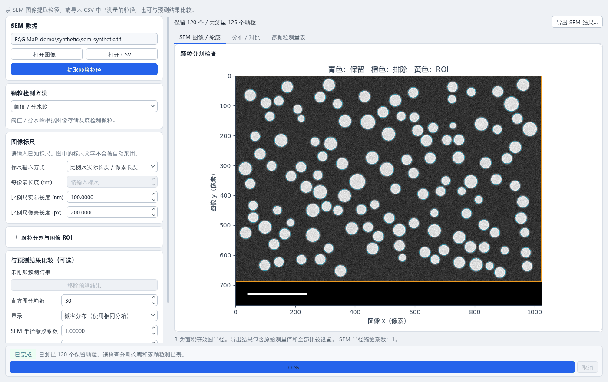
*先检查轮廓：青色颗粒被保留，橙色颗粒被排除（表里写着原因），黄色框是 ROI。*

测量的是每个颗粒**投影面积的等效圆半径**：

```text
A_nm² = A_px × nm_per_pixel²
R_nm  = sqrt(A_px / pi) × nm_per_pixel
D_nm  = 2 × R_nm
```

`A_px` 是颗粒包含的像素数。不圆的颗粒也按同面积的圆给出半径。分布图的横轴是 R，表里同时给出 R 和 D。

#### 测量图像

1. **打开图像。** 在 **SEM 数据**（SEM source）里按 **打开图像…**（Open image…），选择 TIFF、PNG、JPEG 或 BMP。
2. **输入标尺。** 在 **图像标尺**（Image calibration）里选 **标尺输入方式**（Calibration method）：
   - **每像素长度 (nm)**（nm per pixel）：直接输入数值；
   - **比例尺实际长度 / 像素长度**（Scale-bar length / pixels）：输入比例尺的长度（nm）和它的像素长度；
     `nm_per_pixel = 长度_nm / 长度_px`。

   标尺**从不猜测**。GIMaP 不读取图中的比例尺文字、放大倍数或文件的 DPI。打开另一个文件时数值会清空；在为这个文件设置正数之前，不能提取。
3. **排除标注。** 在折叠的 **颗粒分割与图像 ROI**（Segmentation and image ROI）里勾选 **使用图像 ROI（像素边界）**
   （Use image ROI (pixel edges)），输入 **ROI 左边界 x**、**ROI 上边界 y**、**ROI 右边界 x**、**ROI 下边界 y**，
   把比例尺、文字和边框留在外面。ROI 用原图的像素边界：第 0 行在上，像素（第 i 行、第 j 列）的中心在 (j + 0.5, i + 0.5)。
4. 在 **颗粒检测方法**（Particle detection）里**选择检测方法**（见下文）和它的设置。
5. **运行。** 数据区下面的按钮随方法显示为 **提取颗粒粒径**（Extract particles）、**检测颗粒（本地 AI）**
   （Detect particles (local AI)）或 **测量标签颗粒**（Measure labeled particles）。
6. **检查。** 查看 **SEM 图像 / 轮廓**（SEM image / outlines）和 **逐颗粒测量表**（Particle measurements）：哪些区域被保留，
   哪些被排除，为什么。确认之后再使用分布。

没有颗粒通过筛选时，候选颗粒、排除原因和轮廓仍会显示，也可以导出供检查；这时没有粒径分布。

#### 检测方法

换方法会使之前的测量失效。一种方法失败时，GIMaP 不会自己改用另一种。

| 方法 | 适用情况 | 需要什么 |
|---|---|---|
| **阈值 / 分水岭**（Threshold / watershed，默认） | 分得开、对比清楚的颗粒 | 不需要别的 |
| **StarDist（本地 AI）**（StarDist (local AI)） | 阈值分不开的相互接触的颗粒 | 装有 StarDist 的本地 Python，以及本地模型文件夹 |
| **已有实例标签**（Existing instance labels） | 在别处做好的标签（GIMaP 之外的 StarDist、人工修正的标签 …） | 整数 TIFF/PNG 标签图 |

**阈值 / 分水岭。** 设置在 **颗粒分割与图像 ROI** 里：

| 设置 | 作用，以及要检查什么 |
|---|---|
| **颗粒与背景对比**（Particle contrast）：颗粒比背景亮 / 暗 | 亮：取高于阈值的像素；暗：取低于或等于阈值的像素 |
| **阈值**（Threshold）：Otsu 自动阈值 / 手动阈值 | Otsu 由 ROI 内的有限值算出；手动阈值用 **存储灰度值**（Stored intensity）里的数（图像的存储强度单位）。检查背景和颗粒是否分开 |
| **分开接触颗粒（分水岭）**（Split touching particles (watershed)）、**分水岭峰最小间距 (px)** | 把接触的颗粒分开；间距决定一团颗粒被切成几块，注意过分割和漏分割 |
| **最小面积 (px²)**、**最大面积 (px²)** | 去掉噪声或大块背景，也可能去掉真实颗粒；最大面积默认 *不设上限*（No upper limit） |
| **最小圆度**（Minimum circularity） | `4 pi A / perimeter²`；圆度值保留在表里 |
| **排除接触 ROI 边界的颗粒**（Exclude particles touching the ROI boundary） | 默认开启；被 ROI 截断的颗粒被排除，并写明原因 |

灰度图按存储强度分割。彩色图按记录的亮度公式（0.2126 R + 0.7152 G + 0.0722 B）转成灰度。屏幕上的对比度拉伸只帮你看清，不改变阈值、面积或任何测量值。

**StarDist（本地 AI）**，可选。它用训练好的实例分割模型在你的电脑上分开相互接触的颗粒。

- 设置 **本地 Python 解释器**（Local Python executable，装有 StarDist 和 TensorFlow 的 Python 环境）和 **本地实例分割模型**
  （Local instance model，含 `config.json` 和 `weights_best.h5` 或 `weights_last.h5` 的文件夹）；用 **浏览…**（Browse…）选择，
  **检查本地运行环境和模型**（Check local resources）检查文件是否齐全。
- GIMaP 默认在 `~/.cache/gimap/sem/stardist/`（或 `GIMAP_SEM_STARDIST_HOME` 指定的文件夹）里找：Python 在
  `runtime/Scripts/python.exe`（Windows）或 `runtime/bin/python`，模型在 `models/2D_versatile_fluo/`。
- 搭建这个环境时用它自己的 Python 运行 `python -m pip install -r requirements-sem-stardist.txt`（StarDist 0.9.2、CSBDeep 0.8.2、
  TensorFlow 2.15.1）。清单只装软件包，不含模型权重；GIMaP 自己的环境不需要这些包。
- 模型在单独的进程里用 CPU 运行。图像不上传，也不下载权重。**取消**（Cancel）会结束这个进程。一次运行超过 15 分钟会被停止。
- **实例 AI 高级设置**（Instance AI options，折叠）：**AI 图像缩放系数**、**检测概率阈值**、**NMS 重叠阈值**
  （*使用模型默认值*（Model default）即采用模型保存的阈值）、**归一化下 / 上百分位**（在 ROI 内计算；暗颗粒先反转）。
- 测量之前，轮廓会放回原图的像素网格：AI 图像缩放系数不会改变面积。标尺、ROI 以及面积、圆度、边界筛选对三种方法都一样。

官方 `2D_versatile_fluo` 权重是用荧光细胞核图像训练的：**没有针对 SEM 验证**。请用自己图像上的轮廓来判断；检测到的颗粒更多不等于更准确。
用 SEM 图像训练的模型可以从本地文件夹载入。

**已有实例标签。** 先打开 SEM 图像，再选标签文件。0 是背景，每个颗粒有自己的正整数。RGB 伪彩色图、浮点标签和多页文件会被拒绝。
标签图的尺寸要么与 SEM 图像相同，要么正好等于你设的 ROI。GIMaP 不检查标签是否由这张图像得到。

#### 从 CSV 文件导入粒径

按 **打开 CSV…**（Open CSV…），然后在 **CSV 粒径设置**（CSV measurement settings）里选择：

- **粒径数值列**（Value column），以及它是 **半径** 还是 **直径**（**数值含义**，Stored size quantity）；
- **数值单位**（Stored unit）：`nm`、`µm` 或 `像素`（像素需要这个来源的 **图像标尺**）；
- **分隔符**（Delimiter，TSV 用 `\t`）和 **表头前跳过行数**（Rows before header）；**读取 CSV 列名**（Read CSV columns）重新读取列名。

软件不会替你选列。按 **导入粒径**（Import particle sizes）：直径除以二，µm 换算成 nm。空的、非数值、非有限或非正的行会被拒绝，原因写在表里。

#### 分布与比较

| 设置 | 含义 |
|---|---|
| **直方图分箱数**、**最小半径 (nm)**、**最大半径 (nm)** | 分箱；最大值默认 *由数据和预测确定* |
| **显示**（Display）▸ **概率分布（使用相同分箱）**（Probability (same bins)，默认） | SEM 和预测重新分到同样的分箱边界，各自在范围内归一化到总和为 1；范围外的部分会写明 |
| **显示** ▸ **论文显示（单独缩放预测峰高）**（Paper display (independent peak scaling)） | SEM 用 60 个分箱；预测用它自己的半径轴，扣除最小值后按 SEM 峰高缩放，这时高度不能当作可比的概率 |
| **SEM 半径缩放系数**（SEM radius scale） | 默认 1；只在比较时缩放 SEM 半径，测得的半径仍保留在颗粒表里 |

改动之后按 **更新分布**（Update distribution）；导出需要最新的分布。**移除预测结果**（Remove prediction）保留 SEM 测量，只显示它自己。从 **工具** 菜单再次打开这个窗口时，之前附上的预测也会被移除。

#### 导出

**导出 SEM 结果…**（Export SEM results…）先让你选文件夹，然后在里面新建子文件夹 `SEM_analysis_<日期>_<时间>/`。
那里已有同名结果文件时，它拒绝覆盖。

| 文件 | 内容 |
|---|---|
| `sem_particles.csv` | 每个对象：是否保留、R、D；图像来源还有面积、中心、圆度和排除原因 |
| `sem_distribution.csv` | 分箱边界、SEM 概率，以及附带的预测 |
| `sem_distribution.png` / `.pdf` / `.svg` | 分布图（浅色配色），附带预测时含对比曲线 |
| `sem_display_arrays.npz` | 图上画的数组，以及测得的半径 |
| `sem_overlay.png` / `.pdf` / `.svg` | 轮廓、保留和排除的对象以及 ROI，供检查（仅图像来源） |
| `sem_segmentation.npz` | 原分辨率灰度图（未做显示拉伸）、标签、轮廓叠加（仅图像来源） |
| `sem_instance_labels.tif` | 原分辨率 int32 标签，保留原 ID，可在 **已有实例标签** 里重用（仅图像来源） |
| `sem_analysis.json` | 带 SHA-256 的来源、读取方式、标尺、ROI、方法及设置、筛选条件、计数、比较设置、预测来源和文件清单 |

CSV 文件的 `#` 头行里也写有来源和设置。StarDist 运行还会记录模型配置、阈值和权重的 SHA-256；权重本身不复制。

读取、提取、更新分布和导出都在后台运行。**取消** 会丢弃尚未显示的结果；正在写的文件可能仍会写完，已经写出的文件不会被删除。

## 9. AI 助手

分析命令栏里的 **问 AI…**（Ask AI…），或 **工具 ▸ 用 AI 处理…**（Tools ▸ Process with AI…，`Ctrl+Shift+L`），让 AI 用你同样的工具分析
分析页面上显示的帧（GIWAXS 或 GISAXS）。它会切换模式、调整扇区和切线、设置 I(χ) 窗口、拟合峰或水平切线并导出文件，页面会跟着显示每一步。
AI 是可选的：**运行自动分析**（Run Automatic Analysis）不需要 AI 也能给出标准结果（见 5.5 节）。

运行时，一个面板显示 AI 推理的摘要、每次工具调用（鼠标停留可看参数和结果）、修改卡片，最后是报告。

### 9.1 三种引擎和设置

在 **工具 ▸ 设置… ▸ AI 助手**（Tools ▸ Settings… ▸ Assistant）里，或在开始对话框的 *AI 引擎*（Brain）里选择引擎（**设置 AI…**（Set Up AI…）打开设置）。

| 引擎 | 计费 | 设置 |
|---|---|---|
| **Claude Code —— 你的 Claude 订阅**（Claude Code — your Claude plan；默认） | 计入你的 Claude Pro 或 Max 订阅；不需要 API 密钥 | 需要安装 Claude Code（Claude 桌面应用自带）并登录一次：**登录…**（Sign In…）打开一个运行 `claude auth login` 的窗口；选好账号后按 **检查登录**（Check）。模型和思考强度在设置里选（模型留空即 Claude Code 的默认值）。 |
| **Claude API —— API 密钥**（Claude API — API key） | 按 token 计费 | 先运行一次 `pip install anthropic`；在设置里添加密钥（或设置 `ANTHROPIC_API_KEY`）；**测试连接**（Test Connection）检查密钥和模型。默认模型 `claude-opus-5`，思考强度 *high*。 |
| **其他 AI 服务商 —— OpenAI 兼容 API**（Other AI providers — OpenAI-compatible API） | 按服务商的方式计费 | 先运行一次 `pip install openai`。在 **其他 AI 服务商**（Other AI providers）里选服务商（地址自动填好；本地服务器或 Azure 需要改），保存密钥或设置对应的环境变量（如 `DEEPSEEK_API_KEY`、`DASHSCOPE_API_KEY`），选模型（手动输入、建议列表或 **获取列表**（Get List）），再按 **测试连接**。 |

其他服务商包括 DeepSeek、Qwen（阿里云百炼）、OpenAI、Kimi、智谱 GLM、Google Gemini、OpenRouter、SiliconFlow、Azure OpenAI，
以及你自己电脑或实验室服务器上的模型（Ollama、LM Studio、vLLM …）。模型必须支持工具调用：**测试连接** 会发送一个带工具的小请求。
密钥保存在用户数据文件夹里，每个服务商一个。

Claude Code 只拿到 GIMaP 的工具，没有命令行、文件或网络权限，也不会收到 API 密钥。

**给 AI 的常驻说明**（Standing instructions for the AI，在 **工具 ▸ 设置… ▸ AI 助手** 里）会加到每一次运行中，例如你的标定文件放在哪里、线站的能量。

### 9.2 开始一次运行

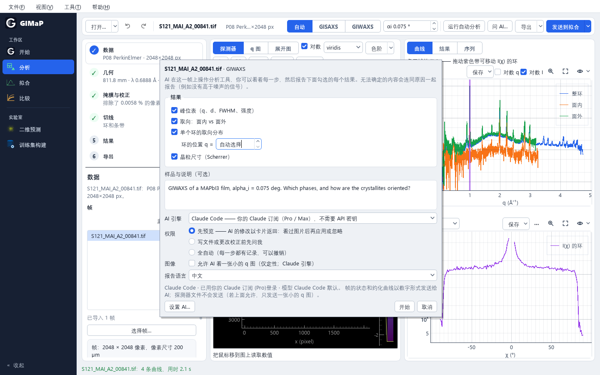
*开始对话框：要报告的结果、笔记、AI 引擎、权限、报告语言。按钮上方一行说明引擎是否就绪（这里是已用 Claude 订阅登录的 Claude Code），以及会发送什么。*

1. 在分析里打开一帧，按 **问 AI…**。
2. 勾选想要的结果：
   - GIWAXS：*峰位表（q、d、FWHM、强度）*、*取向：面内 vs 面外*、*单个环的取向分布*（I(χ)、极大值、Herman 取向因子；
     可指定环，也可让 AI 选）、*晶粒尺寸（Scherrer）*；
   - GISAXS：*Yoneda 处的水平切线，已居中，已选好两半*、*面内距离 2π/q\**、*I(qy) 拟合：形状、半径、距离*。
3. 可在 **样品与说明（可选）**（Sample and instructions (optional)）里写笔记：样品、想知道什么、标定文件在哪里。
4. 选择 **权限**（Permissions）：

   | 权限 | 结果 |
   |---|---|
   | **先预览**（Preview first，推荐新用户使用） | AI 做的每个设置修改在结束时撤回，以卡片形式返回，由你决定是否应用 |
   | **写文件或更改校正前先问我**（Ask me before writing files or changing corrections） | 每个这类操作都弹框询问；你拒绝，AI 就照办 |
   | **全自动**（Fully automatic） | 全部直接执行，每一步都有记录，可以撤销 |

5. 选择是否允许 AI 看一张小的 q 图（仅定性；Claude 引擎）以及 **报告语言**（Report language），然后按 **开始**（Start）。

**停止**（Stop）随时结束运行。报告把每项要求的结果列为 *完成*、*部分完成* 或 *不可用*，并说明原因（例如“0.2 到 2.0 Å⁻¹ 之间没有高于 3σ 的峰”）。
报告下面的表格来自工具的结果，不是 AI 的文字。**保存报告…**（Save Report…）写出 HTML 报告和 JSON 记录
（`<帧>_ai_report.html` / `.json`；数据旁边已有 `gimap_analysis/` 时建议存在那里，否则存在帧旁边）。

**先做基线，再追问题。** AI 可以先一步运行 GIMaP 的标准流程（与运行自动分析相同，每个决定都附理由）。这些选择是默认值，不是限制：
AI 随后按你的问题深入——原位序列的开头、所有样品共有的峰、峰强比、基线跳过的峰——并把解释标为假设，附上依据的数值。

### 9.3 修改卡片：预览、应用、撤销

AI 对分析的每个修改（扇区宽度、自定义扇区、q 框、帧、模式、αi、径向分箱、有效强度范围）都有记录；AI 也可以只建议而不动手。
这些修改以卡片形式出现在 **修改**（Changes）下：一张带有修改的 q 图、文字说明的设置、AI 建议的理由，以及 **应用**（Apply）、
**忽略**（Dismiss）或 **撤销**（Undo）。**全部撤销**（Undo All）撤回所有已应用的修改。

在 *先预览* 模式下，AI 自己探索时做的改动会在结束时恢复。AI 为某个设置提出过建议值时，只显示这个建议；否则每个设置的净变化留作一张卡片。
改了又改回原样、或者没有可见变化的修改不显示。

### 9.4 追问

运行结束后，在报告下方的输入框里输入问题（例如“为什么面内扇区几乎没有信号？”），按 **提问**（Ask）。
一次新的运行在同一帧、同样的设置上回答它，并且知道上一次运行找到了什么，也可能带来新的卡片。

### 9.5 没有几何的帧

没有仪器配置与这一帧匹配时，AI 不会停下，而是去找几何。

1. **你点名的文件。** 笔记或常驻说明里点名的文件或文件夹先读，例如 *“标定是 D:\beamtime\calib\img_0005.cbf，12.4 keV”*。
   只写文件名的标定（*“calibration LaB6_take2.poni”*）也会采用：帧所在文件夹里、或笔记点名的文件夹里这个名字的文件。
2. **搜索。** 帧所在文件夹及其子文件夹、上一级文件夹及其其他子文件夹、上两级文件夹及其子文件夹，以及上三级里的标定 / 日志文件夹；
   需要时还可以只读地向上或向下搜索更多文件夹。它找：
   - 标定结果：pyFAI 的 `.poni` 文件和几何标定导出的标定（`.json`）；
   - 标样图像，标样由文件名或文件夹名判断（AgBH / 山嵛酸银、LaB6、CeO2、LaB6 + CeO2 混合物；Si、Al2O3 和 Cr2O3 能识别但还不能拟合）；
     多模块 NeXus 序列（`*_m01.nxs` … `*_m11.nxs`）算一幅图像；
   - 写有能量、距离、光束中心或入射角的日志和参数文件（`.log`、`.fio`、`.txt` …）。
3. **选择。** 优先选同类探测器文件、拍摄时间在帧之前、名字里带 *giwaxs*/*waxs* 和 *final*/*redone* 的标定。标样图像用 GIMaP 的标定拟合，
   按标样的衍射线在 q 上的位置评判：平均偏差在 0.2 % 以内为好，0.5 % 以内可用。名字说不出是哪种标样时，每种标样都拟合，用同样的方法比较。
4. **问你。** 只有数字无法决定、或者到处都找不到能量时，才会弹出 **AI 提问**（The AI asks）对话框，列出选项及其文件时间和文件夹，或请你输入数值。

帧上方两级以内的文件和你点名的文件直接读取；其他文件在你同意后读取（*写文件或更改校正前先问我*），或在面板里留一条说明后读取（另外两种权限）。
隐藏文件夹和系统文件夹（`.ssh`、`AppData`、`Windows` …）从不读取。选定的几何保存为该探测器的仪器配置（权限为 *写文件或更改校正前先问我* 时，要你批准后才保存），
报告写明它来自哪个文件、哪种标样和哪些数值。**请核对**：搜索找到的标定可能属于另一个实验（见第 12 章）。

### 9.6 发送什么，保存什么

- **发送给 AI 的**：帧的状态（文件名、几何、设置）和以数字形式表示的约化曲线。探测器文件本身从不发送；小的 q 图只在你允许时发送。
  使用本地模型（Ollama、LM Studio …）时，数据不离开你的电脑或实验室网络。
- **显示的**：每次运行的 token 数；Claude Code 还显示订阅的用量警告和按 API 价格折算的费用（仅供比较，订阅不按 token 计费）；API 显示估计费用。
- **保存在你电脑上的**：每次运行的记录在用户数据文件夹的 `assistant_runs/` 里；AI 认为缺少的分析记在同一文件夹的 `assistant_feature_requests.jsonl` 里。

**如何理解这些数值。**

- 除非知道仪器展宽，Scherrer 尺寸是相干长度的下限；很宽的弥散峰（FWHM 超过 q 的 15 %）不给尺寸。
- Herman 因子假设薄膜在面内各向同性，并按 sin χ 给每个 |χ| 加权；只有至少 80 % 的权重被测到时才给出。环只测到一部分时，
  报告还给出同样 |χ| 范围内随机取向环的 f，用来比较。
- 远低于同一 q 处弥散背景的区域（低于 20 %：阴影、吸收体、不灵敏的探测器区域）算作未测量，落在其中的扇区不参与比较。
  qz 轴附近的强度可能未测到（缺失楔）。
- 只有一两个分箱宽、远高于背景的峰标记为尖峰（热像素、模块边缘），不算衍射。
- 只有样品笔记或数据能明确指认时，才使用 (100)、edge-on 之类的晶体学标记。

### 9.7 不用窗口

`tools/gimap_agent.py` 不开窗口就运行同样的标准流程，供脚本和其他智能体使用：
`python tools/gimap_agent.py auto <帧> --notes "…" --out <文件夹>` 为每一帧写一份 `report.md`，列出每个决定和需要你回答的问题。
序列按最终状态分析：最后五分之一的帧求和，至多 10 帧（不到十帧时只取最后一帧）；`--frame N` 和 `--sum K` 选别的帧。同一探测器的
各模块文件不论给了几个，都只分析一次，放在以扫描名命名的文件夹里（缺了一部分时，报告里列为待回答的问题）；`--series` 把每个只有
一帧的文件当作一个序列。
它的选项、退出码、默认决定在哪些情况下可能不适合你的问题，以及怎样在你熟悉的 GIWAXS 测量上检查它（`tools/eval_giwaxs_agent.py`；
建在你自己数据上的案例放在 `docs/agents/eval/local/`，Git 忽略这个文件夹），见 `docs/agents/giwaxs-playbook.md` 和 `docs/agents/gisaxs-playbook.md`。

## 10. 实验室

**实验室**（Labs）页面（侧边栏 ▸ 实验室）是实验性功能。它们的设置属于 *实验室参数*：**文件 ▸ 实验室参数 ▸ 载入… / 另存为…**
（File ▸ Labs Parameters ▸ Load… / Save As…）连同拟合的模型一起读写。

### 10.1 二维预测

**二维预测**（2D Prediction）用训练好的预测模块处理 GISAXS 探测器帧。左边三步，右边是画布。

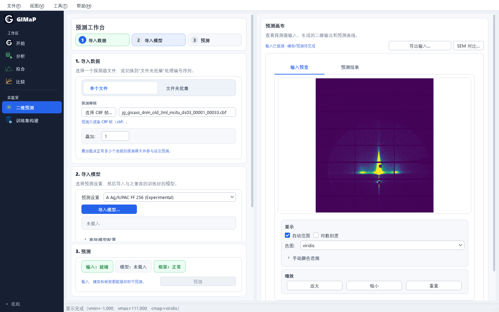
*已载入一个 CBF 帧，显示在“输入预览”里；还没有导入模型。“3. 预测”下的三个状态说明还缺什么，三者都就绪之前“预测”不可用。*

1. **导入数据。**
   - **单个文件**（Single file）：**选择 CBF 帧…**（Choose CBF frame…），或把 CBF 帧拖到画布上。**叠加**（Stack）是几个连续的探测器文件组成一个输入。
   - **文件夹批量**（Folder batch）：一个编号帧的文件夹、帧号 **范围**（Range）和 **每次预测的文件数**（Files per prediction）；
     字段下面一行说明这对应多少个文件和多少次预测。

   预测只读 CBF 帧（`.cbf`）。
2. **导入模型。** 选择 **预测设置**（Prediction setup），即 `modules/` 里的一个模块（见 10.3 节），按 **导入模型...**（Import model...）；
   下面一行说明模型是否已载入。折叠在下面的有：**高级模型配置**（Advanced model configuration：框架检查、**重新载入配置**（Reload Config）、**编辑配置**（Edit Config））
   和 **高级模型来源**（Advanced model sources：模型库）。
3. **预测。** 三个状态 *输入*、*模型*、*框架* 说明还缺什么；三者都就绪时 **预测**（Predict）可用。预测在后台运行，**停止**（Stop）结束它。

载入帧后画布显示 **输入预览**（Input preview），预测后显示 **预测结果**（Prediction result）。*Preprocessed* 按顺序显示模块的各个预处理步骤及其产生的图像（点击可放大）。

- **导出输入...**（Export input...）保存所显示的帧，并附 JSON 记录。
- **导出结果...**（Export result...）把结果存为图片，旁边存数据，以及记录模块、模型、预处理步骤和输入文件的 JSON。
- 文件夹批量的结果列在 **批量结果**（Batch results）里，可筛选、排序和导出。
- **活动日志**（Activity log）折叠在底部。

画布上方的 **SEM 对比…**（SEM comparison…）在结果带有以 nm 为单位的半径轴时，打开附带当前预测的 **SEM 粒径分析**（SEM Particle Analysis，见 8.3 节）；
否则打开的工具不带预测。然后在那里打开 SEM 图像或粒径 CSV。附带的是一份复制：半径分布及其来源（输入文件、模块、模型、预处理、运行环境）。之后在预测页更换输入或模型，
不会改动已打开的比较；过时的结果也不会再被附带。从工具菜单打开 SEM 工具时，会移除之前附带的预测。

两个分布不是同一个量。SEM 给出的是一个小视野里颗粒投影面积对应的半径，按颗粒计数；预测给出的是模块模型从被照射区域的散射得到的半径分布。
两者的差别是值得讨论的结果，不说明哪一方错了。

### 10.2 训练集构建

**此功能仍在开发中。**

**训练集构建**（Trainset Build）设计一套模拟的 GISAXS 训练集（BornAgain），在本地检查并准备训练。左边五步，每步显示状态：

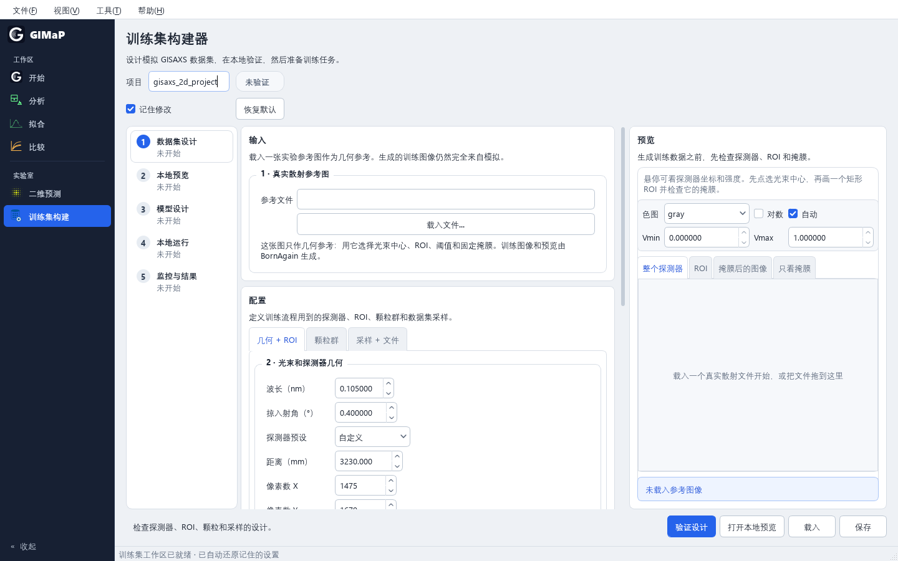
*第 1 步“数据集设计”。左边是五个步骤及其状态；载入参考文件后，右边的预览显示探测器、感兴趣区域和掩膜。*

1. **数据集设计**（Dataset Design）：可选地载入一幅实测图像作为几何参考（**载入文件...**（Load file...）：用来确定光束中心、感兴趣区域和掩膜，
   从不当作训练图像）；然后设置 **几何 + ROI**（Geometry + ROI）、**颗粒群**（Particle population）、**采样 + 文件**（Sampling + files）。**验证设计**（Validate design）检查设计。
2. **本地预览**（Local Preview）：在所选参数范围内模拟的例子，以及预处理（背景、噪声、掩膜和变换在 **高级预处理**（Advanced preprocessing）里）。
3. **模型设计**（Model Design）：训练设置和网络的各层。
4. **本地运行**（Local Run）：作业包、本地生成和训练，带进度和 **安全停止**（Stop safely）。这个版本不能提交到 Maxwell 集群。
5. **监控与结果**（Monitor & Results）：日志、指标和最佳模型的登记。

**记住修改**（Remember changes）把设计留到下次；**恢复默认**（Reset defaults）恢复内置值（随后的提示可以撤销）；**载入**（Load）、**保存**（Save）读写项目文件。
中文界面里，这个页面的很多文字仍是英文。

### 10.3 预测模块

预测模块是 `modules/` 下带 `module.yaml` 的文件夹。主要字段：

| 字段 | 含义 |
|---|---|
| `id`、`name`、`version` | 内部标识、显示名称、版本 |
| `framework` | 模型框架，例如 TensorFlow/Keras |
| `model.model_path` | 训练好的模型的路径 |
| `preprocess.entry`、`preprocess.steps`、`preprocess.params` | 预处理入口、步骤和参数 |
| `io.input_type`、`io.stack_axis`、`io.input_shape` | 输入类型（例如 `cbf`）、叠加轴、模型的输入形状 |
| `outputs` | 输出：参数名、范围或输出类型 |

添加模块时，请确认模型路径、输入类型、预处理代码和输出定义与训练好的模型一致。指向某台电脑上特定位置的路径，换电脑时要改。
要做 SEM 对比，半径输出需要以 nm 为单位的轴。

一维预测的 V5 方法使用自带的模型 `modules/Fitting_1D_Model/Workflow_v5`；fit1d 改用安装的 `gisaxs1d_gui_kit`（见 6.4 节）。

## 11. 输出文件

GIMaP 从不改动你的数据文件。分析的导出默认写到**数据旁边的 `gimap_analysis/`** 文件夹；其他大多数导出会询问位置并给出建议。
用户数据文件夹在 Windows 上是 `%APPDATA%\GIMaP`（或 `GIMAP_HOME` 指定的文件夹；**帮助 ▸ 打开用户数据文件夹**（Help ▸ Open User Data Folder））。

| 操作 | 写出的文件 | 默认位置 | 附带的记录 |
|---|---|---|---|
| 分析 ▸ **导出**（Export，`Ctrl+E`）、**导出曲线…**（Export Curves…） | 每条曲线一个 `<stem>_<curve>.csv`、`<stem>_fit_input.dat`、`<stem>_analysis.json`（多帧文件中的一帧加 `_frameNNNN`，帧求和时加 `_sumN`） | 数据旁边的 `gimap_analysis/`，不弹对话框；无法写入时弹出文件夹对话框 | `<stem>_analysis.json`（设置、几何、校正、排除的像素）和 `#` 头行 |
| 分析的曲线图 ▸ **保存 ▸ 曲线存为数据…**（Curves as Data…） | 这张图的 CSV 和 `_analysis.json` | 文件夹对话框，从 `gimap_analysis/` 开始 | 同导出 |
| 分析的曲线图和图像 ▸ 存为图片（**曲线图存为图片…**、**当前视图存为图片…** …） | PNG、TIFF、SVG 或 PDF，浅色配色 | 对话框，从 `gimap_analysis/` 开始 | 无 |
| 分析 ▸ **保存 q 图数据…**、**当前视图数据存为 CSV…** | `<stem>_qmap.csv`、`<stem>_cake.csv` | 对话框，从 `gimap_analysis/` 开始 | `#` 头行（来源、帧、坐标轴） |
| 分析 ▸ 序列 ▸ **导出**（Export：**热图导出为 CSV 表…**、**热图导出为图片…**、**阶段表…**（Stages as Table…）、**随帧变化的曲线（表格）…**、**每帧的峰表…**、所选帧的曲线） | `<序列>_<曲线>[_<两半>]_map.csv`、`…_map.png`、`…_stages.csv`、`…_trace_<量>.csv`、`…_peaks.csv`；所选帧为 `<帧>_<曲线>[_<两半>].csv` | 对话框，从 `gimap_analysis/` 开始 | `#` 头行（曲线、两半、帧、切线），每个表格旁边有记录设置的 `.json` |
| 分析 ▸ **发送到拟合**（Send to Fitting） | `<stem>_fit_input.dat`（q 单位 Å⁻¹） | 数据旁边的 `gimap_analysis/`；那里写不了时为你选的文件夹（本次会话记住） | `#` 头行（来源、帧、求和、曲线、带两半的观测信息） |
| 分析 ▸ **批量导出…**（Batch Export…） | 按曲线的表 `<batch>_<curve>_frames.csv`（或 `.txt`、`.dat`）、选了拟合时的拟合表，以及按你的选择生成的子文件夹 `curves/`、`fit_input/`、`maps/`、`images/`、`frames/`、`fits/`；帧名保留从 0 数的帧号（`…_frame0003_sum3_…`） | 上次的批量文件夹，否则数据旁边的 `gimap_analysis/`；默认再建一个以帧所在文件夹命名的子文件夹（单个文件：以文件命名；来自多个文件夹：`batch`）；**两者都保留**时写到新的子文件夹 | `README.txt` 和 `<batch>_batch.json`（写出的每个文件、每帧的切线、失败的帧及原因）；`curves/` 里每帧还有 `_analysis.json` |
| 分析 ▸ **把序列发送到拟合…**（Send Series to Fitting…） | `fit_input/<帧>_fit_input.dat`、`README.txt`、`<batch>_batch.json` | 它自己的文件夹 `<名称>_fitting/`，在同一数据的批量导出旁边 | `README.txt`、批量 JSON |
| 分析 ▸ **监视时导出新帧**（Export New Frames While Watching） | 每个新帧同导出 | 帧旁边的 `gimap_analysis/` | 同导出 |
| 分析 ▸ **保存设置…**（Save Settings…）；掩膜步骤 ▸ **保存…**（Save…）；区域 ▸ **添加 ▸ 保存切线…**（Add ▸ Save Cuts…） | `analyze_settings.json`；`masks.json`；`cuts.json` | 对话框，从 `gimap_analysis/` 开始 | 文件本身就是记录 |
| 运行自动分析 ▸ **保存报告…**（Save Report…） | `<stem>_report.html`（带图）或 `.md` | 同一文件夹的帧上次保存到的文件夹，否则已有 `gimap_analysis/` 时在那里，否则在帧旁边 | 报告本身（没有 JSON） |
| 用 AI 处理 ▸ **保存报告…** | `<stem>_ai_report.html` + `<stem>_ai_report.json` | 同上 | JSON |
| 用 AI 处理（自动） | 每次运行的记录；缺少的分析 | 用户数据文件夹：`assistant_runs/`、`assistant_feature_requests.jsonl` | — |
| 用 AI 处理，AI 导出时 | 同导出的曲线，以及 `<stem>_assistant.json` | 数据旁边的 `gimap_analysis/` | `<stem>_analysis.json`、`<stem>_assistant.json` |
| 拟合 ▸ 单条分析 ▸ **保存 ▸ 数据与拟合…**（Data and Fit…） | `<curve>_fit.csv` + `<curve>_fit.json`（成对写出） | 上次保存的文件夹，否则上次打开曲线的文件夹，否则曲线所在文件夹 | JSON（模型、方法、范围、排除的点；fit1d 保留它自己的曲线和警告） |
| 拟合 ▸ **保存 ▸ 曲线图…**、**保存 ▸ 模型…** | `<curve>_fit.png` / `.svg`；`<curve>_model.json` | 同上 | 无；模型文件 |
| 拟合 ▸ 原位序列 ▸ **保存 ▸ 每一帧的结果表…** | `series_fit.csv` + `series_fit.json` | 序列所在文件夹 | JSON（`gimap_series_fit_v2`：初始模型、两半及其来源、每帧的状态和原因；探测器帧时还有分析页的设置） |
| 拟合 ▸ 原位序列 ▸ **趋势图…**、**所选帧的曲线图…** | `series_trend.png`、`series_frame.png` | 序列所在文件夹 | 无 |
| **工具 ▸ 一维预测——拟合多条曲线…**，以及拟合的 *AI 建议（一维预测）* | 一个运行文件夹：`request.json`、`batch_summary.json` …，每条曲线一个子文件夹，含 `solutions.json`、`fitting_curves.csv` … | 启动 GIMaP 时所在文件夹下的 `AI_Fitting_Output/v5_<日期>_<时间>_<微秒>/`（便携版：程序文件夹）；不会自动删除 | `request.json` |
| 比较 ▸ **保存 ▸ 每个序列的表… / 每一帧的结果表…** | `compare_series.csv` / `compare_frames.csv` + `.json` | 第一个从文件添加的序列所在文件夹，否则上次添加序列的文件夹 | `#` 头行和 JSON |
| 比较 ▸ **变化图… / 路径图… / 终态图…** | `compare_*.png` 或 `.svg` | 同上 | 无 |
| 溅射 ▸ **预测** | 每个扫描和请求一个文件夹：`structure_physical.csv` + `structure_physical_summary.json`（物理路径）、`structure.csv` + `structure_summary.json`（逐窗）、模型的 `intake/` 和 `binned/` | 用户数据文件夹：`sputter/<扫描>-<代码>/`（或**更多选项 ▸ 结果保存在**）；相同的请求重用它的文件夹 | `gimap_request.json`（请求、Python、PyTorch 版本） |
| 溅射 ▸ 结构示意 ▸ **保存图像… / 保存分镜图…** | PNG、PDF 或 SVG | 结果文件夹 | 无 |
| 溅射，显示结果后在后台 | `fringe_heights.csv`（每个时间组由 q_z 干涉条纹得到的 H）+ `fringe_summary.json` | 结果文件夹的 `fringes_v1/`；不能写入时为用户数据文件夹的 `sputter_fringes/<结果文件夹>/` | 摘要：`binned/run.json`、各分块和 `structure_physical.csv` 的 SHA-256、工具的版本、αc 及其来源、设置 |
| XRR 序列提取 ▸ **导出 CSV…** | `<source>_xrr.csv` + `.json` | 源文件旁边；CBF 文件夹则在文件夹里 | JSON（决定 qz 的每个值及其来源；`center_convention`；`source_layout` 列出读到的每个文件） |
| 格式转换 | 转换后的帧，默认 `<source>_<6 位帧号>.<ext>`（或一个 `converted_images.h5`） | 第一个输入旁边的 `converted/` | `conversion_report.json`、`conversion_metadata.json`（或每帧一个 JSON） |
| SEM 粒径分析 ▸ **导出 SEM 结果…** | 8.3 节列出的文件 | 你选的文件夹里新建的 `SEM_analysis_<日期>_<时间>/`；从不覆盖 | `sem_analysis.json`；CSV 的 `#` 头行 |
| 二维预测 ▸ **导出输入...**（Export input...） / **导出结果...**（Export result...） | `<input>_input.png` + `.json`；`<input>_prediction.png` + `.json`（结果有曲线或图时还有 `.txt`） | 上次的导出文件夹，否则输入所在文件夹 | JSON |
| 二维预测 ▸ 多个文件时的 **导出结果...** | 按你的选择：`prediction_results_<时间>.jsonl`；`prediction_curves_<时间>.txt`（或 `prediction_parameters_<时间>.txt`）；`prediction_images_<时间>/` 里的图像 | 你选的文件夹（从上次的导出文件夹开始） | `.txt` 里的 `#` 头行 |
| 训练集构建 ▸ **准备任务包**（Prepare job package） | 作业文件夹（`config.yaml`、脚本、`manifest.json` …） | 程序文件夹下的 `trainset_jobs/<project>/`（工作区可以更改） | `manifest.json`（校验和） |
| 训练集构建 ▸ **保存**（Save） | `<project>.yaml` | 上次的项目文件夹，否则程序文件夹 | 文件本身 |
| 几何标定 ▸ **导出标定…**（Export Calibration…） | `<image>.gimap-calibration.json` | 标样图像旁边 | 文件本身（光束中心从 0 数像素中心，比窗口显示的小 0.5 px；`metadata.center_convention`） |
| 几何标定 ▸ **应用**（Apply） | 仪器配置 | 用户数据文件夹：`instrument_profiles.json` | — |
| **文件 ▸ 保存项目**（File ▸ Save Project） | `<name>.gimap`；比较里有来自分析的热图时还有 `<name>.compare.npz` | 第一帧旁边 | 项目本身（数据按路径引用） |
| **文件 ▸ 实验室参数 ▸ 另存为…** | `gimap_parameters.json` | 对话框，从启动 GIMaP 时所在的文件夹开始 | — |
| 错误（自动） | `logs/errors.log`（超过 2 MB 时改名为 `errors.old.log`） | 用户数据文件夹 | — |
| `tools/gimap_agent.py` | 每帧一个子文件夹（一组模块文件：每次扫描一个；`--series`：`<名称>_series/`），含 `report.md`、`report.json`、曲线、q 图；`summary.md` + `summary.json` | `--out`；不给时为用户数据文件夹里的 `assistant_runs/cli/<时间>/`；从不写到数据旁边 | `report.json` |

保存单个文件的对话框在替换这个文件之前会询问；写在它旁边的记录（例如 `.json`）会直接替换，不再询问。
不弹文件对话框的导出——导出、**曲线存为数据…**（用的是文件夹对话框）、发送到拟合、监视、批量导出、把序列发送到拟合、AI 的导出、
转换器的报告和元数据 JSON——会替换所在文件夹里的同名文件。批量导出和把序列发送到拟合会先就同一数据之前的导出发问（**替换**、
**两者都保留（写到新的子文件夹）**、**取消**；5.7 节）。格式转换从不覆盖转换出的图像（加上 `_001` … 或者停下），
SEM 粒径分析从不覆盖它的结果。

**文本文件。** GIMaP 写的每个文本文件（CSV、TXT、DAT、拟合用曲线、`README.txt`）都是不带 BOM 的 UTF-8。GIMaP 自己的符号写成
ASCII——`1/A`、`deg`、`2theta`、`alpha_i`、`chi`、`sigma`、`+/-`——文件名、帧名和路径保持原样；JSON 记录保留每个名字的原样。脚本
读这些文件时请用 `encoding="utf-8"`（例如 `numpy.loadtxt(path, encoding="utf-8")`）。在 Excel 里双击打开 CSV 时，非 ASCII 的名字
可能显示错乱；数值不受影响。

## 12. 已知限制

0.1.0 是预发布版本。以下限制是已知的，每条都附有应对办法。

| 限制 | 怎么办 |
|---|---|
| **拟合不读 `.csv` 曲线**，尽管分析把曲线导出为 CSV。 | 用 **发送到拟合**（Send to Fitting），或打开分析写出的 `<name>_fit_input.dat`；列为 `q I [σ]` 的 `.dat` 和 `.txt` 文件也能打开。 |
| **几何标定可能把错误的解排在第一。** 标样设为 **自动识别**（Auto Detect）且不给估计距离时，可能排出另一种标样的解；**估计距离**（Estimated distance）不对时，即使标样选对也会被误导，而且这个字段里可能有你没输入过的距离（见 4.3 节）。 | 知道标样时自己选。估计距离留在 *可选*（Optional），或输入你实验装置的大致距离；不是你输入的数字，除非正好是这个距离，否则改回 0。按 **应用**（Apply）之前，核对距离，并确认画出的环落在图像的环上。 |
| **仪器配置只按探测器名称和帧尺寸匹配**；**自动搜索找到的标定可能属于另一个实验**（整体复制过来的文件夹里，文件时间说明不了什么），甚至属于另一台探测器：`.poni` 或 `.json` 采用时不核对像素尺寸和帧尺寸（见 4.2 节）。 | 看报告写明用的是哪个文件，并核对**几何**步骤里的距离。在笔记里点名标定文件，或者自己给出；错误的配置用 **几何…** ▸ **删除配置** 删掉。 |
| **XRR 序列提取可能把 NeXus 文件头里的光束中心放错**（Lambda 服务器写的文件，见 8.2 节）。 | 在预览里确认十字落在直射束上，或用 **选取直射束中心**（Pick direct-beam center）。CBF 序列不受影响。 |
| **不是 Lambda 服务器写的 NeXus/HDF5 文件现在按存储原样读**（以前的版本会转置并翻转）。用以前的版本在这种文件上做的几何或掩膜不再适用（5.1 节）。 | 核对这类数据的光束中心和掩膜；需要时重新标定。 |
| **XRR 强度是原始值**：没有监视器归一化、足印、背景或分辨率校正。 | 对导出的 CSV 自己做这些校正。 |
| **格式转换不读 EDF。** | 用 **分析 ▸ 批量导出 ▸ 转换格式的探测器帧**（Analyze ▸ Batch Export ▸ Converted detector frames）。 |
| **SEM 粒径取决于分割**；默认的 StarDist 权重是用细胞核训练的，不是 SEM。标尺从不从图像读取。 | 按比例尺输入标尺；检查每个轮廓；尽量用 SEM 图像训练的模型。 |
| **fit1d**（预测参数）只提供球和竖直圆柱，不提供随机取向圆柱；用**尝试 …**组成时，模型里的值和范围不传过去。它需要单独安装的工具包。 | 用**模型中的粒子**来传固定的值和范围；把结果当作**精修这些数值**的起点。没有工具包时用*寻找颗粒形状（不用 AI）*。 |
| **二维预测只读 CBF 帧。** | 用格式转换把其他帧转成 CBF。 |
| **训练集构建**仍在开发中；不能提交到 Maxwell 集群。 | 用本地运行。 |
| **训练集构建（实验室）没有完全翻译**：中文界面里很多文字仍是英文；二维预测也有少量这样的文字。 | — |
| 会话中途切换界面语言后，少数文字保持原来的语言（例如一次已完成的自动分析的结果行）。 | 重新运行分析，或重启。 |
| 批量导出进行中退出 GIMaP，已完成帧的文件会保留，但批量表、`README.txt` 和批量的 JSON 记录不会写出。 | 用 **停止**（Stop）结束批量导出：它会写出这些文件。 |
| 一维预测把运行文件夹写到启动 GIMaP 时所在的文件夹，不会自动删除。 | 自己删除旧的 `AI_Fitting_Output/v5_…` 文件夹。 |
| **溅射工作区不能确定连续膜的厚度**，膜上带颗粒的情形也没有建模（7.4 节）。 | 读岛体积等效厚度 t_eq（岛时间窗，有条件）和由沉积速率得到的名义厚度；与 XRR、石英晶体微天平或截面对照。 |
| **溅射工作区用 Ag 模型读取 Cu**（网络是为 Ag 和 Au 训练的）。 | Cu 的结果仅供参考。 |
| **溅射工作区由 q_z 干涉条纹得到的岛高度 H 是均匀层的高度**（极小值位于 H Q = 2π n）：对其他形状的岛，加上折射模型，可能有约 1 nm 的固定偏差；范围内不足一个条纹周期时有最多 8% 的系统误差（已含在区间内）。范围内没有极小值、极小值正穿过模块间隙或无法确定级次时，不给出 H。 | 看趋势；与 XRR、AFM 或截面对照；摘要写明 αc 及其来源。 |
| **溅射工作区只凭强度标出光斑可能移出样品的时间窗**（低于前后一个调制周期内相邻时间窗水平的一半；没有调制时低于前后各 10 s 内水平的 20%；连同仍低于 80% 的两侧；7.4 节）。不读取样品台的位置和平移范围：从未低于水平一半的下凹不会被标出，不论持续多久，较慢地移出样品也不会；其他原因造成的下凹（光束强度下降、快门）同样会被标出，最前和最后的时间窗不作判断。光斑足迹到达样品边缘时，边缘散射或条纹可能使分析区域的强度升高而不是降低：这样的时间窗不会被标出。 | 有束线时间的样品台记录时，用它核对被标出的时间窗；这些时间窗的数值仍保留在“时间窗”表中。 |
| **溅射工作区的文献方法依赖你给出的沉积速率、t0 和沉积结束时间**（GISAXS 都不测量），也依赖 D = 2π/q*。它的渗流区间假定速率误差在 ±10% 以内、t0 误差在 ±2 s 以内（给出 t0 时为 ±0.5 s）——这是工程上的选择，页面不改变它们——把沉积结束时间当作准确值，并且不含 2π/q* 的系统误差（聚并开始后、D > 10 nm 时超过 40%）。没有给出沉积结束时间时，假定沉积持续到扫描结束。PNO、PSBMA 和 PEO 没有已发表的渗流数据，用该金属所有聚合物的区间（7.4 节）。 | 给出样品位置的速率，知道的话也给出 t0 和沉积结束时间；需要别的误差时，用工具包的 `physical` 命令加 `--rate-error` 和 `--t0-error` 运行。渗流*无法确定*就按无法确定理解；与别的腔体的阈值比较只是对照，不是预测。 |
| **溅射工作区第一次预测时下载 PyTorch**（约 1.2 GB，需要联网）；模型在 CPU 上运行。 | 没有网络时手动安装 PyTorch（13.7 节）。 |
| GIMaP 在 Windows 上开发和测试。TensorFlow 在 CPU 上运行；没有配置 GPU。 | — |

## 13. 故障排除、常见问题、版本与联系

### 13.1 文件无法载入

图像下方的提示会用文字说明原因：空文件（还在写入？）、不是探测器图像、NeXus 文件损坏或不完整、没有权限。另一个程序还在写的
NeXus/HDF5 文件要等它关闭后才能读；写入程序没关文件就结束了的文件，对它的副本运行 `h5clear -s` 后能读；用本机读不了的压缩过滤器
压缩的文件需要 Python 包 `hdf5plugin`（见 5.1 节的 *NeXus 与 HDF5 文件*）。否则请检查格式是否受支持：
`.cbf` 需要 `fabio`，HDF5/NeXus 文件需要 `h5py`，并且数据集在读取器预期的位置。需要支持其他文件格式时，请联系作者（见 13.12 节）。

### 13.2 `.csv` 曲线在拟合里打不开

拟合读取 `.dat` 和 `.txt` 曲线。来自分析的曲线请用 **发送到拟合**（Send to Fitting），或打开 CSV 旁边写出的 `_fit_input.dat`。

### 13.3 一维预测无法启动

*General V5* 运行前会用校验和检查它的模型文件（`modules/Fitting_1D_Model/Workflow_v5/`），有文件缺失或被改动时不启动：提示里写着文件名。
*Single RC specialist* 这时不会停下，而是继续做数值拟合，并把 *Fast model unavailable* 写作解的原因。便携版和 Git 仓库都包含这些文件。从源码运行时：

- 在加入权重之前最后更新的检出还没有这些文件：请更新（见 2.4 节）。
- 2026-10-13 之前在 Windows 上做的检出，其中一些文件的换行符被转换过；即使已经用两条普通命令移到新的 `main`，也是如此，而且 `git status` 看不出来。
  请运行 `tools\update_source.ps1`：即使没有新内容可下载，它也会重新写出这些文件。
- 你自己改过的模型文件，脚本不会动；`git status` 会把它列为已修改。`git checkout -- modules/Fitting_1D_Model/Workflow_v5`
  恢复仓库里的文件（并丢弃你在这个文件夹里的改动）。

拟合的数值方法（*精修模型中的数值*、*在范围内搜索，再精修*、*寻找颗粒形状（不用 AI）*）不使用模型文件，不受这项检查影响。*预测参数（fit1d）*需要它自己的工具包，放在 `utils/gisaxs1d_gui_kit`
（或由 `GISAXS1D_KIT_HOME` 指定）；没有时，这个方法会提示把文件夹放在哪里。

### 13.4 二维预测：“预测”不可用，或模型没有导入

**预测**（Predict）上方的三个状态说明缺什么：*输入*（一个 CBF 帧或文件夹）、*模型*（按 **导入模型...**（Import model...））和 *框架*（模块需要的框架已安装）。
模型载入失败时，检查模块的 `model.model_path`：指向另一台电脑的路径需要改。

### 13.5 SEM 粒径分析不提取

- 在为这个文件设置正数的 **图像标尺**（Image calibration）之前，运行按钮不可用。
- **StarDist（本地 AI）**（StarDist (local AI)）：按 **检查本地运行环境和模型**（Check local resources）。它需要装有 StarDist 和 TensorFlow 的 Python（`requirements-sem-stardist.txt`），
  以及含 `config.json` 和权重的模型文件夹。软件不会替你下载任何东西。
- **已有实例标签**（Existing instance labels）：标签必须是整数图像，尺寸等于 SEM 图像或 ROI。
- 没有颗粒通过筛选：看被排除的轮廓和原因，再调整阈值、对比方向、面积上下限或 ROI。

### 13.6 AI 助手无法开始

开始对话框会说明所选引擎是否就绪。Claude Code：先安装，再在 **工具 ▸ 设置… ▸ AI 助手**（Tools ▸ Settings… ▸ Assistant）里 **登录…**（Sign In…）并 **检查登录**（Check）。
Claude API：`pip install anthropic`、密钥、**测试连接**（Test Connection）。其他服务商：`pip install openai`、密钥、支持工具调用的模型、**测试连接**。

### 13.7 TensorFlow / PyTorch 不可用，或缺少依赖

`requirements.txt` 要求 TensorFlow 2.15–2.16（Windows 上为 `tensorflow-intel`）；测试过的版本是 2.15.1。缺少软件包时，
激活正确的 Python 环境，运行 `pip install -r requirements.txt`。

只有溅射工作区需要 PyTorch：第一次**预测**时把它装进 GIMaP 所用的 Python（`requirements-sputter.txt`，保留已安装的 NumPy）。
安装失败时，任务状态会说明原因，并给出可以手动运行的命令：

- 连不上 pypi.org（代理、SSL、防火墙）：联网，或设置代理（`HTTPS_PROXY`）；
- 没有写入这个环境的权限：从你能写入的文件夹启动 GIMaP（`Start_GIMaP.bat`），或以管理员身份安装。GIMaP 从不装到用户自己的
  site-packages：模型不使用它们；
- 磁盘已满：需要约 1.5 GB；
- 找不到适合这个 Python 的 PyTorch：用 `Start_GIMaP.bat` 启动 GIMaP，它会配置 Python 3.10；
- 没有 pip：GIMaP 先用 `ensurepip` 补上；
- PyTorch 已安装但无法加载：在 Windows 上安装 Microsoft Visual C++ 可再发行组件，或在原处重新安装 PyTorch
  （`python -m pip install --force-reinstall --no-deps -r requirements-sputter.txt`）。如果 GIMaP 在 pip 写入软件包时被关闭，
  下一次**预测**会自己这样做。

手动安装：用**预测**按钮下面写着的 Python 运行 `python -m pip install -r requirements-sputter.txt`。环境变量
`GIMAP_SPUTTER_NO_INSTALL=1` 关闭自动安装。

### 13.8 Windows 对安装程序发出警告

安装程序和启动程序是没有签名的批处理文件（`.bat`），所以 Windows 运行下载的文件前可能会询问，机构的杀毒软件或应用程序控制也可能拦截。
只运行从 GIMaP 的 GitHub Releases 页面下载的文件。否则请在本地 Python 环境里从源码运行 GIMaP（见 2.2 节）。

### 13.9 导出为空或失败

- **为空**：检查 q 或帧的范围、掩膜、切线，以及这一帧是否有有效数据。拟合还要检查拟合范围、参数边界、比例和背景；二维预测还要检查叠加数和模块是否适合这些数据。
- **失败**：检查文件夹是否存在、是否可写；不要导出到受保护的系统文件夹。数据旁边的 `gimap_analysis/` 无法写入时（只读的数据共享盘），导出会请你另选文件夹。

### 13.10 窗口对屏幕来说太大

GIMaP 跟随操作系统的显示缩放，适配 1280 × 720 的屏幕。文字太大或太小时，用 **视图 ▸ 字号**（View ▸ Font Size）或
**工具 ▸ 设置… ▸ 外观**（Appearance）；内容多的面板会滚动而不是被截断。窗口的大小和位置在下次启动时恢复。

### 13.11 常见问题

**GIMaP 可以用于正式生产吗？** 还不行。0.1.0 是预发布版本：请把它当作 beta 版科学软件，对重要的结果进行核对。

**能用我自己训练的模型吗？** 二维预测可以，只要它能用模块配置描述、并有受支持的载入器（见 10.3 节）。SEM 粒径分析可以用任何本地 StarDist 模型文件夹。
一维预测的 V5 方法使用自带的模型；fit1d 在设置里提供 *通用网络*（General network）和 *Si 上的 Au 纳米颗粒（已适配）*（Au nanoparticles on Si (adapted)）两个网络。

**一维预测的结果存在哪里？** 在启动 GIMaP 时所在文件夹下的 `AI_Fitting_Output/v5_<日期>_<时间>_<微秒>/`（便携版：程序文件夹）。
你自己保存（**保存**）的拟合存在你选的位置。第 11 章列出了所有输出。

**有数据离开我的电脑吗？** 只有使用远程引擎的 AI 助手时才会：发送帧的状态和以数字表示的约化曲线，从不发送探测器文件（见 9.6 节）。
StarDist 在本地运行，不下载任何东西。

### 13.12 版本与联系

本手册对应 **GIMaP 0.1.0**（预发布版）。**帮助 ▸ 关于 GIMaP**（Help ▸ About GIMaP）显示你正在运行的程序版本。程序文件夹里的 `CHANGELOG.md`
列出自 0.0.2 以来的变化（被替换的页面、设置现在保存在哪里）、尚未发布的改动，以及这个版本的已知限制。

联系方式：[yufeng.zhai@desy.de](mailto:yufeng.zhai@desy.de)
