# GIMaP 用户手册

GIMaP 是掠入射 X 射线散射（GISAXS、GIWAXS）的桌面分析软件。它把探测器帧变成标定好的曲线
（I(q)、I(qy)、I(χ)），找峰、取向和尺寸，用颗粒模型拟合一维曲线，跟踪原位序列，并比较不同的测量。
每条曲线都记着它从哪里来、用了哪些设置。

本手册对应 0.2.0 版，这是预发布版（pre-release）：请把它当作测试阶段的科学软件，重要的结果要核对。
工作区（分析、拟合、比较、溅射）可以用于日常工作；溅射运行随 GIMaP 提供的分析包（第 8 章）。
实验室（Labs）页面和一维预测（1D Predict）是实验性的。
**帮助 ▸ 关于 GIMaP**（Help ▸ About GIMaP）显示正在运行的版本。自 0.0.2 以来的改动和这一版的已知限制
写在程序文件夹里的 `CHANGELOG.md` 中（第 13 章汇总了已知限制）。

本手册说明该做什么、会得到什么。GIMaP 怎样算出它显示的数值——公式、阈值、误差模型及其局限——写在另一份参考文档
《物理与方法》（Physics and Methods，[`docs/Physics_Manual_zh.md`](Physics_Manual_zh.md)，**帮助 ▸ 物理与方法**
（Help ▸ Physics and Methods））里；方法关系到你的判断时，本手册会写出它在那里的章节。

第一次用 GIMaP？从第 1 章开始：两个各约十分钟的练习，用的是公开数据。

从**帮助 ▸ 用户手册**（Help ▸ User Manual，`F1`）打开离线阅读页面（按 `F1` 时直接定位到当前页面所属的章节）：左侧是固定、可展开的章节目录，以及
**搜索本篇文档**（Search this document），可以同时搜索标题和正文。点击章节或搜索结果直接跳转，目录会标出
当前所在的小节。按 `/` 聚焦搜索框，`Enter` 打开第一条结果，`Esc` 清空搜索。窗口较窄时，点击**目录**（Contents）
展开导航。页面随浏览器或系统使用浅色、深色外观，打印时使用浅色。
Windows 和 macOS 上，公式和命令都以等宽文本块保留原文的空格和换行，长行可以在块内横向滚动；行内代码也保留等宽格式。

## 目录

1. 快速入门
2. 安装与更新
3. 主窗口
4. 几何与标定
5. 分析（Analyze）
6. 拟合
7. 比较与阶段
8. 溅射
9. 工具窗口
10. AI 助手
11. 实验室
12. 输出文件
13. 已知限制
14. 故障排除、常见问题、版本与联系

## 1. 快速入门

两个练习，各约十分钟：一帧 GIWAXS、一帧 GISAXS，都是公开数据。两个练习的步骤相同：打开帧、给它几何、
运行自动分析、看结果、把曲线发送到拟合。全程不用 AI。

### 1.1 开始之前

两组数据随 GIMaP 一起提供，便携版和源码版本都有，在程序文件夹的 `tests/data/external/` 文件夹里：

| 文件夹 | 文件 | 内容 |
|---|---|---|
| `giwaxs_p08_mapi/` | `S121_MAI_A2_00841.tif`、`LaB6_2021_12_DESY_P08.poni` | MAPbI₃ 钙钛矿薄膜的 GIWAXS，DESY P08，PerkinElmer 2048 × 2048 探测器，αi = 0.075° |
| `gisaxs_galaxi/` | `galaxi_data.tif`、`galaxi_bornagain.poni` | Ag 纳米颗粒的 GISAXS，GALAXI（于利希），Pilatus 1M，λ = 1.34 Å，αi = 0.463° |

数据的来源、许可证和文献给出的几何见 `tests/data/external/README.md`。

1. 启动 GIMaP（第 2 章），打开的是**开始**（Start）页。
2. **帮助 ▸ 示例数据 ▸ GIWAXS——MAPbI₃ 薄膜（DESY P08）…**（Help ▸ Example Data ▸ GIWAXS — MAPbI₃ Film (DESY P08)…）
   把 GIWAXS 示例（帧和它的 `.poni`）复制到你选择的文件夹，默认是 `Documents\GIMaP examples\giwaxs_p08_mapi`，
   并在分析页中打开这一帧：1.2 节的第 1 步就完成了。GIMaP 把结果写在数据旁边的 `gimap_analysis/` 文件夹里；
   用副本可以让程序文件夹保持干净。（也可以自己复制这个文件夹，再像 1.2 节那样从开始页打开帧。）
3. 到 1.3 节时，用同样的方法选**帮助 ▸ 示例数据 ▸ GISAXS——Ag 纳米颗粒（GALAXI）…**。每个示例放在自己的
   文件夹里，默认的文件夹就是这样。**自动查找标定**（Find Calibration Automatically）也会搜索帧旁边和上面几层
   的文件夹，但先取帧所在文件夹里的标定文件（4.2 节）：每一帧拿到的是它自己那个示例的 `.poni`，而不是旁边那个
   示例的。

**帮助 ▸ 示例数据**里还有一个山嵛酸银标样（pyFAI）和一帧用倾斜探测器测的 GIWAXS（Xeuss）。每一项的提示
写明来源和许可证，副本旁边还有 `SOURCE_AND_LICENCE.md`。

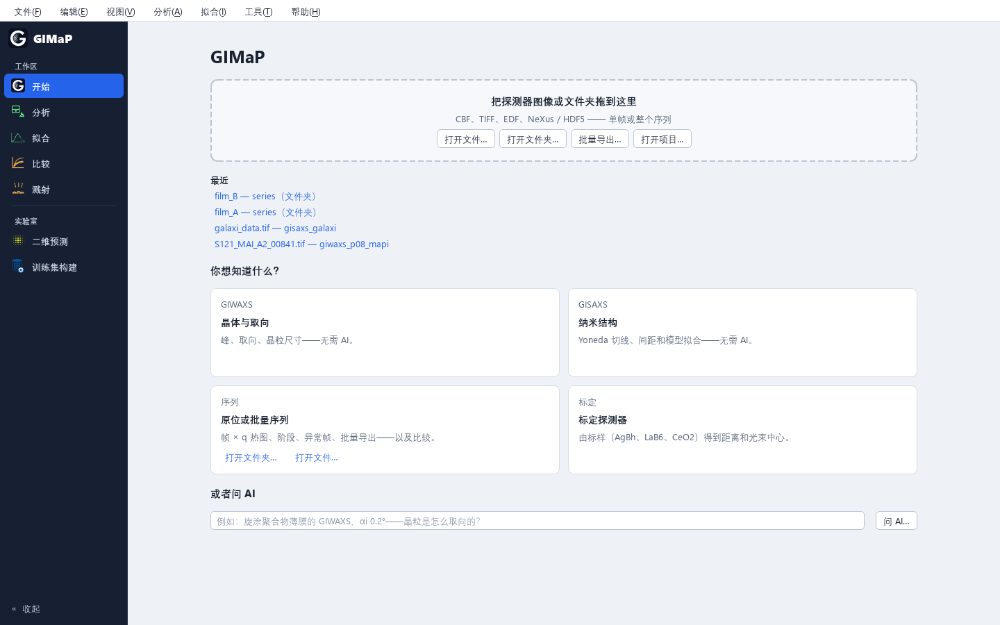
*开始页：拖入或打开数据，选择你想知道什么（序列卡片有自己的“打开文件夹…”和“打开文件…”链接），或者问 AI。
打开过的文件会列在“最近”下面。*

### 1.2 GIWAXS：钙钛矿薄膜

**1. 打开帧。** 在开始页按**打开文件…**（Open Files…），选择 `S121_MAI_A2_00841.tif`（也可以把文件
拖到窗口上）。**分析**（Analyze）页打开。核对：

- 命令栏显示文件名，**数据**步骤显示尺寸 `2048×2048 px`；
- **数据**（Data）步骤是 ✓；**掩膜与校正**（Mask & corrections）写出排除了多少像素
  （“排除了 0.0058 % 的像素”：孤立的热像素和死像素）；
- **几何**（Geometry）显示 **!** 和“还没有几何”；
- 一条黄色提示条说“此探测器（2048×2048）没有仪器配置”，并提供**自动查找标定**、**输入几何…**（Enter Geometry…）和**标定…**（Calibrate…）。

探测器图像以像素显示。没有几何时还没有 q 曲线。

**2. 给它几何。** 按提示条里的**自动查找标定**。GIMaP 在帧周围的文件夹里搜索，找到
`LaB6_2021_12_DESY_P08.poni`。核对：

- **几何**变成 ✓，显示 `811.8 mm · λ 0.6888 Å · αi 0°`；
- **切线**变成 ✓（环和条带），曲线出现；
- **结果**（Results）步骤写出几何的来源：“已保存的标定文件（没有再用标样图像检查）；由自动搜索找到：
  LaB6_2021_12_DESY_P08.poni”，并有 1 个问题。

这个几何现在保存为仪器配置 *Detector 2048×2048*。从此以后，分析对这个尺寸的每一帧都用它（4.1 节）。
处理自己的数据时，要确认找到的文件是你这次测量的标定。

**3. 运行自动分析。** 按命令栏的**运行自动分析**（Run Automatic Analysis）。只需要几秒；**结果**标签页
逐项显示已完成的步骤。结束后，结果步骤问一个问题：入射角。在**入射角 αi (°)**（Incidence angle αi (°)）
里输入 `0.075`，按**用这些答案再运行一次**（Run Again with These Answers）。**几何**现在显示 `αi 0.075°`，
命令栏的 αi 框以橙色显示 `αi 0.075 °`：这是你设的值，用于你显示的每一帧，也包括接着打开的那一帧，直到你
回到配置中的 αi（4.1 节）。

**4. 看结果。** 结果标签页的第一行类似“GIWAXS — 12 个峰（12 个可靠），分析了 3 个环”。下面是：

- **峰**（Peaks）：q 和 FWHM 的单位是 Å⁻¹，d 是 Å，L（Scherrer 尺寸，是下限）是 nm，以及峰在面外（OOP）
  还是面内（IP）。这里能看到 q ≈ 0.90、1.00、1.41、1.99 和 2.22 Å⁻¹ 附近的峰。数据的 README 把
  0.899 Å⁻¹ 标为 PbI₂ (001)，0.999 Å⁻¹ 标为 MAPbI₃ (110)。要比较候选衍射，可在**物相**（Phases）中给出候选物相（5.9 节）。
- 对峰面积最大且没有警告的三个环，可将实测 Hermans 取向因子 f 与相同角度范围的各向同性参考值 f_iso 对照。每个环还给出统计误差、系统变化范围、极图拟合和强度极大值的位置。
- **检查**（Checks）列出被遮挡和未测到的角度范围，包括 qz 旁边的缺失楔。
- **几何**：用到的配置、距离、光束中心、波长和 αi。

选中一个峰，打开**拟合细节**（Fit details），可以看到拟合用到的点、高斯峰和它的背景，以及各个误差。
**保存报告…**（Save Report…）把全部内容存成网页或 Markdown。把图像切换到 **q 图**（q map）或
**展开图**（Cake），可以在 q 中看环；**来源**（Sources）显示每条曲线用了哪些像素。

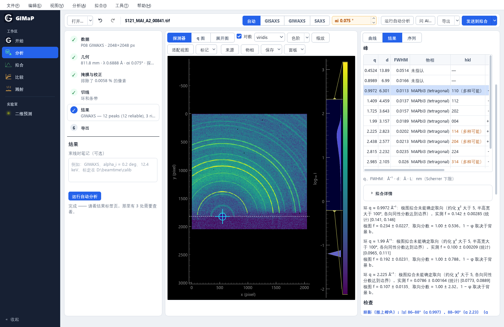
*一帧 GIWAXS 的结果标签页：总结行、峰表、拟合细节和环的取向；检查在更下面。*

**5. 发送到拟合。** 按**发送到拟合**（Send to Fitting）。GIMaP 在帧旁边写出
`gimap_analysis/S121_MAI_A2_00841_fit_input.dat`（列为 q、I、σ、像素数；q 的单位是 Å⁻¹；以 `#` 开头的
头行写明这些点从哪里来），并在**拟合 ▸ 单条分析**（Fitting ▸ Single analysis）里打开它。**曲线**
（Curve）步骤显示“拟合 2050 个点”（文件名在命令栏里）。

GIWAXS 发送的是 I(q)。拟合的模型是颗粒模型（第 6 章），拟合页顶部的提示也这样说：它们是颗粒的形状因子，
不描述衍射峰。所以对晶体的峰，上面的峰表通常就是你要的结果（许多帧的峰拟合用**批量导出 ▸ 环区域中的峰**，
5.7 节）。`_fit_input.dat` 文件同时也是带记录的曲线，可以交给其他程序。

### 1.3 GISAXS：银纳米颗粒

数据来源把样品描述为 Ag 球，带径向次晶（paracrystal）排列，峰间距 53.6 nm（BornAgain 的示例
*experiment_at_galaxi*）。

**1. 打开帧。** 先清掉 1.2 节留在分析页里的内容：在数据步骤里按**清除**（Clear；这也会忘掉在那里给出的答案），
再右键命令栏的 αi 框 ▸ **回到配置中的 αi**（Back to Profile αi）。否则钙钛矿薄膜的 αi（0.075°）也会用在这一帧上，
运行时也不会再问 αi。然后取 GISAXS 示例（**帮助 ▸ 示例数据 ▸ GISAXS——Ag 纳米颗粒（GALAXI）…**，1.1 节），
或者用**文件 ▸ 打开数据…**（File ▸ Open Data…，`Ctrl+O`）选择 `galaxi_data.tif`。分析页显示
`1043×981 px`（行 × 列）。**掩膜与校正**排除了 `1.4 %` 的像素：Pilatus 模块之间的缝隙。和前面一样，
提示条要求几何。

**2. 给它几何。** 按**自动查找标定**。搜索在帧所在的文件夹里找到 `galaxi_bornagain.poni`，先于旁边文件夹里
1.2 节的 GIWAXS 标定采用它：帧自己所在文件夹里的标定文件排在最前面（4.2 节）。核对：

- **几何**变成 ✓，显示 `1730.0 mm · λ 1.34 Å · αi 0°`；
- **切线**显示“Yoneda 切线”。模式保持**自动**（Auto）：探测器上最大散射角不超过 20° 的帧按 GISAXS 处理；
- 结果步骤写着“已保存的标定文件（没有再用标样图像检查）；由自动搜索找到：galaxi_bornagain.poni”和“1 个问题”。

也可以在按按钮之前写明标定：在**结果**步骤的**束线时笔记**（Beamtime notes）里输入 `galaxi_bornagain.poni`
（这个文件就在帧所在的文件夹里，所以写文件名就够了）。笔记里写明的标定在每次运行中都先于仪器配置和搜索被试用。

**3. 运行自动分析。** 按**运行自动分析**。需要半分钟到几分钟（慢的是模型拟合）。然后结果步骤询问 αi。在
**入射角 αi (°)** 里输入 `0.463`，按**用这些答案再运行一次**。

这个答案很重要：αi = 0° 时，Yoneda 带被标在 αf = 0.639°；αi 正确时是 αf = 0.176°。**几何**现在显示
`1730.0 mm · λ 1.34 Å · αi 0.463°`，αi 框和 1.2 节一样以橙色显示 `αi 0.463 °`：这次运行沿用了第 2 步保存的
仪器配置，并配上你的 αi。如果你在笔记里写明了标定，这次运行会再次应用那个文件，并把你的 αi 和它一起存进这个
探测器的仪器配置，αi 框就不是橙色（4.1 节）。

**4. 看结果。**

| 部分 | 这里看到的 | 要核对的 |
|---|---|---|
| **水平切线**（Horizontal cut） | 在 Yoneda 带上，第 605–609 行 | 图上的橙色带落在 Yoneda 带上 |
| 光束中心 | x 移到对称轴上，x = 597.26 px | 文献给出的直射束 x = 597.1 px |
| 两半 | “两半：两半取平均”（Halves: Mean of both halves），理由在它的提示里 | 两半一致；否则取能用的那一半 |
| **特征长度 2π/q\***（Length scale 2π/q\*） | “2π/q\* = 55.6 nm，位于切线的肩峰处（\|qy\| = 0.0113 Å⁻¹，没有分辨出的峰）：不一定是粒子间距。” | 它不是粒子间距：接近文献的 53.6 nm 只是巧合（同样的颗粒去掉干涉后的 BornAgain 模拟也有肩峰） |
| **I(qy) 拟合**（Fit of I(qy)） | 解的表格，最可能的在前：模型、p（概率）、每群颗粒按半径从小到大的 R、h、D（nm；D 一栏的短横线表示该群没有次晶）和 χ²ᵣ；处于边界的数值标 ⚠，表下的警告列出这些数值，工具提示写明是哪个边界 | 是否还有一个解差不多一样可能；哪些值处于边界 |

这里的拟合是**预测参数**（Predict parameters，6.4 节）：GIMaP 的网络给出一种或两种球和竖直圆柱的颗粒群（带或不带次晶），
每个解用最小二乘精修并按概率加权，报告最可能的解。截图中较早的第一层拟合给出一群带次晶的竖直圆柱加上第二群更大的竖直圆柱
（R = 3.17 / 6.15 nm，D = 44 / – nm，χ²ᵣ 1.07，概率 0.39）。另有两个解差不多一样可能（0.32 和 0.30），所以结果标签页写着
一处需要查看（**模型选择**（Model choice））：有 3 个解的概率不低于 0.2，仅凭这条曲线无法确定模型。概率只在所尝试的各种
组成之间比较。这条切线很宽的对数正态尺寸分布和低 q 处的上升，在这里用两种颗粒群来描述。对这个样品，你知道颗粒是球：
请在拟合中拟合这个模型（第 5 步）。

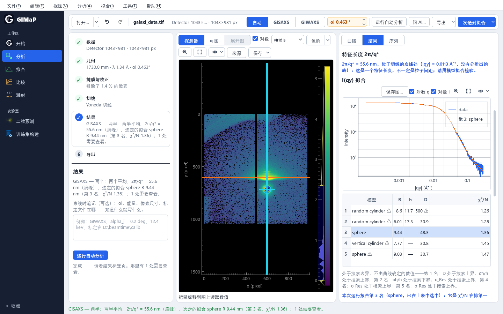
*一帧 GISAXS 的结果标签页：切线、特征长度 2π/q\*、拟合曲线和解的表格。*

**5. 发送到拟合。** 按**发送到拟合**。GIMaP 写出 `gimap_analysis/galaxi_data_fit_input.dat`（用切线步骤
选定的两半，这里是平均；q 的单位是 Å⁻¹），并在**拟合 ▸ 单条分析**里打开：**曲线** ✓
“拟合 598 个点”，**模型**（Model）“球 · 9 个自由参数”，**拟合**（Fit）“选择方法，然后拟合”。
拟合页里 q 以 nm⁻¹ 显示。

拟合步骤已经为这条曲线选好**预测参数**（Predict parameters），**方法**（Method）下面一行写出原因：
“推荐用于这条曲线：尚未拟合的 GISAXS 线切。”模型里是一个球，正是你知道这个样品所含的颗粒：在**方法**下面把**粒子**
（Particles）设为**模型中的粒子**（The particles in Model），再按**预测参数**。结束后，模型里是这个解，状态行写着
“1 个解；最好的 球（χ²ᵣ 1.82，598 个点中的 596 个；2 个低于网络的 q 窗口）已放入模型。”
**结果 ▸ 其他解**（Other solutions）列出它（R 4.31 nm，D 39.2 nm；p 显示 —，因为只尝试了这一种组成），
**拟合详情…**（Fit details…）给出模型中每个值及其 68 % 区间（*R 4.31 [4.31, 6.71] nm*）和要注意的地方：这里 R 和 D 位于
各自区间的边缘，σR/R 停在边界上，所以一群高斯分布的球只能粗略地描述这条切线。
按**精修这些数值**（Refine These Values）用最小二乘精修它并得到它的误差（在全部 598 个点上 χ²ᵣ 为 1.85；拟合详情说明两个
χ²ᵣ 不是同一批点的）；再查看残差（6.2 节）。
在分析页的结果标签页里按**在拟合中精修**（Refine in Fitting），打开的也是这条曲线。

尺寸取决于模型和它的尺寸分布。BornAgain 的模型用对数正态的半径分布；拟合页默认和自动分析都用按数目的高斯（在
**尺寸分布**里选*对数正态，按数目*才能同类比较）：比较半径时要小心。

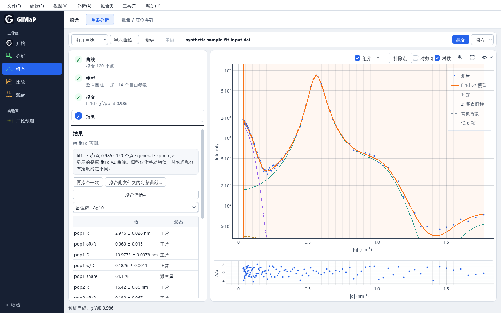
*预测参数后，结果页并列显示最小二乘值和后验中位数。右侧为曲线、模型和残差。*

### 1.4 接下来看哪里

| 你想…… | 见 |
|---|---|
| 为自己的探测器设置几何 | 第 4 章 |
| 画掩膜、选切线区域、跟踪序列、导出很多帧 | 第 5 章 |
| 认真拟合一个模型，或拟合整个原位序列 | 第 6 章 |
| 比较不同的测量或样品 | 第 7 章 |
| 跟踪原位溅射序列中的岛 | 第 8 章 |
| 让 AI 做分析，你在旁边看 | 第 10 章 |
| 知道每个导出文件里有什么 | 第 12 章 |

## 2. 安装与更新

### 2.1 Windows：便携版

不需要 Python，安装包自带。

1. 打开 [GitHub Releases](https://github.com/zyffcc/gisaxs_gui/releases) 页面，选择最新的版本。安装包有两种形式之一：
   一个文件 `GIMaP-<version>-windows-x64-portable.zip`；或者，这个文件超过 GitHub 允许的大小（1900 MiB）时，
   拆成的几个部分 `GIMaP-<version>-windows-x64-portable.zip.part01`、`.part02` ……，再加上安装程序
   `00_Download_and_Install_GIMaP-<version>.bat`。
2. 选一个路径短、只用英文字母、你有写权限的文件夹（例如 `C:\GIMaP`）。
   - **一个 ZIP：** 下载它，把整个 ZIP 解压到这个文件夹里，再双击 `GIMaP-<version>-windows-x64-portable`
     文件夹里的 `Start_GIMaP.bat`。
   - **几个部分：** 只把 `00_Download_and_Install_GIMaP-<version>.bat` 下载到这个（空的）文件夹里，双击它。
     它下载各个部分，逐个校验（SHA-256），合并并解压到安装程序旁边的文件夹 `GIMaP-<version>-windows-x64-portable`，
     然后启动一次 GIMaP。（`Install_GIMaP_parts.bat` 合并并解压你自己下载的各个部分，但不校验它们。）
3. 想自己核对下载的文件，就把它的 SHA-256 和发布页上 `SHA256SUMS.txt` 里对应的那一行比较。在 PowerShell 里，
   `Get-FileHash -Algorithm SHA256` 后面跟上文件名，就会显示它。

**文件夹里有什么。** `runtime\`（自带的 Python，装好了 GIMaP 需要的全部包）、程序本身、`Start_GIMaP.bat`、
1.1 节的示例数据（`tests\data\external\`），以及 `licenses\`：`runtime\` 里所有组件的许可证文本，还有 GIMaP 自己的
`LICENSE` 和 `THIRD_PARTY_NOTICES.md`（也可以用**帮助 ▸ 第三方声明**（Help ▸ Third-party Notices）打开）。
文件夹里也有 `Update_GIMaP.bat`，
但它只更新 Git 克隆（2.4 节）。

**以后启动 GIMaP。** 双击 `GIMaP-<version>-windows-x64-portable` 文件夹里的 `Start_GIMaP.bat`；
在桌面上为它建一个快捷方式会很方便。第一次启动时要为这个文件夹准备自带的 Python 环境，需要几分钟。

**路径与内存。** 文件夹路径只能用英文字母（例如 `D:\GIMaP`，不要放在“下载”这类中文名的文件夹里）：
Qt 无法从含中文的路径加载插件，`Start_GIMaP.bat` 发现这种路径时会说明并停下。把整个文件夹移到这样的路径下，
再启动一次。第一次启动的准备步骤（`tools\portable_unpack.py`）只占很少内存；它没有成功时，GIMaP 不会启动，
窗口里写着原因。如果提到内存不足（“内存资源不足，无法处理此命令”）：重启电脑、关闭其他程序，确认虚拟内存已打开
（系统 ▸ 关于 ▸ 高级系统设置 ▸ 性能“设置” ▸ 高级 ▸ 虚拟内存：自动管理），在那个盘上留出几 GB 空间，
再双击 `Start_GIMaP.bat`。还不行的话，把发布的 ZIP 重新解压到一个空文件夹里。

安装程序和启动程序是批处理文件，没有签名。Windows 运行前可能要求确认，单位的杀毒软件也可能拦截。
只运行 GIMaP 的 GitHub Releases 页面上的文件；否则请从源码运行 GIMaP（2.2 节）。

### 2.2 从源码运行

**Windows 上最简单的方法（不需要懂 Python）。** 在含有 `main.py` 的文件夹里双击 `Start_GIMaP.bat`：仓库的克隆，
或者仓库的 ZIP（GitHub 上 **Code ▸ Download ZIP**；Windows 可能把它解压成一个 `gisaxs_gui-main` 文件夹，里面还有一个
`gisaxs_gui-main`，含有 `main.py` 的是里面那个）。和便携版一样，文件夹路径只能用英文字母，并且要短、可写（2.1 节）。
第一次启动会在文件夹里的 `.gimap` 中建立一个专用环境：下载 uv（一个小的 Python 安装工具，固定版本，并核对 SHA-256）、
Python 3.10 和 `requirements-full.txt` 里的包（核心和全部可选部分，约 2 GB），视网速需要 3–20 分钟，然后打开 GIMaP。以后的启动是即时的。安装包失败时（例如空闲内存不够），
它会自动改为一次只装一个包再试一次，占内存少得多，只是慢一些。更新改动了 `requirements.txt` 时，
下一次启动会先补上缺少的包。文件夹以外的东西都不会被改动；删掉 `.gimap` 就去掉了这个环境。

**移动文件夹。** `.gimap` 里的环境属于建立它的那个位置。移动文件夹或改名之后，删掉其中的 `.gimap` 文件夹，
再双击 `Start_GIMaP.bat`：环境会为新的位置重新建立。要在原地重建（例如环境损坏时），运行
`powershell -NoProfile -ExecutionPolicy Bypass -File tools\setup_source_env.ps1 -Reinstall`。

**手动方式。** GIMaP 要求 Python >=3.10，测试覆盖 3.10 和 3.11。在源码文件夹里运行以下命令。

```powershell
python -m venv .venv
.\.venv\Scripts\Activate.ps1
python -m pip install --upgrade pip
python -m pip install -r requirements.txt
python main.py
```

如果 PowerShell 拒绝激活环境，先运行 `Set-ExecutionPolicy -Scope Process -ExecutionPolicy Bypass`。
用 Conda：

```powershell
conda create -n GUI python=3.11 -y
conda activate GUI
python -m pip install -r requirements.txt
python main.py
```

`requirements.txt` 是核心：分析、几何标定、拟合（含预测参数）、序列、批量导出、自动分析、XRR、溅射和 SEM。可选部分各有
自己的文件：`requirements-tensorflow.txt`（二维预测、训练集训练）、`requirements-bornagain.txt`（BornAgain
模拟）和 `requirements-ai.txt`（用 AI 处理）；`requirements-full.txt` 装全部。缺少某个包的功能会说明要装哪个文件。

在这样的环境里用 `python main.py` 启动 GIMaP。`Start_GIMaP.bat` 从不用它：它总是用自己的 `.gimap` 环境，
会在你的环境之外再建一个。

**作为软件包安装，带 `gimap` 命令。** 在源码文件夹里运行 `python -m pip install -e .`，会安装 GIMaP 和
`requirements.txt` 里的包，并添加命令 `gimap`。`gimap` 启动 GIMaP；`gimap frame_0001.cbf scan_folder sample.gimap`
同时打开所列的内容（帧和文件夹在分析页打开，项目按项目打开）；`gimap --version` 显示版本，`gimap --help` 显示选项。
`python main.py` 接受同样的参数。请像上面那样以可编辑方式（`-e`）安装：手册、图标和示例数据留在源码文件夹里，
普通的 `pip install .` 不会复制它们。

**预测参数**（Predict parameters）和一维预测训练好的网络在 Git 仓库里（约 13 MB，6.4 节），所以源码版本什么都能运行，包括预测参数（第 6 章）。
在 macOS 上，BornAgain 要单独安装：方法见 `README.md`。

### 2.3 可选部分

没有这些 GIMaP 也能运行。每一项只在表中所列的功能里需要。

| 部分 | 用于 | 怎样装 |
|---|---|---|
| AI 账号或本地模型 | **问 AI…**（Ask AI…）、**工具 ▸ 用 AI 处理…**（Tools ▸ Process with AI…） | Python 包在 `requirements-ai.txt` 里（`requirements-full.txt` 和 `Start_GIMaP.bat` 都包含）；在**工具 ▸ 设置… ▸ AI 助手**（Tools ▸ Settings… ▸ Assistant）里设置 AI（第 10 章） |
| StarDist | **工具 ▸ SEM 粒径分析…**（Tools ▸ SEM Particle Analysis…）里分开相互接触的颗粒 | 单独的 Python 环境，装 `requirements-sem-stardist.txt`，再加一个本地模型文件夹（第 9 章） |
| 分析包 | 溅射工作区的**分析**（Analyze）和**静态帧**（Static Frames） | 随 GIMaP 提供（`utils/sputter_client`），不需要再装 Python 包。用**选择文件夹…**（Choose Folder…）或 `GIMAP_SPUTTER_CLIENT` 可以改用另一个分析包（8.1 节） |

TensorFlow 在 CPU 上运行；GPU 环境没有配置。

### 2.4 更新

**Windows 便携版。** 像 2.1 节那样取得新版本（安装程序或 ZIP）。它放在自己的文件夹里；启动新的 `Start_GIMaP.bat`，
旧文件夹不再需要时删掉即可。`Update_GIMaP.bat` 不能更新便携版文件夹：那里没有 `.git`，脚本会说明，并且什么都不改。

**macOS 便携版。** 将新包解压到一个新文件夹，打开其中的 `Start_GIMaP.command`。
首次启动会为该包准备运行环境；设置保留在用户数据文件夹中。

**源码版本（Git 克隆）。** 双击文件夹里的 `Update_GIMaP.bat`（需要 Git 2.16 或更新的版本），或者运行：

```powershell
powershell -ExecutionPolicy Bypass -File tools\update_source.ps1
```

这个脚本从 GitHub 更新当前分支，并说明它看到了什么、做了什么。它把你还没提交的修改先放到一边，
再放回新版本之上；不碰你的数据和结果；在会覆盖你自己的文件之前停下。和新版本合不上的修改会留在一边，
脚本会说明。分支要移到改写过的历史上时，你自己的、GitHub 上没有的提交保存在一个备份分支里；
怎样取回见 `README.md`。加上 `-DryRun` 可以只看它会做什么，
不做任何改动。它说 Python 包列表（`requirements.txt`）变了时：用 `Start_GIMaP.bat` 启动 GIMaP 的话什么都不用做，它下次启动时会自己补上新的包；在你自己建的环境
（conda、venv）里，就在那个环境里运行脚本为每个变了的列表打印出的命令，例如 `python -m pip install -r requirements.txt`。

从 **Code ▸ Download ZIP** 得到的文件夹没有 `.git`，不是 Git 克隆：脚本会说明，并且什么都不改。重新下载 ZIP，
或者用 Git 克隆仓库（`git clone https://github.com/zyffcc/gisaxs_gui.git`），以后就能用这个脚本更新。
把新的 ZIP 解压到一个新文件夹里（把 `.gimap` 搬过去行不通，见 2.2 节）：它第一次运行 `Start_GIMaP.bat` 时会重新建立环境。
你的设置留在用户数据文件夹里。

2026-10-13 之前最后一次更新的源码版本还没有这个脚本。`main` 的历史在那天改写过：不要在这样的副本里运行
`git pull`、合并或推送。先按 `README.md` 中 *Updating a source checkout* 一节的步骤迁移，以后就用这个脚本。

**更新会保留什么。** 设置、仪器配置、最近的文件和拟合模型都保存在程序之外的用户数据文件夹里（3.11 节），
所以更新会保留它们。0.0.2 版把设置存在自己的程序文件夹里：新的便携版文件夹不会带过来，从默认值开始；
原地更新的源码版本会在第一次启动、用户数据文件夹里还没有设置时导入一次。

### 2.5 系统与屏幕

发布目标为 Windows x64 和 macOS 15 或更新版本，Apple Silicon 与 Intel 使用各自的包。
每个包实际验证的系统见发布页。1280 × 720 的屏幕就够用（窗口最小为 1024 × 640）；1080p 或更大的屏幕
能更舒服地并排显示探测器图像和曲线。GIMaP 跟随操作系统的显示缩放（例如 125 % 或 150 %）。

### macOS 便携包

按处理器选择 **Apple Silicon（arm64）** 或 **Intel（x86_64）** 包。解压 ZIP 后双击
`Start_GIMaP.command`。首次启动会校验并解包 Python 运行环境到
`~/Library/Application Support/GIMaP/runtimes/`，终端窗口显示准备进度和启动错误；以后复用此环境，
无需另装 Python。请把启动器、`app/` 和 `runtime.tar.gz` 放在一起。当前包尚未签名：确认下载可信后，
使用 macOS 的“打开”操作，不必关闭系统保护。目标系统为 macOS 15 或更新版本及 Windows x64；
每个发布包实际验收的系统与架构以发布页为准。开发机源码启动成功不等于安装包验收通过。

在 Mac 上用 Python 3.10 或 3.11 从源码安装时，运行 `python -m pip install -r requirements-release.txt`，即可选用与解释器版本和处理器架构对应的 SciPy 官方构建。

## 3. 主窗口

### 3.1 窗口的各部分

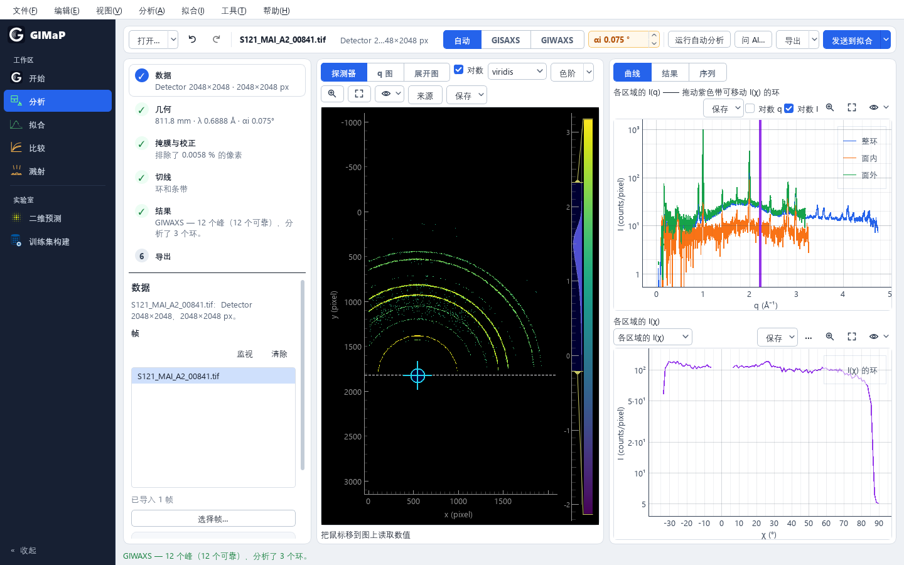
*分析页：侧栏、命令栏、左边的步骤和数据步骤的帧列表（下面是“选择帧…”）、中间的图像、右边的曲线。*

- **侧栏**（左边）列出各个页面。工作区：**开始**（Start）、**分析**（Analyze）、**拟合**（Fitting）、
  **比较**（Compare）、**溅射**（Sputter）。实验室（Labs）：**二维预测**（2D Prediction），
  即实验性的机器学习工具。侧栏底部的 **« 收起**（« Collapse，或 `Ctrl+B`）把它缩成图标。
  `Ctrl+1` … `Ctrl+6` 按这个顺序切换页面：开始、分析、拟合、比较、溅射、二维预测（所以溅射是 `Ctrl+5`）。
- **菜单栏**：**文件、编辑、视图、分析、拟合、工具、帮助**（File, Edit, View, Analyze, Fitting, Tools, Help；3.6 节）。
  工具窗口从**工具**菜单打开；**分析**和**拟合**菜单里是这两个页面的命令。
- **页面。** 分析和拟合的布局相同：上面是命令栏，左边是工作的各个步骤，右边是图。
- **消息**以短通知的形式出现在右下角。关于已写出文件的通知带有**打开文件夹**（Open Folder）按钮。
  每个页面底部还有自己的状态行。

窗口标题显示当前的帧；打开了项目时也显示项目名。标题后的 `*` 表示工作里有尚未保存的更改（3.8 节）。

**启动。** GIMaP 启动时，先出现一个小窗口，显示版本和正在载入的内容；几秒后出现主窗口。比较（Compare）和溅射
（Sputter）页面在第一次打开时才构建。GIMaP 已经在运行时再启动一次，会先询问：**切换到它**（Switch to It）把正在运行的
窗口调到前面（第二次启动时给的文件也在那里打开）；**仍然启动（设置只读）**（Start Anyway (Read-only Settings)）打开第二个
窗口，它不保存设置和会话，两个窗口就不会互相覆盖文件。

**小屏幕。** 窗口比页面需要的尺寸小时（分析页约 1200 × 690 以下），页面保持自己的大小并出现滚动条，图和表格不会被截断。

**拖入文件。** 探测器帧、文件夹和 `.gimap` 项目可以拖到窗口的任何地方。拟合页显示时拖入的曲线文件
（`.dat`、`.txt`）在拟合页打开。

**关闭。** 工作里有未保存的更改时，关闭前会先询问：**保存**（Save，保存项目，或另存为新项目）、**不保存**（Don't Save）
或**取消**（Cancel）。还有任务在运行时关闭 GIMaP——批量导出、序列热图、自动分析、AI 分析、一次拟合、原位序列、
二维预测、SEM 粒径分析、溅射分析——会先询问并列出正在运行的任务。选**是**（Yes）会停止它们并退出；选**取消**（Cancel）
继续工作。还在收尾的 SEM 分析可能会请你在它停下后再关一次窗口。

### 3.2 开始页

- **拖放框**：把探测器图像或文件夹拖到上面，或按**打开文件…**（Open Files…）、**打开文件夹…**
  （Open Folder…）、**批量导出…**（Batch Export…，用上次的设置把一个文件夹的原始帧直接变成曲线）或
  **打开项目…**（Open Project…）。分析页立即打开，在图像载入期间就显示文件、探测器和帧数。
- **最近**（Recent）：最近打开的五个文件、文件夹和项目，带有所在的文件夹（完整的列表在
  **文件 ▸ 最近打开**里）。
- **你想知道什么？**（What do you want to know?）：**晶体与取向**（GIWAXS）、**纳米结构**（GISAXS）、
  **原位或批量序列**、**标定探测器**。每一项打开相应的地方，并选好模式。序列这张卡片另有两个链接：
  **打开文件夹…**（Open Folder…，一个文件夹的帧：每帧一个文件，或一次扫描的各模块文件）和**打开文件…**
  （Open Files…，选定的帧，或装着整个序列的一个 NeXus/HDF5 文件）；两者都停在分析页的序列标签页上。
- **或者问 AI**（Or ask the AI）：写下你的数据和问题，再按**问 AI…**（Ask the AI…；第 10 章）。

### 3.3 步骤与命令栏

在分析和拟合页，左边的每个步骤都显示自己的状态，并用一行字说明它得到了什么：

| 标记 | 含义 |
|---|---|
| ✓ | 完成，没有要核对的 |
| ! | 完成，但要看一看（有问题或警告） |
| × | 失败：那一行写着原因 |
| … | 正在运行 |
| 数字 | 还没做 |

那一行比步骤栏宽时，末尾用“…”截断；把鼠标停在步骤上可以看到整行。

点一个步骤就显示它的控件。常用的控件直接显示；少用的选项折叠在一个可以展开的标题下面。

屏幕上只留每次看都需要的内容：状态、结果、失败、缺少或猜测的值，以及数值的来源。控件怎么用、一个分区是做什么的，
写在鼠标提示里：把鼠标停在控件上，或停在分区的标题上（标题有提示时，鼠标指针会带一个问号）。

分析页的命令栏窄的时候，长的按钮文字会缩短（“运行分析”、“批量…”、“拟合”）；完整的文字留在提示里。

### 3.4 图与图像

**曲线图。**

- 右键打开菜单：**重置视图**（Reset View）、对数坐标、**复制图片**（Copy Image）、**复制数据**（Copy Data）；
  带**保存**（Save）按钮的图还有**曲线图存为图片…**（Plot as Figure…）和**曲线存为数据…**（Curves as Data…）。
- 按住右键拖动可以缩放；鼠标滚轮也可以缩放。
- **缩放**（Zoom，放大镜）：拖出一个矩形。不按这个按钮时，Shift + 拖动在所有图和图像上都能用。
  **重置**（Reset）重新显示全部。
- **对数 I**（Log I）和**对数 q**（Log q）切换坐标轴。眼睛按钮显示或隐藏每一类标记。
- 图窄的时候，标题换到图的上方，选项收进 **⋯** 菜单。

**探测器图像**（还有 q 图、展开图和序列热图）有**缩放**、**适配视图**（Fit view）、**标记**（Marks）、
色图、**对数**（Log）和**色阶**（Levels）。每张图像旁边有一个带两个手柄的直方图，用来调颜色范围。
颜色范围和标记的细节见 5.4 节。

保存的图总是用浅色配色，即使屏幕上是深色主题。

### 3.5 表格

结果表格——自动分析的峰和解、拟合和比较页的表格——都可以复制。选中几行按 `Ctrl+C`，或在右键菜单里用
**复制所选行**（Copy Rows）/ **复制整个表格**（Copy Table）。复制的行带有列名，可以直接粘贴到电子表格里。

### 3.6 菜单

| 菜单 | 菜单项 |
|---|---|
| 文件（File） | 打开数据…（`Ctrl+O`）、打开文件夹…（`Ctrl+Shift+O`）、最近打开、打开项目…（`Ctrl+Shift+P`）、保存项目（`Ctrl+S`）、项目另存为…（`Ctrl+Shift+S`）、实验室参数 ▸ 载入… / 另存为…、退出 |
| 编辑（Edit） | 撤销（`Ctrl+Z`）、重做（`Ctrl+Y`；`Ctrl+Shift+Z` 也可以）：分析页的设置，拟合单条分析的模型 |
| 视图（View） | 工作区和实验室：各个页面（`Ctrl+1`…`Ctrl+6`）、收起侧栏（`Ctrl+B`）、全屏（`F11`）、主题 ▸ 浅色 / 深色、字号 ▸ 放大（`Ctrl++`）/ 缩小（`Ctrl+-`）/ 重置（`Ctrl+0`）、语言 ▸ English / 中文 |
| 分析（Analyze） | 运行自动分析、停止自动分析、重新分析（`F5`）、用标准样品标定绝对强度…、导出曲线…（`Ctrl+E`）、批量导出…（`Ctrl+Shift+E`）、批量导出一个文件夹…、发送到拟合、把两条切线都发送到拟合、把序列发送到拟合…、把序列发送到比较、设置文件 ▸ 保存设置… / 载入设置… / 保存切线… / 载入切线… / 保存掩膜… / 载入掩膜…、图与数据 ▸ 保存图像… / 保存 q 图数据… / 保存当前视图数据…、工具 ▸ 从记录复现…、清空帧列表 |
| 拟合（Fitting） | 打开曲线…、导入曲线…、拟合一个文件夹的曲线…、拟合（`Ctrl+Return`）、停止拟合、多条曲线联合拟合…、载入模型…、保存模型…、保存数据与拟合…、保存图…、批量 / 原位序列 ▸ 开始 / 停止、一维预测——拟合多条曲线… |
| 工具（Tools） | 几何标定…（`Ctrl+Shift+G`）、格式转换…（`Ctrl+Shift+C`）、转换当前文件…、XRR 序列提取…（`Ctrl+Shift+R`）、SEM 粒径分析…、一维预测——拟合多条曲线…、用 AI 处理…（`Ctrl+Shift+L`）、设置…（`Ctrl+,`） |
| 帮助（Help） | 用户手册（`F1`）、物理与方法、键盘快捷键…、示例数据 ▸ GISAXS——Ag 纳米颗粒（GALAXI）… / SAXS——AgBh 标样（pyFAI）… / GIWAXS——MAPbI₃ 薄膜（DESY P08）… / GIWAXS——PbTe，倾斜探测器（Xeuss）…、报告问题…、打开日志文件夹、打开用户数据文件夹、GitHub 仓库、检查更新…、如何引用 GIMaP…、第三方声明、关于 GIMaP |

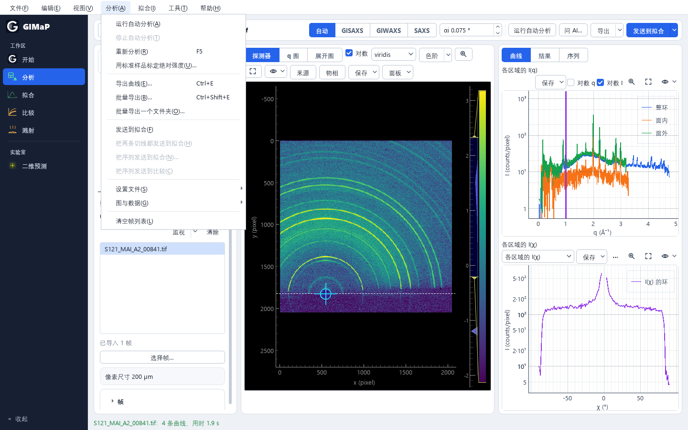
*分析页打开一帧时的**分析**（Analyze）菜单。现在不能执行的菜单项是灰的，它的提示说明原因。*

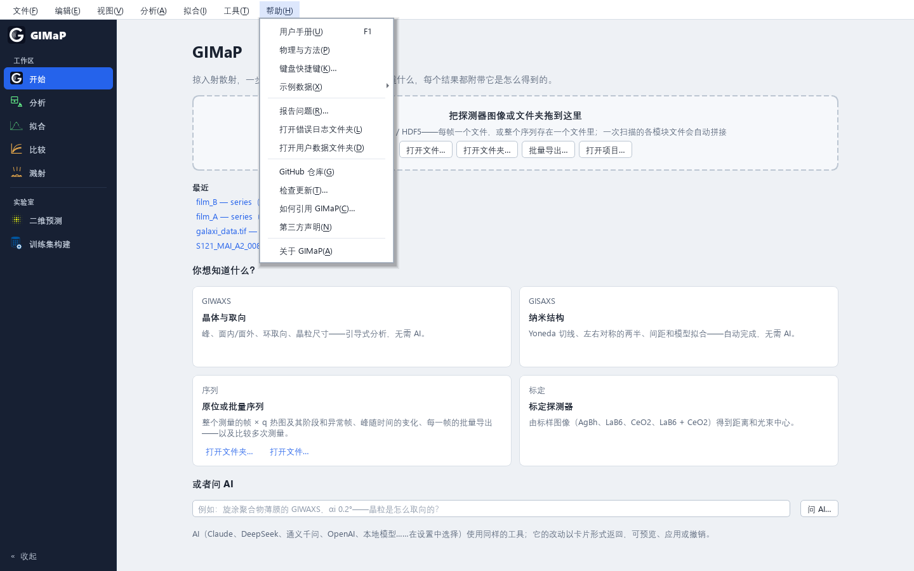
*帮助（Help）菜单：两份手册、键盘快捷键、示例数据（子菜单）、在哪里报告问题、GIMaP 保存文件的文件夹，以及 GitHub、引用、
第三方声明和版本信息的入口。*

- 显示拟合的单条分析时，**文件 ▸ 打开数据…** 打开的是曲线，菜单项也会这样写（打开曲线…）。
- **编辑 ▸ 撤销**（Edit ▸ Undo）和**重做**（Redo）作用于当前显示的页面：分析页，或拟合的单条分析。
  菜单项会写出它要改回的内容（例如“撤销：切线区域”“撤销：拟合（精修）”）。在其他页面上它们是灰的。
- **分析**和**拟合**菜单里的每一项都先显示它的页面（拟合菜单显示单条分析；拟合一个文件夹的曲线…
  （Fit a Folder of Curves…）和 原位序列 ▸ 开始 / 停止（In-situ Series ▸ Start / Stop）显示原位序列），
  再做页面上对应按钮做的事。现在不能执行的菜单项是灰的，它的提示说明原因（例如“请先打开一帧。”）。
- 撤销、重做、重新分析（Repeat Analysis）、导出曲线…（Export Curves…）、批量导出…（Batch Export…）和拟合（Fit）
  旁边显示的快捷键属于页面：只在那个页面有键盘焦点时起作用（3.7 节）。菜单项本身在任何页面上都能用。
- **实验室参数**（Labs Parameters）是二维预测的设置。文件里还带着拟合的模型（单条分析的粒子和全局参数）：
  **载入…**（Load…）不经询问就用文件里的模型替换拟合当前的模型，并把它存为保存的模型；需要现在的模型时，先保存项目。
  分析页的设置另存为设置文件
  （**分析 ▸ 设置文件 ▸ 保存设置… / 载入设置…**，Analyze ▸ Set-up Files ▸ Save Settings… / Load Settings…；
  页面的**导出**（Export）菜单里也有，批量导出也用它）。项目保存一个样品的全部内容（3.8 节）。
- **工具 ▸ 一维预测——拟合多条曲线…**（Tools ▸ 1D Predict — Fit Many Curves…）用实验性的神经网络模型
  拟合一组曲线文件（第 6 章）。其他工具窗口见第 4 章和第 9 章。
- **帮助 ▸ 用户手册**在网页浏览器里打开本手册；界面是中文时打开中文版，是英文时打开英文版。
  固定的章节目录和正文搜索都可以离线使用。
  **物理与方法**（Physics and Methods，GIMaP 怎样算出它显示的数值）和**第三方声明**（Third-party Notices）
  也这样打开；这些文档之间的链接会在浏览器里打开另一份文档的对应章节。**键盘快捷键…**（Keyboard Shortcuts…）把菜单和各页面的全部快捷键列在一张可以复制的表里（`Ctrl+C`）。
- **帮助 ▸ 示例数据**（Help ▸ Example Data）把 GIMaP 自带的一个公开示例复制到你选择的文件夹
  （默认是 `Documents\GIMaP examples\<示例>`），并在分析页中打开它的帧（1.1 节）。
- **帮助 ▸ 报告问题…**（Help ▸ Report a Problem…）把 GIMaP、操作系统、Python、Qt、PyQt 和 numpy 的版本
  （不含路径和数据）复制到剪贴板，并在浏览器中打开 GitHub 上的新问题页面：把它们粘贴进去。
  **检查更新…**（Check for Updates…）在浏览器中打开 GitHub 上的发布页（最新的在前，含预发布版）；GIMaP 本身不发出任何网络请求。

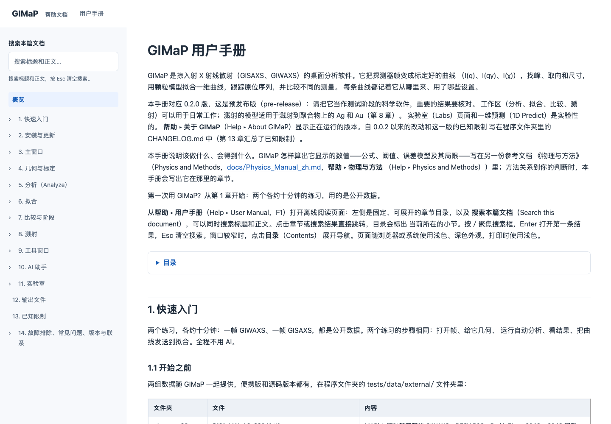
*帮助阅读页面：可展开的章节目录和正文搜索始终位于文档旁边。*

### 3.7 快捷键

文件、视图和工具菜单的快捷键在每个页面上都起作用。下表的快捷键属于某个页面或窗口：只在它有键盘焦点时起作用。
用 `Ctrl+1` … `Ctrl+6` 或侧栏切换页面之后，先在页面里点一下。标着“菜单”的页面快捷键也显示在编辑、分析和拟合
菜单里（3.6 节）；这些菜单项在任何页面上都能用。**帮助 ▸ 键盘快捷键…**在程序里显示菜单的快捷键和这张表。

| 在哪里 | 按键 | 作用 |
|---|---|---|
| 分析 | `Page Up` / `Page Down` | 上一个 / 下一个已导入的帧（先走完一个数据源的帧，再到下一个数据源） |
| 分析 | `Ctrl+Z`，`Ctrl+Shift+Z` 或 `Ctrl+Y` | 撤销 / 重做对设置的一次修改（菜单：编辑 ▸ 撤销 / 重做） |
| 分析 | `Ctrl+E` | 导出这一帧的曲线（菜单：分析 ▸ 导出曲线…） |
| 分析 | `Ctrl+Shift+E` | 批量导出…（菜单：分析 ▸ 批量导出…） |
| 分析 | `F5` | 重新分析这一帧（菜单：分析 ▸ 重新分析） |
| 分析 | `Delete` 或 `Backspace` | 从列表中移除选中的数据源（它的全部帧）、掩膜或切线区域（文件本身不受影响） |
| 分析 | `Esc` | 停止在图上点选光束中心；取消正在画的掩膜 |
| 分析，画多边形掩膜时 | `Return`（或 `Enter`）/ `Backspace` | 闭合多边形（至少三个点）/ 去掉最后一个点 |
| 拟合 | `Ctrl+Return` | 拟合（菜单：拟合 ▸ 拟合） |
| 拟合 | `Ctrl+Z`，`Ctrl+Shift+Z` 或 `Ctrl+Y` | 撤销 / 重做对模型的一次修改（菜单：编辑 ▸ 撤销 / 重做） |
| 比较 | `Delete` | 从表格中移除选中的序列 |
| 表格 | `Ctrl+C` | 复制选中的行，带列名 |
| 几何标定 | `Esc` | 关闭窗口（标定正在运行时会先询问） |
| XRR 序列提取 | `Esc` | 停止在预览图上点选直射束中心；没有在点选时关闭窗口 |

### 3.8 项目

项目（`.gimap`，一个 JSON 文件）把一个样品恢复成离开时的样子：

- 分析页的帧和全部设置（模式、配置、掩膜和画出的区域、校正、切线），导入时选的帧（5.1 节），以及序列是否沿用同一条切线；
- 拟合页的曲线、两半、拟合范围、排除的点、模型和所选方法，以及它的结果：最近一次拟合（数值、误差、χ²ᵣ、处于边界的值、
  相关）、预测参数的每个解（概率、区间、标记）和拟合从哪个解开始。打开时照原样显示；曲线文件在保存项目之后改变了（按
  SHA-256）时，显示为已过时（*拟合后已更改：请重新拟合*），项目的说明里也写明；
- 原位序列的文件夹和选项及其已拟合的帧（每帧的数值、误差、χ²ᵣ 和点数，曲线列出后重新显示；文件已不在列表中的帧不恢复，
  状态行写明有几帧），以及比较页的序列；
- 溅射表单（含速率单位的输入栏、几何、分析和静态帧的选项）、扫描/掩膜/输出路径，以及所显示结果的文件夹引用（不复制结果）。
  旧版本的项目保留它的几何；其中早先的方法（预测）的结果不再打开。

二维预测的设置连同拟合模型用**文件 ▸ 实验室参数 ▸ 另存为…**（File ▸ Labs Parameters ▸ Save As…）
存进单独的文件。打开不含溅射的旧项目时，溅射工作区会恢复为空表单。

**文件 ▸ 保存项目**（File ▸ Save Project，`Ctrl+S`）写出项目；第一次会问保存在哪里（默认在第一帧旁边）。
**打开项目…**、开始页的**打开项目…**、**最近打开**（项目排在前面），或把 `.gimap` 文件拖到窗口上，
都能打开它。

- 数据按路径引用，不复制。比较页内嵌的数组保存在项目旁边的 `<name>.<generation>.compare.npz` 中。
  移动或复制时，把 `.gimap` 和其中 `compare.arrays_file` 指向的文件一起带走。旧的 `<name>.compare.npz` 项目仍可打开。
- 保存时先写出新数组和临时项目文件，成功后才原子替换 `.gimap`。写入或替换失败时，原项目和原数组仍可使用。
  旧数组文件被其他程序占用时可能留在原处；项目记录指向的是实际使用的数组文件。
- 比较页仍在导入或恢复序列时，**保存项目**会要求先等待完成或取消导入，不会保存未完整载入的列表。
  项目里的比较数据按保存的顺序在后台读取；读取错误在比较页的状态栏和通知中显示。
- 文件移走了，项目照样能打开；一条通知说有多少文件找不到，并列出前几个，
  **详情…**（Details…）列出全部。
- 分析页恢复保存的来源顺序、当前显示的源和原始帧号；来源顺序也决定**求和**（Sum）中参与计算的相邻单帧文件及序列顺序。
  若原来的源缺失，会提示已回退到另一源的首个导入帧；若 NeXus 数据分块现在由 master 表示，会将原帧号和导入选择映射到 master 中。
- 用 0.2.0 移除的方法（*预测参数（fit1d）*、*寻找颗粒形状*）保存的项目，打开时用页面为它的曲线选的方法（6.2 节）；
  这些方法的选项不再读取。
- 打开项目会替换窗口里现有的内容：之前那个样品在分析页的帧、在拟合页的曲线和原位序列、在比较页的序列都会关闭。
  需要的话先保存。
- 在分析页按**清除**之后，接着打开的内容就不再属于那个项目：**保存项目**会询问保存位置，而不是覆盖它。
- 工作和上次保存或打开时不同时，窗口标题后会出现 `*`。这时打开另一个项目或关闭窗口，会先询问：**保存**（Save）、
  **不保存**（Don't Save）或**取消**（Cancel）。把改动改回去，`*` 也会消失；在列表里看另一帧不算更改。
- 打不开的项目会从**最近打开**中移除，提示里会说明。
- 有任务在运行时（原位序列、批量导出……）不能打开项目：先停止任务。
- 打开项目会替换原位序列的拟合结果。那里有拟合完、还没保存的帧时，打开项目之前会先问：**保存**（Save，每一帧的结果表）、
  **丢弃**（Discard）或**取消**（Cancel，什么都不改）。

### 3.9 会话之间记住的内容

- **最近的数据**：每个打开过的文件或文件夹（对话框、拖放、开始页、批量导出）都列在**文件 ▸ 最近打开**
  和开始页上，最新的在前。最多保留 8 个；已不存在的文件不列出；**清空列表**（Clear the List）清空它。最近的项目单独保存
  （最后 6 个），排在前面，**清空列表**之后仍然保留。
- **上次的设置**：分析过一帧之后关闭 GIMaP 时，分析页的设置（模式、配置、掩膜、校正、切线区域……）保存在
  用户数据文件夹的 `last_analyze_setup.json` 里。下次会话打开第一帧时，一条通知提供**使用**（Use It）。
  不经询问绝不会套用，因为新的束线时可能需要别的设置；打开项目时也不会提供，以项目自己的设置为准。
  打不开的文件会从最近打开中移除（有通知说明）。
- **自动保存与恢复**：有更改的工作每 2 分钟、以及每个长任务（批量导出、自动分析、一次拟合、原位序列……）结束后，
  保存到用户数据文件夹的 `autosave/session.gimap`；任务运行时不写。GIMaP 没有正常关闭时（崩溃、断电、在任务管理器里
  结束了窗口），下次启动会问**GIMaP 上次没有正常关闭。恢复 … 自动保存的工作吗？**：**恢复**（Restore）打开那份工作
  （带 `*`，要保留就保存；**保存项目**写回它原来的项目），**丢弃**（Discard）删除它。正常关闭时会删除自动保存。序列热图
  （包括监视时在线生成的）随自动保存和项目一起恢复，最多 400 万个值（每一行的 x 和强度）；更大的热图不保存，提示会说要重新构建。
  各行的约化记录和热图数值合计不超过 32 MB 时，项目也保存这些记录（记录按 UTF-8 字节数计算，每个数值按 8 字节计算）。
  加上记录后超出限额时，热图仍可恢复。要导出可复现的热图，请先点**生成热图**（Build Map）。
- **溅射**：每个扫描文件夹上次分析时的值（几何、金属、掩膜、基底、速率及其单位、是否 QCM 读数、模式、沉积开始和持续时间、
  膜厚）、上次使用的值（掩膜、样品滚转角和速率不会带到别的文件夹）、几何预设、分析包的文件夹，以及上次显示的结果（下次启动时
  再打开）。旧版本为早先的方法（预测）记住的内容不再读取。
- 窗口的大小和位置、各面板之间分隔条（splitter）的位置、主题、字号和语言在下次启动时恢复。

### 3.10 出错时

意外的错误不会关闭 GIMaP。一个窗口说明发生了什么：**显示详细信息**（Show Details）显示技术报告，
**复制详细信息**（Copy Details）把它复制下来用于报告问题，工作可以继续。每个错误都写进用户数据文件夹里的
`logs/errors.log`。同一个文件夹里还有 `gimap.log`，记录每次会话做了什么（版本、警告、保存失败等；没有控制台窗口时
也记录），每个文件最多 1 MB，保留之前的三个；以及 `crash.log`，GIMaP 因系统库崩溃而终止时，Python 的调用栈写在这里。
那个窗口里的**打开日志文件夹**（Open Log Folder），或者随时用**帮助 ▸ 打开日志文件夹**（Help ▸ Open Log Folder），
都会打开这个文件夹；还没有任何记录时，菜单项会这样说明。要报告问题，
**帮助 ▸ 报告问题…**（3.6 节）会复制版本信息，粘贴到报告里即可。

读不了的文件会用文字说明原因：空文件（还在写入？）、不是探测器图像、损坏或不完整的 NeXus 文件、
另一个程序还在写的 NeXus/HDF5 文件、没有权限。更多内容见第 14 章。

### 3.11 设置与用户数据文件夹

**工具 ▸ 设置…**（Tools ▸ Settings…，`Ctrl+,`）有四页。修改立即生效（字号在最后一次点击箭头后稍等片刻生效，按 Enter
则立即生效）；只有 AI 的密钥要用它自己的**保存**（Save）按钮保存。

| 页 | 设置的内容 |
|---|---|
| **外观**（Appearance） | 浅色或深色主题、字号、界面语言（默认英文，或中文）。数值、单位和文件名从不翻译。 |
| **分析**（Analyze） | **使用文件头中写的光束中心**（Use the beam centre written in the file header；CBF 的 `Beam_xy`、NeXus 的 `beam_center_x/y`）：默认关闭，因为很多束线从不更新它，所以保留标定过的配置中心。**发送到拟合的水平切线**（Send horizontal cut to Fitting）：发送到拟合时传 GISAXS 水平切线的哪一半（默认两半都画在 \|qy\| 上，两种颜色）。 |
| **数据**（Data） | 用户数据文件夹在哪里（**打开**），以及**重置所有设置…**（Reset All Settings…；仪器配置保留，之后要重启 GIMaP） |
| **AI 助手**（Assistant） | 用哪个 AI、它的常驻说明、模型、密钥和权限（第 10 章） |

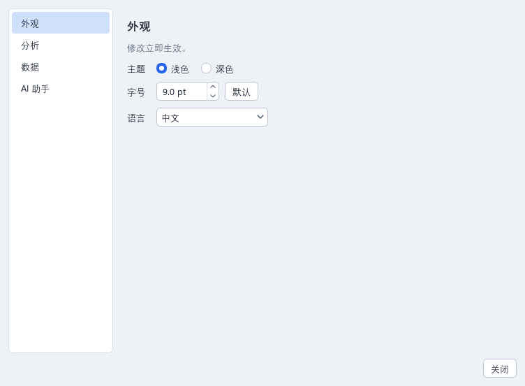
*工具 ▸ 设置…：外观页。*

所有设置、偏好、仪器配置、会话和拟合模型都保存在程序之外的一个用户数据文件夹里，错误日志（3.10 节）、
溅射工作区的结果文件夹（第 8 章）和 AI 助手每次运行的记录（第 10 章）也在这里：

- Windows：`%APPDATA%\GIMaP`；
- 其他系统：`~/.config/gimap`（设置了 `$XDG_CONFIG_HOME` 时为 `$XDG_CONFIG_HOME/gimap`）；
- 或者环境变量 `GIMAP_HOME` 指定的文件夹。

**帮助 ▸ 打开用户数据文件夹**（Help ▸ Open User Data Folder）打开它。更新程序从不覆盖它，删掉程序文件夹也不会删掉它。

- **每个文件夹只运行一个 GIMaP。** 运行中的 GIMaP 在这里持有 `gimap.lock`；再启动一次会先询问（3.1 节）。
  崩溃的 GIMaP 留下的锁会被直接接管，不会询问。
- **旧版本的设置。** 第一次打开默认文件夹时，GIMaP 把旧版本保存在程序文件夹里的设置（`config/user_parameters.json`、
  `config/user_settings.json`、`config/instrument_profiles.json`）导入一次：只导入设置，从不导入会话（上次拟合的曲线、
  最近打开和上次的文件夹都不带过来）。`GIMAP_HOME` 指定的文件夹不导入任何东西。

## 4. 几何与标定

没有几何时，GIMaP 只以像素显示探测器，没有任何 q。本章说明几何从哪里来、得到几何的三种方法、几何标定窗口、
光束中心的像素坐标，以及怎样在分析页调整中心。

### 4.1 仪器配置

*仪器配置*（instrument profile）是为一个探测器保存的几何：样品–探测器距离、像素尺寸、波长、光束中心和入射角 αi。
仪器配置保存在用户数据文件夹里（`instrument_profiles.json`，3.11 节）。

打开一帧时，分析页挑选与它匹配的配置：

- **帧尺寸。** 不同帧尺寸的配置一律不用。
- **探测器名**，前提是文件写了它（CBF 和 NeXus 通常有，TIFF 没有）。名字匹配比尺寸匹配更重要。
- 几个配置匹配程度相同时，用最新的那个。

探测器名不同并不排除一个配置：没有更好的匹配时，帧尺寸相同的配置也会被采用。所以，为一个没有探测器名的 TIFF
建的配置，会用于同样尺寸的每一个 TIFF。换了装置（距离、能量）而探测器不变时，
要新建或选择另一个配置。

**帧旁边的 `.poni` 优先。** 帧所在的文件夹里有一个名字与帧相同开头的 pyFAI `.poni`（或只有一个 `.poni`），而且它适合这一帧
（写明的帧尺寸和像素尺寸相符，并给出波长）时，它的几何先于按名字和尺寸匹配到的配置使用：那样的配置可能来自同一台探测器的
另一个实验。**几何**步骤这时写 *帧旁边的 galaxi_bornagain.poni*。在使用这个文件时保存的光束中心或几何会写上它，此后改用你保存的配置。

**为另一台探测器选的配置不会被使用。** 在**仪器配置**里选的（或从项目里保留的）配置如果用于另一种帧尺寸，对其他尺寸的帧就被放在
一边：这些帧改用旁边的 `.poni` 或与它们匹配的配置，提示条说明哪个配置没有用、为什么。提示条里的 **仍然使用“…”**（Use “…” Anyway）
仍然把它用于这种尺寸的帧。

**几何**（Geometry）步骤显示正在用的几何（`811.8 mm · λ 0.6888 Å · αi 0°`）。它的**仪器配置**
（Instrument profile）一栏设为**自动（匹配探测器）**（Automatic (match detector)）；在这里选一个配置，就改用它。

**αi** 是配置的一部分，但命令栏有自己的 αi 框。它显示配置里的 αi（还没有显示帧时显示“αi 来自配置”，
αi from profile）。你输入的值以橙色显示，用于每一帧；下次启动时它也会被记住，并在第一帧时用一条通知说明。
右键这个框 ▸ **回到配置中的 αi**（Back to Profile αi）可以去掉它；数据步骤里的**清除**（Clear）不会去掉它。
记住的值属于设定它时所用的仪器配置。下次启动后的第一帧如果用的是另一个配置，或者它的探测器还没有配置，
这个值就不会被采用：αi 框显示配置里的 αi，一条通知说明这一点，并可以一步用回原来的值（**使用 0.075°**，
Use 0.075°）；运行自动分析时会询问 αi，并把原来的值作为建议写出。命令栏里的值从不写进仪器配置，所以
**回到配置中的 αi** 总是回到配置自己的值。

- 在结果步骤里回答的 αi（**用这些答案再运行一次**）也这样设置，显示为橙色——前提是这次运行保留了探测器已有的配置
  （1.2 节）。
- 如果这次运行改为应用一个标定——在束线时笔记里写明的，或者为还没有配置的探测器找到的——回答的 αi 就和它一起
  存进仪器配置（1.3 节）。

配置怎样挑选、每种覆盖值替换什么，见[《物理与方法》1.4 节](Physics_Manual_zh.md#14-一帧的几何从哪里来)。

**文件头里的光束中心**默认不用：保留标定过的配置中心，因为很多束线从不更新文件头。
**工具 ▸ 设置… ▸ 分析 ▸ 使用文件头中写的光束中心**（Tools ▸ Settings… ▸ Analyze ▸ Use the beam centre
written in the file header）可以改变这一点（3.11 节）。**光束中心 ▸ 使用文件头中的中心**
（Beam centre ▸ Use File Header Centre）把文件头里的中心作为本次会话的中心（4.5 节）。

### 4.2 得到几何的三种方法

没有匹配的配置时，图像上方的提示条会说明，并提供 **自动查找标定**、**载入 .poni…**（Load .poni…）、**输入几何…** 和
**标定…**。**几何**步骤里也有**自动查找标定**、**标定…**、**载入 .poni…** 和 **导出 .poni…**（Export .poni…），并用**几何…**代替**输入几何…**。

**载入 .poni…** 读入你选的 pyFAI `.poni`。写明另一种帧尺寸、或像素尺寸与帧文件头相差超过 1 % 的文件，会写出原因并先询问再使用。
带波长的文件成为这个探测器的仪器配置（含倾斜），在**仪器配置**里被选中，这一帧重新分析。不带波长的文件打开**探测器几何**对话框，
填好它的数值，波长显示*必填*。**导出 .poni…** 把正在使用的几何（在对话框里则是对话框中的数值）写成 pyFAI `.poni`（2.1 版：像素尺寸、
帧尺寸、距离、PONI、rot1–rot3、波长），供 pyFAI、GIXSGUI 等程序使用；αi 不属于 `.poni`。

**自动查找标定**（Find Calibration Automatically）。GIMaP 取以下来源中第一个适合这一帧的：

1. 你在**结果**（Results）步骤的束线时笔记里写明的标定：写路径，或者只写文件名（文件在这一帧所在的文件夹里，
   或在笔记写明的文件夹里）；
2. 这个探测器已有的仪器配置；
3. 帧所在文件夹及其周围的文件夹里（旁边的文件夹，最多向上三级）现成的标定文件（`.poni`、导出的 `.json`）。
   它们先按所在的文件夹排序：帧自己所在的文件夹，然后是它的子文件夹、上一级文件夹、帧所在文件夹旁边的文件夹，再往上。
   同一类文件夹里，写入时间离这一帧最近的排在前面，早于这一帧写入的优先；
4. 那里的标样图像（AgBh、LaB₆、CeO₂），拟合后，标样的衍射线落在各自 q 的 0.5 % 以内才接受。

**结果**步骤写明用了哪个标定、在哪里找到的。`.poni` 或 `.json` 文件按原样采用：不会用标样图像核对。
它写明的像素尺寸和这一帧的相差超过 1 %，或者写明的帧尺寸不同时，会被跳过。但 TIFF 常常不写像素尺寸，`.poni`
常常不写帧尺寸，这时就无法区分两台探测器：帧所在的文件夹里没有标定时，相邻文件夹里另一台探测器的标定也可能被采用。
例如 1.1 节的 GIWAXS `.poni`，在搜索看来就适合 GALAXI 的 TIFF；只是因为所在的文件夹，它才排在 `galaxi_bornagain.poni`
后面。搜索在帧所在的文件夹（及其子文件夹）之外找到的标定文件，会连同所在的文件夹一起列出
（*galaxi_bornagain.poni (sibling folder gisaxs_galaxi)*）。它写明的探测器尺寸（`.poni` 的 `max_shape`）和这一帧不同时
会被跳过，原因写在决定里。它是在另一个能量下做的（与这一帧相差超过 0.2 %）时，和任何标定一样采用它的距离和光束中心、
能量用这一帧的，同时单独写一条决定（**标定**：*… made at another energy than the frame's*），不会不声不响地采用。你自己写明的文件、或者就在帧旁边的文件，
不做这项检查。
结果保存为这个探测器的仪器配置。

帧自己的文件头写明的探测器距离与正在使用的标定相差超过 5 % 时，数据步骤会写出来（*⚠ 文件头给出的探测器距离是 370 mm，
正在使用的标定是 147.6 mm（相差 151 %）。*），自动分析也把它列在*需要处理*里（**detector distance**）。
文件头里的距离常常只是名义值，那样就以标定为准；但别的实验的标定看起来也是这个样子。

**倾斜的探测器。** 带倾斜（pyFAI 的 `Rot1`、`Rot2`、`Rot3`）的 `.poni` 给出倾斜的几何：每个像素都放在 pyFAI
放的位置，所以 q、χ、立体角和偏振因子都是倾斜探测器的值（[《物理与方法》3.7 节](Physics_Manual_zh.md#37-poni-的探测器倾斜)）。
**几何** 步骤和摘要写 *探测器倾斜 6.06°*，自动分析把它列在 *Decisions* 里。之后移动的光束中心（GISAXS 的对称轴，
或手动设定）保留倾斜。**帮助 ▸ 示例数据** 中的 Xeuss 示例就是这种情况：像 GIMaP 0.1 那样略去它 6.06° 的倾斜，
|q| 最多偏差 6.3 %。几何标定拟合倾斜（rot1、rot2；4.3 节），**几何** 对话框有 rot1、rot2、rot3 的字段。

**在 GISAXS 帧上核对 rot3。** 粉末环约束 rot1 和 rot2。要核对绕光束的旋转，在**几何 ▸ 核对 rot3（Check rot3）▸ 测量镜面散射杆（Measure Specular Rod）**中沿脊线点选相距较远的两点。在点选精度范围内，两点的 qy 都应接近零。要采用显示的角度，在**几何…**中将它输入 rot3 字段，**保存配置（Save Profile）**后重复核对。如果方向吻合但两点的 qy 仍有偏移，请检查直射束中心。用**测量地平线或 Yoneda 带（Measure Horizon or Yoneda Band）**在同一特征上点选两点；两点的出射角应相等。样品地平线上两者都应为零。

`.poni` 可指定探测器方向 1–4。GIMaP 按存储图像的行列方向计算几何。请使用与标定时存储顺序相同的帧。

搜索可能挑到别的实验的标定：帧所在的文件夹里没有标定时，取的是旁边或上面文件夹里的；一次性复制过来的同一个文件夹里有好几个标定时，
可能取错（文件时间这时说明不了什么）。请核对它写出的文件和**几何**步骤显示的距离，
或者在笔记里写明正确的文件（笔记里写明的标定先于配置和搜索被试用），或者改用下面两种方法。错误的配置可以用 **几何…**（Geometry…）▸ **删除配置**（Delete profile）删掉。

**输入几何…**（Enter Geometry…）打开**探测器几何**（Detector geometry）对话框：**配置名称**（Profile name）、
**样品–探测器距离**（Sample–detector distance）、**像素尺寸 x** / **y**（Pixel size x / y）、
**波长**（Wavelength）和 **能量**（Energy；同一个值的两种单位，输入一个就得到另一个）、**探测器倾斜 rot1**、**探测器倾斜 rot2**、
**绕光束的转动 rot3**（pyFAI 的转角，以度计；全为 0 即探测器垂直于光束）、**光束中心 x** / **y**（Beam centre x / y；4.4 节）、
**中心调整步长**（Centre step）、**入射角 αi**（Incidence angle αi），以及 **载入 .poni…** / **导出 .poni…**。

- **能量** 下面一行写出波长的来源：*波长来自文件头。*、*波长来自 LaB6.poni。*、*波长来自配置“…”。* 或 *波长由你输入。*
  文件没有给出波长或能量时，两个字段都显示 *必填*，这一行以橙色说明：不假设任何值，**保存配置** 和 **导出 .poni…** 要等你输入后才执行。

- **保存配置**（Save Profile）把所有数值保存为这个探测器和帧尺寸的仪器配置。保存的几何立即生效：本次会话之前
  为这个探测器设的中心被丢弃，**仪器配置**一栏回到**自动（匹配探测器）**。
- **应用中心**（Apply Centre）只在本次会话使用这个光束中心（4.5 节）；其他数值只有**保存配置**后才生效。
  还没有配置可用时，先保存一个。
- 在几何步骤里，用**几何…**（Geometry…）打开的是同一个对话框，填好了正在用的几何。用原来的名字保存就是修改这个
  配置，用新名字保存则两个都保留。**删除配置**（Delete profile）删掉它。

**标定…**（Calibrate…）打开几何标定窗口（4.3 节），载入当前显示的帧；关闭这个窗口之前，分析页会等待。
当这一帧本身就是标样图像时用它，也可以在那里打开标样图像。在那个窗口里按**应用**（Apply；从**工具**菜单打开时
也一样）就保存配置，分析页用它重新分析这一帧；本次会话之前设的光束中心会被丢弃，改用标定得到的中心。

第四个按钮**使用上一次的几何…**（Use Previous Geometry…）只在从 0.0.2 更新后出现：它把原 Cut & Fitting
页面的几何保存为配置。

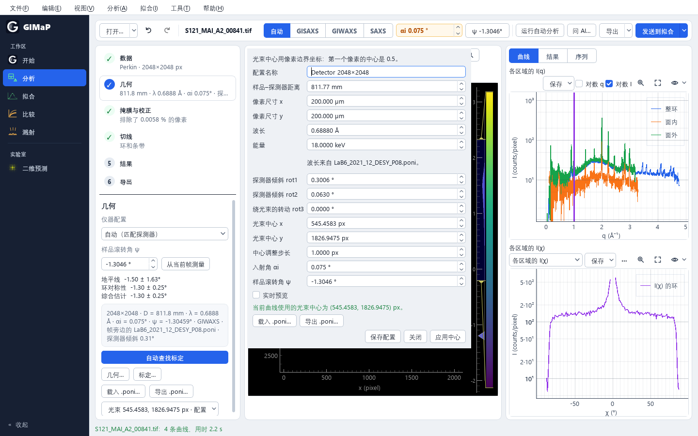
*几何…：正在使用的几何（这里来自 P08 帧旁边的 LaB₆ `.poni`），带能量、写明波长来源的一行、探测器倾斜 rot1–rot3、载入 .poni… / 导出 .poni…、实时预览、应用中心和保存配置。*

### 4.3 几何标定窗口

**工具 ▸ 几何标定…**（Tools ▸ Geometry Calibration…，`Ctrl+Shift+G`）在不离开当前页面的情况下，
标定 SAXS、GISAXS 或 GIWAXS 探测器的几何。分析页的**标定…**和开始页的**标定探测器**（Calibrate the detector）
也能打开它。

1. 用**打开…**（Open…）打开一张标样图像（NeXus/HDF5，如 `.nxs` 或 `.h5`；`.cbf`、`.tif` / `.tiff` 或
   `.edf`），或把路径粘贴到图像栏里按回车。也可以把图像拖到窗口上。NeXus/HDF5 文件按分析页的方式读
   （模块文件拼接，方向相同；5.1 节）。多帧的文件出现**帧：**（Frames:）一行，选**单帧**（A single frame，
   填帧号，从 1 数）或**全部帧求和**（Sum of all frames，读的时候显示进度，可以取消）。一个文件里有几个
   同样可能的图像数据集时，会问用哪一个。
2. 确认检测到的能量和像素尺寸。CBF 有对应的扫描 NXS 元数据时，能量会自动填好。**能量** 下面一行写出它的来源（*来自文件头。*、
   *来自配套的 NXS 文件。*、*由你输入。*）。文件没有给出能量时，这一栏显示 *必填*，下面一行以橙色写 *文件中没有：请输入 X 射线能量*，
   **自动标定** 要等你输入后才开始——不假设任何能量（以前的版本会不声不响地用 12 keV）。下一张没有能量的图像沿用你输入的值，
   这一行请你核对。标定记录和仪器配置写明能量的来源。
3. 确认探测器型号。识别不了时，在**探测器型号**（Detector model）里选一个已知的探测器，或选
   **自定义像素尺寸**（Custom pixel size），并在**高级配置**（Advanced configuration）里输入数值。
   **自动检测**（Auto detected）保留文件里的像素尺寸。
4. 选择标样。图像的路径——文件名或它上面的某个文件夹——只出现一种标样（例如 `AgBh`、`LaB6` 或 `CeO2`）时，
   自动选中它；出现多于一种时，这一栏设为**自动识别**（Auto Detect）；一种都没有时，保持原样
   （窗口打开时是自动识别）。自动识别会试遍所有已知的标样。
5. **估计距离**（Estimated distance）是可选的，用来引导搜索：不知道距离就保持“可选”（Optional），
   知道就输入大致的距离。打开图像时，只有在图像文件写明了距离时（NeXus 文件可以；CBF 或 EDF 头里的距离不用），
   或者没有这个但以前应用过标定时（用那次标定的距离），这一栏才会被填上：请核对这样的数是不是这套装置的距离。
   **距离范围**（Distance range）限定搜索（*自动 · 30–10000 mm*、*SAXS · 500–10000 mm*、
   *WAXS · 30–1500 mm*，或*自定义*（Custom），用高级配置里的上下限）。范围是硬限制，不只是起点：
   范围外的解一概不显示，拟合中心和距离之后也一样。范围内没有解时，标定停下并提示“在距离范围内没有解”——
   请放宽范围，或检查能量和像素尺寸。
   掠入射下拍的标样图（硅片上的 AgBH：样品地平线以上的弧、穿过光束的镜面反射杆、Yoneda 带）会被识别出来：
   镜面反射杆不参与找环和拟合，光束上方的水平亮带不当作环；对 AgBH，已匹配的各级之间的级次都必须出现——
   所以 Yoneda 带不会再被当成“半距离解”的第一级环。用到这些时，解的警告里会写明。
6. 在**高级配置（Advanced configuration）**中的**固定 rot3（Fixed rot3）**输入测得的绕束转角（度，默认 0）。拟合环时保留此值。
   **探测器倾斜：精修 rot1、rot2**（Detector tilt: Refine rot1, rot2，默认勾选）在匹配到三个或更多环时，把探测器的倾斜与中心和距离
   一起拟合（[《物理与方法》3.8 节](Physics_Manual_zh.md#38-由标样的环求探测器倾斜)）。取消勾选后，只要匹配到至少两个环且点数足够，仍会用环上点精修中心和距离。点**自动标定**（Auto Calibration）。计算在后台进行；**取消**（Cancel）在当前这一步之后停止。
7. 检查结果：**选定解**（Selected solution）的光束中心、距离、**探测器倾斜**（rot1 和 rot2，*0.372°, 0.433°*，或 *未精修*；
   提示里给出 1σ）、匹配的环、**环上点 RMS**（Ring-point RMS）。其提示给出精修前在同一组点上的 RMS。拟合倾斜时，还给出固定倾斜为零、重新拟合中心和距离的 RMS。没有环上点拟合记录时，显示**环半径 RMS**（Ring-radius RMS）。检查置信度和警告（警告前标 ⚠，
   提示里写明它为什么要紧），以及下面的 **候选解**（Candidate solutions）。预览上方那一行只写图像和它的尺寸。选中一个候选解就画出它的环。**纯图像**（Clean image）暂时隐藏所有叠加，
   **重置视图**（Reset view）在缩放或平移后恢复完整的探测器拼图，**聚焦图像**（Focus image）隐藏结果面板，
   给高的 WAXS 拼图更多空间。水平分隔条也可以拖动。
   恰有三个环参与倾角拟合时，提示框中倾角的 1σ 来自这次拟合的协方差。每次去掉一个环时固定倾角，用其余两个环估算中心和距离的离散程度。
8. 要手动调整结果，按**手动精修**（Manual refine）：拖动中心标记，编辑中心 / 距离的数值，或把检测到的环和
   理论峰配对（**拟合所选环**，Fit selected ring）。**恢复拟合值**（Reset to fitted）回到拟合得到的解，
   **结束手动**（Finish manual）关闭这个面板。应用或导出手动修改过的中心或距离时，会清除环上点 RMS 和拟合不确定度。环半径 RMS 指原先自动匹配的衍射环。
9. 点**应用**（Apply），把几何保存为这个探测器的仪器配置。一条通知说明应用了什么、分析页将用哪个配置。
   结果使已保存配置的光束中心移动超过 10 px，或距离变化超过 5 % 时，窗口会先询问，再覆盖那个配置。

**导出标定…**（Export Calibration…）把结果写成 `.json` 文件，或写成 pyFAI `.poni`（在文件对话框里选 *pyFAI 几何文件 (*.poni)*；
倾斜写成 Rot1、Rot2、Rot3）。它建议的文件是标定图像旁边的
`<图像名>.gimap-calibration.json`；不想改动数据文件夹时，请另选文件夹。之后的通知可以打开文件夹。
记录里写明用的是哪一帧，或者是几帧之和。**导入标定…**（Import Calibration…）把这样的文件读回来，并选上它的
标样；在几帧之和上做的标定先立即显示第一帧，再读同样的和。导出的 `.json` 也可以拖到窗口上。**打开…**和
**导入标定…**从当前图像所在的文件夹开始，没有的话从上次用过的文件夹开始。

**叠加线。** 黄色实线是匹配上的理论环，橙色虚线是没有用上的理论环，青色点线是检测到的实验半径，
粉色线交于光束中心；图像上方的图例说明每种线型。支持只有一部分的 WAXS 弧，以及中心在探测器有效区域之外的情况。置信度低的结果
或只有一个环的结果应当视为不确定，要手动检查。环怎样拟合、RMS 残差和置信度衡量什么，见
[《物理与方法》第 3 章](Physics_Manual_zh.md#3-标定)。

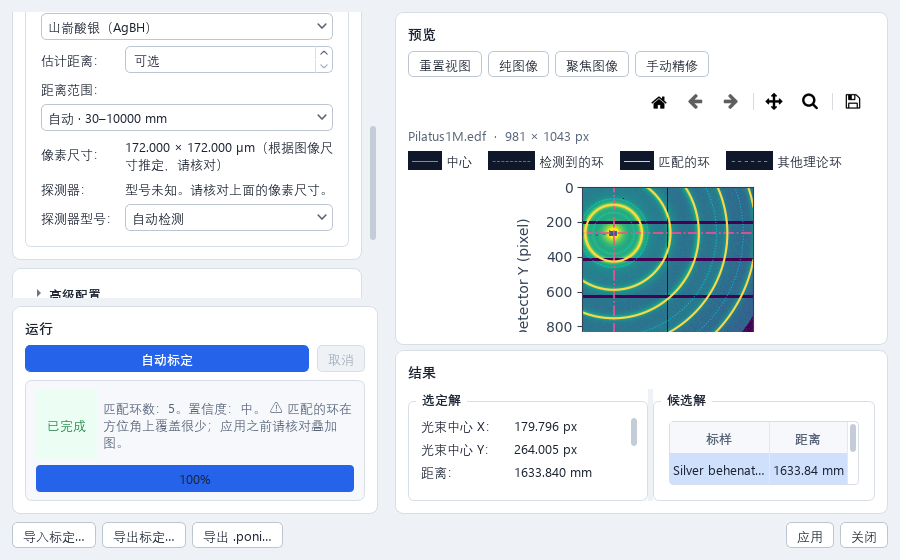
*几何标定：标样上拟合出的环、选定解和候选解。*

**这个窗口里的光束中心**用和分析页相同的像素坐标显示和输入（4.4 节），可以在两处直接对照或抄写。
导出的标定文件仍按以前版本的方式记数：其中光束中心按像素中心从 0 数，比窗口显示的小半个像素，文件里写明了这一点
（`metadata.center_convention`）。导入这个文件后，窗口显示的中心和原来相同。

**核对透射标样的结果。** 对透射和掠入射图像，自动标定都会先精修由圆弧得到的候选中心，再找衍射环。
在公开的山嵛酸银帧上，**自动识别**在估计距离留为*可选*和输入 2000 mm 时都匹配到五个环，
得到的距离约为 1634 mm。手动选择山嵛酸银也得到相同的结果。

估计距离会影响候选解的排序。新安装时初值为*可选*。打开另一张图像时，文件或最近一次应用的标定提供的距离会替换手动输入的值（包括 0），
请核对它是否属于当前装置。两者都未提供距离时，手动输入的值会保留。
不知道距离时，把这一栏设为 0，即显示*可选*。按**应用**之前，请核对距离是否符合当前装置，
并检查叠加的环是否落在图像的环上。

### 4.4 像素坐标

分析页、几何标定窗口和 XRR 序列提取窗口用同一套像素坐标显示和输入光束中心：

- 像素的角点落在整数上，所以第一个像素的中心是 (0.5, 0.5)；
- x 从图像（按显示的样子）的左边起算，y 从上边起算（第 0 行在上）；
- 光束中心是直射束的位置。

因此同一个配置在三个窗口里显示同样的数，中心可以从一处直接抄到另一处。

别的程序可能用别的数法。例如 1.3 节的 GALAXI 帧，文献给出的直射束是从左下角数的 (597.1, 323.4) px；
在 GIMaP 里是 (597.1, 719.6) px。

**导出的文件从 0 数。** 几何标定导出的 `.json`，以及 XRR 序列提取的 CSV 和 JSON 记录，都按像素中心从 0 数，
比窗口显示的小半个像素，和以前的版本一样。每个文件都写明了这一点（标定文件里是 `metadata.center_convention`，
XRR 记录里是 `center_convention`）。导入这样的文件后，窗口显示的仍是窗口的数。

已移除的训练集研究代码保留旧坐标约定，不再属于 GIMaP 工作区。这些约定及其相互换算的定义见
[《物理与方法》1.2 和 1.3 节](Physics_Manual_zh.md#12-规范像素坐标)。

### 4.5 分析页里的光束中心

除非你修改，用的都是配置里的光束中心。**几何**步骤把它显示在**光束中心**（Beam centre）按钮上，四位小数，
并写明来源：`光束 x, y px · 配置`、`· 本次会话`或`· 文件头`。它的菜单有：

| 菜单项 | 作用 |
|---|---|
| **在图上点选**（Pick on Image） | 在探测器图像上点直射束（只在**探测器**视图，不在 q 图上；`Esc` 取消） |
| **输入坐标…**（Enter Coordinates…） | 在一个小窗口里输入中心（见下） |
| **使用文件头中的中心**（Use File Header Centre） | 用文件里写的中心（如果有的话；菜单项上显示它） |
| **按对称性细化 x**（Refine x by Symmetry） | GISAXS：和**使左右对称**（Make Left and Right Symmetric）相同的搜索（4.6 节） |
| **回到配置中的中心**（Back to Profile Centre） | 丢掉本次会话设的中心 |
| **保存到配置**（Save to Profile） | 把本次会话的中心写进仪器配置 |

也可以在图上拖动青色十字。用以上任何一种方式设的中心，都对本次会话中所有相同探测器尺寸（行 × 列）的帧有效；
尺寸不同的帧回到它们配置里的中心（打开上面那个设置时，用文件头里的中心），并有一条通知说明。设置文件和项目也会记下它。**保存到配置**让它长期有效。

**几何…** 和**输入坐标…** 打开的小窗口在你操作时保持打开，你可以一边调中心一边看曲线：

- 坐标显示四位小数；
- **中心调整步长**（Centre step）设定上下箭头按钮、方向键和鼠标滚轮每次移动多少（最小 0.0001 px）；
  两个窗口共用这个值，并且会记住；
- **应用中心**（Apply Centre）在本次会话中使用这个中心并重画曲线；可以反复调整和应用；
- 勾选**实时预览**（Live Preview）后，每次改动都会自动重画曲线。快速连续的改动会合并处理，你在曲线上设的缩放会保留；
- **保存配置**（在几何… 里）保存全部几何数值，窗口保持打开；
- **关闭**（Close）保留最后一次应用的中心，丢掉还没应用的输入。

换文件或换帧、清空列表时，这些窗口会关闭，这样为一个探测器输入的中心永远不会被用到另一个探测器上。

### 4.6 使左右对称

GISAXS 的水平切线关于 qy = 0 对称。光束中心列稍有偏差时，I(qy) 的两半对不上。**使左右对称**
（Make Left and Right Symmetric；**切线**步骤，GISAXS）把中心列移到切线的对称轴上：

1. 先在整条水平切线上粗搜索，找到对称轴；
2. 再在它附近几个像素的范围内精细搜索：比较试探轴左右两边有效像素的列均值。只有两边都测到的列才算数（缝隙和
   被掩膜的列不参与，不跨缝隙衔接）。每一对按 1 / 到轴的距离加权，所以远处大量的列不会压过低 q 的结构。

评分、权重和接受的条件见[《物理与方法》8.2 节](Physics_Manual_zh.md#82-由镜像对称求光束中心列)。
只改 x，y 保持不变。结果显示在一条通知里（粗定位 … → 精修 … px）。0.0001 px 是数值计算的停止容差，
不是测量的不确定度。数据覆盖不够，或有几个轴拟合得同样好时，中心保持原样，通知会说明原因。

搜索在后台运行；再按一次这个按钮（此时显示**取消中心搜索**，Cancel Centre Search）就停止。新的中心对本次会话有效
（4.5 节）；**光束中心 ▸ 保存到配置**让它长期有效。GISAXS 帧的自动分析会自己做这一步。

## 5. 分析（Analyze）

**分析**（Analyze）是处理探测器帧的唯一工作区，GISAXS 和 GIWAXS 都在这里。它把一帧变成以 q（Å⁻¹）为横轴的曲线，
显示曲线上每个点来自图上哪里，并把曲线连同“怎么得到的”记录一起写出。**拟合**（Fitting）只拟合曲线；
凡是涉及探测器图像的操作都在这里。

页面分五部分（3.1 节的截图显示了打开一帧 GIWAXS 时的这五部分）：

| 部分 | 内容 |
|---|---|
| 命令栏 | **打开…**（Open…，箭头里是 **打开文件夹…**（Open Folder…））、↶ ↷（撤销 / 重做）、‹ ›（上一帧 / 下一帧，列出多于一帧时出现）、模式 **自动 / GISAXS / GIWAXS / SAXS**（Auto / GISAXS / GIWAXS / SAXS）、αi、**运行自动分析**（Run Automatic Analysis，运行时旁边出现 **停止**（Stop））、**问 AI…**（Ask AI…）、**导出**（Export）▾、**批量导出…**（Batch Export…，列出多于一帧时出现）、**发送到拟合**（Send to Fitting）▾ |
| 步骤（左） | **数据**（Data）、**几何**（Geometry）、**掩膜与校正**（Mask & corrections）、**切线**（Cuts）、**结果**（Results）、**导出**（Export）。每一步显示状态（✓、!、× 或 …，见 3.3 节）和一句结论；点开是这一步的控件，少用的选项折叠起来。 |
| 图像（中） | **探测器**（Detector）、**q 图**（q map）或 **展开图**（Cake，GIWAXS）、**对数**（Log）、色图、**色阶**（Levels）、**标记**（Marks）、缩放、**适配视图**（Fit view）、**来源**（Sources）、**保存**（Save）▾、**面板**（Panels）▾；图下方两行是光标处的读数：像素和它的值、q 及 q_y 或 q_∥ 和 q_z，然后是 2θ、χ、αf（掠入射）和 d = 2π/q（在 q 图和展开图上，点用 q 给出）。它是三栏中最宽的一栏；**面板 ▾** 可以隐藏步骤栏或曲线与结果栏，把全部空间留给图像，也可以再显示它们 |
| 标签页（右） | **曲线**（Curves，上下两个曲线图）、**结果**（Results，自动分析或 AI 的发现及其证据）、**序列**（Series，每一帧的强度对帧号和 q 的热图） |
| 状态行 | 正在做什么、进度条和 **取消**（Cancel）。写出文件后右下角有提示，带 **打开文件夹**（Open Folder）。 |

窗口较窄时，命令栏会缩短长按钮的文字（3.3 节），必要时把操作按钮移到第二行。

模式：**自动** 时，探测器最远处的散射角超过 2θ = 20° 的帧按 GIWAXS 处理，否则按 GISAXS。自动模式每一帧都重新判断。
选 **GISAXS** 或 **GIWAXS** 可以强制指定；强制的模式看起来不适合当前帧时，状态行会提醒。
**SAXS**（透射 SAXS/WAXS）处理透射测量的帧：整个环上的 I(q)、χ 从 −180° 到 180° 的 I(χ)（χ 在光束右侧为 0°，上方为 90°）、切线区域、
q_y–q_z 的 q 图和展开图；没有地平线，没有 Yoneda 切线，也没有缺失楔。αi 未知、且文件名指明标样（AgBh、LaB₆、CeO₂），或者帧是小角的、
围绕光束中心至少有三个锐环、每个环在探测器覆盖的方向中至少 80 % 都出现时，自动 选择它，状态行会说明。αi 大于 0 总是表示掠入射。
**运行自动分析**（Run Automatic Analysis）照旧处理这样的帧：写出切线，不拟合颗粒模型，并在 **technique** 下说明（如果它其实是
掠入射帧，给出 αi 或测量技术即可）。

αi 框在你输入之前显示配置中的 αi；输入的值以橙色显示，一直保留，直到你右键 ▸
**回到配置中的 αi**（Back to Profile αi）（4.1 节）。

几何——仪器配置、查找标定、光束中心及其对话框——见第 4 章。本章从一帧已经有几何开始。

### 5.1 打开数据与帧列表

GIMaP 读取 CBF、TIFF 和 EDF 帧，以及 NeXus/HDF5 文件（`.nxs`、`.nx`、`.nx5`、`.h5`、`.hdf5`、`.hdf`）。
属于一起的文件是一个*数据源*：同一探测器的各模块文件拼接起来，master 文件和它的数据文件一起读，多帧文件里的每一帧都是
序列中的一帧（见下面的 *NeXus 与 HDF5 文件*）。

1. 用以下任一方式打开帧：
   - 命令栏的 **打开…** 或 **文件 ▸ 打开数据…**（File ▸ Open Data…，`Ctrl+O`），或 **打开…** 的箭头 ▸
     **打开文件夹…**、**文件 ▸ 打开文件夹…**（`Ctrl+Shift+O`）；
   - 把文件或文件夹拖到窗口任意位置；
   - 开始页，或 **文件 ▸ 最近打开**（File ▸ Open Recent）。
2. 分析页立即打开，在后台检查这些数据源（导入慢时，**取消导入**（Cancel Import）可以停止）。打开的文件夹自己没有帧、
   下一层有（每个探测器写一个子文件夹）时，就打开下一层，状态行说明打开了哪些子文件夹。
3. 有多帧的数据源时，**导入帧**（Import Frames）窗口问要列出哪些帧，每个数据源分别选：**全部帧**（All Frames）、
   **帧范围**（Frame Range，首帧到末帧，每 n 帧取一帧）或**指定帧**（Specific Frames，用逗号分隔的帧号，从 1 数，
   例如 `1, 5, 20`）。列出的只是引用：显示哪一帧才读哪一帧，所以几千帧的堆栈也能很快打开。
4. **数据** 步骤在图像载入期间先显示数据源的名字，载入后显示探测器、图像尺寸和帧。帧有几何时，曲线自动出现，不需要再点。
   没有几何时，图像上方的提示条提供 **自动查找标定**（Find Calibration Automatically）、**载入 .poni…**（Load .poni…）、
   **输入几何…**（Enter Geometry…）和 **标定…**（Calibrate…），见 4.2 节。

**已经列出了帧时。** 列表中已有帧时再打开或拖入文件或文件夹，GIMaP 会问是 **替换**（Replace）它们还是 **加到列表**（Add to List）。
加入的帧必须来自同一台探测器：新帧中的第一帧与当前显示的帧尺寸不同时，什么都不加入，状态行说明原因
（*这些帧是 1043×981 …；列表中的帧是 2048×2048 …*）。一个列表从不混合两台探测器，所以批量导出也从不混合两种几何。

**帧列表**（数据步骤）里每个已导入的帧一行，不论它来自单独的文件还是 NeXus 堆栈：

- 点一行即读取并显示这一帧。`Page Up` / `Page Down`，或命令栏的 ‹ ›，只在已导入的帧之间前后切换。
- 有多帧的数据源时，步骤上方出现一条 **帧 [4] 共 12 帧**（Frame [4] of 12），用来选帧（从 1 数）。没有导入的帧，
  要先用 **选择帧…** 加进来。
- **选择帧…**（Choose Frames…，在列表下方）事后修改导入的选择（**保留当前选择**（Keep Current Selection）让一个数据源保持原样）。
  生成热图、批量导出和把序列发送到拟合处理已导入的帧，再用各自的范围、间隔和求和。求和不会跨过没有导入的帧；帧号、时间和
  记录里写的文件保持原来的意义。改变选择会清除旧选择的序列热图和批量拟合预览。项目保存这个选择。
- 要从列表中去掉一个数据源：右键它的某一行 —— **从列表移除整个数据源**（Remove Source from List）、
  **在文件夹中显示**（Show in Folder）、**复制路径**（Copy Path）—— 或选中后按 `Delete` 或 `Backspace`。它的全部帧都被移除；
  文件本身不受影响，列表的其余部分、序列热图和批量导出照常继续。
- **清除**（Clear，或 **分析 ▸ 清空帧列表**（Analyze ▸ Clear Frame List））清空列表，序列热图一并清除。
- **帧 ▸ 求和**（Frames ▸ Sum，折叠在列表下方）把连续几帧相加以改善统计：当前帧加上后面几帧（后续文件，或 NeXus 文件中的后续帧）。
  批量导出和监视文件夹时按同样的组大小求和。
- 列表上方，数据步骤写出当前数据源由什么组成（例如 *11 module files · 240 frames · stitched*）、帧的方向，以及（用警告色）
  它缺了什么。**文件头**（File header）一行写出文件里的能量、距离和曝光时间（以 s 计）。
- 一帧的文件变了（名称、修改时间或大小）时，**F5**（**分析 ▸ 重新分析**（Analyze ▸ Repeat Analysis））、重新显示这一帧和
  监视文件夹都会重新读它；没变就不重读。

**监视**（Watch，在 **清除** 旁边）在测量期间监视一个文件夹：选好文件夹后，每 2 秒看一次。新帧写完即加入列表，并显示最新的一帧。
再按一次 **监视** 停止。

- 探测器一帧一帧写进的一个文件（或一组模块文件）在增长时就跟着，即使新增帧没有改变文件大小或时间戳。刚写入或仍被写入程序占用的文件会重新检查，稳定的文件继续使用缓存。每次只取上一次看时已经在文件里的帧，最新的一帧可能还在写，
  等下一次再取。数据步骤写着 *还在增长：第 N 帧是目前最新的完整帧*。这期间开始的序列热图或批量导出也只取这些帧。
  同一台 Windows 电脑上的程序如果用 HDF5 的文件锁写文件，别人就读不了它：这样的文件显示为正在写入，关闭后再读。
- 勾选 **导出 ▾ ▸ 监视时导出新帧**（Export New Frames While Watching）后，每个完整的新帧导出一次（写到数据旁边的
  `gimap_analysis/`；设置了 **求和** 时只导出凑齐的组）。一组模块文件齐全后才导出：模块文件数与这个文件夹里另一组相同时立即导出，
  否则等它的文件约 10 秒不再变化。模块文件比另一组少的一组等约 30 秒，然后按现状导出（探测器可能关掉了一个模块）。
  缺少或还读不了的模块文件会在状态行中点名，这一组等到它出现为止。
- 已经生成的序列热图会随新帧增长，不需要再按 **生成热图**（开启导出而还没有热图时，会用所选的曲线自动生成一张）。
  点选热图的一行后，热图不再跟随最新的帧；序列选项里的 **显示最新的帧**（Show the newest frame）可以恢复跟随。
- 另一个程序占着不放的文件每次都再试，并在状态行说明一次；从列表移除的数据源再增长时会重新列出。

**在线模式**——**监视**按钮的箭头：

- **暂停监视**（Pause Watching）停止查看文件夹；取消勾选后，其间写入的文件全部列出并约简。停止监视也会结束暂停。
- **静置时间**（Settle Time）：**两次查看（2 秒）**（Two Looks (2 s)，默认：新文件在两次查看中相同时读取）、**5 s**、**10 s**
  或 **30 s**——用于写文件时会停顿的探测器，帧不会被读到一半。
- **把新帧加入序列热图**（Add New Frames to the Series Map，默认勾选）：每个写完的新帧用屏幕上的设置约简，它的曲线加入序列
  热图（5.6 节）、随帧变化的曲线和时间线——没有生成热图、也没有导出时同样如此。由监视开始的热图从开始监视时屏幕上的那一帧起。只保留曲线，不保留帧：1000 帧、每条 200 点的
  曲线约占 3 MB。
- **把每一帧记入结果数据库**（Record Every Frame in the Results Database）：加入热图的每一帧的曲线也写入数据旁边的
  `gimap_analysis/gimap_series.sqlite`（约每秒一次），带帧号、文件、时间和热图的设置；跳过的文件也记在里面。比较页可以读取
  （7.2 节），以后不需要原始帧也能再比较这次测量。
- **跳过的文件…**（Skipped Files…）打开监视时未能处理的文件的日志，带时间和原因：写入它的程序占着、约简失败、帧里没有热图的
  曲线。
- **在拟合中拟合新帧…**（Fit New Frames in Fitting…）导出屏幕上的帧，打开**监视时导出新帧**，在**拟合 ▸ 原位序列**中打开
  `gimap_analysis/` 并勾选**监视新曲线**（Watch for new curves），曲线列出后就开始：目前写好的和新出现的每条曲线都从上一帧的
  结果开始拟合（6.5 节）。单条分析中的模型还是没人设置过的初始猜测时不开始：状态栏提示先用一帧设置好模型再按**开始**。

这些选择在两次启动之间保留。在一台台式电脑上，监视 1000 帧、每帧 20,000 像素的测量时，列出、约简、加入热图并记录每一帧平均约需 60 ms（`tools/benchmarks/insitu_online.py`）。

#### NeXus 与 HDF5 文件

数据源是什么由文件的内容决定，文件名只作提议：

- **一个文件一帧**——每个文件是一帧；一文件夹这样的文件是一个序列；
- **一个文件装整个序列**——一摞帧（扫描点 × 帧的网格按存储顺序读，数据步骤会说明）；
- **每个探测器模块一个文件**（P03 Lambda 9M：`…_m01.nxs` … `…_m11.nxs`，每个文件都有全部帧）——每帧拼成一幅，以扫描名
  （不带 `_m01`）命名。只有这些文件装着同一个数据集、模块尺寸相同、模块位置各不相同时，才算一组；只是名字相像的文件各自单独读，
  数据步骤说明原因；
- **master 加数据文件**（Eiger：`…_master.h5` 和 `…_data_000001.h5` …）——一个数据源，帧依次分布在各数据文件里。

不含探测器图像的 HDF5 文件（模型权重、结果表）不会从文件夹中列出。

**图像**取文件标为默认绘图的数据集，没有的话取探测器的 `data`，再没有就取最像图像的数据集；掩膜、平场和暗场从不当作图像。
一个文件里有几幅图像时，显示一幅并列出其余的（格式转换和几何标定里可以选）。

**方向。** Lambda 服务器（P03）写的文件照 GIMaP 一直以来的方式显示：各模块按位置拼接，再转置并上下翻转（旋转 90°）；数据步骤写
*P03 Lambda: transposed and flipped*。其他所有 NeXus/HDF5 图像按存储原样读，第 0 行在上，与同一探测器的 CBF 或 TIFF 相同
（*Image as stored in the file*）。以前的版本把这些文件也转了：用以前的版本在这种文件上做的几何或掩膜不再适用。请核对
（正方形的帧仍会按尺寸匹配到旧的仪器配置）。

**数值。** 文件头的值按各自的单位读——以 ms 写的曝光时间显示为 s，能量可以是 eV 或 keV，距离可以是 mm 或 m；GIMaP 不认识的单位
不取，不猜。探测器的 `pixel_mask` 会被采用；无符号整数数据中，该类型的最大值表示“无数据”。

**缺了什么就说什么，从不补上**：缺一个模块文件（探测器的那部分留空）、各模块文件的帧数不同（只用每个模块都有的帧）、缺一个数据文件
（它之后的帧读不了）、要的帧超出末尾（报错，不会改读最后一帧）。还在写的文件读到写好的部分，变了再重读；另一个程序占着的文件
在它关闭之前读不了；写入程序没关文件就结束了时会说明（对它的副本运行 `h5clear -s` 就能读）。用 bitshuffle 或 LZ4 压缩的文件
需要 Python 包 `hdf5plugin`（已在 `requirements.txt` 中）。

### 5.2 掩膜与校正

**掩膜与校正** 步骤先列出改变强度标度的部分：折叠的 **归一化**（Normalisation）、**校正**（Corrections：暗场、背景、
缝隙保护、强度范围）和 **强度校正（GIWAXS）**（Intensity corrections，含 Lorentz 因子），窗口较小时它们的标题也在视野内。
其后是**探测器与曲线误差**（Detector and curve errors）。步骤列表中这一步的说明在强度被缩放时先写出来
（*强度 × 1.25*、*Lorentz 因子*）。其下说明排除了多少像素以及原因：探测器
缝隙与标记像素、本帧找到的热 / 死像素、你的掩膜、缝隙保护、强度范围、背景，以及从镜像一侧补齐了多少像素。

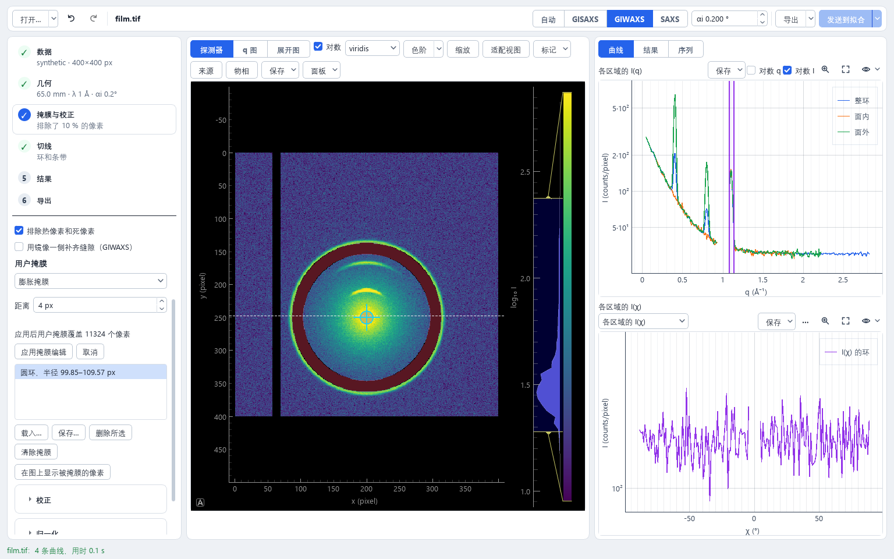

*在这幅合成帧上，红环预览手绘圆环向外膨胀 4 个像素后的结果。“应用掩膜编辑”旁的计数表示编辑后用户掩膜覆盖的像素数。*

**在图上显示被掩膜的像素**（Show Masked Pixels on the Image）在探测器图上标出它们：红色 = 排除，
琥珀色圆圈 = 热 / 死像素，青色 = 由镜像补齐（参与曲线计算）。

**哪些像素算数据。** 整数计数探测器上的负值是缝隙码，被排除。浮点帧（已扣暗场或背景）上的负值是数据，保留。

**坏像素** —— **排除热像素和死像素**（Leave out hot and dead pixels，默认开，会记住）。GIMaP 在每一帧中排除孤立的热像素、
死像素（只在计数探测器上判断）和缺陷探测器行 / 列上零散的亮像素；判据见
[《物理与方法》4.4 节](Physics_Manual_zh.md#44-在帧中找到的坏像素)。凡是宽于一个像素的东西——布拉格斑点、条纹、beam stop 边缘、
Yoneda 带——都保留，也不会整行整列去掉。排除的数量写进导出记录（`bad_pixels_left_out`）。关掉这个选项，这些像素就回到曲线里。

**用户掩膜**（User mask）

在**用户掩膜**下选择工具。**排除像素**（Exclude pixels）把选区加入掩膜。**恢复像素**（Include pixels）
从用户掩膜中移除选区，其中通过探测器有效性检查和其他校正的像素可重新参与计算。

| 选区 | 操作 |
|---|---|
| 矩形（Rectangle）或椭圆（Ellipse） | 按**绘制**（Draw），点击外接矩形的两个对角。 |
| 多边形（Polygon） | 按**绘制**，依次点击顶点。双击或按 `Enter` 闭合，`Backspace` 删除最后一点，`Esc` 取消。 |
| 圆（Circle）或圆环（Annulus） | 按**绘制**，先点击圆心。圆再点击圆周上一点。圆环则依次点击内圆周和外圆周。 |
| 手绘笔画 | 选**画笔**（Brush）或**橡皮擦**（Eraser），设置**半径**（Radius，单位为像素），按**绘制**后拖动。橡皮擦可以恢复先前排除的像素。 |
| 围绕直射束的环 | 选**以束心为中心的 q 环**（Beam-centred q annulus），输入**内边界 q**（Inner q）和**外边界 q**（Outer q），单位为 Å⁻¹。该工具使用当前探测器几何。 |

画好后可预览用户掩膜的像素总数。按**应用掩膜编辑**（Apply mask edit）使掩膜作用于所有曲线。排除矩形或多边形的操作在绘制结束时立即生效。

对 q 环或数值规则，按**预览掩膜**（Preview mask），核对总数后按**应用掩膜编辑**。
**高于阈值**（Above threshold）和**低于阈值**（Below threshold）比较原始像素值。需要相对阈值时，勾选
**中位数的倍数**（Multiple of the median）并输入倍数。中位数取自剩余的有效像素。
**饱和像素**（Saturated pixels）选中达到或超过所输入饱和值的像素。**负值像素**（Negative pixels）选中小于零的值。启用帧求和时，这些规则比较求和值。

**膨胀掩膜**（Grow mask）和**腐蚀掩膜**（Shrink mask）按给定像素半径的圆盘扩大或缩小用户掩膜。
**反转掩膜**（Invert mask）交换用户掩膜内外的像素。按列表顺序执行各项编辑。**删除所选**（Remove Selected）
或 `Delete` 移除一项编辑。**清除掩膜**（Clear Masks）后，用户掩膜覆盖 0 个像素。编辑菜单中的**撤销**（Undo）和
**重做**（Redo）适用于绘制、应用规则、载入、删除和清除。

**保存…**（Save…）可以把操作顺序写进 GIMaP `.json` 文件，在每一帧上重新执行。请保留该文件所引用的掩膜图像。
如果只需保存本帧的用户掩膜，可选 EDF、TIFF、NumPy（`.npy`）或 Fit2D（`.msk`）。图像中 0 表示未掩蔽，1 表示掩蔽。
探测器缝隙和自动排除的坏像素另行记录。图像旁的记录文件（如 `masks.edf.json`）写明帧、几何、设置和掩膜来源。
**载入…**（Load…）接受上述操作记录、旧版矩形及多边形 JSON 文件，以及与当前帧形状一致的掩膜图像。
与 pyFAI 的约定相同，图像中所有非零像素都被掩蔽。见《物理与方法》4.5 节。

**用镜像一侧补齐缝隙（GIWAXS）**（Fill gaps from the mirror side (GIWAXS)）默认关闭，适用于 ±q∥ 散射对称的样品。
缝隙像素取相同出射角、相反面内角处的强度。在倾斜探测器上，镜像位置可能落在另一行。参与插值的像素必须都有实测值。
缺失楔区仍保留为空。导出记录补齐像素数。使用镜像补齐的曲线以像素离散度计算误差棒；取向曲线只使用实测像素及其误差
（见 5.4–5.5 节）。

在**校正**（Corrections）中选择同一探测器的**暗场**（Dark frame）`K` 和背景帧 `B`。**暗场比例**（Dark scale）用于样品，**比例**（Scale）用于背景。原始背景先扣暗场；**背景的暗场比例**（Dark scale for background）默认取背景与暗场的曝光时间之比，任一缺失时取样品暗场比例。取消**自动**（Auto）可手动输入比例。对已处理的背景勾选**背景已扣除暗场**（Background is already dark-subtracted）。NeXus 文件可选择帧号。随后可设置有效原始强度范围（**最小** / **最大**（Min / Max））、**缝隙保护**（Gap guard，默认 3 px，可设 0–20 px，会记住）——
离缝隙和坏像素这么近的像素也被排除。**薄膜内的折射，αc**（Refraction in the film, αc）使 q_z 取该临界角薄膜内部的值
（q∥ 不变；低于 αc 的像素不进入 q 图和 q_z 切线）。默认关闭；见物理与方法 2.6 节。

在**平场**（Flat field）中选择与样品尺寸一致的均匀曝光帧 `D_ff`（探测器文件的第一帧或 NumPy `.npy` 数组）。默认关闭。选择暗场后，先按平场与暗场的曝光时间之比扣暗场；任一时间缺失时取样品暗场比例。如果文件已经过暗场校正，勾选**平场已扣除暗场**（Flat is already dark-subtracted）。归一化响应 `F_ff` 在保留像素上的均值为 1，**平场阈值**（Flat-field threshold，默认 0.05）及以下的像素被排除。该行显示归一化均值和排除数。误差传播需要原始计数或 ADU 尺度的平场。批量导出、序列和监视文件夹也使用这些校正。JSON 记录给出暗场比例、阈值、文件摘要及实际采用的误差模型。合并批量导出的记录在 `frame_error_models` 中列出每一帧所用的模型。[物理与方法 4.10](Physics_Manual_zh.md#410-平场探测器响应)

展开**探测器与曲线误差**（Detector and curve errors）。取消**使用仪器配置中的设置**（Use instrument profile settings），即可编辑**每 ADU 的计数（增益）**（Counts per ADU (gain)）、**偏置（ADU）**（Offset (ADU)）及**误差模型**（Error model）。原始读数按 `增益 × (ADU − 偏置)` 转换。**自动**（Automatic）依据存储类型和所用校正选择模型。CCD 的整数 ADU 及探测器内部校正过的计数可能需要指定模型。可选择**泊松**（Poisson）、**像素离散度**（Scatter of the pixels）或**指定 σ 帧**（Given σ frame）。σ 帧给出各样品像素在原输入单位下的标准差。选择**将探测器设置保存到仪器配置**（Save detector settings to profile）供下次使用。如由相邻 `.poni` 文件提供几何参数，选择已保存的仪器配置即可使用其中的探测器设置。

默认对少于 10 个像素的分箱使用全曲线拟合的方差。若部分强度范围内的预测方差为零或负值，则以该范围内像素的实测离散度确定方差下限。这些分箱只要有可测的离散度，就仍可参与取向分析。在低计数泊松数据中，可将**泊松方差**（Poisson variance）从**实测强度**（Observed intensity）改为**平滑强度**（Smoothed intensity），以相邻点估计计数噪声。曲线强度保持实测值，导出的 σ 使用所选模型。拟合工作区可另选权重。[物理与方法 6.4](Physics_Manual_zh.md#64-曲线误差模型)

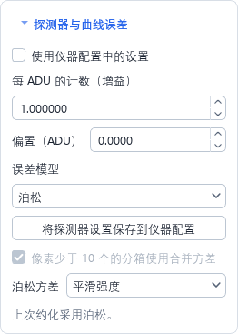

处理顺序固定：探测器无效像素 → 热 / 死像素 → 掩膜 → 暗场 → 背景 → 平场排除的像素 → 缝隙保护 → 强度范围（作用于测得的值）→
除以平场 → 镜像补齐 → 强度校正 → 归一化。若探测器发生旋转，依赖角度的强度校正在镜像插值前作用于实测源像素。曲线、q 图、展开图和导出都使用处理后的帧。

**归一化**（Normalisation，折叠，各项默认关闭；GISAXS 和 GIWAXS 都可用）。第一行总是写出当前帧文件头中有哪些可用的值
（*文件头中：曝光 20 s; Monitor = 5000*）。在其他所有校正之后，每一帧乘以 **A_abs / (t_exp · M · T · d)**：

| 项 | 需要输入 |
|---|---|
| **曝光时间 t_exp**（Exposure t_exp） | *取自文件头*（From the file header，文件给出的曝光时间；帧之和取各帧之和）或 *手动输入*（Typed，s） |
| **监视器 M**（Monitor M） | 文件头中的一个监视器读数（*文件头：I0 = …*：EDF 关键字、Pilatus CBF 的 `Flux`、NeXus 的 `NXmonitor`；帧之和取各帧之和）或 *手动输入* |
| **透射率 T**（Transmission T） | 0 < T ≤ 1 |
| **厚度 d**（Thickness d） | mm |
| **绝对强度因子 A_abs**（Absolute scale A_abs） | 由同一装置下玻璃碳或水的测量得到的因子 |

字段下面一行写明这一帧乘了多少、每一项的来源，以及强度的单位；曲线图、CSV 的列名和拟合输入都随之带上这个单位
（*counts/(pixel·s·monitor)*）。误差棒乘以同一个因子；光子计数保持泊松误差。文件头中没有所选值的帧不做分析，状态栏说明原因。
JSON 记录（`normalisation`）和每个曲线文件（`# intensity: …` 一行）写明因子和每一项及其来源；设置文件保存这些选择
（[《物理与方法》4.12 节](Physics_Manual_zh.md#412-归一化曝光时间监视器透射率厚度绝对强度)）。

**用次级标准样品标定绝对强度**

1. 在与样品相同的仪器设置下，用透射几何测量标准样品。在分析页选择仪器配置，或打开带有几何参数的帧。
   打开**分析 ▸ 用标准样品标定绝对强度…**（Analyze ▸ Absolute Scale from a Standard…）。
2. 选择标准样品的探测器文件和帧号，或导入径向曲线，列依次为 q、I，可另附 σ。使用帧时，先核对当前的掩膜、
   暗场、平场及背景，按实验情况扣除空池或空束散射。导入曲线时，用已完成校正、尚未做帧归一化的强度。
   输入标准样品的曝光时间、监视器读数、透射率和厚度（mm）。未使用的曝光时间、监视器或透射率项填 1。
3. 选**水**（Water）并输入实测水温，或选**参考曲线文件**（Reference curve file）并载入自己的参考表，
   例如 SRM 3600 证书的数据。三列分别为 q、微分散射截面（cm⁻¹）和各点的标准不确定度（cm⁻¹）。
   两个文件的 q 单位分别选择。各点共有的比例不确定度以一个标准差的百分数单独输入一次；未给出的分量填 0。
4. 两个 q 界限都留空即取重叠区间，也可用 Å⁻¹ 输入范围。水应选小角散射平台。点**拟合比例因子**（Fit Scale），
   对照曲线及残差（标定后的测量值减去参考值）。残差随 q 系统变化时，应核对背景和拟合区间。
5. 输入**待测样品**的厚度（mm），点**应用比例因子**（Apply Scale）。程序将两种厚度分别换算为 cm，
   把 A_abs、标准不确定度、来源和 UTC 日期写入仪器配置。在**掩膜与校正 ▸ 归一化**中设置待测样品自己的曝光时间、
   监视器读数和透射率，监视器读数与标准样品采用相同约定。以后换样时，可点**使用已保存的比例因子**（Use Saved Scale）
   并输入新样品的厚度。若探测器距离、像素尺寸、倾角或波长发生变化，需要使用新设置下的标定结果。

曲线 CSV 的强度列标为 `cm^-1`。帧的 JSON 记录在 `normalisation.standard_calibration` 中保存标准样品的测量文件、
参考值来源、拟合 q 区间和 A_abs ± σ_A_abs。σ_A_abs 是整条曲线共有的比例不确定度，逐点 σ 列给出各点的统计不确定度。
批量导出合并表时，批次 JSON 的 `frame_normalisations` 逐帧记录样品归一化参数，并指向所用标准样品的标定记录。
若随后将序列中的参考峰归一化到指定峰高，最终曲线为相对强度。

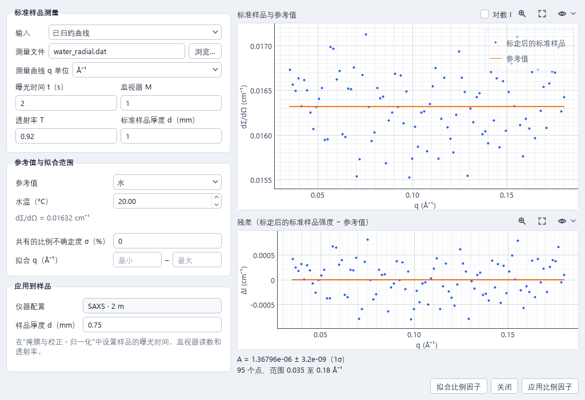

**强度校正（GIWAXS）**（Intensity corrections (GIWAXS)）。整帧校正默认关闭。这些因子改变给定 q 处的强度。环取向分析可单独设置偏振和出射角。

| 校正 | 需要输入 |
|---|---|
| **每个像素的立体角（cos³2θ）**（Solid angle of each pixel (cos³2θ)） | — |
| **偏振，因子**（Polarisation, factor） | f（默认 0.99）：同步辐射 0.95–0.99（水平偏振），非偏振的实验室光源为 0，竖直偏振为 −1 |
| **薄膜内的吸收**（Absorption in the film） | **厚度**（Thickness，nm）、**衰减长度**（Attenuation length）1/µ（µm，查 CXRO 或 NIST 等表） |
| **峰面积的洛伦兹因子**（Lorentz factor for peak areas） | **入射面排除带半宽**（Incidence-plane half-width），以水平像素为单位（默认 2） |

峰位不变；在 χ 或 q 之间比较强度时会变——取向、极图、结晶度比值。薄膜吸收不含折射，因此只在远高于临界角时有效；开启后，
位于样品地平线及其下方的像素被排除。各因子以及误差棒怎样随之变化，见[《物理与方法》第 5 章](Physics_Manual_zh.md#5-giwaxs-的强度校正)；
JSON 记录（`intensity_corrections`）写明公式和参数。

对纤维织构样品，可选**峰面积的洛伦兹因子**比较晶体衍射积分强度。图像使用 GIXSGUI 的权重 cos αi |q_y|/k。
径向曲线对每个 q 分箱内加权后的像素求和，峰表使用这条曲线。比较不同等宽 q 网格上的峰下加权总计数时，将各自的拟合面积除以相应的 q 分箱宽度。排除带沿整个入射面分布。半宽为 2 时，
排除 |q_y|/k 小于两倍水平像素宽度与探测器距离之比的像素。[《物理与方法》5.6 节](Physics_Manual_zh.md#56-纤维织构的-lorentz-因子)

环剖面 I(χ) 始终使用洛伦兹加权前的像素平均强度。**默认对环剖面作偏振校正**（Polarise ring profiles by default）在整帧偏振校正
关闭时采用水平偏振参数 0.99。可按光源设置整帧偏振参数，或取消上述环剖面选项，使整帧偏振校正关闭时环剖面也不作偏振校正。
**取向分析的最低出射角 αf**（Orientation minimum αf）按像素的出射角排除近地平线区域。**自动**（Automatic）采用两倍的薄膜
临界角，未给临界角时采用两倍的入射角。也可以输入角度值（°）指定阈值。

命令行使用 `--orientation-min-exit-deg`，单位为度。

### 5.3 切线

**切线** 步骤管理切线位置。**自动切线**（Auto Cuts）回到自动给出的位置。

#### GISAXS：水平切线与竖直切线

GIMaP 找到 Yoneda 带（在样品地平线与出射角 1.5° 之间、镜面反射棒两侧测得的最亮行），然后取：

- **水平切线** I(qy)：Yoneda 行处高 5 px 的条带（图上为橙色）；
- **竖直切线** I(qz)：条带名义宽度为 10 px。空间足够时，条带内缘离投影后的镜面反射杆至少 15 列。优先取右侧，其次取左侧。两侧空间都不足时取较宽的一侧并提示。15 列是几何间距，较宽的反射杆可能需要更大的偏移。

找不到 Yoneda 带时，水平切线放在地平线上方，步骤里会说明——请检查 αi。要移动切线，在图上拖动橙色条带
（拖动边缘可改变高度），或双击某一列来移动竖直切线。步骤会说明切线位于 Yoneda 带、由手动设置，还是在地平线上方。

**水平切线的两半**（Halves of the horizontal cut）。qy 有正负：光束两侧是同一结构的两次测量。选择送去拟合的曲线用哪部分：

| 选项 | 拟合用的曲线 |
|---|---|
| **两半都画在 \|qy\| 上（两种颜色）**（Both halves on \|qy\| (two colours)） | 两半都折叠到 \|qy\| 上 |
| **两半取平均**（Mean of both halves） | 两半的平均 |
| **qy < 0 半边** / **qy > 0 半边**（qy < 0 half / qy > 0 half） | 只用一侧 |

同一选项也在 **发送到拟合 ▾** 和 **工具 ▸ 设置… ▸ 分析**（Tools ▸ Settings… ▸ Analyze）中。**使左右对称**（Make Left and Right Symmetric）把光束中心列移到
切线的对称轴上（只改 x；方法见 4.6 节）。

#### GISAXS：自己的切线

两半选项下面是 **切线列表**（List of cuts）。前两行是自动切线——**Yoneda 切线**（Yoneda cut，拟合使用的那条）和
**竖直切线**（Vertical cut）——之后可以按需添加任意多条有名字的切线：

- **添加 ▾**（Add）——水平带（I(qy)）、竖直带（I(qz)）、框（I(qy) 或 I(qz)）、扇区（从直射束出发某一方向上的
  I(qyz)）或任意方向的线（沿线的 I(s)）。新切线放在容易看到的位置并被选中，可以立即输入它的位置。
- **在图像或 q 图上画**（Draw on the image or the q map）——水平、竖直和扇区点一下，框点两个对角，线点两端。Esc 取消。
- 表格下方的编辑区设置位置：带的中心 ± 半宽，框的起止范围（以及沿 qy 还是 qz 切），扇区的 χ ± 半宽和 q 范围，
  线的起点、终点和半宽。**添加** 旁边的列表选择单位：**q (Å⁻¹)**、**角度（°）**（Angles，即出射角：qz 对应 αf，
  qy 对应样品地平线上的 2θf）或 **像素（px）**（Pixels (px)；光束中心列上的行、沿计算所得地平线的列）。
  编辑区下面一行给出另外两种单位下的位置。
- 勾选一行即显示或隐藏它的曲线和轮廓。双击名称可改名。**复制**（Duplicate）复制所选切线（复制自动切线时：在同一 q
  处得到一条自己的带，可再移到别处）。**移除**（Remove）删除它；Ctrl+Z 可恢复。输入 Yoneda 切线的位置就是设定它的行，
  和拖动橙色条带一样。**自动切线**（Auto Cuts）把自动切线放回原位，自己的切线保留。

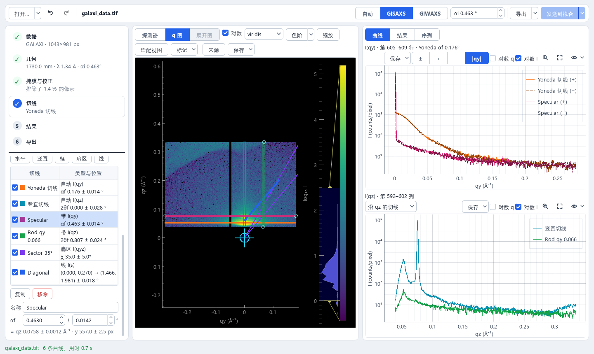

*Yoneda 切线、镜面反射处的一条带、Bragg 杆处的一条竖直带、一个扇区和一条线，在表格、q 图和曲线图中各有自己的颜色；
所选的带以出射角输入。*

一条切线在各处都是同一种颜色：表格行、曲线、探测器图和 q 图上的轮廓，以及 **来源**（Sources）里它的像素。水平带和
沿 qy 的框与 Yoneda 切线一起在上图，竖直带和沿 qz 的框在下图；有扇区或线时，下图上方的列表可以显示它们。在 q 图上
可以拖动带和框、改变它们的大小。像素中心的 q 落在切线内时，该像素属于这条切线（整像素，只计地平线以上的像素），
所以在探测器图上 qz 恒定的带略有弯曲。

切线以 q 保存：对同一套设置的每一帧都成立，批量导出和序列图也一样，**保存设置…**（Save Settings…）会保存它们。来了
另一台探测器或另一种几何的帧时（探测器、帧尺寸、像素尺寸、距离、波长、光束中心或倾斜不同），切线步骤会询问：
**保留切线**（Keep Cuts）还是 **移除切线**（Remove Cuts）；在你选择之前，切线在同一 q 处照常应用。每条导出的切线在其
CSV 的 `# region:` 行和 `_analysis.json` 中写明它在 q 中的定义——以及 αf 或 2θf；自动切线另外写出其条带边缘的
qz 和 αf（qy 和 2θf）。

#### GIWAXS：区域，环 / 扇区 / 斑点

一帧 GIWAXS 在上图给出 I(q)，在下图给出 I(χ)。χ = 0° 是表面法线方向，±90° 是样品平面。

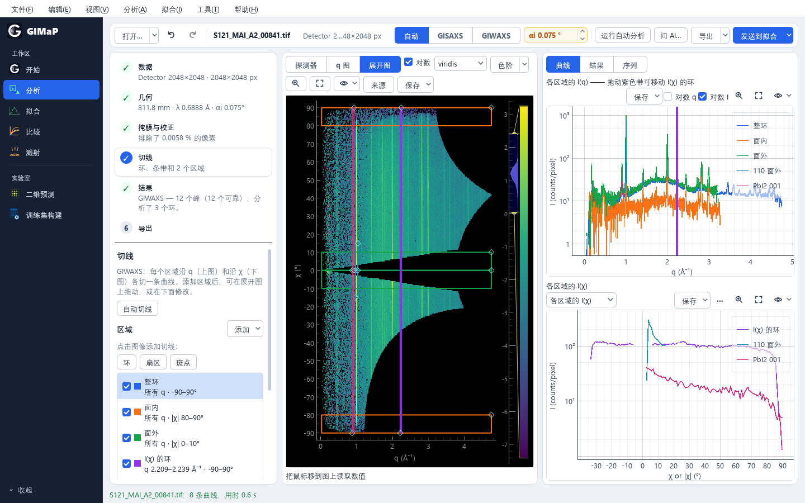

*每个区域有自己的颜色，在列表、q 图、展开图和曲线图中相同。*

图像上方有三种视图：

- **探测器** —— 测得的原始帧，单位为像素；
- **q 图** —— 强度重新网格化到 q∥（qr）和 qz 上。网格不会比探测器对 q 的采样更细（GIWAXS 至多 800 × 800 格，GISAXS 至多
  600 × 600 格），所以测量到的区域里每一格都有像素；留空的地方就是没有测到的（缝隙、掩膜、缺失楔形区）。视图打开时对准
  测量到的格子；
- **展开图** —— 展开为 χ 对 q：环是竖线，区域是矩形。

图像上方的 **保存 ▾**：**当前视图存为图片…**（View as Figure…，带色标）或 **当前视图数据存为 CSV…**
（View Data as CSV…，q 图或展开图的数据表，带坐标轴）。

**区域**（Regions）。一个区域 = 一个 q 范围 × 一个 χ 范围，可选两侧（±χ，折叠到 |χ|）。每个区域以自己的颜色给出两条曲线：
I(q)（上图）和 I(χ)（下图）。列表一开始就有标准切线——整环、面内带、面外带和 I(χ) 的环——自动分析和 AI 也使用它们。
勾选区域即显示。

**点一下添加切线。** 在 *点击图像添加切线*（Click on the image to add a cut）下按 **环**（Ring）、**扇区**（Sector）
或 **斑点**（Spot），再在探测器图、q 图或展开图上点一下：

| 按钮 | 点在 | 得到 |
|---|---|---|
| **环** | 一个峰（也可点上方 I(q) 曲线图上的峰） | 该峰的 q 窗口 × 所有 χ：用于取向的 I(χ) |
| **扇区** | 一个方向 | 该 χ 附近几度内（±5°，或斑点的宽度）的所有 q：沿该方向的 I(q) |
| **斑点** | 一个斑点 | 斑点的 q 窗口 × χ 窗口：该斑点的两条曲线 |

区域会自动对准峰：中心和 FWHM 由像素拟合得到，窗口为中心 ± FWHM，不会伸进相邻的峰。提示中给出 q、d 和 FWHM，并可撤销。
点击处附近没有明确的峰时，使用固定宽度，提示会说明。新区域按位置命名，例如 `Ring q 0.998` 或 `Sector |χ| 85°`。

**精确修改区域。** 选中区域，输入中心 ± **半宽**（Half width，q 精确到四位小数，χ 精确到 0.1°），或勾选 **全部 q**（All q）、
**所有 χ**（All χ）、**两侧（±χ）**（Both sides (±χ)）。下面一行显示实际范围和 d = 2π/q。**对准峰**（Snap to Peak）
把窗口重新对准最近的峰。**移除区域**（Remove Region）删除它。区域也可以在展开图上拖动和缩放。

**添加 ▾**（Add）中还有 **在展开图上绘制**（Draw on the Cake View，点两个对角）、**最强峰处的环**（Ring at the Strongest Peak）、
**面内带（|χ| 70–90°）**（In-plane Band (|χ| 70–90°)）、**面外带（|χ| 0–20°）**（Out-of-plane Band (|χ| 0–20°)）、
**整个图样**（Whole Pattern），以及 **保存切线…** / **载入切线…**
（Save Cuts… / Load Cuts…，区域集合存为 JSON，供下一组数据使用；载入会替换你添加的区域，标准切线不变）。
**最强的环**（Strongest Ring）把 I(χ) 的窗口放回最显著的环上。

**更多切线设置**（More cut settings，折叠）：**径向分箱**（Radial bins，默认自动）、**I(q) 的横轴**（I(q) axis，q 或 2θ），
以及 **q 框**（q box，一个 q∥ × qz 矩形，单位 Å⁻¹，可在 q 图上拖动），给出 I(qz) 和 I(q∥)。下图的下拉框选择
**各区域的 I(χ)**、**q 框：I(qz)** 或 **q 框：I(q∥)**。

### 5.4 曲线与结果

**曲线上的点从哪里来。** 每个点通常是一个分箱内有效像素的平均强度。默认径向分箱宽度取决于 q 在一个探测器像素上的变化量。
选中 **峰面积的洛伦兹因子** 时，径向 I(q) 给出每个 q 分箱的加权和。计算径向均值时，光束附近或区域边缘像素很少的分箱
会沿 q 与相邻分箱合并。I(χ) 和洛伦兹加权的径向求和保留原有分箱。探测器缝隙、被掩膜的 χ 范围和缺失楔都可能留下空分箱，
曲线在缺失范围处断开。

误差棒 σ 按 **探测器与曲线误差** 的设置计算。自动模式下，原始整数计数用计数误差，浮点、扣暗场、扣背景或镜像补齐的帧
用像素离散度。也可指定 σ 帧。用实测强度估计泊松误差时，全为零计数的分箱取一个计数的误差。**平滑强度** 只改变泊松误差估计。
要让每个径向点对更多实测像素取平均，可加宽区域的 χ 范围或调小 **径向分箱**。[《物理与方法》6.4 和 6.5 节](Physics_Manual_zh.md#64-曲线误差模型)

**来源。** 按 **来源**，探测器图上会以曲线图中的颜色显示每条曲线来自哪些像素。点一条曲线，只看它的区域。

**曲线图。** 每个曲线图有：

- **对数 I**（Log I）和 **对数 q**（Log q）（对数坐标轴；I(χ) 或 2θ 的图上后者为 **对数 χ**（Log χ）/ **对数 2θ**（Log 2θ））。
  横轴取对数时，x ≤ 0 的点不画：要在对数 q 轴上看 GISAXS 切线的两半，请选 |qy|（见下）。切换坐标轴时，
  你放置的窗口带保持原来的数据范围。
- x 有正负时（水平切线的 qy、环的 I(χ)）：**±**（两半）、**+**、**−**，或 **|qy|** / **|χ|**（两半都画在 |x| 上，
  负半边用另一深浅的虚线）。这只改变显示和 **曲线图存为图片…**，不改变导出的数据和拟合用的曲线。
- 缩放（拖出矩形；在任何视图中按住 `Shift` 拖动也可以）、重置，以及标记（眼睛）按钮。
- **保存 ▾**：**曲线图存为图片…**（Plot as Figure…，论文图）或 **曲线存为数据…**（Curves as Data…，每条曲线一个 CSV
  加一份 JSON 记录）。
- 右键菜单（**复制图片**（Copy Image）、**复制数据**（Copy Data）…）、按住右键拖动缩放，以及窄图的 **⋯** 菜单，
  和所有曲线图一样（3.4 节）。

**色阶。** 每幅图像旁边是显示值的直方图，带两个手柄。拖动手柄或两者之间的带可以快速调整；在色标上滚动鼠标滚轮可放大色标，
做更细的调整。**色阶 ▾** 中有：

- **每帧自动**（Auto for every frame）及其 **规则**（Rule）：1–99.7 %、0.1–99.9 %、5–95 %、最小–最大、均值 ± 3σ；
- 以强度单位输入的 **最小** / **最大**；
- **自动一次**（Auto Once；直接点 **色阶** 按钮也一样）。

拖动或输入的上下限会一直保持——换帧、重新分析、实时序列热图都不会重置——直到你选回自动；此时按钮显示
**色阶（固定）**（Levels (fixed)）。上下限在对数和线性显示下含义相同。探测器图、q 图、展开图和序列热图各自保存自己的上下限。

在 **对数** 显示中，不大于 0 的像素（扣过暗场或背景的帧中的噪声）以色图的最低颜色画出（取正值的 0.1 % 分位数），而不是不着色；
自动上下限只由正值得出；被掩膜的像素仍不着色。线性显示的上下限取所有值的分位数，色标条围绕上下限画出，因此最亮像素是典型值上千倍的帧
也有清楚的色标条。这只改变显示，从不改变数据。

**标记。** 每幅图像有 **标记 ▾**，每个曲线图有一个眼睛按钮：每类标记一个开关——光束中心、样品地平线、切线带、
掩膜和切线区域、像素叠加层、标出的热 / 死像素、q 框、色标、窗口带——以及 **显示全部标记** / **隐藏全部标记**
（Show All Marks / Hide All Marks）。隐藏的标记在换帧和下次启动时仍保持隐藏。同一菜单可删除你画的东西：
**删除画的掩膜**（Remove the Drawn Masks）、**删除全部切线区域**（Remove All Cut Regions）、**删除 q 框**（Remove the q Box），
都可撤销。在 q 图上，光束中心是直射束（q∥ = 0，qz = 0），位于图的正下方；样品地平线以虚线画在 qz = k sin αi 处。

**撤销 / 重做**（↶ ↷，`Ctrl+Z`、`Ctrl+Shift+Z` 或 `Ctrl+Y`）。对设置的每次改动是一步：画一个掩膜、添加或移动区域、
拖动条带、仪器配置、αi、光束中心、模式、校正、求和的帧数、载入设置文件、应用 AI 卡片。一次拖动或同类改动的快速连续操作算一步。
提示会说明下一次撤销改的是什么（例如 *Undo: cut regions*）。已保存的仪器配置不能这样撤销。

### 5.5 运行自动分析

**运行自动分析** 对当前显示的帧执行 GIMaP 的标准流程。它不需要 AI，GIWAXS 和 GISAXS 都适用。

运行前，可以在 **结果** 步骤中填写 **束线时笔记**（Beamtime notes）：αi、能量、像素尺寸、标定文件在哪——知道什么就写什么。
在命令栏中设定的 αi 就是这次运行使用的 αi：不会再问，报告的 *Decisions*（决策）写明它来自命令栏。笔记或回答中的数值与它不同时，
会替换命令栏中的值，所以报告的 αi 总是实际使用的那个。

**GIWAXS。** 运行时依次：

1. 确定几何（仪器配置、数据附近的标定文件，或标样图像）；
2. 序列取最后的若干帧求和：最后五分之一的帧，至多 10 帧（不到十帧时只取最后一帧）；
3. 寻峰并拟合；
4. 比较面内与面外；
5. 给出最强可靠环的取向和 Scherrer 尺寸。

结果标签页显示 **峰**（Peaks）、**检查**（Checks：阴影、伪影、没测到的范围）、**几何**（Geometry：来源、距离、光束中心、
波长、αi）、**序列**（Series，带 **与序列开头比较**（Compare with the Start of the Series））和 **报告**（Report）。
尺寸是 Scherrer 下限。物相只指认到你给出的物相（**物相**，5.9 节）。

报告的 *Decisions*（决策，**显示全文**（Show the Full Text））写明所用的 q 轴。使用运动学 q 时，报告给出地平线附近因折射
造成的 q_z 偏移量级，在薄膜临界角附近或以下约为 k·sin αi。峰参数的统计误差来自记录的约化模型（泊松、像素离散度或指定 σ 帧），不含几何不确定度。
GIMaP 最多拟合 12 个最显著的候选峰。合格的候选峰更多时，*Decisions* 和峰表下面的一行写出候选峰有多少、这 12 个里有多少个给出了峰
（拟合可能把两个候选峰合并，或者否决一个），峰表、环和序列提示都只来自这 12 个（命令行的 `--max-peaks` 可以拟合更多）。
保存的报告给出每个峰的 q、d 和 FWHM 及其 ±。约化 χ² 大于 1 的拟合，其 ± 乘以 √χ²_r；拟合的 χ²_r 大于 10 的峰在 caveat 一列
标为 *poor fit*：它的形状不是一条直线背景上的单个高斯峰，读它的宽度和尺寸时要小心。*lamellar (1:2:3:4)* 提示要求各级
依次出现：在第一级 q 的五倍附近有峰、却没有第三和第四级时，不列出这个提示。离数据末端不到 1.5 个峰宽的峰
（“位于数据末端：请检查”（at the end of the data: check））不用于环、尺寸和序列提示：它的形状可能被截断。

对于每个分析的环，报告列出排除的出射角范围和偏振设置。环的 I(χ) 及其误差只取实测像素，所以径向曲线使用镜像补齐时，
两条曲线的误差模型可能不同。报告并列给出实测 Hermans f ± 统计误差 [系统变化范围] 和相同分箱的各向同性参考值 f_iso。按出射角筛选后，再排除紧邻截止位置且
强度不超过环净强度中位数 5% 的连续分箱，并列出对应的 |χ| 区间。计算系统范围时，将强度阈值设为关闭、5% 和 10%，
出射角阈值设为标称值的 0.5、1、2 倍，背景按拟合所得的标准误差上下改变，未得到标准误差时上下改变 20%。
每种筛选条件均考察地平线缺口留空和用邻近 10° 角带平均密度补全两种情形。若末端连续分箱的密度均低于前一角带均值的 75%，还考察去除或补全这些衰减分箱的情形。
另用最初实测角带的均值补全 0° 附近的缺失楔。若极图拟合能确定取向，也计入模型对低角楔区的外推及传播误差。
报告注明决定上下限的情形。上下限之差大于 0.05 时，环结果首行和**需要处理**（Needs attention）均指出实测 χ 范围不足以确定取向因子。
命令行导出的 `azimuthal_last_ring.csv` 表头记录与该曲线对应的已分析环的因子和上下限。


*峰表（q、d、FWHM、可信度、Scherrer 尺寸 L、OOP/IP）；下方的 **拟合细节** 展开后显示所选峰的拟合。*

**GISAXS。** 运行时依次：

1. 确定几何，并与 GIWAXS 一样，序列取最后的若干帧求和；
2. 在 Yoneda 带取水平切线（找不到时提示检查 αi）；
3. 把光束中心列移到对称轴上；
4. 选择两半：两半都可用且一致时取平均，否则用可用的一半，并写出理由（一半被遮挡、被缝隙切断、太短）；
5. 给出切线侧峰（没有侧峰时为肩峰）的特征长度 2π/q\*：“这是一个特征长度，不一定是粒子间距；请用模型拟合检验”。
   形状因子或直射束的拖尾也会形成肩峰，所以 2π/q\* 从不作为间距报告（报告中这一节是**特征长度 2π/q\***
   （Length scale 2π/q\*）；决策 **length scale** 写出它在哪里，并只说一次它是什么）；
6. 用**预测参数**（Predict parameters，拟合页的网络方法，6.4 节）拟合 I(qy)：GIMaP 的网络给出一种或两种球和竖直圆柱的
   颗粒群（带或不带次晶间距 D）及其数值；每个解用最小二乘精修，并按后验概率加权。已知入射角 αi 和 Yoneda 带的出射角 αf 时，拟合采用第二层，在切线的真空 q_z = (2π/λ)(sin αi + sin αf) 处计算 Born 项。
   任一角度未知时采用第一层，即 q_z = 0 处的有效界面。报告在 *Decisions* 中写明采用哪一层及其原因。
   特征长度 2π/q\* 独立于拟合。请在拟合中确认模型。

各个解按概率 **p** 从高到低排列；证据抽样失败时按 **BIC 权重** 排列。概率是相对于所尝试的各种组成而言的；你给定组成时的唯一一个解不给概率
（*only this composition was tried*）。R、h、D 列出每一群颗粒的值，按半径从小到大（`3.06 / 6.02`、`49.4 / –`：– 表示这一群
没有次晶）。表里的 χ²ᵣ 是 Σ((I − 模型)²/σ²)/(N − 自由数值的个数)，对拟合的点求和，σ 取曲线自身的 σ：同一个解在拟合页显示的
就是这个数。预测参数略去低于网络 q 窗口的点（q < q_max/300）；报告写明有多少（*fitted: 596 of 598 points; 2 below the
network's q window*）。运行报告最可能的解，表格选中它。停在范围边界上的非线性参数不由曲线确定：表格给它标 ⚠，表下一行警告
按名次写出（“⚠ 不由曲线确定（处于搜索边界）——第 1 名：D……”；哪个边界，如“D 处于搜索上界”，写在它的提示里），
**拟合细节**和报告的备注列也这样写；报告的解有这样的数值时，一处需要查看（**拟合**（Fit））会说明。振幅、背景和直射束拖尾的
振幅按非负拟合，不算作处于边界的数值；等于 0 的会写在报告的 *Decisions* 里（*fit caveat: Background at 0, the
non-negativity limit*）。报告的解 χ²ᵣ 大于 10（即拟合页序列中“拟合差”的限值，6.5 节）时，它与曲线的偏差远大于噪声：
一处需要查看（**拟合**）说明试过的组成都描述不了这条切线，它的 R 和 D 不是测量值（粉末或标样的布拉格环会造成这样的失配）。
在第二层，若球或随机取向圆柱的 q_z·R > 1.2，预测参数会标出 `qzR_cov`，表示报告的区间可能低估不确定度。
若 q_z·R > 2，还会标出 `qzR_fail`，提示模型误差较大。第二层的竖直圆柱在 q_z·R > 2 时会标出 `cyl_sphere`，即使高度未知，也要考虑半径相近的球。若要在球的拟合中计入出射反射路径，按**发送到拟合**，
在模型 ▸ **掠入射下的球**（Spheres in grazing incidence）中填入 αi、αf 和 λ，再运行预测参数。
另有一个解的概率不低于 0.2 时，单凭曲线无法决定模型：表下一行会说明，结果标签页会问你预期哪一个，并指出 D 与 2π/q\*
相差在 15 % 以内的解。报告给出所报告解精修后的 R、h、D 及其 68 % 区间（*fit intervals: R (1) 3.17 [3.04, 3.26] nm …*：先是精修值，
再是区间；后验抽样没有收敛时区间取自最小二乘误差）。每个量只有一个名字，即拟合页模型表里的名字，表格、备注、拟合细节和报告里
都一样：直射束拖尾是 Tail A、Tail w、Tail ν，还有 σ_q、Scale；有几群颗粒时名字后面的括号里是颗粒群的编号（R (2)、σR/R (1)）；
报告列出它的 CSV 和 JSON 文件里各个键对应的名字。关于背景、光束尾项和分辨率的备注排在关于颗粒的备注之后，合成一段；
不存在的项（Tail A = 0）不再给出提示。
**保存拟合曲线…**（Save Fitted Curve…：q（Å⁻¹）、I、σ 和运行报告的拟合）、**保存拟合表…**（Save Fit Table…：每个解及其概率、
参数（nm）、R、h、D 的 68 % 区间、χ²ᵣ 和拟合的点数、`at_bounds` 中处于边界的数值和 `chosen` 中报告的解）和 **保存图…**（Save Plot…）
保存结果；**在拟合中精修**（Refine in Fitting）在拟合中打开准备好的曲线（按所选的两半）。

与 GIWAXS 一样，报告的 *Decisions*（**显示全文**）写明这些数字是什么：q 是运动学值；在临界角附近，折射主要使 q_z 偏移，
Yoneda 带处的最大，量级为 k·sin αi，这一行给出你这一帧的数值（q_y 和 2π/q\* 几乎不变）；切线的 σ（χ²ᵣ 用它归一化）只是统计误差，
来自记录的泊松、像素离散度或指定 σ 帧模型，不含几何的不确定度；R、h、D 的区间来自给定这些 σ 的后验，所以也不含几何和模型选择的不确定度。


*切线及其两半、特征长度 2π/q\*、拟合图（对数 q / 对数 I）和解的表格。*

**拟合细节**（Fit details，在峰表或拟合表下方，默认收起；打开后之后的报告也保持打开）跟随选中的行：

- 峰：拟合用到的点、高斯峰及其局部线性背景；q、d、FWHM 及其误差；峰高、面积、背景与斜率；S/N、χ²ᵣ、拟合窗口、
  Scherrer 尺寸，以及该环在 q 图上测到、被遮挡或没测到的部分（这个峰怎样拟合、怎样寻峰以及本次运行的阈值，写在**拟合细节**
  的提示里）；
- 模型解：每个参数（R、σR/R、h、D、σD/D、权重、Scale、Background、Tail A、Tail w、Tail ν、σ_q），以及 R、h、D 的
  68 % 区间、它的概率、χ²ᵣ 和它所依据的点数、
  log RMSE、是否收敛与用时、点数和 q 范围、组成是你给的还是网络选的、它的警告和处于边界的数值，以及 **在拟合中查看**
  （Show in Fitting）——在拟合中打开曲线并画出这个解。

**只有你能回答的问题**（αi、能量、像素尺寸、标定文件及其标样、GISAXS 的模型）会在结果步骤中变成输入框。填好后按 **用这些答案再运行一次**
（Run Again with These Answers），或在输入框中按 `Enter`。

**运行期间**，右侧切换到结果标签页。顶部的面板显示正在进行的步骤和用时，并逐项勾选已完成的阶段。**停止**（面板和命令栏中都有）
在下一步开始前结束运行。正在进行的一步会先做完，面板说明在等什么（几何拟合或模型拟合可能要一分钟左右）。
已得到的结果会保留：**保存报告…**（Save Report…）或 **丢弃**（Discard）。

**结果属于哪一帧。** 结果属于运行时的那一帧。运行期间文件列表被锁定。切换到别的帧时，结果步骤会说明这些结果来自哪一帧；
回到那一帧时结果随之恢复。**保存报告…** 写出带图片的网页（`.html`，任何浏览器都能打开）或 Markdown 文本（`.md`）；保存对话框从数据所在文件夹开始。
两种都有**掩膜**（Mask）和**记录**（Record）两节：GIMaP 的版本、输入文件及其 SHA-256、几何取自标定文件时该文件的路径和
SHA-256、仪器配置及其来源（由文件建立的配置写明该文件的路径），以及各项校正（背景、缝隙保护、坏像素、强度校正）。

自动分析设的求和只用于它分析的那一帧。序列热图、批量导出和把序列发送到拟合不用它（对话框和序列标签页会这样说明）；
要在那里求和，请自己设 **数据 ▸ 帧 ▸ 求和**。

**问 AI…** 让 AI 用同样的工具做同样的事，你在一旁看着（第 10 章）。

### 5.6 序列热图与阶段

列出多帧——多个文件、一个文件夹，或一个多帧的 NeXus/HDF5 文件——后，**序列** 标签页把每一帧的同一条曲线显示为强度对帧号和 q 的热图。

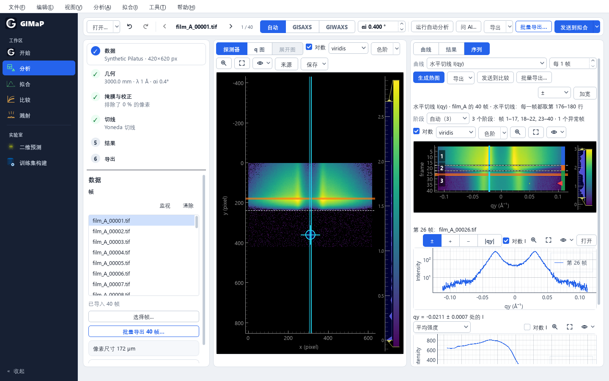

*拖动水平带选帧，拖动竖直带选 q 窗口。热图上方一行写出曲线、帧和每帧都用的切线；旁边的下拉框（±）选择切线的两半，帧轴从 1 数。
这里是一个 40 帧的合成序列：“3 个阶段：帧 1–17, 18–22, 23–40 · 1 个异常帧”。异常帧是第 34 帧，那一帧有几列探测器像素过亮
（qy 0.05 Å⁻¹ 附近短短的一个亮点）；热图旁的红色箭头标出它，它没有自成一个阶段。*

1. 选择 **曲线**（Curve；GISAXS 默认水平切线，GIWAXS 默认 I(q)；每个区域的 I(q) 和 I(χ) 都在列表里）。
   长序列要先快速看全貌时，把 **曲线** 旁边的框设为*每 n 帧*（例如*每 5 帧*）。
2. 按 **生成热图**（Build Map）。每个已导入的帧（或每组相加的帧）用当前设置处理，热图随之逐步长出。长序列在多个低优先级进程中处理；
   面板显示进度、剩余时间，可 **暂停**（Pause）和 **停止**，已完成的行保留。
3. 拖动水平带选一帧：下方画出它的曲线；**打开**（Open）用序列的切线在分析页中显示这一帧。
4. 拖动竖直带选一个 q 窗口：再下方画出随帧变化的 **平均强度**（Mean intensity），或窗口中的峰——**峰位**（Peak position）、
   **峰宽（2.355 σ）**（Peak width (2.355 σ)）、**峰面积**（Peak area）、**峰高**（Peak height）（扣去直线背景后的质心、2.355 σ、
   面积和峰高）。窗口落在探测器缝隙里或数据之外时没有值：图上说明，不画点。
5. **导出 ▾**（热图生成后出现）：**热图导出为 CSV 表…**（Map as CSV Table…）、**热图导出为图片…**（Map as Figure…）、
   **阶段表…**（Stages as Table…）、**所选帧的曲线（图）… / （表格）…**（Selected Frame's Curve as Figure… / as Table…）、
   **随帧变化的曲线（图）… / （表格）…**（Trace as Figure… / Trace as Table…，下方曲线图每帧的值）、
   **每帧的峰表…**（Peak Table of Every Frame…）、**保存结果数据库…**（Save Results Database…，把每一帧的曲线写入
   `gimap_series.sqlite`，比较页可以读取；批量导出拟合过各帧时，*结果：批量拟合*中的拟合也一并写入；已有的数据库会加入新的帧，
   之前记录过的帧被替换）和**时间线（表格）…**（Timeline as
   Table…）。

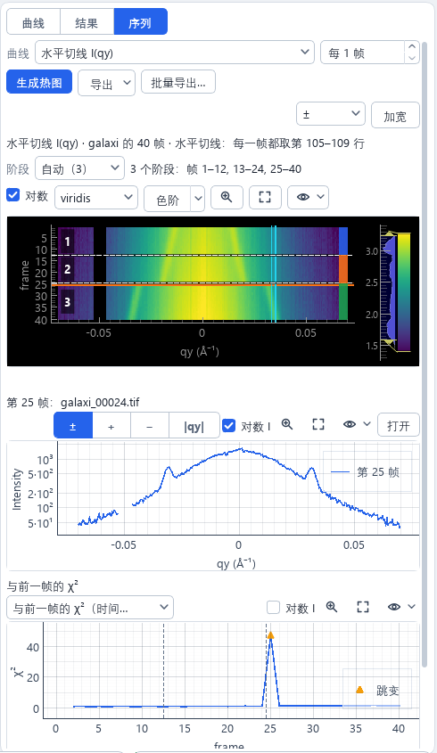

*用公开的 GALAXI 帧做成的 40 帧序列，侧峰在第 25 帧突然移动：只差噪声的帧之间 χ² ≈ 1，跳变处标 ▲，阶段边界画虚线。*

相邻帧比较的做法源自 Xi-cam 的 Timeline。[Xi-cam，第 3.4 节](https://journals.iucr.org/s/issues/2018/04/00/xe5032/)

**时间线。** 热图下方曲线图的下拉框里还有**与前一帧的 χ²（时间线）**（χ² to the frame before (timeline)）和**与参考帧的 χ²
（时间线）**（χ² to the reference frame (timeline)）：每一帧的曲线与前一帧、或与参考帧（**选项 ▸ 参考帧**，默认第一帧）相差多少，
以每个 x 列的噪声为单位，噪声由序列本身估计。只差噪声的两帧约为 1；转变处是一个峰。虚线标出阶段边界，▲ 标出跳变（序列突然变化
的帧），× 标出异常帧。**点击**热图下方曲线图上的某点——时间线或其他任何曲线——选中那一帧并在分析页显示。**时间线（表格）…**
为每一帧写出两个 χ²、是否跳变、所在阶段和是否异常。计算方法见[物理与方法 11.12 节](Physics_Manual_zh.md#1112-时间线每一帧与相邻帧和参考帧相差多少)。

**整个序列一条切线。** 切线是自动的时候，热图的每一帧——以及批量导出、把序列发送到拟合和监视文件夹的自动导出——都切在屏幕上
这一帧切的地方：GISAXS 为选定的水平条带行和竖直条带列，GIWAXS 为 I(χ) 的环。热图上的各行因此来自同一切线位置。
按钮下面一句写明这条切线（*序列的切线——horizontal cut: rows 202–206 for every frame*）。你自己设的切线本来就每帧相同。

**热图显示的是什么。**

- 每个点画在它测到的 x 上：谱线在它自己的 q 处，探测器缝隙保持为缺口（导出保留测到的 x）。
- 帧轴从 1 数，整数刻度——一个多帧文件时是文件里的帧号，几个文件时是在列表中的位置。
- GISAXS 水平切线时，热图旁的下拉框选择两半：**±** 两侧原样，**+** 或 **−** 一侧，**|x|** 两侧都画在 |x| 上，或 **平均**（mean，
  两侧平均）。阶段、随帧变化的曲线和导出都跟随这个选择。
- 热图上方一行写出它的内容：曲线、两半、帧、切线和求和。生成之后设置改了，它会说
  *这张热图是用另一套设置生成的——请再点“生成热图”。*
- **加宽**（Wide）给序列标签页更多空间；热图下面的帧曲线和随帧变化的曲线随之变宽。

**选项：帧、切线、坐标轴**（Options: frames, cut, axes，折叠在图的下方）：

- **帧**（Frames）首帧 **至** 末帧（*最后一帧*：列表的最后一帧）：热图取的帧；不是全部帧时，按钮下面会写明。要重新取全部帧，
  把首帧设为 1、末帧设为*最后一帧*。
- **在每一帧里重新找切线**（Find the cut again in every frame）：每帧重新找切线，而不是切在屏幕上这一帧切的地方。
- **帧轴**（Frame axis）：**帧号**（Frame number），或帧带有时间时的 **时间 (s)**（Time (s)，各帧的时间戳，或帧号 × 曝光时间）。
  保存的图片里每行等高，跳帧或时间间隔不等的帧在图上不表示真实的时间间隔；CSV 保留每行的帧号和时间。
- **阶段比较**（Stages compare）：**整个 x 轴**（The whole x axis），或 **热图当前显示的 x 范围**（The x range shown in the map，
  缩放热图，阶段随之改变）。
- **同时显示所选帧的图像**（Show the picked frame's image）：点选一行时也在分析页里显示那一帧。

热图和探测器图一样：对数、色图和色阶都能用。读数显示帧号、文件、x 和强度。热图属于生成它时的文件列表：之后再列出文件，
热图保留并标明是之前列表的热图；帧列表下方的 **清除** 会删除它。

**导出文件的名字。** 每个文件以序列、曲线和两半命名——`<序列>_<曲线>[_<两半>]_map.csv`、`…_map.png`、`…_trace_<量>.csv`、
`…_peaks.csv`、`…_stages.csv`——所选帧的文件按批量导出给这一帧的名字（`<帧>_<曲线>[_<两半>].csv`）。每个表格的 `#` 行写出它是
哪条曲线、哪两半、哪些帧、哪条切线，旁边有一个同名的 JSON 记录设置。

**结果：批量拟合。** 批量导出拟合每一帧时（5.7 节），热图下方出现 *结果：批量拟合*（Results: batch fitting）面板。每完成一帧就加一行：
参数、状态和失败的原因。选一行可看实际拟合的点和叠在上面的模型；**参数趋势**（Parameter trend）画出一个参数随帧号的变化。
不导出拟合曲线文件也能看；q 的单位为 Å⁻¹，长度为 nm。暂停、停止或结束后结果都保留，直到 **清除**、新一次批量拟合或改变导入的选择。

**阶段。** 热图一生成，GIMaP 就把序列分成若干阶段并标出异常帧（彩色阶段条、边界虚线、红色箭头；**阶段**（Stages）一行；
折叠的 *变化了什么，以及异常帧*；热图下方曲线图的下拉框中的 **沿序列的变化**（Change along the series））。
**批量导出时跳过异常帧**（Leave the odd frames out of Batch Export）让这个列表的下一次批量导出跳过它们。
**发送到比较**（Send to Compare，或 **分析 ▸ 把序列发送到比较**（Analyze ▸ Send Series to Compare））把这个序列放到
其他序列旁边。阶段和异常帧怎样得到、怎样解读，见第 7 章。

### 5.7 批量导出

批量导出用当前设置处理每个已导入的帧，并写出你选择的内容。先把一帧设置好（几何、掩膜、切线），再用同样的方式导出全部。

对话框写出每个文件夹的帧的几何从哪里来：*几何来自它们旁边的 LaB6.poni*、*配置“…”，与当前显示的帧相同*，或 *逐帧使用所选配置或与其
探测器和尺寸相符的配置；没有配置的帧不产生 q 曲线*。概要一行写出当前显示的帧所用的几何。没有任何帧能有几何时（当前帧没有、任何帧旁边
都没有 `.poni`、也没有仪器配置），对话框写 *没有几何：无法得到 q 曲线*，**导出** 保持不可用。

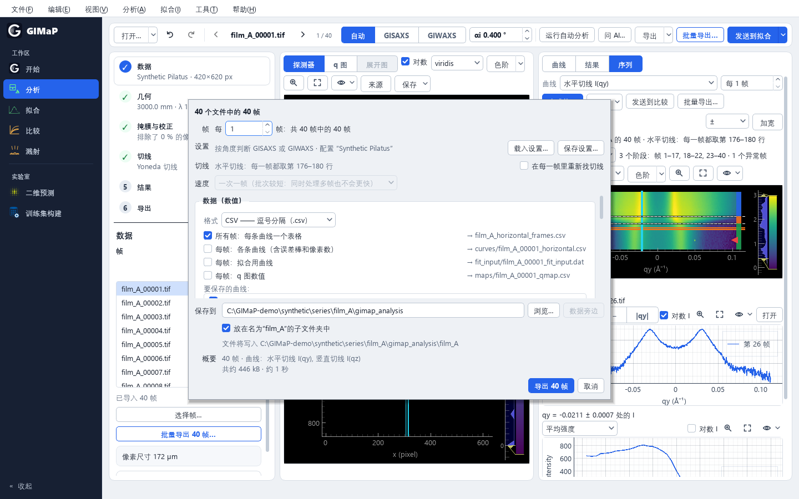

*每个选项旁边都写出它会生成的文件。切线一行写出每帧用的切线；概要写出多少帧、哪些曲线，以及导出大约多大、多久。*

**从哪里打开：** 命令栏的 **批量导出…** 或 **分析 ▸ 批量导出…**（`Ctrl+Shift+E`）、文件列表下的 **批量导出 N 帧…**、
序列标签页的 **批量导出…**、导出步骤或 **导出 ▾**。对一个原始数据文件夹，**分析 ▸ 批量导出一个文件夹…**
（Analyze ▸ Batch Export a Folder…）或开始页打开这个文件夹，等它的第一帧分析完，再打开对话框。

**对话框：**

- 上方：**帧**（Frames，**每**（Every）n 帧取一帧）、**设置**（Settings，设置摘要，带 **载入设置…** / **保存设置…**（Load Settings… / Save Settings…））、
  **切线**（Cuts，每帧用的切线，旁边是 **在每一帧里重新找切线** 勾选框，见 5.6 节）、**速度**（Speed）。
- 中间四组：

| 组 | 选项 | 文件 |
|---|---|---|
| **数据（数值）**（Data (numbers)）—— CSV（逗号）、TXT（制表符）或 DAT（空格） | **所有帧：每条曲线一个表格**（第一列 x，之后每帧一列）；**每帧：各条曲线（含误差棒和像素数）**；**每帧：以 q 为横轴的曲线，NXcanSAS 格式（.h5）**（Each frame: its q curves as NXcanSAS (.h5)，见 5.8 节；不论选哪种格式，总是 HDF5）；**每帧：拟合用曲线**；**每帧：q 图数值**；**每帧：χ–q 展开图数值** | `<名称>_<曲线>_frames.csv`、`curves/<帧>_<曲线>.csv`（+ `_analysis.json`）、`nxcansas/<帧>_nxcansas.h5`、`fit_input/<帧>_fit_input.dat`、`maps/<帧>_qmap.csv`、`maps/<帧>_cake.csv` |
| **图片**（Pictures）—— PNG、TIFF、SVG 或 PDF | **每帧：探测器图像的图片**；**每帧：q 图的图片**；**色阶**（Colour scale）：每帧自己的上下限（1–99.7 %），或屏幕上的上下限、所有帧相同（图片可以相互比较） | `images/<帧>_detector.png`、`images/<帧>_qmap.png` |
| **转换格式的探测器帧**（Converted detector frames）—— TIFF、EDF、NumPy 或 HDF5 | **每帧：探测器数据转为其他格式**（按读取的值：模块已拼接、帧已求和；按文件存储的类型写，缝隙码和没有数据的像素按格式转换的方式标记，见 9.1 节；只被热像素检测或手绘掩膜排除的像素保留原值） | `frames/<帧>.tif` |
| **拟合用曲线**（Curve for Fitting，GISAXS） | **切线的两半**（Halves of the cut）：**两半取平均**、**q > 0 一半** 或 **q < 0 一半**——每帧的模型拟合用哪一部分 | （写在拟合用曲线里） |
| **拟合（可选）**（Fitting (optional)） | 见下 | `<名称>_peak_fits.csv` 或 `<名称>_model_fits.csv`，以及同名 `.png` |

- 下方：**保存到**（Save to，**浏览…**（Browse…）；第一次是数据旁边的 `gimap_analysis/`，之后是上次用的文件夹；
  **数据旁边**（Next to the Data）回到数据所在的文件夹，上次用于别的数据的文件夹会注明）和
  **放在名为“`<名称>`”的子文件夹中**（In a subfolder named “`<name>`”，默认勾选）。下面一行写明文件会写到哪里；
  **导出 N 帧**（Export N Frames）开始批量导出。

**开始之前**，**概要**（Summary）写出多少帧、哪些曲线和哪两半，以及导出大约多大、多久（切线由切线一行写出；每种文件是什么，
写在文件夹里的 `README.txt` 中）。屏幕上的帧在去掉自动分析的求和
重新读的时候，切线一行会说明，**导出** 等它读完。写不了的文件夹立即说明，**导出** 不可用。文件夹里已有同一数据的导出（或拟合用曲线）
时，导出会问 **替换**（Replace）、**两者都保留（写到新的子文件夹）**（Keep Both in a New Subfolder）或 **取消**；问题里写出替换
会删掉哪些文件。只有这次导出会重写替换要删的每一种文件时，`Enter` 才是替换，否则是两者都保留。

选择表格、逐帧曲线和 NXcanSAS 文件时，勾选需要的曲线（**全部** / **无**（All / None））。在所有帧的表格里，点完全相同的帧并排放；点只差一点
（舍入、缺几列）的帧逐行对齐；只有网格真的不同时才插值到第一帧的 x 上，不跨缺口、不外推。表头写明是哪一种。文件夹里总会写
`README.txt`（每种文件是什么、曲线名称、单位、切线、求和、失败的帧）和 `<名称>_batch.json`（选项、帧列表、每个失败的帧及原因、
写出的每个文件、每帧的切线，以及第一帧的完整设置）。

**名字。** 文件名里的帧号从 0 数（`scan_00007_frame0003_sum3_…`；只有一帧的文件不带 `_frame`）；表头、标签和图片标题从 1 数
（*frame 4 of 12*），每个曲线文件在 `#` 行里写出它来自哪一帧、怎样求和、读了哪些文件。一组模块文件以扫描名命名，不带 `_m01`。

**拟合（可选）**——默认 **不拟合**（No fitting）：

- **环区域中的峰**（Peaks of the ring regions，GIWAXS）：每个有 q 窗口的区域（环或斑点）是一个峰。在该区域的 I(q) 中拟合，
  范围为窗口两侧各加一个窗口宽度，**峰形**（Peak shape）可选 Pseudo-Voigt、高斯、洛伦兹，加直线背景。每帧每个峰一行：
  q、d、FWHM、面积及其误差，峰高、η、χ²ᵣ，拟合不显著、太宽或点太少时写明原因。
- **水平切线的颗粒模型**（Particle model of the horizontal cut，GISAXS）：与 5.5 节一样用**预测参数**拟合 **切线的两半**
  里选的那一半或平均（**模型**（Model）：**自动（由网络选择组成）**——一种或两种球和竖直圆柱的颗粒群，带或不带次晶——
  或指定一个带次晶的球、随机取向圆柱或竖直圆柱；多于 1000 个点的切线先合并）。每帧都只用它自己的数据预测，不需要起始值。
  两半从不一起拟合。每帧一行，即最可能的解：`halves`、`points`、模型、`chi2`（χ²ᵣ，同 5.5 节）、`probability` 和各参数（nm）。
  每帧需要几秒到几分钟，随点数和电脑而变。这个选择的初值：切线步骤选的是平均或某一半时用它，否则用上次批量导出的选择。没有计数、或所选的一半没有点
  （*No points on the q > 0 half*）的帧不拟合，原因列出来。拟合用曲线仍包含两半（qy 带正负），并写明所选的两半。
- **起始值**（Start values，只用于峰）：**上一帧的结果**（The previous frame's result；缓慢变化的序列）、
  **第一帧的结果（所有帧都用）**（The first frame's result, for every frame；帧之间互不影响），
  或 **每帧重新寻找**（Found anew in each frame）。
- **在当前帧上试拟合**（Try on This Frame）在批量之前用这些选项拟合当前显示的帧。**同时保存每帧的拟合曲线**
  （Also save the fitted curve of each frame）写出 `fits/<帧>_<曲线>_fit.csv`（峰）或 `fits/<帧>_model_fit.csv`
  （颗粒模型：拟合用到的点，单位 nm⁻¹，以及拟合）。
- 高斯峰和洛伦兹峰的 η 固定为 0 或 1；只有 Pseudo-Voigt 拟合 η。
- 每帧的拟合随做随显示在序列标签页的 *结果：批量拟合* 里（5.6 节）。

**原位校正（参考峰）**（In-situ corrections (reference peak)，折叠，GIWAXS）：用测量中不变的峰（衬底、内标）校正漂移。
填写 **参考峰 q**（Reference peak q）和 **搜索 ±**（Search ±，单位 Å⁻¹）；该窗口中最强的点就是这个峰。
**对齐探测器距离，使峰位于此 q**（Align the detector distance so the peak sits at this q）按帧缩放探测器距离；
**按峰高归一化强度**（Normalise the intensity to the peak height）按比例缩放强度，使参考峰的峰高等于
**归一化后的峰高**（Peak height after，默认 1），可选
**整个序列用同一系数（取自第一帧）**（One factor for the whole series (from the first frame)，默认）或
**每帧按各自的峰**（Every frame to its own peak）。两项默认都关；`<名称>_batch.json` 保存这些设置（`series_correction`）。
公式见[《物理与方法》6.10 节](Physics_Manual_zh.md#610-序列的参考峰校正)。

**速度：**

| 速度 | 做法 |
|---|---|
| **温和**（Gentle） | 一次一帧；电脑保持空闲 |
| **均衡**（Balanced，推荐） | 在低优先级进程中同时处理几帧（约四分之一的核心数，最多 4） |
| **快速**（Fast） | 同时处理更多帧（除两个以外的全部核心，最多 8）；其他程序会变慢 |

同时处理的帧数不超过一半空闲内存所允许的数量（一帧 Lambda 9M 图像，1490 万像素，处理时约需 1.4 GB）。
批次很短时只一次一帧，**速度** 框里会这样写明。举例：Lambda 9M 的帧、开启峰拟合，一次一帧约 2.5 s/帧，
*均衡*（同时 4 帧）不到 1 s/帧。

**结束后**，状态行写出导出了多少帧、写到哪个文件夹、用了多久，模型拟合成功了几帧、其余为什么没有成功；失败的帧连同原因逐一列出
（在面板里、`README.txt` 里和 `<名称>_batch.json` 里）。有帧失败或拟合失败的批次不以成功结束。

**运行期间**，右侧标签页上方的面板显示正在处理的帧、已完成数、每帧用时和剩余时间，以及最新的拟合。**暂停** 不再开始新的帧；
**停止** 在正在处理的帧完成后结束批次——已写出的都保留，表格包含已完成的帧。运行中可以调低同时处理的帧数。
序列标签页显示已完成各帧的热图，随帧完成而增长；**显示最新的帧**（Show the newest frame）让下方的曲线跟随最新的帧
（点某一行可看别的帧）。

选项和文件夹会记住，下次打开即是上次的选择。**保存设置…** / **载入设置…**（在对话框里、**导出 ▾** 里和
**分析 ▸ 设置文件**（Analyze ▸ Set-up Files）里都有）把整套设置（模式、仪器配置及其几何、αi、中心、
求和、掩膜、校正、切线区域、导出选项）存为一个文件：下一批原始数据只需 **批量导出…** → 文件夹 → **导出 N 帧**。
设置中提到的掩膜或背景文件找不到时，会列出并忽略。

### 5.8 导出与发送到拟合

**导出**（命令栏，`Ctrl+E`，以及 **分析** 菜单）在数据旁边的 `gimap_analysis/` 中写出；导出步骤中的 **导出曲线…**（Export Curves…）
先询问文件夹——从上次选择的文件夹开始（跨会话记住），没有时从数据旁边开始——再把同样的文件写到那里：

- 每条曲线一个 CSV（`x, I, sigma, pixels`），名为 `<stem>_<曲线>.csv`；切线区域的曲线用区域名命名（区域 *ring q1.0* 为
  `<stem>_ring_q1_0.csv` 和 `<stem>_ring_q1_0_chi.csv`），两个区域同名或区域名与另一条曲线相同时再加上区域编号
  （`<stem>_ring_q1_0_region3.csv`）；批量导出仍用编号（`region1`），与它的表格一致；
- `<stem>_analysis.json`：来源、几何、光束中心的来源、校正、排除的坏像素数、切线；
- `<stem>_fit_input.dat`：拟合用曲线（**分析 ▸ 把两条切线都发送到拟合** 还在旁边写出垂直切线 `<stem>_fit_input_qz.dat`，
  见 6.6 节）；
- 勾选 **同时导出为 NXcanSAS（.h5）**（Also as NXcanSAS (.h5)，在导出步骤的 **导出曲线…** 下面；会话之间记住）时，还写出
  `<stem>_nxcansas.h5`：以 q 为横轴的曲线，格式为 **NXcanSAS**（HDF5，NeXus 定义 NXcanSAS 1.1），SasView、SASfit 和其他
  NeXus 程序都能打开，拟合页也能读（6.1 节）。每条曲线是一个单独的 SASentry，标题写明帧、曲线和它的 Q 是哪个 q：水平切线保留
  带符号的 qy（两半都在；按 |Q| 拟合的程序会看到每个 |q| 两次，在那里请只拟合一半），垂直切线是 qz。每条含按分析计算的 Q
  （1/angstrom）、I（经标准样品标定后为 1/cm，其余为任意单位）、Idev = σ、没有有限值的点的掩膜、波长、距离、像素尺寸和 αi（作为样品的
  pitch），以及与 `_analysis.json` 相同的记录（作为 JSON 写在 SASprocess 的注释里）。I(χ) 和按 2θ 显示的曲线不在其中——NXcanSAS
  没有角度轴——它们在各自的 CSV 里。这个选项同样用于 **保存这张图的曲线**（Save the Curves of the Plot）和 **监视时导出新帧**
  （Export New Frames While Watching）。

`<stem>` 是文件名；多帧文件中的一帧会加上 `_frame` 和帧号，求和时加上 `_sum` 和相加的帧数。

该文件夹无法写入时，GIMaP 会让你另选文件夹。右下角的提示列出写了什么，并带 **打开文件夹**。

图片、q 图数据和设置文件：

| 项 | 在哪里 | 写出 |
|---|---|---|
| **保存图像…**（Save Image…） | 导出步骤、**导出 ▾**、**分析 ▸ 图与数据**（Analyze ▸ Figures） | 当前显示的探测器图或 q 图，带色标（PNG、TIFF、SVG、PDF） |
| **保存 q 图数据…**（Save q-Map Data…） | 导出步骤、**导出 ▾**、**分析 ▸ 图与数据** | 规则 q 网格（qy–qz 或 q∥–qz）上的强度，CSV 表格，带坐标轴 |
| **保存曲线图…**（Save Plots…） | 导出步骤 | 上下两个曲线图存为图片，单栏宽 |
| **保存上方曲线图…** / **保存下方曲线图…**（Save Upper Plot… / Save Lower Plot…） | **导出 ▾** | 其中一个曲线图 |
| **保存设置…** / **载入设置…**（Save Settings… / Load Settings…） | **导出 ▾**、**分析 ▸ 设置文件**、批量导出对话框 | 整套设置存为文件（5.7 节） |

图像自己的 **保存 ▾**（5.3 节）和 **分析 ▸ 图与数据 ▸ 保存当前视图数据…**（Save View Data…）把 q 图或展开图存为带坐标轴的表格。

保存的图片总是使用浅色配色，与屏幕上的主题无关。

**发送到拟合** 在 `gimap_analysis/` 中写出 `<stem>_fit_input.dat` 并在拟合中打开。文件的列为 `q I sigma pixels`，
q 单位为 Å⁻¹，`#` 开头的行记录来源、缝隙保护、帧（*frame 4 of 12*）和相加的帧数。GISAXS 送出整条水平切线（qy 带正负），
拟合页按所选的两半使用它（箭头 ▾ 中选择，与切线步骤相同；选平均或一半时也写进文件）；GIWAXS 送出 I(q)，拟合页打开时提示
它的模型是颗粒的形状因子，不是峰。拟合页以 nm⁻¹ 显示 q，并标明单位。数据旁边的文件夹写不了时，GIMaP 让你另选一个，
并在本次会话里记住它。

**把序列发送到拟合…**（Send Series to Fitting…，在箭头 ▾、导出步骤和 **分析** 菜单中）打开只写拟合用曲线的批量导出对话框：
选好 **每**（Every）n 帧取一帧、文件夹，GISAXS 还有 **切线的两半**，**导出并在拟合中打开**（Export and Open in Fitting）
为每个已导入的帧（或每组相加的帧）写出 `fit_input/<帧>_fit_input.dat`，写进它自己的文件夹 `<名称>_fitting/`（在同一数据的
批量导出旁边，不动那次导出），并在 **拟合 ▸ 批量 / 原位序列**（Fitting ▸ Batch / In-situ series）中打开它的 `fit_input/`（第 6 章）。

### 5.9 物相：指标化与极图

图像工具栏中的 **物相**（Phases）打开 **物相与指标化**（Phases and Indexing）窗口（GIWAXS 帧）。窗口有三个标签页。

**物相**（Phases）。**从 CIF 添加…**（Add from CIF…）读入 CIF：晶胞、对称操作和原子位置（强度 |F|² 由原子计算）。从文献抄来的
CIF 常常只写空间群（`_symmetry_space_group_name_H-M`、Hall 符号或编号）而不列出对称操作：这时 GIMaP 由符号生成这些操作——
《国际晶体学表》设置下的全部空间群，以及常见的其他设置（`P 21/n`、`Pbnm`、菱面体轴的 `R-3m`、两种原点选择）——
**对称性**（Symmetry）一列写 *由空间群生成的操作（CIF 中没有）*。生成不了时（符号无法识别或不在表中、晶胞形状不符合符号的
要求、没有给出空间群），该物相 **仅给出位置**：列出晶胞的所有 hkl，没有强度和消光。此时只要物相还在列表中，**对称性** 一列
就以 ⚠ 开头，它的提示和 **所选物相**（Selected Phase）写明原因，指认到此物相的峰只是 *暂定*（峰表中标 **?**，报告中也写明）。
物相以 `_chemical_name_common`、`_chemical_name_mineral` 或数据块的名字命名；化学式是名称的提示。**添加晶胞**
（Add Cell）添加手动输入的晶胞和它的点阵 **心型**（Centring：P、A、B、C、I、F、R）：允许的衍射强度都取 1。在 **所选物相**
（Selected Phase）中修改名称、晶胞和 **取向**（Orientation）：**粉末（随机取向）**、**晶面 (hkl) 平行于衬底** 或 **晶轴 [uvw]
沿表面法线**，并给出三个指数。**显示**（Show）隐藏或显示一个物相。每个物相有自己的颜色，名称写在图像的角上。**叠加**（Overlay）
设定 **q 上限**（q max，3 Å⁻¹）、**hkl 标注**，以及 **按薄膜中的折射移动纤维织构衍射点**，带 **薄膜的 αc**（为 0 时用 5.2 节折射
校正中的 αc）和 **同时显示反射通道（DWBA）**。

画出的内容：

- 纤维织构物相：每个衍射在 **q 图** 上画在 (±q∥, qz)，在 **探测器** 上画在它的像素处，在 **展开图** 上画在 (q, χ)；点随 m·|F|²
  变大，空心点在缺失楔中（探测器看不到）或属于反射通道；鼠标停在点上显示 hkl、d、q∥、qz 和 χ；
- 粉末物相：它的环在 q 图和探测器上画为弧线，在展开图上画为直线；
- 每个物相：在 **I(q)** 上每个环处画一条虚线，最强的几条带标注。

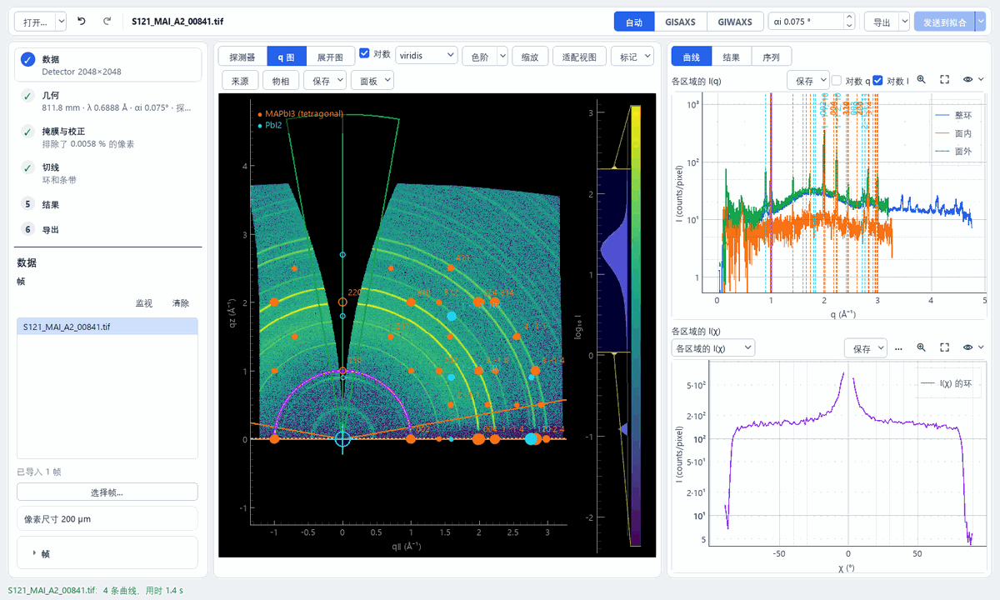

**衍射点**（Reflections）。表中列出每个显示物相的纤维织构衍射点或环：hkl、d、q、q∥、qz、χ、多重度 m、|F|² 和以最强者为 100 的
相对强度。用 Ctrl+C 复制。选中一行后按 **这个环的极图**（Pole Figure of This Ring）：I(χ) 的环移到该衍射上，并以该衍射的 χ0 拟合极图。

**极图**（Pole Figure）。将 I(q) 上的紫色带移到环处，选择**拟合极图**（Fit Pole Figure）。拟合把减去背景的像素平均强度折叠到
|χ|，采用 N(χ) ∝ [I(χ) − b] sin χ。**自动**（Automatic）在径向像素平均强度上拟合高斯峰与局部直线背景以确定 b，拟合失败时改用
邻近分箱。也可以输入 b。拟合采用**掩膜与校正**中的最低出射角，还可通过**拟合到 χ**（Fit up to χ，默认 90°）进一步限制范围。

为有取向的晶粒选择**模型**（Model）。**高斯 + 各向同性**（Gaussian + isotropic）是在以 χ0 为锥角的圆锥周围按极角呈高斯分布。
**高斯镶嵌分布 + 各向同性**（Gaussian mosaic + isotropic）描述绕优选轴的高斯角度展宽。
**Maier–Saupe + 各向同性**（Maier–Saupe + isotropic）描述密度正比于 exp(m cos²γ) 的轴向有序分布，γ 为与优选轴的夹角。
后两者均对倾斜轴的全部方位角求平均。在**方向**（Direction）下，可固定为沿法线或面内，输入 χ0 或拟合方向。

先将实测分箱的 f 与相同分箱的各向同性参考值 f_iso 对照。上下限分别注明对未测角区和衰减分箱的哪种处理给出最小和最大 f。可再与包含缺失楔的完整拟合分布的 f 对照。图中显示实测点和拟合曲线。结果给出取向分数 1 − φ、半高宽、χ0、二维有序度
和约化 χ²。取向分数取决于背景 b。拟合未收敛、约化 χ² 大于 5、被拟合的参数达到边界或半高宽大于 100° 时，结果标为
“极图拟合未能确定取向”，同时给出原因。该拟合的楔区补全结果不计入实测 f 的系统范围。报告还列出紧邻出射角截止位置而被排除的连续弱分箱 |χ| 区间。

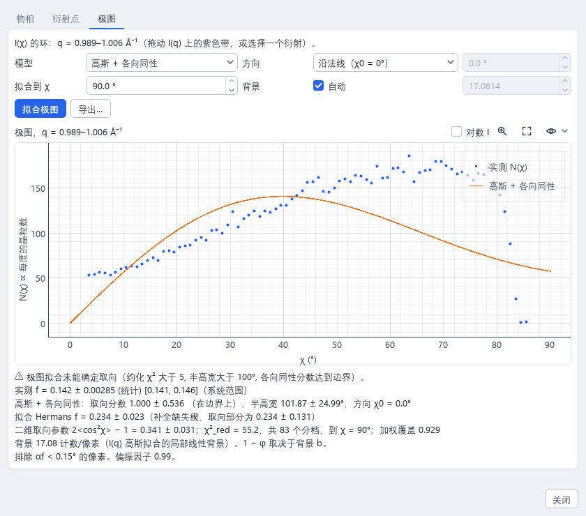

**导出…**（Export…）把极图写成 CSV（`<帧>_pole_figure.csv`，默认在数据旁边的 `gimap_analysis/` 中），旁边写
`<帧>_indexing.json`：物相（带 CIF 及其 SHA-256）、衍射表、设置和拟合结果。CSV 表头和 JSON 均记录实测 f、f_iso 和决定系统变化上下限的情形。

**晶体取向（依据物相）**（Crystal orientation (from phase)）。在**物相**（Phases）中勾选要分析的物相。
在**极图**（Pole Figure）的**模型**（Model）中选择**晶体取向（依据物相）**，按**拟合晶体取向**（Fit Crystal Orientation）。
GIMaP 在 I(q) 中寻峰，将每个物相可用的已指认衍射环联合拟合。各环分别使用自己的局部背景和强度比例因子，
同一物相的各环共用一个取向分布，其中可含各向同性晶粒和最多两组取向晶粒。
各组分别拟合平行于衬底的晶面和镶嵌展宽半高宽。展宽较窄和较宽的两组晶粒可以有相同的择优晶面。
若所测反射只有一个独立的极点方向，可检验同一根纤维轴上有一种或两种展宽的模型。
要设置单个环的窗口，可在拟合前将紫色带移至其峰处。
若带内有多个已检出的峰，各峰保留自己的窗口。自动分析根据径向峰计算各环窗口。
若可用 CIF 中的组成和实测波长下的散射因子求出薄膜光学常数，模型将计入出射透射因子 |T|²，贴近样品平面的实测分箱也可参与拟合。
用户明确设置的最低出射角和**拟合到 χ**（Fit up to χ）仍然有效。缺少光学常数时，采用常规的最低出射角限制。
一个窗口含有多个物相的衍射时予以排除。同一物相在窗口内的各个反射共同贡献于拟合曲线。

在**显示衍射环**（Show ring）中选择物相和 q 值。点为实测 N(χ)，实线为联合拟合，虚线为各反射族的贡献，含各自所占的各向同性部分。
图例中的百分比为各反射族对该环强度的贡献比例。
请先查看**已确定取向**（Orientation determined）或**未能确定取向**（Orientation not determined）的判断。
对每组取向晶粒，面板给出拟合得到的平行于衬底的晶面 (h k l)、镶嵌展宽半高宽（度）和占该物相全部晶粒的百分比。
± 后为统计标准误差。各组的百分比之和为**取向晶粒合计**（Total oriented）。
可查看次优纤维轴、两种模型之间的 ΔBIC，以及联合拟合和所示衍射环各自的约化 χ²。
若未能确定取向，列出的晶面、展宽和分数仅描述此次试拟合。晶体 Hermans 因子描述拟合得到的纤维轴分布，
此环实测 f 描述该环实测角度内的取向。计入出射透射因子时，面板还显示薄膜的 δ 和 β。
**导出…**将所选衍射环与各反射族的贡献写入 `<帧>_crystal_orientation.csv`，将各物相拟合结果、设置和来源写入
`<帧>_crystal_orientation.json`。提供物相时，自动分析报告也包含**晶体取向**（Crystal orientation）一节，JSON 中对应 `crystal_orientation`。

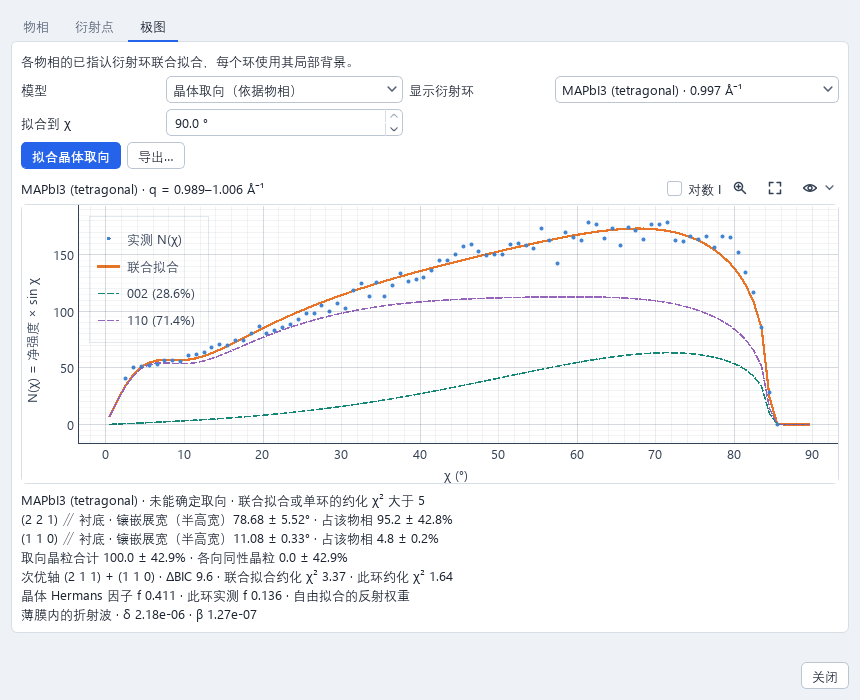

**在自动分析中。** 显示有物相时（或命令行给出 `--phase FILE.cif`，多个物相重复给出），**运行自动分析**（Run Automatic Analysis）
把每个峰指认到 max(3σ, FWHM/2) 以内最近的衍射：**结果**（Results）的 **峰**（Peaks）表增加 **物相**（phase）、**hkl** 和
**Δq** 三列。hkl 标记为**多种可能**（ambiguous）表示窗口内有两个或更多候选衍射。将鼠标移到 hkl 上可查看备选，移到 Δq 上可查看
窗口和晶面间距的相对偏差 Δd/d。**未指认**（Unassigned）表示没有匹配的衍射。报告的**物相指认**（Phase assignment）一节列出这些结果并
说明所用的 q 轴，采用折射校正时也给出薄膜临界角。入射角高于薄膜临界角时，透射和反射通道可能使环分裂。
每个分析的环在 Hermans f 旁边还给出极图拟合。公式见 [物理与方法 7.10 和 7.11 节](Physics_Manual_zh.md#710-衍射点叠加与物相指认)。

## 6. 拟合

**拟合**（Fitting）页用颗粒模型拟合一维曲线。页面顶部切换两种方式：

- **单条分析**（Single analysis）——一条曲线，分四步（6.2 节）。
- **批量 / 原位序列**（Batch / In-situ series）——用单条分析的模型拟合所选文本曲线（包括同一文件中的多列强度）、
  一个文件夹里的每条曲线，或一个探测器序列的每一帧（6.5 节）。

来回切换时，两边各自的曲线、模型和结果都保留。没有打开曲线时，曲线步骤并排给出两个入口：**打开曲线…**（Open Curve…）
和**拟合一个文件夹的曲线…**（Fit a Folder of Curves…）。一个序列或一批样品通常这样做：先在这里拟合一条有代表性的曲线
（先预测参数，再精修），然后在结果里按**拟合此文件夹的每条曲线…**（Fit Every Curve in This Folder…）。
要选择多个 TXT/DAT 文件或读取共用 q 的多曲线表格，可用任一页面命令栏或**拟合**菜单里的**导入曲线…**（Import Curves…）。
把多个曲线文件拖到单条分析页上也会打开同一个导入预览。

拟合页内部用 nm⁻¹，每个坐标轴和输入框都标明单位。分析页用 Å⁻¹；它为拟合写出的曲线文件也是 Å⁻¹，打开时自动换算。

从 0.0.2 版过来的用户：原 Cut & Fitting 页的探测器部分现在由**分析**（Analyze）页承担，它写出拟合页要拟合的曲线。

| 原 Cut & Fitting 的控件 | 现在 |
|---|---|
| Import image、Previous / Next | 分析页的文件列表 |
| Detector parameters | 分析页的仪器配置（**几何…**（Geometry…）、**标定…**（Calibrate…）） |
| Find Yoneda & Set Cut、cut 厚度 | 分析页自动的水平切线（拖动条带或输入行号） |
| Optimize Center X | **分析 ▸ 光束中心 ▸ 按对称性细化 x**（Analyze ▸ Beam centre ▸ Refine x by Symmetry） |
| Mask negative pixels + guard | **掩膜与校正**（Mask & corrections）步骤 ▸ **校正**（Corrections，折叠）▸ **缝隙保护**（Gap guard，默认 3 px） |
| Stack | **数据**（Data）步骤 ▸ **帧**（Frames，折叠）▸ **求和**（Sum） |
| Cut region width | 拟合页的**拟合范围**（Fitting range） |
| In-situ CBF / NXS 序列 | 分析页 ▸ **把序列发送到拟合…**（Send Series to Fitting…），或直接在**批量 / 原位序列**里用这些帧（6.5 节） |

### 6.1 拟合页读哪些曲线

拟合页读 `.dat`、`.txt` 和 `.csv` 文本曲线，以及 NXcanSAS 文件（`.h5`）：

- 分析页的曲线文件 `<name>_fit_input.dat` 有四列——q（Å⁻¹）、强度、σ、参与平均的探测器像素数——文件头记录曲线的来源。
- 其他列为 `q I [σ]` 的 `.dat` / `.txt` 文件也能打开。文件头注明了 q 单位的文件按注明的单位读取——`#` 行里的
  `q in <单位>`，或第一列的列名（`q (1/A)`、`q_nm^-1`、`# columns: qy (1/A) …`、`# q [1/nm]  I`）；分析页的曲线文件注明 Å⁻¹。
  没有注明单位的文件，在**曲线 ▸ 文件 ▸ 文件头未注明时的 q 单位**（Curve ▸ File ▸ q unit of files without one in their header）
  里设（默认 Å⁻¹，一维预测窗口也是）。文件头同时注明 Å⁻¹ 和 nm⁻¹ 的文件打不开：*文件头同时注明了 q 的单位 1/A 和 1/nm；请改成只注明一种单位。*
  没有注明单位的文件总会说明这一点——*q 的单位是假定的：Å⁻¹（文件里没有注明）。如果它的 q 其实是 nm⁻¹，得到的每个长度
  （R、D）都会差 10 倍……*，并写出怎样改——在曲线卡片、拟合步骤、打开曲线时的状态栏，以及结果步骤里数值的旁边。
  按所设单位读出的 q 范围对 GISAXS 或 SAXS 切线还不合理时（|q| 超过 10 nm⁻¹ = 1 Å⁻¹，或整条曲线都在 0.02 nm⁻¹ 以下），
  警告改为说明这一点，以及它对每个长度的影响（R 和 D 小了或大了 10 倍）。列名行上面的标题行同样算文件头；读不成数字的行，
  以及含 NaN 或 inf 的行被略去，卡片和状态栏写明有多少行（*文件里有 3 行无法读成数字，已被略去。*）。
- NXcanSAS 文件（`.h5`，由分析页、SasView、Mantid 等程序写出的 HDF5；`.hdf5` 和 `.nxs` 通过“所有文件”选择）：文件里每个
  SASdata 组是一条曲线，读取 Q、I、作为强度 σ 的 Idev，以及文件提供的高斯分辨率 Qdev。q 按文件在 Q 上注明的单位读取：1/angstrom 和 1/nm 原样读取，1/m 换算为 nm⁻¹；
  曲线卡片写明 *q 按 Å⁻¹ 读取：文件中注明*。拟合页不认识的 Q 单位，按文件头未注明单位的文本文件处理。文件的掩膜排除的点不参与拟合。
  含多条曲线的文件会问打开哪一条（**打开曲线…**、拖入的文件），之后名为 *文件.h5 · curve 2*；**导入曲线…** 取其中的每一条。
  拟合结果的文件（保存 ▸ 数据与拟合，原位序列的**拟合结果（NXcanSAS）…**）每条曲线含拟合的数据点和模型：只提供其中的测量曲线
  （默认选第一条；只有一条时直接打开），**导入曲线…** 也只取这些，所以一个序列的拟合结果可以再作为序列打开。
  装探测器帧的 HDF5 文件不是曲线：拖到窗口上会交给分析页。

`.csv` 文件按表头的列名读取，不按列的位置：q 是名为 q 的列（`q`、`qy (A^-1)`、`q_nm^-1`……），I 是名为 I 或
intensity 的列，σ 是名为 sigma、σ、err 或 dI 的列，q 的高斯宽度取自 dQ 或 sigma_q 列。其他列（模型、残差、各项、像素数）不读。所以命令行写出的
切线（`horizontal.csv`，列名在最后一个 `#` 行里）、分析页的曲线表格，以及拟合页自己 **保存 ▸ 数据与拟合…** 写出的表格——其中
q 出现两次，先是 nm⁻¹，再是 Å⁻¹：取第一个，按 nm⁻¹——都能直接打开。q 按它那一列的名字写明的单位读取。没有表头、只有两三列
的 CSV 像 `.dat` 文件一样按 `q I [σ]` 读。表头说不清时（两列强度、两个方向的 q，或没有表头而列更多），**选择列**（Choose
Columns）像**导入曲线…**一样显示表头和前十行，问哪一列是 q、I 和 σ（或没有 σ），q 列的名字没有写明单位时还问 q 的单位。
拟合的记录写明读了哪些列（`curve.columns_read`）。

没有列名的单曲线文本文件按 `q I [σ]` 读取。要提供高斯分辨率，请标明列名，例如 `# q_nm^-1 I sigma dQ`。
dQ 是一个标准差，未单列单位时使用 q 列的单位。分析页输出的第四列是像素数。
要把 `q I1 I2 …` 拆成多条曲线，请明确使用**导入曲线…**。

**导入选定文件或一个文件里的多条曲线**

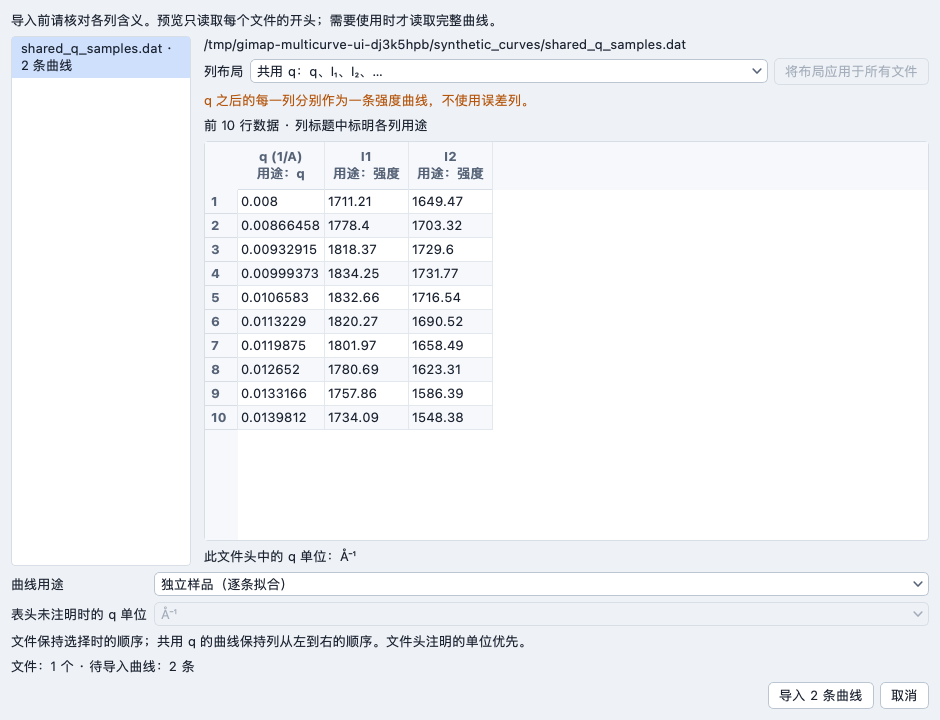

1. 点击**导入曲线…**，选择一个或多个 `.txt` / `.dat` 文件，或 NXcanSAS `.h5` 文件。可取消的预览显示前十行数据、各列用途、
   q 单位和曲线总数。不会改写原文件，也不会生成拆分文件。NXcanSAS 文件给出其中的每一条曲线（每个 SASdata 组一条，按文件中的
   顺序；显示的是第一条的行）：列布局对它不适用。
2. 逐文件核对**列布局**（Column layout）：

   | 布局 | 解释 |
   |---|---|
   | **单条曲线：q、I、可选 σ**（Single curve: q, I, optional σ） | 第 1 列为 q，第 2 列为 I，第 3 列（存在时）为 σ。 |
   | **共用 q：q、I₁、I₂、…**（Shared q: q, I₁, I₂, …） | 第 1 列为共用 q；其余每列各是一条强度曲线，没有提供 σ。 |

   `q I sigma` 或 `q I1 I2` 这样的明确表头会给出对应布局建议。表头无法明确判断时仍默认**单条曲线**：
   单凭数值无法区分 σ 和 I₂，需要时请自己选择**共用 q**。列一致的文件可用**将布局应用于所有文件**（Apply layout to all）。
   明确标为误差的列（例如 `sigma`、`sigma1`）受到保护，不能通过共用 q 模式当作强度导入。
   明确标为强度的列也不能当作 σ；误差列出现在其他位置的混合布局，需要整理成支持的布局后再导入。
   带 GIMaP Analyze 标记的 `q I sigma pixels` 导出始终保留为一条曲线，不能把 sigma 或像素数当强度列导入。
   此入口不支持每条曲线交错带误差的 `q I1 sigma1 I2 sigma2`。
3. 选择**曲线用途**（Use curves as）：默认**独立样品（逐条拟合）**（Independent samples (fit each curve)），
   每条曲线都从单条分析中的同一个模型开始；阶段检测、跳过异常帧、曲线之间的连续性约束均关闭且不可选。
   **时间序列（按文件和列的顺序）**（Time series (file and column order)）按预览中的文件顺序、再按从左到右的列顺序处理；
   请核对这是否就是实验顺序。此模式开放原有序列选项（6.5 节）。
4. 设置**表头未注明时的 q 单位**（q unit when absent from the header），初值取自单条分析；每个文件头注明的单位优先。
   点击**导入 N 条曲线**（Import N curves），在**批量 / 原位序列**打开固定的选择。选一条代表曲线，点击
   **在单条分析中打开这一帧**（Open Frame in Single Analysis）设置或精修模型，然后返回按**开始**。
   拟合范围和排除的点也取自单条分析，开始前请核对。

列表和结果用文件名与强度列区分曲线。项目保存精确的文件选择与列映射（包括表头名称），重开时会报告丢失的文件或变动的列。
CSV、JSON 导出保留源文件和所选 q/I/σ 列。在单条分析中打开一条映射曲线后，其拟合记录也保留这些来源；
**从此文件导入曲线…**（Import Curves from This File…）可回到预览。原文件必须仍然可读。
固定选择不能**监视新曲线**：要换文件或列请重新导入；监视普通单曲线文件请使用文件夹模式。

未提供 σ 就保持缺失：精修和搜索对 ln I 等权拟合，不编造计数误差；预测参数则按 ln I 相对其趋势的离散取一个相对 σ（6.4 节）。
每条导入曲线的 q、I 和所提供的 σ 始终按行对齐；某一强度列中的无效值不删除另一条曲线的有效点。

其他单曲线入口：

1. 命令栏里的**打开曲线…**（Open Curve…，拟合页显示时按 `Ctrl+O`），或把曲线文件拖到页面上。
2. **分析页 ▸ 发送到拟合**：写出 `<name>_fit_input.dat` 并在这里打开。分析页选的两半对应拟合页的**切线的两半**（Halves of the cut）：

   | 分析页 | 拟合页 |
   |---|---|
   | 两半都画在 \|qy\| 上（两种颜色）（Both halves on \|qy\| (two colours)，默认） | \|q\| 上的两半（Both halves on \|q\|） |
   | 两半取平均（Mean of both halves） | 两半取平均（Mean of both halves） |
   | qy < 0 半边（qy < 0 half） | q < 0 一半（q < 0 half） |
   | qy > 0 半边（qy > 0 half） | q > 0 一半（q > 0 half） |

   数据旁边的文件夹写不了时，分析页让你另选一个文件夹，并在本次会话里记住它。GIWAXS 的 I(q) 打开时，页面顶部有一条提示：
   拟合页的模型是 GISAXS 水平切线的颗粒形状因子，不描述衍射峰，所以不为它推荐方法（峰用**分析 ▸ 批量导出 ▸
   环区域中的峰**）。

3. GISAXS 自动分析之后（5.5 节），**分析页 ▸ 结果 ▸ 拟合细节 ▸ 在拟合中查看**（Results ▸ Fit details ▸ Show in Fitting）：
   打开同一条曲线，并把选中的解放进**模型**（Model）。自动分析用的就是拟合页自己的模型（预测参数，尺寸分布*高斯，按数目*），
   所以解原样进入模型；状态行写出模型与该解自己的曲线相差多少。**在拟合中精修**（Refine in Fitting）只打开曲线，不带解。

### 6.2 单条分析：一条曲线，四步


*预测参数后，结果页并列显示最小二乘值和后验中位数。右侧为曲线、模型和残差。*

布局和分析页相同：左边是步骤，每步写出当前状态；右边是图。

- **曲线图**：数据点（拟合范围外的颜色较淡）、整条曲线上的模型、拟合范围的**橙色条带**（可拖动）。
  **组分**（Components，初始不勾选）显示可相加的强度贡献：颗粒、常数背景和存在的光束尾项／低 q 项。
  总模型用较醒目的实线，各项贡献用较细的虚线或点线；点**组分**旁的箭头可以逐项选择。
- 下面的**残差图**根据所选强度权重显示 (I − model)/σ，对数拟合则显示 ln(I/model)。
- **命令栏**：**打开曲线…**（菜单里有**载入模型…**（Load Model…））、**撤销 / 重做**（Undo / Redo，`Ctrl+Z` /
  `Ctrl+Shift+Z`：模型、拟合范围或排除的点的每次改动都是一步，每次拟合、选用解、载入模型也各是一步）、**拟合**（Fit，`Ctrl+Return`）、**停止**（Stop）和**保存**（Save：**数据与拟合…**、
  **曲线图…**、**模型…**、**解…**）。撤销或重做之后，状态行写出是哪一步（*已撤销：拟合（精修）。*），两个按钮的提示写出
  它们将撤销或重做的那一步（*撤销：解 2 放入模型（Ctrl+Z）*）。

显示或隐藏组分时，当前 x/y 坐标范围保持不变，包括手动缩放。默认的自动范围和**重置**（Reset）只参考数据与总模型；
较小的组分尾部可能低于可见范围。要查看这些尾部，在组分菜单中勾选**组分参与自动缩放**（Include components in auto range）。
更改这个选项会立即重置视图，之后按**重置**也遵循这项选择。对数轴无法显示零值或负值；程序不会为显示而平移、
设定正数下限或归一化这些数值。这些选择只影响显示：拟合、残差和**保存 ▸ 数据与拟合…**仍使用完整模型并保留全部贡献。
组分曲线表示相加后得到总模型的强度，不是颗粒占比。批量拟合的结果可用**在单条分析中打开这一帧**
（Open Frame in Single Analysis）在这里查看组分。

**1. 曲线**（Curve）

- 卡片里：点数、q 范围（nm⁻¹；Å⁻¹ 在卡片的提示里）、*σ 来自文件*，以及 q 按什么单位读取及单位从哪里来（*q 按 Å⁻¹ 读取：
  文件中注明*，或 *……：文件中未注明：用“文件头未注明时的 q 单位”的设置*）。拟合按 1/σ 给每个点加权。σ 为零、为负或缺失的点
  不参与拟合，卡片写明有多少个（*有 4 个点的 σ 为零、为负或缺失，已被略去：它们无法加权……*）；只有参与拟合的点确实按
  文件的 σ 加权时，卡片才写 *σ 来自文件*。没有 σ 时，卡片里
  有一行警告写明每种方法怎么做——*⚠ 文件里没有 σ。预测参数：使用 3.4 % 的相对 σ，由 ln I 相对其趋势的离散估计。精修和搜索：
  拟合 ln I，每个点权重相同。*——拟合步骤里按所选的方法再说一遍。强度为负或为零的点会被数出来：有 σ 时它们和其他点一样参与
  拟合（*参与拟合的 400 个点里有 12 个强度为负或为零（9 个为负，3 个为零）：它们保留，按各自的 σ 加权……*，写在卡片里，
  打开曲线时也写在状态栏）；没有 σ 时它们不参与拟合，因为这些点没有 ln I，警告里写明有多少个。
- 怎样设拟合范围、**添加颗粒**（Add Particle）里有什么、每种方法做什么、怎样固定数值，都写在这些控件的提示里；步骤本身只说
  进行到哪里。
- **切线的两半**，用于穿过光束的切线（q < 0 与 q > 0）：**两半取平均**（两半都测到的地方取平均；一半有缺口处和它到头之后
  只用另一半，从不插值）、**|q| 上的两半**、**q > 0 一半**或 **q < 0 一半**。*预测参数*只能拟合一条曲线：选着 **|q| 上的两半**
  时它把下拉换成平均并说明；*精修*和*搜索*仍拟合两半。
- **拟合范围**，单位 nm⁻¹，也可以拖动橙色条带；**整条曲线**（Whole Curve）拟合所有点。
- 折叠的*文件*里：**文件头未注明时的 q 单位**（q unit of files without one in their header）——默认 Å⁻¹，原位序列也用它。
  文件头注明了单位的文件（分析页的曲线：Å⁻¹）按注明的单位读取，不管这里怎么设。改这个设置时，没有注明单位的曲线按新单位重新打开；
  注明了单位的曲线不变，状态行说明原因。项目和上次的会话保存曲线读取时用的单位和这个设置。之前保存的曲线照旧打开；
  只有文件头注明的单位与保存的不同时按文件头读取，状态行（项目则在打开项目的提示里）说明。
- **排除点**：打开图上方的**排除点**（Exclude），点一个点把它排除在拟合之外（再点一次恢复），或拖一个框排除框里的点。
  排除的点画成红色 ×，曲线步骤写出排除了几个，**全部恢复**（Include All）把它们放回。排除的点随曲线（和项目）保存，
  并写进拟合记录。

**2. 模型**（Model）

- **添加颗粒**（Add Particle）为每种颗粒加一张卡片：**球**（Sphere）、**随机取向圆柱**（Random cylinder）、
  **竖直圆柱**（Vertical cylinder）或**核壳球**（Core–shell sphere：半径 R 的核包在厚度 **t** 的壳里，核的衬度是壳的
  **ρc/ρs** 倍；用于精修和搜索，预测参数不会给出它）。
- 每张卡片有 **S(q)** 开关（相邻颗粒之间的干涉）。开启后，**干涉函数**（Interference）选择类型——**一维次晶**（1D
  paracrystal，默认：D 与 **σnn/D**，相邻颗粒间距的相对标准差）、**二维六方次晶**（2D hexagonal paracrystal：平面内
  无序的六方晶格，对取向取平均；D 与 σnn/D）或**硬球（Percus–Yevick）**（Hard spheres (Percus–Yevick)：半径 **R_HS** 与
  体积分数 **φ**）；后两种用于精修和搜索——以及**耦合**（Coupling）：LMA（P·S，默认）或 DA（尺寸与位置无关；
  [《物理与方法》9.5 节](Physics_Manual_zh.md#95-结构因子一维次晶)和[9.14 节](Physics_Manual_zh.md#914-手动拟合的模型)）。
  各个值：scale、R 与 **σR/R**，随机取向圆柱还有 h 与 **σh/h**，核壳球还有 t 与 ρc/ρs，以及干涉函数的数值。分布宽度一律
  是相对值（与分析页的结果和一维预测相同）。scale 是颗粒在 q = 0 处的强度：每种形状因子在那里都是 1。
  竖直圆柱有高度分布时，DA 对高度和半径分布都取散射振幅的平均，这会影响水平切线上结构峰的对比度。
- 每个值占一行：名称（提示里给出它在链接中的名称，如 `R_1`）、值、拟合后的 ± 误差、**下限**和**上限**（勾选**范围**时）、
  **拟合**和 **=**（链接）。两群颗粒在一屏之内。
- **精修**和**搜索**时，可为每群颗粒选择**尺寸分布**（Sizes）。默认的按数量高斯分布以 R 为中心，σ = R·(σR/R)，只取中心上下四个 σ 内的正半径。
  **对数正态，按数量（中位数）**（Log-normal, by number (median)）使用中位数 M 和 s = SD(ln R)；数量均值为 M exp(s²/2)，相对标准差为 √(exp(s²) − 1)。
  **舒尔茨（伽马），按数量**（Schulz (Gamma), by number）使用数量均值 R 和相对标准差 w，形状参数为 1/w²，尺度参数为 Rw²。
  结果给出分布归一化后的数量均值和相对标准差。打开旧模型时保留原来的分布。启用新的分布、权重或文件分辨率时，模型以
  `gimap_fit_model_v3` JSON 格式保存。
- 在**分辨率**（Resolution）中选择**恒定 σ_q**（Constant σ_q，0 表示不展宽）或**文件中的分辨率**（Resolution from the file）。
  后者对每一颗粒项在 |qᵢ + dQᵢ Z| 处的值取平均，Z 为标准正态变量。每个拟合点的 dQ 都须为有限的非负数；dQ 为 0 的点直接计算。
- 在**权重**（Weights）中，**σ 来自文件**（σ from the file）的残差为 (I − 模型)/σ，**相对（σ = I）**（Relative）的残差为 (I − 模型)/I，
  **泊松（σ = √I）**（Poisson）的残差为 (I − 模型)/√I。**无（拟合 ln I）**（None (fit ln I)）使用 ln I − ln 模型，默认选项在文件没有可用 σ 时也采用该式。
  相对、泊松和对数拟合只使用正强度。**保存数据与拟合**的记录和拟合报告均列出所选设置。[《物理与方法》第 9 章](Physics_Manual_zh.md#93-尺寸分布)

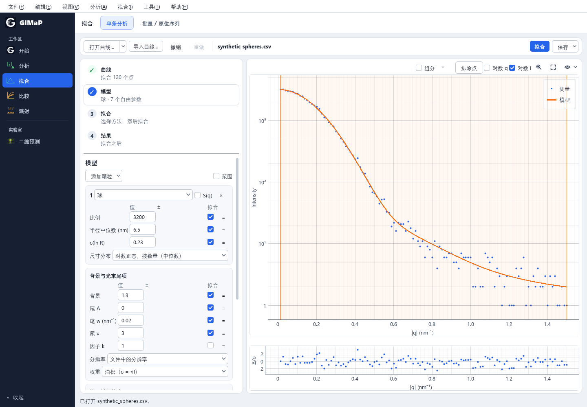

- 勾选**拟合**（fit）：拟合可以改这个值。不勾选：这个值固定不变。
- **=** 把这个值链接到另一个值（**等于**（Same as）：例如两群颗粒共用一个 σR/R）或其他值的表达式（**表达式…**
  （Expression…）：`2*R_1`、`R_1 + t_shell_1`；数、+ − * / **、sqrt、exp、log、min、max 等）。链接的值显示为灰色：编辑时
  和每次拟合中它都随其他值变化，自己不参与拟合，误差由其他值传递得到。**链接与约束**（Links and constraints）卡片列出每个
  链接（× 取消链接）、**粒子不重叠**（Particles do not overlap：两者都拟合时 D ≥ 2R、R_HS ≥ R；默认开启）以及不等式约束：
  **添加约束…**（Add Constraint…）接受例如 `D_2 >= 2*R_2 + 3`。链接和约束随模型保存，也写进拟合记录；删除一种颗粒时，读它的
  链接和约束一并删除（[《物理与方法》9.15 节](Physics_Manual_zh.md#915-参数之间的链接与约束)）。
- **范围**（Ranges）显示每个值的 min – max。拟合把值限制在范围内；*在范围内搜索*在整个范围里搜索。输入范围外的值会扩大范围。
  强度、背景等线性项的 **∞** 表示不设上限；取消勾选后可以输入有限的最大值。
- **背景与光束尾项**（Background and beam tail）：一个常数背景，q = 0 处的光束尾项 A / (1 + (|q|/w)^ν)（**尾 A**、
  **尾 w**、**尾 ν**（Tail A / w / ν）：直射束和反射束的经验尾巴），以及 q 分辨率 **σ_q**（默认 0，关闭）；整体因子 k
  （默认固定为 1）乘在颗粒和尾项上。尾项的范围随曲线而定：A 至多为最大强度的 10 倍，w 在 0.3 q_min 到
  min(30 q_min, q_max) 之间，ν 在 1 到 6 之间——用起始模型打开曲线时，以及精修或搜索从通用范围开始时设定（状态栏会说明）；
  你输入的范围保持不变。拟合之后，停在范围边上或没有有限误差的尾项会被标记（[《物理与方法》9.6 节](Physics_Manual_zh.md#96-参数与默认值)）。模型的公式，以及 **σnn/D** 与旧版本和一维预测的 σD/D 的关系，见
  《物理与方法》[9.2 节](Physics_Manual_zh.md#92-强度模型)和[9.5 节](Physics_Manual_zh.md#95-结构因子一维次晶)。
- **掠入射下的球**（Spheres in grazing incidence）：αi、αf、λ 和有效反射系数 |r|、arg r。αi = αf = 0（默认）时球按
  q_z = 0 计算，即有效界面近似，不需要任何基底信息。输入 αi、αf（切线所在的行）和 λ 后，球按直射路径加出射反射路径
  计算；把 |r| 和 arg r 设为自由即可拟合反射。手动拟合时，DA 对有高度分布的竖直圆柱也使用这些路径。输入了角度的拟合结束后，结果里给出每个球的 q₊R。
  数值下面的**基底**（Substrate）：*未知*（默认，即上面的几个层次）、表中的材料（**Si**、**SiO₂**、**玻璃（平板玻璃）**、
  **Au**：切线波长下的 δ 和 β，4.9–30 keV）或**输入 δ、β**。选了基底并给出两个角度时，球按基底菲涅耳系数的四项 DWBA 计算
  （此时不用 |r| 和 arg r）；下面一行说明正在用的层次（*层次：四项 DWBA（已知基底），基底 Si（… δ = …，β = …）*）。预测参数
  不用基底，它的解返回时不带基底（[《物理与方法》9.17 节](Physics_Manual_zh.md#917-已知基底的四项-dwba)）。
  什么时候用哪一种，以及在 Si 和聚合物膜上的例子，见《物理与方法》[9.10 节](Physics_Manual_zh.md#910-水平切线里的球和圆柱有效界面近似)；
  三群拟合怎样读，见[9.11 节](Physics_Manual_zh.md#911-三群模型)。
- 拟合之后每个值显示 ± 误差；停在范围边上的值显示橙色的 *⚠ 到达边界*（at a bound；见 6.3 节的*停在范围边上的值*）。

新安装从一个中性的模型开始，不带以前某次拟合的值。请按你的样品设颗粒类型和尺寸，或者让拟合步骤去找。

**3. 拟合**（Fit）——一个**方法**（Method）下拉框，一个按钮。**方法**有三项：**预测参数**（Predict parameters：GIMaP 的
网络，再做最小二乘）、**精修模型中的数值**（Refine the values in Model）和**在范围内搜索，再精修**（Search the ranges, then
refine）（6.3 节）。

- 打开曲线时，页面替它选好方法。还没拟合过的 GISAXS 水平切线选**预测参数**，**方法**下面一行写出原因：*推荐用于这条曲线：
  尚未拟合的 GISAXS 线切。*其他曲线保持原来选的方法（GIWAXS 的 I(q) 从不推荐方法）。预测之后，方法自动换成
  **精修模型中的数值**。万一缺少 GIMaP 的网络，方法下面一行会说明，并写出缺少的文件名（14.3 节）。
- 方法下面只多出它需要的：预测参数下面是**粒子**（Particles，6.4 节）。
- 按命令栏的**拟合**（`Ctrl+Return`），或下面那个以方法命名的按钮（例如**精修**（Refine））。运行时显示进度条和**停止**。
  **精修**和**搜索**只要 χ²ᵣ 下降超过 0.1 % 就从自己的结果继续（最多再运行 5 次；运行日志和报告写明几次），所以拟合不再停在
  第二次精修才能到达的极小值上方。
- 折叠的**选项**（Options）里：**最多计算次数（精修、搜索）**（Evaluations at most (Refine, Search)，默认自动）和
  **一维预测批量窗口…**（1D Predict Batch Window…，6.4 节）。

**4. 结果**（Results），从上往下：

- 质量：χ²ᵣ（有 σ 时）或 ln I 的方差（没有 σ 时）、点数、自由参数个数、是否收敛——精修（Refine）或搜索（Search）试过的
  曲线没有一条比起始曲线更好时，写的是*未能比起始值更好（保留起始值）*：起始值保留，不算收敛，也不给误差（没有 σ 时，
  起始值对 ln I 的描述已经好过拟合自己求比例因子得到的任何曲线，就会这样；改一个值，或用搜索）。点数少于自由量个数加一的
  曲线（*拟合范围内只有 5 个点，却有 9 个自由量：拟合至少需要 10 个点……*）和没有强度大于零的点的曲线，精修和搜索会拒绝。预测参数之后这里写出有几个解、最可能的
  已放进模型，按**精修**得到它的质量和每个值的误差。
- 下一步：**精修这些数值**（Refine These Values，预测之后）、**再拟合一次**（Fit Again，同一方法，用模型里现在的值、
  固定的值和范围）和**拟合此文件夹的每条曲线…**（Fit Every Curve in This Folder…，对这条曲线所在的文件夹打开原位序列，
  每条曲线从这个模型开始）。
- **拟合详情…**（Fit details…）在独立的非模态浮窗中显示边界诊断、相关性和假设；预测参数之后还给出模型中那个解的后验（6.4 节）。
  常规诊断不再把完成的预测标成黄色警告。
- **不确定度与报告…**（Uncertainty and Report…，精修或搜索之后）：**误差与相关**（Errors and correlations）列出每个自由值和
  链接值的 1σ 误差，以带数值的热图显示相关矩阵，并列出 |r| > 0.9 的参数对；**χ² 剖面**（χ² profile）把一个值依次固定在网格
  各点上、重新拟合其他值，给出 Δχ² = 1 的区间（**计算剖面**（Run Profile）、**停止**）；**拟合报告**（Fit report）以
  Markdown、HTML 或纯文本显示报告——数据文件及其 SHA-256、q 范围、模型、每个值 ± 误差及其状态、χ²ᵣ、相关的参数对、设置——
  可以**复制**或**保存报告…**（Save Report…）（[《物理与方法》9.16 节](Physics_Manual_zh.md#916-精修和搜索之后的不确定度)）。
  曲线无法确定的值（误差不是有限数，或超过数值的 10 倍）在表格和报告中标 ⚠。
  对预测参数的解，**后验检验（MCMC）**（Posterior check (MCMC)）用第二种抽样器对同一后验抽样（似然、模型误差和先验相同），
  检验此模态的蒙特卡罗精度。对精修或搜索的结果，抽样对象为拟合的似然。**运行检验**（Run Check）启动两个独立系综，
  分别从分散的重要性样本出发，样本不足时从先验盒补齐。**步数**（默认 3000）和**行走者**均指每个系综。
  **种子**使运行可复现，**停止**保留已完成的步数。表格把 MCMC 中位数及 68 % / 95 % 区间与预测参数抽样得到的区间
  （有这些区间时）或最小二乘参照区间比较。一起查看自相关时间 τ 和跨系综的分段 R̂；每个值在每个系综保留的步数都至少达到
  50 τ、且 R̂ 都低于 1.05 时，结论为已收敛。68 % 区间互不重叠的值标 ⚠。**轨迹：**（Trace of）逐步绘制一个值。
  **保存检验…**（Save Check…）将运行及诊断写成 JSON。拟合报告列出当前模型和数据对应的检验。见[《物理与方法》9.19 节](Physics_Manual_zh.md#919-用-mcmc-检验后验)。

  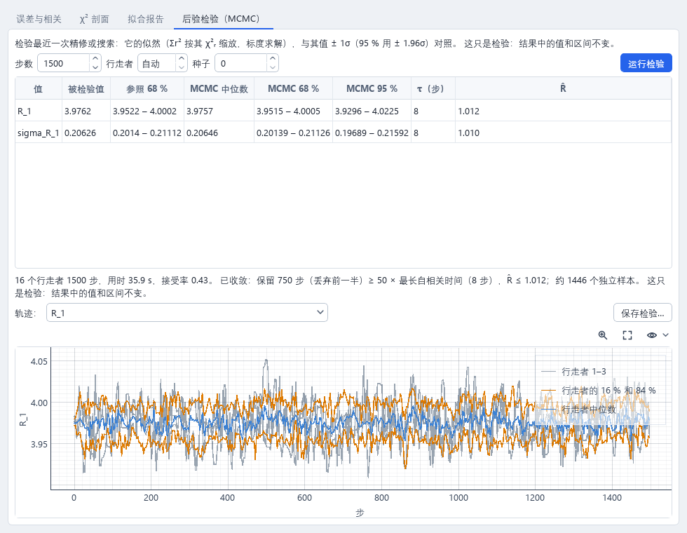

  *预测参数后的短时间检验显示两种采样器得到的区间、τ 和拆分 R̂。本例中的系综尚未收敛。*

- 有几个解时（预测参数的，或分析页的），参数表上方的下拉框切换一整套解：参数、误差、总曲线、组分和残差一起更新，
  不把不同解的单个参数端点拼在一起。导出记录标明所选解。每一项写出解的编号和名字——两个解组成相同时加编号（*球 #1*、
  *球 #2*）——以及它的 χ²ᵣ、p 和简短的标记（*⚠ 在边界：尾 ν*；悬停可看完整的句子）；预测被停止时保留的解标为*不完整*。
  **精修这些数值**之后，第一项是这次拟合（*由解 1 重新精修（精修）· χ²ᵣ 1.04*），质量框写明数值来自对解 1 的新一次精修，
  不是预测给出的；那个解自己的数值和区间仍在下面。
- 右键曲线里的**显示组分**（Show components）和**组分**（Components）可分别显示各群粒子、常数背景和低 q 项，只改变显示，不改变拟合及科学数组。
- 各个值 ± 1σ 误差（解处的协方差，按 χ²ᵣ 缩放）。模型中是预测参数的解、之后还没有拟合时，± 是这个解 68 % 后验区间宽度的
  一半（提示给出区间，列名的提示说明是哪一种 ±）；标度和背景显示 **–**：预测参数对每个样本直接求解它们，没有区间。选中若干值，按**固定**（Fix）、**参与拟合**（Let It Fit）或**范围…**
  （Range…）（右键也一样）：下一次**再拟合一次**就用上。**范围…** 在模型里显示这个值的 min – max。拟合没有给出误差的
  自由值显示 **–**，它的提示说明原因（在范围的边界上、所属颗粒群的比例或尾 A 为 0，或曲线不约束它）。
- 折叠的**其他解**（Other solutions）：*预测参数*给出的解，各带它的 χ²ᵣ 和概率 **p** 或 **BIC 权重**（两列列名的提示给出它们的定义；
  每一行的提示说明 χ²ᵣ 按多少个点计算）。R 和 D 列出每一群颗粒的值，按半径从小到大（`3.06 / 6.02`、`49.4 / –`）；同一种组成的
  两个解在提示里写出它们在哪些数值上不同（σnn/D、σ_q……）。从 **在拟合中查看**（Show in Fitting）带来的解显示分析工作区
  那次拟合的 χ²ᵣ（5.5 节），直到你在这里拟合。
  **使用这个解**（Use This Solution）把它放进模型（撤销可以换回原来的模型）。**导出解…**（Export Solutions…，也就是
  **保存 ▸ 解…**）写出每个解：`<curve>_solutions.csv`（每个解的每个参数一行：组成、概率、χ²ᵣ 及其点数、标记、是否不完整，
  以及数值、后验中位数、68 % 和 95 % 区间和最小二乘误差）、`<curve>_solutions.json`（保存数据与拟合的记录，每个解都在
  `predict` 下）和 `<curve>_solutions_curves.csv`（拟合的点，以及每个解的模型、残差和各项）。
- **保存数据与拟合…**（Save Data and Fit…）写出 CSV——q（nm⁻¹ 与 Å⁻¹）、I、σ、模型、残差和每一项——旁边是 JSON 记录：
  模型、拟合（误差、处于边界的值、相关）和用到的点；预测参数之后还有每个解（`predict`：组成、概率、χ²ᵣ、标记和每个数值及其
  中位数与区间）。文件类型选 **NXcanSAS (*.h5)** 时写出含两个 SASentry 的 HDF5 文件：
  拟合用到的点和模型，Q = |q|，单位 1/nm。Idev 是拟合实际采用的 σ，启用文件分辨率时还写出 Qdev，此时 CSV 也包含以 nm⁻¹ 表示的 dQ。
  记录既在旁边，也在文件里。**保存图…**（Save Plot…）把曲线和残差写为浅色 PNG、SVG 或 PDF，显示所选模型项和拟合范围的底色；
  采用文件 σ 加权时显示实测误差棒。**保存模型…**（Save Model…）
  把模型写成 JSON，可以用**载入模型…**给另一条曲线用。
- 最下面是折叠的**运行日志**（Run Log）。

要检查的地方：

- 拟合属于做拟合时的那条曲线和那些点。之后改了两半、拟合范围或排除的点，拟合和结果步骤会写
  *拟合后已更改：请重新拟合*（Changed after the fit: Fit again）。
- 打开另一条曲线会停止正在进行的拟合；在那之后才结束的拟合不保留，状态行会说明。
- 保存失败（例如文件只读）时，原来的文件不变，并说明原因。

模型、方法和各项选择（包括**粒子**）下次启动时恢复，上次的曲线也会重新打开。若启动过程中收到另一条曲线，以新曲线为准。

### 6.3 拟合方法

一个**拟合**按钮执行**方法**里选中的方法。拟合页只有一种网络方法，即**预测参数**，另有两种按模型现状做最小二乘的方法：

| 方法 | 做什么 | 什么时候用 |
|---|---|---|
| **预测参数**（Predict parameters） | GIMaP 的网络给出组成和数值；拟合页的模型按曲线给它们加权（后验），每个解再用最小二乘精修。每个解都带它的概率和每个值的 68 % 区间（6.4 节）。 | 颗粒或尺寸未知的 GISAXS 切线，并说明每个解有多大概率、曲线把每个值约束得多好。还没拟合过的 GISAXS 切线默认选它。 |
| **精修模型中的数值**（Refine the values in Model） | 从模型里的值出发，用拟合页自己的模型做有界最小二乘，停在附近。 | 模型已经接近：预测或选用解之后、从分析页来之后，或者要误差时。 |
| **在范围内搜索，再精修**（Search the ranges, then refine） | 在自由参数的范围内做差分进化（范围跨 10 倍以上时按对数），再从最好的三个起点精修。 | 起点差，但知道颗粒类型和合理的范围。较慢。 |

- 各 scale（每种颗粒的 scale、背景、峰的 A）每一步都按上下限求解（有界加权最小二乘），所以搜索只改尺寸、分布宽度、间距和峰的形状。
- **停止**：*精修*和*搜索*保留目前最好的值。停止*预测参数*不产生新结果。
  即使停止发生在结果等待显示期间，也记录为已停止，不声称已经收敛。

**停在范围边上的值。** 对精修和搜索，模型中的固定值和上下限都是硬限制，包括粒子强度比例和全局项：它们不会自动放宽范围，
也不自动固定自由参数，也没有这样做的选项。停在范围边上的值写在**拟合详情…**里（*…… 停在了范围的边界：请放宽范围或固定它。*）：
在模型里改它的范围（**范围…**）或固定它，再按**再拟合一次**。预测参数不使用模型中的固定值和范围：它的网络看自己所知的整个范围，
处于这个范围边界的值会标出（6.4 节）。

### 6.4 预测参数与一维预测

**预测参数**（Predict parameters）从曲线找出一条切线里的颗粒和它们的数值。它是拟合页唯一的网络方法。GIMaP 的网络在拟合页
自己模型的模拟切线上训练，它给出组成和数值；模型按实测点给它们加权（后验），每个解再用最小二乘精修。每个解都带有它的概率，
以及每个值所在的范围（它的 68 % 区间）。区间和概率允许模型在每个点上有强度 5 % 的误差，因为拟合页的模型只能把实测曲线描述到
百分之几；拟合本身和它的 χ²ᵣ 用曲线自己的 σ。网络（约 13 MB）随 GIMaP 提供，用 numpy 运行：不需要另外安装任何东西。方法和它的基准见
[《物理与方法》9.13 节](Physics_Manual_zh.md#913-预测参数)。

- **拟合页里打开的曲线**：拟合步骤的方法**预测参数**（见下）。
- **一组曲线文件**：**工具 ▸ 一维预测——拟合多条曲线…**（Tools ▸ 1D Predict — Fit Many Curves…），或拟合步骤*选项*里的
  **一维预测批量窗口…**，打开一维预测窗口（见后文）。要用你的模型拟合一个文件夹的每条曲线，请用原位序列（6.5 节）；
  它的**逐帧预测**（Predict each frame）对每一帧运行预测参数。
- 分析页的**运行自动分析**（5.5 节）、批量导出的**水平切线的颗粒模型**（5.7 节）、**用 AI 处理**（第 10 章）和命令行也都用
  预测参数拟合 GISAXS 切线。

**在拟合步骤里要输入什么**

1. 在**拟合**里选**预测参数**（还没拟合过的 GISAXS 切线会预先选好）。下面的**粒子**（Particles）决定它尝试什么：
   - **模型中的粒子**（The particles in Model）：模型里的 1–3 种颗粒——它们的类型，以及每种是否带次晶
     （**间距 D**（Distance D））。各群按半径从小到大排列。模型里没有颗粒时，预测改用**球和竖直圆柱（1–2 种）**。
   - **球和竖直圆柱（1–2 种）**（Spheres and upright cylinders (1–2)）或**任意颗粒（1–3 种）**（Any particles (1–3)）：
     网络在其中给出它认为最可能的四种组成，以及每种颗粒群数目最可能的一种，由它们的概率决定。
2. 切线的几何来自模型的角度（*掠入射下的球*里的 αi、αf 和 λ）：两个都有时，球有直接路径和出射反射路径，预测连同其他
   数值一起拟合有效反射系数 r（之后它在模型的*掠入射下的球*里）；角度为 0 时按 q_z = 0 计算（有效界面，《物理与方法》9.10 和
   9.13 节）。半径大于约 3 nm 的球（q₊R 大于 1.7）请输入角度：没有角度时，在真实衬底上半径会偏 10–40 %，有角度时约 6 %
   （中位数，Yoneda 角处的模拟曲线）。在远高于临界角的切线上反射波很弱，|r| 大、半径约一半的球可能同样好地描述曲线：那里请把
   |r|（`refl_amp`）固定为衬底的值或 0，再精修。给两个角度时预测用时约为 2.4 倍。手动模型使用上述三种数量分布时，预测使用原来的高斯、
   自身的 q 分辨率和曲线的实测 σ。旧模型保留原有的预测尺寸分布和耦合约定。
3. 文件里没有 σ 时，预测按 ln I 相对其趋势的离散取一个相对 σ（至少 1 %）；曲线卡片写出它的数值，一维预测窗口用同一个估计。
4. 按**拟合**。它在单独的进程里运行。进度条下面一行写出在哪一步——*第 1 步，共 3 步 · 网络建议：组成 2 / 4*、
   *第 2 步，共 3 步 · 精修各峰……*、*第 3 步，共 3 步 · 后验采样：解 2 / 3*——已用的时间，以及这一步做完一项之后，这一步
   大约还要多久。**停止**立即结束它：停止之前已完成后验采样的解会保留，标为*不完整*，概率只在这些解之间计算（一个都没有完成时，
   什么都不变）。几百个点的曲线在单核上：用**模型中的粒子**要几秒，
   用**球和竖直圆柱（1–2 种）**要几十秒到几分钟，用**任意颗粒（1–3 种）**要几分钟或更久：其中随机取向圆柱很慢（每次最小二乘拟合 20–30 s）。
   用时随点数和尝试的组成数增加，也取决于电脑。

它只有一条路径，没有别的要设：网络为每种组成给出 1000 个样本，按与曲线的符合程度加权；每种组成最可能的数值用最小二乘精修；
都精修不到 χ²ᵣ 2 以下时，对最好的两种组成在范围内搜索；然后在与最好的解 BIC 相差 20 以内的解（最多四个）周围对后验抽样，
由此得到它们的概率和区间。

预测不使用模型中的固定值和范围：网络看每个值的整个范围。进入模型的解保留模型的几何；之后**精修**会保留你固定的值。

**怎么读结果**

- 解放进**结果 ▸ 其他解**（Results ▸ Other solutions），按权重从高到低排序，给出各解的 χ²ᵣ 和概率 **p** 或 **BIC 权重**。排名第一的解放在模型里，
  **方法**换成**精修模型中的数值**。概率比较的是试过的组成，以及每种组成中彼此不同的解：一个 p 为 0.6 的解旁边有一个 0.4 的，
  说明曲线在它们之间分不出来。两到三群颗粒时这很常见：某一群颗粒在同一 D 下的另一个 R，或两群颗粒的次晶互换，可能同样能
  描述曲线；预测参数也会尝试并列出它们。在模拟曲线上，真实的解在 95 %（一到两群）和 87 %（一到三群）的情形中在列出的解之中：
  报告一个解之前先看看其他的。概率是相对于所尝试的各种组成而言的：选**模型中的颗粒**时只尝试一种组成，它唯一的解不显示
  概率（*只尝试了这一种组成*）。
- χ²ᵣ = Σ((I − 模型)²/σ²)/(N − 自由数值的个数)，σ 取曲线自身的 σ，按预测参数拟合的点计算。它略去低于网络 q 窗口的点，
  状态行、表格的提示和拟合详情都写明有多少（*χ²ᵣ 1.04，598 个点中的 596 个；2 个低于网络的 q 窗口*）。同一个解无论
  出现在哪里，显示的都是这一个数。之后的**精修**拟合拟合范围内的每一个点；两个 χ²ᵣ 不是同一批点的时，它会说明。
- **结果**并列显示模型中的**最小二乘值**（least-squares value）和**后验中位数**（posterior median）及其中央 68 % 区间（将鼠标悬停在中位数上，或打开**拟合详情…**）。
  JSON 记录、各解的 CSV 和拟合报告均区分两者。回退到 BIC 时显示 **BIC 权重**（BIC weight）。用证据比较时，拟合详情给出有效样本数、
  对数证据的自助法误差（重抽样 200 次）以及由此产生的组成概率的 68 % 蒙特卡罗范围。有效样本少于 50 时，抽样分位数用调温权重。
  破折号表示缺少抽样估计。
- **拟合详情…**（Fit details…）给出拟合点数和实测强度最大处附近的点间距。校准切线在 0.02–2 nm⁻¹ 有 397 个线性等距点（Δq = 0.005 nm⁻¹）。
  若间距比为 3，表示强度最大处的点间距是校准网格的三倍。少于 80 点时，应检查曲线特征能否分辨。超过 400 点时，抽样可能回退到 BIC；
  可尝试重新分成 150–250 个对数等距的点，再运行**预测参数**。
- 测量切线有反射束时，选中**数据中有反射束**（Reflected beam present in the data）。若使用第一层且已知实测 q₊，可在**用于第一层提示的实测 q_z（nm⁻¹）**（Measured q_z for level-1 flags）中输入。此值只影响提示。对于这种切线，球或随机取向圆柱的
  q_z·R > 1.2 时，第一层（有效界面）和第二层（q_z 处的 Born 项）标记 `qzR_cov`。在 DWBA 球模拟基准中，
  q_z·R 为 1.2–1.7 时，68 % 区间仅覆盖 18–33 % 的真值。第二层在 q_z·R > 2 时另加 `qzR_fail`；可给出两个角度使用第三层，
  或用已知基底做四项 DWBA 拟合。第三层在 q_z·R > 1.7 时也提示区间覆盖率偏低。第一层半径偏差标记 `qzR` 的阈值也是 1.7。
  在第二、三层，q_z·R > 2 的竖直圆柱可能代表半径相近的球（`cyl_sphere`）。
  在任一层，若圆柱高度已知、0.8 ≤ h/(2R) ≤ 1.25 且 q_z·R > 1.2，也给出此标记。覆盖率表见《物理与方法》9.13 节。
- **拟合详情…**也列出报告的 68 % 区间，区间已扩展至包含最小二乘值。先是精修值，再是区间，例如 `R 4.12 [4.08, 4.16] nm`，以及概率。精修值位于
  区间的一端时，有一行说明（*精修值位于后验的边缘：模型只在模型误差之内描述这条曲线*）。再下面是要注意的地方，每一类一行：
  曲线几乎不约束的值（它的区间覆盖了允许范围的大部分）、停在边界上的值、强相关的值、有效样本很少（这时区间只是粗略的）、
  数值来自把模型误差加进 σ 的拟合，或因后验抽样没有收敛而按 χ² 和数值个数（BIC）比较各个解——通常是模型不能在误差之内
  描述的曲线；这时区间取最小二乘误差。关于背景、光束尾项和分辨率的说明跟在后面，合成一段（*背景、光束尾项和分辨率：……*）；
  不存在的项（尾 A = 0）不给出提示。数值的名字与模型里的相同（尾 ν、σ_q、σR/R (1)：括号里是颗粒群的编号）。曲线显示不出其尺寸的颗粒群也会
  被指出：Guinier 区在最低 q 处或更低的（曲线只显示它的衰减，而粗糙度或低 q 处的上升也会产生这样的衰减：报告这种尺寸的颗粒
  之前先核对），或比曲线能分辨的更小的（一个平滑背景）。在 q_z = 0 处拟合（模型里没有角度）、在切线处 q_z·R 大于 1.7 的
  球或随机取向圆柱也会被指出：这时它的半径有偏差，通常偏小；请给出两个角度。只有知道切线角度的地方 GIMaP 才能这样说，
  比如自动分析（5.5 节），或手动提供实测 q₊ 时。
- 之后用**精修这些数值**（或**精修模型中的数值**），在模型自己的限制下得到最小二乘误差，和任何模型一样。

网络认识的切线：q 跨 10–300 倍（低于 q_max/300 的点被略去，并会说明）、一到三群颗粒、半径从 0.5/q_max 到 5/q_min。

**一维预测窗口**

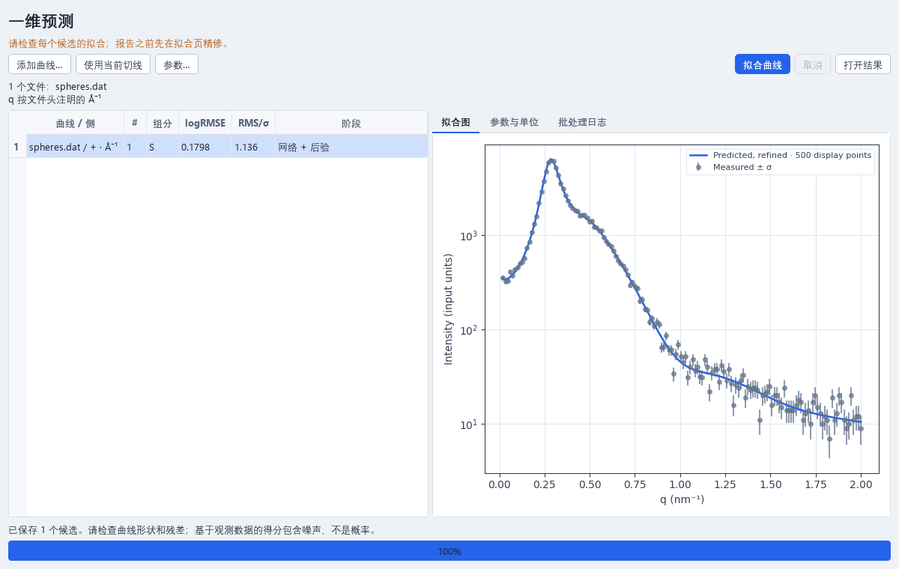

*左侧为所选曲线和候选解，右侧显示拟合及其参数。若测量中存在反射束，请在设置中注明。*

这个窗口对列出的每条曲线运行预测参数，没有别的方法。

1. **添加曲线…**（Add curves…）列出文本曲线文件（`q I [σ]`；`.dat`、`.txt`，也可以是逗号分隔的 `.csv`）。**使用当前切线**（Use current cut）
   改用拟合页里打开的曲线。按钮下面一行写出每个文件的 q 按什么单位读取：文件头注明的单位；文件头没有注明的，按设置
   **文件头未注明时的 q 单位**（q unit of files without one in their header）。文件头同时注明 Å⁻¹ 和 nm⁻¹ 的文件不拟合，也在这一行列出。
2. **参数…**（Parameters…）里设：
   - **完整组成**（Complete composition）：最多三个框，知道时填颗粒类型（每群都带次晶）；所有框都是*自动 / 不用*
     （Auto / unused）时，网络在所有组成中选择。
   - **文件头未注明时的 q 单位**（q unit of files without one in their header）：默认 Å⁻¹，和拟合页相同（6.1 节；
     以前保存为 nm⁻¹ 的设置保持不变）。文件头注明了 q 单位的文件按注明的单位读取，不管这里怎么设；分析页的
     `_fit_input.dat` 注明 Å⁻¹，不用设。文件头用 `#` 行里的 `q in <单位>`，或第一列的列名（`q (1/A)`、`q_nm^-1`、
     `# columns: qy (1/A) …`、`# q [1/nm]  I`）注明单位。**使用当前切线**自动换算。文件没有注明单位时（6.1 节），状态行下面有一条警告写明文件、所用的单位和怎样改；候选解的提示和它的*参数与单位*
     （Parameters and units）文字里也有，记录里保存在 `curve_notes`。
   - **q 的两侧**（q sides）：*两半分别拟合*（Each half separately）、*q > 0 一半*或 *q < 0 一半*。
   - **线切的 qz（nm⁻¹）**（Cut qz (nm⁻¹)）：切线的 q_z，球按它的 Born 项计算；不勾选（默认）时 q_z = 0，即有效界面。出射反射
     路径需要两个角度：这样的曲线请在拟合页、在模型里填上角度后拟合。
   - **加到计数 σ 上的相对 σ**（Relative σ added to counting σ，默认 10 %）和**加到计数 σ 上的绝对 σ**（Absolute σ added to
     counting σ）：只用于**使用当前切线**，并且曲线是分析页写出的、带有探测器各列像素数时；它们与计数 σ 按平方和相加。
     没有 σ 的曲线使用预测参数的相对 σ，由 ln I 相对其趋势的离散估计（和拟合页的数值相同；强度为负或为零的点不参与拟合）；
     每个候选解都记录它（`sigma_source`、`sigma_relative`、`curve_notes`）。

   文件由拟合页的读取器读入：任意几行文件头（列名行上面的标题行也可以），逗号、制表符、分号或空格分隔。强度为负或为零的点
   在每个候选解的 `curve_notes` 里数出。

   **保存设置**（Save Settings）保留它们。早先版本用*通用 V5*、*单 RC 专用模型*、*物理拟合*或 *fit1d* 保存的设置，
   打开时都是预测参数：它们自己的选项被丢弃，fit1d 的切线 qz 保留为**线切的 qz**。
3. **拟合曲线**（Fit curve；列出多个文件时为**拟合 N 个文件**）开始，**取消**（Cancel）停止（已完成文件的结果保留），
   **打开结果**（Open results）打开运行文件夹。
4. 表格列出每条曲线每一半的候选：**曲线 / 侧**（文件名和 + 或 −）、**#**、**组分**（S 球，RC 随机取向圆柱，VC 竖直圆柱）、
   **logRMSE**、**RMS/σ** 和**阶段**（Stage）；文件的行在**曲线 / 侧**里还写出 q 读取时的单位（悬停可以看单位从哪里来）。选中一行，在右边的标签页里看它的**拟合图**、**参数与单位**和**批处理日志**。

每个候选的**阶段**都是*网络 + 后验*（Network + posterior；预测参数），悬停可以看它的概率和标记。

**结果写在哪里。** 窗口每次运行在 GIMaP 用户数据文件夹（便携版也相同）里新建一个文件夹；可用**帮助 ▸ 打开用户数据文件夹**（Help ▸ Open User Data Folder）打开该位置：
`AI_Fitting_Output/v5_<日期>_<时间>_<微秒>/`。里面有 `request.json`、`batch_summary.json`、`top20_candidates.json`、
`fitting_run_summary.json`，以及每条曲线每一半的 `solutions.json`（参数、单位、运行的阶段、概率和区间）、
`display.npz` 和 `fitting_curves.csv`。`request.json` 和 `fitting_run_summary.json` 列出每条曲线的 q
按什么单位读取（`q_units`）；`batch_summary.json` 里每个文件的条目和 `top20_candidates.json` 里它的候选用 `q_unit_read`、
`q_unit_from` 记下同样的信息。这些文件夹不会自动删除。自己用**保存**存的拟合写在你选的位置。

**网络文件。** 预测参数的权重在 `src/gimap/features/fitting/domain/posterior/data/`（`flow_v1.npz`，以及它的记录
`flow_v1.json` 和模型卡 `MODEL_CARD.md`），便携版和 Git 仓库里都有。预测在使用前按记录里的 SHA-256 检查它们；文件被改动
或缺失时不启动，消息里写出文件名（14.3 节）。一维预测以前的网络*通用 V5*（General V5）和*单 RC 专用模型*（Single RC
specialist）已在 0.2.0 移除（原因见《物理与方法》第 10 章）。fit1d 工具包（*预测参数（fit1d）*）和快速物理拟合
（*寻找颗粒形状（不用 AI）*，以及这个窗口的*物理拟合*）也一并移除：拟合页只有一种网络方法，选择就简单了。

### 6.5 原位序列

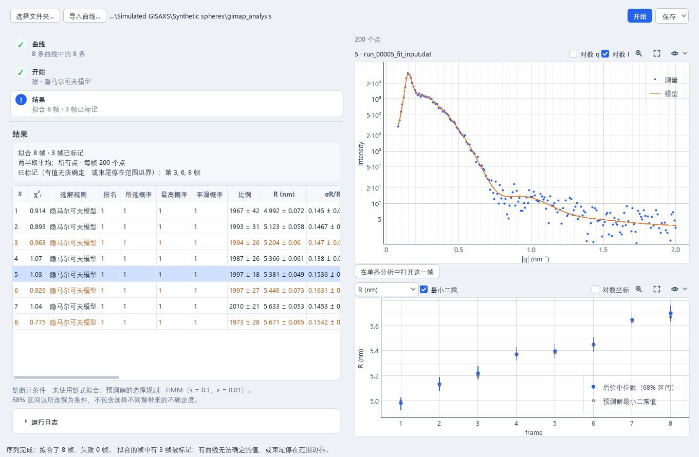

*用隐马尔可夫模型拟合八条合成球形粒子曲线。每帧只有一个预测解，其单帧概率和平滑概率均为 1。上图选中第 5 帧，下图显示 R 的后验中位数、68% 区间和各解的最小二乘值。*

**批量 / 原位序列**页签用单条分析的模型拟合曲线。命令栏有**导入曲线…**、**选择文件夹…**（Choose Folder…）和**开始**（Start）；
运行时出现**暂停**（Pause）和**停止**，有帧拟合完后出现**保存**。**导入曲线…**支持选定文件和共用 q 的多列表格（6.1 节）。
下文文件夹和时间序列选项用于文件夹模式与有序序列；导入的独立样品使用同一初始模型，没有阶段检测、异常帧排除或连续性约束。

文件夹扫描、单位文件头检查、预览、探测器帧切线和监视都在后台运行。初次列出并预览序列时，**开始**不可用，
**停止**（Stop）可取消准备。读取曲线或帧时按**停止**，请求会立即登记；当前读取返回后跳过拟合，
被取消的帧不会误记为拟合失败。**暂停**让当前帧完成后再暂停；已完成的结果保留。

**1. 曲线**（Curves）

- **选择文件夹…**（或把文件夹拖到页面上）、单条分析结果里的**拟合此文件夹的每条曲线…**，或在分析页列出这些帧后选
  **把序列发送到拟合…**：每一帧都导出到 `<名称>_fitting/`（可以每 N 帧相加），然后序列在这里打开，曲线已经列出。
- **文件**（Files）是文件名模式：默认 `*_fit_input.dat`；任何 `.dat` / `.txt` 曲线都可以。**包括子文件夹**
  （Also in subfolders）往下层找。
- 帧范围和切线两半的控件要等列表载入完成后才可用；初值策略、方法和延续解选项仍可修改，
  准备期间保存项目会保留这些选择。
- **探测器帧。** **文件**也可以写探测器文件（`*.cbf`、`*.tif`、`*.edf`、`*.nxs` ……）；只有帧、没有曲线的文件夹会自动换成它的帧。
  每一帧（NeXus/HDF5 文件的每一帧；一组模块文件是一个数据源；分析页的**求和**把相邻帧合成一组）都按分析页对已设置好的那一帧的
  切法来切——仪器配置、αi、光束中心、掩膜与校正、坏像素、序列的切线和两半——得到与 `<stem>_fit_input.dat` 相同的曲线（q 为 Å⁻¹），
  只在内存里，数据旁边不写任何文件。这一步写出用的是谁的设置；分析页还没有设置好的帧时说明原因，**开始**不会运行。
  **采用 Analyze 的设置**（Take Analyze's Set-up）采用分析页现在的设置，重新切这些帧。JSON 记录保存分析页的设置。
- 文件夹中的曲线按文件名的计数顺序列出（`frame_2` 在 `frame_10` 之前），并按这个顺序编号 1、2、3……
  **帧**（Frames）：这些编号的第一帧 – 最后一帧，**每**（Every）n 帧取一帧。
- **q 的单位**：每个曲线文件按文件头注明的单位读取，没有注明的按单条分析的**文件头未注明时的 q 单位**（开始时的值，整次运行不变）。
  这一步按单位和来源数出列出的曲线——*2 条曲线：q 按文件头注明的 Å⁻¹*；*1 条曲线：q 按 nm⁻¹，文件头未注明单位
  （单条分析 ▸ 曲线 ▸ 文件）*——并点名文件头同时注明两种单位的文件：它不拟合，那一帧说明原因。探测器帧按 Å⁻¹ 切。
  导入的固定选择则保存导入预览里选定的后备单位；每个文件头注明的单位仍然优先。
- **监视新曲线**（Watch for new curves）：序列运行时每 2 秒看一次文件夹，写进去的新曲线（例如测量过程中分析页写出的）也会接着拟合。
  新文件在两次看到的大小和时间都相同时才拿来；读过之后又变了的文件重新拟合；文件夹读不了时等它恢复。
- **切线的两半**（Halves of the cut）：每帧只拟合一条曲线——**两半取平均**、**q > 0 一半**或 **q < 0 一半**，从不两半一起。
  你没有选时，它取分析页送出这些曲线时的两半，否则取单条分析的两半（不是 |q| 上的两半时），再否则取平均；下面一行写出这个值的来源。
  只有一侧 q 的曲线没有两半可选：下拉框不能用，它的提示说明原因。所选的一半没有点的帧失败，原因为 *No points on the q > 0 half*（或 *q < 0*），
  不会改用另一半。
- 曲线列出后在后台互相比较（7.1 节）。这一步写出有几个阶段、几个异常帧，列表按阶段着色。**跳过异常帧**
  （Leave out the odd frames）默认打开。

**2. 开始**（Start）

- 每一帧都用单条分析的模型、拟合范围和排除的点（**在单条分析中编辑**（Edit in Single Analysis）去改它们），以及曲线步骤的两半。
  所有方法都保留模型的固定值和上下限；停在边界的值会被报告，但不自动放宽范围（6.3 节）。
- **每一帧的初值来自**（Each frame starts from）：
  - **上一帧的结果**（The previous frame's result，默认）——适合缓慢变化的样品。某一帧没收敛时，下一帧重新从单条分析的模型开始。
  - **单条分析里的模型**（The model in Single analysis）——每一帧相互独立。
  - **上一帧的结果；每个新阶段从单条分析的模型开始**（The previous result; the Single model at each new stage）——
    在一个阶段内跟着样品走，在曲线转向的地方重新开始。
  - **上一帧的结果；链断开处用“预测参数”**（Previous result, Predict at chain breaks）——每一帧从上一帧的
    结果开始；在链断开处（拟合失败或未收敛、进入新阶段，或 χ²ᵣ 超过上一帧的 3 倍且大于 2），用预测参数（6.4 节，方法不变）
    以单条分析模型的粒子、从概率不低于最可能解十分之一的解中最接近上一帧的那个重新拟合这一帧，保留较好的结果。若手动模型的尺寸分布、权重或分辨率不同，先从预测值出发，按手动模型的设置精修，再比较两次拟合。参数停在边界
    （光束拖尾、背景或其他参数）、曲线确定不了的参数和拟合差会被标记，但不使链断开，所以曲线平滑变化的序列保持平滑。没有粒子或多于三种粒子的模型只做精修（运行日志会说明）。
- **反向再精修一遍**（Refine again in a backward pass）：所有帧拟合完后，从倒数第二帧到第一帧，每一帧从下一帧的结果开始精修，保留两次
  拟合中较好的一次——开头几帧难拟合的样品，就从拟合可靠的地方倒着跟回去。**监视新曲线**等待新曲线时不做。
- **方法**（Method）：**精修（快）**（Refine (fast)）、**在范围内搜索，再精修（慢）**（Search the ranges, then refine (slow)）
  或**逐帧预测**（Predict each frame）。
- **逐帧预测**（Predict each frame）使用起始模型的粒子为每帧生成候选解。取消勾选两个连续性选项后，每帧采用概率最高的解。
  **优先选择延续上一帧的解**（Prefer the solution that continues the previous frame，默认勾选）在 ln R、ln D、ln(σ_R/R)
  坐标中取距离最近的候选解。候选解的概率须至少为本帧最大概率的 0.2 倍，链断开后重新拟合时门槛为 0.1 倍。
  没有前一帧的拟合结果、进入新阶段或选择独立起点时，逐帧预测取概率最高的解。概率门槛或拟合方向改变时，序列中台阶的位置也可能改变。
- **跨帧平滑（隐马尔可夫模型）**（Smooth across frames (hidden Markov model)）使用整个序列的证据，在各帧候选解中选出一条路径。
  **逐帧对数步长 (s)**（Log step per frame (s)）设定相邻所选帧的变化尺度，默认 0.1，约相当于 10%。较小的值更偏好平滑路径，可能抑制短暂的变化。
  在还有待处理帧时，各帧先按单帧概率选解，队列处理完后再求整条路径。勾选**监视新曲线**时，新到的帧可能改变此前帧的选解。
- 然后按命令栏的**开始**。**暂停**和**停止**在当前帧拟合完后生效；读取时按停止则按上文跳过该帧的拟合。
  已完成的帧保留。序列运行时不能打开项目（先停止）。
  阶段还没找到就开始的运行不用阶段（会说明）。

**3. 结果**

- 拟合了几帧、失败几帧、几帧没收敛，以及每帧用的两半和点数。光束尾项停在范围边上、或有数值没有有限误差的帧计为
  **已标记**（flagged：在列表中标出，运行结束时计数，记录中列在 `flagged` 下）。
- 表格每帧一行：χ²ᵣ、每个自由值 ± 1σ、**起点**（Started from）、**标记**（Flags）、拟合的**点数**（Points）和**两半**（Halves）。
  点一行可以看那一帧的曲线和模型；失败的帧显示原因。**起点**说明这一帧所保留的拟合从哪里开始：*接续第 n 帧*（上一帧；*反向
  拟合*时为下一帧）、*从“预测参数”重新开始（链断开的原因）*——选中“预测参数”哪个解的规则在悬停提示中——、接续的拟合仍更好时
  为 *…（链断开：原因）*，或 *从单条分析中的模型开始*。**标记**说明采信这一行之前需要知道的：失败、未收敛、拟合差、参数停在
  范围边界、光束拖尾在范围边缘、曲线确定不了的参数。
- 逐帧预测或重启时，**选解规则**（Chosen by）列给出所用规则和参考帧。**排名**（Rank）、**所选概率**（p chosen）和**最高概率**（p max）均按单帧数据计算，第 1 名最可能。
  跨帧平滑时，**平滑概率**（p smoothed）给出路径上该解的边缘概率。未被采纳的重启有相应标记。表格下方列出本次运行所用规则。
  旧版项目未记录这些概率，相应单元格留空。
- 对于有预测后验的参数，趋势图显示所选解的后验中位数和中央 68% 区间。勾选**最小二乘**（Least squares）可用小空心符号叠加该解的最小二乘值。
  此区间不含选解本身的不确定度。仅用最小二乘拟合的参数仍显示拟合值和标准误差。图的标题是序列的名字。曲线写明了帧的测量时间时（分析页
  从带时间戳的帧写出的拟合输入），值旁边的下拉框可以改为对**时间 (s)**（距第一个已拟合帧）作图。
- **在单条分析中打开这一帧**（Open Frame in Single Analysis）把这一帧和它的拟合模型送回单条分析细看。
- **保存 ▸ 每一帧的结果表…**（Table of Every Frame…）写出 CSV（帧、文件、χ²ᵣ、log RMSE、是否收敛、点数、所用的两半、每个值及其误差），
  旁边是 JSON 记录：初始模型、两半及其来源、范围、排除的点、方法、每帧的状态、原因和 q 读取时的单位（`q_unit`、`q_unit_from`；`q_unit_of_files` 是未注明单位的文件所用的设置）、拟合差的帧（χ²ᵣ 大于 10），以及列出了哪些曲线或帧。
  表格最后是 `flags`、`start_from`（previous、next、single 或 predict）、`start_frame`、`chain_break`、`predict_choice` 和
  `fit_pass` 几列，记录写明初值方式和是否
  反向拟合。有预测解时，CSV 还包含名次、单帧概率、参考帧和平滑概率。JSON 按名次保存全部隐马尔可夫状态的概率，并记录选解规则和每次链式重启的结果。
  **保存 ▸ 序列报告…**（Series report…）将这些逐帧决定、链断开阈值和源文件名写成 Markdown 表格。**拟合结果（NXcanSAS）…**（Fits as NXcanSAS…）为每个已拟合帧写出拟合的数据点和这些 q 上的模型（一个 `.h5`，每帧两个
  条目，各带这一帧的记录和角色——数据或模型；Q 单位 1/nm）。**结果数据库…**（Results Database…）把每一帧的拟合——状态、χ²ᵣ、值和误差、标记、初值
  来源——写入 `gimap_series.sqlite`；曲线所在文件夹或往上两级中已有的数据库（分析页写在曲线旁边的）会先被提议。
  **趋势图…**（Trend Plot…）和**所选帧的曲线图…**（Selected Frame's Plot…）保存图。
- 没保存的结果要被丢掉之前——再按一次开始、换了曲线、打开项目——GIMaP 会问：**保存**、**丢弃**或**取消**。
- GIWAXS I(q) 的序列跑完后，6.1 节的那条提示再次出现，并说明有几帧拟合得差。
- 最下面是折叠的**运行日志**（Run Log）。

读不了或拟合失败的曲线在列表里标 ✗，序列继续。文件夹或精确的导入选择、单位与各项设置下次启动时恢复，也随项目保存。
映射曲线的结果记录保留列索引和名称；JSON 的列索引从 0 开始，预览界面里的列号从 1 开始。

### 6.6 多条曲线联合拟合

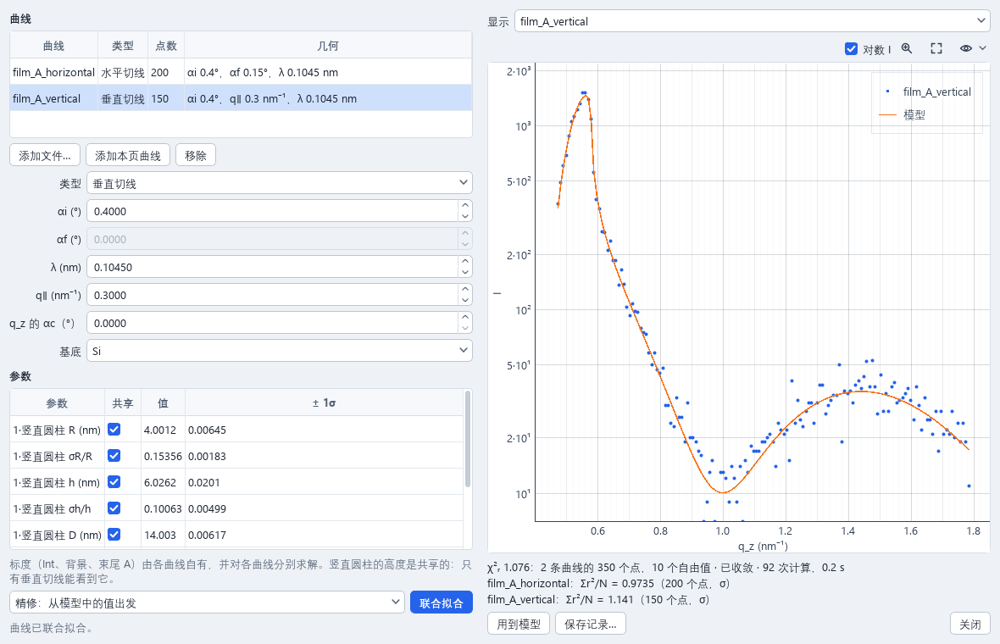

*垂直切线（右）的极小值约束圆柱高度 h。两条曲线共享 h，各有自己的强度标度和背景。*

**拟合 ▸ 多条曲线联合拟合…**（Fitting ▸ Fit Several Curves Together…）用一个 χ² 拟合一组曲线：通常是同一 GISAXS 帧的水平
切线和垂直切线。垂直切线约束竖直圆柱的高度和颗粒在竖直方向的尺寸。拟合从单曲线分析中的模型出发。

- **曲线**（Curves）：**添加文件…**（曲线文件）、**添加本页曲线**（单条分析中的曲线，带其模型中的角度）和**移除**；
  **分析 ▸ 把两条切线都发送到拟合**（Analyze ▸ Send Both Cuts to Fitting）写出这一帧的水平切线（`<stem>_fit_input.dat`）和
  垂直切线（`<stem>_fit_input_qz.dat`，写在数据旁边的 `gimap_analysis/`，那个文件夹不能写时写到你选的位置），并带着它们的
  几何把两条都列在这里。列表下面是选中曲线的**类型**——*水平切线*（αi、αf、λ）、*垂直切线*（αi、λ、所在列的 **q∥**，分析对
  其 q_z 做了折射修正时还有 **q_z 的 αc**）或*其他曲线（q_z = 0）*——及其数值。
- **基底**（所有曲线共用）：垂直切线用四项 DWBA 计算，需要基底（Si、SiO₂、玻璃（平板玻璃）、Au 或**输入 δ、β**）；给了两个
  角度的水平切线也随之用四项 DWBA。
- **垂直切线的最低出射角**（Lowest exit angle of the vertical cut）默认为 2 αc，αc 取所选基底在该条切线波长下的临界角。
  设为 0 可保留所有有效出射角。绘图、摘要中的点数和拟合使用同一范围。
- **参数**（Parameters）：模型中的每个自由值，**共享**（只拟合一次；默认是所有颗粒参数）或不共享（各曲线自有）。标度——每群
  颗粒的 Int、背景、尾项 A——总是各曲线自有，所以每条曲线有自己的标度和背景。列表中有垂直切线时，竖直圆柱获得共享的高度 h
  和 σh/h。若模型中未给定起始高度且出射角下限大于零，精修会比较 10、5 和 20 nm，从残差平方和最小的高度起步。
- **联合拟合**（Fit Together），方法为*精修*（从模型中的值出发）或*在范围内搜索，再精修*；运行时有进度条和**停止**（保留到
  那时最好的值）。摘要给出全部点上的 χ²ᵣ 和每条曲线的 Σr²/N；**显示**（Show）选择画出哪条曲线及其模型。**用到模型**（Use in
  Model）把第一条水平切线的值（含共享值；高度固定在联合拟合的值上）放进模型；**保存记录…**（Save Record…）写出每条曲线及其
  模型、误差、共享值、χ² 和协方差（JSON）。
- **保存报告…**（Save Report…）以 Markdown 格式写出拟合摘要和参数。记录和报告都给出出射角下限，以基底临界角的倍数和度数表示。
  使用给定的不确定度或泊松权重时，垂直切线的约化 χ² 超过 3 会列在**需要留意**（Needs attention）中。模型未计入颗粒层的有效折射率，
  致密层或高原子序数元素层的拟合高度很可能偏低。在 BornAgain 基准中，覆盖率为 10–40% 的类金颗粒层用整条切线拟合时高度偏低
  13–60%，从 2 αc 起拟合时偏低 6–20%。拟合圆柱高度时，报告还给出整条垂直切线的拟合高度（若选定的就是整条切线，则从 2 αc 起拟合作比较）。
  高度差超过两次拟合高度的合成标准误差的两倍，或超过选定范围拟合高度的 2% 时，会给出提示。
  两个范围包含相同的可用点，或对照拟合失败时，报告会说明无法比较高度。
  两次拟合均假设颗粒层稀疏、高度与半径互不相关。模拟圆柱满足 H = 1.5 R 时，两次拟合的高度均偏高约 14%。

导出的竖直条带跨过 qy = 0 或中心 |qy| 小于 0.02 nm⁻¹ 时，**多条曲线联合拟合**会提示。颗粒模型不含镜面反射；如果条带包含镜面反射，请把切线移到脊线旁边，重新发送两条曲线。垂直切线模型及其与 BornAgain 的比较见
[《物理与方法》9.18 节](Physics_Manual_zh.md#918-多条曲线联合拟合垂直切线)。

## 7. 比较与阶段

阶段和**比较**（Compare）页回答一个散射序列需要回答的问题，不需要标签，也不需要 AI：

- 哪些帧不属于这个序列（异常帧）；
- 序列在哪里转向（阶段），变得多快；
- 哪些测量或样品彼此相像。

它们都用分析页约化出的曲线，几何、掩膜和切线都相同。它们取代 0.0.2 版的 Classification 页。这里的阶段是只从曲线得到的序列分段；
溅射序列的生长阶段（岛、聚并、膜）是另一回事，见第 8 章。

### 7.1 阶段与异常帧

**怎么找出来的**

1. 曲线按 log I 比较，只用（几乎）每一帧都有数据的 q 点。默认去掉每帧的平均水平，只比较形状。
2. 先找异常帧：一帧与它之前 3 帧和之后 3 帧都不一致，差别远大于帧与帧之间的变化——或者在整条曲线上，或者只在少数几个点上（约 1 %），
   而且与前后两侧的差别方向相同，例如某一帧里几列过亮的探测器像素。样品真实的变化不算异常：突变之后的帧与后面的帧一致，持续变化中的帧落在前后两侧之间。
   连续两三帧（序列开头或末尾两帧）这样的帧都会被找出。如果留着，这样一帧会自己成为一个主成分，被切成一个假的阶段，还会进入比较页的终态。
3. 其余帧的主成分。
4. 阶段：按帧的顺序把主成分切成若干直线段（每个阶段至少 5 帧，最多 8 个阶段）。每多加一个阶段，它至少要解释剩余变化的 5 %，并且多于噪声能解释的部分。
   序列多于 1500 帧（不计异常帧）时，先把相邻帧按块平均再切分，所以阶段边界只精确到一块。
5. 进度：沿主成分完成一半和 90 % 变化时的帧。

判据和停止规则见[《物理与方法》第 11 章](Physics_Manual_zh.md#11-序列)。

**怎么读**

- 阶段是对序列的描述，本身不等于相。平滑的变化也会在变化速度拐弯处被切开。阶段之间哪里增长、哪里减少（相对于曲线的其余部分），才说明结构是否改变。
- 每个异常帧都写出原因。差别集中在某个 q 附近的少数几个点上，多半是探测器：在分析页的**掩膜与校正**步骤里遮掉那里，再重建热图。
  样品只持续一到三帧的真实事件（例如某个晶粒只在一帧里闪亮）也会被标为异常帧，原因里写出在哪个 q、变了多少。持续下去的变化不算异常。
- 序列开头和末尾只有一侧的帧可比，开头或末尾一两帧里的变化分不出是样品还是伪影，会标为异常帧并写出原因。
  监视中的序列，最新一帧里出现新东西时，等后面的帧到了会重新判断。

**出现在哪里**

- **分析页 ▸ 序列**（Analyze ▸ Series，5.6 节）：热图旁的彩色阶段条，阶段开始处的虚线，异常帧处的红色箭头
  （**标记 ▸ 阶段**（Marks ▸ Stages）可以隐藏）。**阶段**（Stages）选*自动（n）*或你指定的数目。折叠的
  *变化了什么，以及异常帧*（What changes, and the odd frames）列出每个阶段的典型帧、阶段之间增长或减少最多的地方、
  完成一半 / 90 % 的帧，以及每个异常帧的原因。**批量导出时跳过异常帧**（Leave the odd frames out of Batch Export）
  如其所说。热图下方的图可以显示*沿序列的变化*（Change along the series）。**导出 ▸ 阶段表…**（Export ▸ Stages as Table…）
  写出每帧的阶段、是否异常及原因，旁边是记录方法的 JSON。原因用热图自己的横轴（χ、qy 或 q）表述。**选项 ▸ 阶段比较**
  （Stages compare）选整个 x 轴或热图当前显示的范围。
- **拟合页 ▸ 原位序列**（6.5 节）：列出的曲线按将要拟合的方式比较（用单条分析的两半、范围和排除的点）。列表按阶段着色，
  **跳过异常帧**默认打开，**每一帧的初值来自**多一个选项**上一帧的结果；每个新阶段从单条分析的模型开始**。

### 7.2 比较页

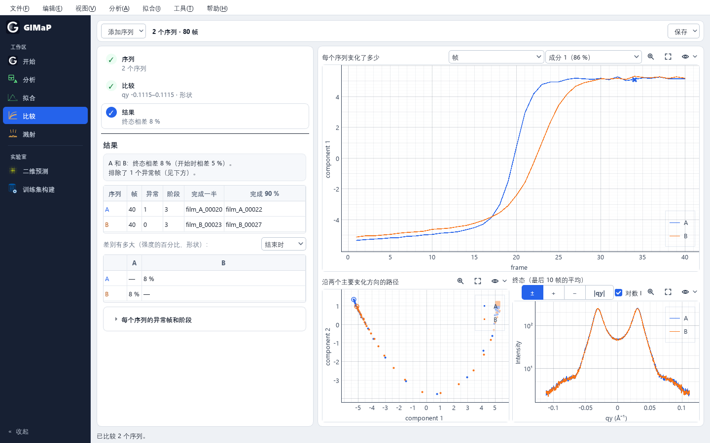

*左边三步，这里打开的是结果步骤；右边是每个序列变化了多少、它们的路径和终态。两个 40 帧的合成序列，各 3 个阶段：A 有 1 个异常帧
（第 34 帧，变化图上的 ×），它不计入 A 的终态，所以 A 的终态曲线在 qy 0.05 Å⁻¹ 附近没有那几列过亮像素造成的尖峰。A 和 B：
终态相差 8 %（开始时相差 5 %）。*

常见用法：在分析页打开一个样品，在序列标签页生成热图，按**发送到比较**（Send to Compare）；每个样品重复一次。
两个以上的序列相互比较；只有一个时只描述它。

**1. 序列**（Series）

- **添加序列**（Add Series）可以加**分析页的序列热图**（The Series Map of Analyze）、**曲线文件夹…**（Folder of Curves…，
  一个序列）、**曲线文件…**（Curve Files…，合起来一个序列）或**结果数据库…**（Results Database…：分析页的序列标签页或监视时写的
  `gimap_series.sqlite`，一个序列的一种曲线，不需要原始帧；里面有几种时会问选哪一种）。曲线文件要有 q 和 I 两列（`.dat`、`.txt`、`.csv`、`.xy`、
  `.chi`；每个序列至少两个文件，按文件名的计数顺序排列：`frame_2` 在 `frame_10` 之前）。文件头写明 nm⁻¹ 时 q 换算成 Å⁻¹。
- 分析页写的文件夹（批量导出的文件夹、它的 `curves/`，或 `gimap_analysis/`）里有好几种曲线。一种曲线是一个序列：有几种时会问
  选哪一种（拟合用曲线叫*拟合用曲线*，不属于分析页导出的文件叫*其他文件*），序列名为 *`<样品或批次>` · `<曲线>`*。
  批量导出的所有帧表格（`<名称>_<曲线>_frames.csv`）也可以作为一个序列加入。
- 文件夹或曲线文件也可以拖到页面上。同一个热图或文件夹不会重复加入。
- 文件夹扫描和曲线读取在后台排队执行；文件夹按请求顺序加入。任务面板显示进度和**取消**（Cancel）。
  取消后，尚未读完的序列和排队中的导入不会加入，已完整读入的序列保留。取消请求立即登记；
  正在进行的目录扫描或单个表格读取须返回后才丢弃结果，逐条读取曲线时在文件之间检查并停止。
  打开项目也用同一队列读取曲线和附属 NPZ 文件中的数组，读取错误在这里显示。
- 双击名字可以给序列改名。**删除所选**（Remove Selected，或按 `Delete`）和**全部移除**（Remove All，随后的提示里可以撤销）。
- 名字很长时，图和结果里只显示各序列不同的部分；表格、CSV 和 JSON 保留完整的名字。

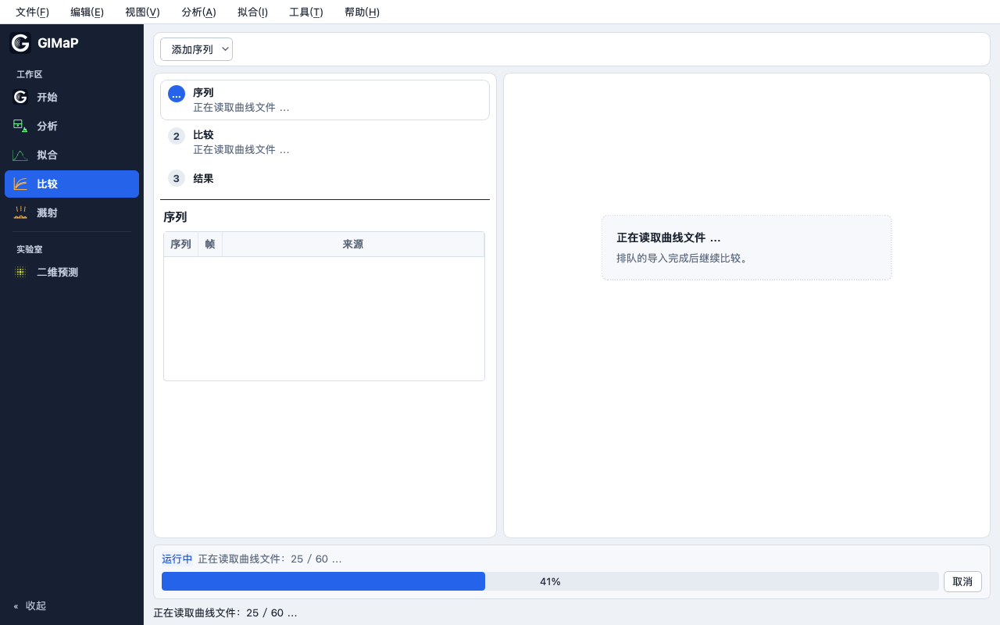

*正在导入 60 条合成曲线：窗口保持响应，取消可停止未完成的导入。*

**2. 比较**（Compare）

- 比较的 **q 范围**（q range，Å⁻¹；按序列的坐标轴命名，例如 **qy 范围**）：所有序列都覆盖的范围。收窄它可以去掉有噪声的边缘或探测器伪影；**全部范围**（Whole Range）复原。
- **只比较形状**（Compare the shape only，默认打开）：去掉每帧的平均水平，所以更亮的光束、更厚的薄膜或更长的曝光不算新的结构。
  关闭时整体强度也算在内。
- **终态**（End state）：一个序列最后 N 帧的平均（默认 10 帧，不含异常帧）。
- 每次改动后稍等片刻就在后台重新比较。比较失败时（例如范围内没有共同的点），结果里说明原因和怎么改。
- 修改序列、q 范围、只比较形状或终态帧数后，旧结果立即隐藏，表格和图像导出不可用；当前设置的比较完成后恢复。
  序列未变时，改回已有结果对应的设置可以立即恢复它。导入没有加入新序列时保留已有比较；有新数据时在队列结束后比较。
- 各序列必须用同一横轴（qy、q 或 χ）。横轴不同的序列——例如一个 GISAXS 的 qy 热图和一个 GIWAXS 的 q 热图——不比较，
  结果里写出这些横轴（*这些序列的横轴不同：…*）。

**3. 结果**（Results）

- 分组（三个以上序列时）：按终态的相似程度把序列一步步合并，在合并距离跳得最大的地方分组。这个跳跃不到前一步的两倍，
  或者没有哪两个序列相差 2 % 以上时，不分组（[《物理与方法》11.10 节](Physics_Manual_zh.md#1110-比较)）。
- 结束时和开始时差别最大的序列。
- 每个序列：帧数、异常帧、阶段、完成一半和 90 % 变化时的帧。
- 序列两两之间差别的表，**结束时**（At the end）或**开始时**（At the start），以强度的百分比表示。
- 折叠的**每个序列的异常帧和阶段**（Odd frames and stages of every series）：每个序列的阶段，以及它的异常帧和原因；
  每个阶段相对前一个阶段变化最大的地方（增长最多和减少最多的 q，以 % 表示）在它的提示里，也写进 JSON 记录。

**右边的图**

- **每个序列变化了多少**（How far each series has changed）——沿图上方选的主要变化方向（**成分 1** 解释得最多），
  对**帧**（Frame），或者对**在序列中的比例（0–1）**（Share of the series (0–1)，用于记录速率不同的测量）；× 标出异常帧。
- **沿两个主要变化方向的路径**（Paths through the two main changes）——○ 第一个保留的帧，■ 最后一帧。只有一个主要变化时显示说明，不画空坐标。
- **终态**（End states）——每个序列的终态曲线。

**保存**

- 有了比较结果后才出现**保存**（重新比较期间暂不可用）。**保存 ▸ 每个序列的表…**（Table of Every Series…）或**每一帧的结果表…**（Table of Every Frame…）写出 CSV 和 JSON 记录：方法和设置，以及每个序列的来源、异常帧及原因、阶段、
  变化完成一半 / 90 % 的帧、结束时和开始时的差别，还有 `stage_details`——每两个阶段之间曲线增长最多和减少最多的 x（`grows_most`、
  `falls_most`：`x` 按记录的 `x_label`，`percent` 是相对于曲线其余部分的变化）和同样内容的一句话。
- **变化图…**（Change Plot…）、**路径图…**（Paths Plot…）、**终态图…**（End States Plot…）保存图，总是用浅色配色。
- 页面上的表格可以复制（`Ctrl+C` 或右键），带列名。
- 项目保存设置和序列：曲线文件按路径，内嵌数组存进 `<project>.<generation>.compare.npz`（3.8 节）。
  保存项目前先完成或取消尚未结束的导入。

### 7.3 下结论之前

- **时有时无的探测器伪影会造成异常帧。** 某个 q 处的窄尖峰只在部分帧出现时，这些帧被标为异常，原因写的是*多半是探测器，不是样品*。
  在分析页遮掉它再重建热图，不要把它当成样品的变化。
- **比较范围要避开伪影和阴影区。** 在全 q 范围比较时，一个序列可能因为尖峰或阴影显得离群。把 **q 范围**收窄到干净的部分后，
  结束时的差别可能小得多。
- **两张表都要看。** 除了**结束时**，也看**开始时**的差别：序列的差别可能在起点，而不在终点。

## 8. 溅射

**项目文件。** 文件 ▸ 保存项目会保存本页参数（输入栏、几何和各选项）及所显示结果的文件夹引用。打开项目会恢复这些内容；旧项目没有溅射记录时会清空本页。移动项目时请一起保留结果文件夹；缺失文件夹会提示。


**溅射**（Sputter）工作区（侧栏，`Ctrl+5`）跟踪原位溅射沉积：一个扫描的 PILATUS CBF 帧，记录金属溅射到基底上的过程。
输入栏下面有两个视图，用输入栏右边的**主屏 | 详情**（Main Screen | Details）切换：

- **主屏**（打开时显示，8.1 节）显示**分析**（Analyze）的结果：每个时间窗的实测图和一个模型的图像并排，以及这个模型所代表的
  晶粒——半径 R、高度 H、间距 D、间隙、尺寸分布宽度、覆盖率，有的话还有晶粒下面连续金属层的厚度——和它们在整条扫描里的演化。
  分析运行一个单独的分析包；
- **详情**（8.2 节）里是几何、分析和沉积后测量样品的选项、分析读入的帧占多少空间（**存储**，Storage），以及关于主屏所示
  结果的五个标签页：**时间窗**（Windows）、**生长过程**（Growth Process）、**报告**（Report）、**日志**（Logs）和**步骤**（Steps）。

主屏显示的内容见[《物理与方法》12.1 节](Physics_Manual_zh.md#121-分析主屏显示什么)。

### 8.1 主屏：分析

**需要什么。** 不需要额外准备：分析包随 GIMaP 提供（程序文件夹的 `utils/sputter_client`；一个有 `code` 和 `models` 的
文件夹，在 GIMaP 自己的 Python 里运行，用 NumPy、SciPy 和 Matplotlib，不需要 PyTorch）。要改用另一个分析包，用
**选择文件夹…**（Choose Folder…，在**详情 ▸ 分析选项 ▸ 分析包**（Details ▸ Analyze options ▸ Analysis package））选它的文件夹，
或把环境变量 `GIMAP_SPUTTER_CLIENT` 设为它；两者都优先于随 GIMaP 提供的那个。这样指定的文件夹如果不是分析包（后来移走了，
或选错了文件夹），就跳过它，改用随 GIMaP 提供的分析包，**分析包**那一行标出提示，原因在它的悬停提示里。完全没有分析包时主屏会说明；
**打开结果…**（Open Result…）照样可以显示以前分析过的文件夹。

**输入栏**，从左到右（最左边选的是**原位**；**沉积后**用于沉积之后测量的样品，见下面“沉积之后测量的样品”）：

1. **选择…**（Choose…）：一个扫描的文件夹（它的 CBF 帧所在的文件夹，或只有一个子文件夹存放帧的扫描文件夹，例如 `p2m/`）。
   随后输入栏下面有一行说明帧数、探测器、曝光和时间。
2. **金属**（Metal：Ag、Au、Cu）和**基底**（Substrate：Si、TiO₂、PS、PET、PSBMA、PNO、PEO、Polymer）。**Polymer** 是其他或
   不确定种类的聚合物膜，例如嵌段共聚物：模型把任何聚合物都描述成一层膜，聚合物种类对金属尺寸的影响只有几个百分点；Ag 和 Cu
   在任何聚合物上都能分析。分析包只对其中一些组合有网络：
   遇到别的组合，分析会立即停下，任务状态的**详情**（Details）里是分析包列出它支持的组合的那句话。
3. **速率**（Rate）：沉积速率，必填，单位在旁边选：**Å/s**（默认——石英晶体微天平显示的单位）或 **nm/s**
   （1 nm/s = 10 Å/s）。这个数是石英晶体微天平的读数时勾选 **QCM 读数**（QCM reading）：分析包取它的 0.6 倍作为样品处的速率。
   不勾选时，它就是样品处的速率。单位随速率按扫描文件夹记住。读完扫描的文件头后，输入栏下面那一行还会写出到最后一帧时
   达到的名义厚度（样品处速率 × 从沉积开始到最后一帧的时间；给了持续时间时只算到沉积结束）。样品处的速率高于 1 nm/s 或
   低于 0.005 nm/s 对溅射来说不寻常：分析开始前会问单位是否正确（**仍然分析**（Analyze Anyway）或**取消**（Cancel））。
4. 下面一行写出将要使用的几何——能量或波长、距离、入射角、光束中心、样品滚转角——或者还有哪些要填写。**编辑**（Edit）切到详情
   里的这些字段（8.2 节说明它们的值从哪里来）。光束中心留空时由帧估计；样品滚转角不填就是 0，不给**掩膜文件**（Mask）时
   分析包用这种金属与基底的网络训练时所用的像素掩膜——PEO 上的 Cu 用 P03 2021 年的掩膜，其余用 2025 年的（这两项在
   **更多选项**（More options）里，8.2 节）。在这个掩膜（或你给的掩膜）之外，分析包还会遮掉帧本身显示不可用的像素：
   死像素、热像素、束流挡块及其支撑杆（自动掩膜；探测器尺寸对不上的掩膜不用，此时只用自动掩膜）。把鼠标停在结果名字上
   可以看到读帧时用的掩膜。
5. **分析**（Analyze）。右边的任务状态用一行写出分析此刻在做什么，进度条显示已经完成的份额。
   **取消**（Cancel）立即结束；已经读完的帧留给下一次运行。**详情**显示分析包的消息。分析运行时，主屏显示它正在做什么、
   已经得到什么（实时视图）：

   - 最上面是同一行状态，横跨整个视图，带计数，知道进度快慢时还写出大约还要多久，例如 *正在读入帧：400 / 1,200 · 约剩 4 分钟*、
     *网络 cu_v4：正在用正向模型绘制候选，第 7/24 个时间窗*、*比较网络：cu_p5 21.5, cu_v4 12.5 → cu_v4*、
     *联合精修：第 2/6 次迭代 · 拟合偏差中位数 11.3 · 已用 5:40，约剩 11 分钟*（到目前为止每次迭代的秒数乘以剩下的迭代次数，
     即迭代全部做完所需的时间）、*正在绘制主屏：第 5/20 个时间窗*。分析包两次事件之间，这一行写出正在进行的步骤
     （*第 3 步，共 4 步：撰写报告…*）。没有自己计数的那一行——网络正在启动、网络正在为全部时间窗给出候选、联合精修准备中、
     某个步骤——满 10 秒后加上已经用了多久：*正在启动网络 cu_p5（要比较的 2 个网络中的第一个） · 已用 0:45*。较新的分析包在联合精修的一次迭代内部也每分钟几次报告进度：*联合精修：第 3/6 次迭代 ·
     求导数：12/20 个时间窗 · 已用 6:12，约剩 9 分钟*（求导数是一次迭代里最长的部分；剩余时间 = 每个时间窗的秒数 × 本次迭代
     剩下的时间窗 + 每次迭代的秒数 × 之后的迭代次数）。
   - 左边是四个步骤——**读入帧**（Read the frames）、**求解结构**（Find the solutions）、**写报告**（Write the report）、
     **绘制图像**（Draw the images）——各带状态和一行产出（已读入的帧数、已求解的时间窗、与数据更吻合的网络、已绘制的时间窗），
     下面是已运行的时间、进程数和其中此刻正在工作的个数（*已运行 03:12 · 进程数：16 · 其中 14 个正在工作*；正在计算或
     从磁盘读数据的进程算在工作）。求解结构时这一行说网络正在做什么、做到哪里：已准备的网络输入、网络正在给出候选、已求解的时间窗与
     已计算的模型图数、已精修的时间窗（精修模式：先给每个时间窗求出候选，再逐个精修）、整条扫描联合精修的轮次（完整模式）。
     任务状态的进度条在每一步内部也会前进。
   - **步骤树**（较新的分析包）：四个步骤换成一张步骤及其子步骤的清单——读入帧（束心、像素掩膜、读帧、沉积开始时刻）、
     划分时间窗、每个网络、比较网络、整条扫描联合精修（准备、迭代）和写出结果。○ 待做，● 进行中（下面一行写着此刻在做什么），
     ✓ 完成（右边是它的结论；太长时截断，鼠标停在上面看全文），✗ 失败，– 跳过。一步完成后收起它的子步骤，▸ 可以再展开。
     保存了产出的步骤标题后面有 ›，点它在右边查看：探测器求和图上的束心与像素掩膜（掩膜去掉的像素为红色，+ 为直射束，虚线为
     样品地平线）、读入的帧、计数率及其基线和沉积开始时刻、各时间窗、各网络的拟合偏差、联合精修每次迭代的拟合偏差中位数和
     当前的解（R、H、D、连续金属层 t_b 和覆盖率；打开时每次迭代后自动更新）。**回到分析**（Back to the Analysis）关闭它。
   - 右边用一段话说明正在进行的步骤，配一幅图和一幅曲线。读入帧：左图是抽样帧求和后的探测器，掩膜去掉的像素为红色，+ 为
     直射束，虚线为样品地平线；右图是最近读入的帧在 q_y–出射角网格上的计数率；下面是已读入各帧的计数率，金属沉积后随之上升。
     求解结构（以及后面两步）：最近求解的时间窗的实测图与其解的模型图，图下一行是它的数值；下面是目前已求解各时间窗的半径、
     高度、间距和覆盖率。
   - **从磁盘读帧。** 较新的分析包还会告诉各进程从磁盘读帧文件花了多少时间：**读入帧**这一行变成例如
     *正在读入第 312 帧（共 1,241 帧） · 磁盘每帧 0.82 s（占用时的 85 %）*，读完后仍保留磁盘这一段。磁盘每帧至少 0.15 s
     且至少占一半时间（或分析包自己这样说）时，图上方出现一条提示：慢在从这个磁盘读帧（USB 或网络驱动器，或者杀毒软件在
     访问时扫描每个文件），先把扫描文件夹复制到本机 SSD，读入会快得多。这时增加进程也没有帮助。磁盘快、或分析包较旧时，
     不显示任何额外内容。
   - **什么都没发生时。** 分析的进程一分钟都没有计算或读数据、分析包也没有新的消息时，实时视图上方出现一条提示：分析包很可能
     在某个进程里因错误停下了，不会自己继续；提示里有它日志的最后一行，**停止分析**（Stop Analysis）结束它。这时最上面那一行
     和任务状态写着 *已有 1:10 没有进展：分析包的进程都在等待*。GIMaP 不替你停止：磁盘不响应时，一段时间内看起来也是这样。
   - 点一个已开始的步骤可以查看它的产出；点正在进行的步骤回到跟随分析。分析结束后结果取代实时视图（失败或**取消**后回到
     原来显示的内容）。实时视图显示的不是结果：结果是分析包最后写出的、含每个时间窗全部候选解的那一份。
   - **初步结果。** 精修模式下，网络的结果（候选解及其随时间的路径）几分钟内就显示在主屏上，结果名字后面注明整条扫描的
     联合精修正在进行；分析继续运行。时间窗选择条下面有一行写出分析此刻在做什么（与上面同一行），旁边的**步骤**（Steps）
     重新打开实时视图和它的步骤，那里的**显示初步结果**（Show the Preliminary Result）回来。联合精修每完成一次迭代，
     它当前的解就以虚线画在演化图上——半径、高度、间距、间隙和覆盖率各用自己的颜色，图例里写作 *联合精修 第 k/n 次*——
     下一次迭代替换它。数值卡片仍显示所选解的数值。分析结束后，最终结果（其中含联合精修解）取代初步结果，虚线随之消失。

同一个请求再分析一次，显示的是它已有的结果。其余的在**详情 ▸ 分析选项**里：

| 字段 | 用途 |
|---|---|
| **模式**（Mode） | **自动**（Auto）：Si 和 TiO₂ 用快速，聚合物基底用精修。**快速**（Quick）：网络给出的候选解，每个都用物理模型画成图（每个时间窗约一秒）。**精修**（Refine）：再对每个时间窗的解做精修（聚合物上每个时间窗要几分钟）。**完整**（Full）：对每个时间窗做更长的精修，并把整条扫描放在一起精修（几个小时）。 |
| **生长规律先验**（Growth-law prior） | 联合精修整条扫描时，是否在成膜之前让晶粒间距 D 和半径 R 靠近同一金属在这种基底上的生长规律 D = D₁ h^p、R = R₁ h^q（h 是金属量；见《物理与方法》12.1 节）。**自动**（Auto，默认）：PS 上的 Ag 打开——它在这里通过了事先定好判据的留一检验——其他体系关闭。**开**（On）：对分析包里有规律的体系都用；没有规律的体系不受影响。**关**（Off）：都不用。只有联合精修用它（精修和完整模式；聚合物在自动模式下就是精修）。样品的生长方式与分析包的参考扫描明显不同时，请选**关**。**详情 ▸ 报告**（Details ▸ Report）写出是否用了、用的是哪个体系的规律；导出的 `METHODS.md` 写出规律本身。 |
| **并行进程数**（Parallel processes） | 分析同时运行几个进程，“分析”和静态帧都用这个设置。**自动（N）**（Automatic (N)，默认）：每个核心一个进程，留出两个核心，最多 16 个，空闲内存不够时更少；每次显示这个选择框和每次开始分析时重新计算 N。也可以选 1 到这台电脑核心数之间的一个数。下次打开仍保留。实时视图和**详情 ▸ 报告**写出实际用了几个进程。 |
| **沉积开始（s）**（Start of deposition (s)） | 扫描中沉积开始的时间。留空：由数据确定。 |
| **沉积持续时间（s）**（Deposition duration (s)） | 沉积开始后持续了多久；之后金属量不再增加。留空：持续到扫描结束。 |
| **聚合物膜厚（nm）**（Polymer film thickness (nm)） | 基底是聚合物时显示。留空：分析包对这种聚合物用它自己的值。 |
| **分析包**（Analysis package） | 正在使用的文件夹，和**选择文件夹…**。 |
| **打开报告**（Open Report）、**打开文件夹**（Open Folder） | 用打开 Markdown 文件的程序打开所显示结果的报告（每个量的数值、范围和来源），以及在文件管理器里打开结果所在的文件夹。报告也在**详情 ▸ 报告**里。 |
| **导出…**（Export…） | 顶栏**打开结果…**旁边也有。选一个文件夹，在里面写 `<扫描名>_export`：`evolution` 和 `patterns` 两张图，各有 PDF、SVG（嵌入字体）和 300 dpi 的 PNG；`solution.csv`（每个时间窗显示的解——联合精修解，或你选的解——及其拟合偏差，列名带单位）；`all_solutions.csv`（每个时间窗的全部解）；`METHODS.md`（几何、帧数、掩膜、网络、联合精修的 κ 和 Δt、拟合偏差的定义和中位数、分析包，全部取自这个结果的记录）；以及 README。不重新计算；早于导出功能的分析包会说明。 |

**怎样读结果。** 主屏一次显示一个时间窗：

- **时间窗。** 用滑块、它两边的箭头或在演化图上点击来选；滑块旁边是它在扫描中的时间和这时的名义沉积量。
- **实测图**（Measured image）和**模型图**（Model image）：计数率随 q_y 和出射角的分布，坐标轴相同，共用一个对数色标。色标由
  实测图决定，所以换解时不变；没有数据的格子在两幅图里都是空的。
- **显示的解**（Solution shown）：这个时间窗的各个解——网络的**候选 1** 到**候选 3**（Candidate 1–3），做过精修时还有
  **精修解**（Refined）和**联合精修解**（Joint fit (whole scan)：所有时间窗在整条扫描上一起精修，随时间平滑）——每个都带着
  它的*拟合偏差*：它的模型图与实测图相差多少（越小越好；用来比较同一个时间窗的各个解）。最先显示的是全扫描的平滑演化选出的
  那个解（有联合精修解时就是它），这样单个时间窗的多数歧义就消除了；它不一定是拟合偏差最小的那个。看到另一个解的
  图像对得更好时就选它：数值、模型图和演化图都跟着变，这个选择随结果保存。**恢复默认解**（Back to Default）把它改回去。
- **数值**：所显示解的**半径 R**（Radius R）、**高度 H**（Height H）、**连续金属层 t_b**（Continuous layer t_b，晶粒下面
  连续金属层的厚度；还是分开的岛时为 0）、**间距 D**（Distance D，中心到中心）、**间隙**（Gap，D − 2R）、**尺寸分布宽度**
  （Size distribution width，半径对数正态分布的 σ）和**金属覆盖率**（Coverage）。这个样品的模型里没有的量不显示；t_b 只在
  较新分析包的结果里显示（它把 t_b 列为结果）。
- **演化**：各时间窗所显示的解的 R、H、t_b（暗金色）、D 和间隙（nm）以及覆盖率随扫描中时间的变化；虚线标出当前显示的时间窗。
  较新分析包的结果在两幅图后面用浅色色带标出生长阶段——**孤立的岛**（Separate islands）、**聚并**（Coalescence，覆盖率超过
  0.5）、**连续膜**（Continuous film，一半金属在连续层里）和**停镀之后**（After the deposition）——色带够宽时写出名称（见
  **详情 ▸ 生长过程**）。
- **图样 ｜ 实空间 ｜ 组分**（Patterns | Real Space | Components），在时间窗那一行的右边：**实空间**把所显示的解画成形貌，代替两幅图，单位 nm。
  左边是截面：衬底（聚合物膜画出来，厚度不按比例）、有连续底层时的底层，以及按半径和高度画的晶粒。右边是俯视图：晶粒的
  半径和尺寸分布取自这个解。整条扫描画成同一片膜的生长：每个时间窗的视场大小（nm）相同，每个窗的晶粒就是前一个窗的晶粒。
  膜还开着时，间距 D 变小处在空位出现新核（成核），D 变大处相邻的岛合成一个圆岛（聚并）；覆盖率到约一半以后，不再有岛消失
  或移动：它们长到一起，先成蠕虫状的团簇，再成连通的膜，剩下没覆盖的地方是通到基底的沟道。所画金属的覆盖率取解的覆盖率，
  而且不比前一个窗少（有连续底层时至少 85 %：模型的底层本身没有横向结构，图里的沟道是示意）。沉积后测量的系列样品按名义
  厚度排序，同样画。位置只是示意，大小是这个解的；左边的截面穿过俯视图的中线。它跟着你选的时间窗和解变。相接的晶粒画成一整块；贯穿整个视场的那一块
  颜色更深，图上方一行说明这些晶粒是分立的、正在聚并，还是已连成网络（已逾渗）。膜一旦连成一片——晶粒下面有连续底层，或晶粒
  连成贯穿视场的网络——就画成膜本身而不是晶粒：俯视图显示金属的高度（低处浅、起伏高处深），网络的孔洞是衬底的颜色；截面是
  沿俯视图中线的膜轮廓；图上方一行写*连续膜 … nm，其上的晶粒：…*或网络贯穿视场。这时数值方块也按膜来说：**膜高 H**、
  **起伏半径 R**、**起伏间距 D**（膜表面的横向相关长度，不是分开颗粒的间距），不显示**间隙**。
- **组分**（Components）把所显示解的模型图拆成各个物理项——**晶粒与岛**、**大团簇**、**膜的涨落与网络**、**膜下空洞**、
  **透过金属看到的基底**、**荧光**、**光路背景**……；多孔 TiO₂ 上是**孔内团簇**、**盖层上的团簇**和**孔内金属网络**。占模型
  计数至少 0.1 % 的项各画一幅小图（最多六幅，大的在前），用实测图的色标，贡献小的项看起来就暗；标题写它占计数的比例。各项
  加起来就是模型图。右边**占模型计数的比例**：各时间窗所显示的解里每一项随扫描的变化，标出当前时间窗。较早分析包的结果会
  说明它没有拆分模型。

数据分不开两个解时，它们都在那里，是拟合偏差相近的候选解：比较它们的图像。分析包无法使用的时间窗（例如其中没有帧）会在图像的
位置说明原因。

**多孔 TiO₂ 层里的金属。** 这里的模型没有晶粒点阵，所以没有高度、间距、间隙和覆盖率。数值是**岛半径（相对值）**（看它的
变化，不看数值本身）、尺寸分布宽度、**岛份额**（能分辨的岛里的金属份额，早期可以大于 1）、**帽层份额**（TiO₂ 颗粒顶上帽层里的
金属份额）、孔内金属网络的**竖直关联长度**和**横向关联长度**，以及**成膜份额**。演化图左边是三个长度，右边是三个份额。
**实空间**画出这一层：左边是按比例的截面，有 TiO₂ 颗粒、模型认为孔内金属所在深度处的色带，以及按覆盖率盖在一部分颗粒
顶面的帽层；右边放大一个颗粒的顶部，帽层按厚度、团簇按大小画出。下面一行写明已沉积多少金属，其中多少在岛里、帽层里和
孔里。

**沉积之后测量的样品。** 沉积之后单独测量的样品——例如一组不同厚度的 Au 膜中的一片——没有沉积速率，也没有沉积之前的帧。
在输入栏最左边选**沉积后**（After Deposition；**原位** In Situ 是沉积过程中记录的扫描）。输入栏里就换成**添加样品…**（Add
Samples…）和一行样品概况，主屏和详情的左边出现**样品列表**（Sample List；输入栏右边的**样品列表**开关可以隐藏或显示它）：

1. **添加样品… ▸ 文件夹…**：选一个装着多个样品的文件夹——其中每个含 CBF 帧的文件夹算一个样品，帧放得多深都行（测量文件夹、
   `run1` ……；文件名里写着 GIWAXS 的帧不用）——或者选单个样品的文件夹；**CBF 文件…**把单个帧当作一个样品。
   一个文件夹里只有一个文件夹时（压缩包解压进同名文件夹），会往里找。不打开 zip 压缩包：请先解压。已在列表里的样品不会重复添加。
2. GIMaP 从每个文件夹名里读出：**名义厚度**是后面跟着 `nm` 或金属符号的数字（`10Au`、`6.5nm`、`6p5_Au`）；紧挨在它前面的
   `H` 或 `HiPIMS` 表示 HiPIMS 沉积。它前面的部分是基底（`850_H10Au` 中的 `850`）：样品旁边恰好叫这个名字的文件夹（`850`）
   就是这些样品的**裸基底**——另一片同种基底、没有镀金属、同样方式测量的样品，给出图像里的基底部分；没有时按膜直接长在 Si 上
   处理。同一基底、同一沉积方式的样品组成一个**系列**（`850 · DC`、`850 · HiPIMS`；只有同一基底也有 HiPIMS 样品时才写出 DC），
   分析进它自己的文件夹。名字里没有厚度的样品列出但不勾选，状态为“缺厚度”：双击它的 **nm** 填写。只能分析 Au 膜：
   名字写着别的金属的文件夹列出但不勾选（“不是 Au”）。
3. **列表**按系列显示——每个系列写出裸基底和已分析了几个样品——下面是它的样品：勾选框（勾上的由“分析”运行；系列的勾选框
   勾选它的全部样品）、名字和名义厚度（双击可以修改）以及状态：“等待中”、“分析中…”、分析后的“偏差 2.91”（拟合偏差）、
   “失败”（原因见提示）。右键菜单有**分析这个样品**、**分析这个系列**、**显示结果**、整个系列的**裸基底…**或
   **不用裸基底（直接在 Si 上）**、**打开文件夹**和**移除**；**编辑**里可以全选、全不选和移除样品。
4. **分析**按列表的顺序逐个运行勾选的样品。任务状态写出“第 3/12 个样品：850_6Au”和当前步骤，进度条覆盖整个列表。
   每个样品运行时主屏显示三步：读入样品的帧（探测器求和、可用帧之和、哪些帧没用及原因）、逐帧求解（最近求解的一帧的实测图
   与模型图；下面是系列，这个样品已求解的各帧都画在它的名义厚度处）、归入系列。某个样品失败时标出来，接着做下一个；
   **取消**停止正在做的和后面的样品（已分析的留在各自的系列里）。以前用同样的帧和数值分析过的样品不再重算；
   以前用别的帧或数值分析过的样品，问一次（列出全部名字）之后替换。
   样品都做完后，每个被分析的系列再把它的样品作为同一片生长的膜联合拟合（“把 … 的样品作为同一片生长的膜联合拟合”）：
   按名义厚度排序，厚的样品建立在薄的样品之上——半径、间距、连续底层、膜高、金属量和（合拢前的）覆盖率从一个样品到下一个
   不减少。台式机上每个系列约 5–10 分钟；失败时各样品保留各自的解。只有一个样品的系列或较旧的分析包跳过这一步。
5. 完成后主屏显示最后分析的样品所在的系列：每个样品代替一个时间窗（它的数值是各帧的中位数），演化图的横轴是名义厚度。
   在列表里选一个样品，主屏就显示它的系列并停在这个样品；在主屏上沿系列移动，列表里也跟着选中对应的行。
6. **导出…**（Export…，在**打开结果…**旁边，详情里也有）把 `samples_report` 写进你选的文件夹：`report.html` 是一个可以直接
   发送的文件，用界面语言写成，列表里的每个系列分两部分。**孤立颗粒**——晶粒彼此分开，或相互接触但没有连成贯穿整个图的网络：
   半径 R、高度 H、间距 D、间隙 D − 2R 和覆盖率。**连成的膜**——晶粒下有连续底层，或晶粒连成网络：这时已经没有单个颗粒，
   所以给出膜厚、膜密度、膜高和膜表面的起伏（高度、半径、间距）。每部分有自己的表格（含名义厚度、阶段、金属等效厚度 h_m
   和拟合偏差）和随名义厚度变化的图；报告写出从多厚起连成膜，并列出每个样品的实测图、模型图和两条切线。`samples.csv`
   列出全部样品及其所属部分。部分和阶段与主屏的**实空间**图及数值块的标题一致：“分立的岛”、“相互接触的晶粒”（接触，但没有贯穿
   整个图的团簇）、“连成网络的晶粒”；有连续底层时，底层比晶粒高出底层的部分薄为“薄底层上的晶粒”，否则为“连续膜”，底层密度
   低于块体的 0.95 时为“密度低于 1 的膜”。

**详情 ▸ 静态帧（沉积之后测量）**里是：**结果文件夹**（Results folder；每个系列放进其中一个以系列命名的子文件夹，已有的系列会
继续往里加）、**模式**（快速、精修或完整）、这些帧的几何（留空的字段用分析包自己的值，**分析包的值**把它们填进来；
**分析包自带的掩膜**列出包里的像素掩膜）和日志。一次只运行一个分析。列表随项目保存，下次打开仍在。

分析包支持入射角 0.40° 附近的 Au 膜；其他情况它怎么说，见这一节的日志。

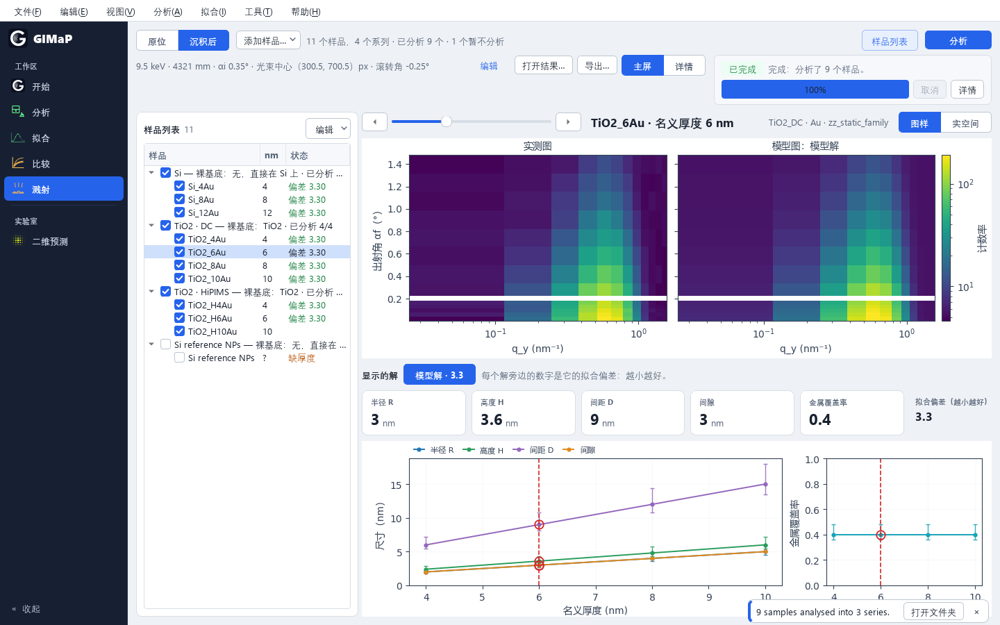
*“沉积后”添加了一个装着多个样品的文件夹——这里用的是编造的文件夹和测试里编造的结果（合成图像、编造的数值）。左边是样品列表：
三个系列及各自的裸基底，每个样品的名义厚度从文件夹名读出，旁边是拟合偏差；名字里没有厚度的样品暂不分析（“缺厚度”），它的系列
排在最后；还有一个样品尚未分析。右边是所选样品的系列，停在这个样品上。*

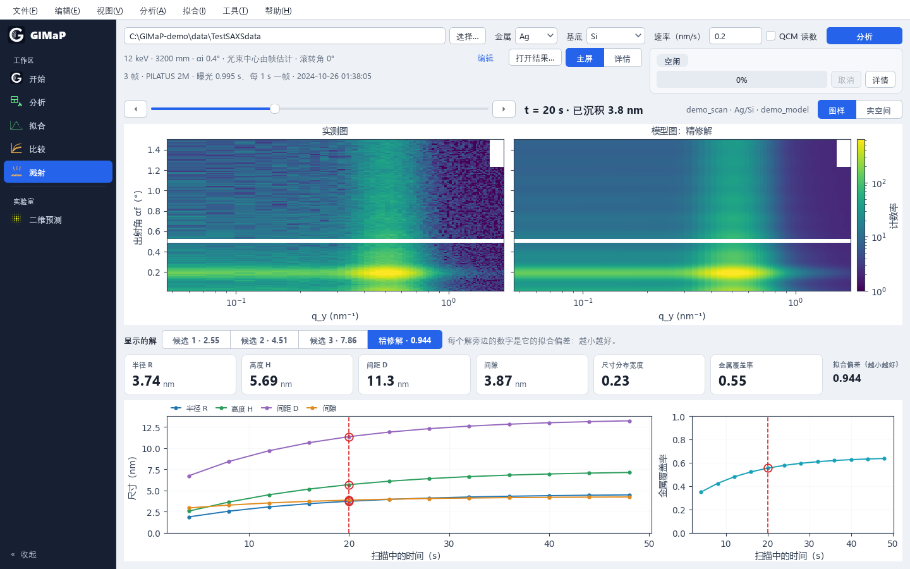
*有结果的主屏——这里的结果是编造的：合成的图像和编造的数值，扫描文件夹用仓库 `TestSAXSdata/` 文件夹里的三帧 PILATUS CBF 帧
代替。上方：输入栏、一行几何和分析的任务状态。下方：所选的时间窗与“图样 ｜ 实空间”切换、实测图与所显示解的模型图并排、各个解和它们的拟合偏差、
数值，以及整条扫描里的演化。*

**下结论之前。** 这些数值属于一个图像能重现实测图的物理模型，并且取自一条在整条扫描里平滑的演化。它们没有与你的样品的
独立测量（SEM、AFM、XRR）比较过；名义沉积量和金属量与你给出的速率成正比。分析包的报告（**详情 ▸ 报告**）写明每个量是直接从
计数读出的、模型值还是估计。

**打开结果…**显示以前分析过的结果：选它的文件夹，或选这个扫描的结果文件夹（显示其中最新的结果）。没有“分析”结果的文件夹
（例如早先的方法“预测”留下的，GIMaP 已不再包含该方法）不会打开。结果存在哪里见第 12 章。

### 8.2 详情

输入栏右边的**主屏 | 详情**切换到详情。左边从上到下：

- **样品与几何**（Sample and geometry）：**X 射线**（X-rays：**能量（keV）**（Energy (keV)）或**波长（nm）**（Wavelength
  (nm)））、**距离（mm）**（Distance (mm)）、**入射角 αi（°）**（Incidence αi (°)）和**光束中心（px）**（Beam centre (px)，
  列、行）。核对每个值。每个值旁边写着它的来源——这个文件夹上次的分析、预设、（只对能量）文件头里的 `Wavelength` 行或这个
  扫描的 NeXus 文件，或任何文件夹上次的运行（*请核对*）——或者请你填写：PILATUS 的文件头里既没有距离也没有入射角。平场
  文件名里的 `E<eV>` 是探测器的标定能量，不一定是光束的能量：它只显示在输入框旁边，从不填入。需要核对的值、与所用值不同的
  文件中的能量都用警告样式（⚠）显示；这一行的提示说明原因。**光束中心（px）**留空时由帧估计；你给出的光束中心使用分析页的
  像素坐标（4.4 节）。**把几何存为预设…**（Save Geometry as Preset…）为这台探测器和这个平场在一次束线时间内（默认是扫描前后
  各一周）的后续扫描填好几何。3.9 节说明还记住了什么。
- **分析选项**（Analyze options，8.1 节）。
- **静态帧（沉积之后测量）**，默认折叠（8.1 节“沉积之后测量的样品”）。
- **更多选项**（More options），默认折叠：

| 字段 | 用途 |
|---|---|
| **掩膜文件**（Mask） | 探测器掩膜（`.npy`，可选），只为这个文件夹记住。**分析包自带的掩膜**（Masks of the Package）列出分析包带来的像素掩膜。 |
| **样品滚转角（°）**（Sample roll (°)） | 这个文件夹和预设都没有给出时为 0（页面会说明）。 |
| **结果保存在**（Save results in） | 结果文件夹放在哪里（默认是用户数据文件夹里的 `sputter` 文件夹）。 |

**存储**（Storage，默认折叠，在“更多选项”下面）：分析读入的帧会保留，同一个扫描下次不用重读——每个扫描常有几 GB。它们放在
GIMaP 的本机文件夹（Windows 上是 `%LOCALAPPDATA%\GIMaP\sputter_client`，macOS 上是 `~/Library/Caches/GIMaP/sputter_client`），
不放在用户数据文件夹：Windows 上那个文件夹随漫游配置文件同步。展开后列出每份读入数据（大小、上次被分析使用的时间、在哪里）、
合计和结果的大小。**删除所选**（Remove Selected）和**删除未使用超过** *n* **天**（Remove Unused For）先询问再删除；正在被
分析使用的那份不删。**读入数据上限**（Limit of the imports，默认 5 GB，0 为不设上限）：分析开始和结束时，从最久没用过的
读入数据删起，直到其余的不超过上限——绝不删正在使用的，也绝不删结果。旧版 GIMaP 放在用户数据文件夹里的读入数据照样使用，
列为“用户数据文件夹（旧版 GIMaP）”；它们不会被搬动。

右边是关于主屏所示结果的五个标签页（还没有结果时，每页都写着*请分析一个扫描，或打开一个结果*）：

- **时间窗**（Windows）：每个时间窗一行（沉积之后测量的系列为每个样品一行），列出主屏上显示的那个解——时间、名义厚度、
  它的数值、拟合偏差，以及是哪一个解。在主屏上换一个解，它那一行跟着变。`Ctrl+C` 复制所选的行。
- **生长过程**（Growth Process；用较新分析包分析的原位扫描）：依据哪些解（整条扫描的联合精修，或贯穿各时间窗的平滑路径）；
  **生长阶段**及其时间范围和金属量；对金属量 h 的**生长规律**——覆盖率达到 0.5 和成膜时的金属量、成膜前的 D = D₁ h^p 和
  R = R₁ h^q、成膜后的 D 和 R、停镀后的粗化、拟合偏差中位数和相邻时间窗间的回退次数——每一项旁边是构建分析包所用的、同一金属
  在同一基底上的扫描的中位数和范围，以及这条扫描在范围内、低于还是高于范围；还有**模型的物理项**：每个时间窗所显示解里各项
  的占比（跟着你的选择变）。金属量是等效厚度，与 X 射线波长无关。
- **报告**（Report）：分析所用的网络、试过的网络及其拟合偏差、模式、像素掩膜和运行时间；然后是**各步用时**（Time per
  step），一张小表列出每一步及其用时（分:秒）——读帧那一行另写已读入几帧（共几帧）和磁盘每帧的秒数及其占用时的比例——、
  全部步骤的合计和进程数；从磁盘读帧是慢的一环时有一条提示（与实时视图相同）；最后是分析包的报告（`REPORT.md`）。
  较旧分析包的结果只列它有的行（没有读帧信息和进程数）。
- **日志**（Logs）：分析每一步的日志（`analyze_*.log`），一次显示一个。
- **步骤**（Steps）：实时视图里那样的分析步骤，各带它的结论；点带 › 的步骤在右边查看它的图。较早分析包的结果说明它没有
  各步骤的记录。

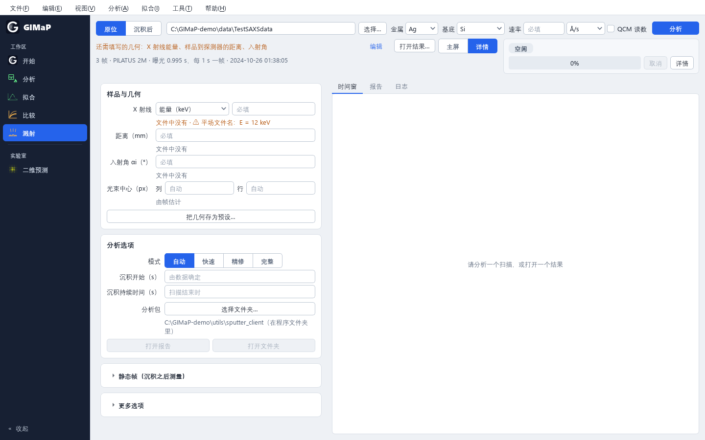
*选好文件夹时的详情。这里用仓库 `TestSAXSdata/` 文件夹里的三帧 PILATUS CBF 帧代替一个扫描（它们不是溅射序列，所以没有结果）：
输入栏下面一行写出帧数、探测器、曝光和时间。能量、距离和入射角不在文件里，所以页面请你填写（平场的能量只显示在能量旁边，
不填入）；光束中心留空时由帧估计。*

### 8.3 输出文件

分析的结果在这个扫描的文件夹的子文件夹里，`sputter/<扫描>-<代码>/iampred-<代码>`：分析包的报告（`REPORT.md`、`report.png`、
`report.csv`）和图、`windows.csv`、`analysis.json`、各步骤的日志（`analyze_*.log`）、主屏用的数据（`main/main.json`，每个
时间窗一个 `w_<t>.npz` 和 `.png`）、你选的解（`main/choices.json`）和 `gimap_request.json`。第 12 章列出全部文件。

## 9. 工具窗口

本章介绍 **工具**（Tools）菜单里的三个窗口：格式转换（Format Converter）、XRR 序列提取（XRR Series Extractor）和 SEM 粒径分析（SEM Particle Analysis）。这个菜单的其他命令随各自的工作介绍：几何标定（Geometry Calibration，4.3 节）、一维预测（1D Predict，6.4 节）和用 AI 处理（Process with AI，第 10 章）。这些窗口和工作区并排使用：窗口打开在当前页面之上，不改变这个页面。每个窗口都记住自己的大小和位置。每个工具算什么、用什么单位和像素坐标、不做哪些校正，见[《物理与方法》第 13 章](Physics_Manual_zh.md#13-工具窗口与实验室)。

### 9.1 格式转换

打开 **工具 ▸ 格式转换…**（Tools ▸ Format Converter…，`Ctrl+Shift+C`），把探测器帧写成另一种格式。
**工具 ▸ 转换当前文件…**（Convert Current File…）打开窗口时会带上当前工作区显示的文件。源文件只读，不会被改动。

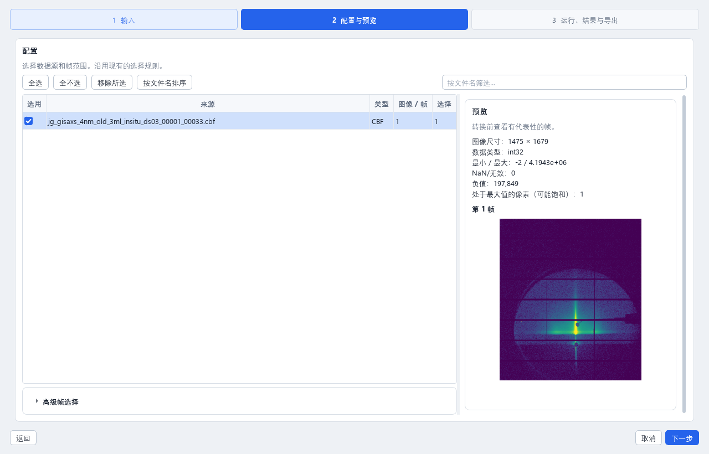
*第 2 步：左边是要转换的源文件；右边是预览，以及这一帧的尺寸、数据类型、数值范围和无效、负值、饱和像素的数目（多帧源文件显示第一帧、中间帧和最后一帧）。*

窗口分三步，用 **下一步**（Next）和 **返回**（Back）切换。

1. **输入**（Input）：**添加文件**（Add files）、**添加文件夹**（Add folder）或 **使用当前打开的文件**（Use currently
   opened file），也可以把文件和文件夹拖到窗口上。转换器读取 NeXus/HDF5（`.nxs`、`.nx`、`.nx5`、`.h5`、`.hdf5`、`.hdf`）、
   CBF 和 TIFF，读取器和方向与分析页相同（5.1 节）；能识别单幅图像和多帧文件；一组模块文件是一个输入（拼接，以扫描名命名，
   不带 `_m01`），master 和它的数据文件也是；NeXus 文件里有多个数据集时，由你选择数据集。列表写出一个输入由什么组成，
   以及读取器的说明（⚠ 缺模块文件、帧数不同）。不含探测器图像的 HDF5 文件不能作为输入，并说明原因。
2. **配置与预览**（Configure & Preview）：勾选要转换的源文件（**全选**（Select all）、**全不选**（Select none）、
   **按文件名筛选…**（Filter by filename…）、**按文件名排序**（Sort by filename）、**移除所选**（Remove selected））。多帧 NXS 文件可在
   **高级帧选择**（Advanced frame selection）里选 *全部*、*当前帧*、*帧范围*、*自定义*（例如 `1, 5, 8–20`）或
   *每 N 帧*。预览显示第一帧、中间帧和最后一帧。
3. **运行、结果与导出**（Run, Results & Export）：选择

   | 设置 | 选项 |
   |---|---|
   | **输出格式**（Output format） | TIFF、CBF、HDF5 或 NumPy（`.npy`）。所有输入都已经是的格式不提供（HDF5 仍可用于容器文件） |
   | **输出位置**（Destination） | 默认是第一个输入旁边的 `converted` 文件夹 |
   | 文件名 | 单帧源文件的帧沿用源文件名（`<source>.tif`）。多帧源文件用 **多帧命名模板**（Multi-frame template），默认 `{source}_{frame:06d}`（或 `{source}_img_{frame:06d}`），例如 `scan_001_000123.tif`。帧号从 1 数，而批量导出的文件名里 `_frame0003` 从 0 数。勾选 **文件名冲突时自动添加后缀**（Add suffix automatically when names collide，默认勾选）时加上 `_001`、`_002` …，不勾选时遇到同名文件就停下 |
   | **高级输出选项**（Advanced output options） | 数据类型（默认保留存储的数值和类型，见下文；CBF 只存整数：NaN、浮点数的小数部分和负值都保留不了）；**另写元数据 JSON 文件**（Write metadata sidecar JSON，默认勾选）：**整个转换只写一个元数据文件**（One metadata file for the whole conversion，即 `conversion_metadata.json`，默认）或 **每张输出图像旁各写一个 JSON 文件**（One JSON file beside each output image）；**导出为一个 NeXus/HDF5 容器文件**（Export as one NeXus/HDF5 container，`converted_images.h5`；这个文件已存在时为 `converted_images_001.h5` …） |

   写 CBF 或 TIFF 时，文件头里的元数据是 ASCII JSON（`json.loads` 能原样读回，非 ASCII 的路径也一样）。第三步的按钮显示为
   **检查并转换**（Review & Convert）：它列出要写的内容和大小，在那里按 **转换**（Convert）开始转换。

**没有数据的像素。** 转换后的帧在 GIMaP 里读回来和源文件一样：没有数据的像素相同（模块缝隙、坏像素、被屏蔽或没有模块覆盖的像素），
其余像素的数值相同，整数计数仍是计数（计数误差、死像素检测照常）。例外是写成 CBF 的浮点帧：CBF 只存整数，小数部分被截掉，
负值（−1 及以下）读回时是缝隙码，即没有数据的像素。这样的帧请写成 TIFF 或 HDF5。默认
（**保留存储的数据类型**，Keep the stored data type）按文件存储的类型写——即预览里的 **数据类型**（Data type）——而不是读取器给出的 32 位浮点数：

| 源数据 | 写成 |
|---|---|
| 整数计数（Pilatus 的 CBF 或 TIFF、NeXus） | 存储类型；缝隙码按存储的值保留（Pilatus 的 −1、−2）。读取器已经剔除的像素（NeXus `pixel_mask` 标记的像素、拼接模块之间的缝隙）写成 −1。需要写 −1 的无符号帧改用能容纳所有数值的有符号类型（uint32 → int32）；HDF5 里保留原类型，用该类型的最大值标记这些像素 |
| 浮点帧 | 按存储的值，没有数据的像素写 NaN（CBF 只存整数：写 −1；数值被截断，负值读回时是缝隙码） |
| **保存为 32 位浮点数**（Save as 32-bit float） | 32 位浮点数，没有数据的像素写 NaN（CBF：−1） |
| **按原始数据范围转换为 uint16**（Convert to uint16 …）/ **截断到 uint16 范围**（Clip to the uint16 range） | 由有数据的像素换算成 uint16（缩放到 0–65534，或在 65535 处截断）；没有数据的像素写 65535 |

HDF5 输出（以及容器文件）另外在 NeXus 的 `/entry/instrument/detector/pixel_mask`（第 0 位）里标记每个没有数据的像素，
GIMaP 和其他 NeXus 读取程序都认它。每帧的元数据在 `pixel_values` 下写明做了什么：存储类型和写出的类型、没有数据的像素有多少、
写成了什么；写成 CBF 的浮点帧还写明读回时没有数据的像素有多少（`pixels_read_back_without_data`）、多少负值成为缝隙码
（`negative_data_read_as_gap_codes`）、多少数值被截断（`values_truncated`）。GIMaP 不把 `.npy` 文件当作帧打开：那里的标记就是 −1 或 NaN。两种 uint16 模式只在 HDF5 里保留这个标记：TIFF 或 CBF
不带掩膜，没有数据的像素从这些文件读回时是值为 65535 的有效像素（见第 13 章）。规则见
[《物理与方法》13.3 节](Physics_Manual_zh.md#133-格式转换)。

运行时会弹出进度窗口，可以 **暂停**（Pause）和 **取消**（Cancel）（正在写的那幅图像会先写完）。结束后可用
**打开输出文件夹**（Open output folder）和 **查看报告**（View report）。报告是输出文件夹里的
`conversion_report.json`，列出每一帧写成还是失败；之后再往同一文件夹转换时会替换它。

转换器不读 EDF 帧。显示的是 EDF 帧时，**转换当前文件…** 打开的窗口里没有这个文件，输入列表下面会说明原因。
要转换 EDF 帧，或者按分析读取的样子转换任意帧（拼接模块、帧求和），请用
**分析 ▸ 批量导出 ▸ 转换格式的探测器帧**（Analyze ▸ Batch Export ▸ Converted detector frames；TIFF、EDF、NumPy 或 HDF5，见 5.7 节）。

### 9.2 XRR 序列提取

打开 **工具 ▸ XRR 序列提取…**（Tools ▸ XRR Series Extractor…，`Ctrl+Shift+R`），从 GIWAXS/GISAXS 探测器的角度序列得到
XRR 曲线。每一帧给出曲线上的一个点。

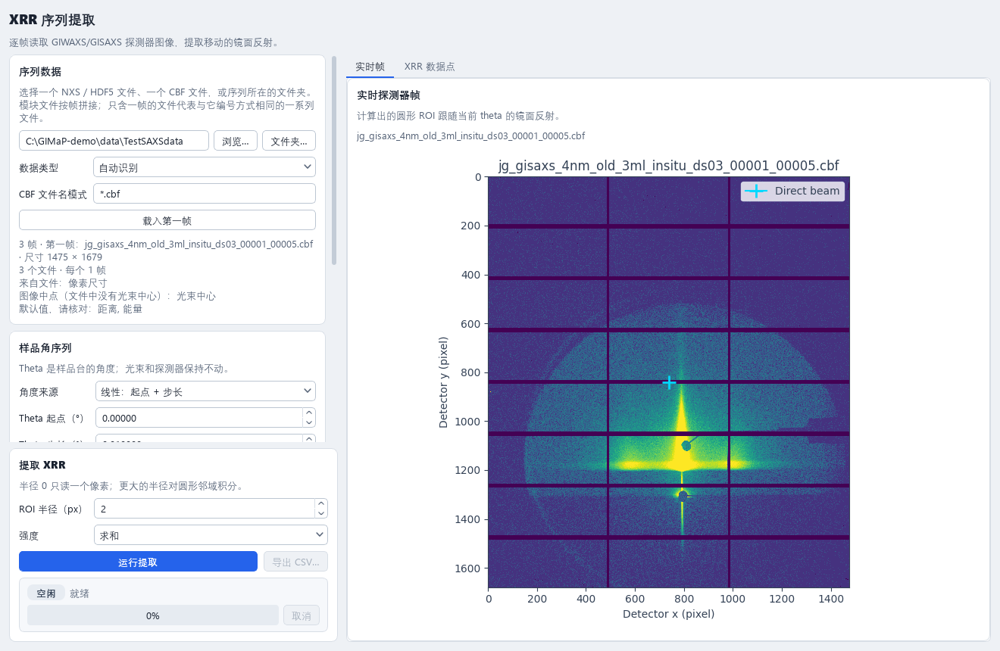
*左边：序列（**浏览…** 选文件，**文件夹…** 选序列所在的文件夹；下面写出序列由什么组成、哪些值文件里没有）、θ（几何在下面）和 ROI。
右边：帧上的直射束十字和落在镜面反射上的 ROI 圆；曲线在 **XRR 数据点** 标签页里。*

1. **选择序列。** **浏览…**（Browse…）选一个 NeXus/HDF5 文件或 CBF 文件，**文件夹…**（Folder…）选序列所在的文件夹；
   文件或文件夹也可以拖到窗口上。
   - 一组模块文件每帧拼成一幅；一个多帧文件每帧一个点（各模块帧数不同时只用每个模块都有的帧）。
   - 只有一帧的 NeXus 文件代表编号方式与它相同的那一串文件；编号相像但对不上的文件（帧尺寸不同、不止一帧）会列出并排除。
     一文件夹的 NeXus 文件逐个读。
   - CBF 再给一个通配模式（**CBF 文件名模式**（CBF pattern），例如 `*.cbf`）：按自然顺序排列的每个文件是一个点。
2. **设置 θ。** 用线性序列（**Theta 起点（°）**（Theta start）和 **Theta 步长（°）**（Theta step）），或者用 NXS
   里每帧一个 θ 值的电机数据集。
3. **设置几何。** 输入距离、能量、像素尺寸和直射束中心。在**探测器旋转角（Detector rotations）**中核对以度计的 pyFAI rot1、rot2 和 rot3 以及 **pyFAI 探测器朝向（pyFAI orientation）**（1–4）。未提供的旋转角默认为零，朝向默认为 3。**反射方向（Reflection direction）**选择实验室坐标系中向上或向下的散射光线。探测器绕光束旋转时，反射点会跨列移动。
   - 窗口从最近一次应用的几何标定开始，标记为 *（来自上次标定）*（from last calibration）。那次标定的帧尺寸不同时，
     只采用它的能量。
   - **载入第一帧**（Load first frame）不会覆盖你输入的值。每个字段旁的标签说明每个值来自文件、上次标定、
     图像中心还是内置默认值；**载入第一帧** 下面的摘要只提醒文件里没有、需要核对的值（*⚠ 文件里没有，请核对：…*）。
   - 若文件给出的探测器朝向或倾斜超出支持范围，检查摘要会列出字段和原值。请核对提取所用数值旁的来源标签。rot3 加减整周等价。
   - **选取直射束中心**（Pick direct-beam center）可以在帧上点出中心。
4. **设置 ROI。** ROI 半径，以及 `求和`（Sum）或 `平均`（Mean）。半径 0 只读一个像素；更大的半径对算出的镜面反射点周围的圆形区域积分。
5. **运行提取**（Run extraction）。每次只载入一整帧：窗口显示它和 ROI，记下一个点，再释放这一帧。整个序列不会同时放进内存。
6. **查看与导出。** **实时帧**（Live frame）和 **XRR 数据点**（XRR points）可随时切换；处理过程会更新两者，但不会替你切换标签页。
   **导出 CSV…**（Export CSV…）保存 θ（°）、qz（Å⁻¹）、强度、ROI 位置和有效像素数。

CSV 默认写到 `<源文件夹>/<源文件名>_xrr.csv`；用 **文件夹…**（Folder…）选的文件夹（CBF 或 NeXus 文件）则写进这个文件夹里，以文件夹命名。旁边的 `.json`
记录保存决定 qz 的每一个值（序列、θ、距离、能量、像素、中心、方向、ROI）以及各自的来源，并在 `source_layout` 下写出序列由什么组成、
读了哪些文件和读取器的警告（运行结束后状态行也会重复这些警告）。

**没有做的校正。** 提取器给出的是 ROI 的原始求和或平均值，不做监视器 / 通量归一化、足印校正、背景扣除或分辨率校正，θ 也不加偏移。
θ 的电机数据集支持度、rad、mrad 和 urad（含 µrad/μrad）；遇到未知单位或非有限角度时停止提取。整数探测器的负值缝隙码与读取器掩膜会排除，浮点帧的负值仍作为数据保留。不应用分析页的交互掩膜与坏像素搜索。头文件光束中心采用变换后的显示坐标；没有唯一中心的模块拼接帧需要标定或点选中心。


**像素坐标。** 直射束中心的显示和输入与分析、几何标定使用同一套像素坐标（见 4.4 节）：像素角点在整数上，第一个像素的中心是
(0.5, 0.5)；x 从左边缘数，y 从上边缘数。把鼠标停在中心字段或 *ROI x* / *ROI y* 表头上，窗口里也能看到这段说明。
中心值可以在三个窗口之间直接复制。XRR 将应用的光束中心四舍五入到两位小数，几何标定显示三位，分析页显示四位。
三者都使用单击**应用**时保存的坐标。

- 预览图、十字和 ROI 圆，以及 *ROI x* / *ROI y* 列，用的都是同一套像素。
- 用鼠标选的中心就是点击的位置：半径为 0 时，点哪个像素就读哪个像素。
- 窗口退回使用的图像中心（第 3 步）是帧的正中，即 (列数 / 2, 行数 / 2)。

导出的文件数法不同：CSV 里的 `roi_center_x_px` / `roi_center_y_px` 和 JSON 记录里的
`geometry.beam_center_x_px` / `beam_center_y_px` 从 0 开始数像素中心，所以比窗口显示的小 0.5 px，记录里写明了这一点
（`center_convention`）。如果你在 2026-10-13 之前的 GIMaP 里从这个窗口记下过中心，请把 x 和 y 各加 0.5 px：那时窗口从 0 开始数像素中心。

**NeXus 文件头中心。** XRR 与分析页现在采用相同的显示坐标，包括 P03 的转置和上下翻转。没有唯一头文件中心的模块拼接帧使用标定或明确点选的中心。提取前请检查预览图上的十字。

### 9.3 SEM 粒径分析

打开 **工具 ▸ SEM 粒径分析…**（Tools ▸ SEM Particle Analysis…），测量 SEM 图像中的颗粒尺寸，或者从 CSV 文件载入别处测好的粒径。
这个窗口独立工作：不需要预测模型、TensorFlow 或散射数据。**实验室 ▸ 二维预测** 预测的半径分布可以和它比较：在那里按 **SEM 对比…**（SEM comparison…），会打开这个窗口并附上预测的一份副本（见 11.1 节）。

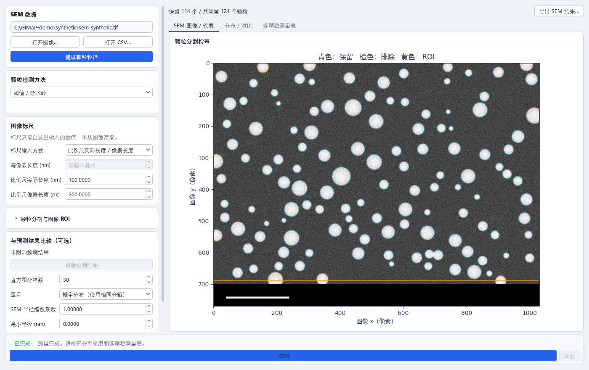
*先检查轮廓：青色颗粒被保留，橙色颗粒被排除（表里写着原因），黄色框是 ROI。*

测量的是每个颗粒**投影面积的等效圆半径**：

```text
A_nm² = A_px × nm_per_pixel²
R_nm  = sqrt(A_px / pi) × nm_per_pixel
D_nm  = 2 × R_nm
```

`A_px` 是颗粒包含的像素数。不圆的颗粒也按同面积的圆给出半径。分布图的横轴是 R，表里同时给出 R 和 D。分割、筛选以及与预测的比较，
定义见[《物理与方法》13.2 节](Physics_Manual_zh.md#132-sem-粒径分析)。

#### 测量图像

1. **打开图像。** 在 **SEM 数据**（SEM source）里按 **打开图像…**（Open image…），选择 TIFF、PNG、JPEG 或 BMP。
2. **输入标尺。** 在 **图像标尺**（Image calibration）里选 **标尺输入方式**（Calibration method）：
   - **每像素长度 (nm)**（nm per pixel）：直接输入数值；
   - **比例尺实际长度 / 像素长度**（Scale-bar length / pixels）：输入比例尺的长度（nm）和它的像素长度；
     `nm_per_pixel = 长度_nm / 长度_px`。

   标尺**从不猜测**。GIMaP 不读取图中的比例尺文字、放大倍数或文件的 DPI。打开另一个文件时数值会清空；在为这个文件设置正数之前，不能提取。
3. **排除标注。** 在折叠的 **颗粒分割与图像 ROI**（Segmentation and image ROI）里勾选 **使用图像 ROI（像素边界）**
   （Use image ROI (pixel edges)），输入 **ROI 左边界 x**、**ROI 上边界 y**、**ROI 右边界 x**、**ROI 下边界 y**，
   把比例尺、文字和边框留在外面。ROI 用原图的像素边界：第 0 行在上，像素（第 i 行、第 j 列）的中心在 (j + 0.5, i + 0.5)。
4. 在 **颗粒检测方法**（Particle detection）里**选择检测方法**（见下文）和它的设置。
5. **运行。** 数据区下面的按钮随方法显示为 **提取颗粒粒径**（Extract particles）、**检测颗粒（本地 AI）**
   （Detect particles (local AI)）或 **测量标签颗粒**（Measure labeled particles）。
6. **检查。** 查看 **SEM 图像 / 轮廓**（SEM image / outlines）和 **逐颗粒测量表**（Particle measurements）：哪些区域被保留，
   哪些被排除，为什么。确认之后再使用分布。

没有颗粒通过筛选时，候选颗粒、排除原因和轮廓仍会显示，也可以导出供检查；这时没有粒径分布。

#### 检测方法

换方法会使之前的测量失效。一种方法失败时，GIMaP 不会自己改用另一种。

| 方法 | 适用情况 | 需要什么 |
|---|---|---|
| **阈值 / 分水岭**（Threshold / watershed，默认） | 分得开、对比清楚的颗粒 | 不需要别的 |
| **StarDist（本地 AI）**（StarDist (local AI)） | 阈值分不开的相互接触的颗粒 | 装有 StarDist 的本地 Python，以及本地模型文件夹 |
| **已有实例标签**（Existing instance labels） | 在别处做好的标签（GIMaP 之外的 StarDist、人工修正的标签 …） | 整数 TIFF/PNG 标签图 |

**阈值 / 分水岭。** 设置在 **颗粒分割与图像 ROI** 里：

| 设置 | 作用，以及要检查什么 |
|---|---|
| **颗粒与背景对比**（Particle contrast）：颗粒比背景亮 / 暗 | 亮：取高于阈值的像素；暗：取低于或等于阈值的像素 |
| **阈值**（Threshold）：Otsu 自动阈值 / 手动阈值 | Otsu 由 ROI 内的有限值算出；手动阈值用 **存储灰度值**（Stored intensity）里的数（图像的存储强度单位）。检查背景和颗粒是否分开 |
| **分开接触颗粒（分水岭）**（Split touching particles (watershed)）、**分水岭峰最小间距 (px)** | 把接触的颗粒分开；间距决定一团颗粒被切成几块，注意过分割和漏分割 |
| **最小面积 (px²)**、**最大面积 (px²)** | 去掉噪声或大块背景，也可能去掉真实颗粒；最大面积默认 *不设上限*（No upper limit） |
| **最小圆度**（Minimum circularity） | `4 pi A / perimeter²`；圆度值保留在表里 |
| **排除接触 ROI 边界的颗粒**（Exclude particles touching the ROI boundary） | 默认开启；被 ROI 截断的颗粒被排除，并写明原因 |

灰度图按存储强度分割。彩色图按记录的亮度公式（0.2126 R + 0.7152 G + 0.0722 B）转成灰度。屏幕上的对比度拉伸只帮你看清，不改变阈值、面积或任何测量值。

**StarDist（本地 AI）**，可选。它用训练好的实例分割模型在你的电脑上分开相互接触的颗粒。

- 设置 **本地 Python 解释器**（Local Python executable，装有 StarDist 和 TensorFlow 的 Python 环境）和 **本地实例分割模型**
  （Local instance model，含 `config.json` 和 `weights_best.h5` 或 `weights_last.h5` 的文件夹）；用 **浏览…**（Browse…）选择，
  **检查本地运行环境和模型**（Check local resources）检查文件是否齐全。
- GIMaP 默认在 `~/.cache/gimap/sem/stardist/`（或 `GIMAP_SEM_STARDIST_HOME` 指定的文件夹）里找：Python 在
  `runtime/Scripts/python.exe`（Windows）或 `runtime/bin/python`，模型在 `models/2D_versatile_fluo/`。
- 搭建这个环境时用它自己的 Python 运行 `python -m pip install -r requirements-sem-stardist.txt`（StarDist 0.9.2、CSBDeep 0.8.2、
  TensorFlow 2.15.1）。清单只装软件包，不含模型权重；GIMaP 自己的环境不需要这些包。
- 模型在单独的进程里用 CPU 运行。图像不上传，也不下载权重。**取消**（Cancel）会结束这个进程。一次运行超过 15 分钟会被停止。
- **实例 AI 高级设置**（Instance AI options，折叠）：**AI 图像缩放系数**、**检测概率阈值**、**NMS 重叠阈值**
  （*使用模型默认值*（Model default）即采用模型保存的阈值）、**归一化下 / 上百分位**（在 ROI 内计算；暗颗粒先反转）。
- 测量之前，轮廓会放回原图的像素网格：AI 图像缩放系数不会改变面积。标尺、ROI 以及面积、圆度、边界筛选对三种方法都一样。

官方 `2D_versatile_fluo` 权重是用荧光细胞核图像训练的：**没有针对 SEM 验证**。请用自己图像上的轮廓来判断；检测到的颗粒更多不等于更准确。
用 SEM 图像训练的模型可以从本地文件夹载入。

**已有实例标签。** 先打开 SEM 图像，再选标签文件。0 是背景，每个颗粒有自己的正整数。RGB 伪彩色图、浮点标签和多页文件会被拒绝。
标签图的尺寸要么与 SEM 图像相同，要么正好等于你设的 ROI。GIMaP 不检查标签是否由这张图像得到。

#### 从 CSV 文件导入粒径

按 **打开 CSV…**（Open CSV…），然后在 **CSV 粒径设置**（CSV measurement settings）里选择：

- **粒径数值列**（Value column），以及它是 **半径** 还是 **直径**（**数值含义**，Stored size quantity）；
- **数值单位**（Stored unit）：`nm`、`µm` 或 `像素`（像素需要这个来源的 **图像标尺**）；
- **分隔符**（Delimiter，TSV 用 `\t`）和 **表头前跳过行数**（Rows before header）；**读取 CSV 列名**（Read CSV columns）重新读取列名。

软件不会替你选列。按 **导入粒径**（Import particle sizes）：直径除以二，µm 换算成 nm。空的、非数值、非有限或非正的行会被拒绝，原因写在表里。

#### 分布与比较

| 设置 | 含义 |
|---|---|
| **直方图分箱数**、**最小半径 (nm)**、**最大半径 (nm)** | 分箱；最大值默认 *由数据和预测确定* |
| **显示**（Display）▸ **概率分布（使用相同分箱）**（Probability (same bins)，默认） | SEM 和预测重新分到同样的分箱边界，各自在范围内归一化到总和为 1；范围外的部分会写明 |
| **显示** ▸ **论文显示（单独缩放预测峰高）**（Paper display (independent peak scaling)） | SEM 用 60 个分箱；预测用它自己的半径轴，扣除最小值后按 SEM 峰高缩放，这时高度不能当作可比的概率 |
| **SEM 半径缩放系数**（SEM radius scale） | 默认 1；只在比较时缩放 SEM 半径，测得的半径仍保留在颗粒表里。取其他值时，标签页下方以警告显示（*⚠ SEM 半径缩放系数：…*） |

改动之后按 **更新分布**（Update distribution）；导出需要最新的分布。**移除预测结果**（Remove prediction）保留 SEM 测量，只显示它自己。从 **工具** 菜单再次打开这个窗口时，之前附上的预测也会被移除。

#### 导出

**导出 SEM 结果…**（Export SEM results…）先让你选文件夹，然后在里面新建子文件夹 `SEM_analysis_<日期>_<时间>/`。
那里已有同名结果文件时，它拒绝覆盖。

| 文件 | 内容 |
|---|---|
| `sem_particles.csv` | 每个对象：是否保留、R、D；图像来源还有面积、中心、圆度和排除原因 |
| `sem_distribution.csv` | 分箱边界、SEM 概率，以及附带的预测 |
| `sem_distribution.png` / `.pdf` / `.svg` | 分布图（浅色配色），附带预测时含对比曲线 |
| `sem_display_arrays.npz` | 图上画的数组，以及测得的半径 |
| `sem_overlay.png` / `.pdf` / `.svg` | 轮廓、保留和排除的对象以及 ROI，供检查（仅图像来源） |
| `sem_segmentation.npz` | 原分辨率灰度图（未做显示拉伸）、标签、轮廓叠加（仅图像来源） |
| `sem_instance_labels.tif` | 原分辨率 int32 标签，保留原 ID，可在 **已有实例标签** 里重用（仅图像来源） |
| `sem_analysis.json` | 带 SHA-256 的来源、读取方式、标尺、ROI、方法及设置、筛选条件、计数、比较设置、预测来源和文件清单 |

CSV 文件的 `#` 头行里也写有来源和设置。StarDist 运行还会记录模型配置、阈值和权重的 SHA-256；权重本身不复制。

读取、提取、更新分布和导出都在后台运行。**取消** 会丢弃尚未显示的结果；正在写的文件可能仍会写完，已经写出的文件不会被删除。

## 10. AI 助手

分析命令栏里的 **问 AI…**（Ask AI…），或 **工具 ▸ 用 AI 处理…**（Tools ▸ Process with AI…，`Ctrl+Shift+L`），让 AI 用你同样的工具分析
分析页面上显示的帧（GIWAXS 或 GISAXS）。它会切换模式、调整扇区和切线、设置 I(χ) 窗口、拟合峰或水平切线并导出文件，页面会跟着显示每一步。
AI 是可选的：**运行自动分析**（Run Automatic Analysis）不需要 AI 也能给出标准结果（见 5.5 节）。

运行时，一个面板显示 AI 推理的摘要、每次工具调用（鼠标停留可看参数和结果）、修改卡片，最后是报告。

### 10.1 三种引擎和设置

在 **工具 ▸ 设置… ▸ AI 助手**（Tools ▸ Settings… ▸ Assistant）里，或在开始对话框的 *AI 引擎*（Brain）里选择引擎（**设置 AI…**（Set Up AI…）打开设置）。

| 引擎 | 计费 | 设置 |
|---|---|---|
| **Claude Code —— 你的 Claude 订阅**（Claude Code — your Claude plan；默认） | 计入你的 Claude Pro 或 Max 订阅；不需要 API 密钥 | 需要安装 Claude Code（Claude 桌面应用自带：`claude.exe` 在 `%LOCALAPPDATA%\Packages\Claude_…\LocalCache\Roaming\Claude\claude-code` 下，GIMaP 会自己找到，也可以在 **程序**（Program）旁用 **浏览…**（Browse…）选择）并登录一次：**登录…**（Sign In…）打开一个运行 `claude auth login` 的窗口；选好账号后按 **检查登录**（Check）。模型和思考强度在设置里选（模型留空即 Claude Code 的默认值）。 |
| **Claude API —— API 密钥**（Claude API — API key） | 按 token 计费 | 先运行一次 `pip install anthropic`；在设置的 **API 密钥**（API key）里输入密钥，按 **保存**（Save）（或设置 `ANTHROPIC_API_KEY`）；**测试连接**（Test Connection）检查密钥和模型。默认模型 `claude-opus-5`，思考强度 *high*。 |
| **其他 AI 服务商 —— OpenAI 兼容 API**（Other AI providers — OpenAI-compatible API） | 按服务商的方式计费 | 先运行一次 `pip install openai`。在 **其他 AI 服务商**（Other AI providers）里选服务商（地址自动填好；本地服务器或 Azure 需要改），保存密钥或设置对应的环境变量（如 `DEEPSEEK_API_KEY`、`DASHSCOPE_API_KEY`），选模型（手动输入、建议列表或 **获取列表**（Get List）），再按 **测试连接**。 |

其他服务商包括 DeepSeek、Qwen（阿里云百炼）、OpenAI、Kimi、智谱 GLM、Google Gemini、OpenRouter、SiliconFlow、Azure OpenAI，
以及你自己电脑或实验室服务器上的模型（Ollama、LM Studio、vLLM …）。模型必须支持工具调用：**测试连接** 会发送一个带工具的小请求。

**密钥存在哪里。** 已安装的适配器能访问操作系统凭据库时，**保存**（Save）会把密钥存入凭据库，例如 Windows 凭据管理器。
没有可用的受支持适配器时，GIMaP 把密钥以明文保存在用户数据文件夹（3.11 节）。Claude API 密钥保存在 `claude_api_key.txt`，
其他服务商的密钥保存在 `assistant_provider_keys.json`。有权读取这些文件的人可以看到密钥。系统凭据库可用时，将原来存于文件中的密钥重新保存一次，
即可把该密钥移入凭据库。**移除**（Remove）删除已保存的密钥。GIMaP 优先使用已保存的密钥，其次读取服务商的环境变量。

Claude Code 只拿到 GIMaP 的工具，没有命令行、文件或网络权限，也不会收到 API 密钥。

**给 AI 的常驻说明**（Standing instructions for the AI，在 **工具 ▸ 设置… ▸ AI 助手** 里）会加到每一次运行中，例如你的标定文件放在哪里、线站的能量。

### 10.2 开始一次运行

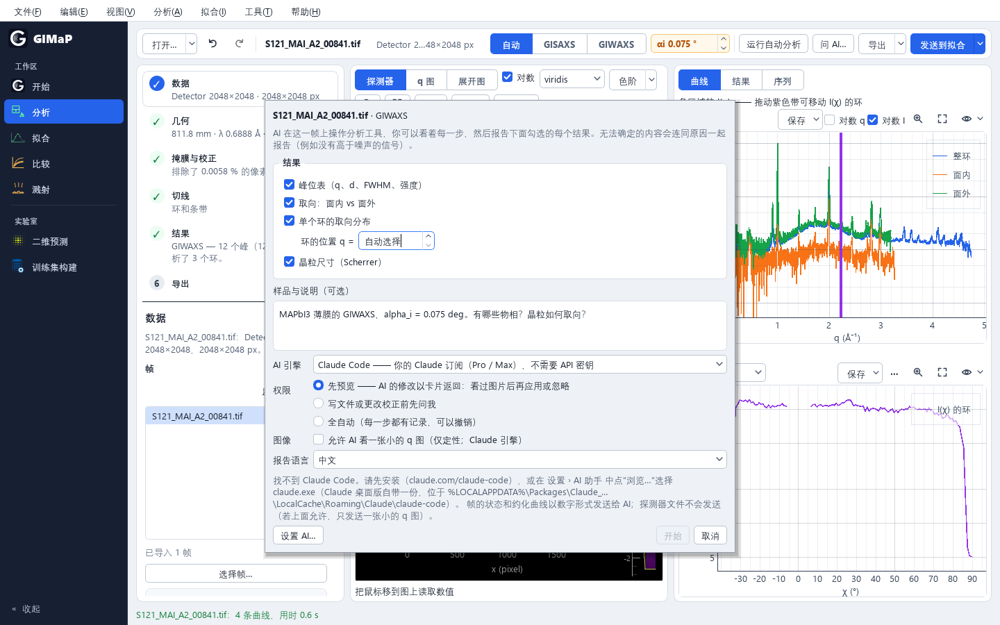
*开始对话框：要报告的结果、笔记、AI 引擎、权限、报告语言。按钮上方一行说明引擎是否就绪，以及会发送什么。这台电脑上没有安装 Claude Code，所以这一行说明到哪里获取（或在 设置 ▸ AI 助手 中选择 `claude.exe`），**开始**（Start）保持灰色；Claude Code 已登录时，这一行写出订阅和模型。*

1. 在分析里打开一帧，按 **问 AI…**。
2. 勾选想要的结果：
   - GIWAXS：*峰位表（q、d、FWHM、强度）*、*取向：面内 vs 面外*、*单个环的取向分布*（I(χ)、极大值、Hermans 取向因子；
     可指定环，也可让 AI 选）、*晶粒尺寸（Scherrer）*；
   - GISAXS：*Yoneda 处的水平切线，已居中，已选好两半*、*切线的特征长度 2π/q\**、*I(qy) 拟合：形状、半径、距离*。
3. 可在 **样品与说明（可选）**（Sample and instructions (optional)）里写笔记：样品、想知道什么、标定文件在哪里。
4. 选择 **权限**（Permissions）：

   | 权限 | 结果 |
   |---|---|
   | **先预览**（Preview first，推荐新用户使用） | AI 做的每个设置修改在结束时撤回，以卡片形式返回，由你决定是否应用 |
   | **写文件或更改校正前先询问**（Ask before writing files or changing corrections） | 每个这类操作都弹框询问；你拒绝，AI 就照办 |
   | **全自动**（Fully automatic） | 全部直接执行，每一步都有记录，可以撤销 |

5. 选择是否 **发送一张小的 q 图（仅定性；仅 Claude）**（Send a small q-map image (qualitative; Claude only)）——AI 用它目测判断，
   所有数值仍来自工具——以及 **报告语言**（Report language），然后按 **开始**（Start）。一次运行做什么，写在 **开始** 的提示里。

**停止**（Stop）随时结束运行。报告把每项要求的结果列为 *完成*、*部分完成* 或 *不可用*，并说明原因（例如“0.2 到 2.0 Å⁻¹ 之间没有高于 3σ 的峰”）。
报告下面的表格来自工具的结果，不是 AI 的文字。**保存报告…**（Save Report…）写出 HTML 报告和 JSON 记录
（`<帧>_ai_report.html` / `.json`；数据旁边已有 `gimap_analysis/` 时建议存在那里，否则存在帧旁边）。

**先做基线，再追问题。** AI 可以先一步运行 GIMaP 的标准流程（与运行自动分析相同，每个决定都附理由）。这些选择是默认值，不是限制：
AI 随后按你的问题深入——原位序列的开头、所有样品共有的峰、峰强比、基线跳过的峰——并把解释标为假设，附上依据的数值。

### 10.3 修改卡片：预览、应用、撤销

AI 对分析的每个修改（扇区宽度、自定义扇区、q 框、帧、模式、αi、径向分箱、有效强度范围）都有记录；AI 也可以只建议而不动手。
这些修改以卡片形式出现在 **修改**（Changes）下：一张带有修改的 q 图、文字说明的设置、AI 建议的理由，以及 **应用**（Apply）、
**忽略**（Dismiss）或 **撤销**（Undo）。**全部撤销**（Undo All）撤回所有已应用的修改。

在 *先预览* 模式下，AI 自己探索时做的改动会在结束时恢复。AI 为某个设置提出过建议值时，只显示这个建议；否则每个设置的净变化留作一张卡片。
改了又改回原样、或者没有可见变化的修改不显示。

### 10.4 追问

运行结束后，在报告下方的输入框里输入问题（例如“为什么面内扇区几乎没有信号？”），按 **提问**（Ask）。
一次新的运行在同一帧、同样的设置上回答它，并且知道上一次运行找到了什么，也可能带来新的卡片。

### 10.5 没有几何的帧

没有仪器配置与这一帧匹配时，AI 不会停下，而是去找几何。

1. **你点名的文件。** 笔记或常驻说明里点名的文件或文件夹先读，例如 *“标定是 D:\beamtime\calib\img_0005.cbf，12.4 keV”*。
   只写文件名的标定（*“calibration LaB6_take2.poni”*）也会采用：帧所在文件夹里、或笔记点名的文件夹里这个名字的文件。
2. **搜索。** 帧所在文件夹及其子文件夹、上一级文件夹及其其他子文件夹、上两级文件夹及其子文件夹，以及上三级里的标定 / 日志文件夹；
   需要时还可以只读地向上或向下搜索更多文件夹。它找：
   - 标定结果：pyFAI 的 `.poni` 文件和几何标定导出的标定（`.json`）；
   - 标样图像，标样由文件名或文件夹名判断（AgBH / 山嵛酸银、LaB6、CeO2、LaB6 + CeO2 混合物；Si、Al2O3 和 Cr2O3 能识别但还不能拟合）；
     多模块 NeXus 序列（`*_m01.nxs` … `*_m11.nxs`）算一幅图像；
   - 写有能量、距离、光束中心或入射角的日志和参数文件（`.log`、`.fio`、`.txt` …）。
3. **选择。** 现成的标定文件先按所在的文件夹排列（帧自己所在的文件夹，然后是它的子文件夹、上一级文件夹、旁边的文件夹、再往上），
   再按文件时间。标样图像优先选同类探测器文件、拍摄时间在帧之前、名字里带 *giwaxs*/*waxs* 和 *final*/*redone* 的。标样图像用 GIMaP 的标定拟合，
   按标样的衍射线在 q 上的位置评判：平均偏差在 0.2 % 以内为好，0.5 % 以内可用（[《物理与方法》3.4 节](Physics_Manual_zh.md#34-质量指标)）。名字说不出是哪种标样时，每种标样都拟合，用同样的方法比较。
4. **问你。** 只有数字无法决定、或者到处都找不到能量时，才会弹出 **AI 提问**（The AI asks）对话框，列出选项及其文件时间和文件夹，或请你输入数值。

帧上方两级以内的文件和你点名的文件直接读取；其他文件在你同意后读取（*写文件或更改校正前先询问*），或在面板里留一条说明后读取（另外两种权限）。
隐藏文件夹和系统文件夹（`.ssh`、`AppData`、`Windows` …）从不读取。选定的几何保存为该探测器的仪器配置（权限为 *写文件或更改校正前先询问* 时，要你批准后才保存），
报告写明它来自哪个文件、哪种标样和哪些数值。**请核对**：搜索找到的标定可能属于另一个实验（见第 13 章）。

### 10.6 发送什么，保存什么

- 首次向某个服务发送请求前，包括在设置中**获取列表**（Get List）或**测试连接**（Test Connection），GIMaP 会显示接收方并询问是否允许。
  拒绝会取消该请求。同意后，GIMaP 会将对该服务的授权保存在 `settings.json` 中。
- **分析时发送的数据。** 服务会收到你的指令、帧信息（包括文件名、几何和设置）以及约化曲线、拟合参数等工具结果。
  允许发送预览图时还会发送一张小的 q 图。使用本地部署的模型时，接收方是你选定的电脑或实验室服务器。
- **显示的**：每次运行的 token 数；Claude Code 还显示订阅的用量警告和按 API 价格折算的费用（仅供比较，订阅不按 token 计费）；API 显示估计费用。
- **本机记录。** 每次运行的记录在用户数据文件夹的 `assistant_runs/` 里，写明服务商及其返回的模型名。服务未返回模型名时记录请求的模型。
  助手导出的结果表、曲线分析 JSON 和保存的 AI 报告都包含这两项信息。
  AI 提出的缺失功能记在 `assistant_feature_requests.jsonl` 中。密钥的存放位置见 10.1 节。

**如何理解这些数值。** 背后的规则见《物理与方法》：[7.7 节](Physics_Manual_zh.md#77-环的取向与-hermans-取向因子)（Hermans）、
[7.8 节](Physics_Manual_zh.md#78-微晶尺寸scherrer)（Scherrer）和[第 8 章](Physics_Manual_zh.md#8-gisaxs-自动分析)（GISAXS）。

- 除非知道仪器展宽，Scherrer 尺寸是相干长度的下限；很宽的弥散峰（FWHM 超过 q 的 15 %）不给尺寸。
- Hermans 因子假设薄膜在面内各向同性，按 sin χ 给各 |χ| 分箱加权，至少测到 80 % 的权重时才给出。
  将统计误差与改变出射角阈值、地平线强度阈值、背景及两端衰减和未测分箱的假定密度所得的系统变化范围一起读。极图拟合将模型外推到未测到的角度。
  解释取向分数前请检查拟合质量（5.9 节）。
- 远低于同一 q 处弥散背景的区域（低于 20 %：阴影、吸收体、不灵敏的探测器区域）算作未测量，落在其中的扇区不参与比较。
  qz 轴附近的强度可能未测到（缺失楔）。
- 只有一两个分箱宽、远高于背景的峰标记为尖峰（热像素、模块边缘），不算衍射。
- 只有样品笔记或数据能明确指认时，才使用 (100)、edge-on 之类的晶体学标记。

### 10.7 不用窗口

**示例（GALAXI GISAXS）。** 在源码文件夹中运行以下命令，可复现论文图 4 的 Yoneda 切线和第二层拟合。
输入为公开的 GALAXI 帧、配套的标定文件和文献给出的入射角 0.463°。

```sh
python -m tools.gimap_agent auto tests/data/external/gisaxs_galaxi/galaxi_data.tif --calibration tests/data/external/gisaxs_galaxi/galaxi_bornagain.poni --incidence-deg 0.463 --out fig4
```

打开 `fig4/galaxi_data/report.md`，在 *Decisions* 中查看拟合层级和切线的真空 q_z。
在 q_z = 0.5226 nm⁻¹ 处，半径 5.99 nm 的竖直圆柱有 q_z·R = 3.13。*Needs attention* 提示它可能代表球（`cyl_sphere:R_2`）。BornAgain 的参考模型使用半径 5.75 nm 的球。
`horizontal.csv` 保存带正负号的 Yoneda 水平切线，`vertical.csv` 保存垂直切线。`fit_curve.csv` 给出以 |qᵧ| 为横坐标的最佳拟合曲线，两侧重叠处取平均。
`fit_solutions.csv` 列出候选解及其概率。退出码 2 表示报告里还有需要判断的问题。
同一文件夹中还有 `qmap.png` 和 `report.json`。整次运行的摘要保存在 `fig4/summary.md` 和 `fig4/summary.json`。

`tools/gimap_agent.py` 不开窗口就运行同样的标准流程，供脚本和其他智能体使用：
`python tools/gimap_agent.py auto <帧> --notes "…" --out <文件夹>` 为每一帧写一份 `report.md`，列出每个决定和需要你回答的问题。
序列按最终状态分析：最后五分之一的帧求和，至多 10 帧（不到十帧时只取最后一帧）；`--frame N` 和 `--sum K` 选别的帧；
`--max-peaks N` 拟合多于 12 个最显著的候选峰。同一探测器的
各模块文件不论给了几个，都只分析一次，放在以扫描名命名的文件夹里（缺了一部分时，报告里列为待回答的问题）；`--series` 把每个只有
一帧的文件当作一个序列。

- **帧。** 参数可以是文件、`*.tif` 这样的通配符或文件夹。shell 没有展开的通配符（PowerShell 不展开）由 GIMaP 展开，按自然顺序
  （`f2` 在 `f10` 之前）；文件夹代表其中的每个探测器图像（`.cbf`、`.tif`、`.tiff`、`.edf`、NeXus/HDF5；不搜索子文件夹；
  作为 `--calibration`、`--mask` 或 `--flat-field` 给出的文件不算）。`summary.md` 写明每个通配符或文件夹给出多少个文件；一个文件也没有时报错（退出码 1）。
- **不能用的值。** `--incidence-deg` 必须大于 0° 且小于 90°，`--calibration`、`--mask` 和 `--flat-field` 给出的文件必须存在：否则命令在读取任何
  数据之前写出原因并以退出码 1 结束（不会改用它自己找到的标定来代替你点名的那个）。
- **不属于这一帧的标定。** 没有人点名、由搜索从帧所在文件夹（及其子文件夹）以外取来的标定，是报告里的一个待回答问题，
  带完整路径（*calibration found by the search*；退出码 2）：确实是它时，用 `--calibration` 给出。`.poni` 写明的探测器尺寸
  与帧不同时——写在 `max_shape` 里，或由它点名的探测器得出（把 Pilatus 300K 的文件用在 Pilatus 1M 的帧上）——不采用：
  *the calibration does not match this frame*。GISAXS 运行中，对称轴离标定的光束中心超过 100 px 时不应用（报告写 *not applied*，
  并要求给出这次测量的标定）；找不到对称轴同样是一个待回答问题。
- **文件夹。** 每一帧在 `--out` 下有自己的文件夹，以帧命名，`summary.md` 的每一行都链接到它的 `report.md`。不同文件夹里同名的帧，
  加上能区分它们的最近一级文件夹名（`<名称>_<文件夹>`），否则加编号。已有先前运行摘要的 `--out` 文件夹会被拒绝（退出码 1）；
  `--overwrite` 替换那次运行：先删除它的 `summary.json` 列出的帧文件夹，别的不动。
- **掩膜。** `--mask FILE` 对每一帧应用同一个掩膜，读法与分析工作区的**载入掩膜**（Load Masks）相同：GIMaP 掩膜 `.json`（有顺序的形状、规则及图像来源），
  或与帧同样大小的掩膜图像，非零像素被排除。掩膜不合适的帧失败并写出原因。`report.md`（**Mask** 一节）和 `report.json`（`mask`）
  总是写明应用了哪个掩膜，或者没有应用；探测器缝隙和自动找到的坏像素与它分开写。
- **平场。** `--flat-field PATH` 用平场（探测器响应）除每一帧，做法与分析工作区校正中的**平场**（Flat field）相同：与帧同样大小
  的探测器图像或 `.npy` 数组，归一化到平均值为 1，平场值不大于 0.05 的像素被排除。平场不合适的帧失败并写出原因。`report.md`
  在**决定**（Decisions）中写出它（*flat field: divided by flat.npy (120 pixels left out)*），并在**记录**（Record）中写出文件和
  它的 SHA-256；`report.json` 把它写在 `inputs` 和 `analysis_record.corrections.flat_field` 里。
- **记录。** `report.json` 写明发布版本、UTC 时间、原样的选项（包括笔记），以及每个输入文件（帧的各个文件、标定、掩膜、平场）的路径、
  大小和 SHA-256；模型拟合还写网络、网络权重的 SHA-256 和种子。`summary.json` 是一个对象，含发布版本、时间、选项和各帧的报告
  （`frames`）。每个 CSV 以 `#` 行开头，写明发布版本、带 SHA-256 的输入和几何，列名只用 ASCII，单位只有一种写法
  （`qy (A^-1), I, sigma`；`chi (deg)`），按系统代码页读文件的程序也能读；在窗口里由分析工作区导出的曲线、q 图、展开图和
  拟合输入文件带同样的几行。`report.md` 有窗口保存的报告里的**记录**一节（5.5 节）。`report.json` 里 `geometry`
  是计算 q 所用的值（15 位有效数字；文字里做了舍入）——GISAXS 时它的光束中心 x 是精修后的对称轴；`calibration` 和
  `tables.geometry_used` 是读入时的标定，即这次精修之前的值（`gisaxs.symmetry` 里两个列位置都有）；没有给临界角时
  `critical_angle_deg` 为 `null`。`report.md` 在几何里写出像素尺寸和能量，说明对称轴一行里 *asymmetry* 的定义，
  间距无序度用拟合工作区模型表的名称 σnn/D。每个晶粒尺寸都写明单位（`size_A`、`size_nm`）。对同样的输入重复运行，得到的文件相同，只有时间和耗时不同
  （[《物理与方法》14.10 节](Physics_Manual_zh.md#1410-不用窗口运行时的记录)）。
- **曲线写成 NXcanSAS。** `--curve-format nxcansas` 把每帧以 q 为横轴的曲线写成一个 NXcanSAS 文件 `curves_nxcansas.h5`，
  代替它们的 CSV（与分析页 **同时导出为 NXcanSAS（.h5）** 写的相同，5.8 节；最后一个环的 I(χ) 仍是
  `azimuthal_last_ring.csv`，拟合仍是 `fit_curve.csv`）；`--curve-format both` 两者都写；默认 `csv` 只写 CSV。`call … --out`
  也接受这个选项。
- **语言与用时。** `report.md` 和 `summary.md` 的标题是英文；`--language zh` 只把各节的标题（`##` 行）写成中文，别的都不翻译：
  文件标题、表格及其列名、决定、问题和其他每一句话仍是英文，`report.json` 和 CSV 也是（一份报告只用一种语言；在窗口里
  标题跟随程序的语言）。
  GISAXS 的模型拟合每帧要几秒到几分钟，取决于点数和电脑；`--no-fit` 不做拟合。

它的选项、退出码、默认决定在哪些情况下可能不适合你的问题，以及怎样在你熟悉的 GIWAXS 测量上检查它（`tools/eval_giwaxs_agent.py`；
建在你自己数据上的案例放在 `docs/agents/eval/local/`，Git 忽略这个文件夹），见 `docs/agents/giwaxs-playbook.md` 和 `docs/agents/gisaxs-playbook.md`。

## 11. 实验室

**实验室**（Labs）页面（侧边栏 ▸ 实验室）是实验性功能。它们的设置属于 *实验室参数*：**文件 ▸ 实验室参数 ▸ 载入… / 另存为…**
（File ▸ Labs Parameters ▸ Load… / Save As…）连同拟合的模型一起读写。

### 11.1 二维预测

**二维预测**（2D Prediction）用训练好的预测模块处理 GISAXS 探测器帧。左边三步，右边是画布。

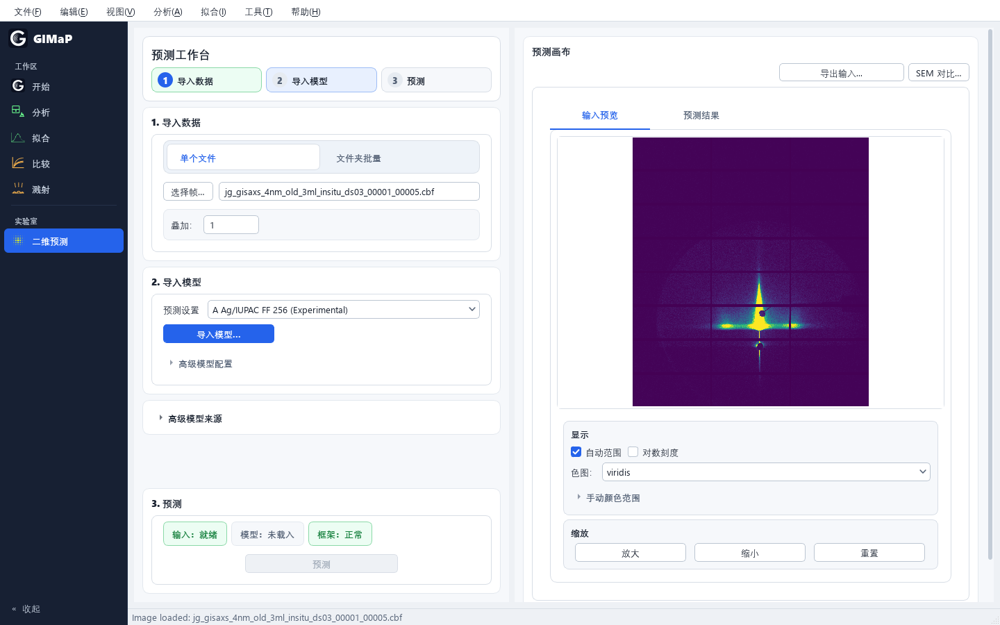
*已载入一个 CBF 帧，显示在“输入预览”里；还没有导入模型。“3. 预测”下的三个状态说明还缺什么，三者都就绪之前“预测”不可用。*

1. **导入数据。**
   - **单个文件**（Single file）：**选择 CBF 帧…**（Choose CBF frame…），或把 CBF 帧拖到画布上。**叠加**（Stack）是几个连续的探测器文件组成一个输入。
   - **文件夹批量**（Folder batch）：一个编号帧的文件夹、帧号 **范围**（Range）和 **每次预测的文件数**（Files per prediction）；
     字段下面一行说明这对应多少个文件和多少次预测。

   预测只读 CBF 帧（`.cbf`）。
2. **导入模型。** 选择 **预测设置**（Prediction setup），即 `modules/` 里的一个模块（见 11.3 节），按 **导入模型...**（Import model...）；
   “3. 预测”下的*模型*状态说明它是否已载入。折叠在下面的有：**高级模型配置**（Advanced model configuration：框架检查、**重新载入配置**（Reload Config）、**编辑配置**（Edit Config））
   和 **高级模型来源**（Advanced model sources：模型库）。
   - 随程序提供的模块不带模型。第一次按 **导入模型...** 时会要求选择训练好的模型所在的文件夹（TensorFlow SavedModel 文件夹）。
     GIMaP 把这个文件夹记在你的用户数据文件夹里（见 3.11 节），而不是写进模块的 `module.yaml`，所以程序文件保持不变；
     下次按 **导入模型...** 时直接载入，不再询问。
   - 模型已载入后再按一次 **导入模型...**，可以选择另一个文件夹。
   - 模块还没有模型时，**活动日志**（Activity log）会说明；记住的文件夹已不存在时，日志会写出它的路径。**重置所有设置…**（Reset All Settings…）也会清除记住的文件夹。
3. **预测。** 三个状态 *输入*、*模型*、*框架* 说明还缺什么；三者都就绪时 **预测**（Predict）可用。预测在后台运行，**停止**（Stop）结束它。

载入帧后画布显示 **输入预览**（Input preview），预测后显示 **预测结果**（Prediction result）。*Preprocessed* 按顺序显示模块的各个预处理步骤及其产生的图像（点击可放大）。

- **导出输入...**（Export input...）保存所显示的帧，并附 JSON 记录。
- **导出结果...**（Export result...）把结果存为图片，旁边存数据，以及记录模块、模型、预处理步骤和输入文件的 JSON。
- 文件夹批量的结果列在 **批量结果**（Batch results）里，可筛选、排序和导出。
- **活动日志**（Activity log）折叠在底部。

画布上方的 **SEM 对比…**（SEM comparison…）在模块的 `module.yaml` 声明了以 nm 为单位的半径轴时（见 11.3 节），打开附带当前预测的 **SEM 粒径分析**（SEM Particle Analysis，见 9.3 节）；
否则打开的工具不带预测，活动日志说明原因。随程序提供的模块中，只有 `Au_Silicon_15nm` 声明了坐标轴。然后在那里打开 SEM 图像或粒径 CSV。附带的是一份复制：半径分布及其来源（输入文件、模块、模型、预处理、运行环境）。之后在预测页更换输入或模型，
不会改动已打开的比较；过时的结果也不会再被附带。从工具菜单打开 SEM 工具时，会移除之前附带的预测。

两个分布不是同一个量。SEM 给出的是一个小视野里颗粒投影面积对应的半径，按颗粒计数；预测给出的是模块模型从被照射区域的散射得到的半径分布。
两者的差别是值得讨论的结果，不说明哪一方错了。

### 11.2 训练集构建

训练集构建已从 GIMaP 移除，不再提供页面、菜单入口或启动任务。已有训练文件不会删除。请在外部训练模型，再把兼容模型导入二维预测（11.3 节）。

### 11.3 预测模块

预测模块是 `modules/` 下带 `module.yaml` 的文件夹。主要字段：

| 字段 | 含义 |
|---|---|
| `id`、`name`、`version` | 内部标识、显示名称、版本 |
| `framework` | 模型框架，例如 TensorFlow/Keras |
| `model.model_path` | 默认的模型：留空，或相对于模块文件夹的路径。用 **导入模型...** 选择的文件夹记在你的用户数据文件夹里，优先使用 |
| `preprocess.entry`、`preprocess.steps`、`preprocess.params` | 预处理入口、步骤和参数 |
| `io.input_type`、`io.stack_axis`、`io.input_shape` | 输入类型（例如 `cbf`）、叠加轴、模型的输入形状 |
| `outputs` | 输出：参数名、范围或输出类型；分布输出用 `axes: row` 和 `axes: column`，含 `key`、`label`、`unit`、`min`、`max` |

添加模块时，请确认输入类型、预处理代码和输出定义与训练好的模型一致。`model_path` 请留空，不要写你电脑上的文件夹：
每个用户用 **导入模型...** 选择模型，它从不写进 `module.yaml`。没有选择文件夹时，`module.yaml` 里已经写着的路径仍然有效。唯一的例外是
外部训练工具登记的模块：它的 `module.yaml` 写着这台电脑上的模型文件。二维预测对一帧做什么、不做哪些校正，见
[《物理与方法》13.4 节](Physics_Manual_zh.md#134-二维预测实验室)。

要做 SEM 对比，模块必须声明半径轴：`outputs: axes: row`，含 `key: r`、`unit: nm`、`min` 和 `max`，如 `Au_Silicon_15nm`。
模块没有声明坐标轴时，分布画在一个占位的轴上（两个轴都是 0.05–15 nm），这不是物理尺度，也不会附带到 SEM 对比。

预测参数使用 `src/gimap/features/fitting/domain/posterior/data/` 中的网络（见 6.4 节），不是预测模块。

一维预测的 `request.json` 和 `fitting_run_summary.json` 用 SHA-256 标识网络的记录（其中写有权重的 SHA-256，载入时校验）。请求记录归一化选项及随机种子策略：预测参数用固定种子。

## 12. 输出文件

GIMaP 从不改动你的数据文件。分析的导出默认写到**数据旁边的 `gimap_analysis/`** 文件夹；其他大多数导出会询问位置并给出建议。
有些建议的位置也在数据旁边（XRR 的 CSV、格式转换的 `converted/`、标定、项目）：数据在只读的共享盘上时，请另选文件夹。
用户数据文件夹在 Windows 上是 `%APPDATA%\GIMaP`，在其他系统上是 `~/.config/gimap`，或者是 `GIMAP_HOME` 指定的文件夹
（3.11 节；**帮助 ▸ 打开用户数据文件夹**（Help ▸ Open User Data Folder））。下表列出 GIMaP 写出的每个文件；表后的几段说明
用户数据文件夹和 Windows 便携包里有什么。

| 操作 | 写出的文件 | 默认位置 | 附带的记录 |
|---|---|---|---|
| 分析 ▸ **导出**（Export，`Ctrl+E`）、**导出曲线…**（Export Curves…） | 每条曲线一个 `<stem>_<curve>.csv`、`<stem>_fit_input.dat`、`<stem>_analysis.json`（多帧文件中的一帧加 `_frameNNNN`，帧求和时加 `_sumN`）；勾选 **同时导出为 NXcanSAS（.h5）** 时还有 `<stem>_nxcansas.h5` | 数据旁边的 `gimap_analysis/`，不弹对话框；无法写入时弹出文件夹对话框 | `<stem>_analysis.json`（设置、几何（含 `.poni` 的倾斜）、校正、排除的像素、误差模型、分箱、写出时的 UTC 时间）和 `#` 头行 |
| 分析的曲线图 ▸ **保存 ▸ 曲线存为数据…**（Curves as Data…） | 这张图的 CSV 和 `_analysis.json` | 文件夹对话框，从 `gimap_analysis/` 开始 | 同导出 |
| 分析的曲线图和图像 ▸ 存为图片（**曲线图存为图片…**、**当前视图存为图片…**、**分析 ▸ 图与数据 ▸ 保存图像…**（Analyze ▸ Figures ▸ Save Image…） …） | PNG、TIFF、SVG 或 PDF，浅色配色 | 对话框，从 `gimap_analysis/` 开始 | 无 |
| 分析 ▸ **保存 q 图数据…**、**当前视图数据存为 CSV…**（也在 **分析 ▸ 图与数据** 里） | `<stem>_qmap.csv`、`<stem>_cake.csv` | 对话框，从 `gimap_analysis/` 开始 | `#` 头行（来源、帧、坐标轴） |
| 分析 ▸ 序列 ▸ **导出**（Export：**热图导出为 CSV 表…**、**热图导出为图片…**、**阶段表…**（Stages as Table…）、**所选帧的曲线（图）…** / **（表格）…**、**随帧变化的曲线（图）…** / **（表格）…**、**每帧的峰表…**） | `<序列>_<曲线>[_<两半>]_map.csv`、`…_map.png`、`…_stages.csv`、`…_trace_<量>.csv` 和 `….png`、`…_peaks.csv`；所选帧为 `<帧>_<曲线>[_<两半>].csv` 和 `.png`（图也可存为 TIFF、SVG 或 PDF） | 对话框，从 `gimap_analysis/` 开始 | `#` 头行（曲线、两半、帧、切线），每个表格旁边有记录设置的 `.json`；图没有记录 |
| 分析 ▸ 序列 ▸ **导出 ▸ 保存结果数据库…**；监视 ▾ ▸ **把每一帧记入结果数据库** | `gimap_series.sqlite`（SQLite：约简后的每一帧曲线，带帧号、文件和时间；跳过的文件） | 对话框，从 `gimap_analysis/` 开始；监视时为数据旁边的 `gimap_analysis/` | 热图的设置记在数据库里 |
| 分析 ▸ 序列 ▸ **导出 ▸ 时间线（表格）…** | `<序列>_<曲线>[_<两半>]_timeline.csv` | 对话框，从 `gimap_analysis/` 开始 | `#` 头行和一个 `.json`（方法、参考帧、跳变） |
| 拟合 ▸ 原位序列 ▸ **保存 ▸ 拟合结果（NXcanSAS）…** / **结果数据库…** | `series_fits.h5`（每个已拟合帧的拟合点和模型）；`gimap_series.sqlite`（每一帧的拟合） | 曲线所在文件夹；那里或往上两级中已有的数据库 | 每个条目带这一帧的记录；数据库里有拟合设置 |
| 分析 ▸ **发送到拟合**（Send to Fitting） | `<stem>_fit_input.dat`（q 单位 Å⁻¹）及 `<stem>_fit_input.json`。**把两条切线都发送到拟合**还写出垂直切线 `<stem>_fit_input_qz.dat` 和对应的 `.json`。 | 数据旁的 `gimap_analysis/`，或本次会话选定的可写文件夹 | JSON 约化记录和 `#` 头行（来源、帧、求和、曲线和观测信息） |
| 分析 ▸ **批量导出…**（Batch Export…） | 按曲线的表 `<batch>_<curve>_frames.csv`（或 `.txt`、`.dat`）；选了拟合时，拟合表 `<batch>_peak_fits.csv`（或 `<batch>_model_fits.csv`）及其趋势图 `<batch>_peak_fits.png`（`_model_fits.png`），选了拟合曲线时还有 `fits/<帧>_<峰或模型>_fit.csv`；按你的选择生成的子文件夹 `curves/`、`nxcansas/`、`fit_input/`、`maps/`、`images/`、`frames/`；帧名保留从 0 数的帧号（`…_frame0003_sum3_…`） | 上次的批量文件夹，否则数据旁边的 `gimap_analysis/`；默认再建一个以帧所在文件夹命名的子文件夹（单个文件：以文件命名；来自多个文件夹：`batch`）；**两者都保留**时写到新的子文件夹 | `README.txt` 和 `<batch>_batch.json`（写出的每个文件、每帧的切线、失败的帧及原因）；`curves/` 里每帧还有 `_analysis.json` |
| 分析 ▸ **把序列发送到拟合…**（Send Series to Fitting…） | `fit_input/<帧>_fit_input.dat`、`README.txt`、`<batch>_batch.json` | 它自己的文件夹 `<名称>_fitting/`，在同一数据的批量导出旁边 | `README.txt`、批量 JSON |
| 分析 ▸ **监视时导出新帧**（Export New Frames While Watching） | 每个新帧同导出 | 帧旁边的 `gimap_analysis/`；那里写不了时为你选一次的文件夹（本次会话记住）；不选时关闭这项导出，状态行说明原因 | 同导出 |
| 分析 ▸ **保存设置…**（Save Settings…）；掩膜步骤 ▸ **保存…**（Save…）；区域 ▸ **添加 ▸ 保存切线…**（Add ▸ Save Cuts…） | `analyze_settings.json`；`masks.json` 或掩膜图像（5.2 节）；`cuts.json` | 对话框，从 `gimap_analysis/` 开始 | JSON 文件记录了操作。掩膜图像旁另有 `<文件名>.json`。 |
| 运行自动分析 ▸ **保存报告…**（Save Report…） | `<stem>_report.html`（带图）或 `.md` | 本次会话中同一文件夹的帧上次保存到的文件夹，否则已有 `gimap_analysis/` 时在那里，否则在帧旁边 | 报告本身（没有 JSON） |
| 用 AI 处理 ▸ **保存报告…** | `<stem>_ai_report.html` + `<stem>_ai_report.json` | 同上 | JSON |
| 用 AI 处理（自动） | 每次运行的记录；缺少的分析 | 用户数据文件夹：`assistant_runs/`、`assistant_feature_requests.jsonl` | — |
| 用 AI 处理，AI 导出时 | 同导出的曲线，以及 `<stem>_assistant.json` | 数据旁边的 `gimap_analysis/` | `<stem>_analysis.json`、`<stem>_assistant.json` |
| 拟合 ▸ 单条分析 ▸ **保存 ▸ 数据与拟合…**（Data and Fit…） | `<curve>_fit.csv`（或 NXcanSAS 的 `<curve>_fit.h5`）+ `<curve>_fit.json`（成对写出） | 上次保存的文件夹，否则上次打开曲线的文件夹，否则曲线所在文件夹 | JSON（模型、方法、范围、排除的点；预测参数的每个解） |
| 拟合 ▸ 单条分析 ▸ **保存 ▸ 解…**（Solutions…，即**导出解…**） | `<curve>_solutions.csv` + `<curve>_solutions.json`（成对写出）+ `<curve>_solutions_curves.csv` | 同数据与拟合 | JSON（数据与拟合的记录，含每个解及其数值和区间） |
| 拟合 ▸ **保存 ▸ 曲线图…**、**保存 ▸ 模型…** | `<curve>_fit.png` / `.svg`；`<curve>_model.json` | 同上 | 无；模型文件 |
| 拟合 ▸ 批量 / 原位序列 ▸ **保存 ▸ 每一帧的结果表…** | `series_fit.csv` + `series_fit.json` | 序列所在文件夹 | JSON（`gimap_series_fit_v2`：初始模型、两半及其来源、每帧的状态和原因；探测器帧时还有分析页的设置） |
| 拟合 ▸ 批量 / 原位序列 ▸ **保存 ▸ 序列报告…** | `series_fit.md` | 序列所在文件夹 | 每帧的选解规则、概率与运行设置 |
| 拟合 ▸ 批量 / 原位序列 ▸ **趋势图…**、**所选帧的曲线图…** | `series_trend_<量>.png`（这个量在表里的列名，例如 `series_trend_chi2_reduced.png`）和 `series_frame_<NNNNN>.png`（帧号从 1 数，五位），或 `.svg`；还没有拟合时为 `series_trend.png`、`series_frame.png` | 序列所在文件夹 | 无（图里的标题写明量或帧） |
| **工具 ▸ 一维预测——拟合多条曲线…** | 一个运行文件夹：`request.json`、`batch_summary.json` …，每条曲线一个子文件夹，含 `solutions.json`、`fitting_curves.csv` … | GIMaP 用户数据文件夹下的 `AI_Fitting_Output/v5_<日期>_<时间>_<微秒>/`；不会自动删除 | `request.json` |
| 比较 ▸ **保存 ▸ 每个序列的表… / 每一帧的结果表…** | `compare_series.csv` / `compare_frames.csv` + `.json` | 第一个从文件添加的序列所在文件夹，否则上次添加序列的文件夹（文件夹还在时），否则你的用户主文件夹 | `#` 头行和 JSON |
| 比较 ▸ **变化图… / 路径图… / 终态图…** | `compare_*.png` 或 `.svg` | 同上 | 无 |
| 溅射 ▸ **分析**（8.1 节） | 每个请求一个文件夹：`analysis.json`（状态、模型族、各步骤、各文件）、分析包的 `REPORT.md`、`report.png`、`report.csv`、`windows.csv`、`summary.json`、`evolution.png`、`patterns.png` 和各步骤的日志，以及 `main/`：`main.json` 和每个时间窗一个 `w_<t>.npz` + `w_<t>.png`（实测图和每个解的模型图） | 用户数据文件夹里这个扫描的文件夹（或**更多选项 ▸ 结果保存在**）：`sputter/<扫描>-<代码>/iampred-<代码>/`；同一个分析包收到相同的请求时显示已有的结果。分析包读入的帧保存在 GIMaP 的本机文件夹（Windows 上 `%LOCALAPPDATA%\GIMaP\sputter_client\`，macOS 上 `~/Library/Caches/GIMaP/sputter_client/`），默认合计至多 5 GB（**详情 ▸ 存储**）；各步骤的产出在结果的 `trace/` 里 | `gimap_request.json`（请求、导入扫描的标签、分析包及其版本、Python、命令行） |
| 溅射 ▸ 在主屏上换一个**显示的解** | `choices.json`：与默认不同的时间窗各选了哪个解 | 结果的 `main/`；不能写入时为用户数据文件夹：`sputter_client/choices/` | 文件本身（结果文件夹、GIMaP 版本、时间） |
| XRR 序列提取 ▸ **导出 CSV…** | `<source>_xrr.csv` + `.json` | 源文件旁边；用 **文件夹…** 选的文件夹则在文件夹里，以文件夹命名 | JSON（决定 qz 的每个值及其来源；`center_convention`；`source_layout` 列出读到的每个文件） |
| 格式转换 | 转换后的帧：单帧源文件为 `<source>.<ext>`；多帧源文件默认 `<source>_<从 1 数的 6 位帧号>.<ext>`；重名时加 `_001` …；或一个 `converted_images.h5`（已存在时为 `converted_images_001.h5` …） | 第一个输入旁边的 `converted/` | `conversion_report.json`、`conversion_metadata.json`（或每帧一个 JSON） |
| SEM 粒径分析 ▸ **导出 SEM 结果…** | 9.3 节列出的文件 | 你选的文件夹里新建的 `SEM_analysis_<日期>_<时间>/`；从不覆盖 | `sem_analysis.json`；CSV 的 `#` 头行 |
| 二维预测 ▸ **导出输入...**（Export input...） / **导出结果...**（Export result...） | `<input>_input.png` + `.json`；`<input>_prediction.png` + `.json`（结果有曲线或图时还有 `.txt`） | 上次的导出文件夹，否则输入所在文件夹 | JSON |
| 二维预测 ▸ 多个文件时的 **导出结果...** | 按你的选择：`prediction_results_<时间>.jsonl`；`prediction_curves_<时间>.txt`（或 `prediction_parameters_<时间>.txt`）；`prediction_images_<时间>/` 里的图像 | 你选的文件夹（从上次的导出文件夹开始） | `.txt` 里的 `#` 头行 |
| 几何标定 ▸ **导出标定…**（Export Calibration…） | `<image>.gimap-calibration.json` | 标样图像旁边 | 文件本身（光束中心从 0 数像素中心，比窗口显示的小 0.5 px；`metadata.center_convention`） |
| 几何标定 ▸ **应用**（Apply） | 仪器配置 | 用户数据文件夹：`instrument_profiles.json` | — |
| **工具 ▸ 设置… ▸ AI 助手** ▸ **API 密钥** ▸ **保存**（Tools ▸ Settings… ▸ Assistant ▸ API key ▸ Save） | 所选服务商的 API 密钥。**移除**（Remove）删除密钥。 | 优先使用系统凭据库，否则以明文写入用户数据文件夹中的 `claude_api_key.txt` 或 `assistant_provider_keys.json` | 10.1 节 |
| **文件 ▸ 保存项目**（File ▸ Save Project） | `<name>.gimap`；比较里有内嵌数组时还有 `<name>.<generation>.compare.npz` | 第一帧旁边 | 项目本身（数据按路径引用）；搬移时带上当前 `compare.arrays_file`（3.8 节）。溅射参数和结果文件夹引用保存在项目里，实际结果文件仍留在该文件夹中 |
| **文件 ▸ 实验室参数 ▸ 另存为…** | `gimap_parameters.json` | 对话框，从启动 GIMaP 时所在的文件夹开始 | — |
| 错误（自动） | `logs/errors.log`（超过 2 MB 时改名为 `errors.old.log`） | 用户数据文件夹 | — |
| **帮助 ▸ 示例数据**（Help ▸ Example Data） | 示例的帧及其 `.poni`（和掩膜），以及 `SOURCE_AND_LICENCE.md` | 你选的文件夹，默认 `Documents/GIMaP examples/<示例>/`；那里已有的文件保留不动 | `SOURCE_AND_LICENCE.md`（数据的来源和许可证） |
| `tools/gimap_agent.py` | 每帧一个子文件夹（一组模块文件：每次扫描一个；`--series`：`<名称>_series/`；不同文件夹里同名的帧：`<名称>_<文件夹>/`），含 `report.md`、`report.json`、曲线和拟合表（CSV 的 `#` 行写明版本、每个输入文件的 SHA-256 和几何）、q 图；`summary.md`（链接到每一帧的报告）+ `summary.json` | `--out`；不给时为用户数据文件夹里的 `assistant_runs/cli/<时间>/`；从不写到数据旁边。已有先前运行摘要的 `--out` 文件夹会被拒绝，除非给 `--overwrite` | `report.json`（发布版本、UTC 时间、原样的选项、每个输入文件的路径、大小和 SHA-256、应用的掩膜或没有掩膜、分析工作区对这一帧的记录；拟合还有网络、网络权重的 SHA-256 和种子） |

**文件是哪个版本写的。** 分析工作区的记录（`_analysis.json`、设置文件、序列表和阶段表旁的 JSON）、批量导出和把序列发送到拟合的记录
（`<batch>_batch.json`；`README.txt` 里写 *Written by GIMaP v…*）、拟合的记录（`<curve>_fit.json`、`series_fit.json`），以及比较、
几何标定、XRR 序列提取、SEM 粒径分析、二维预测和格式转换的记录，都写明写出它们的 GIMaP 发布版本：`software_version`，例如
`GIMaP v0.2.0`。分析工作区记录里的 `software` 仍是 `GIMaP Analyze 1`，那是记录格式的名字。溅射、AI 助手、`tools/gimap_agent.py`
（`report.json`、`summary.json` 和它的 CSV 表格的 `#` 行）和一维预测运行文件夹的记录也写发布版本；更早版本写的记录可能没有
（[《物理与方法》14.5 节](Physics_Manual_zh.md#145-软件版本)）。

**复现约化或拟合。** 打开**分析 ▸ 工具 ▸ 从记录复现…**（Analyze ▸ Tools ▸ Reproduce from Record…），选择导出曲线或拟合结果旁的 JSON，再选择输出文件夹。单帧用 `<stem>_analysis.json`，批量导出用 `<batch>_batch.json`。序列图及所选帧的曲线可用各自 CSV 表格旁的 JSON 复现。对于拟合，选择随结果保存的拟合或解的 JSON。对于**一维预测——拟合多条曲线…**（1D Predict — Fit Many Curves…），整次运行用 `fitting_run_summary.json`，单次切线选边拟合用 `solutions.json`。也可以在命令行运行：

```text
gimap reproduce example_analysis.json --out check
```

省略 `--out` 时，命令在 JSON 旁创建 `<记录主文件名>_reproduced/`。每次比较请选择新的输出位置。文件夹中有重新计算的各列数据（CSV）和 `comparison.json`，批量结果分在带序号的子文件夹中。**identical** 表示记录中的每一列数值都逐位相同，包括曲线所带的不确定度和像素数。**different** 时可查看各列的最大相对差。数值逐位相同时退出码为 0，有差异为 2，出错为 1。

请保留记录所引用的文件。复现时程序校验文件的 SHA-256，并指出缺失或内容有变的文件。文件移动后，可复制一份 JSON，在副本中修改该文件引用里的 `path`，保留原摘要。相对路径以记录所在的文件夹为起点。

约化记录保存帧索引和求和顺序、实际使用的几何和仪器配置、按顺序排列的掩膜操作及其来源文件、最终掩膜位图、暗场、背景和平场设置、强度校正、归一化、切线、分箱及误差模型。手动拟合保存参与拟合的数据点、初始模型及求解器设置。预测参数保存网络、抽样设置和随机种子。记录还写明 GIMaP 版本，并在可获取时写入源码提交号。检验逐位一致性时请使用相同的软件和数值计算环境。

**`<stem>_analysis.json` 除设置外还写什么。** `created` 是写出记录的 UTC 时间（ISO 8601）。`error_model` 说明各点的 σ
怎么算：`poisson`（光子计数）、`pixel_scatter`（不是原样测得的计数：扣过暗场或背景的帧、从镜像一侧补齐的像素）或
`scaled_poisson`（对计数做了 GIWAXS 强度校正）。`binning` 对 GIWAXS 给出径向分箱的个数、q 范围和宽度，稀疏分箱合并后
I(q) 留下多少点，以及合并的规则；对 GISAXS，每个探测器列或行一个点。`geometry` 中的 `rot1_rad`、`rot2_rad` 和
`rot3_rad` 是探测器的转角（pyFAI 的定义，探测器垂直于光束时全为 0；4.2 节）。`dropped_tilt_deg`、
`flat_detector_q_error_max` 以及其他 `flat_detector_…`、`dropped_…` 字段在 0.1 中描述平板探测器略去的内容；现在倾斜
进入几何，它们为 `null`。仪器配置的 `source` 写明几何是谁选的：运行自动分析和
`tools/gimap_agent.py` 写 `automatic analysis: <文件>`。用 AI 处理时，来源以 `assistant: <文件>` 开头，末尾注明服务商和模型。
0.2.0 之前保存的配置两者都写 `assistant:`。[《物理与方法》14.2 节](Physics_Manual_zh.md#142-记录-stem_analysisjson)

保存单个文件的对话框在替换这个文件之前会询问；写在它旁边的记录（例如 `.json`）会直接替换，不再询问。
不弹文件对话框的导出——导出、**曲线存为数据…**（用的是文件夹对话框）、发送到拟合、监视、批量导出、把序列发送到拟合、AI 的导出、
转换器的报告和元数据 JSON——会替换所在文件夹里的同名文件。批量导出和把序列发送到拟合会先就同一数据之前的导出发问（**替换**、
**两者都保留（写到新的子文件夹）**、**取消**；5.7 节）。格式转换从不覆盖转换出的图像（加上 `_001` … 或者停下），
SEM 粒径分析从不覆盖它的结果。修改速率、t0 或结束时间，或者加入精修时间窗时，溅射会重新写出结果文件夹里的表格；
**把最佳模型登记到二维预测** 会替换同一项目的模块。

**文本文件。** GIMaP 写的每个文本文件（CSV、TXT、DAT、拟合用曲线、`README.txt`）都是不带 BOM 的 UTF-8。GIMaP 自己的符号写成
ASCII——`1/A`、`deg`、`2theta`、`alpha_i`、`chi`、`sigma`、`+/-`——文件名、帧名和路径保持原样；JSON 记录保留每个名字的原样。脚本
读这些文件时请用 `encoding="utf-8"`（例如 `numpy.loadtxt(path, encoding="utf-8")`）。在 Excel 里双击打开 CSV 时，非 ASCII 的名字
可能显示错乱；数值不受影响。

**用户数据文件夹里的文件。** 除了上表中的文件，GIMaP 还在那里保存 `settings.json`（设置以及各页面记住的内容，3.9 节）、
`instrument_profiles.json`、`session.json`、`model_parameters.json`（拟合的模型）、`last_analyze_setup.json` 和 `logs/`；AI 助手的
`assistant_runs/`、`assistant_feature_requests.jsonl` 和以文件形式保存的密钥（10.1 节）；
以及溅射在 `sputter/` 里的结果文件夹，它们从不会被删除。旧的结果文件夹请自己删除，长扫描请在
**更多选项 ▸ 结果保存在** 里选数据盘上的文件夹。溅射 ▸ 分析读入的帧放在本机文件夹 `%LOCALAPPDATA%\GIMaP\sputter_client`
（macOS `~/Library/Caches/GIMaP/sputter_client`，Linux `~/.cache/gimap/sputter_client`），有大小上限（**详情 ▸ 存储**，默认
5 GB）；旧版 GIMaP 放在用户数据文件夹 `sputter_client/` 里的照样使用，存储区也列出并可删除它们。这个文件夹之外，`Start_GIMaP.bat` 把 Matplotlib 的字体缓存放在
`%LOCALAPPDATA%\GIMaP\matplotlib`；在 Windows 上，拟合和二维预测里几张卡片是否折叠记在注册表的
`HKEY_CURRENT_USER\Software\GIMaP` 下。

**Windows 便携包。** 除了程序，ZIP 里还有 `licenses\`：便携包中每个组件的许可证文件，由 `licenses\README.txt` 列出，另有
`THIRD_PARTY_NOTICES.md`（**帮助 ▸ 第三方声明**）和 `LICENSE`。发布页的 `SHA256SUMS.txt` 列出每个下载文件的 SHA-256：在 PowerShell
里用 `Get-FileHash -Algorithm SHA256 <文件>`，或用 `sha256sum -c --ignore-missing SHA256SUMS.txt` 核对下载的文件
（它只核对你下载了的文件）。

## 13. 已知限制

0.2.0 是预发布版本。以下限制是已知的，每条都附有应对办法。本章列出这个版本的全部已知限制。方法本身没有考虑的内容（散射物理、仪器、统计），见[《物理与方法》第 15 章](Physics_Manual_zh.md#15-gimap-不建模的内容)。

| 限制 | 怎么办 |
|---|---|
| **薄膜透射模型无法重现环两侧不一致的遮挡。** 公开的 P08 MAPbI₃ 帧在地平线附近就有这种情况（5.9 节）。 | 在原帧上核对正负角度的扇区与 q 窗口。拟合不佳时查看报告中最大残差所在的 χ 和残差大小。模型能描述实测剖面时，再定量报告取向分数。 |
| **序列热图的行不带 σ。** 时间线的 χ² 用由序列本身估计的每个 x 列的噪声；记入结果数据库的序列热图只有 x 和 I（5.6 节）。 | 把时间线读作以帧间噪声为单位的距离，而不是拟合优度；需要每点的 σ 时，用批量导出 ▸ 每一帧：带误差棒的曲线。 |
| **取消不会强制打断底层文件读取。** 比较的目录扫描或单表读取、拟合的当前读取可能尚未返回。 | 按取消或停止后无需重复点击；界面会登记请求，读取返回后丢弃未完成导入或跳过该帧的拟合。已完成的序列和结果保留（6.5、7.2 节）。 |
| **曲线导入支持 `q I [sigma]` 和 `q I1 I2 …`，不支持交错的 `q I1 sigma1 I2 sigma2`。** 无表头的三列数据无法仅凭数值判断含义。 | 在**导入曲线…**里明确选择布局（6.1 节）。每条曲线有各自误差时，请分别提供 `q I sigma` 文件。固定导入选择不能监视新增文件或列。 |
| **几何标定只拟合山嵛酸银、LaB₆、CeO₂ 以及 LaB₆ + CeO₂ 混合物。** AI 的几何搜索能按名字认出 Si、Al₂O₃ 和 Cr₂O₃ 的图像，但不能拟合它们（10.5 节）。 | 用 pyFAI 标定这种图像，再把 `.poni` 交给 GIMaP：在笔记里点名，或放在帧旁边（4.2 节）。 |
| **仪器配置只按探测器名称和帧尺寸匹配。自动搜索找到的标定可能属于另一个实验。** 即使探测器尺寸匹配，也不能据此确定标定来自哪次实验（4.2 节）。 | 请核对报告中的文件和**几何**步骤里的距离。直接给出标定文件，或在笔记中点名。错误的配置可用**几何… ▸ 删除配置**移除。 |
| **粉末环不能确定 rot3。** 在 SAXS 距离上，环对倾角的约束较弱（公开山嵛酸银帧上约 ±0.2°）。在匹配到至少七个环的模拟帧中，光束中心 x 和 rot1 的 1σ 区间覆盖真值的比例低于预期。 | 实测覆盖率见《物理与方法》3.3 节。用广角标样确定 rot1 和 rot2，在**几何 ▸ 核对 rot3**中用 GISAXS 镜面杆与样品地平线核对 rot3。平板探测器的 `.poni` 支持方向 1–4（4.2 节）。 |
| **自动 Yoneda 搜索和水平切线按探测器行取值。** 地平线贯穿整帧时的高度差超过半行会提示。 | 要取恒定出射角，请在 q 空间添加水平条带。镜像补齐需要另一侧有实测信号，不能恢复缺失楔区。 |
| **运行自动分析（GIWAXS）最多拟合 12 个候选峰**，即最显著的那些；窗口里没有设置能拟合更多。其他候选峰不进入峰表、扇区比较、所分析的环和序列提示；*Decisions*（决策）写出候选峰有多少（5.5 节）。 | 需要完整的峰表时，运行 `tools/gimap_agent.py auto … --max-peaks N`（10.7 节），或让 AI 用 `max_peaks` 运行 `find_peaks`。 |
| **运动学 q 未计入薄膜折射。** 临界角附近 q_z 的偏移可达 k·sin αi 的量级。采用透射通道校正后仍可能看到来自反射通道的第二个环。 | 查看报告说明的 q 轴。已知薄膜临界角时可采用折射校正，将几何不确定度与峰拟合误差分别列出。 |
| **缺失楔的强度需要外推。** 若未测区内有强于边缘角带的峰，实际 f 可能超出所列范围。 | 查看 f_iso、决定系统变化上下限的情形和极图拟合的质量（5.9 节）。 |
| **不是 Lambda 服务器写的 NeXus/HDF5 文件现在按存储原样读**（以前的版本会转置并翻转）。用以前的版本在这种文件上做的几何或掩膜不再适用（5.1 节）。 | 核对这类数据的光束中心和掩膜；需要时重新标定。 |
| **平场噪声按实测均值固定来传播。** 单位均值的响应图缺少原始计数尺度，无法确定泊松误差。 | 提供以原始计数或 ADU 保存的均匀曝光帧。比较使用同一平场的曲线时，需考虑共同的参考帧不确定度（5.2 节）。 |
| **归一化在扣除背景和暗场之后才除**。背景和暗场按帧自身的单位扣除，透射率和厚度由用户输入（5.2 节）。 | 把背景的 **比例**（Scale）和 **暗场比例**（Dark scale）设为帧与背景的曝光时间或监视器读数之比。 |
| **XRR 强度是原始值**：没有监视器归一化、足印、背景、分辨率校正或 θ 偏移；不应用分析页的交互掩膜和坏像素搜索（9.2 节）。 | 按实验需要校正导出的曲线，并检查 ROI 和有效像素数。 |
| **格式转换不读 EDF。** | 用 **分析 ▸ 批量导出 ▸ 转换格式的探测器帧**（Analyze ▸ Batch Export ▸ Converted detector frames）。 |
| **格式转换的两种 uint16 模式只在 HDF5 里标记没有数据的像素**：在 TIFF 或 CBF 里，这样的像素值为 65535，读回时是有效值（9.1 节）。 | 缝隙和坏像素重要时，保留存储的数据类型（默认），或者写 HDF5。 |
| **SEM 粒径取决于分割**；默认的 StarDist 权重是用细胞核训练的，不是 SEM。标尺从不从图像读取。 | 按比例尺输入标尺；检查每个轮廓；尽量用 SEM 图像训练的模型。 |
| **二维预测只读 CBF 帧。** | 用格式转换把其他帧转成 CBF。 |
| **二维预测不对帧做任何几何处理或校正**：只运行模块自己的预处理（11.3 节）。 | 只把模块用于它训练时所对应装置的数据。 |
| **二维预测的 Ag 和 Cu 分布模块没有声明坐标轴**：它们的图和曲线画在一个占位的轴上（0.05–15 nm），这不是物理尺度，也不会附带到 SEM 对比（见 11.3 节）。 | 只看这些分布的形状。知道训练模型的坐标轴时，把它们写进模块的 `module.yaml`。 |
| 会话中途切换界面语言后，少数文字保持原来的语言（例如一次已完成的自动分析的结果行）。 | 重新运行分析，或重启。 |
| 批量导出进行中退出 GIMaP，已完成帧的文件会保留，但批量表、`README.txt` 和批量的 JSON 记录不会写出。 | 用 **停止**（Stop）结束批量导出：它会写出这些文件。 |
| **自动分析的模型拟合只凭曲线选择颗粒。** 运行自动分析（以及批量导出的颗粒模型）用预测参数在一种或两种球和竖直圆柱的颗粒群中拟合切线，采用拟合时已知的切线几何（5.5 节）。随机取向圆柱只在你把它给定为组成时才用。公开的 GALAXI Ag 球帧在较早的第一层拟合中给出两群竖直圆柱（1.3 节）。宽的尺寸分布和低 q 处的上升，可能被另一种组成而不是真实的组成描述。2π/q\* 是一个特征长度，不是粒子间距：在 GALAXI 模型的 BornAgain 模拟上，它在 10 条有干涉的模拟中只有 1 条落在真实距离的 10 % 以内，4 条没有干涉的模拟上也都出现了侧峰或肩峰（1.3 节和 5.5 节；[《物理与方法》8.5 节](Physics_Manual_zh.md#85-模型拟合及解的选择)）。 | 根据你对样品的了解选择模型，并在**拟合**中确认：用**模型中的粒子**做预测参数，再精修它，查看残差。不要把 2π/q\* 当作粒子间距引用。 |
| **手动拟合的模型不由预测参数给出。** 核壳球、二维六方次晶（畴无限大）和 Percus–Yevick 硬球（三维液体）只用精修和搜索拟合；核壳球按 q_z = 0 计算。 | 从已知的值开始，或从含球的预测解开始，再在模型里改类型或干涉函数后精修（[《物理与方法》9.14 节](Physics_Manual_zh.md#914-手动拟合的模型)）。 |
| **按强度的尺寸和随机取向圆柱让拟合变慢。** 球或竖直圆柱、尺寸按数目或对数正态时，**在范围内搜索**（Search the ranges）和以前一样只要几秒；用*高斯，按强度*（旧版本的模型）要几十秒，用随机取向圆柱（计算一次 15–800 ms）最多要几分钟。 | 把**尺寸分布**改为*高斯，按数目*，搜索前收窄 R、h 和 σR/R 的范围，或从接近曲线的值开始**精修**（Refine）。 |
| **垂直切线只对球和竖直圆柱建模**，取一个面内 q（所在列的 q∥），不含 q 分辨率和镜面反射杆，并且只在 拟合 ▸ 多条曲线联合拟合 中使用。它的标度是自己的：有几群颗粒时，它们之间的比例不与水平切线绑定（6.6 节）。 | 把垂直切线放在镜面反射杆旁边；随机取向圆柱和核壳球请用水平切线拟合。 |
| **联合拟合中的圆柱高度。** 模型假设颗粒层稀疏且高度与半径相互独立。 | 查看垂直切线的约化 χ² 和两个范围的拟合高度差。高度与半径相关时，两个范围给出的高度都可能有偏差（6.6 节）。 |
| **基底表只有 4.9–30 keV 的裸 Si、SiO₂、平板玻璃和 Au。** 氧化层、聚合物膜、粗糙度和颗粒层自身的折射率都不在其中（6.2 节）。 | 输入有效基底的 δ 和 β，或者用带自由 r 的两条路径。 |
| **后验检验（MCMC）对随机取向圆柱很慢。** 随机取向圆柱每次计算 15–200 ms，一次检验要几个小时。两个独立系综仍可能同时漏掉较远的模态（6.2 节）。 | 通过预测参数的其他解来比较其他模态。 |
| **预测参数（Predict parameters）在不同平台上的拟合结果可能略有差异。** 对同一条切线，数值库的构建版本不同，可能会使解的概率、区间端点、标准误差，以及参数接近边界时的警示有所不同。 | 要复现存档的拟合，请连同切线和设置一起记录操作系统及 Python、NumPy 和 SciPy 的版本。 |
| **预测参数只认识拟合页的模型**（按数目的高斯尺寸、LMA；模型有两个角度时球取两路径、反射系数 r 自由，否则按切线 q_z 处的 Born 项或有效界面计算）。它在一个独立模型的模拟曲线上和 BornAgain 模拟上检验过，没有在已知颗粒的实测曲线上检验；模型以外的物理（粗糙度、其他形状）可能让某个组成得到它不应有的高概率。表面反射的波（四项 DWBA）对 q₊R 超过约 1.7 的球有影响（α_i = 0.4°、12 keV 时 R ≈ 3 nm）：给两个角度时 R 偏离约 6 %（中位数；第 90 百分位 19–40 %），这类曲线约 60 % 选对组成；只给 q_z 时 R 偏离约 10 %（q₊R 2.3–3.5）到 40 %（更大时），球通常被当成竖直圆柱；竖直圆柱不受影响。在反射波弱的曲线上（远高于临界角）给两个角度时，更小的球加大的 \|r\| 可能拟合得一样好；在 BornAgain 对 GALAXI 帧的模型上（宽的对数正态尺寸，αf 在临界角处），自由的 r 让错误的尺寸在误差之内拟合上了（一群球时，三次模拟抽样的 R 为 16–500 nm，其中一次停在 500 nm 边界上；选择组成时，有两次为一群不带次晶的 16 nm 球）；在没有反射的两群球曲线上，这个网络比上一版略常漏掉真实尺寸（[《物理与方法》9.13 节](Physics_Manual_zh.md#913-预测参数)）。 | 按残差和你对样品的了解判断每个解；q₊R 超过 1.7 的球请给两个角度；远高于临界角时把拟合出的 \|r\|（模型里的 `refl_amp`）与衬底的值比较，差得远就固定它，再精修。 |
| **旧版约化或拟合记录可能缺少复现所需的输入和设置。** | 用原输入和设置重新导出记录。含有 `reproduction` 字段的记录可按第 12 节复现。 |
| 缺少受支持的系统凭据库适配器时，API 密钥以明文保存在用户数据文件夹（10.1 节）。有权读取这些文件的人可以看到密钥。 | 在共用的电脑上，可通过服务商的环境变量提供密钥，或在用完后按**移除**（Remove）。 |
| **溅射 ▸ 分析用为两种聚合物膜（一种均聚物、一种嵌段共聚物）上的 Cu 训练的网络读取 Cu**。 | 其他基底上的 Cu：聚合物膜选 **Polymer**，先对照模型图和实测图再用这些值。 |
| **溅射 ▸ 远离网络能量时的分析只靠联合精修。** TiO₂ 上的 Au 和 Ag 用的网络在 8–15 keV、αi 0.25–0.55° 上训练：这个范围内的 TiO₂ 扫描按它自己的能量照常分析。其他网络是在一个波长（Cu 为 0.105 nm，其他为 12 keV）和 αi 0.40° 下训练的；离这个波长 5 % 以内（Au 只在 12 keV）照常分析。更远时，以及 TiO₂ 在 8–15 keV 以外时，分析包按扫描自己的能量从光学常数表（4–30 keV）计算光学常数，网络只给起点，**自动**（Auto）模式改用**精修**（Refine），结果就是联合精修的解。4–30 keV 以外的光子能量在导入时就被拒绝，并说明原因。αi 不在 0.25–0.55° 内的 TiO₂ 扫描照样分析，**详情**（Details）里网络这一步的日志给出警告。 | 远离网络能量时用**精修**或**完整**（Full），用拟合偏差判断结果。保留实际测量的光子能量：为了凑网络的波长而改能量，所有 q 都会跟着缩放。 |
| **溅射 ▸ 分析运行随 GIMaP 提供的分析包**，它只分析分析包有网络的金属与基底组合；它给出的是模型值，没有与你的样品的独立测量比较过（8.1 节）。它读入的帧每个改变了导入的请求（速率、几何、掩膜、基底……）各保存一份，放在 GIMaP 的本机文件夹里，默认合计至多 5 GB：最久没用过的先删除。 | 看模型图与实测图并排对得怎样来判断一个解，能做的话再与 SEM、AFM 或 XRR 对照。**详情 ▸ 存储**列出、删除读入数据并设上限。 |
| **溅射工作区只读 CBF 帧的文件夹**（第 8 章）。 | NeXus 序列请用分析的序列热图（5.6 节）和拟合的原位序列（6.5 节）。 |
| **溅射工作区保留每个结果文件夹**，默认放在用户数据文件夹里；没有任何操作会删除它们，**文件 ▸ 保存项目** 会保存溅射参数和结果文件夹引用。 | 长扫描请在 **更多选项 ▸ 结果保存在** 里选数据盘上的文件夹；旧文件夹自己删除；用 **打开结果…** 重新打开结果。 |
| **Windows 和 macOS 上的 TensorFlow 都在 CPU 上运行**，没有配置 GPU。 | 使用自带的 CPU 运行环境。 |

## 14. 故障排除、常见问题、版本与联系

### 14.1 文件无法载入

图像下方的提示会用文字说明原因：空文件（还在写入？）、不是探测器图像、NeXus 文件损坏或不完整、没有权限。另一个程序还在写的
NeXus/HDF5 文件要等它关闭后才能读；写入程序没关文件就结束了的文件，对它的副本运行 `h5clear -s` 后能读；用本机读不了的压缩过滤器
压缩的文件需要 Python 包 `hdf5plugin`（见 5.1 节的 *NeXus 与 HDF5 文件*）。否则请检查格式是否受支持：
`.cbf` 需要 `fabio`，HDF5/NeXus 文件需要 `h5py`，并且数据集在读取器预期的位置。需要支持其他文件格式时，请用 **帮助 ▸ 报告问题…**
（Help ▸ Report a Problem…）提出，或写信给作者（见 14.12 节）。

### 14.2 `.csv` 曲线要求选择列

拟合按表头的列名读取 CSV（6.1 节）。列名说不清哪一列是 q、I 和 σ 时——两列强度、两个方向的 q、没有表头而列多于三列——
**选择列**（Choose Columns）会问；在那里选好各列（q、I 和 σ 必须是三个不同的列），或者把表头改成 `q, I, sigma`。既不是
`.dat`、`.txt`、`.csv`，也不是 `.h5` 的文件会被拒绝，并说明拟合读取哪些文件。

### 14.3 一维预测无法启动

*预测参数*（Predict parameters；在拟合页和一维预测窗口里）运行前按它的记录 `flow_v1.json` 里的 SHA-256 检查它的网络
（`src/gimap/features/fitting/domain/posterior/data/flow_v1.npz`），两个文件之一缺失或权重被改动时不启动：提示里写着文件名。
便携版和 Git 仓库都包含它们。从源码运行时：

- 在加入网络之前最后更新的检出还没有它：请更新（见 2.4 节）。
- 你自己改过的网络文件，更新脚本不会动；`git status` 会把它列为已修改。
  `git checkout -- src/gimap/features/fitting/domain/posterior/data` 恢复仓库里的文件（并丢弃你在这个文件夹里的改动）。
- Git 把权重当作二进制文件交出（`.gitattributes`），所以检出不会转换它们。

拟合的最小二乘方法（*精修模型中的数值*、*在范围内搜索，再精修*）不使用模型文件，不受这项检查影响。缺少网络时，拟合页不为
GISAXS 切线推荐预测参数；你选它时，**方法**下面一行写出缺少的文件（6.2 节）。

### 14.4 二维预测：“预测”不可用，或模型没有导入

**预测**（Predict）上方的三个状态说明缺什么：*输入*（一个 CBF 帧或文件夹）、*模型*（按 **导入模型...**（Import model...））和 *框架*（模块需要的框架已安装）。
模型载入失败时，看活动日志：里面写着试过的文件夹。文件夹已不存在、或 `module.yaml` 里写的是另一台电脑上的文件夹时，**导入模型...** 会重新要求选择；
模型已载入时，再按一次 **导入模型...** 可以选择另一个文件夹。

### 14.5 SEM 粒径分析不提取

- 在为这个文件设置正数的 **图像标尺**（Image calibration）之前，运行按钮不可用。
- **StarDist（本地 AI）**（StarDist (local AI)）：按 **检查本地运行环境和模型**（Check local resources）。它需要装有 StarDist 和 TensorFlow 的 Python（`requirements-sem-stardist.txt`），
  以及含 `config.json` 和权重的模型文件夹。软件不会替你下载任何东西。
- **已有实例标签**（Existing instance labels）：标签必须是整数图像，尺寸等于 SEM 图像或 ROI。
- 没有颗粒通过筛选：看被排除的轮廓和原因，再调整阈值、对比方向、面积上下限或 ROI。

### 14.6 AI 助手无法开始

开始对话框会说明所选引擎是否就绪。Claude Code：先安装（或在 **程序**（Program）旁用 **浏览…**（Browse…）选择 Claude 桌面应用自带的 `claude.exe`，
它在 `%LOCALAPPDATA%\Packages\Claude_…\LocalCache\Roaming\Claude\claude-code` 下），再在 **工具 ▸ 设置… ▸ AI 助手**（Tools ▸ Settings… ▸ Assistant）里 **登录…**（Sign In…）并 **检查登录**（Check）。
Claude API：`pip install anthropic`、密钥、**测试连接**（Test Connection）。其他服务商：`pip install openai`、密钥、支持工具调用的模型、**测试连接**。
在 GIMaP 里存下的密钥优先于环境变量：存下的密钥错了或过期时，替换它，或 **移除**（Remove）它以使用环境变量。

### 14.7 溅射不分析，或缺少 TensorFlow

**TensorFlow 和其他软件包。** `requirements-tensorflow.txt` 要求 TensorFlow `>=2.15,<=2.16`（Windows 上为 `tensorflow-intel`），
实际装上的是 2.15 的某个版本；测试过的版本是 2.15.1。缺少软件包时，激活正确的 Python 环境，用消息里说的文件运行 `pip install -r`
（装全部用 `requirements-full.txt`）。

**溅射 ▸ 分析。** 输入栏里的任务状态会说明是什么让它停下：

- *没有找到分析包*，或 *… 不是分析包：缺少 …*：程序文件夹里没有完整的 `utils/sputter_client`（随 GIMaP 提供的分析包），
  而且也没有选别的分析包。用**选择文件夹…**（Choose Folder…）选分析包的文件夹（里面有 `code` 和 `models` 的那个），
  或把环境变量 `GIMAP_SPUTTER_CLIENT` 设为它（8.1 节）。
- *请给出沉积速率（Å/s 或 nm/s）*、*请给出光子能量或波长* 之类：输入栏或几何里缺一个值；输入栏下面那一行写出还要填写的几何，
  **编辑**（Edit）显示这些字段。
- *分析出错结束（failed at …）* 或 *（exit code …）*：按**详情**（Details）；**分析选项**下面的日志以分析包的最后几行结尾。
  最后一行是 *no network for … on …* 时，说明分析包没有这种金属在这种基底上的网络；这一行列出它支持的组合。
- *已有 … 没有进展：分析包的进程都在等待*：分析包停止工作却没有结束。实时视图的提示给出它日志的最后一行，**停止分析**结束它
  （8.1 节，*什么都没发生时*）。
- 导入停下并写着 *this scan is at … keV …; the optics are tabulated from 4 to 30 keV*：光子能量在分析包的光学常数表范围之外；
  请检查**详情 ▸ 样品与几何**（Details ▸ Sample and geometry）里的能量或波长（第 13 章）。
- *分析已完成，但这个分析包不写主屏用的数据*：这是较旧的分析包；它的报告在消息写出的文件夹里。请换用新的分析包。
- **打开结果…**提示 *… 里没有分析结果（main/main.json）*：这个文件夹里没有分析的完整结果。

### 14.8 Windows 对安装程序发出警告

安装程序和启动程序是没有签名的批处理文件（`.bat`），所以 Windows 运行下载的文件前可能会询问，机构的杀毒软件或应用程序控制也可能拦截。
只运行从 GIMaP 的 GitHub Releases 页面下载的文件，并用发布页的 `SHA256SUMS.txt` 核对它们（第 12 章，*Windows 便携包*）。否则请在本地
Python 环境里从源码运行 GIMaP（见 2.2 节）。

### 14.9 导出为空或失败

- **为空**：检查 q 或帧的范围、掩膜、切线，以及这一帧是否有有效数据。拟合还要检查拟合范围、参数边界、比例和背景；二维预测还要检查叠加数和模块是否适合这些数据。
- **失败**：检查文件夹是否存在、是否可写；不要导出到受保护的系统文件夹。数据旁边的 `gimap_analysis/` 无法写入时（只读的数据共享盘），导出会请你另选文件夹。建议把文件放在数据旁边的工具（XRR 的 CSV、格式转换、几何标定的导出、项目）在那里也需要另选文件夹。

### 14.10 窗口对屏幕来说太大

GIMaP 跟随操作系统的显示缩放，适配 1280 × 720 的屏幕。文字太大或太小时，用 **视图 ▸ 字号**（View ▸ Font Size）或
**工具 ▸ 设置… ▸ 外观**（Appearance）；内容多的面板会滚动而不是被截断。窗口的大小和位置在下次启动时恢复。

### 14.11 常见问题

**GIMaP 可以用于正式生产吗？** 还不行。0.2.0 是预发布版本：请把它当作 beta 版科学软件，对重要的结果进行核对。

**能用我自己训练的模型吗？** 二维预测可以，只要它能用模块配置描述、并有受支持的载入器（见 11.3 节）。SEM 粒径分析可以用任何本地 StarDist 模型文件夹。
预测参数使用 GIMaP 自带的网络（`tools/ml1d` 可训练另一个）。
溅射使用 GIMaP 自带、放在 `utils/sputter_client/` 里的分析包，或你选的另一个（8.1 节）；新的分析包随 GIMaP 的更新提供。

**一维预测的结果存在哪里？** 在GIMaP 用户数据文件夹下的 `AI_Fitting_Output/v5_<日期>_<时间>_<微秒>/`。
你自己保存（**保存**）的拟合存在你选的位置。第 12 章列出了所有输出。

**拟合该选哪种方法？** 颗粒未知的 GISAXS 切线用**预测参数**：它是拟合页唯一的网络方法，给出每个解和它的概率。模型已经接近曲线时
用**精修模型中的数值**；起点差、但知道颗粒类型和它的范围时用**在范围内搜索，再精修**（6.3 节）。*预测参数（fit1d）*和
*寻找颗粒形状（不用 AI）*已在 0.2.0 移除，这样只需在一种网络方法里选。

**溅射的结果存在哪里？** 在用户数据文件夹的 `sputter/<扫描>-<代码>/` 里，或者在 **更多选项 ▸ 结果保存在** 设定的文件夹里（8.2 节；第 12 章）；
分析的结果在它的子文件夹 `iampred-<代码>/` 里。
它们一直保留，直到你自己删除。

**有数据离开我的电脑吗？** 只有使用远程引擎的 AI 助手（Claude Code、Claude API 或其他服务商的服务器）时，你的数据才会离开：发送帧的状态
和以数字表示的约化曲线，从不发送探测器文件；小的 q 图只在你允许时发送（见 10.6 节）。使用你自己电脑或实验室服务器上的模型时，数据
不离开那个网络。GIMaP 自己不会联网。
**帮助 ▸ GitHub 仓库**、**检查更新…**、**报告问题…** 和二维预测的模型库会在浏览器里打开网页。**报告问题…** 把 GIMaP 和系统的版本
（不含路径、不含数据）放到剪贴板上，再打开 GitHub 上新建问题的页面：在你自己粘贴并提交之前，什么都不会发送。StarDist、预测参数
和二维预测都在你的电脑上运行，不下载任何东西。

### 14.12 版本与联系

本手册对应 **GIMaP 0.2.0**（预发布版）。**帮助 ▸ 关于 GIMaP**（Help ▸ About GIMaP）显示你正在运行的程序版本。程序文件夹里的 `CHANGELOG.md`
列出自 0.0.2 以来的变化（被替换的页面、设置现在保存在哪里）、尚未发布的改动，以及这个版本的已知限制。

- **帮助 ▸ 检查更新…**（Help ▸ Check for Updates…）在浏览器中打开 GitHub 上的发布页（最新的在前，含预发布版）：
  把最新的版本号和“关于”里显示的比一比。检查本身不从 GIMaP 发出任何请求。怎样更新见 2.4 节。
- **帮助 ▸ 如何引用 GIMaP…**（Help ▸ How to Cite GIMaP…）给出发表用 GIMaP 得到的结果时应当引用的文献，
  内容取自程序文件夹里的 `CITATION.cff`，带**复制**（Copy）和**复制 BibTeX**（Copy BibTeX）按钮。请写明你用的版本：
  导出记录以 `software_version` 写明它（第 12 章）；结果来自没有这个键的记录（0.2.0 之前写的，或第 13 章列出的那几种）时，
  请从 **帮助 ▸ 关于 GIMaP** 记下它。只有 `CITATION.cff` 给出 DOI 时，引用文字才写 DOI。
- **许可证。** GIMaP 以 MIT 许可证发布（程序文件夹里的 `LICENSE`）。Windows 便携包里还有使用其他许可证的组件
  （例如使用 GPL-3.0 的 PyQt5），示例数据也保留各自的许可证：**帮助 ▸ 第三方声明**（Help ▸ Third-party Notices）
  把它们全部列出。**帮助 ▸ 关于 GIMaP** 写明许可证以及 Python、Qt、PyQt 和 numpy 的版本，带**复制**按钮。

联系方式：[yufeng.zhai@desy.de](mailto:yufeng.zhai@desy.de)
