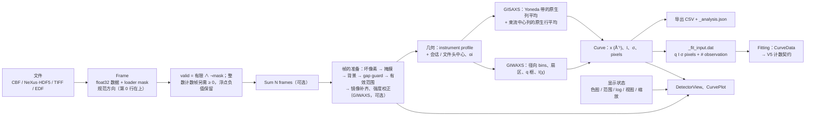

# 科学数据流契约

- **Status**: Current
- **Scope**: 探测器帧从读取、有效像素、校正、几何到曲线，再到 Fitting 的数据所有权与谱系；
  显示状态与科学数据的边界
- **Related code**: `src/gimap/shared/detector_io/`（NeXus / HDF5：`nexus_layout.py`、`nexus_modules.py`、`nexus_datasets.py`、
  `nexus_reading.py`、`nexus_metadata.py`、`nexus_files.py`）、`src/gimap/shared/signed_cut.py`、`src/gimap/shared/geometry/`、
  `src/gimap/features/analyze/domain/`（`validity.py`、`bad_pixels.py`、`preprocess.py`、`corrections.py`、`intensity.py`、
  `binning.py`、`gisaxs.py`、`giwaxs.py`、`symmetry.py`）、`src/gimap/features/analyze/application/frame_preprocessing.py`、
  `use_cases.py`、`export_record.py`、
  `src/gimap/features/analyze/infrastructure/adapters/csv_export.py`、
  `src/gimap/features/fitting/infrastructure/adapters/local_files.py`、
  `src/gimap/features/fitting/presentation/bindings/workflow_v5_binding.py`、
  `src/gimap/features/prediction/infrastructure/adapters/module_preprocessing.py`
- **Related tests**: `tests/test_analyze_domain.py`、`tests/test_analyze_frames_and_center.py`、
  `tests/test_analyze_fit_input_contract.py`、`tests/test_analyze_workspace.py`、
  `tests/test_stable_metadata_ui.py`、`tests/test_prediction_adapters.py`、`tests/test_bad_pixels.py`、
  `tests/test_intensity_corrections.py`、`tests/test_curve_quality.py`
- **Last verified**: 2026-11-01（帧的准备、曲线的 σ 两节对照 `frame_preprocessing.py`、`binning.py`、`export_record.py`）；
  读取、帧、导出与交接、两半各节 2026-10-14；其余沿用 2026-09-28
- **科学说明**：公式、阈值、误差模型和它们的假设写在 [Physics and Methods Reference](../Physics_Manual.md)
  （中文 [`Physics_Manual_zh.md`](../Physics_Manual_zh.md)）第 4–6 章；本文只写数据的所有权、顺序、谱系、模块边界与测试门禁。
  方法、公式、默认值或阈值改了，两份参考和本文在同一次改动里一起改。

## 目的

用户在 Analyze 中看到的曲线，必须就是导出、送到 Fitting、以及 in-situ 序列实际使用的观测。
任何下游流程不得因为方便而重新读取原始数组、另做一套掩码或插值。显示选项（色图、强度范围、
log、q map / detector 视图、缩放）只决定怎么画，不改变任何科学数值。

## 帧与有效像素

- `shared/detector_io` 返回规范方向的帧：像素 `(行 i, 列 j)` 覆盖 `[j, j+1] × [i, i+1]`，第 0 行在
  顶部（与 `DetectorGeometry` 一致，见 [`geometry.md`](geometry.md)）。读取器不做 Flip UD 或 threshold 这类改写数据的
  预处理；改写数值的只有下一节的可选步骤（背景、GIWAXS 的镜像补齐与强度校正），原始帧另存。
- NeXus / HDF5（后缀 `.nxs .nx .nx5 .h5 .hdf5 .hdf`）：`inspect_nexus` / `cached_layout` 先按内容判断源的组成
  （`NexusLayout.kind`：`single_frame`、`stack`、`module_set`、`chunked_master`、`no_image`），文件名只作提议；
  模块组要求数据集路径、模块尺寸相同且模块位置（`translation/distance`）两两不同。每一帧都读，帧号超出抛
  `IndexError`（不夹到最后一帧）；模块帧数不同取共同的帧数，缺模块、缺数据文件、还在写都以 `warnings` 说出，
  `complete` 为 False。打开只经 `open_nexus`（`locking=False`，再试 SWMR，否则 `BeingWritten`；长时间不变的
  “正在写” 文件为 `LeftUnfinished`）；`hdf5plugin` 注册 bitshuffle / LZ4。
- 方向（`NexusLayout.orientation`）：Lambda 服务器的文件（模块组；或探测器组有 `translation/distance`、`layout`
  形如 `<n>X<m>`、名称含 lambda）做 P03 变换——按平移拼接、整体转置、上下翻转（模块的存储方向需要时先转置）；其余
  NeXus / HDF5 按存储原样。实际步骤写进 `metadata["transformations"]`（`[]` = 原样），并在 Data 步骤显示。
  GIMaP 自己的 HDF5 帧导出因此原样读回。
- 读取器的掩膜：探测器组的 `pixel_mask`（拒绝位 0x15F）、非有限值、拼接画布上没有模块的地方，以及无符号整数数据中
  该类型的最大值（无数据，计数在 `metadata["sentinel_pixels"]`）；这些像素在 `data` 中为 NaN，其余为存储值
  （`metadata["stored_dtype"]`）。`saturation_value` 不在这里用（Analyze 的有效强度范围负责）。
- 头文件值按 `units` 属性换算（`nexus_metadata.py`：能量 eV / keV / J，波长 Å / nm / m，长度 mm / cm / m，时间 s / ms），
  没有 `units` 时沿用按大小的旧规则，未知单位不取（`None`）；每帧一个值的数据集按帧取。
- `valid_pixels(data, mask)`：有限且不在 loader mask 中的像素才是观测；整数计数帧的负值（Pilatus / Eiger 的缝隙与
  坏点）无效，浮点帧（扣暗场、减背景）的负值是数据（`negatives_valid=True`）。NeXus loader 把拒绝的像素变成 NaN，
  两者在这里统一。正常零计数保留。
- `sum_frames`：Sum N frames 逐像素相加，像素只有在所有帧中都有效才有效（不用部分帧外推）。
- 写出帧（Format Converter、Batch Export ▸ Converted frames）：`shared/detector_io/output_values.output_frame` 按存储类型
  写（读取器给的是 32 位浮点数），使写出的文件读回时无数据的像素、其余数值和类型都与源相同：缝隙码原样保留，读取器已剔除的
  像素写 −1（无符号帧必要时改用有符号类型；HDF5 里写该类型最大值），浮点帧写 NaN；HDF5 另写 NeXus `pixel_mask`（第 0 位）。
  判断无数据用与 `valid_pixels` 相同的规则（`invalid_pixels`）；每帧元数据的 `pixel_values` 写明做法。

## 帧的准备（顺序固定，`application/frame_preprocessing.py`）

每一步的公式与假设见 Physics Manual §4.4–4.9 与第 5 章。顺序：

1. 探测器自己的无效像素（读取器掩膜、缝隙码；`valid_pixels`）。
2. 帧中找到的坏像素（`domain/bad_pixels.py`：孤立的热像素、死像素（只在计数帧上判断）、缺陷行 / 列上零散的亮像素；
   Mask 步骤或设置 `analyze.bad_pixels` 可关）。
3. 画的掩膜与掩膜文件（`domain/preprocess.rasterize`、`_file_mask`）。
4. 背景：`frame − scale × background`，两帧都有效的像素才有效；背景帧按文件版本缓存一次。
5. gap guard：`guard_invalid(valid, N)` 把**此时所有**无效像素周围 N px（方形邻域）也视为无效——读取器掩膜与缝隙码、
   坏像素、画的与文件掩膜、背景帧中无效的像素；帧边界不算无效，之后的有效范围也不算。窗口里默认 3 px（记在
   `analyze.gap_guard_px`），`Corrections` 和不含该键的设置文件默认 0；0 关闭，最多 20。
6. 有效原始强度范围 Min / Max（饱和、热像素）。
7. 镜像补齐（GIWAXS 且有几何时，默认关）：`domain/preprocess.mirror_fill` 按束流中心列在同一行补无效像素，
   补了哪些记在 `filled_pixels`。
8. 强度校正（GIWAXS 且几何已知时，默认关）：立体角、偏振、薄膜吸收，`I / factor`（`domain/intensity.py`，
   `_correct_intensity`）；计数帧另记每像素的 `1 / factor`（`intensity_scale`），σ 由它传递（见“曲线”）。

第 1–3 步是帧的有效性，第 4–7 步只在至少一步打开时运行（`Corrections.is_identity`），第 8 步在几何已知后、
分析里运行（不属于 `is_identity`）。准备总是从原始帧重新计算，不在上一版结果上累加；改变设置不重新读取文件。
原始 `raw_data / raw_valid` 与准备后的 `data / valid` 分开保存在 `FrameAnalysis` 中。

## 几何与 q

几何只来自 instrument profile（标定或手动输入），会话中心、文件头中心（设置中打开时）与 αi 只替换
各自的字段。q 由 `shared/geometry` 的精确掠入射公式给出，单位 Å⁻¹；Analyze 不使用任何历史近似。
GISAXS / GIWAXS 由最大散射角自动判断（≤ 20° 为 GISAXS），也可强制。
Refine x by Symmetry 只在当前水平带内求左右对称轴并改会话中心 x，不改数据。

## 曲线

- GISAXS 水平切线：Yoneda 带（自动定位或用户拖动的行区间）中**每个探测器列**一个点——该列有效
  像素的平均强度、σ（计数帧为 Poisson `√max(Σ, 1) / n`，其他帧见下面的三种模型）、有效像素数 `n`、有效像素的平均 qy。
  不插值、不重采样，缝隙保持为缝隙。竖直切线同理（每行一个点）。
- GIWAXS：径向 bins、扇区、q 框和 I(χ) 为 bin 平均（`pixels` 为 bin 内有效像素数）。自动 bins 不比
  像素的 q 步长细；沿 q 的曲线把像素太少（< max(8, 中位数 10 %)）的相邻 bin 合并（像素加权的 x 与均值，
  不跨越 > 2.5 个 bin 的空隙）；I(χ) 不合并。
- σ 的三种模型（公式见 Physics Manual §6.4、§5.5；是不是计数只在 `frame_preprocessing.photon_counts` 里决定）：
  - 计数帧（存储类型不是浮点、未减背景、没有镜像补齐）：Poisson，GISAXS 的原生行 / 列和 GIWAXS 的固定边界 bin
    （`BinnedMean`）都是 `√max(Σ, 1) / n`：全为 0 的行或 bin 的 σ 为 1/n，不为 0（加权拟合不能用 σ = 0）。
  - 浮点（扣暗场）帧、减背景后、GIWAXS 镜像补齐后（补齐的像素重复另一侧的光子）：bin 内像素离散度的标准误差
    `s / √n`（`binning.scatter_sigma`；单像素 bin 取其余 bin 的中位方差）。
  - 计数帧开了 GIWAXS 强度校正：Poisson 按校正传递，每像素方差 `I′ / factor`（`I′ = I / factor`），
    `σ = √max(Σ(I′ / factor), f̄²) / n`，f̄ 为 bin 内 1 / factor 的平均（一个计数在平均因子下的方差；
    `BinnedMean.add` 的 `scale`）。

  合并 bin 的 σ 为 `√(Σ nᵢ² σᵢ²) / Σ nᵢ`，对计数帧等于 `√Σ / n`。`# observation:` 的 `counting_model_valid` 只在第一种
  且没有强度校正时为 true（`export_record.fit_input_observation`）：浮点帧、减背景、镜像补齐、GIWAXS 强度校正都使它为 false。
  选哪种看存储类型而不是单位：以浮点存的原始计数得到离散度 σ，以整数存的处理后数据得到 Poisson σ。
- 每条曲线的 `x` 带符号（qy < 0 在直射束左侧）；“送哪一半”只是 Fitting 的显示与选择，不改文件。

## 导出与交接

- `gimap_analysis/<stem>_{horizontal,vertical,…}.csv`：`#` 注释头 + 列 `x, I, sigma, pixels`；
  `<stem>_analysis.json` 记录文件、帧、相加帧、instrument profile、中心来源、校正、切割与提示。
- `<stem>_fit_input.dat`：Fitting 的输入，首行 `# GIMaP Analyze fit input (q in 1/A)`，
  `# observation:` JSON（`source`：GISAXS 为 `native_detector_columns`，其余为 `radial_bins`；
  `file_format`、`gap_guard_px`、`summed_frames`、`intensity_unit = counts_per_pixel`、
  `threshold_enabled`、`counting_model_valid`；选了拟合用的两半时 `halves` = `mean` / `positive` / `negative`；多帧源的
  `frame_index`、`frame_count`），四列 `q I sigma pixels`。文件里始终是两半、带符号的 qy（Å⁻¹）。先写成
  `.<名称>.part` 再改名。
- 每个曲线文件的 `#` 头写出帧：`# frame: 4 of 12 (index 3)`（从 1 数，括号里是文件名用的 0 基下标）、相加的帧
  `# sum of K frames: …`、多文件组成的源 `# files: …`；`# source:` 是原路径，不改写。文件名里的 `_frameNNNN` 从 0 数，
  模块组用去掉 `_mNN` 的扫描名（`export_record.frame_stem`）；`_analysis.json` 的 `source_layout` 记下组成、数据集与方向变换，
  `source_files` 列出每个文件。
- 文本导出（`csv_export.py`）：UTF-8，无 BOM；程序自己的符号写成 ASCII（`Å⁻¹`→`1/A`、`°`→`deg`、`χ`→`chi`、`2θ`→`2theta`、
  `αi`→`alpha_i`、`σ`→`sigma`、`±`→`+/-`、`²`→`^2` 等，`_SPELLINGS`），名称和路径照原样；空格分隔（`.dat`）的单元格里
  空白字符改成 `_`，空值与 NaN 写 `nan`。JSON 记录照原样保留名称。
- Fitting 读取为 `CurveData(q, intensity, error, pixels, observation)`；行被丢弃导致像素数不再对齐时
  丢弃 `pixels`，而不是错位使用。
- V5：`native_detector_columns` 且带 pixels 的曲线恢复原 CBF 路径的计数契约
  （`source = native_cbf_columns`、`valid_pixel_counts`、`gap_margin_px`、`stack_count =
  summed_frames`），σ 为 `√(σ² + (rel·|I|)² + abs²)` 的 working tolerance。输入选择
  （正 / 负 / 两侧、fitting range、排除点）对 q 与 pixel counts 用同一个掩码；折叠视图中 fitting
  range 以 |q| 选择两侧。计数契约不满足时学习分支按记录的原因回退，不静默更换输入。
- Batch Export 的表格 `<名称>_<曲线>_frames.csv`（`batch_tables.common_x`）：各帧点相同时并排（exact）；只差舍入或
  缺几列时每个点放在自己 x 的行上，不插值（matched，空 = 该帧这里没有点）；网格真不同时线性插值到第一个有点的帧的网格
  （按其步长补过它自己的缺口、延伸到其他帧的范围），不跨超过 1.5 个步长的缺口、不外推，没有任何帧有值的行不写
  （interpolated）。表头第三行说是哪一种；首行 x 标签与每帧的文件与帧号；数值 8 位有效数字。σ 与像素数只在逐帧文件中。
  `<名称>_batch.json`（`gimap_analyze_batch_2`）记录选项、帧列表与帧号、写出的每个文件、序列的切线和每帧的切线、
  失败的帧与原因、来源、之前导出的处理，以及第一帧的完整元数据。
- 一条切线用于整个序列（`frames_model.series_cut`，默认）：切线自动时，热图、Batch Export、Send Series 和监视导出的
  每帧都用屏幕上那一帧的切线（GISAXS 水平带的行与竖直切线的列，GIWAXS 的 I(χ) 环窗口）；关掉后每帧重新找。
  自动分析为一帧设的 Sum N 不进入序列处理。
- Series 热图只为显示把各行取到等距网格（`series_map.display_grid`，不连过缺口）；它的表格和导出用测到的 x 和值，
  每个表的旁边写 JSON 记录（`series_record`）。
- Batch Export 的文件按种类放入子文件夹（`curves/`、`fit_input/`、`maps/`、`images/`、`frames/`、`fits/`），表格与拟合表在顶层，
  并写 `README.txt`。文本格式 csv / txt / dat 只改变分隔符（逗号 / 制表符 / 空格；空格分隔时表头空格改为 `_`、空格改写
  `nan`），数值不变。`frames/` 中的探测器数据为读取原样（模块拼接、帧求和、缝隙码保留），不经掩膜与校正。
- 批量拟合（`application/batch_fit.py`）：GIWAXS 峰为区域 χ 范围内、区域 q 窗口两侧各扩一个宽度的 I(q)（探测器 q 步长，
  σ 按帧类型为泊松或像素离散度），`fit_peak` 加权最小二乘（高斯、洛伦兹的 η 固定为 0 / 1）；GISAXS 模型为带符号的
  `fit_input_curve` 连同所选的两半（`BatchChoices.fit_halves`）交给注入的快速物理拟合（`create_quick_fit(halves=…)`）。
  起始值（上一帧 / 第一帧 / 每帧重新）只影响初值，不改变数据；失败帧不作为下一帧起点。
- 设置文件 `gimap-analyze-settings` 只保存处理参数（不含数据）；仪器配置随文件保存几何，保证换电脑后 q 相同。
- in-situ 序列只处理这些曲线文件；Recipe 捕获 Fitting 的模型与输入选择，不含任何探测器预处理。

## 带符号切线的两半（`shared/signed_cut.py`）

- 两个概念：**显示**（Cuts 步骤、设置）为 `both_abs` / `mean` / `positive` / `negative`；**拟合**只有 `mean` / `positive` /
  `negative`（`FIT_HALVES`，`fit_halves()` 把 `both`、`both_abs` 和未知值映射为默认值）。两半永远不一起拟合，只有 Fitting
  Single analysis 的 Refine 与 Search 可以拟合 “Both halves on |q|”。
- 平均（`mean_of_halves`）只在另一半两侧 `HOLE_STEPS`（2.5）个步长内都有测量点，或在同一 |q| 有点时才求平均；其余处用
  这一半原样，不插值。说明（note）写出平均到哪里、之后哪一半单独到哪里；有缺口时写出平均了几个点、几个点只来自一半。
- 选了某一半而它没有点时抛 `MissingHalf`，消息恰为 “No points on the q > 0 half” / “No points on the q < 0 half”，
  从不换成另一半（序列、快速拟合、Batch Export 为严格模式；Single analysis 不严格，记录的 `points.halves_used`
  写出实际用的一半）。快速物理拟合（`create_quick_fit`：Find the particle shape、Batch Export、自动分析）对多于
  `MAX_FIT_POINTS`（1000）个点的曲线先合并相邻点，所以任意长的切线都能拟合；每个解附带 `prepared`（说明）与
  `preparation`（两半、点数、平均与合并）。

## 显示状态

DetectorView 的色图、Auto levels、强度范围、log、Detector / q map 视图、Fit view、光标读数，以及
CurvePlot 的 log 轴与图例都属于显示状态：

- 不修改帧、有效像素或曲线；
- 不触发重新分析（拖动带、拾取中心、改校正除外——它们是科学输入，会重新分析）；
- q map 视图是同一校正后数据在规范几何下的投影，显示用下采样不得进入曲线或导出。

## 2D Prediction module preprocessing

Prediction 的 detector input 与 Analyze 是两个明确的 workflow。Prediction 加载单张 CBF 或先求和
一个 stack，然后只执行一次所选 module 的 preprocessing entry；它不复用界面显示数组，也不在
TensorFlow worker 中再次预处理。

每个 Prediction module 的 `module.yaml` 是预处理顺序和参数的唯一事实来源：

- `steps` 按声明顺序执行，重复步骤也必须重复执行并在诊断快照中区分；
- `params` 原样传给 module-owned entry，crop、resize interpolation、invalid replacement、log scaling、
  mask 和 cut 都属于模型输入契约；
- 声明的 mask 缺失、shape 不兼容、未知步骤或不支持的 interpolation 必须明确失败，禁止静默换成另一套
  算法后继续预测；
- preprocessing step preview 可以把 `-1` sentinel 隐藏为无效像素以避免颜色误导，但送入模型和 export
  的数组必须保持原数值。

`Gold on Silicon 15nm (DESY P03)` 模块与训练/验证 preprocessing 对齐：crop 后通过
`scipy.ndimage.zoom(order=0)` 缩放到 256×256，再处理 invalid，并在 normalization 前应用 detector
mask 和 column cut；随后使用排除指定 detector bands 后的正最大值执行
`log(e · intensity / max + eps)`，再应用一次相同 mask、column cut 和 bottom row cut，确保 log 产生的
无效值仍为训练约定的 `-1`。该模型会把空间特征展开到 dense layer，因此 nearest 与 bilinear 不是
可互换的显示选择，而是会改变预测结果的科学配置。

模块的联合分布 output 必须在 `module.yaml` 声明 matrix row/column 对应的物理量、单位与范围；domain
沿与该声明正交的维度计算 marginal，presentation 不得硬编码或猜测轴方向。Au SavedModel 的 matrix
row 是 `R=0.05–15 nm`，column 在训练 bundle 中是半高度 `h=0.05–15 nm`；对用户和论文图展示时转换为
完整高度 `H=2h=0.1–30 nm`，但不得 transpose 或修改模型输出概率。

没有声明的轴只是显示占位（0.05–15 nm），轴记录里为 `declared: false`；SEM 对比只接受 module 声明了
`key: r`、`unit: nm`、`min` 和 `max` 的 row 轴（`array_contracts.normalize_prediction_output`、
`presentation/bindings/sem_comparison.py`）。`module.yaml` 是程序文件，运行时只读：用户用 Import model...
选的模型文件夹记在用户偏好 `prediction.model_paths`（按 module id，没有 id 时按文件夹名），载入时优先于
`model.model_path`（`infrastructure/adapters/model_paths.py`）。

## XRR

XRR angle series 采用逐 frame 的只读 streaming：全分辨率 detector frame 只在 worker 中完成一次
ROI 提取，GUI 收到的降采样 preview 只能用于显示，不能成为 scientific input。NXS module/frame、
CBF ordering、specular geometry 和 intensity 定义见
[`xrr-series-workflow.md`](xrr-series-workflow.md)。

## 实现与 review 门禁

- Domain 拥有有效像素、校正、binning、切割与对称中心等 framework-neutral 科学函数；
- Application（`AnalyzeFrame`）是唯一把帧、校正、几何和切割串起来的地方；
- Presentation 只收集选项、保存 UI state、请求分析并渲染结果；
- 新增科学选项时同时记录到 `_analysis.json` / `# observation:`，并增加谱系与下游一致性测试。

最低测试要求：

1. 有效像素、gap guard、帧相加与背景的规则（含边界与 0 / 最大值）；
2. 原生列平均的 I、σ、pixels 与逐像素手算一致，缝隙不插值；
3. `_fit_input.dat` 往返：Fitting 读回的 q、I、σ、pixels 与 observation 与 Analyze 一致；
4. V5 选择对 q 与 pixel counts 使用同一掩码（含折叠视图的 |q| 范围）；
5. 显示选项不改变分析结果。
